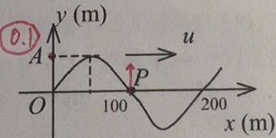

# 《大学物理》第10章 机械波（习题作业参考答案）

原件经识别和整理；“参考解答”是我们补的。

## 机械波

### 简谐波

$$
\omega = 6\pi = \frac{2\pi}{T}
$$

知识点：[平面简谐波的波函数 y=Acos(ω(t±x/u)+φ)](../../../topics/大学物理/平面简谐波方程.md)

### 选择 1

机械波的表达式为 $y = 0.03\cos 6\pi (t + 0.01x)$（SI），则

- A. 其振幅为 3 m
- B. 其周期为 $\frac{1}{3}$ s
- C. 其波速为 10 m/s
- D. 波沿 x 轴正向传播

答案：B。

知识点：[平面简谐波的波函数 y=Acos(ω(t±x/u)+φ)](../../../topics/大学物理/平面简谐波方程.md)、[机械波的形成、横波与纵波](../../../topics/大学物理/机械波的产生与传播.md)

### 选择 2

在简谐波传播过程中，沿传播方向相距为 $\frac{1}{2}\lambda$（$\lambda$ 为波长）的两点的振动速度必定

- A. 大小相同，而方向相反
- B. 大小和方向均相同
- C. 大小不同，方向相同
- D. 大小不同，而方向相反

答案：A。

知识点：[平面简谐波的波函数 y=Acos(ω(t±x/u)+φ)](../../../topics/大学物理/平面简谐波方程.md)

### 选择 3

一平面余弦波在 $t=0$ 时刻的波形曲线如图所示，则 O 点的振动初相 $\phi$ 为

- A. $0$
- B. $\frac{1}{2}\pi$
- C. $\pi$
- D. $\frac{3}{2}\pi$（或 $-\frac{1}{2}\pi$）

答案：D。

$$
E_P = \frac{1}{2}kx^2 = \frac{1}{2}m\omega^2 A^2
$$

知识点：[简谐振动的运动学方程（振幅、角频率、相位）](../../../topics/大学物理/简谐振动运动学.md)、[平面简谐波的波函数 y=Acos(ω(t±x/u)+φ)](../../../topics/大学物理/平面简谐波方程.md)、[用旋转矢量法确定初相与运动状态](../../../topics/大学物理/旋转矢量法.md)

### 选择 4

一平面简谐波在弹性媒质中传播，在某一瞬时媒质中某质元正处于平衡位置，此时其能量

- A. 动能为零，势能最大
- B. 动能为零，势能为零
- C. 动能最大，势能最大
- D. 动能最大，势能为零

答案：C。

知识点：[简谐振动的动能、势能与总机械能](../../../topics/大学物理/简谐振动的能量.md)、[波动过程中的能量传播与能流密度](../../../topics/大学物理/波的能量.md)

### 选择 5

图示一简谐波在 $t=0$ 时刻的波形图，波速 $u=200$ m/s，则 P 处质点的振动速度表达式为

- A. $v = -0.2\pi \cos(2\pi t - \pi)$
- B. $v = -0.2\pi\cos(\pi t - \pi)$
- C. $v = 0.2\pi\cos(2\pi t - \pi/2)$
- D. $v = 0.2\pi\cos(\pi t - 3\pi/2)$

答案：A。

知识点：[平面简谐波的波函数 y=Acos(ω(t±x/u)+φ)](../../../topics/大学物理/平面简谐波方程.md)、[简谐振动的运动学方程（振幅、角频率、相位）](../../../topics/大学物理/简谐振动运动学.md)

### 选择 6

如图所示，两相干波源 $S_1$ 和 $S_2$ 相距 $\lambda/4$（$\lambda$ 为波长），$S_1$ 的位相比 $S_2$ 的位相超前 $0.5\pi$，在 $S_1$、$S_2$ 的连线上，$S_1$ 外侧各点（例如 P 点）两波引起的两谐振动的位相差是

- A. $0$
- B. $\pi$
- C. $\frac{1}{2}\pi$
- D. $\frac{3}{2}\pi$

答案：B。

$$
\Delta\phi = \phi_{S_1P} - \phi_{S_2P} = \left[\phi_1 - \frac{2\pi}{\lambda}r_1\right] - \left[\phi_2 - \frac{2\pi}{\lambda}r_2\right] = (\phi_1 - \phi_2) - \frac{2\pi}{\lambda}(r_1 - r_2)
$$

知识点：[波的叠加原理与干涉条件](../../../topics/大学物理/波的干涉.md)、[平面简谐波的波函数 y=Acos(ω(t±x/u)+φ)](../../../topics/大学物理/平面简谐波方程.md)

### 填空 7

一声波在空气中的波长是 0.25 m，传播速度是 340 m/s，当它进入另一介质时，波长变成了 0.37 m，它在该介质中传播速度为 ______。

答案：503.2 m/s。

$$
T = \frac{0.25}{340} = \frac{0.37}{u}
$$

知识点：[机械波的形成、横波与纵波](../../../topics/大学物理/机械波的产生与传播.md)、[平面简谐波的波函数 y=Acos(ω(t±x/u)+φ)](../../../topics/大学物理/平面简谐波方程.md)

### 简答 8

已知一行波在 $t$ 时刻的波形如图所示。试分别在图上注明所示的 a、b、c、d 四点此时的运动速度的方向（设为横波）。

知识点：[机械波的形成、横波与纵波](../../../topics/大学物理/机械波的产生与传播.md)

### 填空 9

已知波源的振动周期为 $4.00 \times 10^{-2}$ s，波的传播速度为 300 m/s，波沿 x 轴正方向传播，则位于 $x_1 = 10.0$ m 和 $x_2 = 16.0$ m 的两质点振动相位差为 ______。

答案：

$$
\Delta\phi = \frac{2\pi}{\lambda}(x_2 - x_1) = \frac{2\pi}{12}\times 6 = \pi
$$

知识点：[机械波的形成、横波与纵波](../../../topics/大学物理/机械波的产生与传播.md)、[平面简谐波的波函数 y=Acos(ω(t±x/u)+φ)](../../../topics/大学物理/平面简谐波方程.md)

### 填空 10

两相干波源 $S_1$ 和 $S_2$ 的振动方程分别是 $y_1 = A\cos\omega t$ 和

知识点：[简谐振动的运动学方程（振幅、角频率、相位）](../../../topics/大学物理/简谐振动运动学.md)、[波的叠加原理与干涉条件](../../../topics/大学物理/波的干涉.md)、[平面简谐波的波函数 y=Acos(ω(t±x/u)+φ)](../../../topics/大学物理/平面简谐波方程.md)
