# 《大学物理》第10章 波动 10-7 平面电磁波（课件）

原件的每一页，下面附识别出的文字。

### 一 电磁波的产生与传播

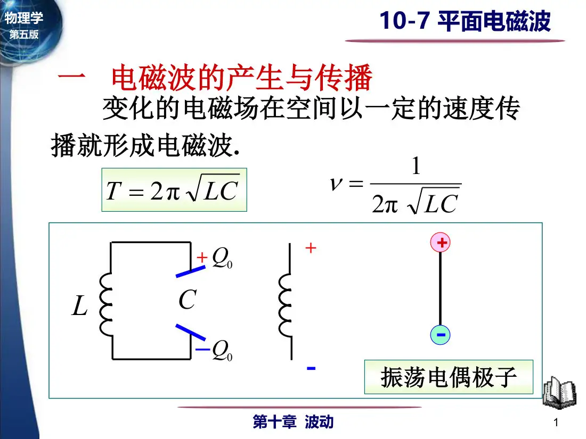

原文：

一 电磁波的产生与传播

变化的电磁场在空间以一定的速度传播就形成电磁波.

$$
T = 2 \pi \sqrt {L C}
$$

$$
\nu = \frac {1}{2 \pi \sqrt {L C}}
$$

$$
\begin{array}{c c c} \text {L} & + Q _ {0} \\ & C \\ & - Q _ {0} \end{array} \quad \begin{array}{c c c} \text {+} \\ & \text {+} \\ & - \end{array} \quad \text {振荡电偶极子}
$$

物理学
第五版

10-7 平面电磁波

第十章 波动

1

### 物理学第五版

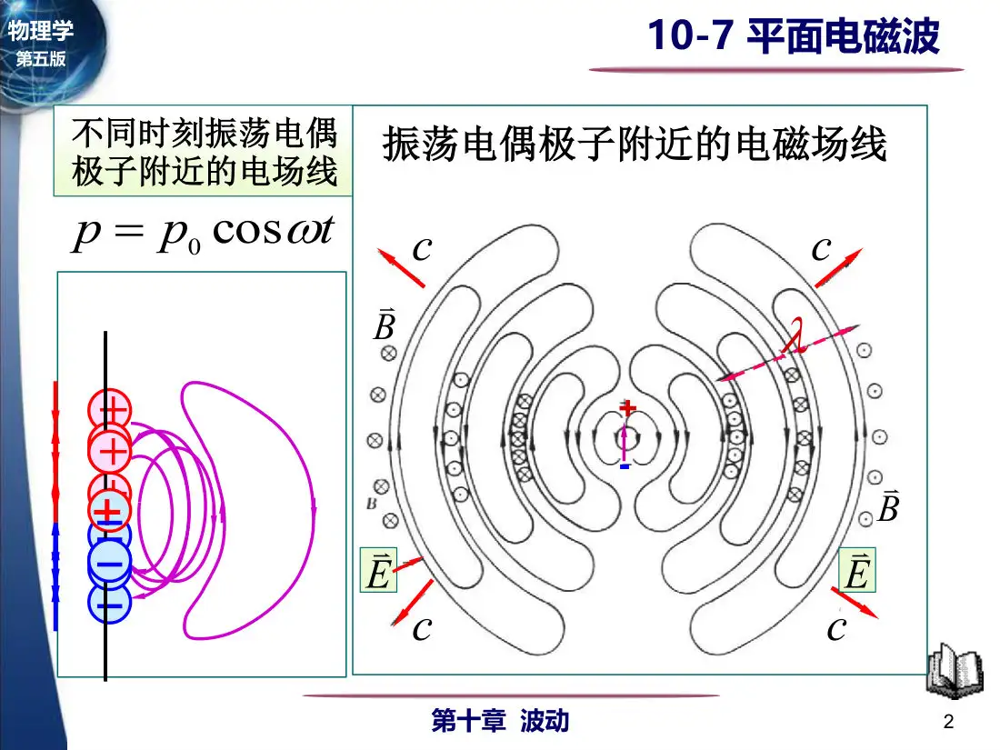

原文：

物理学第五版

10-7 平面电磁波

<table><tr><td>不同时刻振荡电偶极子附近的电场线</td><td>振荡电偶极子附近的电磁场线</td></tr><tr><td> $p = p_0 \cos \omega t$ </td><td></td></tr><tr><td></td><td></td></tr></table>
第十章 波动

2

### $$

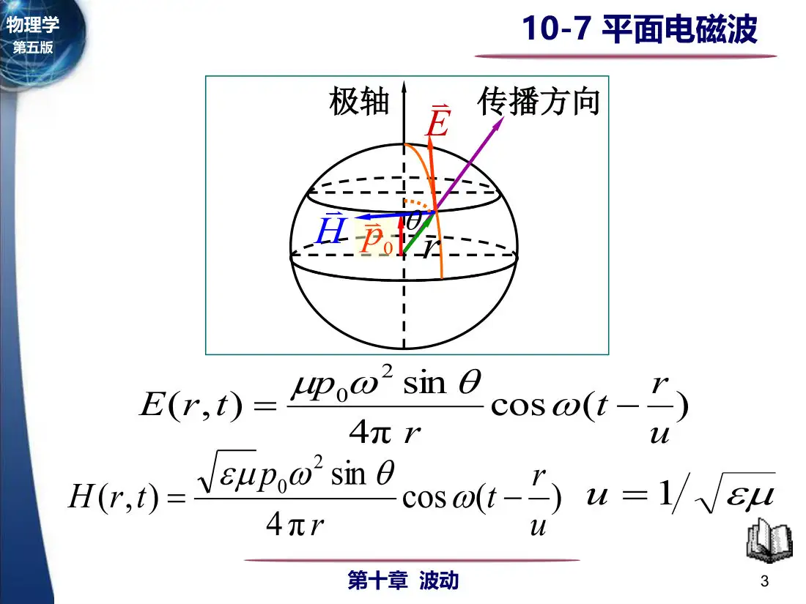

原文：

$$
E (r, t) = \frac {\mu p _ {0} \omega^ {2} \sin \theta}{4 \pi r} \cos \omega (t - \frac {r}{u})
$$

$$
H (r, t) = \frac {\sqrt {\varepsilon \mu} p _ {0} \omega^ {2} \sin \theta}{4 \pi r} \cos \omega \left(t - \frac {r}{u}\right) u = 1 / \sqrt {\varepsilon \mu}
$$

物理学第五版

10-7 平面电磁波

第十章 波动

3

### 10-7 平面电磁波

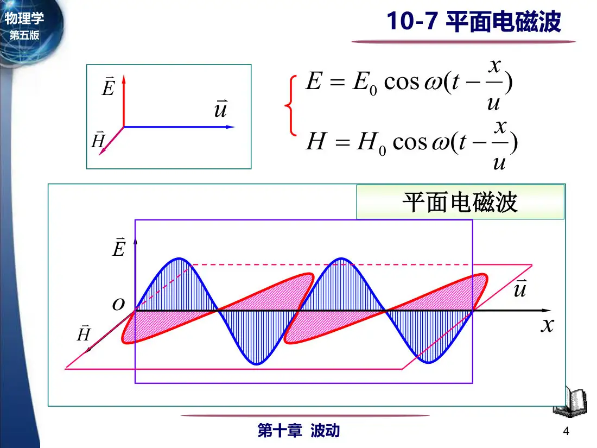

原文：

10-7 平面电磁波

$$
\left\{ \begin{array}{l} E = E _ {0} \cos \omega (t - \frac {x}{u}) \\ H = H _ {0} \cos \omega (t - \frac {x}{u}) \end{array} \right.
$$

平面电磁波

4

### 二 平面电磁波的特性

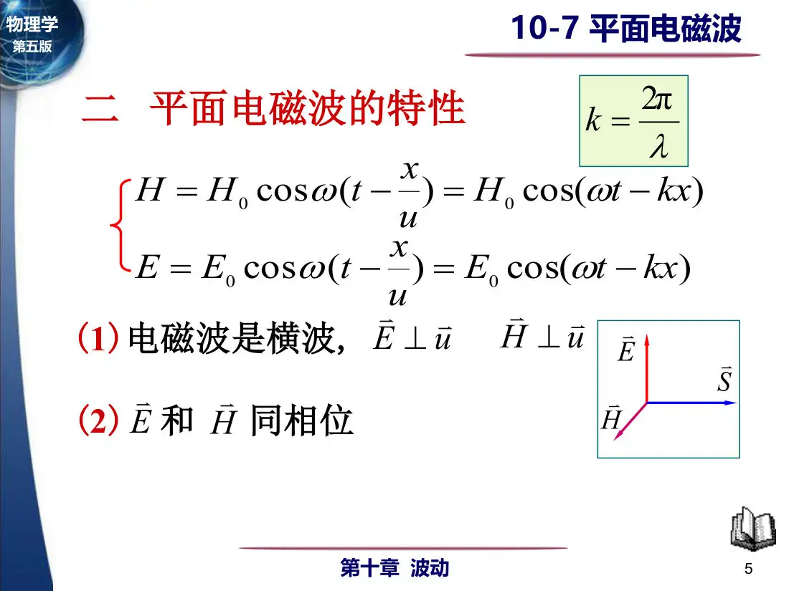

原文：

二 平面电磁波的特性

$$
k = \frac {2 \pi}{\lambda}
$$

$$
\left\{ \begin{array}{l} H = H _ {0} \cos \omega (t - \frac {x}{u}) = H _ {0} \cos (\omega t - k x) \\ E = E _ {0} \cos \omega (t - \frac {x}{u}) = E _ {0} \cos (\omega t - k x) \end{array} \right.
$$

(1) 电磁波是横波， $\vec{E} \perp \vec{u} \quad \vec{H} \perp \vec{u}$

(2) $\vec{E}$ 和 $\vec{H}$ 同相位

物理学
第五版

10-7 平面电磁波

第十章 波动

5

### (3) $\vec{E}$ 和 $\vec{H}$ 数值成比例

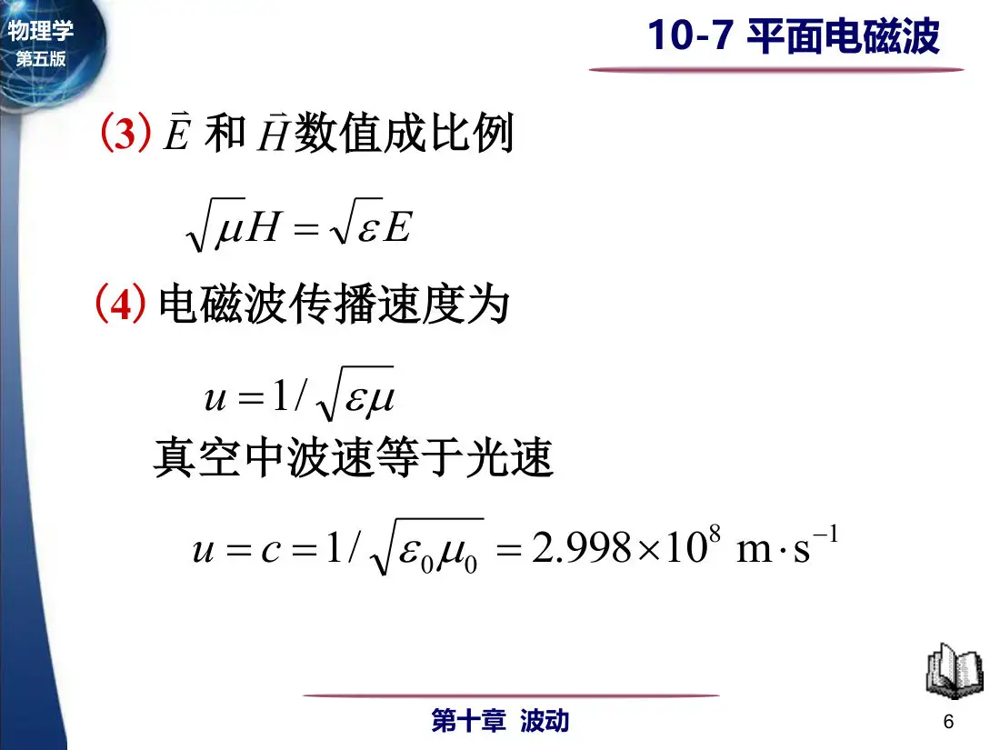

原文：

(3) $\vec{E}$ 和 $\vec{H}$ 数值成比例

$$
\sqrt {\mu} H = \sqrt {\varepsilon} E
$$

(4) 电磁波传播速度为

$u=1/\sqrt{\varepsilon\mu}$ 真空中波速等于光速

$$
u = c = 1 / \sqrt {\varepsilon_ {0} \mu_ {0}} = 2. 9 9 8 \times 1 0 ^ {8} \mathrm{m} \cdot \mathrm{s} ^ {- 1}
$$

物理学
第五版

10-7 平面电磁波

第十章 波动

6

### 三 电磁波的能量

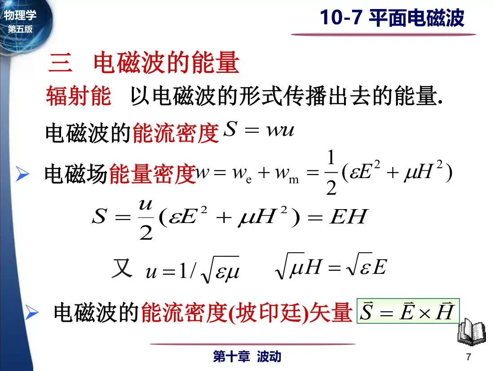

原文：

三 电磁波的能量

辐射能 以电磁波的形式传播出去的能量.

电磁波的能流密度 S = wu

电磁场能量密度 $w=w_{e}+w_{m}=\frac{1}{2}(\varepsilon E^{2}+\mu H^{2})$

$$
S = \frac {u}{2} (\varepsilon E ^ {2} + \mu H ^ {2}) = E H
$$

$$
\text {又} u = 1 / \sqrt {\varepsilon \mu} \quad \sqrt {\mu} H = \sqrt {\varepsilon} E
$$

电磁波的能流密度(坡印廷)矢量 $\vec{S} = \vec{E} \times \vec{H}$

物理学
第五版

10-7 平面电磁波

第十章 波动

7

### 物理学第五版

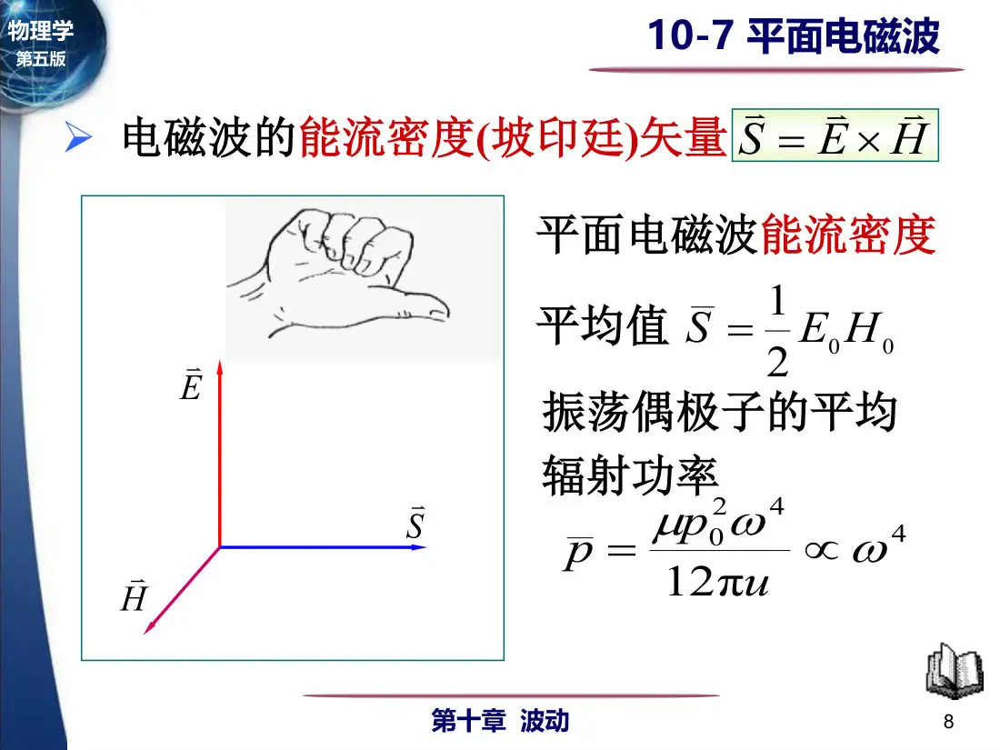

原文：

物理学第五版

电磁波的能流密度(坡印廷)矢量 $\vec{S} = \vec{E} \times \vec{H}$

平面电磁波能流密度
平均值 $\bar{S}=\frac{1}{2}E_{0}H_{0}$ 振荡偶极子的平均
辐射功率

$$
\overline {{p}} = \frac {\mu p _ {0} ^ {2} \omega^ {4}}{1 2 \pi u} \propto \omega^ {4}
$$

10-7 平面电磁波

第十章 波动

8

### 10-7 平面电磁波

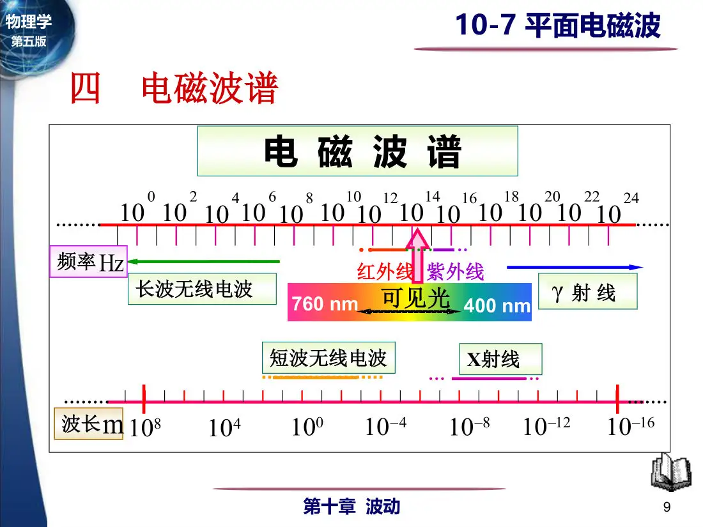

原文：

10-7 平面电磁波

四 电磁波谱

9

### 物理学

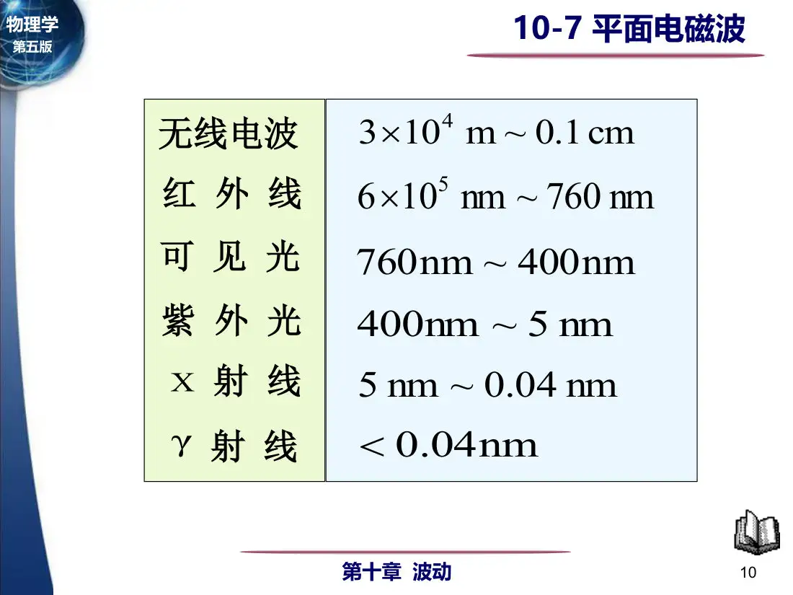

原文：

<table><tr><td>无线电波</td><td> $3 \times 10^{4}$  m ~ 0.1 cm</td></tr><tr><td>红外线</td><td> $6 \times 10^{5}$  nm ~ 760 nm</td></tr><tr><td>可见光</td><td>760nm ~ 400nm</td></tr><tr><td>紫外光</td><td>400nm ~ 5 nm</td></tr><tr><td>x射线</td><td>5 nm ~ 0.04 nm</td></tr><tr><td>γ射线</td><td>&lt; 0.04nm</td></tr></table>

物理学
第五版

10-7 平面电磁波

第十章 波动

10

### 本章目录

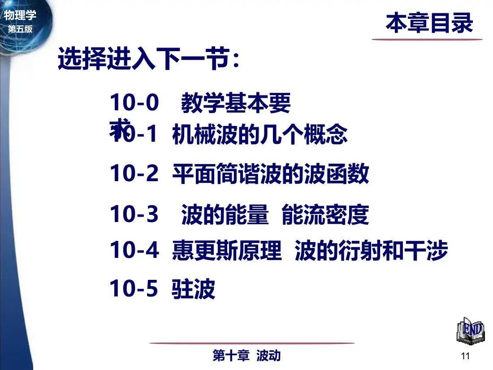

原文：

本章目录

选择进入下一节:

10-0 教学基本要
求0-1 机械波的几个概念
10-2 平面简谐波的波函数
10-3 波的能量 能流密度
10-4 惠更斯原理 波的衍射和干涉
10-5 驻波

第十章 波动

END

11
