# 《大学物理》第10章 波的传播与叠加 §10.2 平面简谐波的波函数（课件）

原件的每一页，下面附识别出的文字。

### § 10.2 平面简谐波的波函数

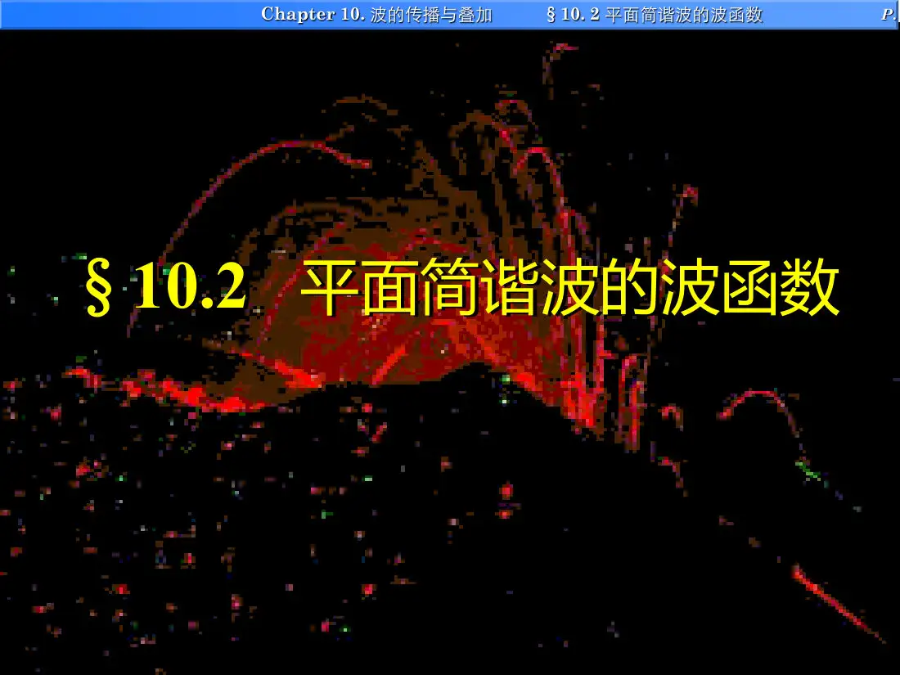

原文：

§ 10.2 平面简谐波的波函数

Chapter 10. 波的传播与叠加 § 10.2 平面简谐波的波函数

P.

### 一、波函数

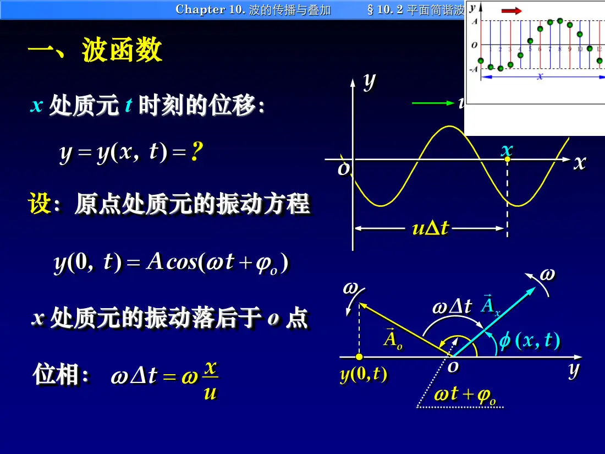

原文：

一、波函数

x 处质元 t 时刻的位移:

$y=y(x,t)=?$

设：原点处质元的振动方程

$$
y (0, t) = A \cos (\omega t + \varphi_ {o})
$$

x 处质元的振动落后于 o 点

位相： $\omega\Delta t=\omega\frac{x}{u}$

Chapter 10. 波的传播与叠加

### $$

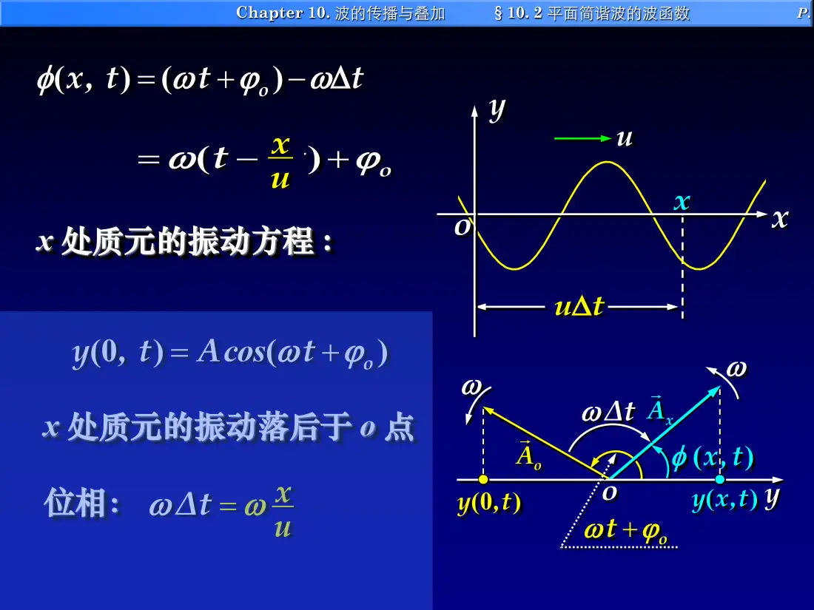

原文：

$$
\begin{array}{r l} \phi (x, t) & = (\omega t + \varphi_ {o}) - \omega \Delta t \\ & = \omega (t - \frac {x}{u}) + \varphi_ {o} \end{array}
$$

x 处质元的振动方程：

$$
y (0, t) = A \cos (\omega t + \varphi_ {o})
$$

x 处质元的振动落后于 o 点

位相: $\omega \Delta t = \omega \frac{x}{u}$

Chapter 10. 波的传播与叠加

§ 10.2 平面简谐波的波函数

P.

### $$

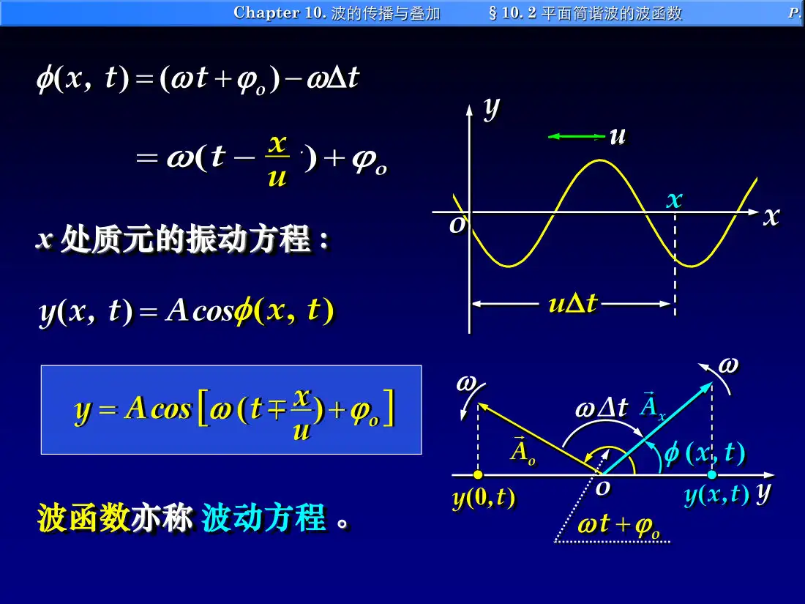

原文：

$$
\begin{array}{r l} \phi (x, t) & = (\omega t + \varphi_ {o}) - \omega \Delta t \\ & = \omega (t - \frac {x}{u}) + \varphi_ {o} \end{array}
$$

x 处质元的振动方程：

$y(x,t) = A\cos \phi (x,t)$

$$
y = A \cos \left[ \omega (t \mp \frac {x}{u}) + \varphi_ {o} \right]
$$

波函数亦称波动方程。

Chapter 10. 波的传播与叠加

§ 10.2 平面简谐波的波函数

P.

### 波动方程的几种标准形式：

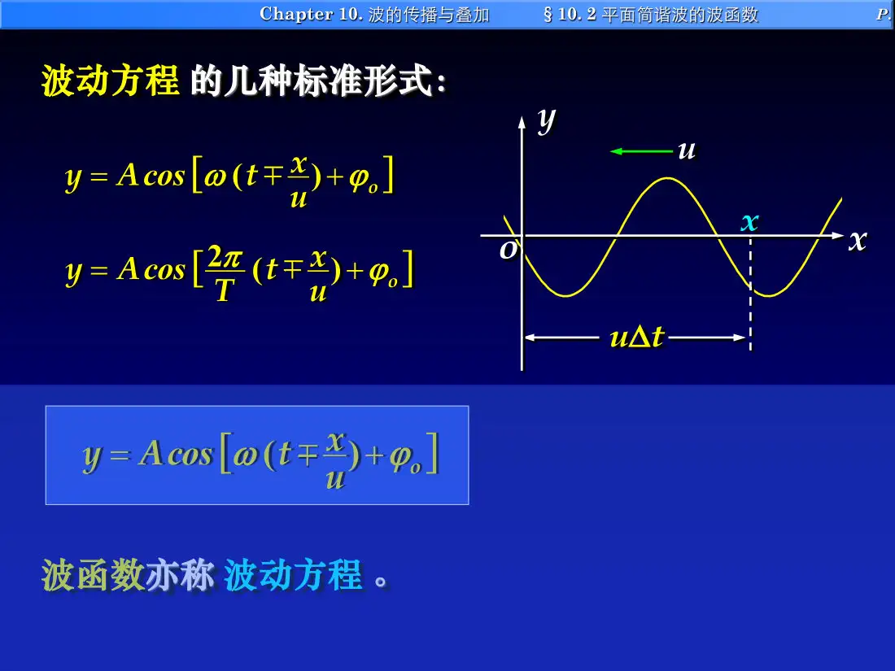

原文：

波动方程的几种标准形式：

$$
y = A \cos \left[ \omega \left(t \mp \frac {x}{u}\right) + \varphi_ {o} \right]
$$

$$
y = A \cos \left[ \frac {2 \pi}{T} (t \mp \frac {x}{u}) + \varphi_ {o} \right]
$$

$$
y = A \cos \left[ \omega (t \mp \frac {x}{u}) + \varphi_ {o} \right]
$$

波函数亦称 波动方程。

Chapter 10. 波的传播与叠加

§ 10.2 平面简谐波的波函数

P.

### 波动方程的几种标准形式:

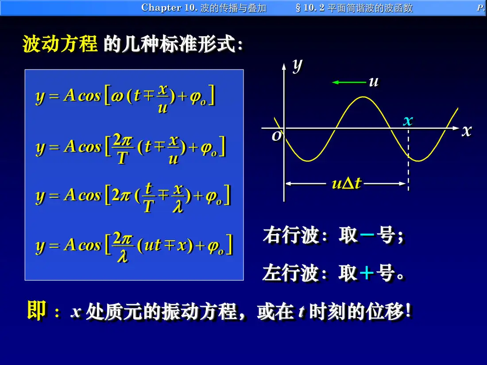

原文：

波动方程的几种标准形式:

$$
y = A \cos \left[ \omega \left(t \mp \frac {x}{u}\right) + \varphi_ {o} \right]
$$

$$
y = A \cos \left[ \frac {2 \pi}{T} (t \mp \frac {x}{u}) + \varphi_ {o} \right]
$$

$$
y = A \cos \left[ 2 \pi \left(\frac {t}{T} \mp \frac {x}{\lambda}\right) + \varphi_ {o} \right]
$$

$$
y = A \cos \left[ \frac {2 \pi}{\lambda} (u t \mp x) + \varphi_ {o} \right]
$$

右行波：取一号；  
左行波：取+号。

即：x 处质元的振动方程，或在 t 时刻的位移！

Chapter 10. 波的传播与叠加

§ 10.2 平面简谐波的波函数

P.

### 二、波动方程的物理含义

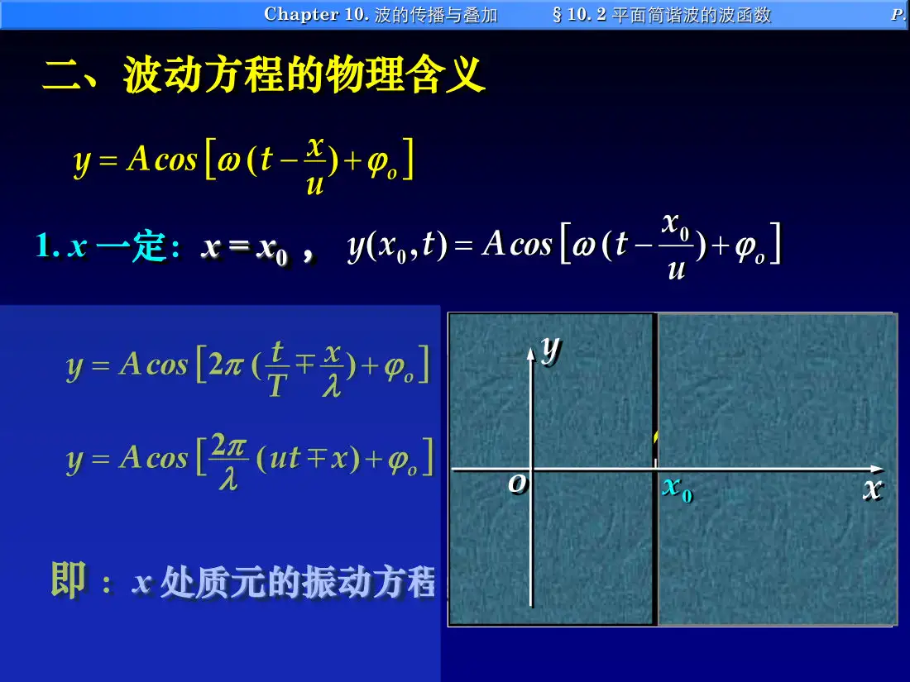

原文：

二、波动方程的物理含义

$$
y = A \cos \left[ \omega \left(t - \frac {x}{u}\right) + \varphi_ {o} \right]
$$

1. x 一定: $x = x_{0}$ , $y(x_{0}, t) = A \cos \left[ \omega \left( t - \frac{x_{0}}{u} \right) + \varphi_{o} \right]$

$$
y = A \cos \left[ 2 \pi \left(\frac {t}{T} \mp \frac {x}{\lambda}\right) + \varphi_ {o} \right]
$$

$$
y = A \cos \left[ \frac {2 \pi}{\lambda} (u t \mp x) + \varphi_ {o} \right]
$$

即：x 处质元的振动方程

Chapter 10. 波的传播与叠加

§ 10.2 平面简谐波的波函数

P.

### 二、波动方程的物理含义

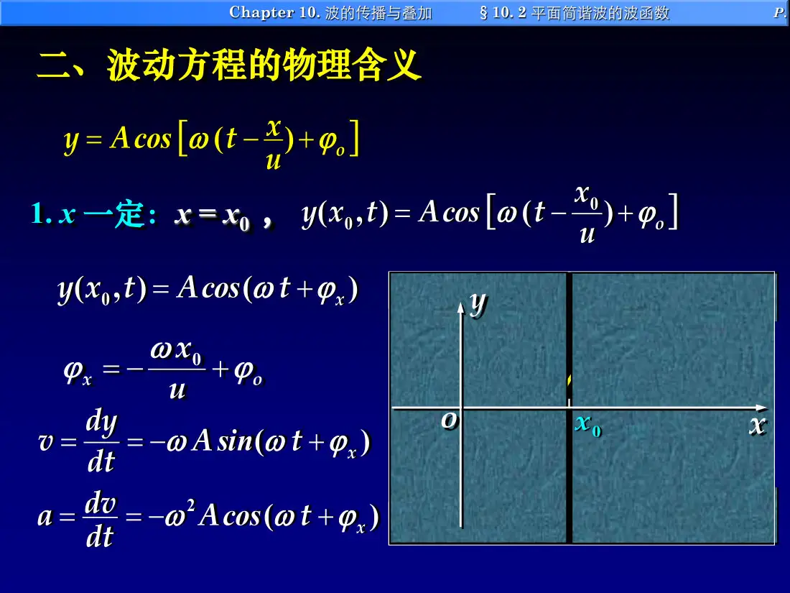

原文：

二、波动方程的物理含义

$$
y = A \cos \left[ \omega \left(t - \frac {x}{u}\right) + \varphi_ {o} \right]
$$

1. x 一定: $x = x_{0}$ , $y(x_{0}, t) = A \cos \left[ \omega \left( t - \frac{x_{0}}{u} \right) + \varphi_{o} \right]$

$$
y \left(x _ {0}, t\right) = A \cos (\omega t + \varphi_ {x})
$$

$$
\varphi_ {x} = - \frac {\omega x _ {0}}{u} + \varphi_ {o}
$$

$$
v = \frac {d y}{d t} = - \omega A \sin (\omega t + \varphi_ {x})
$$

$$
a = \frac {d v}{d t} = - \omega^ {2} A \cos (\omega t + \varphi_ {x})
$$

Chapter 10. 波的传播与叠加

§ 10.2 平面简谐波的波函数

P.

### $$

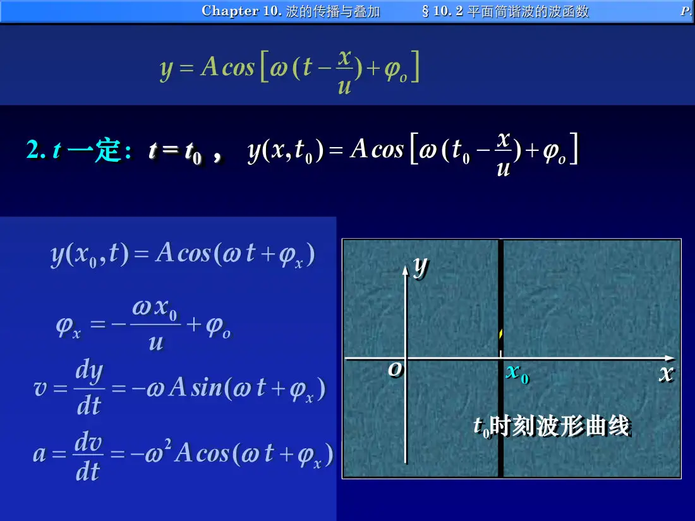

原文：

$$
y = A \cos \left[ \omega \left(t - \frac {x}{u}\right) + \varphi_ {o} \right]
$$

2. t 一定: $t = t_{0}$ , $y(x, t_{0}) = A \cos \left[ \omega \left( t_{0} - \frac{x}{u} \right) + \varphi_{o} \right]$

$$
y (x _ {0}, t) = A \cos (\omega t + \varphi_ {x})
$$

$$
\varphi_ {x} = - \frac {\omega x _ {0}}{u} + \varphi_ {o}
$$

$$
v = \frac {d y}{d t} = - \omega A \sin (\omega t + \varphi_ {x})
$$

$$
a = \frac {d v}{d t} = - \omega^ {2} A \cos (\omega t + \varphi_ {x})
$$

$t_0$ 时刻波形曲线

Chapter 10. 波的传播与叠加

§ 10.2 平面简谐波的波函数

P.

### $$

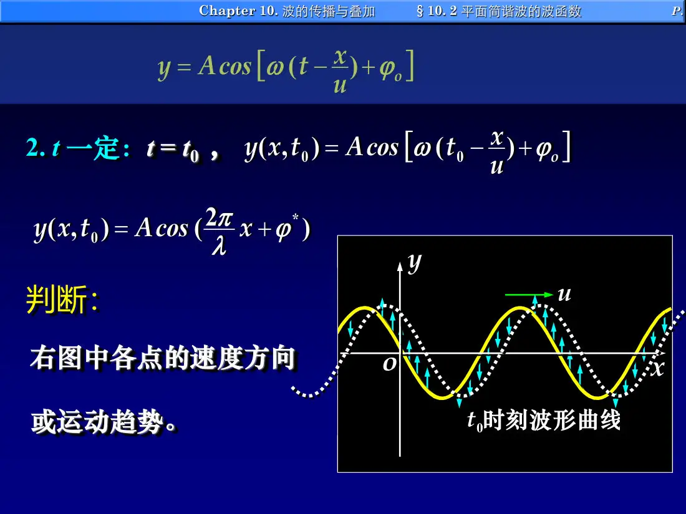

原文：

$$
y = A \cos \left[ \omega \left(t - \frac {x}{u}\right) + \varphi_ {o} \right]
$$

2. t 一定: $t = t_{0}$ , $y(x, t_{0}) = A \cos \left[ \omega \left( t_{0} - \frac{x}{u} \right) + \varphi_{o} \right]$

$$
y (x, t _ {0}) = A \cos \left(\frac {2 \pi}{\lambda} x + \varphi^ {*}\right)
$$

判断：

右图中各点的速度方向或运动趋势。

$t_{0}$ 时刻波形曲线

Chapter 10. 波的传播与叠加

§ 10.2 平面简谐波的波函数

P.

### $$

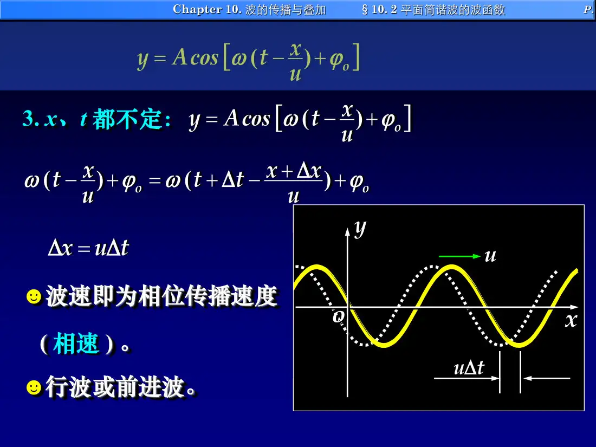

原文：

$$
y = A \cos \left[ \omega \left(t - \frac {x}{u}\right) + \varphi_ {o} \right]
$$

3. x、t 都不定： $y = A \cos \left[ \omega \left( t - \frac{x}{u} \right) + \varphi_{o} \right]$

$$
\omega \left(t - \frac {x}{u}\right) + \varphi_ {o} = \omega \left(t + \Delta t - \frac {x + \Delta x}{u}\right) + \varphi_ {o}
$$

$$
\Delta x = u \Delta t
$$

波速即为相位传播速度（相速）。

😊行波或前进波。

Chapter 10. 波的传播与叠加

§ 10.2 平面简谐波的波函数

P.

### 三、微分形式的平面波波动方程

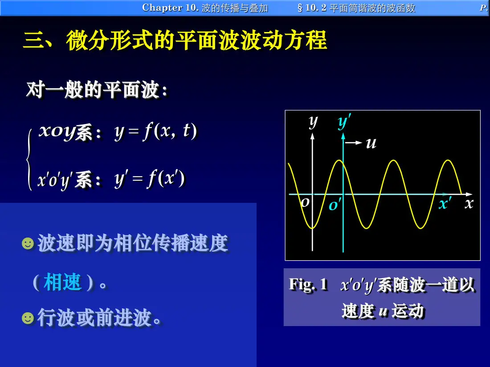

原文：

三、微分形式的平面波波动方程

对一般的平面波：

xoy系： $y = f(x, t)$

$x'o'y'$ 系： $y'=f(x')$

波速即为相位传播速度（相速）。

行波或前进波。

Fig. 1 $x^{\prime}o^{\prime}y^{\prime}$ 系随波一道以速度 $u$ 运动

Chapter 10. 波的传播与叠加

§ 10.2 平面简谐波的波函数

P.

### 三、微分形式的平面波波动方程

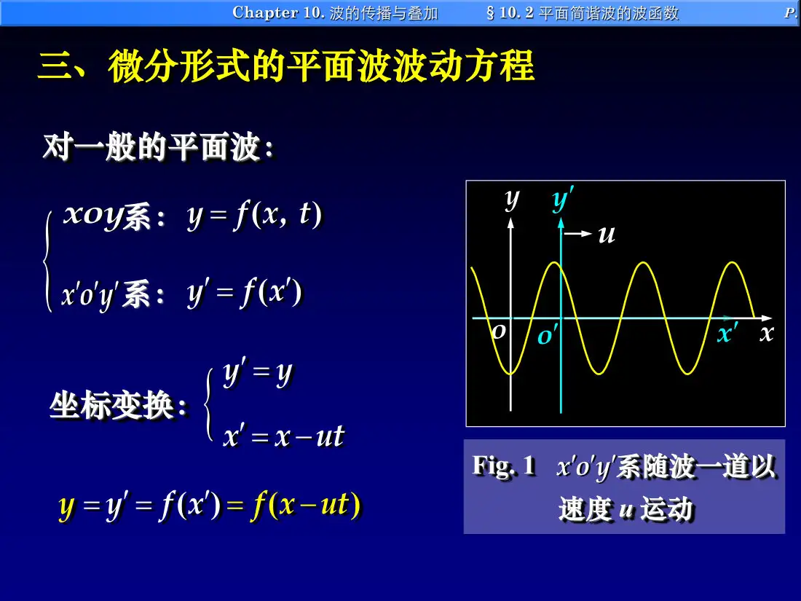

原文：

三、微分形式的平面波波动方程

对一般的平面波：

xoy系： $y = f(x, t)$

$x'o'y'$ 系： $y'=f(x')$

坐标变换： $\left\{\begin{aligned}y^{\prime}&=y\\ x^{\prime}&=x-ut\end{aligned}\right.$

$$
y = y ^ {\prime} = f \left(x ^ {\prime}\right) = f (x - u t)
$$

Fig. 1 $x^{\prime}o^{\prime}y^{\prime}$ 系随波一道以速度 $u$ 运动

Chapter 10. 波的传播与叠加

§ 10.2 平面简谐波的波函数

P.

### $$

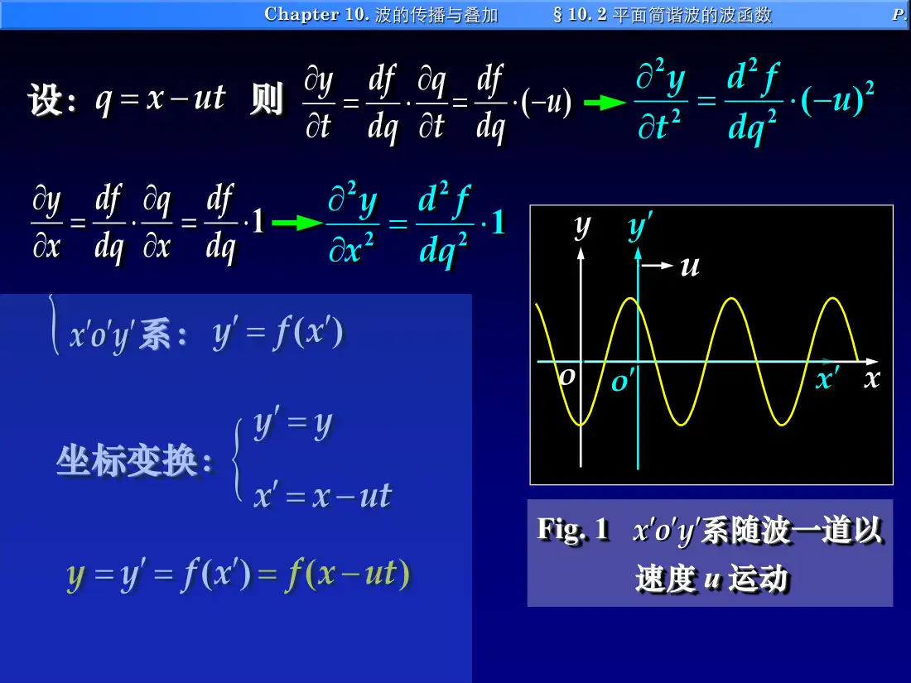

原文：

设： $q = x - ut$ 则 $\frac{\partial y}{\partial t} = \frac{df}{dq}\cdot \frac{\partial q}{\partial t} = \frac{df}{dq}\cdot (-u)\rightarrow \frac{\partial^2y}{\partial t^2} = \frac{d^2f}{dq^2}\cdot (-u)^2$

$$
\frac {\partial y}{\partial x} = \frac {d f}{d q} \cdot \frac {\partial q}{\partial x} = \frac {d f}{d q} \cdot 1 \rightarrow \frac {\partial^ {2} y}{\partial x ^ {2}} = \frac {d ^ {2} f}{d q ^ {2}} \cdot 1
$$

$x^{\prime}o^{\prime}y^{\prime}$ 系： $y^{\prime}=f(x^{\prime})$

坐标变换: $\left\{ \begin{array}{l} y' = y \\ x' = x - u t \end{array} \right.$

$$
y = y ^ {\prime} = f \left(x ^ {\prime}\right) = f (x - u t)
$$

Fig. 1 $x^{\prime}o^{\prime}y^{\prime}$ 系随波一道以速度 $u$ 运动

Chapter 10. 波的传播与叠加

§ 10.2 平面简谐波的波函数

P.

### $$

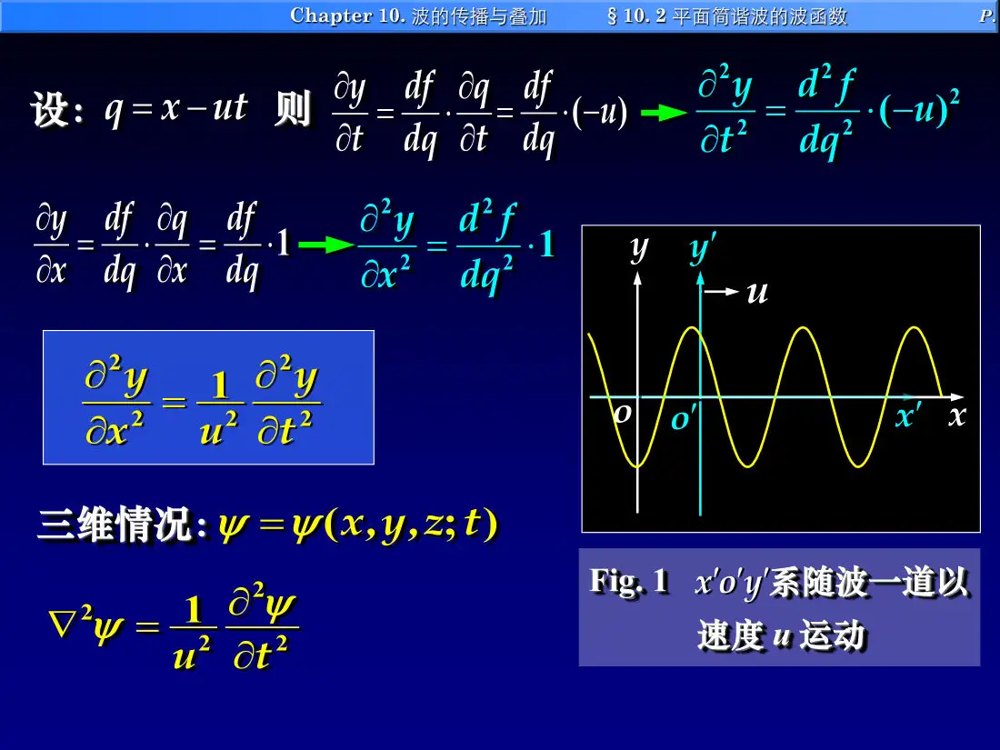

原文：

设： $q = x - ut$ 则 $\frac{\partial y}{\partial t} = \frac{df}{dq}\cdot \frac{\partial q}{\partial t} = \frac{df}{dq}\cdot (-u)\rightarrow \frac{\partial^2y}{\partial t^2} = \frac{d^2f}{dq^2}\cdot (-u)^2$

$$
\frac {\partial y}{\partial x} = \frac {d f}{d q} \cdot \frac {\partial q}{\partial x} = \frac {d f}{d q} \cdot 1 \rightarrow \frac {\partial^ {2} y}{\partial x ^ {2}} = \frac {d ^ {2} f}{d q ^ {2}} \cdot 1
$$

$$
\frac {\partial^ {2} y}{\partial x ^ {2}} = \frac {1}{u ^ {2}} \frac {\partial^ {2} y}{\partial t ^ {2}}
$$

三维情况: $\psi = \psi(x, y, z; t)$

$$
\nabla^ {2} \psi = \frac {1}{u ^ {2}} \frac {\partial^ {2} \psi}{\partial t ^ {2}}
$$

Fig. 1 $x^{\prime}o^{\prime}y^{\prime}$ 系随波一道以速度 $u$ 运动

Chapter 10. 波的传播与叠加

§ 10.2 平面简谐波的波函数

P.

### 对在弹性直棒中传播的平面纵波：

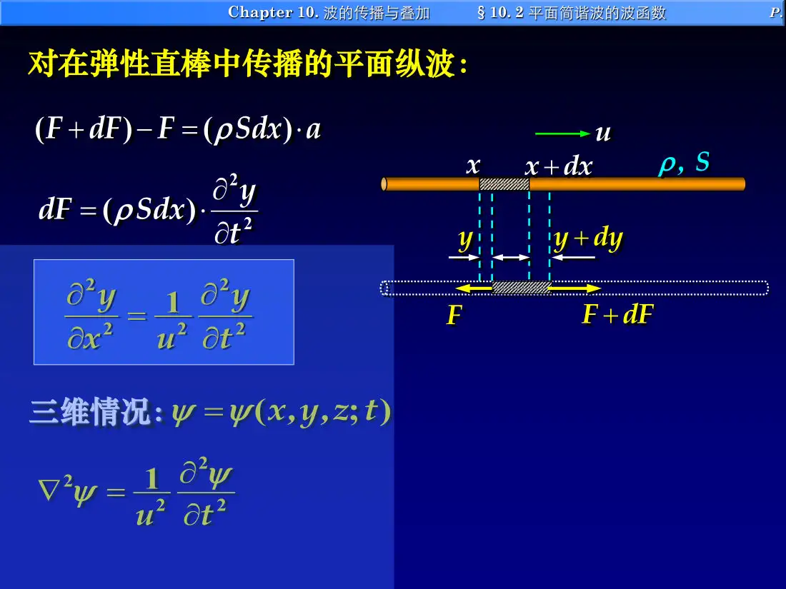

原文：

对在弹性直棒中传播的平面纵波：

$(F + dF) - F = (\rho Sdx)\cdot a$

$$
d F = (\rho S d x) \cdot \frac {\partial^ {2} y}{\partial t ^ {2}}
$$

$$
\frac {\partial^ {2} y}{\partial x ^ {2}} = \frac {1}{u ^ {2}} \frac {\partial^ {2} y}{\partial t ^ {2}}
$$

三维情况: $\psi = \psi(x, y, z; t)$

$$
\nabla^ {2} \psi = \frac {1}{u ^ {2}} \frac {\partial^ {2} \psi}{\partial t ^ {2}}
$$

Chapter 10. 波的传播与叠加

§ 10.2 平面简谐波的波函数

P.

### 对在弹性直棒中传播的平面纵波：

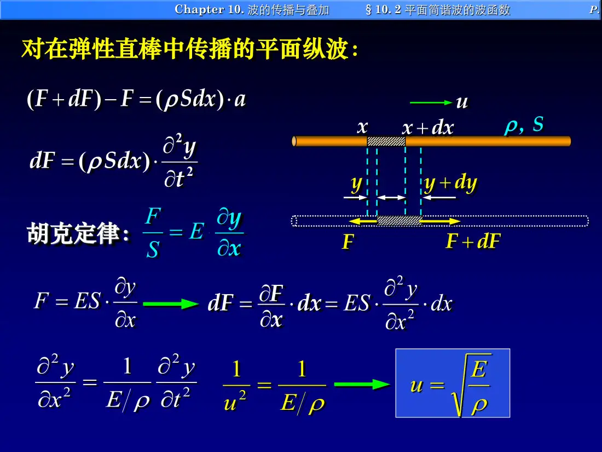

原文：

对在弹性直棒中传播的平面纵波：

$$
(F + d F) - F = (\rho S d x) \cdot a
$$

$$
d F = (\rho S d x) \cdot \frac {\partial^ {2} y}{\partial t ^ {2}}
$$

胡克定律: $\frac{F}{S} = E \cdot \frac{\partial y}{\partial x}$

$$
\begin{array}{c c c} x & x + d x & \rho , S \\ y & y + d y \\ F & F + d F \end{array}
$$

$$
F = E S \cdot \frac {\partial y}{\partial x} \longrightarrow d F = \frac {\partial F}{\partial x} \cdot d x = E S \cdot \frac {\partial^ {2} y}{\partial x ^ {2}} \cdot d x
$$

$$
\frac {\partial^ {2} y}{\partial x ^ {2}} = \frac {1}{E / \rho} \frac {\partial^ {2} y}{\partial t ^ {2}} \quad \frac {1}{u ^ {2}} = \frac {1}{E / \rho} \longrightarrow \boxed {u = \sqrt {\frac {E}{\rho}}}
$$

Chapter 10. 波的传播与叠加

§ 10.2 平面简谐波的波函数

P.

### 对在自由空间传播的平面电磁波：

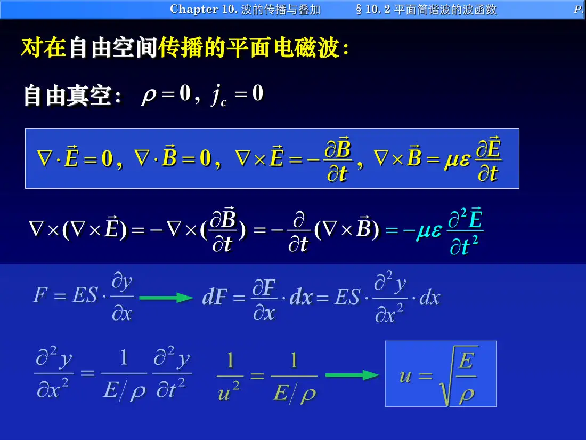

原文：

对在自由空间传播的平面电磁波：

自由真空： $\rho=0,\ j_{c}=0$

$$
\nabla \cdot \vec {E} = 0, \nabla \cdot \vec {B} = 0, \nabla \times \vec {E} = - \frac {\partial \vec {B}}{\partial t}, \nabla \times \vec {B} = \mu \varepsilon \frac {\partial \vec {E}}{\partial t}
$$

$$
\nabla \times (\nabla \times \vec {E}) = - \nabla \times (\frac {\partial \vec {B}}{\partial t}) = - \frac {\partial}{\partial t} (\nabla \times \vec {B}) = - \mu \varepsilon \frac {\partial^ {2} \vec {E}}{\partial t ^ {2}}
$$

$$
F = E S \cdot \frac {\partial y}{\partial x} \longrightarrow d F = \frac {\partial F}{\partial x} \cdot d x = E S \cdot \frac {\partial^ {2} y}{\partial x ^ {2}} \cdot d x
$$

$$
\frac {\partial^ {2} y}{\partial x ^ {2}} = \frac {1}{E / \rho} \frac {\partial^ {2} y}{\partial t ^ {2}} \quad \frac {1}{u ^ {2}} = \frac {1}{E / \rho} \longrightarrow \boxed {u = \sqrt {\frac {E}{\rho}}}
$$

Chapter 10. 波的传播与叠加

§ 10.2 平面简谐波的波函数

P.

### 对在自由空间传播的平面电磁波：

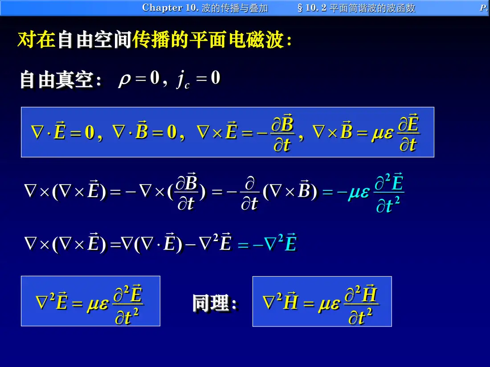

原文：

对在自由空间传播的平面电磁波：

自由真空： $\rho=0,\ j_{c}=0$

$$
\nabla \cdot \vec {E} = 0, \nabla \cdot \vec {B} = 0, \nabla \times \vec {E} = - \frac {\partial \vec {B}}{\partial t}, \nabla \times \vec {B} = \mu \varepsilon \frac {\partial \vec {E}}{\partial t}
$$

$$
\nabla \times (\nabla \times \vec {E}) = - \nabla \times (\frac {\partial \vec {B}}{\partial t}) = - \frac {\partial}{\partial t} (\nabla \times \vec {B}) = - \mu \varepsilon \frac {\partial^ {2} \vec {E}}{\partial t ^ {2}}
$$

$$
\nabla \times (\nabla \times \vec {E}) = \nabla (\nabla \cdot \vec {E}) - \nabla^ {2} \vec {E} = - \nabla^ {2} \vec {E}
$$

$$
\nabla^ {2} \vec {E} = \mu \varepsilon \frac {\partial^ {2} \vec {E}}{\partial t ^ {2}}
$$

同理：

$$
\nabla^ {2} \vec {H} = \mu \varepsilon \frac {\partial^ {2} \vec {H}}{\partial t ^ {2}}
$$

Chapter 10. 波的传播与叠加

§ 10.2 平面简谐波的波函数

P.

### $$

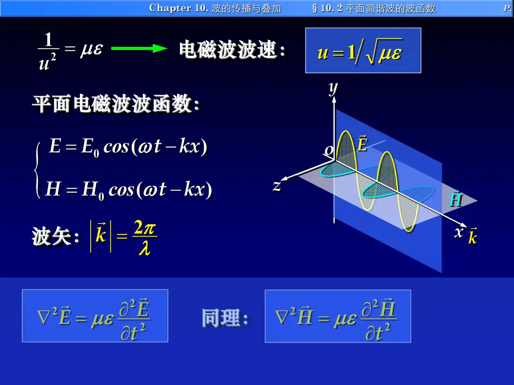

原文：

$$
\frac {1}{u ^ {2}} = \mu \varepsilon
$$

电磁波波速：

平面电磁波波函数：

$$
E = E _ {0} \cos (\omega t - k x)
$$

$$
H = H _ {0} \cos (\omega t - k x)
$$

波矢: $|\vec{k}| = \frac{2\pi}{\lambda}$

$$
\nabla^ {2} \vec {E} = \mu \varepsilon \frac {\partial^ {2} \vec {E}}{\partial t ^ {2}}
$$

同理：

$$
u = 1 / \sqrt {\mu \varepsilon}
$$

$$
\nabla^ {2} \vec {H} = \mu \varepsilon \frac {\partial^ {2} \vec {H}}{\partial t ^ {2}}
$$

Chapter 10. 波的传播与叠加

§ 10.2 平面简谐波的波函数

P.

### $$

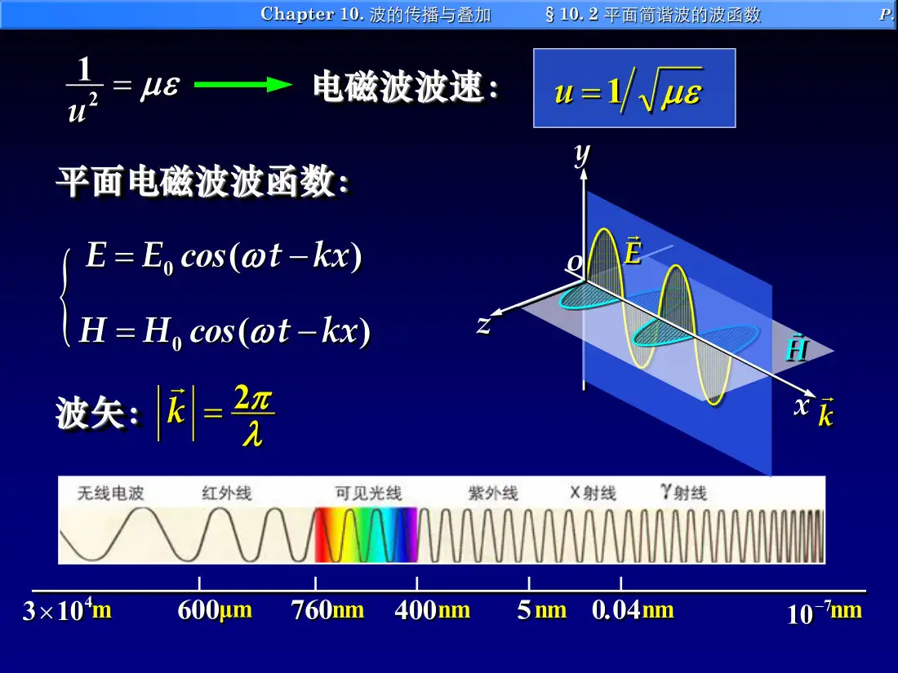

原文：

$$
\frac {1}{u ^ {2}} = \mu \varepsilon
$$

电磁波波速:

平面电磁波波函数：

$$
\left\{ \begin{array}{l} E = E _ {0} \cos (\omega t - k x) \\ H = H _ {0} \cos (\omega t - k x) \end{array} \right.
$$

波矢: $|\vec{k}| = \frac{2\pi}{\lambda}$

$$
u = 1 / \sqrt {\mu \varepsilon}
$$

Chapter 10. 波的传播与叠加

§ 10.2 平面简谐波的波函数

P.

### 电磁波的主要特性：

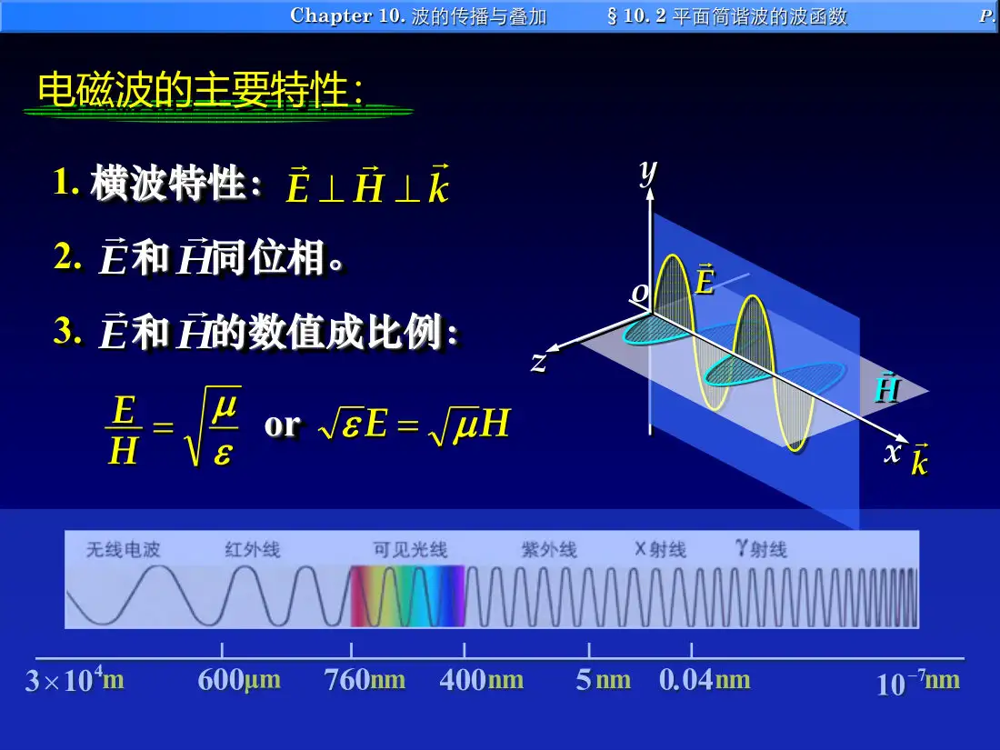

原文：

电磁波的主要特性：

1. 横波特性: $\vec{E} \perp \vec{H} \perp \vec{k}$

2. $\vec{E}$ 和 $\vec{H}$ 同位相。

3. $\vec{E}$ 和 $\vec{H}$ 的数值成比例: $\frac{E}{H} = \sqrt{\frac{\mu}{\varepsilon}}$ or $\sqrt{\varepsilon} E = \sqrt{\mu} H$

Chapter 10. 波的传播与叠加

§ 10.2 平面简谐波的波函数

P.

### 电磁波的主要特性：

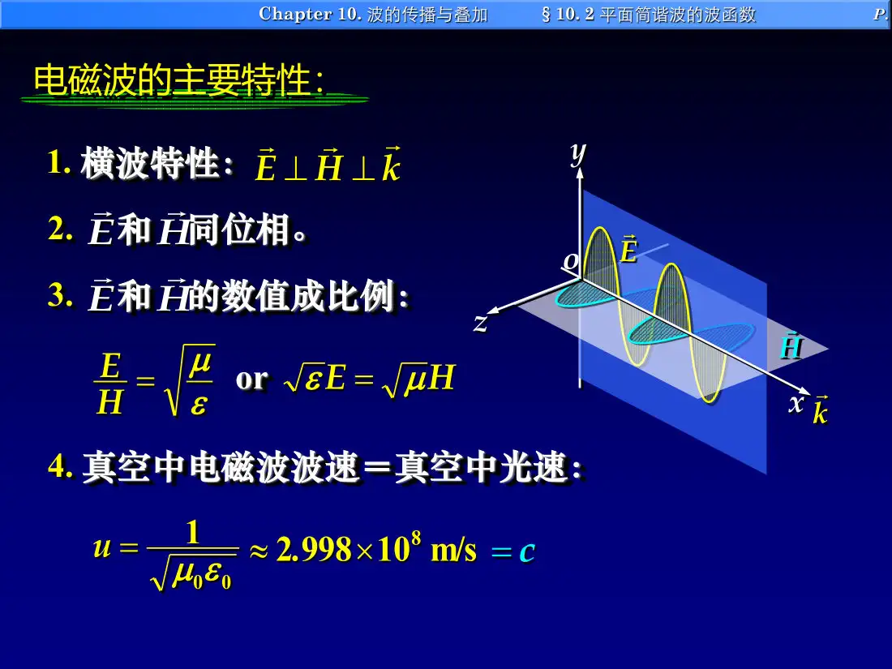

原文：

电磁波的主要特性：

1. 横波特性: $\vec{E} \perp \vec{H} \perp \vec{k}$

2. $\vec{E}$ 和 $\vec{H}$ 同位相。

3. $\vec{E}$ 和 $\vec{H}$ 的数值成比例:

$$
\frac {E}{H} = \sqrt {\frac {\mu}{\varepsilon}} \mathrm{or} \sqrt {\varepsilon} E = \sqrt {\mu} H
$$

4. 真空中电磁波波速=真空中光速:

$u = \frac{1}{\sqrt{\mu_{0}\varepsilon_{0}}}\approx 2.998\times 10^{8}\mathrm{m / s} = c$

Chapter 10. 波的传播与叠加

§ 10.2 平面简谐波的波函数

P.

### 四、波函数的求解

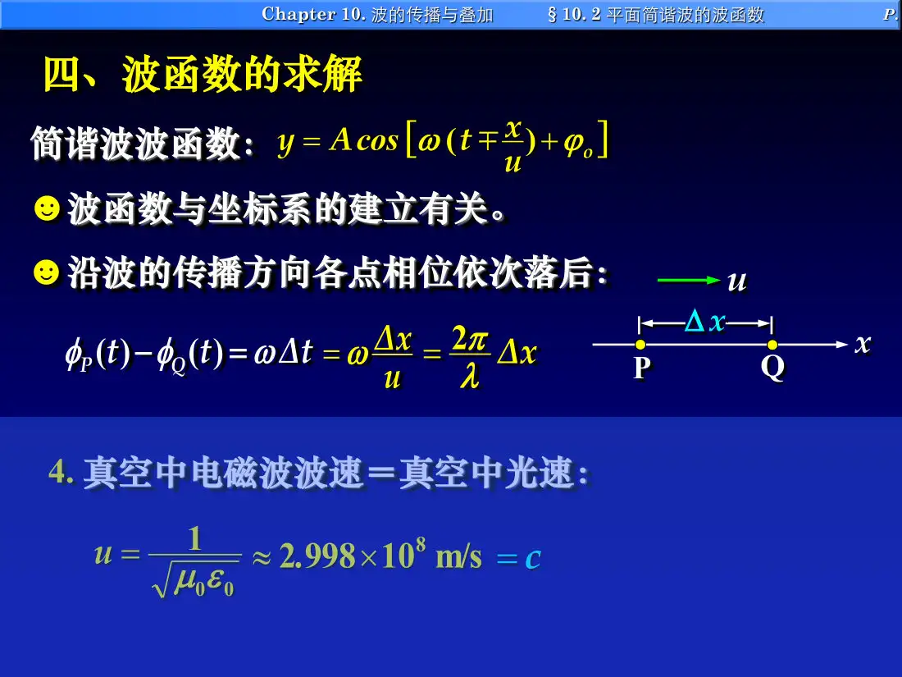

原文：

四、波函数的求解

简谐波波函数： $y = A \cos \left[ \omega \left( t \mp \frac{x}{u} \right) + \varphi_{o} \right]$

波函数与坐标系的建立有关。

😊 沿波的传播方向各点相位依次落后: → u

$$
\phi_ {P} (t) - \phi_ {Q} (t) = \omega \Delta t = \omega \frac {\Delta x}{u} = \frac {2 \pi}{\lambda} \Delta x \quad \xrightarrow [ P ]{| \Delta x |} x
$$

4. 真空中电磁波波速=真空中光速:

$$
u = \frac {1}{\sqrt {\mu_ {0} \varepsilon_ {0}}} \approx 2. 9 9 8 \times 1 0 ^ {8} \mathrm{m/s} = c
$$

Chapter 10. 波的传播与叠加

§ 10.2 平面简谐波的波函数

P.

### 四、波函数的求解

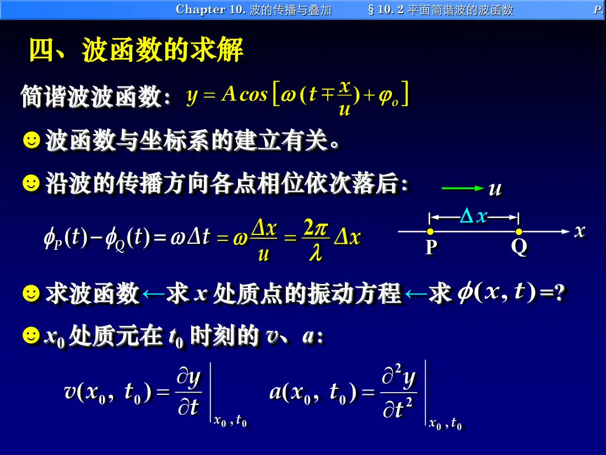

原文：

四、波函数的求解

简谐波波函数： $y = A \cos \left[ \omega \left( t \mp \frac{x}{u} \right) + \varphi_{o} \right]$

波函数与坐标系的建立有关。

😊 沿波的传播方向各点相位依次落后: → u

$\phi_{P}(t) - \phi_{Q}(t) = \omega \Delta t = \omega \frac{\Delta x}{u} = \frac{2\pi}{\lambda}\Delta x$ $\xrightarrow{| \leftarrow \Delta x \rightarrow |}$ P Q x

求波函数←求 x 处质点的振动方程←求 $\phi(x,t)=?$

$x_{0}$ 处质元在 $t_{0}$ 时刻的 v、a:

$$
v (x _ {0}, t _ {0}) = \frac {\partial y}{\partial t} \bigg | _ {x _ {0}, t _ {0}} a (x _ {0}, t _ {0}) = \frac {\partial^ {2} y}{\partial t ^ {2}} \bigg | _ {x _ {0}, t _ {0}}
$$

Chapter 10. 波的传播与叠加

§ 10.2 平面简谐波的波函数

P.

### 解 $x$ 处相位超前M点:

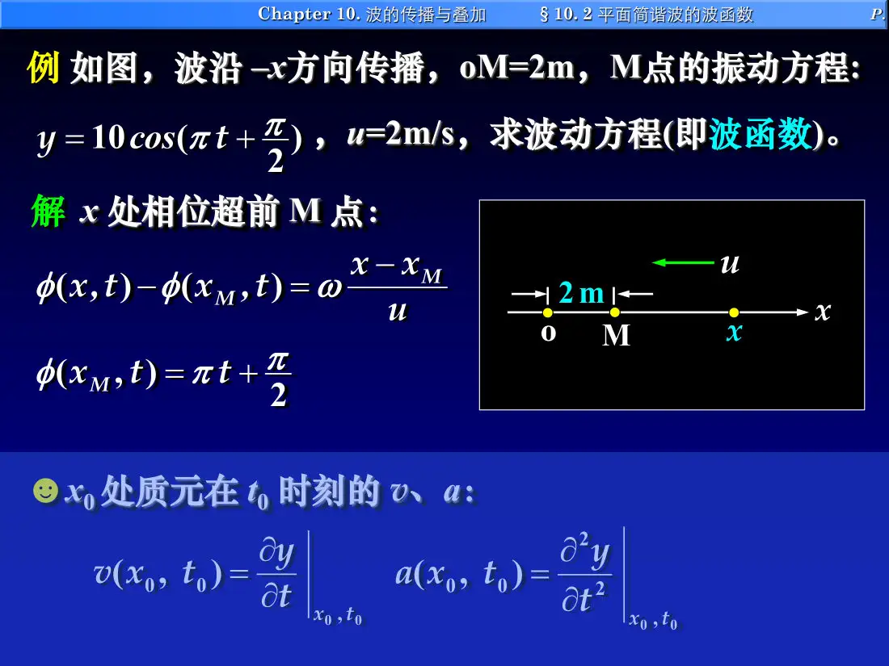

原文：

例如图, 波沿 $-x$ 方向传播, oM=2m, M点的振动方程: $y = 10 \cos (\pi t + \frac {\pi}{2})$ , $u = 2 \mathrm{~m} / \mathrm{s}$ , 求波动方程(即波函数)。

解 $x$ 处相位超前M点:

$$
\begin{array}{l} \phi (x, t) - \phi (x _ {M}, t) = \omega \frac {x - x _ {M}}{u} \\ \phi (x _ {M}, t) = \pi t + \frac {\pi}{2} \end{array}
$$

$$
\begin{array}{c c c} \text {   } & u \\ \text {   } & 2 \text {   m   } \\ \text {   } & 0 & \text {   M   } \\ \text {   } & x & \end{array}
$$

😊 $x_{0}$ 处质元在 $t_{0}$ 时刻的 $v$ 、 $a$ :

$$
v (x _ {0}, t _ {0}) = \frac {\partial y}{\partial t}
$$

$$
a (x _ {0}, t _ {0}) = \frac {\partial^ {2} y}{\partial t ^ {2}} \bigg | _ {x _ {0}, t _ {0}}
$$

Chapter 10. 波的传播与叠加

§ 10.2 平面简谐波的波函数

P.

### 解 $x$ 处相位超前M点:

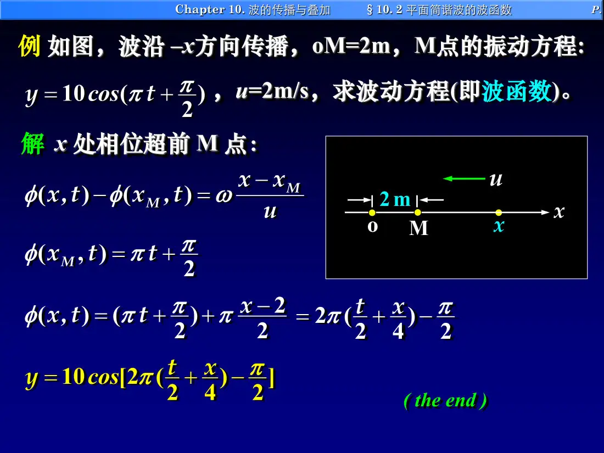

原文：

例如图, 波沿 $-x$ 方向传播, oM=2m, M点的振动方程: $y = 10 \cos (\pi t + \frac {\pi}{2})$ , $u = 2 \mathrm{~m} / \mathrm{s}$ , 求波动方程(即波函数)。

解 $x$ 处相位超前M点:

$$
\phi (x, t) - \phi (x _ {M}, t) = \omega \frac {x - x _ {M}}{u}
$$

$$
\phi (x _ {M}, t) = \pi t + \frac {\pi}{2}
$$

$$
\phi (x, t) = (\pi t + \frac {\pi}{2}) + \pi \frac {x - 2}{2} = 2 \pi (\frac {t}{2} + \frac {x}{4}) - \frac {\pi}{2}
$$

$$
y = 1 0 \cos [ 2 \pi (\frac {t}{2} + \frac {x}{4}) - \frac {\pi}{2} ]
$$

(the end)

Chapter 10. 波的传播与叠加

§ 10.2 平面简谐波的波函数

P.

### 例 图示为 t=0 时的波形图，求波动方程及此时P点 v 。

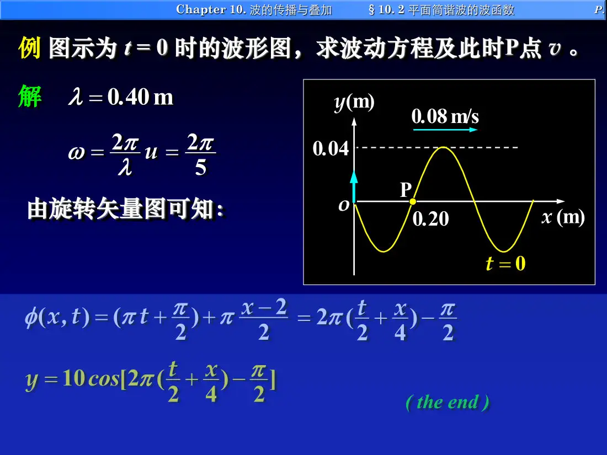

原文：

例 图示为 t=0 时的波形图，求波动方程及此时P点 v 。

解 $\lambda = 0.40 \mathrm{~m}$

$$
\omega = \frac {2 \pi}{\lambda} u = \frac {2 \pi}{5}
$$

由旋转矢量图可知：

$$
\phi (x, t) = (\pi t + \frac {\pi}{2}) + \pi \frac {x - 2}{2} = 2 \pi (\frac {t}{2} + \frac {x}{4}) - \frac {\pi}{2}
$$

$$
y = 1 0 \cos [ 2 \pi (\frac {t}{2} + \frac {x}{4}) - \frac {\pi}{2} ]
$$

(the end)

Chapter 10. 波的传播与叠加

§ 10.2 平面简谐波的波函数

P.

### 例 图示为 t=0 时的波形图，求波动方程及此时P点 v 。

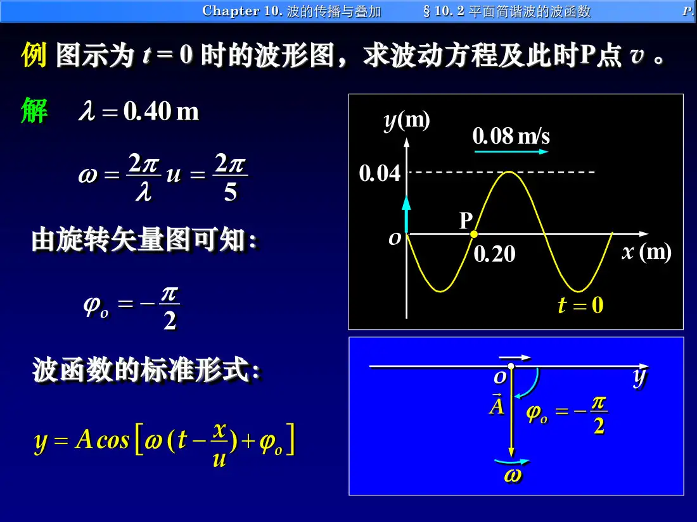

原文：

例 图示为 t=0 时的波形图，求波动方程及此时P点 v 。

解 $\lambda = 0.40 \mathrm{~m}$

$$
\omega = \frac {2 \pi}{\lambda} u = \frac {2 \pi}{5}
$$

由旋转矢量图可知：

$$
\varphi_ {o} = - \frac {\pi}{2}
$$

波函数的标准形式:

$$
y = A \cos \left[ \omega \left(t - \frac {x}{u}\right) + \varphi_ {o} \right]
$$

Chapter 10. 波的传播与叠加

§ 10.2 平面简谐波的波函数

P.

### $$

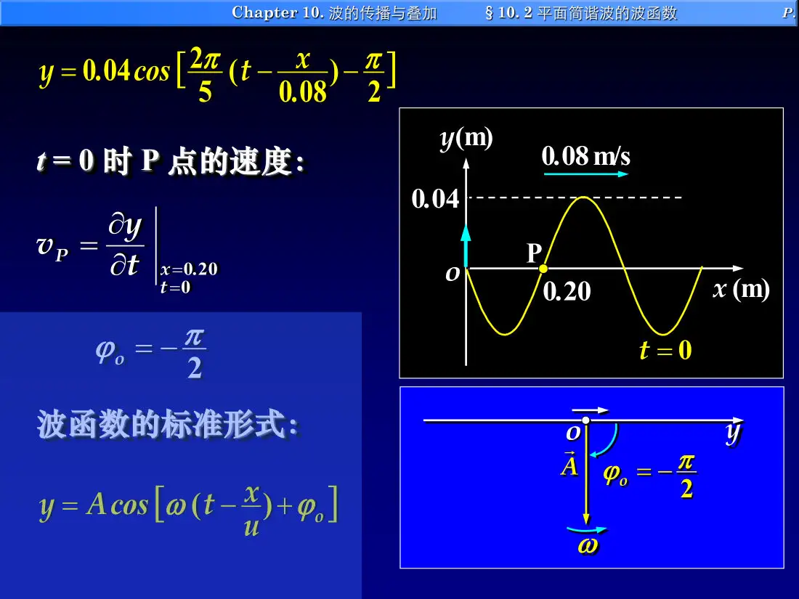

原文：

$$
y = 0. 0 4 \cos \left[ \frac {2 \pi}{5} (t - \frac {x}{0 . 0 8}) - \frac {\pi}{2} \right]
$$

t=0 时 P 点的速度:

$$
v _ {P} = \frac {\partial y}{\partial t} \bigg | _ {x = 0. 2 0 \atop t = 0}
$$

$$
\varphi_ {o} = - \frac {\pi}{2}
$$

波函数的标准形式:

$$
y = A \cos \left[ \omega \left(t - \frac {x}{u}\right) + \varphi_ {o} \right]
$$

Chapter 10. 波的传播与叠加

§ 10.2 平面简谐波的波函数

P.

### $$

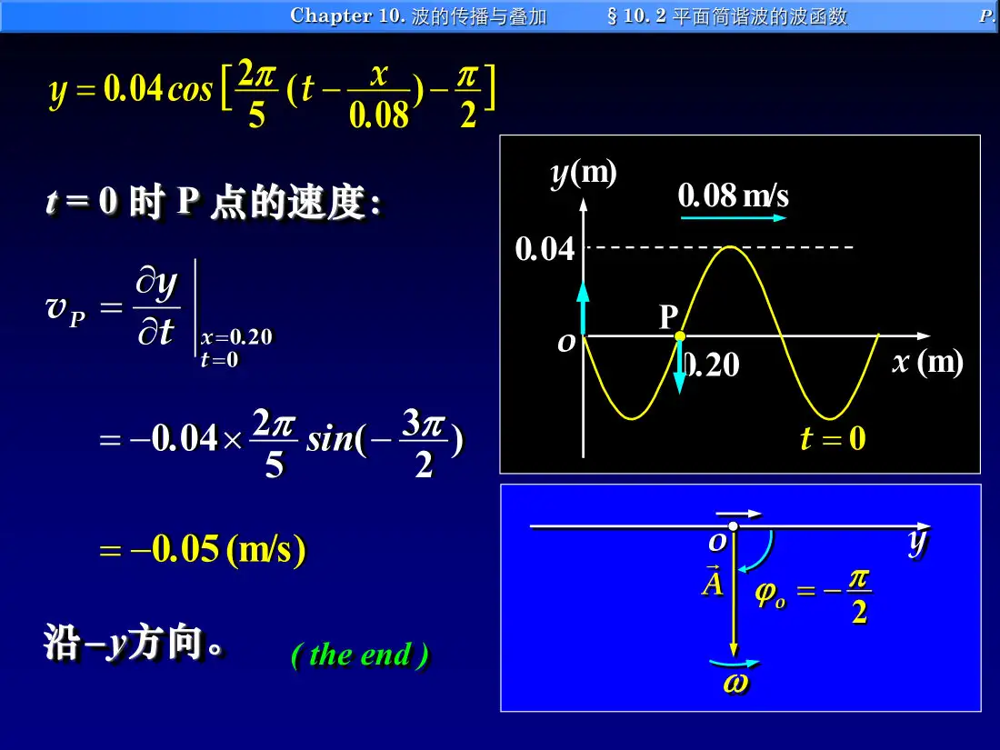

原文：

$$
y = 0. 0 4 \cos \left[ \frac {2 \pi}{5} (t - \frac {x}{0 . 0 8}) - \frac {\pi}{2} \right]
$$

t=0 时 P 点的速度:

$$
\begin{array}{r l} & v _ {P} = \frac {\partial y}{\partial t} \Bigg | _ {x = 0. 2 0 \atop t = 0} \\ & = - 0. 0 4 \times \frac {2 \pi}{5} \sin (- \frac {3 \pi}{2}) \\ & = - 0. 0 5 (\mathrm{m/s}) \end{array}
$$

沿-y方向。

(the end)

$$
\begin{array}{c} \overrightarrow {O} \\ \overrightarrow {A} \\ \overrightarrow {\omega} \end{array} \varphi_ {o} = - \frac {\pi}{2}
$$

Chapter 10. 波的传播与叠加

§ 10.2 平面简谐波的波函数

P.

### 课堂练习 图示为 $t = 1\mathrm{s}$ 时的波形曲线，求波动方程。

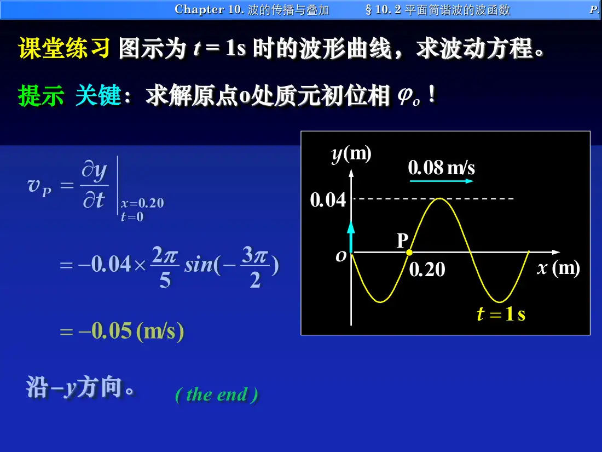

原文：

课堂练习 图示为 $t = 1\mathrm{s}$ 时的波形曲线，求波动方程。

提示 关键：求解原点o处质元初位相 $\varphi_{o}$ ！

$$
\begin{array}{r l} v _ {P} & = \frac {\partial y}{\partial t} \Bigg | _ {x = 0. 2 0 \atop t = 0} \\ & = - 0. 0 4 \times \frac {2 \pi}{5} \sin (- \frac {3 \pi}{2}) \\ & = - 0. 0 5 (\mathrm{m/s}) \end{array}
$$

沿-y方向。

(the end)

Chapter 10. 波的传播与叠加

§ 10.2 平面简谐波的波函数

P.

### 课堂练习 图示为 $t = 1\mathrm{s}$ 时的波形曲线，求波动方程。

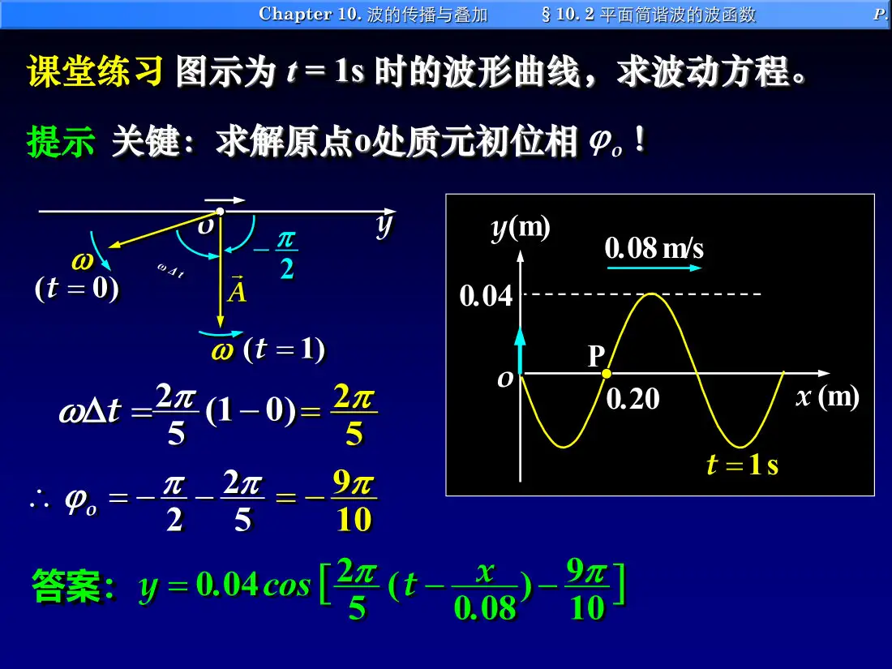

原文：

课堂练习 图示为 $t = 1\mathrm{s}$ 时的波形曲线，求波动方程。

提示 关键：求解原点o处质元初位相 $\varphi_{o}$ ！

$$
\omega \Delta t = \frac {2 \pi}{5} (1 - 0) = \frac {2 \pi}{5}
$$

$$
\therefore \varphi_ {o} = - \frac {\pi}{2} - \frac {2 \pi}{5} = - \frac {9 \pi}{1 0}
$$

答案: $y = 0.04 \cos \left[ \frac{2\pi}{5} (t - \frac{x}{0.08}) - \frac{9\pi}{10} \right]$

Chapter 10. 波的传播与叠加

§ 10.2 平面简谐波的波函数

P.

### 归纳：

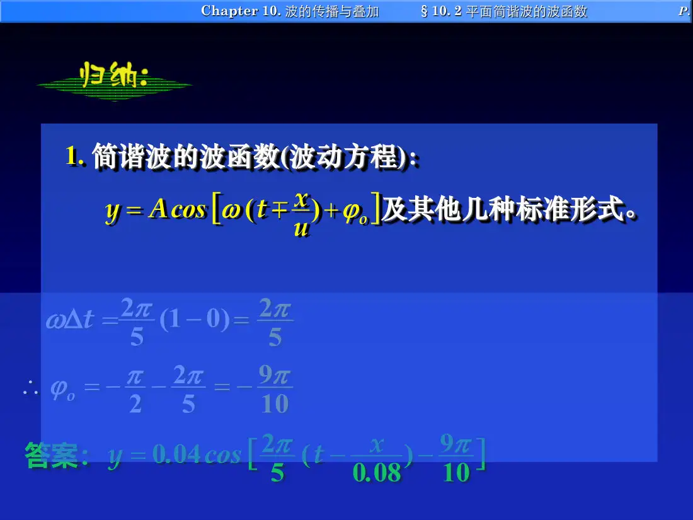

原文：

归纳：

1. 简谐波的波函数(波动方程):

$y = A \cos \left[ \omega \left( t \mp \frac{x}{u} \right) + \varphi_{o} \right]$ 及其他几种标准形式。

$$
\omega \Delta t = \frac {2 \pi}{5} (1 - 0) = \frac {2 \pi}{5}
$$

$$
\therefore \varphi_ {o} = - \frac {\pi}{2} - \frac {2 \pi}{5} = - \frac {9 \pi}{1 0}
$$

答案: $y = 0.04 \cos \left[ \frac{2\pi}{5} (t - \frac{x}{0.08}) - \frac{9\pi}{10} \right]$

Chapter 10. 波的传播与叠加

§ 10.2 平面简谐波的波函数

P.

### 归纳：

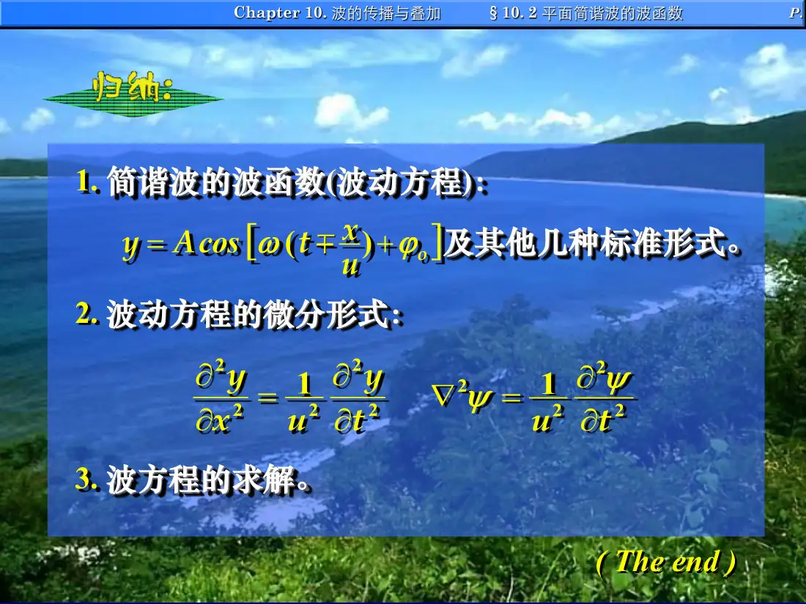

原文：

归纳：

1. 简谐波的波函数(波动方程):

$y = A \cos \left[ \omega \left( t \mp \frac{x}{u} \right) + \varphi_{o} \right]$ 及其他几种标准形式。

2. 波动方程的微分形式:

$$
\frac {\partial^ {2} y}{\partial x ^ {2}} = \frac {1}{u ^ {2}} \frac {\partial^ {2} y}{\partial t ^ {2}}
$$

$$
\nabla^ {2} \psi = \frac {1}{u ^ {2}} \frac {\partial^ {2} \psi}{\partial t ^ {2}}
$$

3. 波方程的求解。

Chapter 10. 波的传播与叠加

§ 10.2 平面简谐波的波函数

P.

The end)
