# 《大学物理》第10章 波的传播与叠加 §10.3 波的能量 能流（课件）

原件的每一页，下面附识别出的文字。

### § 10.3 波的能量 能流

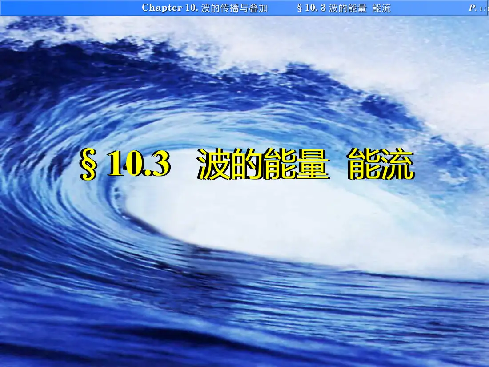

原文：

§ 10.3 波的能量 能流

P. 1/1

Chapter 10. 波的传播与叠加 § 10.3 波的能量 能流

### 一、波的动能与势能

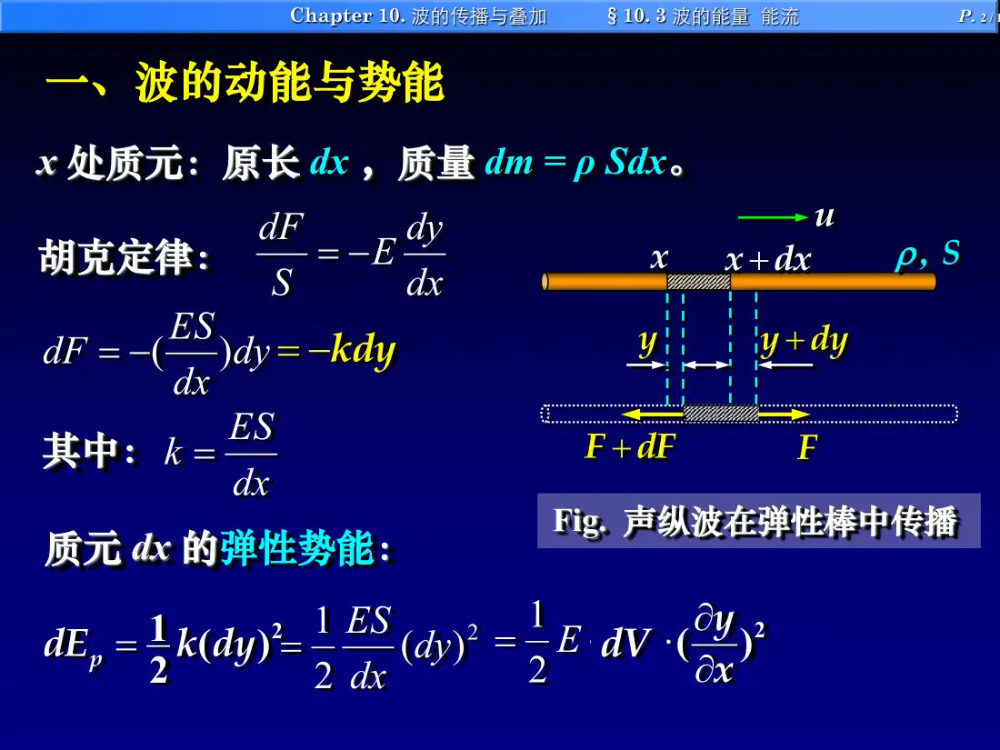

原文：

一、波的动能与势能

x 处质元：原长 dx，质量 dm = ρ Sdx。

胡克定律: $\frac{dF}{S} = -E\frac{dy}{dx}$

$$
d F = - (\frac {E S}{d x}) d y = - k d y
$$

其中： $k=\frac{ES}{dx}$

质元 $dx$ 的弹性势能:

Fig. 声纵波在弹性棒中传播

$$
d E _ {p} = \frac {1}{2} k (d y) ^ {2} = \frac {1}{2} \frac {E S}{d x} (d y) ^ {2} = \frac {1}{2} E \cdot d V \cdot \left(\frac {\partial y}{\partial x}\right) ^ {2}
$$

Chapter 10. 波的传播与叠加

§ 10.3 波的能量 能流

P. 2/1

### $$

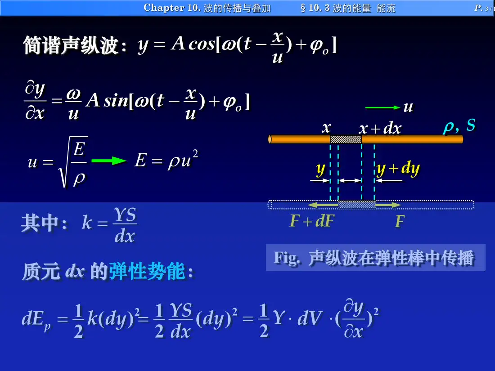

原文：

简谐声纵波： $y = A \cos [\omega(t - \frac{x}{u}) + \varphi_o]$

$$
\frac {\partial y}{\partial x} = \frac {\omega}{u} A \sin [ \omega (t - \frac {x}{u}) + \varphi_ {o} ]
$$

$$
u = \sqrt {\frac {E}{\rho}} \rightarrow E = \rho u ^ {2}
$$

其中: $k = \frac{YS}{dx}$

质元 $dx$ 的弹性势能:

Fig. 声纵波在弹性棒中传播

$$
d E _ {p} = \frac {1}{2} k (d y) ^ {2} = \frac {1}{2} \frac {\Upsilon S}{d x} (d y) ^ {2} = \frac {1}{2} Y \cdot d V \cdot (\frac {\partial y}{\partial x}) ^ {2}
$$

Chapter 10. 波的传播与叠加

§ 10.3 波的能量 能流

P. 3/1

### $$

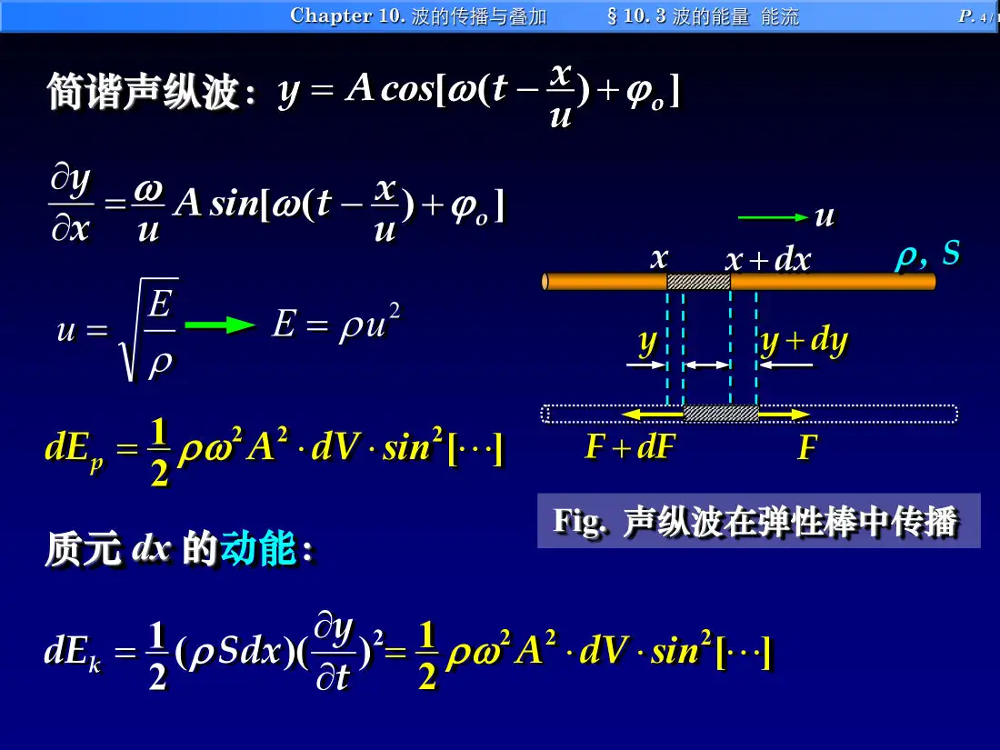

原文：

简谐声纵波： $y = A \cos [\omega(t - \frac{x}{u}) + \varphi_o]$

$$
\frac {\partial y}{\partial x} = \frac {\omega}{u} A \sin [ \omega (t - \frac {x}{u}) + \varphi_ {o} ]
$$

$$
u = \sqrt {\frac {E}{\rho}} \longrightarrow E = \rho u ^ {2}
$$

$$
d E _ {p} = \frac {1}{2} \rho \omega^ {2} A ^ {2} \cdot d V \cdot \sin^ {2} [ \dots ]
$$

质元 $dx$ 的动能:

Fig. 声纵波在弹性棒中传播

$$
d E _ {k} = \frac {1}{2} (\rho S d x) \left(\frac {\partial y}{\partial t}\right) ^ {2} = \frac {1}{2} \rho \omega^ {2} A ^ {2} \cdot d V \cdot \sin^ {2} [ \dots ]
$$

Chapter 10. 波的传播与叠加

§ 10.3 波的能量 能流

P. 4/1

### 结论：任意时刻媒质中某质元的动能 = 势能！

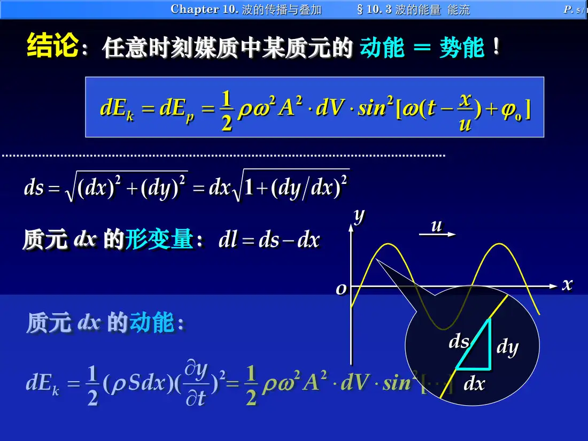

原文：

结论：任意时刻媒质中某质元的动能 = 势能！

$$
d E _ {k} = d E _ {p} = \frac {1}{2} \rho \omega^ {2} A ^ {2} \cdot d V \cdot s i n ^ {2} [ \omega (t - \frac {x}{u}) + \varphi_ {\mathrm{o}} ]
$$

$$
d s = \sqrt {(d x) ^ {2} + (d y) ^ {2}} = d x \sqrt {1 + (d y / d x) ^ {2}}
$$

质元 dx 的形变量: dl = ds - dx

质元 $dx$ 的动能:

$$
d E _ {k} = \frac {1}{2} (\rho S d x) \left(\frac {\partial y}{\partial t}\right) ^ {2} = \frac {1}{2} \rho \omega^ {2} A ^ {2} \cdot d V \cdot \sin
$$

Chapter 10. 波的传播与叠加

§ 10.3 波的能量 能流

P. 5/1

### 结论：任意时刻媒质中某质元的动能 = 势能！

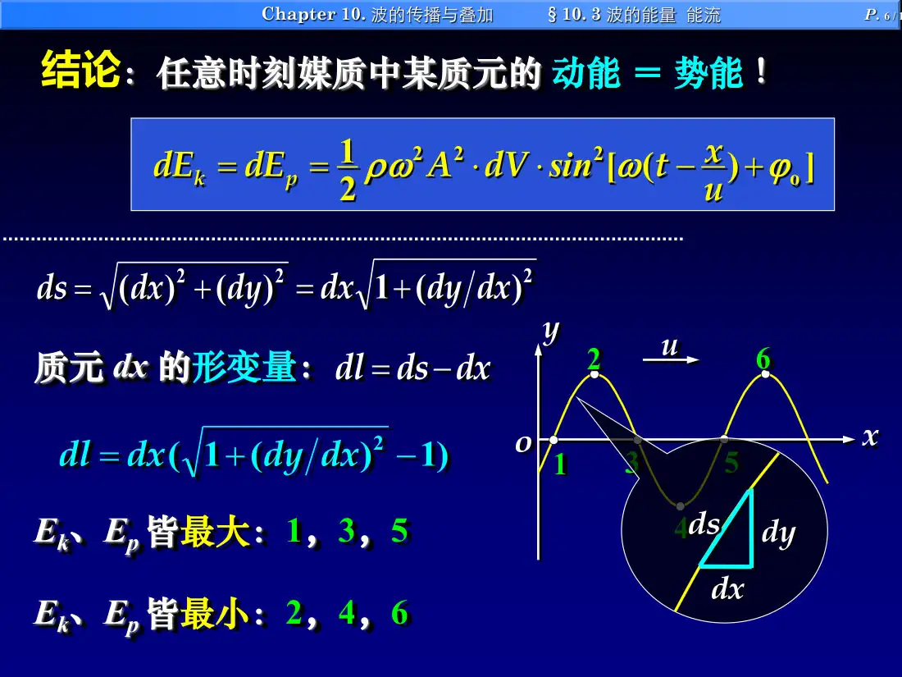

原文：

结论：任意时刻媒质中某质元的动能 = 势能！

$$
d E _ {k} = d E _ {p} = \frac {1}{2} \rho \omega^ {2} A ^ {2} \cdot d V \cdot s i n ^ {2} [ \omega (t - \frac {x}{u}) + \varphi_ {\mathrm{o}} ]
$$

$$
d s = \sqrt {(d x) ^ {2} + (d y) ^ {2}} = d x \sqrt {1 + (d y / d x) ^ {2}}
$$

质元 dx 的形变量: dl = ds - dx

$$
d l = d x \left(\sqrt {1 + (d y / d x) ^ {2}} - 1\right)
$$

$E_{k}$ 、 $E_{p}$ 皆最大：1，3，5

$E_{k}$ 、 $E_{p}$ 皆最小：2，4，6

Chapter 10. 波的传播与叠加

§ 10.3 波的能量 能流

P. 6/1

### 二、波的能量密度

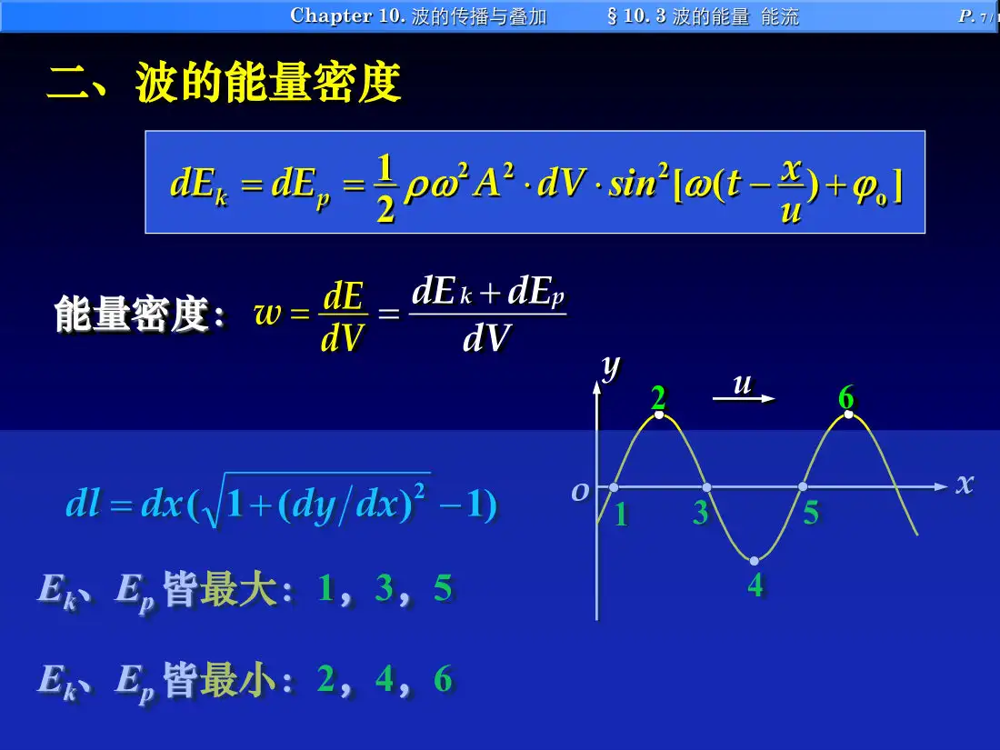

原文：

二、波的能量密度

$$
d E _ {k} = d E _ {p} = \frac {1}{2} \rho \omega^ {2} A ^ {2} \cdot d V \cdot s i n ^ {2} [ \omega (t - \frac {x}{u}) + \varphi_ {\mathrm{o}} ]
$$

能量密度: $w = \frac{dE}{dV} = \frac{dE_{k} + dE_{p}}{dV}$

$$
d l = d x \left(\sqrt {1 + (d y / d x) ^ {2}} - 1\right)
$$

$E_{k}$ 、 $E_{p}$ 皆最大：1，3，5

$E_{k}$ 、 $E_{p}$ 皆最小：2，4，6

Chapter 10. 波的传播与叠加

§ 10.3 波的能量 能流

P. 7/1

### 二、波的能量密度

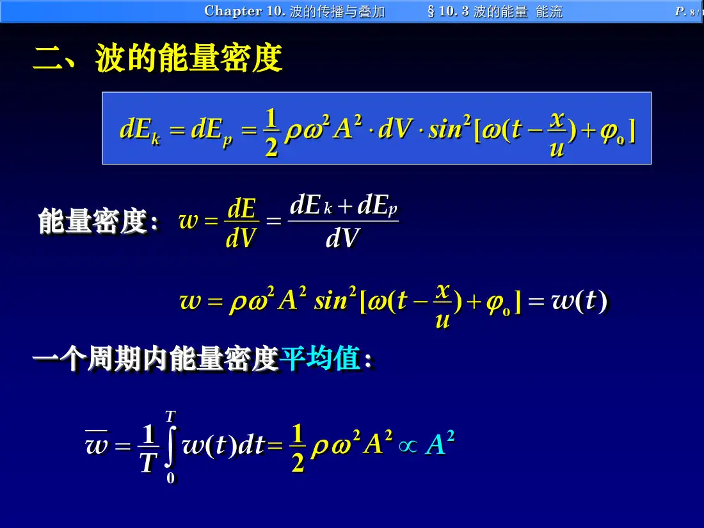

原文：

二、波的能量密度

$$
d E _ {k} = d E _ {p} = \frac {1}{2} \rho \omega^ {2} A ^ {2} \cdot d V \cdot s i n ^ {2} [ \omega (t - \frac {x}{u}) + \varphi_ {\mathrm{o}} ]
$$

能量密度： $w=\frac{dE}{dV}=\frac{dE_{k}+dE_{p}}{dV}$

$$
w = \rho \omega^ {2} A ^ {2} \sin^ {2} [ \omega (t - \frac {x}{u}) + \varphi_ {\mathrm{o}} ] = w (t)
$$

一个周期内能量密度平均值：

$$
\overline {{w}} = \frac {1}{T} \int_ {0} ^ {T} w (t) d t = \frac {1}{2} \rho \omega^ {2} A ^ {2} \propto A ^ {2}
$$

Chapter 10. 波的传播与叠加

§ 10.3 波的能量 能流

P. 8/1

### 三、波的能流及能流密度

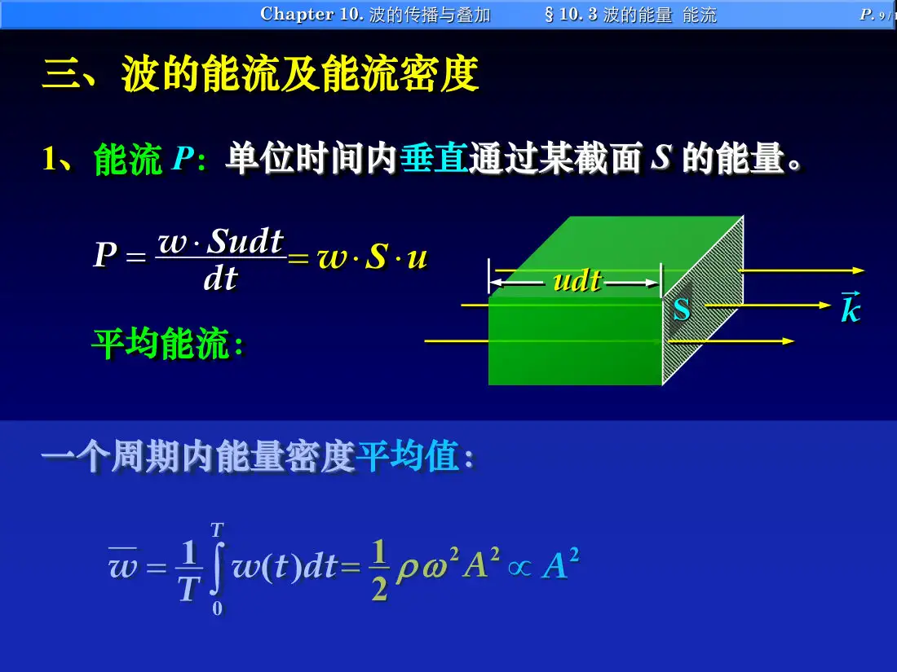

原文：

三、波的能流及能流密度

1、能流 $P$ ：单位时间内垂直通过某截面 $S$ 的能量。

$$
P = \frac {w \cdot S u d t}{d t} = w \cdot S \cdot u
$$

平均能流:

一个周期内能量密度平均值：

$$
\overline {{w}} = \frac {1}{T} \int_ {0} ^ {T} w (t) d t = \frac {1}{2} \rho \omega^ {2} A ^ {2} \propto A ^ {2}
$$

Chapter 10. 波的传播与叠加

§ 10.3 波的能量 能流

P. 9/1

### 三、波的能流及能流密度

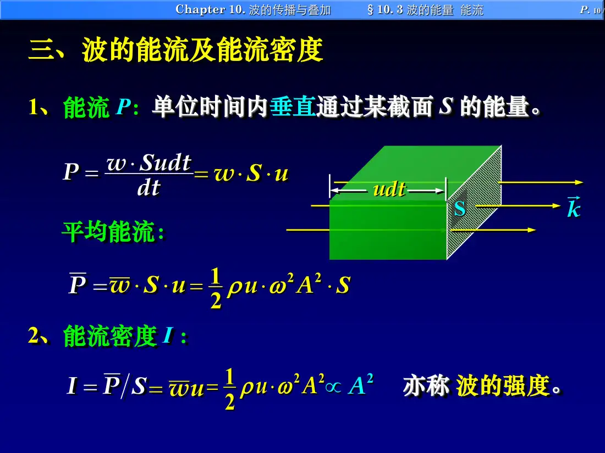

原文：

三、波的能流及能流密度

1、能流 $P$ ：单位时间内垂直通过某截面 $S$ 的能量。

$$
P = \frac {w \cdot S u d t}{d t} = w \cdot S \cdot u
$$

平均能流:

$$
\overline {{P}} = \overline {{w}} \cdot S \cdot u = \frac {1}{2} \rho u \cdot \omega^ {2} A ^ {2} \cdot S
$$

2、能流密度 I :

$I=\overline{P}/S=\overline{w}u=\frac{1}{2}\rho u\cdot\omega^{2}A^{2}\propto A^{2}$ 亦称波的强度。

Chapter 10. 波的传播与叠加

§ 10.3 波的能量 能流

P. 10/

### $$

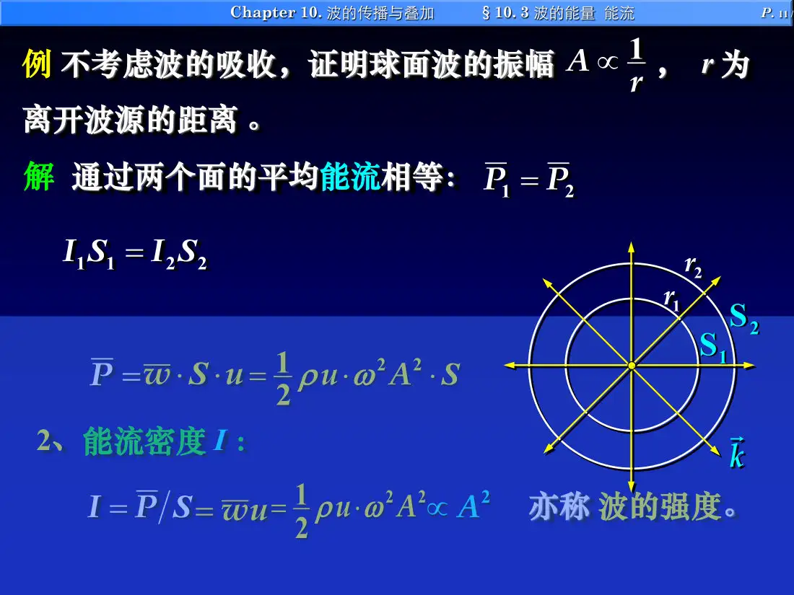

原文：

例 不考虑波的吸收，证明球面波的振幅 $A \propto \frac{1}{r}$ ，r 为离开波源的距离。

解 通过两个面的平均能流相等: $\overline{P}_{1} = \overline{P}_{2}$

$$
I _ {1} S _ {1} = I _ {2} S _ {2}
$$

$$
\overline {{P}} = \overline {{w}} \cdot S \cdot u = \frac {1}{2} \rho u \cdot \omega^ {2} A ^ {2} \cdot S
$$

2、能流密度 I :

$I=\overline{P}/S=\overline{w}u=\frac{1}{2}\rho u\cdot\omega^{2}A^{2}\propto A^{2}$ 亦称波的强度。

Chapter 10. 波的传播与叠加

§ 10.3 波的能量 能流

P. 11

### $$

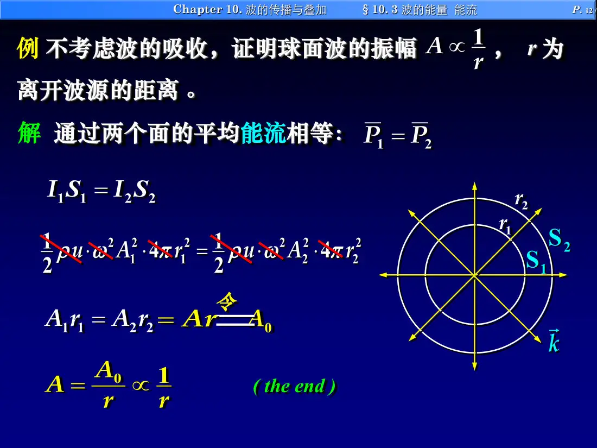

原文：

例 不考虑波的吸收，证明球面波的振幅 $A \propto \frac{1}{r}$ ，r 为离开波源的距离。

解 通过两个面的平均能流相等: $\overline{P}_{1} = \overline{P}_{2}$

$$
I _ {1} S _ {1} = I _ {2} S _ {2}
$$

$$
\frac {1}{2} \rho u \cdot \omega^ {2} A _ {1} ^ {2} \cdot 4 \pi r _ {1} ^ {2} = \frac {1}{2} \rho u \cdot \omega^ {2} A _ {2} ^ {2} \cdot 4 \pi r _ {2} ^ {2}
$$

$$
A _ {1} r _ {1} = A _ {2} r _ {2} = A r \stackrel {\text {令}} {=} A _ {0}
$$

$$
A = \frac {A _ {0}}{r} \propto \frac {1}{r}
$$

(the end)

Chapter 10. 波的传播与叠加

§ 10.3 波的能量 能流

P. 12/

### 四、电磁波的能流密度

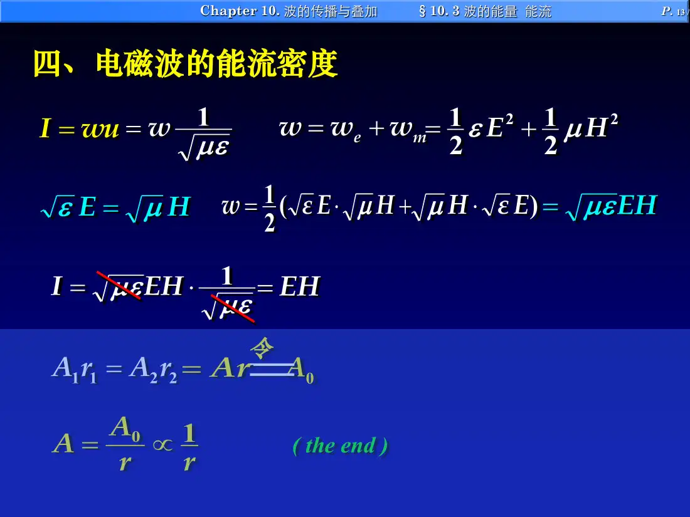

原文：

四、电磁波的能流密度

$$
I = w u = w \frac {1}{\sqrt {\mu \varepsilon}} \quad w = w _ {e} + w _ {m} = \frac {1}{2} \varepsilon E ^ {2} + \frac {1}{2} \mu H ^ {2}
$$

$$
\sqrt {\varepsilon} E = \sqrt {\mu} H w = \frac {1}{2} (\sqrt {\varepsilon} E \cdot \sqrt {\mu} H + \sqrt {\mu} H \cdot \sqrt {\varepsilon} E) = \sqrt {\mu \varepsilon} E H
$$

$$
I = \sqrt {\mu \varepsilon} E H \cdot \frac {1}{\sqrt {\mu \varepsilon}} = E H
$$

$$
A _ {1} r _ {1} = A _ {2} r _ {2} = A r \stackrel {\text {令}} {=} A _ {0}
$$

$$
A = \frac {A _ {0}}{r} \propto \frac {1}{r}
$$

(the end)

Chapter 10. 波的传播与叠加

§ 10.3 波的能量 能流

P. 13/

### 四、电磁波的能流密度

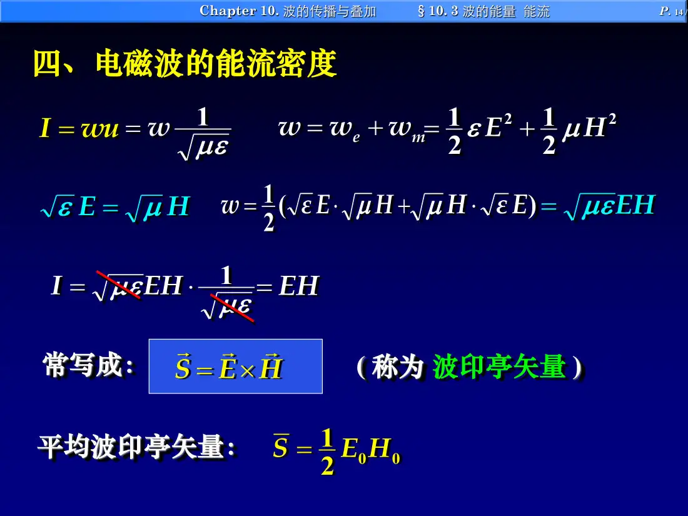

原文：

四、电磁波的能流密度

$$
I = w u = w \frac {1}{\sqrt {\mu \varepsilon}} \quad w = w _ {e} + w _ {m} = \frac {1}{2} \varepsilon E ^ {2} + \frac {1}{2} \mu H ^ {2}
$$

$$
\sqrt {\varepsilon} E = \sqrt {\mu} H w = \frac {1}{2} (\sqrt {\varepsilon} E \cdot \sqrt {\mu} H + \sqrt {\mu} H \cdot \sqrt {\varepsilon} E) = \sqrt {\mu \varepsilon} E H
$$

$I = \sqrt{\mu\varepsilon}EH \cdot \frac{1}{\sqrt{\mu\varepsilon}} = EH$

常写成:

$$
\vec {S} = \vec {E} \times \vec {H}
$$

(称为波印亭矢量)

平均波印亭矢量: $\overline{S} = \frac{1}{2} E_{0}H_{0}$

Chapter 10. 波的传播与叠加

§ 10.3 波的能量 能流

P. 14/

### 归纳:

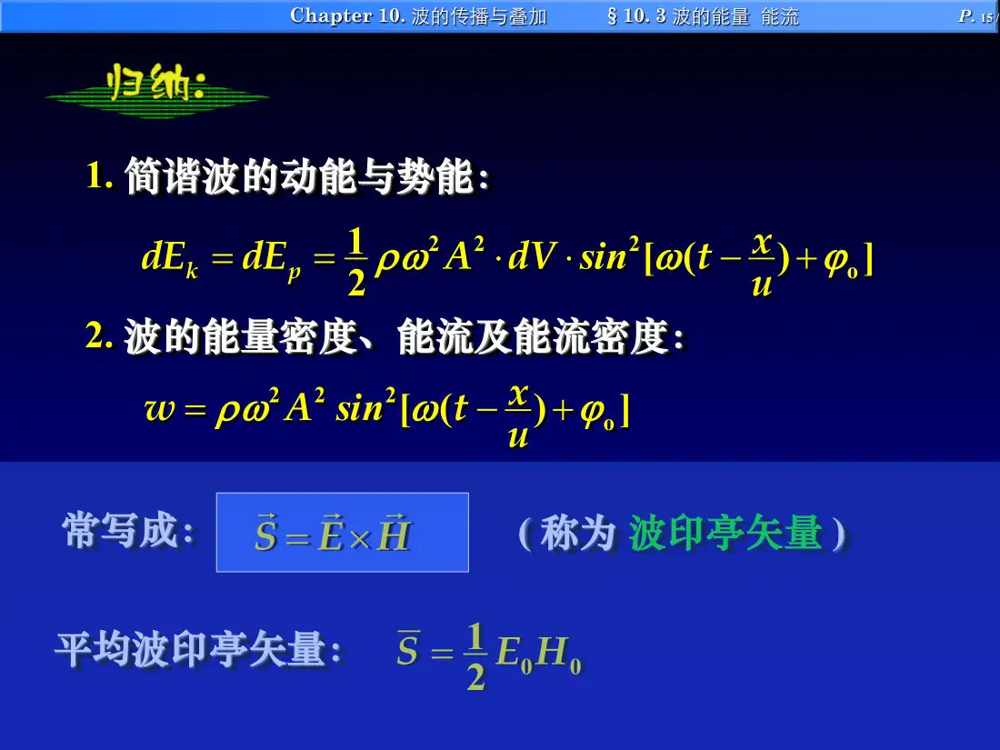

原文：

归纳:

1. 简谐波的动能与势能:

$$
d E _ {k} = d E _ {p} = \frac {1}{2} \rho \omega^ {2} A ^ {2} \cdot d V \cdot s i n ^ {2} [ \omega (t - \frac {x}{u}) + \varphi_ {\mathrm{o}} ]
$$

2. 波的能量密度、能流及能流密度:

$$
w = \rho \omega^ {2} A ^ {2} \sin^ {2} [ \omega (t - \frac {x}{u}) + \varphi_ {\mathrm{o}} ]
$$

常写成:

$$
\vec {S} = \vec {E} \times \vec {H}
$$

(称为波印亭矢量)

平均波印亭矢量: $\overline{S} = \frac{1}{2} E_{0}H_{0}$

Chapter 10. 波的传播与叠加

§ 10.3 波的能量 能流

P. 15/

### 归纳：

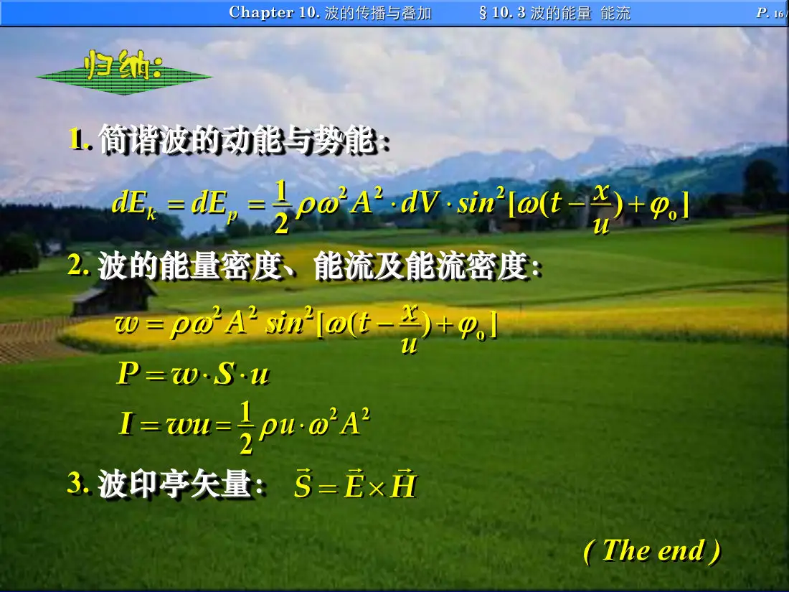

原文：

归纳：

1. 简谐波的动能与势能:

$$
d E _ {k} = d E _ {p} = \frac {1}{2} \rho \omega^ {2} A ^ {2} \cdot d V \cdot s i n ^ {2} [ \omega (t - \frac {x}{u}) + \varphi_ {\mathrm{o}} ]
$$

2. 波的能量密度、能流及能流密度:

$$
w = \rho \omega^ {2} A ^ {2} \sin^ {2} [ \omega (t - \frac {\mathcal {X}}{u}) + \varphi_ {0} ]
$$

$$
P = w \cdot S \cdot u
$$

$$
I = w u = \frac {1}{2} \rho u \cdot \omega^ {2} A ^ {2}
$$

3. 波印亭矢量: $\vec{S} = \vec{E} \times \vec{H}$

Chapter 10. 波的传播与叠加

§ 10.3 波的能量 能流

P. 16/

(The end)
