# 《大学物理》第10章 波的传播与叠加 §10.4 惠更斯原理 波的反射、折射及衍射（课件）

原件的每一页，下面附识别出的文字。

### § 10.4 惠更斯原理

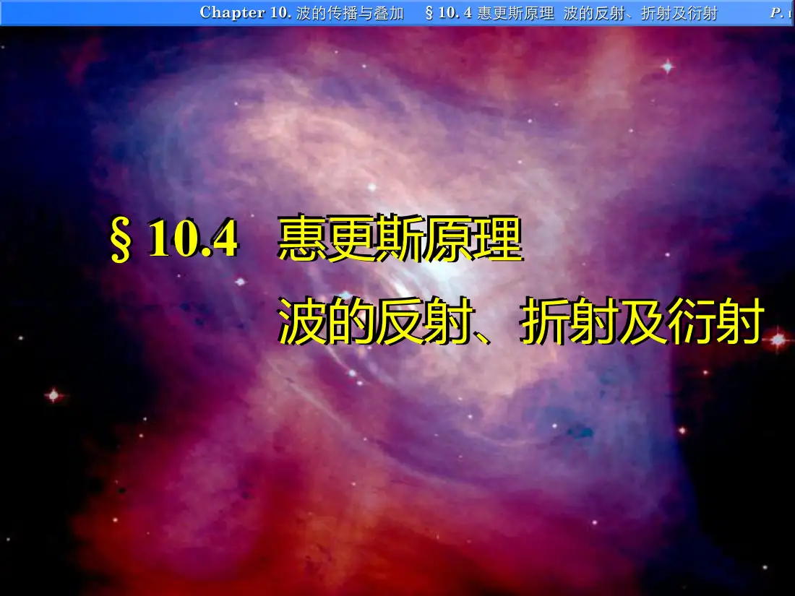

原文：

§ 10.4 惠更斯原理

波的反射、折射及衍射

Chapter 10. 波的传播与叠加 § 10.4 惠更斯原理 波的反射、折射及衍射

P.

### 一、惠更斯原理

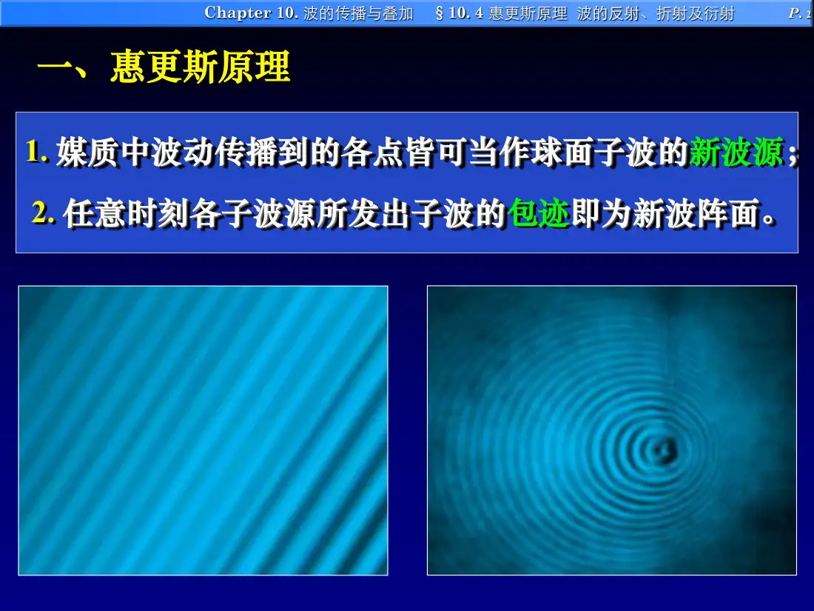

原文：

一、惠更斯原理

1. 媒质中波动传播到的各点皆可当作球面子波的新波源；

2. 任意时刻各子波源所发出子波的包迹即为新波阵面。

Chapter 10. 波的传播与叠加 § 10.4 惠更斯原理 波的反射、折射及衍射

P.2

### 一、惠更斯原理

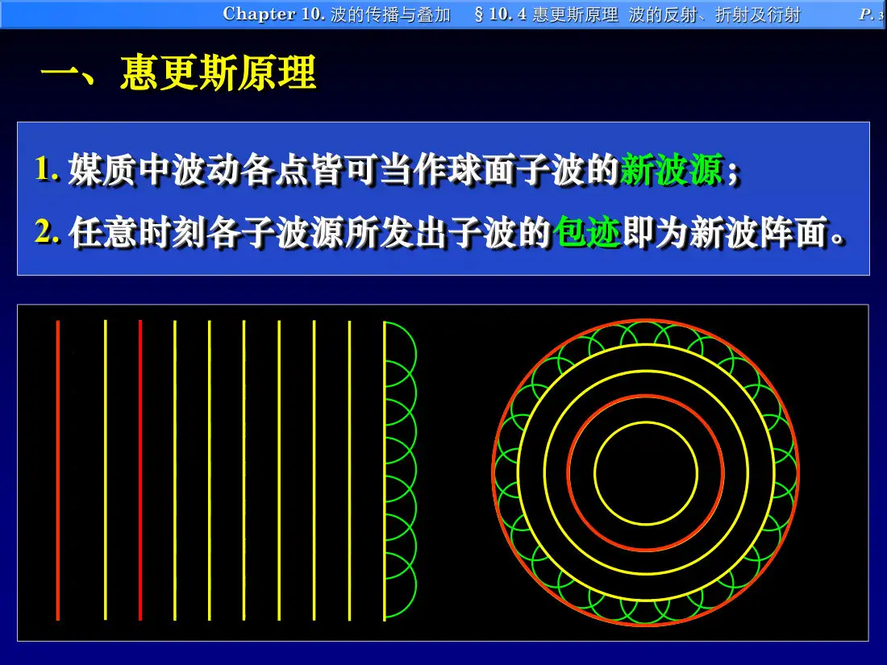

原文：

一、惠更斯原理

1. 媒质中波动各点皆可当作球面子波的新波源；

2. 任意时刻各子波源所发出子波的包迹即为新波阵面。

The image contains no textual content. It displays a diagram with vertical lines (red, yellow, green) and concentric circles (red, yellow, green) arranged in a grid-like pattern. Therefore, no OCR text can be generated.

Chapter 10. 波的传播与叠加 § 10.4 惠更斯原理 波的反射、折射及衍射

P. 3

### 一、惠更斯原理

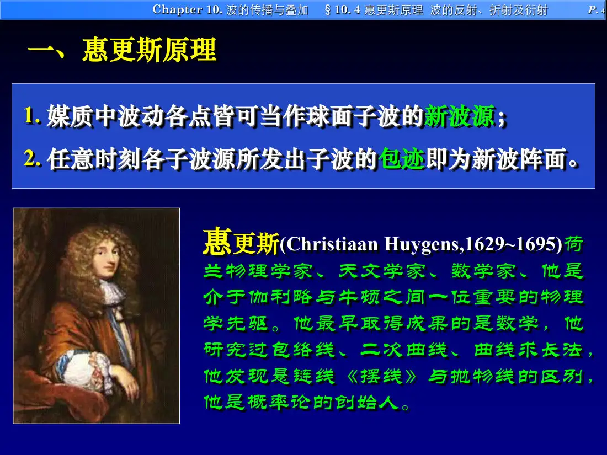

原文：

一、惠更斯原理

1. 媒质中波动各点皆可当作球面子波的新波源；

2. 任意时刻各子波源所发出子波的包迹即为新波阵面。

惠更斯(Christiaan Huygens,1629\~1695)荷兰物理学家、天文学家、数学家、他是介于伽利略与牛顿之间一位重要的物理学先驱。他最早取得成果的是数学，他研究过包络线、二次曲线、曲线求长法，他发现悬链线《摆线》与抛物线的区别，他是概率论的创始人。

Chapter 10. 波的传播与叠加 § 10.4 惠更斯原理 波的反射、折射及衍射

P. 4

### 二、波的衍射现象

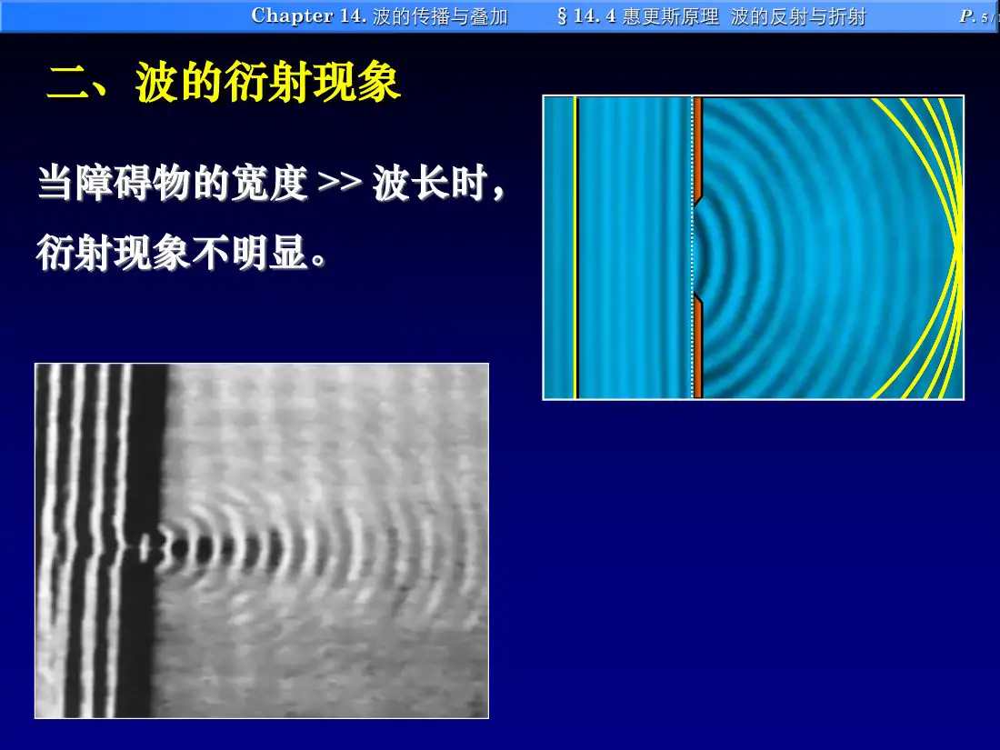

原文：

二、波的衍射现象

当障碍物的宽度 >> 波长时，衍射现象不明显。

Chapter 14. 波的传播与叠加 § 14.4 惠更斯原理 波的反射与折射

P. 5/

### 二、波的衍射现象

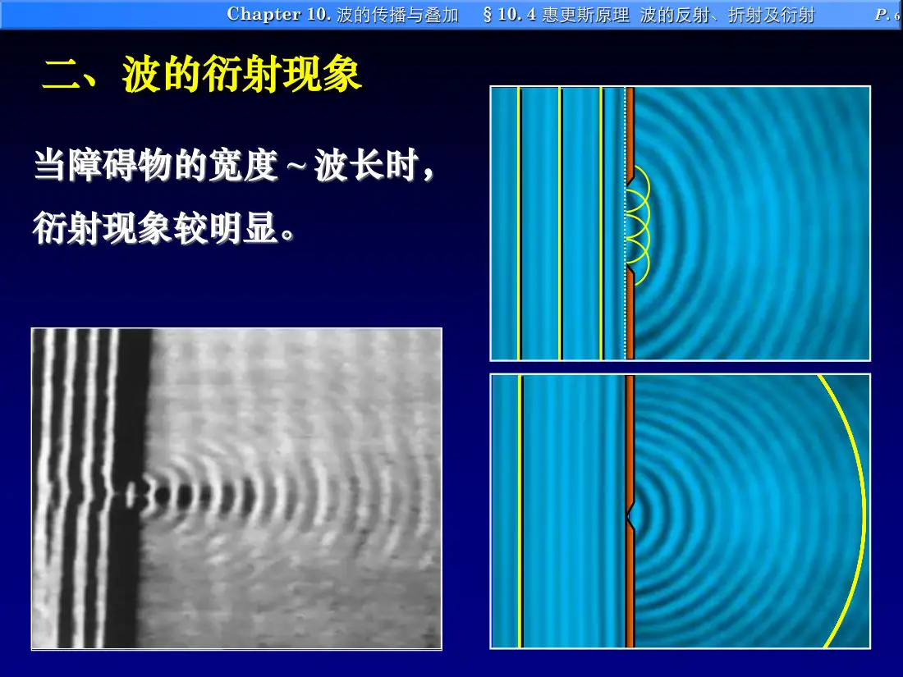

原文：

二、波的衍射现象

当障碍物的宽度～波长时，衍射现象较明显。

Chapter 10. 波的传播与叠加 § 10.4 惠更斯原理 波的反射、折射及衍射

P. 6

### 三、波的反射与折射

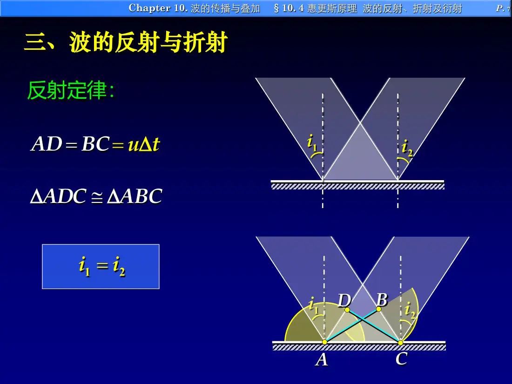

原文：

三、波的反射与折射

反射定律：

$$
A D = B C = u \Delta t
$$

$$
\Delta A D C \cong \Delta A B C
$$

$$
i _ {1} \equiv i _ {2}
$$

Chapter 10. 波的传播与叠加 § 10.4 惠更斯原理 波的反射、折射及衍射

P. 7

### 折射定律:

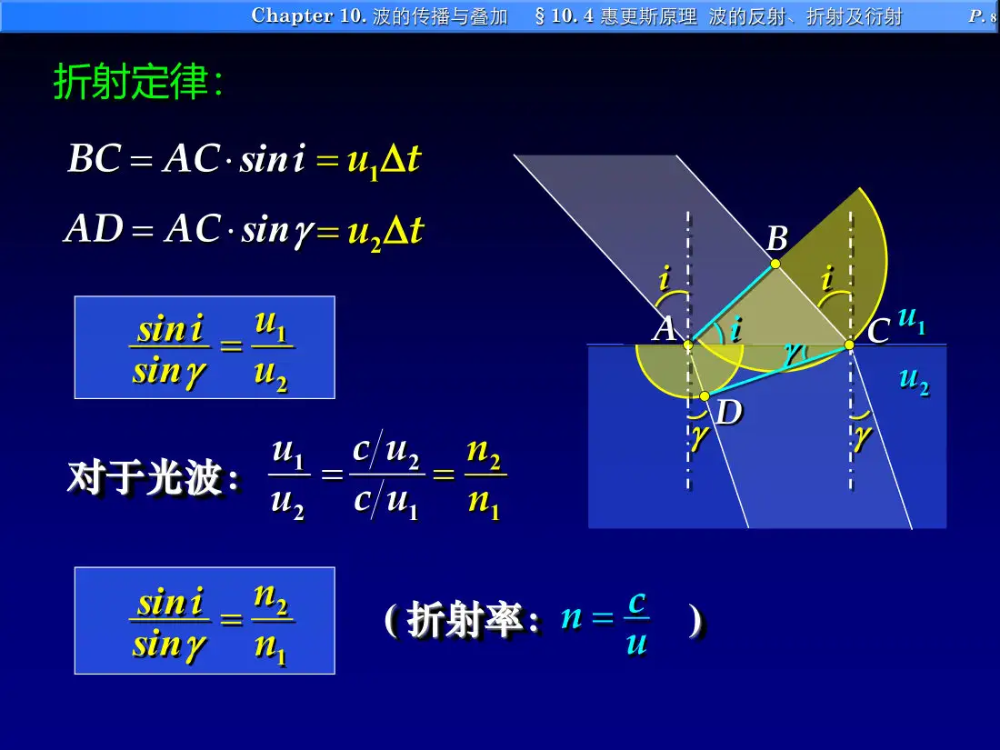

原文：

折射定律:

$$
B C = A C \cdot \sin i = u _ {1} \Delta t
$$

$$
A D = A C \cdot \sin \gamma = u _ {2} \Delta t
$$

$$
\frac {\sin i}{\sin \gamma} = \frac {u _ {1}}{u _ {2}}
$$

对于光波： $\frac{u_{1}}{u_{2}}=\frac{c/u_{2}}{c/u_{1}}=\frac{n_{2}}{n_{1}}$

$$
\frac {\sin i}{\sin \gamma} = \frac {n _ {2}}{n _ {1}}
$$

(折射率: $n=\frac{c}{u}$ )

Chapter 10. 波的传播与叠加 § 10.4 惠更斯原理 波的反射、折射及衍射

P. 8

### 四、透镜的折射

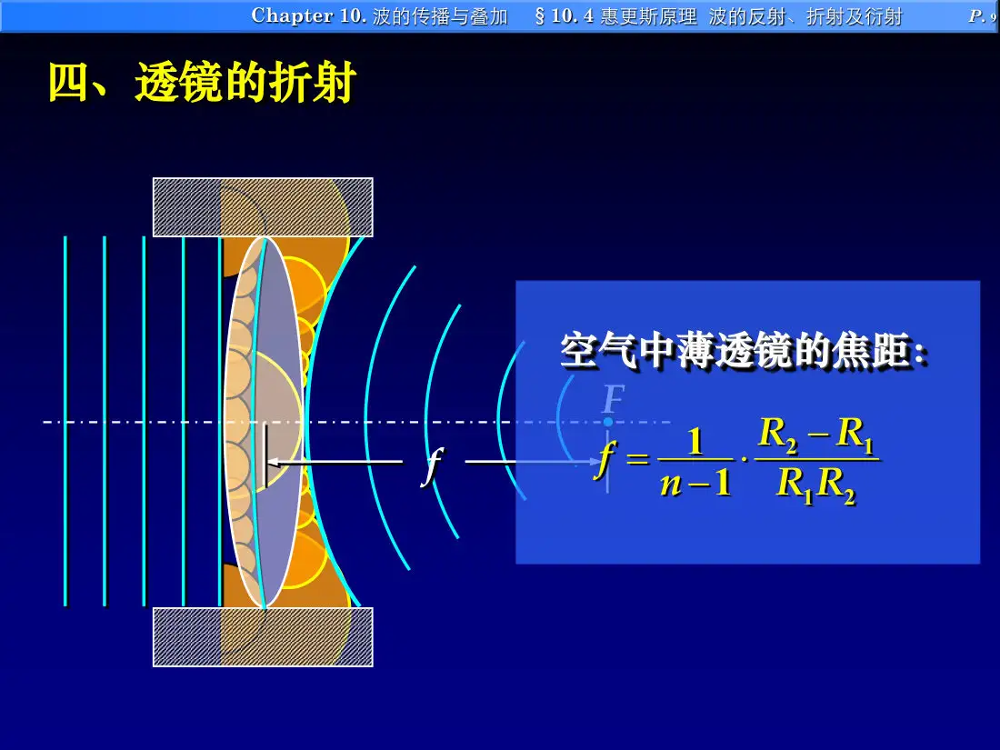

原文：

四、透镜的折射

空气中薄透镜的焦距：

$$
f = \frac {1}{n - 1} \cdot \frac {R _ {2} - R _ {1}}{R _ {1} R _ {2}}
$$

Chapter 10. 波的传播与叠加 § 10.4 惠更斯原理 波的反射、折射及衍射

P. 9

### 归纳：

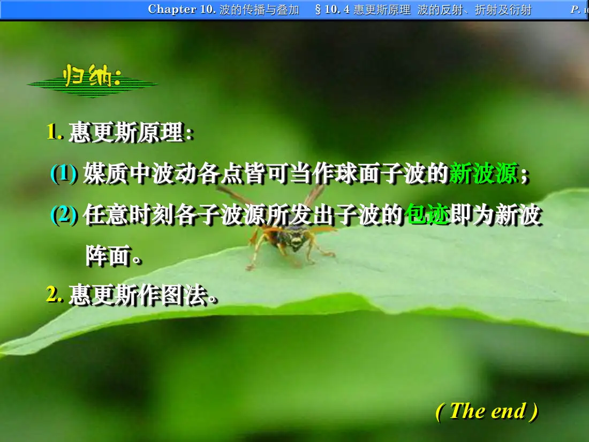

原文：

归纳：

1. 惠更斯原理：

(1) 媒质中波动各点皆可当作球面子波的新波源;

(2) 任意时刻各子波源所发出子波的包迹即为新波阵面。

2. 惠更斯作图法。

Chapter 10. 波的传播与叠加 § 10.4 惠更斯原理 波的反射、折射及衍射

P.1

( The end )

### 一、波的迭加与独立性传播原理

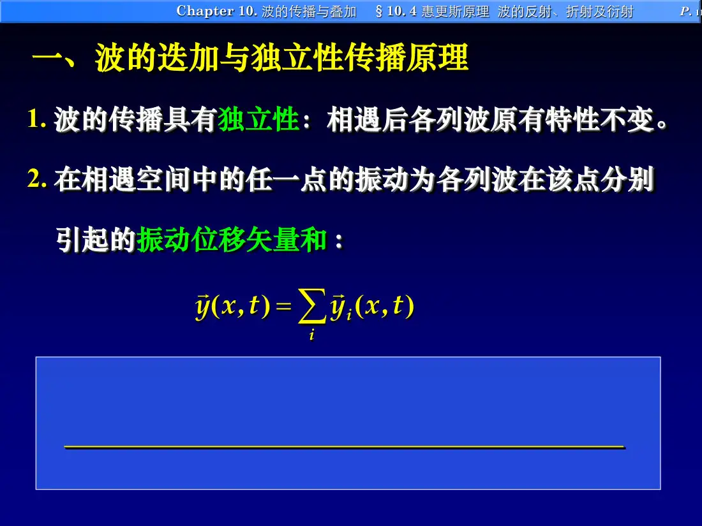

原文：

一、波的迭加与独立性传播原理

1. 波的传播具有独立性：相遇后各列波原有特性不变。

2. 在相遇空间中的任一点的振动为各列波在该点分别引起的振动位移矢量和：

$$
\vec {y} (x, t) = \sum_ {i} \vec {y} _ {i} (x, t)
$$

Chapter 10. 波的传播与叠加 § 10.4 惠更斯原理 波的反射、折射及衍射

P.

### P.

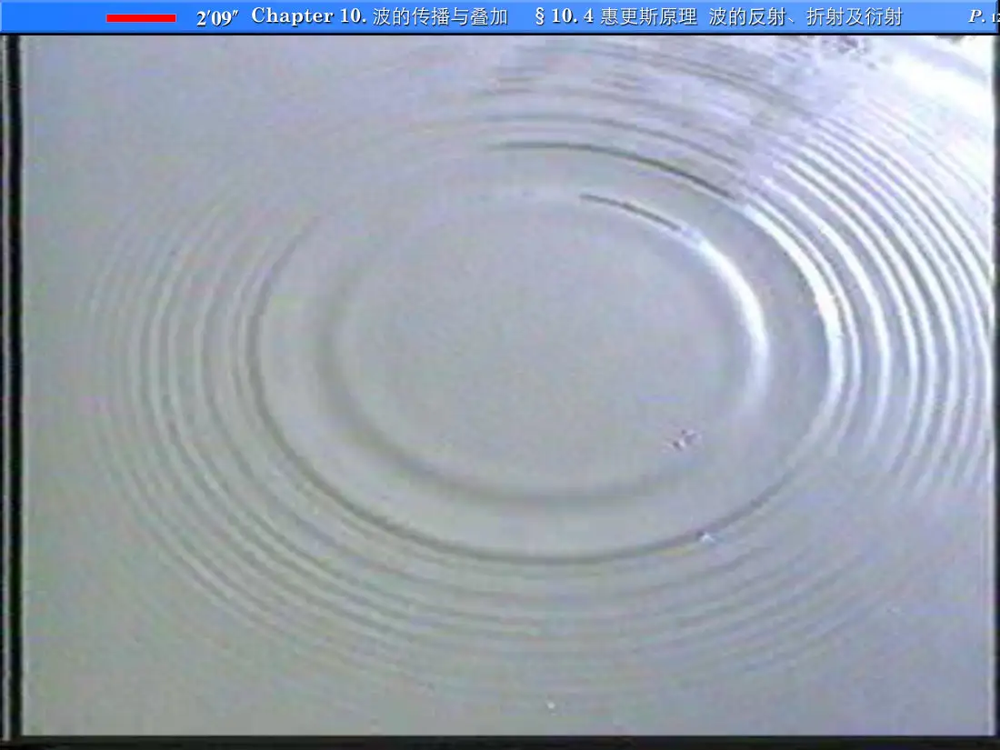

原文：

2'09" Chapter 10. 波的传播与叠加 § 10.4 惠更斯原理 波的反射、折射及衍射

P.

### P.1

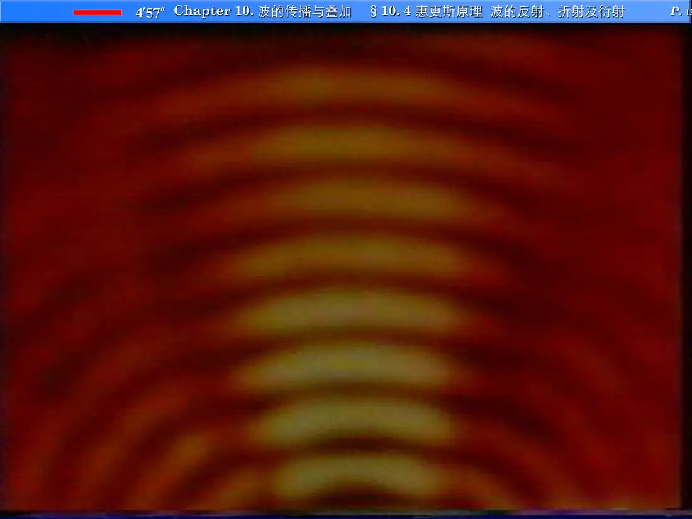

原文：

4'57" Chapter 10. 波的传播与叠加 § 10.4 惠更斯原理 波的反射、折射及衍射

P.1

### 二、波的干涉现象及其规律

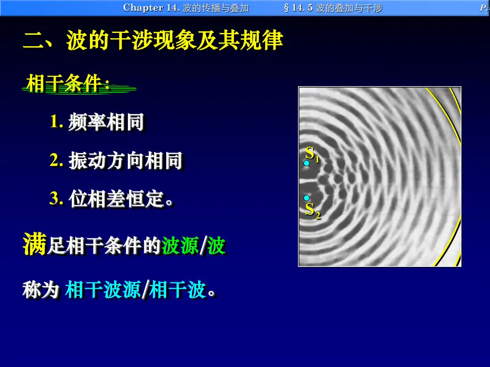

原文：

二、波的干涉现象及其规律

相干条件：

1. 频率相同

2. 振动方向相同

3. 位相差恒定。

满足相干条件的波源/波

称为相干波源/相干波。

Chapter 14. 波的传播与叠加

§ 14.5 波的叠加与干涉

P.

### $$

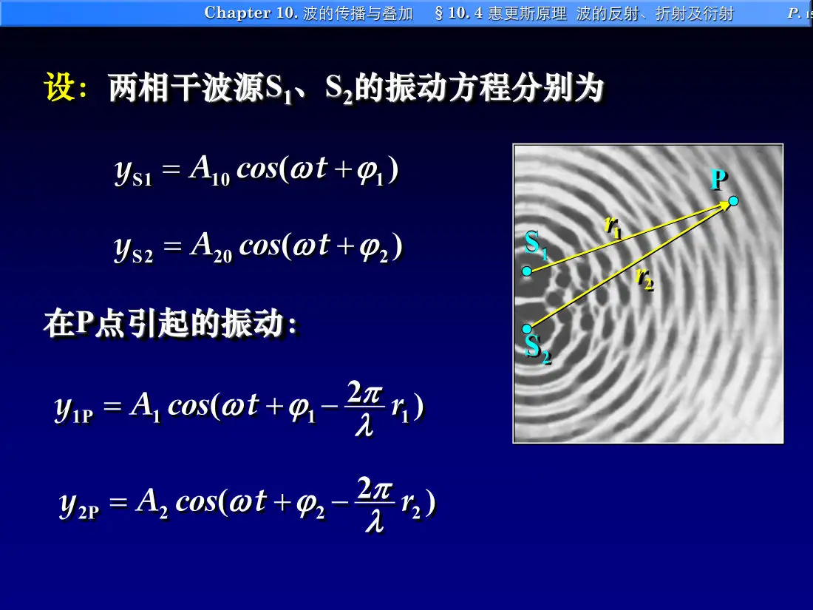

原文：

设: 两相干波源 $\mathrm{S}_{1} 、 \mathrm{~S}_{2}$ 的振动方程分别为

$$
y _ {\mathrm{S} 1} = A _ {1 0} \cos (\omega t + \varphi_ {1})
$$

$$
y _ {\mathrm{S} 2} = A _ {2 0} \cos (\omega t + \varphi_ {2})
$$

在P点引起的振动：

$$
y _ {1 \mathrm{P}} = A _ {1} \cos (\omega t + \varphi_ {1} - \frac {2 \pi}{\lambda} r _ {1})
$$

$$
y _ {2 \mathrm{P}} = A _ {2} \cos (\omega t + \varphi_ {2} - \frac {2 \pi}{\lambda} r _ {2})
$$

Chapter 10. 波的传播与叠加 § 10.4 惠更斯原理 波的反射、折射及衍射

P. 15

### 相干波源 $S_{1}$ 、 $S_{2}$ 的振动方向相同：

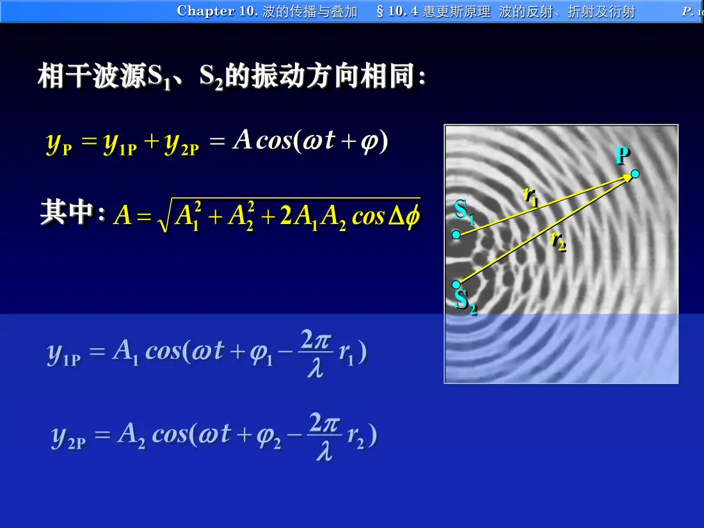

原文：

相干波源 $S_{1}$ 、 $S_{2}$ 的振动方向相同：

$$
y _ {\mathrm{P}} = y _ {1 \mathrm{P}} + y _ {2 \mathrm{P}} = A \cos (\omega t + \varphi)
$$

其中： $A=\sqrt{A_{1}^{2}+A_{2}^{2}+2A_{1}A_{2}\cos\Delta\phi}$

$$
y _ {1 \mathrm{P}} = A _ {1} \cos (\omega t + \varphi_ {1} - \frac {2 \pi}{\lambda} r _ {1})
$$

$$
y _ {2 \mathrm{P}} = A _ {2} \cos (\omega t + \varphi_ {2} - \frac {2 \pi}{\lambda} r _ {2})
$$

Chapter 10. 波的传播与叠加 § 10.4 惠更斯原理 波的反射、折射及衍射

P. 10

### 相干波源 $S_{1}$ 、 $S_{2}$ 的振动方向相同：

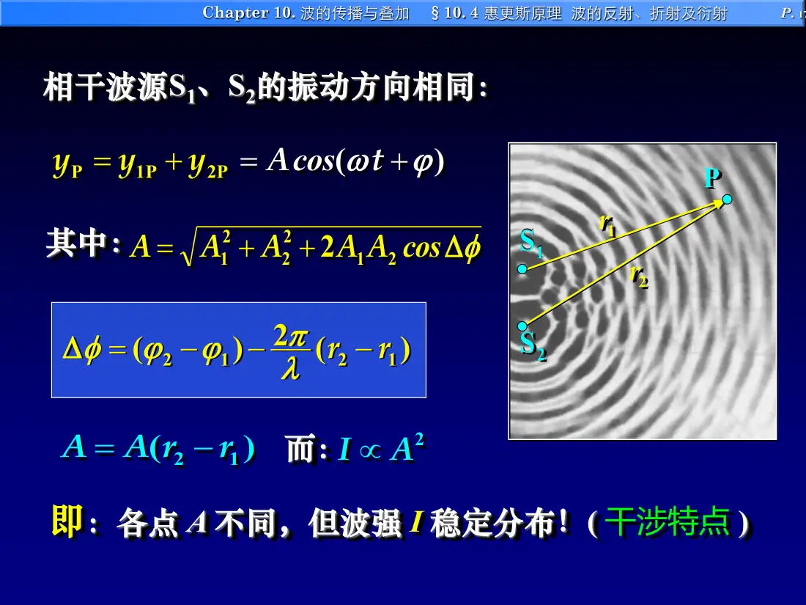

原文：

相干波源 $S_{1}$ 、 $S_{2}$ 的振动方向相同：

$$
y _ {\mathrm{P}} = y _ {1 \mathrm{P}} + y _ {2 \mathrm{P}} = A \cos (\omega t + \varphi)
$$

其中： $A=\sqrt{A_{1}^{2}+A_{2}^{2}+2A_{1}A_{2}\cos\Delta\phi}$

$$
\Delta \phi = (\varphi_ {2} - \varphi_ {1}) - \frac {2 \pi}{\lambda} (r _ {2} - r _ {1})
$$

$A = A(r_{2} - r_{1})$ 而: $I \propto A^{2}$

即：各点 $A$ 不同，但波强 $I$ 稳定分布！（干涉特点）

Chapter 10. 波的传播与叠加 § 10.4 惠更斯原理 波的反射、折射及衍射

P. 1

### $A = A_{1} + A_{2} = A_{max}$ 干涉加强

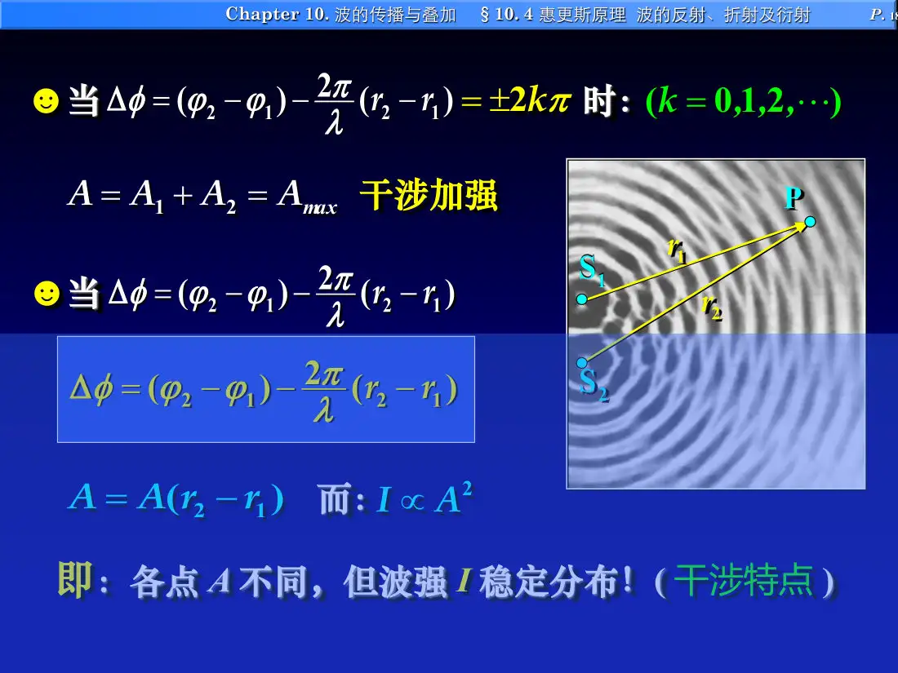

原文：

当 $\Delta\phi=(\varphi_{2}-\varphi_{1})-\frac{2\pi}{\lambda}(r_{2}-r_{1})=\pm2k\pi$ 时： $(k=0,1,2,\cdots)$

$A = A_{1} + A_{2} = A_{max}$ 干涉加强

当 $\Delta \phi = (\varphi_{2} - \varphi_{1}) - \frac{2\pi}{\lambda}(r_{2} - r_{1})$

$$
\Delta \phi = (\varphi_ {2} - \varphi_ {1}) - \frac {2 \pi}{\lambda} (r _ {2} - r _ {1})
$$

$A = A(r_{2} - r_{1})$ 而: $I \propto A^{2}$

即：各点 $A$ 不同，但波强 $I$ 稳定分布！（干涉特点）

Chapter 10. 波的传播与叠加 § 10.4 惠更斯原理 波的反射、折射及衍射

P. 18

### $A = A_{1} + A_{2} = A_{max}$ 干涉加强

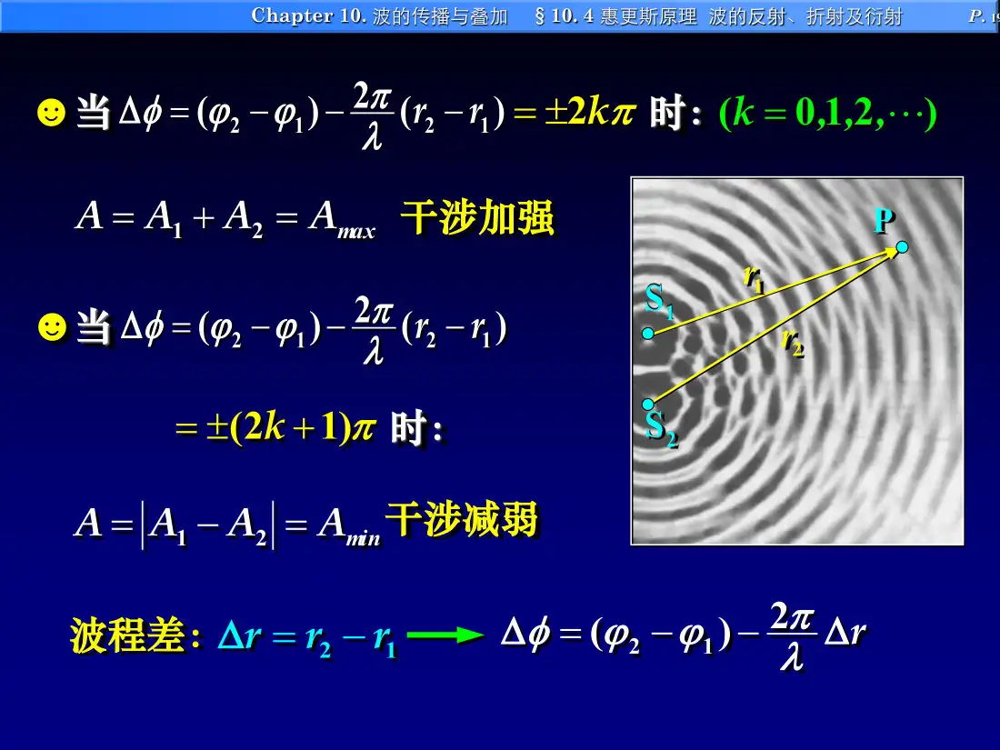

原文：

当 $\Delta\phi=(\varphi_{2}-\varphi_{1})-\frac{2\pi}{\lambda}(r_{2}-r_{1})=\pm2k\pi$ 时： $(k=0,1,2,\cdots)$

$A = A_{1} + A_{2} = A_{max}$ 干涉加强

当 $\Delta\phi=(\varphi_{2}-\varphi_{1})-\frac{2\pi}{\lambda}(r_{2}-r_{1})$ $=\pm(2k+1)\pi$ 时：

$A=\left|A_{1}-A_{2}\right|=A_{min}$ 干涉减弱

波程差: $\Delta r = r_{2} - r_{1} \longrightarrow \Delta \phi = (\varphi_{2} - \varphi_{1}) - \frac{2\pi}{\lambda} \Delta r$

Chapter 10. 波的传播与叠加 § 10.4 惠更斯原理 波的反射、折射及衍射

P. 19

### $$

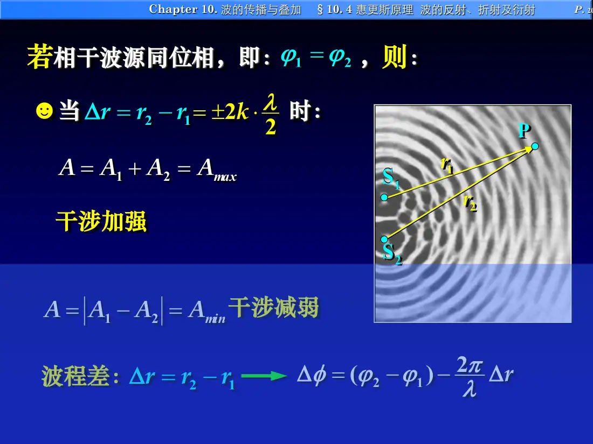

原文：

若相干波源同位相，即： $\varphi_{1}=\varphi_{2}$ ，则：

当 $\Delta r = r_{2} - r_{1} = \pm 2k \cdot \frac{\lambda}{2}$ 时:

$$
A = A _ {1} + A _ {2} = A _ {\max}
$$

干涉加强

$A=\left|A_{1}-A_{2}\right|=A_{min}$ 干涉减弱

波程差: $\Delta r = r_{2} - r_{1} \longrightarrow \Delta \phi = (\varphi_{2} - \varphi_{1}) - \frac{2\pi}{\lambda} \Delta r$

Chapter 10. 波的传播与叠加 § 10.4 惠更斯原理 波的反射、折射及衍射

P. 20

### $$

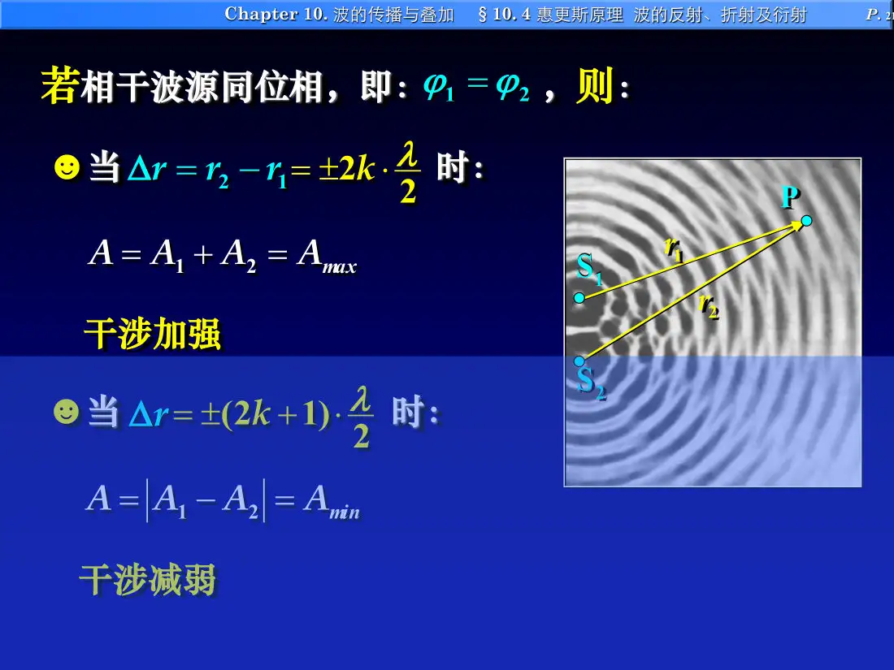

原文：

若相干波源同位相，即： $\varphi_{1} = \varphi_{2}$ ，则：

当 $\Delta r = r_{2} - r_{1} = \pm 2k \cdot \frac{\lambda}{2}$ 时:

$$
A = A _ {1} + A _ {2} = A _ {\max}
$$

干涉加强

当 $\Delta r = \pm(2k + 1) \cdot \frac{\lambda}{2}$ 时:

$$
A = \left| A _ {1} - A _ {2} \right| = A _ {\min}
$$

干涉减弱

Chapter 10. 波的传播与叠加 § 10.4 惠更斯原理 波的反射、折射及衍射

P. 21

### $$

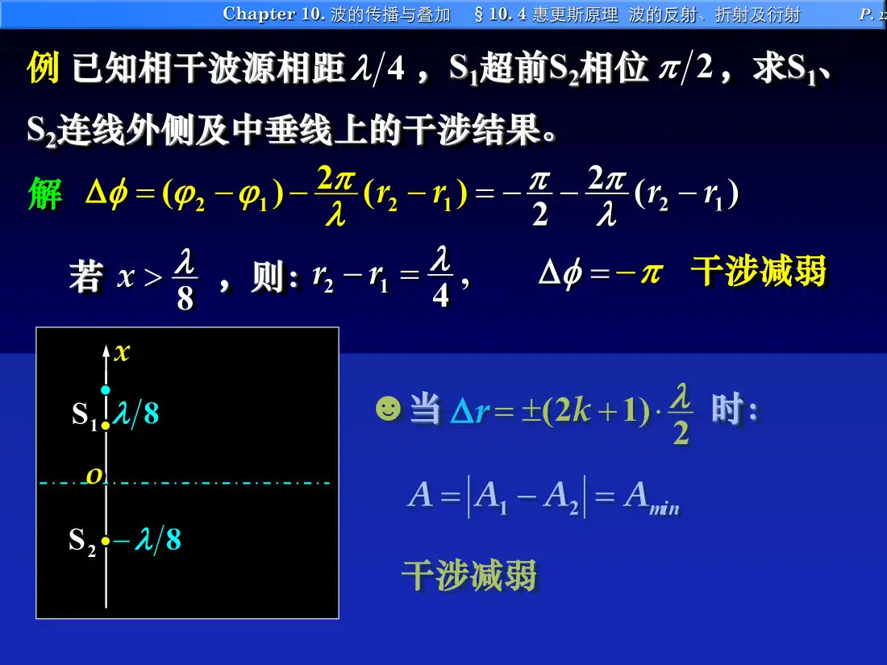

原文：

例 已知相干波源相距 $\lambda / 4$ ， $\mathrm{S}_1$ 超前 $\mathrm{S}_2$ 相位 $\pi / 2$ ，求 $\mathrm{S}_1$ 、 $\mathrm{S}_2$ 连线外侧及中垂线上的干涉结果。

解 $\Delta \phi = (\varphi_2 - \varphi_1) - \frac{2\pi}{\lambda} (r_2 - r_1) = -\frac{\pi}{2} - \frac{2\pi}{\lambda} (r_2 - r_1)$ 若 $x > \frac{\lambda}{8}$ ，则： $r_2 - r_1 = \frac{\lambda}{4}$ ， $\Delta \phi = -\pi$ 干涉减弱

$$
\begin{array}{c c} \text {   S   } _ {1} & \lambda / 8 \\ \text {   S   } _ {2} & - \lambda / 8 \end{array}
$$

当 $\Delta r = \pm(2k + 1) \cdot \frac{\lambda}{2}$ 时:

$$
A = \left| A _ {1} - A _ {2} \right| = A _ {\min}
$$

干涉减弱

Chapter 10. 波的传播与叠加 § 10.4 惠更斯原理 波的反射、折射及衍射

P. 22

### $\Delta \phi = 0$ 干涉加强

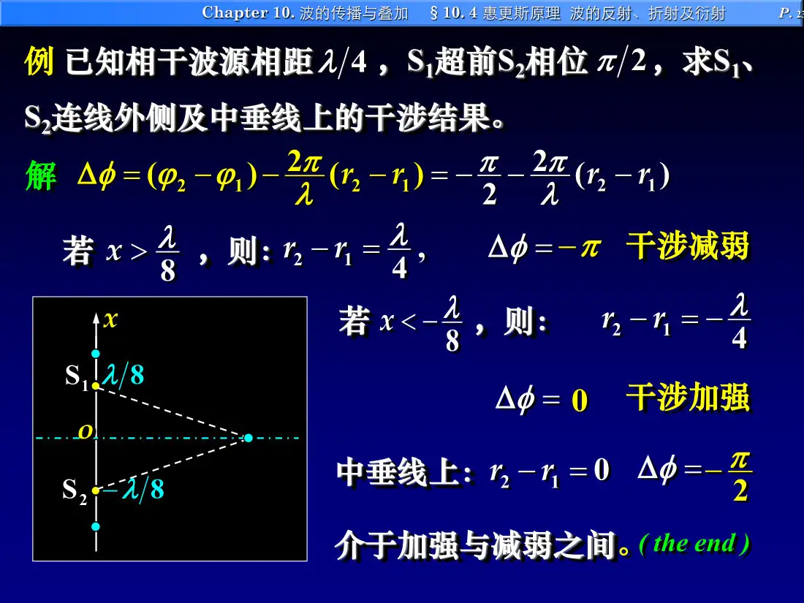

原文：

例 已知相干波源相距 $\lambda / 4$ ， $\mathrm{S}_{1}$ 超前 $\mathrm{S}_{2}$ 相位 $\pi / 2$ ，求 $\mathrm{S}_{1} 、 \mathrm{S}_{2}$ 连线外侧及中垂线上的干涉结果。

解 $\Delta \phi = (\varphi_{2} - \varphi_{1}) - \frac{2\pi}{\lambda}(r_{2} - r_{1}) = -\frac{\pi}{2} -\frac{2\pi}{\lambda} (r_{2} - r_{1})$

若 $x > \frac{\lambda}{8}$ ，则： $r_{2} - r_{1} = \frac{\lambda}{4}$ ， $\Delta\phi = -\pi$ 干涉减弱

若 $x < -\frac{\lambda}{8}$ , 则: $r_{2} - r_{1} = -\frac{\lambda}{4}$

$\Delta \phi = 0$ 干涉加强

中垂线上: $r_{2} - r_{1} = 0 \quad \Delta \phi = -\frac{\pi}{2}$

介于加强与减弱之间。(the end)

Chapter 10. 波的传播与叠加 § 10.4 惠更斯原理 波的反射、折射及衍射

P. 23

### 归纳：

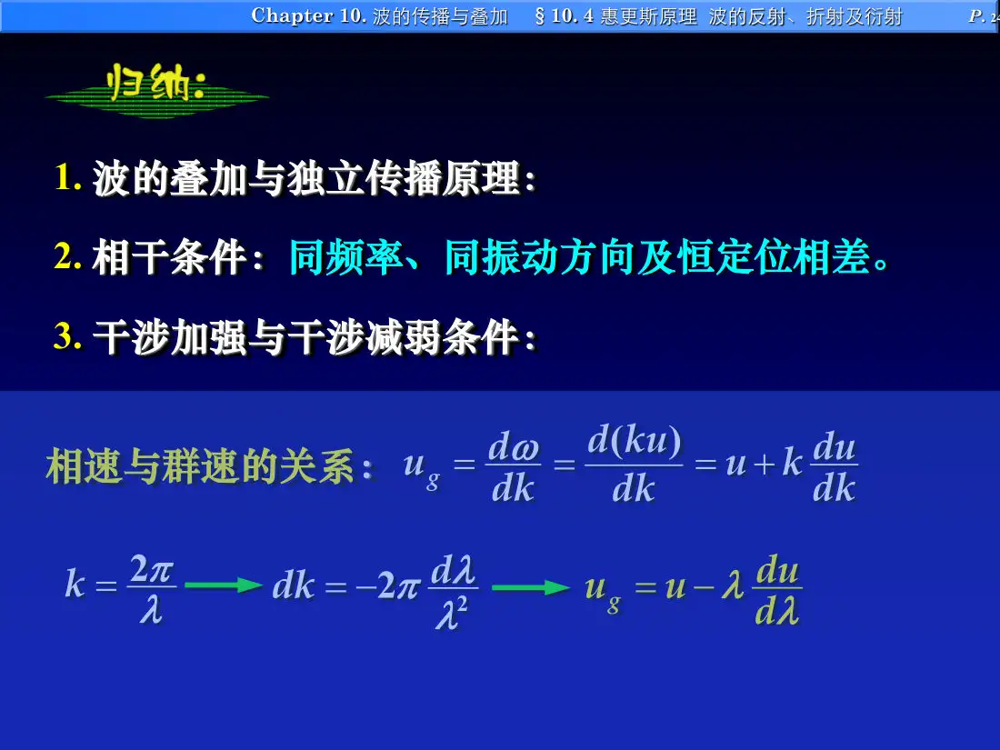

原文：

归纳：

1. 波的叠加与独立传播原理：

2. 相干条件：同频率、同振动方向及恒定位相差。

3. 干涉加强与干涉减弱条件：

相速与群速的关系: $u_{g} = \frac{d\omega}{dk} = \frac{d(ku)}{dk} = u + k\frac{du}{dk}$

$$
k = \frac {2 \pi}{\lambda} \longrightarrow d k = - 2 \pi \frac {d \lambda}{\lambda^ {2}} \longrightarrow u _ {g} = u - \lambda \frac {d u}{d \lambda}
$$

Chapter 10. 波的传播与叠加 § 10.4 惠更斯原理 波的反射、折射及衍射

P. 24

### \*三、波包、相速和群速

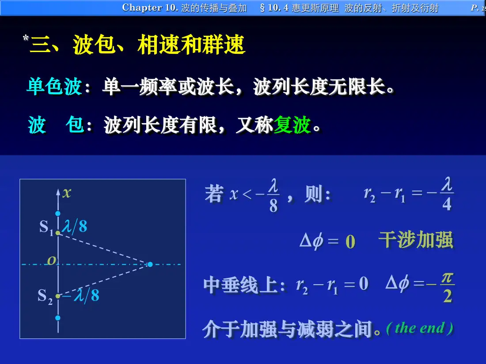

原文：

\*三、波包、相速和群速

单色波：单一频率或波长，波列长度无限长。

波包：波列长度有限，又称复波。

若 $x < -\frac{\lambda}{8}$ ，则： $r_{2} - r_{1} = -\frac{\lambda}{4}$

$\Delta \phi = 0$ 干涉加强

中垂线上: $r_{2} - r_{1} = 0 \quad \Delta \phi = - \frac{\pi}{2}$

介于加强与减弱之间。(the end)

Chapter 10. 波的传播与叠加 § 10.4 惠更斯原理 波的反射、折射及衍射

P. 25

### 归纳:

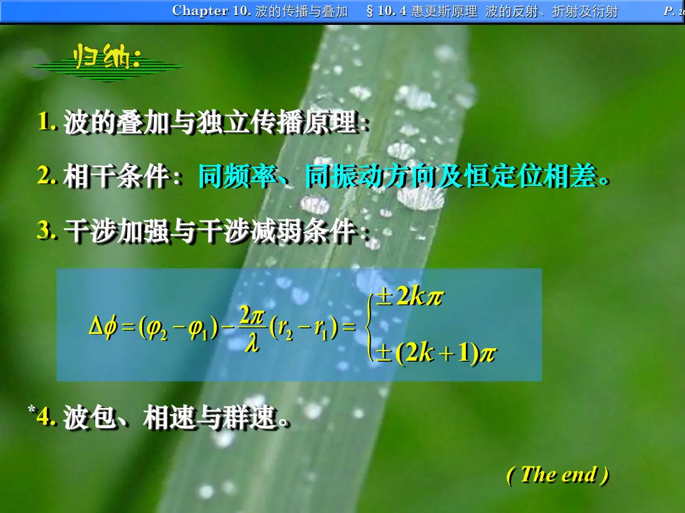

原文：

归纳:

1. 波的叠加与独立传播原理:

2. 相干条件：同频率、同振动方向及恒定位相差。

3. 干涉加强与干涉减弱条件：

$$
\Delta \phi = (\varphi_ {2} - \varphi_ {1}) - \frac {2 \pi}{\lambda} (r _ {2} - r _ {1}) = \left\{ \begin{array}{l} \pm 2 k \pi \\ \pm (2 k + 1) \pi \end{array} \right.
$$

\*4. 波包、相速与群速。

$$
(T h e e n d)
$$

Chapter 10. 波的传播与叠加 § 10.4 惠更斯原理 波的反射、折射及衍射

P. 26

### \*三、波包、相速和群速

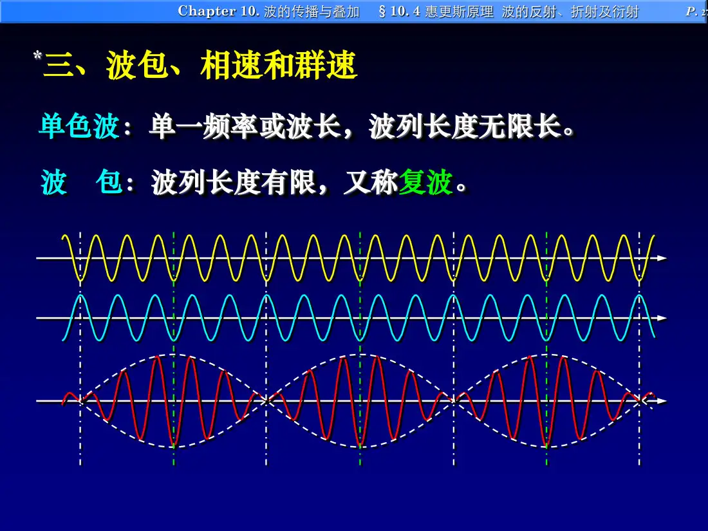

原文：

\*三、波包、相速和群速

单色波：单一频率或波长，波列长度无限长。

波包：波列长度有限，又称复波。

Chapter 10. 波的传播与叠加 § 10.4 惠更斯原理 波的反射、折射及衍射

P. 27

### 设有两列沿 $+x$ 轴传播的简谐波：

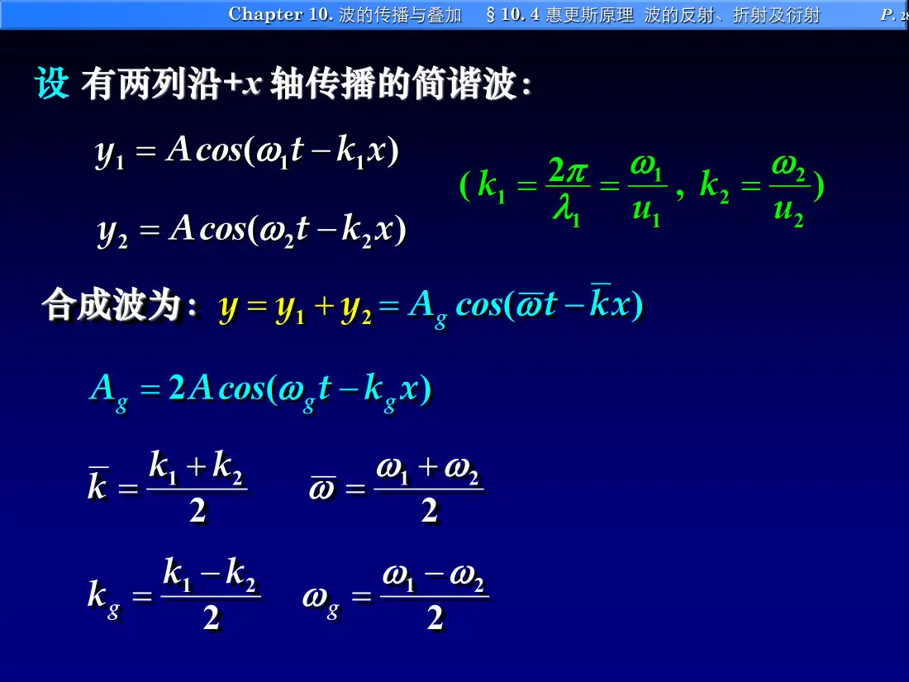

原文：

设有两列沿 $+x$ 轴传播的简谐波：

$$
y _ {1} = A \cos (\omega_ {1} t - k _ {1} x)
$$

$$
y _ {2} = A \cos (\omega_ {2} t - k _ {2} x)
$$

$$
(k _ {1} = \frac {2 \pi}{\lambda_ {1}} = \frac {\omega_ {1}}{u _ {1}}, k _ {2} = \frac {\omega_ {2}}{u _ {2}})
$$

合成波为： $y=y_{1}+y_{2}=A_{g}\cos(\overline{\omega}t-\overline{k}x)$

$$
A _ {g} = 2 A \cos (\omega_ {g} t - k _ {g} x)
$$

$$
\overline {{k}} = \frac {k _ {1} + k _ {2}}{2} \quad \overline {{\omega}} = \frac {\omega_ {1} + \omega_ {2}}{2}
$$

$$
k _ {g} = \frac {k _ {1} - k _ {2}}{2} \quad \omega_ {g} = \frac {\omega_ {1} - \omega_ {2}}{2}
$$

Chapter 10. 波的传播与叠加 § 10.4 惠更斯原理 波的反射、折射及衍射

P. 28

### 波包 $A_{\mathrm{g}}$

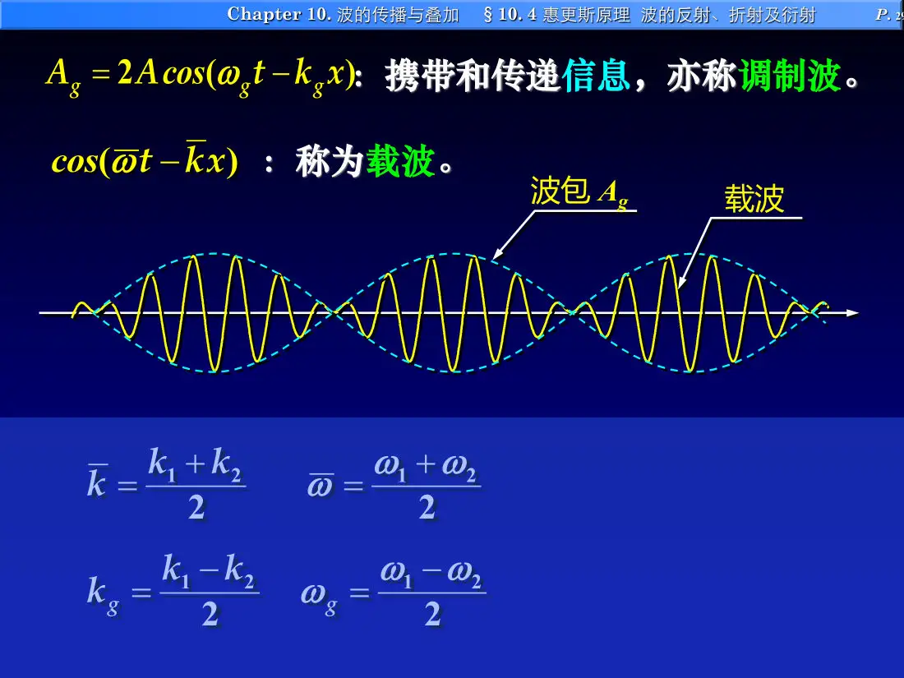

原文：

$A_{g}=2A\cos(\omega_{g}t-k_{g}x)$ ：携带和传递信息，亦称调制波。

cos( $\overline{\omega}t-\overline{k}x$ ) : 称为载波。

波包 $A_{\mathrm{g}}$

载波

$$
\overline {{k}} = \frac {k _ {1} + k _ {2}}{2}
$$

$$
\overline {{\omega}} = \frac {\omega_ {1} + \omega_ {2}}{2}
$$

$$
k _ {g} = \frac {k _ {1} - k _ {2}}{2} \quad \omega_ {g} = \frac {\omega_ {1} - \omega_ {2}}{2}
$$

Chapter 10. 波的传播与叠加 § 10.4 惠更斯原理 波的反射、折射及衍射

P. 29

### 波包 $A_{g}$

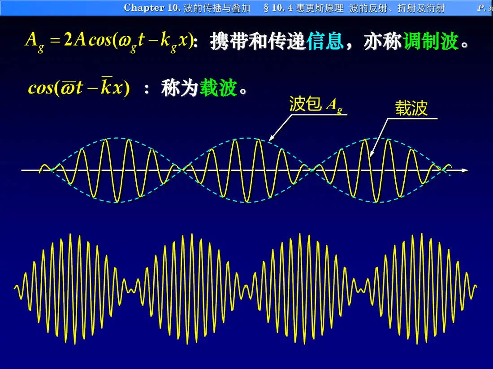

原文：

$A_{g}=2A\cos(\omega_{g}t-k_{g}x)$ ：携带和传递信息，亦称调制波。

cos( $\overline{\omega}t-\overline{k}x$ ) : 称为载波。

波包 $A_{g}$

载波

The image contains no text. The OCR result "1" is a hallucination and does not correspond to any content in the source image. Therefore, the correct OCR output must reflect the absence of any visible text. (no text)

Chapter 10. 波的传播与叠加 § 10.4 惠更斯原理 波的反射、折射及衍射

P. 30

### 相速 u ：振动状态或位相传播的速度

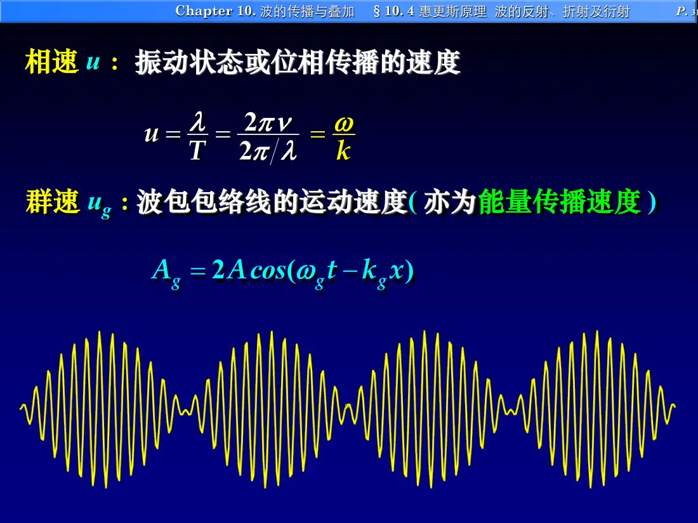

原文：

相速 u ：振动状态或位相传播的速度

$$
u = \frac {\lambda}{T} = \frac {2 \pi \nu}{2 \pi / \lambda} = \frac {\omega}{k}
$$

群速 $u_{g}$ : 波包包络线的运动速度(亦为能量传播速度)

$$
A _ {g} = 2 A \cos (\omega_ {g} t - k _ {g} x)
$$

Chapter 10. 波的传播与叠加 § 10.4 惠更斯原理 波的反射、折射及衍射

P. 31

### 相速 u ：振动状态或位相传播的速度

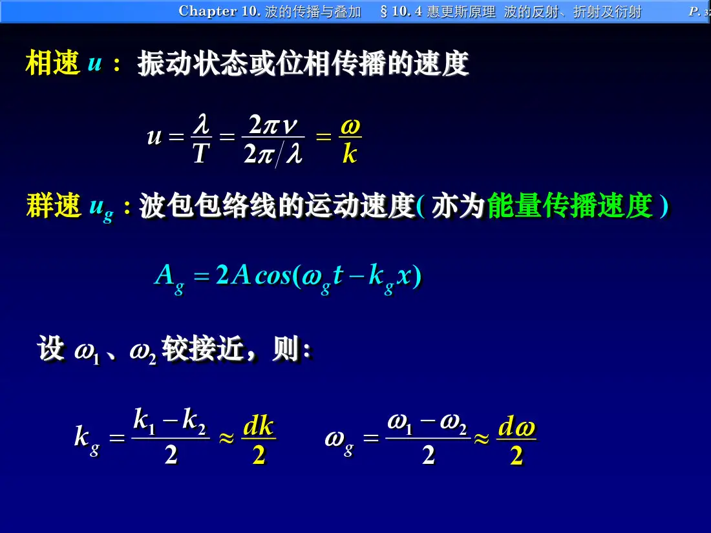

原文：

相速 u ：振动状态或位相传播的速度

$$
u = \frac {\lambda}{T} = \frac {2 \pi \nu}{2 \pi / \lambda} = \frac {\omega}{k}
$$

群速 $u_{g}$ : 波包包络线的运动速度(亦为能量传播速度)

$$
A _ {g} = 2 A \cos (\omega_ {g} t - k _ {g} x)
$$

设 $\omega_{1}$ 、 $\omega_{2}$ 较接近，则：

$$
k _ {g} = \frac {k _ {1} - k _ {2}}{2} \approx \frac {d k}{2} \quad \omega_ {g} = \frac {\omega_ {1} - \omega_ {2}}{2} \approx \frac {d \omega}{2}
$$

Chapter 10. 波的传播与叠加 § 10.4 惠更斯原理 波的反射、折射及衍射

P. 32

### $$

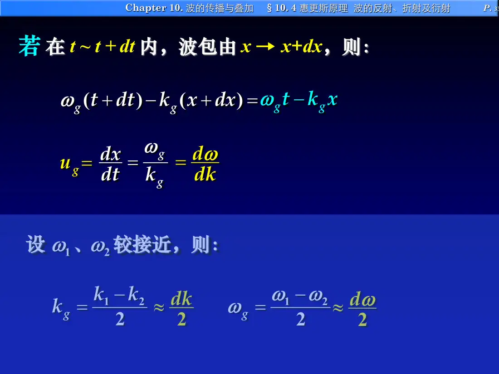

原文：

若在 $t \sim t + dt$ 内，波包由 $x \to x + dx$ ，则：

$$
\omega_ {g} (t + d t) - k _ {g} (x + d x) = \omega_ {g} t - k _ {g} x
$$

$$
u _ {g} = \frac {d x}{d t} = \frac {\omega_ {g}}{k _ {g}} = \frac {d \omega}{d k}
$$

设 $\omega_{1} 、 \omega_{2}$ 较接近，则:

$$
k _ {g} = \frac {k _ {1} - k _ {2}}{2} \approx \frac {d k}{2} \quad \omega_ {g} = \frac {\omega_ {1} - \omega_ {2}}{2} \approx \frac {d \omega}{2}
$$

Chapter 10. 波的传播与叠加 § 10.4 惠更斯原理 波的反射、折射及衍射

P. 33

### $$

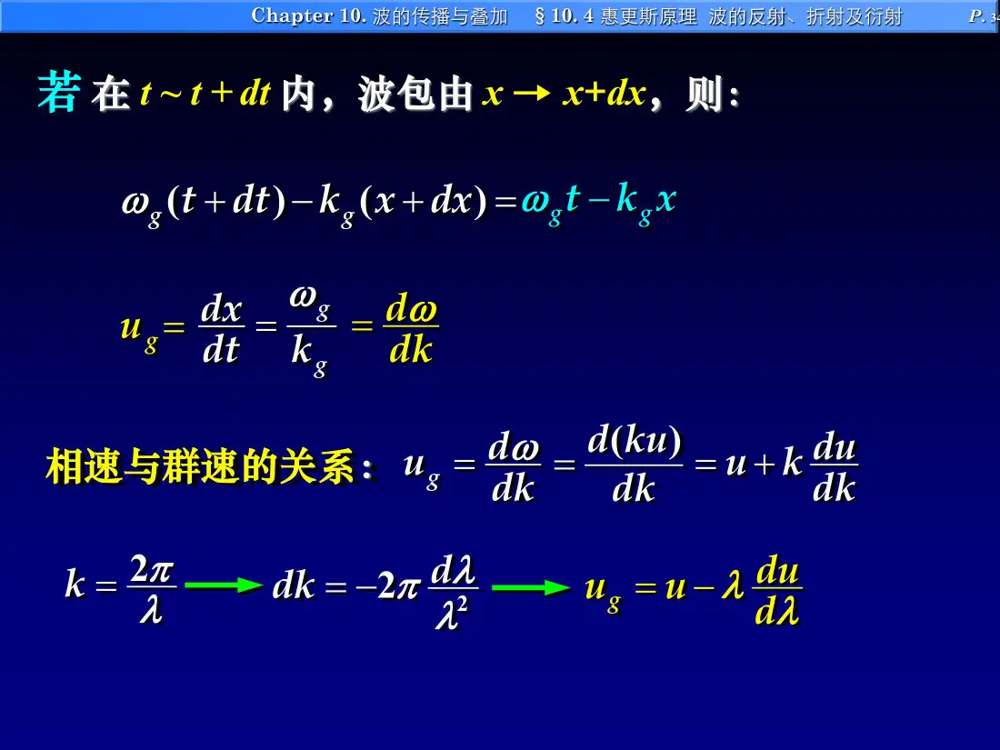

原文：

若在 $t \sim t + dt$ 内，波包由 $x \to x + dx$ ，则：

$$
\omega_ {g} (t + d t) - k _ {g} (x + d x) = \omega_ {g} t - k _ {g} x
$$

$$
u _ {g} = \frac {d x}{d t} = \frac {\omega_ {g}}{k _ {g}} = \frac {d \omega}{d k}
$$

相速与群速的关系： $u_{g}=\frac{d\omega}{dk}=\frac{d(ku)}{dk}=u+k\frac{du}{dk}$

$$
k = \frac {2 \pi}{\lambda} \longrightarrow d k = - 2 \pi \frac {d \lambda}{\lambda^ {2}} \longrightarrow u _ {g} = u - \lambda \frac {d u}{d \lambda}
$$

Chapter 10. 波的传播与叠加 § 10.4 惠更斯原理 波的反射、折射及衍射

P. 34
