# 《大学物理》第10章 波的传播与叠加 §10.5 驻波（课件）

原件的每一页，下面附识别出的文字。

### § 10.5 驻波

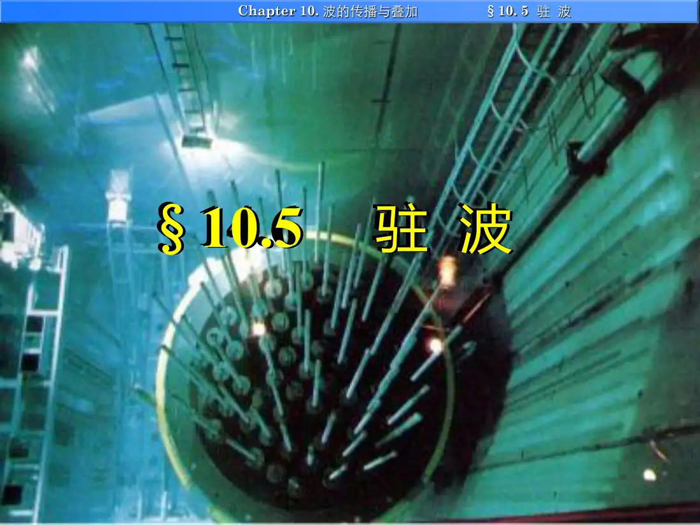

原文：

§ 10.5 驻波

Chapter 10. 波的传播与叠加

§ 10.5 驻波

### 一、驻波的形成

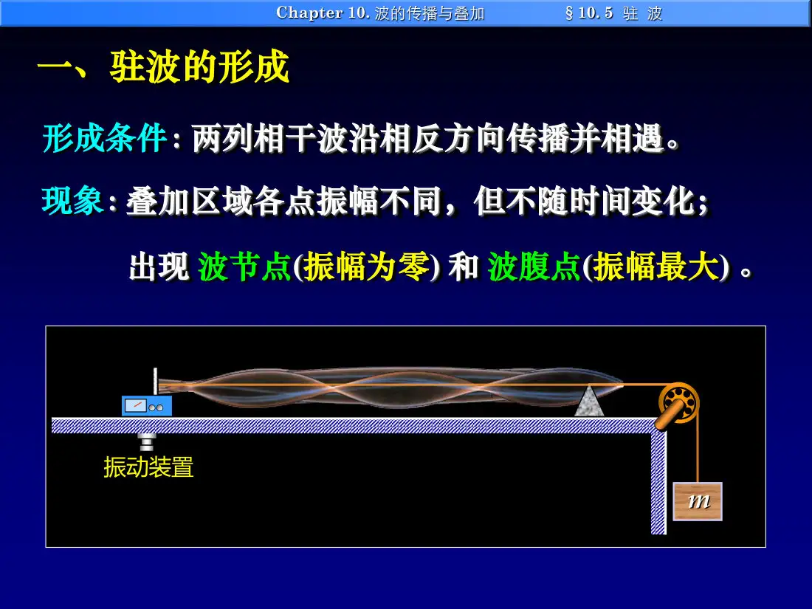

原文：

一、驻波的形成

形成条件: 两列相干波沿相反方向传播并相遇。

现象: 叠加区域各点振幅不同, 但不随时间变化;

出现波节点(振幅为零)和波腹点(振幅最大)。

振动装置

Chapter 10. 波的传播与叠加

§ 10.5 驻波

### 振动装置

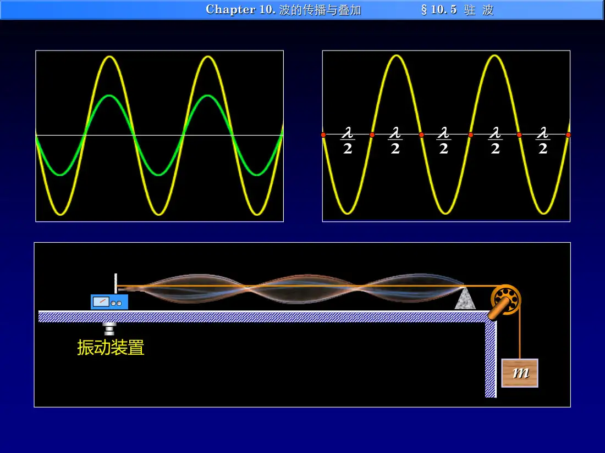

原文：

振动装置

Chapter 10. 波的传播与叠加

§ 10.5 驻波

### 二、驻波方程

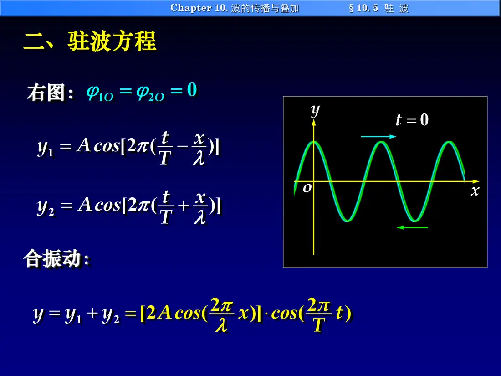

原文：

二、驻波方程

右图： $\varphi_{10} = \varphi_{20} = 0$

$$
y _ {1} = A \cos [ 2 \pi (\frac {t}{T} - \frac {x}{\lambda}) ]
$$

$$
y _ {2} = A \cos \left[ 2 \pi \left(\frac {t}{T} + \frac {x}{\lambda}\right) \right]
$$

合振动：

$$
y = y _ {1} + y _ {2} = \left[ 2 A \cos \left(\frac {2 \pi}{\lambda} x\right) \right] \cdot \cos \left(\frac {2 \pi}{T} t\right)
$$

Chapter 10. 波的传播与叠加

§ 10.5 驻波

### 令： $A(x)=2A\cos(\frac{2\pi}{\lambda}x)$

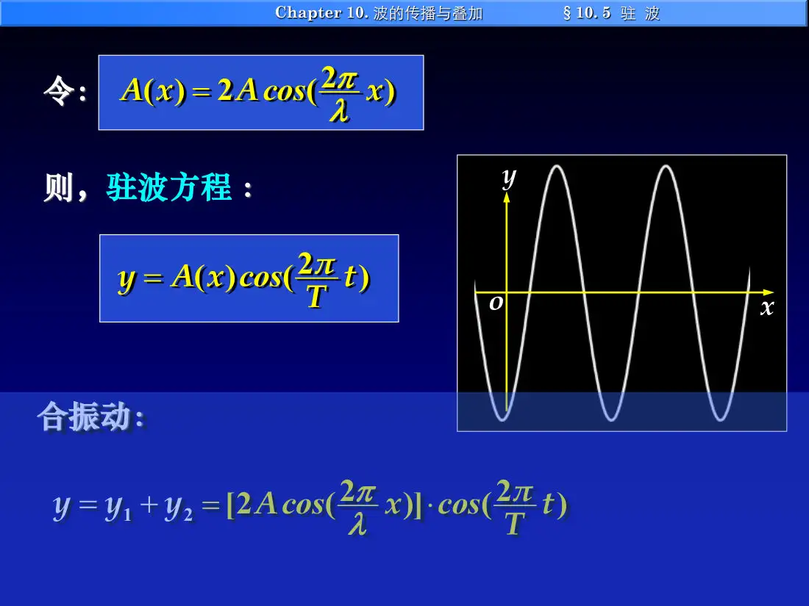

原文：

令： $A(x)=2A\cos(\frac{2\pi}{\lambda}x)$

则，驻波方程：

$$
y = A (x) \cos (\frac {2 \pi}{T} t)
$$

合振动：

$$
\begin{array}{c c c} \hline & y \\ \hline & o \\ \hline & x \\ \hline \end{array}
$$

$$
y = y _ {1} + y _ {2} = [ 2 A \cos (\frac {2 \pi}{\lambda} x) ] \cdot \cos (\frac {2 \pi}{T} t)
$$

Chapter 10. 波的传播与叠加

§ 10.5 驻波

### 令： $A(x)=2A\cos(\frac{2\pi}{\lambda}x)$

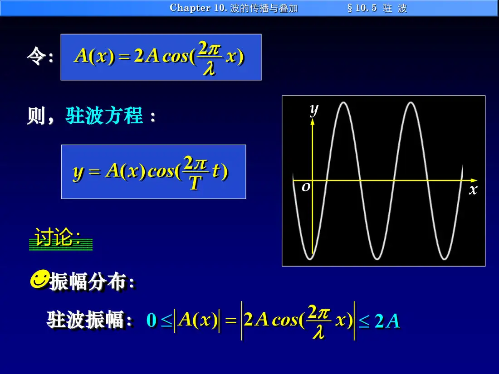

原文：

令： $A(x)=2A\cos(\frac{2\pi}{\lambda}x)$

则，驻波方程：

$$
y = A (x) \cos (\frac {2 \pi}{T} t)
$$

$$
\begin{array}{c c} \text { y } \\ \text { x } \end{array}
$$

讨论：

振幅分布：

驻波振幅: $0 \leq |A(x)| = |2A \cos(\frac{2\pi}{\lambda} x)| \leq 2A$

Chapter 10. 波的传播与叠加

§ 10.5 驻波

### $$

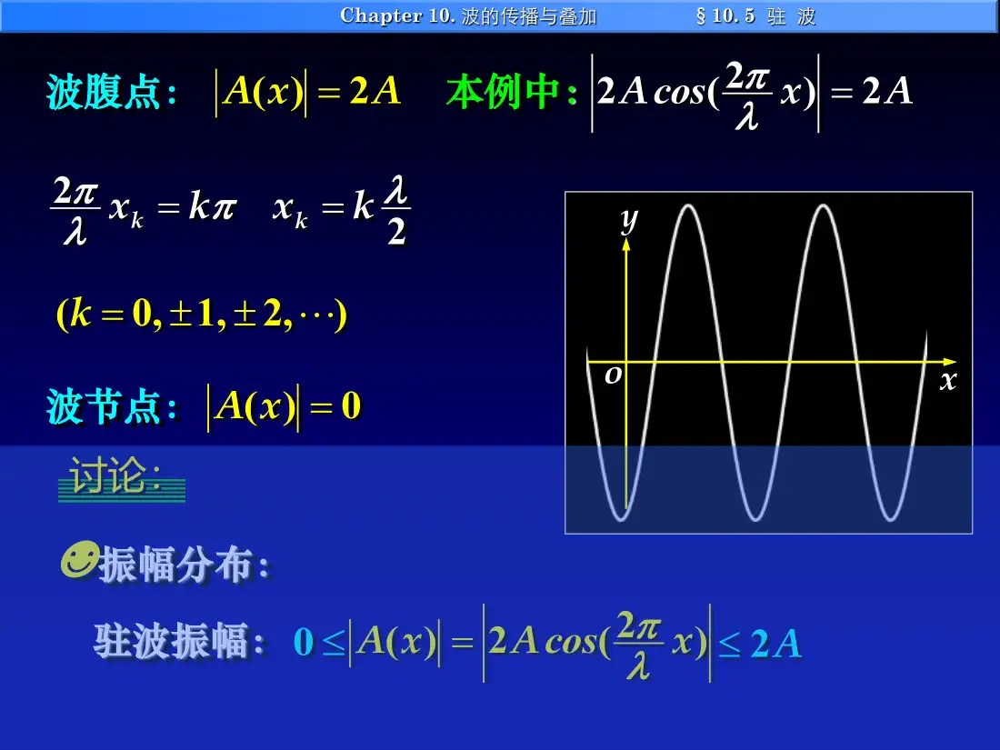

原文：

波腹点: $|A(x)| = 2A$ 本例中: $\left|2A\cos \left(\frac{2\pi}{\lambda}x\right)\right| = 2A$

$$
\frac {2 \pi}{\lambda} x _ {k} = k \pi \quad x _ {k} = k \frac {\lambda}{2}
$$

$$
(k = 0, \pm 1, \pm 2, \dots)
$$

波节点: $|A(x)| = 0$

$$
\begin{array}{c c} \text { y } & \\ \text { x } & \end{array}
$$

讨论：

振幅分布：

驻波振幅: $0 \leq |A(x)| = |2A \cos(\frac{2\pi}{\lambda} x)| \leq 2A$

Chapter 10. 波的传播与叠加

§ 10.5 驻波

### $$

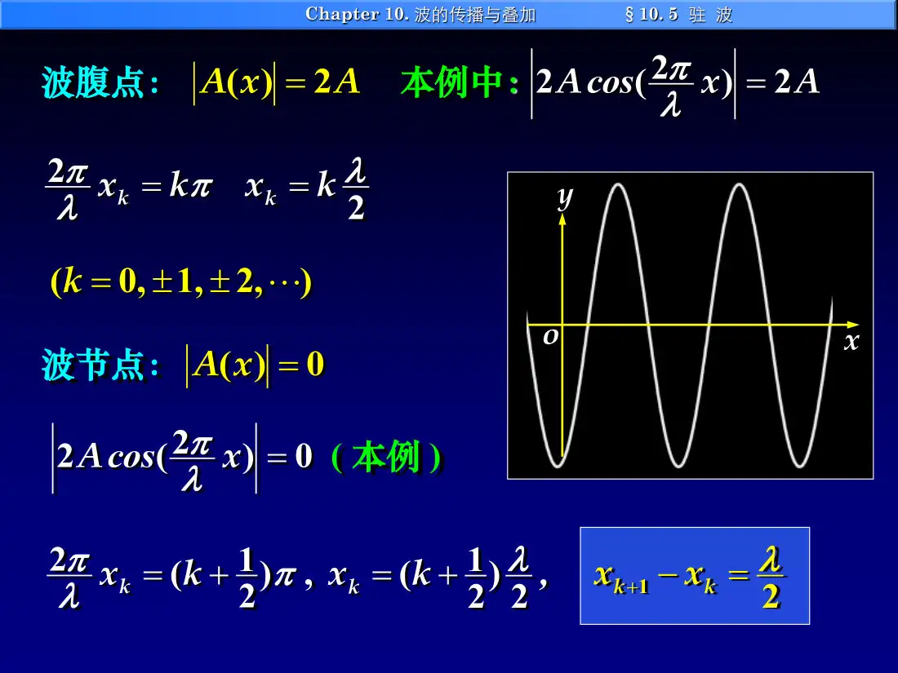

原文：

波腹点: $|A(x)| = 2A$ 本例中: $\left|2A\cos \left(\frac{2\pi}{\lambda}x\right)\right| = 2A$

$$
\frac {2 \pi}{\lambda} x _ {k} = k \pi \quad x _ {k} = k \frac {\lambda}{2}
$$

$$
(k = 0, \pm 1, \pm 2, \dots)
$$

波节点: $|A(x)| = 0$

$\left|2A\cos \left(\frac{2\pi}{\lambda} x\right)\right| = 0$ （本例）

$$
\frac {2 \pi}{\lambda} x _ {k} = (k + \frac {1}{2}) \pi , x _ {k} = (k + \frac {1}{2}) \frac {\lambda}{2},
$$

$$
\begin{array}{c c} \text { y } & \\ \text { x } & \end{array}
$$

$$
x _ {k + 1} - x _ {k} = \frac {\lambda}{2}
$$

Chapter 10. 波的传播与叠加

§ 10.5 驻波

### 位相分布：

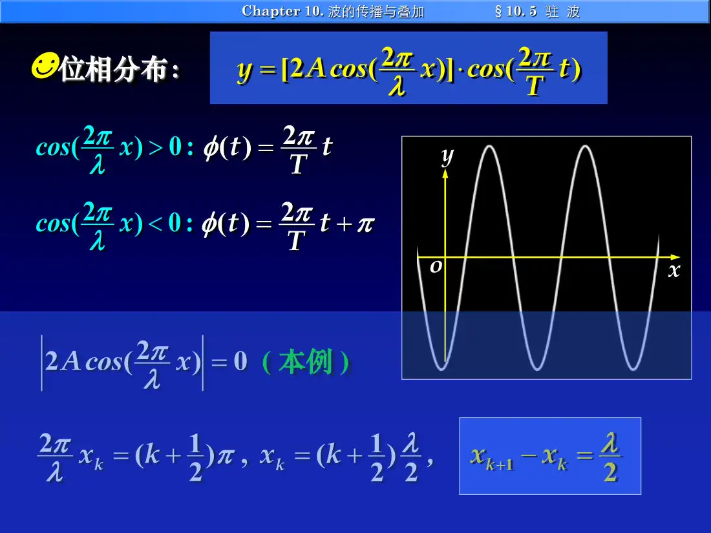

原文：

位相分布：

$$
y = [ 2 A \cos (\frac {2 \pi}{\lambda} x) ] \cdot \cos (\frac {2 \pi}{T} t)
$$

$$
\cos \left(\frac {2 \pi}{\lambda} x\right) > 0: \phi (t) = \frac {2 \pi}{T} t
$$

$$
\cos \left(\frac {2 \pi}{\lambda} x\right) <   0: \phi (t) = \frac {2 \pi}{T} t + \pi
$$

$\left|2A \cos \left(\frac{2\pi}{\lambda} x\right)\right| = 0$ （本例）

$$
\begin{array}{c c} \text { y } & \\ \text { x } & \end{array}
$$

$$
\frac {2 \pi}{\lambda} x _ {k} = (k + \frac {1}{2}) \pi , x _ {k} = (k + \frac {1}{2}) \frac {\lambda}{2},
$$

$$
x _ {k + 1} - x _ {k} = \frac {\lambda}{2}
$$

Chapter 10. 波的传播与叠加

§ 10.5 驻波

### 位相分布：

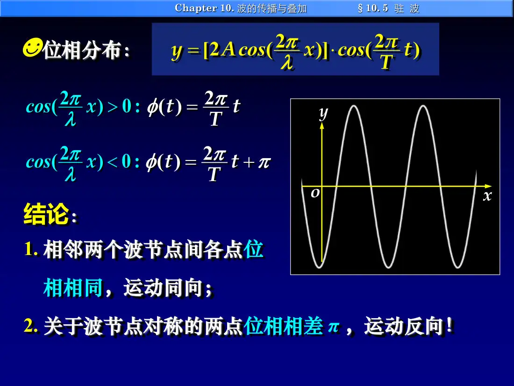

原文：

位相分布：

$$
y = [ 2 A \cos (\frac {2 \pi}{\lambda} x) ] \cdot \cos (\frac {2 \pi}{T} t)
$$

$$
\cos \left(\frac {2 \pi}{\lambda} x\right) > 0: \phi (t) = \frac {2 \pi}{T} t
$$

$$
\cos \left(\frac {2 \pi}{\lambda} x\right) <   0: \phi (t) = \frac {2 \pi}{T} t + \pi
$$

结论：

1. 相邻两个波节点间各点位相相同，运动同向；

2. 关于波节点对称的两点位相相差 $\pi$ ，运动反向！

Chapter 10. 波的传播与叠加

§ 10.5 驻波

### 结论：

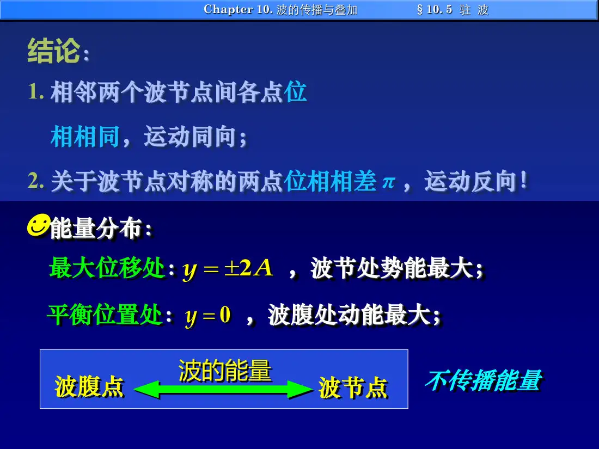

原文：

结论：

1. 相邻两个波节点间各点位相相同，运动同向；

2. 关于波节点对称的两点位相相差 $\pi$ ，运动反向！

能量分布：

最大位移处: $y = \pm 2A$ ，波节处势能最大;

平衡位置处：y=0 ，波腹处动能最大；

波的能量
波腹点
波节点

不传播能量

Chapter 10. 波的传播与叠加

§ 10.5 驻波

### Fig. 1 t 时刻行波波形曲线

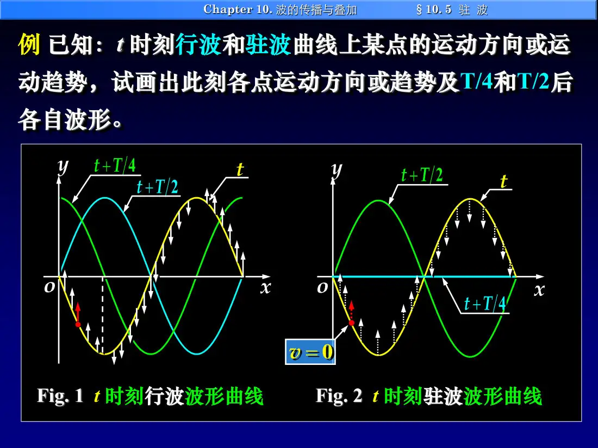

原文：

例 已知：t 时刻行波和驻波曲线上某点的运动方向或运动趋势，试画出此刻各点运动方向或趋势及 T/4 和 T/2 后各自波形。

Fig. 1 t 时刻行波波形曲线

Chapter 10. 波的传播与叠加

§ 10.5 驻波

### 波密介质波疏介质

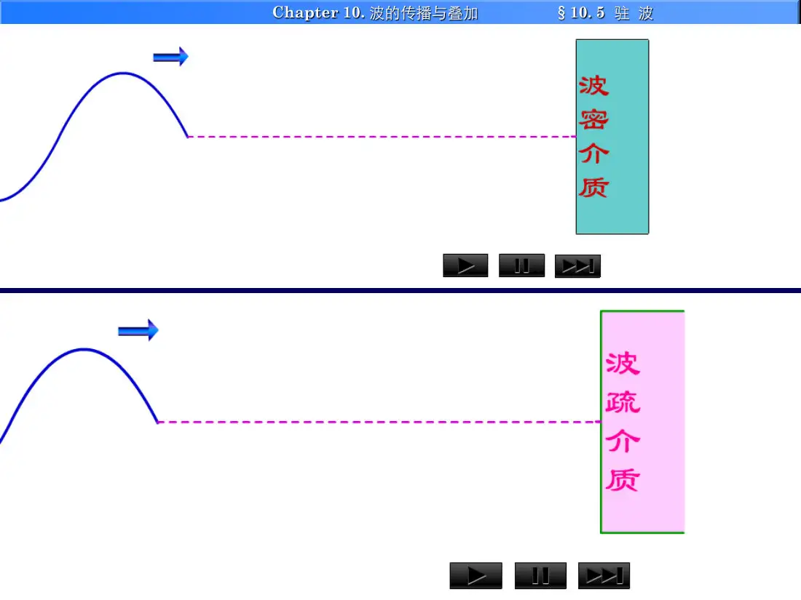

原文：

波密介质波疏介质

§ 10.5 驻波

Chapter 10. 波的传播与叠加

▶
▶
▶

### 三、入射波与反射波形成的驻波

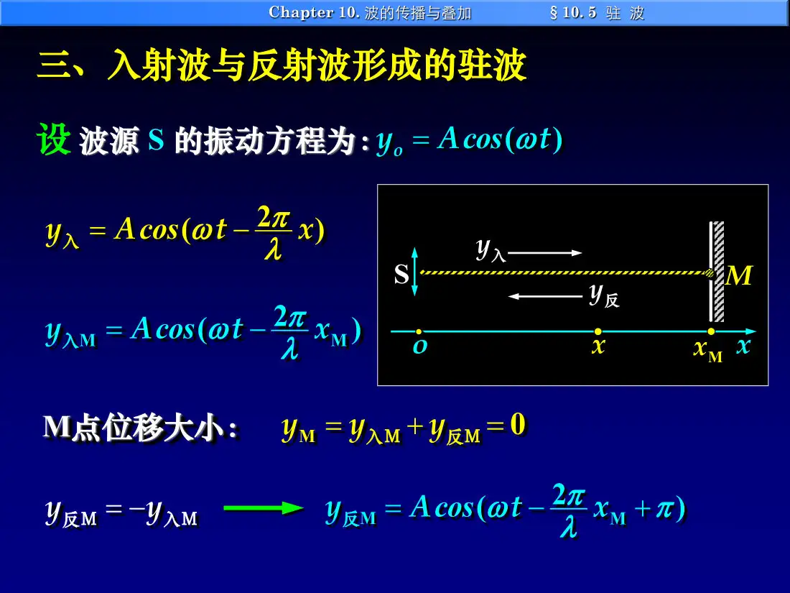

原文：

三、入射波与反射波形成的驻波

设 波源 S 的振动方程为: $y_{o} = A \cos(\omega t)$

$$
y _ {\lambda} = A \cos (\omega t - \frac {2 \pi}{\lambda} x)
$$

$$
y _ {\lambda \mathrm{M}} = A \cos (\omega t - \frac {2 \pi}{\lambda} x _ {\mathrm{M}})
$$

$$
\begin{array}{c c c} & y _ {\lambda} \longrightarrow \\ S & \longleftarrow y _ {\text {反}} \\ \hline o & x & x _ {M} x \end{array}
$$

M点位移大小: $y_{\mathrm{M}} = y_{\text{入M}} + y_{\text{反M}} = 0$

$$
y _ {\text {反M}} = - y _ {\text {入M}} \longrightarrow y _ {\text {反M}} = A \cos \left(\omega t - \frac {2 \pi}{\lambda} x _ {\mathrm{M}} + \pi\right)
$$

Chapter 10. 波的传播与叠加

§ 10.5 驻波

### M端可看成反射波源：

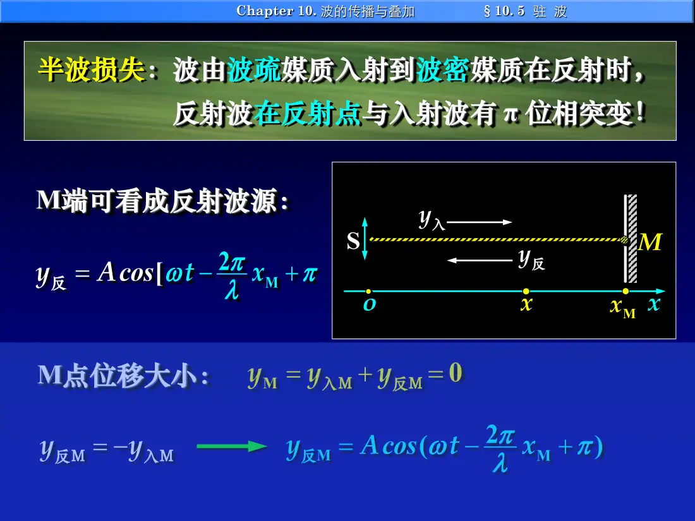

原文：

半波损失：波由波疏媒质入射到波密媒质在反射时，反射波在反射点与入射波有 $\pi$ 位相突变！

M端可看成反射波源：

$$
y _ {\text {反}} = A \cos [ \omega t - \frac {2 \pi}{\lambda} x _ {\mathrm{M}} + \pi
$$

M点位移大小: $y_{\mathrm{M}} = y_{\text {入M}} + y_{\text {反M}} = 0$

$y_{反M} = -y_{入M} \longrightarrow y_{反M} = A \cos(\omega t - \frac{2\pi}{\lambda} x_{M} + \pi)$

Chapter 10. 波的传播与叠加

§ 10.5 驻波

### M端可看成反射波源：

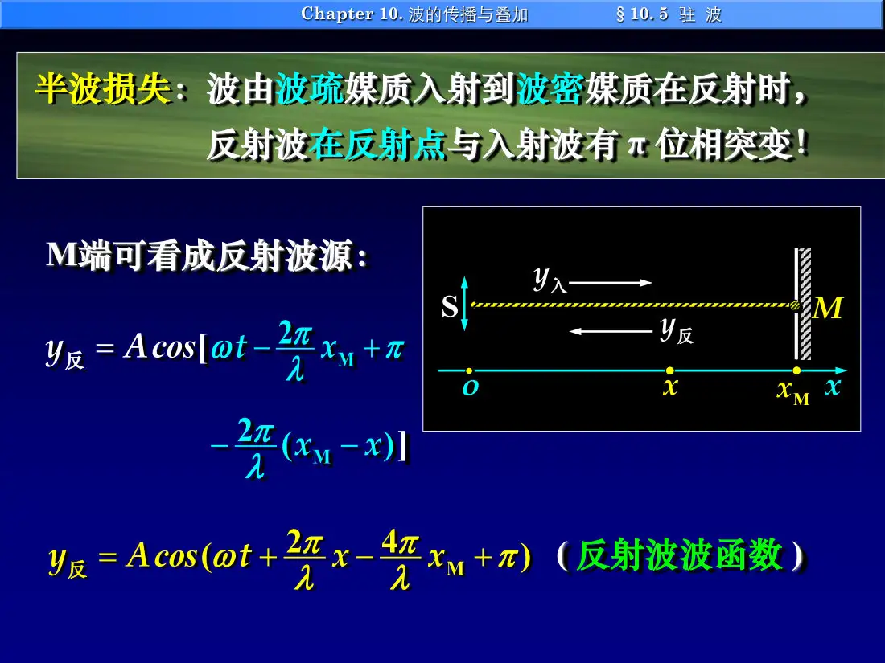

原文：

半波损失：波由波疏媒质入射到波密媒质在反射时，反射波在反射点与入射波有 $\pi$ 位相突变！

M端可看成反射波源：

$$
\begin{array}{r l} y _ {\text {反}} & = A \cos [ \omega t - \frac {2 \pi}{\lambda} x _ {\mathrm{M}} + \pi \\ & - \frac {2 \pi}{\lambda} (x _ {\mathrm{M}} - x) ] \end{array}
$$

$y_{反}=A\cos(\omega t+\frac{2\pi}{\lambda}x-\frac{4\pi}{\lambda}x_{M}+\pi)$ （反射波波函数）

Chapter 10. 波的传播与叠加

§ 10.5 驻波

### $$

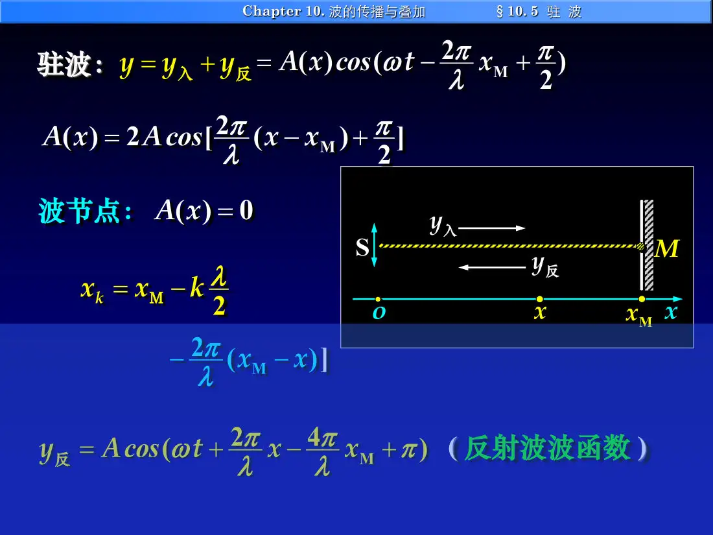

原文：

驻波： $y = y_{\lambda} + y_{\text{反}} = A(x)\cos(\omega t - \frac{2\pi}{\lambda} x_{\mathrm{M}} + \frac{\pi}{2})$

$$
A (x) = 2 A \cos \left[ \frac {2 \pi}{\lambda} \left(x - x _ {\mathrm{M}}\right) + \frac {\pi}{2} \right]
$$

波节点: $A(x) = 0$

$$
\begin{array}{r} x _ {k} = x _ {\mathrm{M}} - k \frac {\lambda}{2} \\ - \frac {2 \pi}{\lambda} (x _ {\mathrm{M}} - x) ] \end{array}
$$

$y_{反}=A\cos(\omega t+\frac{2\pi}{\lambda}x-\frac{4\pi}{\lambda}x_{M}+\pi)$ （反射波波函数）

Chapter 10. 波的传播与叠加

§ 10.5 驻波

### $$

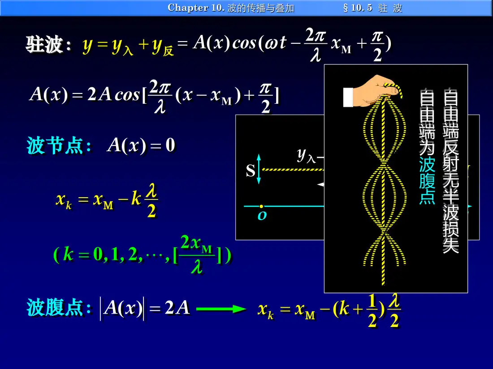

原文：

驻波： $y=y_{\lambda}+y_{反}=A(x)\cos(\omega t-\frac{2\pi}{\lambda}x_{M}+\frac{\pi}{2})$

$$
A (x) = 2 A \cos \left[ \frac {2 \pi}{\lambda} \left(x - x _ {\mathrm{M}}\right) + \frac {\pi}{2} \right]
$$

波节点: $A(x) = 0$

$$
x _ {k} = x _ {\mathrm{M}} - k \frac {\lambda}{2}
$$

$$
(k = 0, 1, 2, \dots , [ \frac {2 x _ {\mathrm{M}}}{\lambda} ])
$$

$$
\begin{array}{c} y _ {\lambda} - \\ \text { S } \\ \text { o } \end{array}
$$

自由端为波腹点
自由端反射无半波损失

波腹点: $|A(x)| = 2A \longrightarrow x_k = x_M - (k + \frac{1}{2})\frac{\lambda}{2}$

Chapter 10. 波的传播与叠加

§ 10.5 驻波

### $$

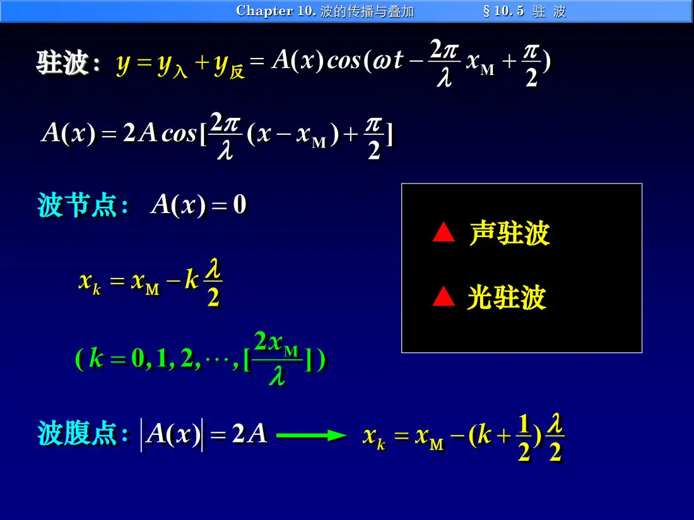

原文：

驻波： $y = y_{\lambda} + y_{\text{反}} = A(x)\cos(\omega t - \frac{2\pi}{\lambda} x_{\mathrm{M}} + \frac{\pi}{2})$

$$
A (x) = 2 A \cos [ \frac {2 \pi}{\lambda} (x - x _ {\mathrm{M}}) + \frac {\pi}{2} ]
$$

波节点: $A(x) = 0$

声驻波

$$
x _ {k} = x _ {\mathrm{M}} - k \frac {\lambda}{2}
$$

▲ 光驻波

$$
(k = 0, 1, 2, \dots , [ \frac {2 x _ {\mathrm{M}}}{\lambda} ])
$$

波腹点: $|A(x)| = 2A \longrightarrow x_k = x_{\mathrm{M}} - (k + \frac{1}{2})\frac{\lambda}{2}$

Chapter 10. 波的传播与叠加

§ 10.5 驻波

### 四、振动的简正模式

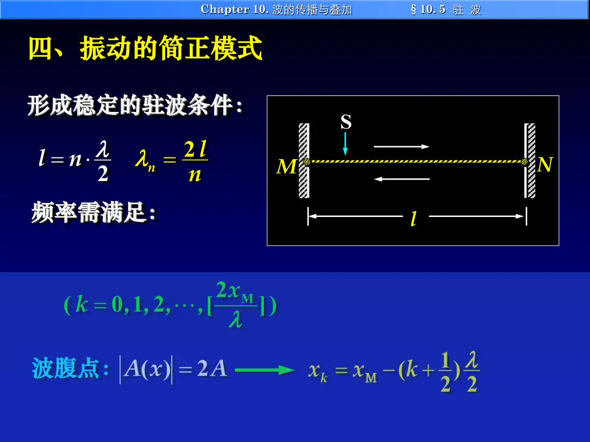

原文：

四、振动的简正模式

形成稳定的驻波条件：

$$
l = n \cdot \frac {\lambda}{2} \quad \lambda_ {n} = \frac {2 l}{n}
$$

频率需满足：

$$
(k = 0, 1, 2, \dots , [ \frac {2 x _ {\mathrm{M}}}{\lambda} ])
$$

$$
\text {波腹点:} \left| A (x) \right| = 2 A \longrightarrow x _ {k} = x _ {\mathrm{M}} - (k + \frac {1}{2}) \frac {\lambda}{2}
$$

Chapter 10. 波的传播与叠加

§ 10.5 驻波

### 四、振动的简正模式

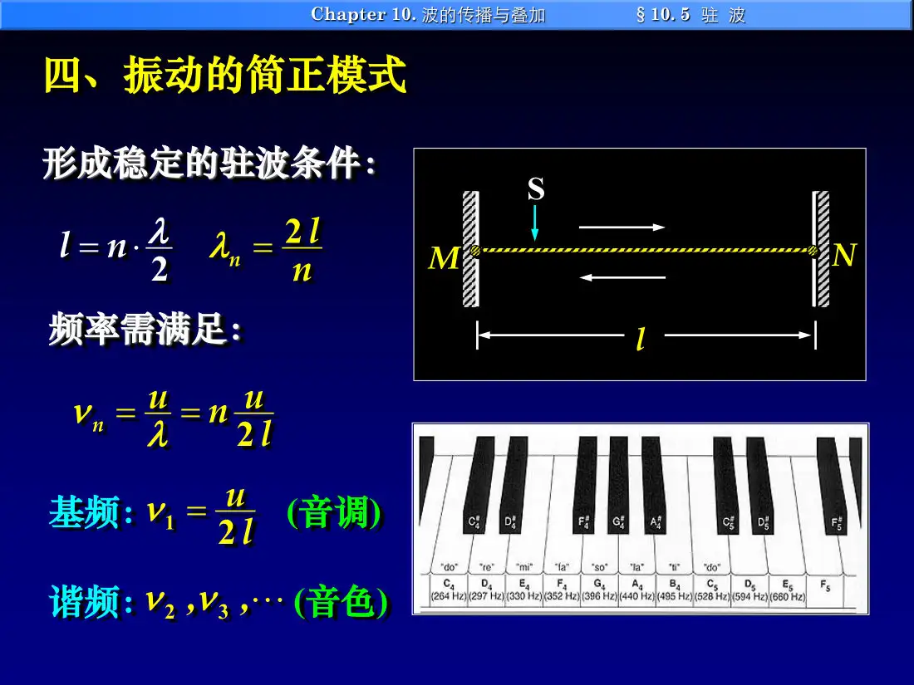

原文：

四、振动的简正模式

形成稳定的驻波条件：

$$
l = n \cdot \frac {\lambda}{2} \quad \lambda_ {n} = \frac {2 l}{n}
$$

频率需满足：

$$
\nu_ {n} = \frac {u}{\lambda} = n \frac {u}{2 l}
$$

基频: $v_{1}=\frac{u}{2l}$ (音调)

谐频: $\nu_{2}, \nu_{3}, \cdots$ (音色)

Chapter 10. 波的传播与叠加

§ 10.5 驻波

### 归纳：

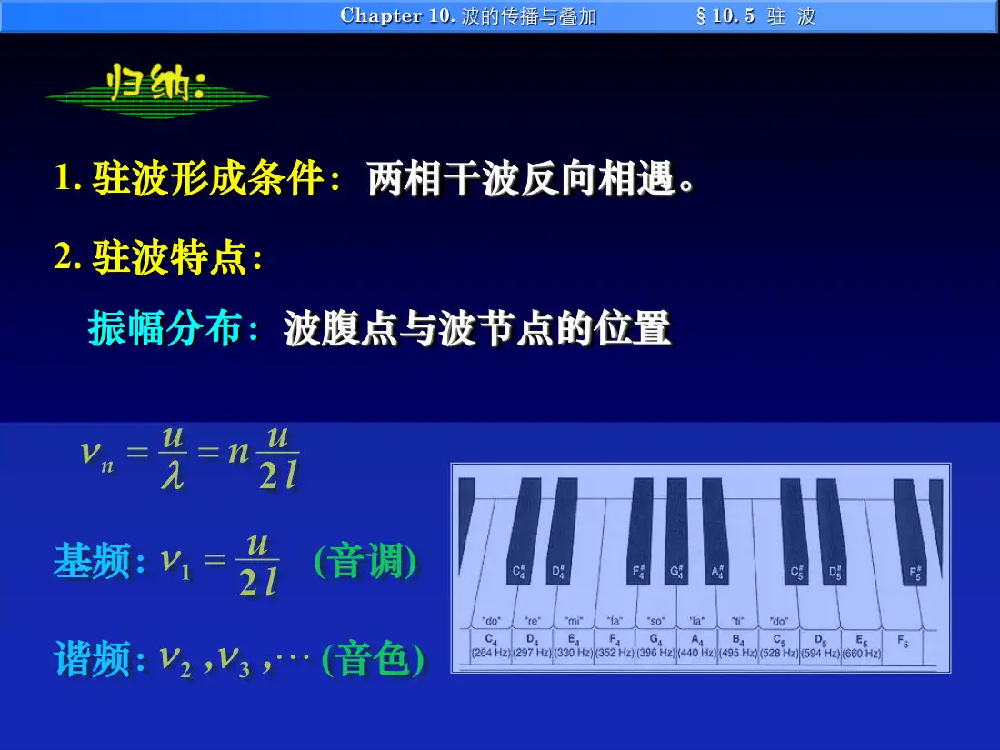

原文：

归纳：

1. 驻波形成条件：两相干波反向相遇。

2. 驻波特点：

振幅分布：波腹点与波节点的位置

$$
v _ {n} = \frac {u}{\lambda} = n \frac {u}{2 l}
$$

基频: $v_{1}=\frac{u}{2l}$ (音调)

谐频: $\nu_{2}, \nu_{3}, \cdots$ (音色)

Chapter 10. 波的传播与叠加

§ 10.5 驻波

### 归纳:

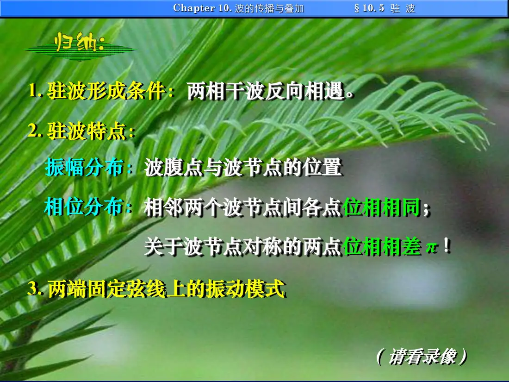

原文：

归纳:

1. 驻波形成条件：两相干波反向相遇。

2. 驻波特点：

振幅分布：波腹点与波节点的位置

相位分布：相邻两个波节点间各点位相相同；

关于波节点对称的两点位相相差 $\pi!$

3. 两端固定弦线上的振动模式

(请看录像)

Chapter 10. 波的传播与叠加

§ 10.5 驻波

### 驻波

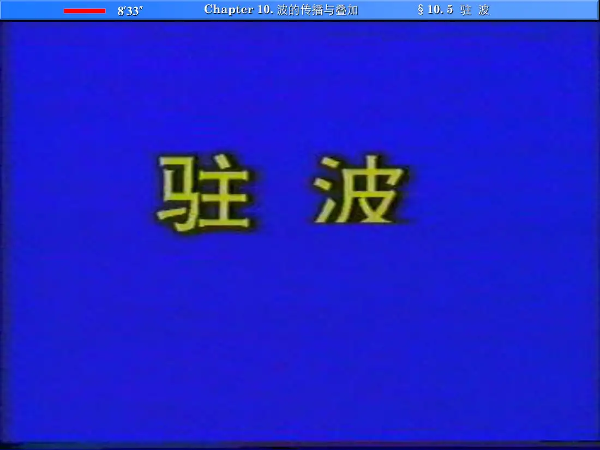

原文：

驻波

8'33"

Chapter 10. 波的传播与叠加

§ 10.5 驻波

### 波反射时 的相位突变

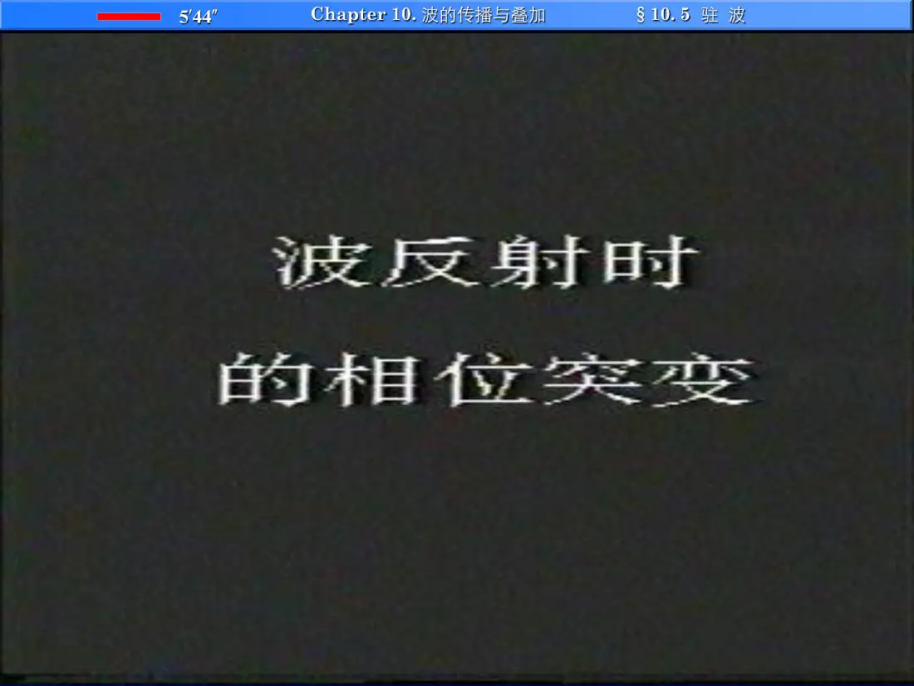

原文：

波反射时 的相位突变

5'44"

Chapter 10. 波的传播与叠加

§ 10.5 驻波
