# 《大学物理》第11章 §11.1 相干光 光程及光程差（课件）

原件的每一页，下面附识别出的文字。

### § 11.1 相干光 光程及光程差

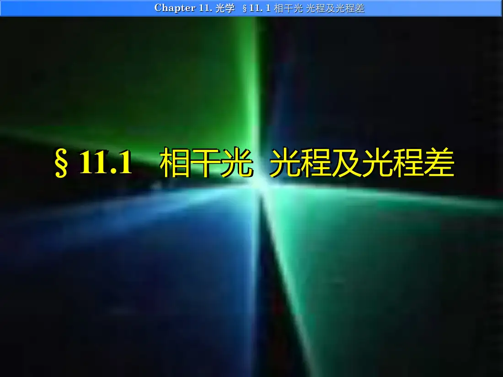

原文：

§ 11.1 相干光 光程及光程差

Chapter 11. 光学 § 11.1 相干光 光程及光程差

### 一、热光源的发光机制

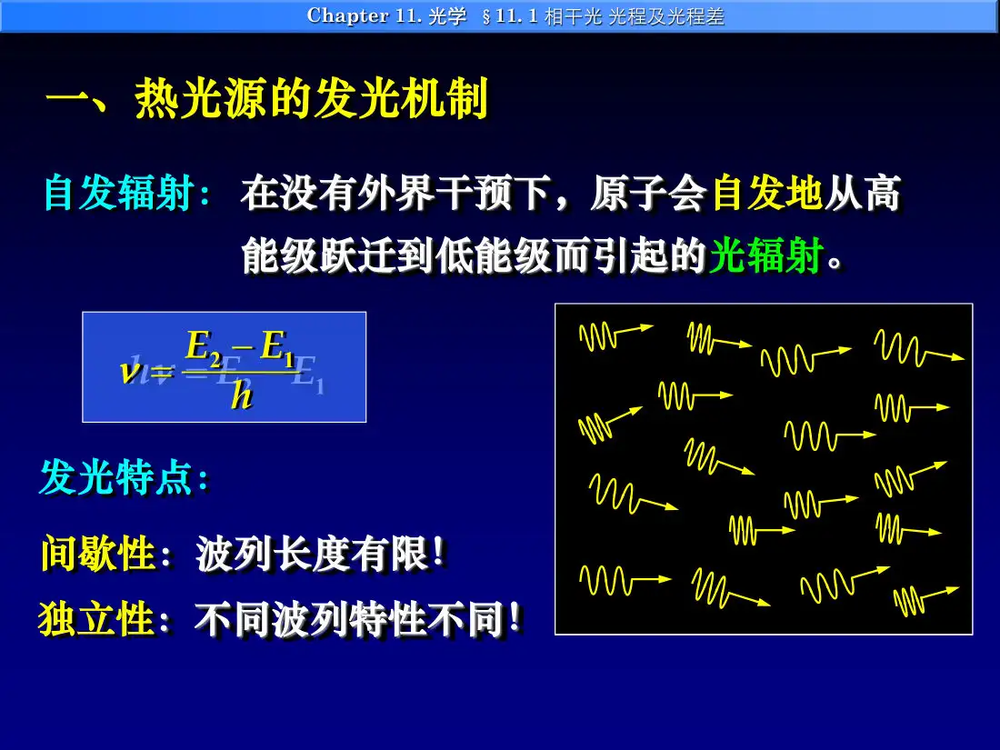

原文：

一、热光源的发光机制

自发辐射：在没有外界干预下，原子会自发地从高能级跃迁到低能级而引起的光辐射。

$$
\nu = \frac {E _ {2} - E _ {1}}{h} E _ {1}
$$

发光特点:

间歇性：波列长度有限！

独立性：不同波列特性不同！

Chapter 11. 光学 § 11.1 相干光 光程及光程差

### 二、普通光源的时间相干性与空间相干性

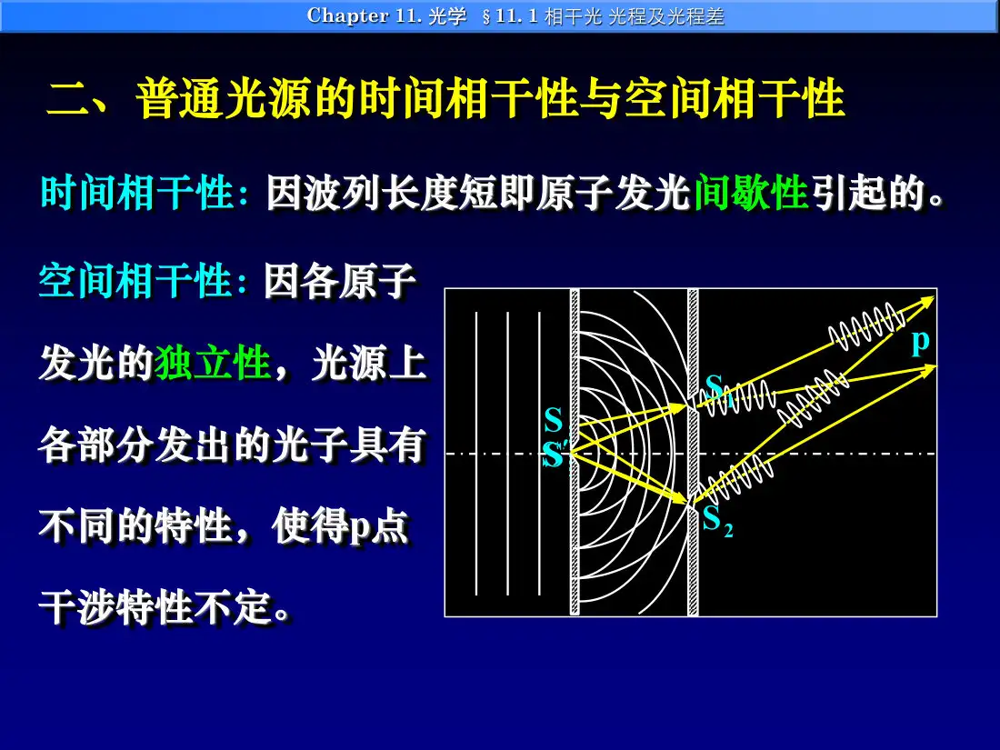

原文：

二、普通光源的时间相干性与空间相干性

时间相干性：因波列长度短即原子发光间歇性引起的。

空间相干性: 因各原子发光的独立性, 光源上各部分发出的光子具有不同的特性, 使得p点干涉特性不定。

Chapter 11. 光学 § 11.1 相干光 光程及光程差

### 三、相干光的获得方法

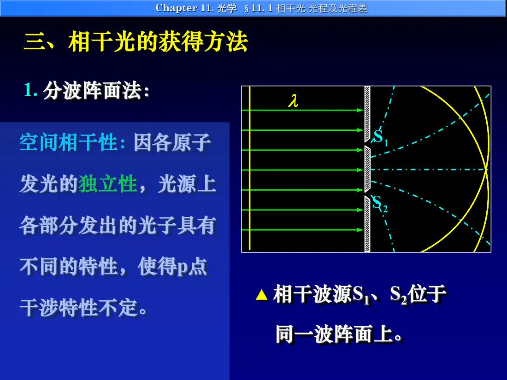

原文：

三、相干光的获得方法

1. 分波阵面法:

空间相干性: 因各原子发光的独立性, 光源上各部分发出的光子具有不同的特性, 使得p点干涉特性不定。

▲ 相干波源 $S_{1}$ 、 $S_{2}$ 位于同一波阵面上。

Chapter 11. 光学 § 11.1 相干光 光程及光程差

### 三、相干光的获得方法

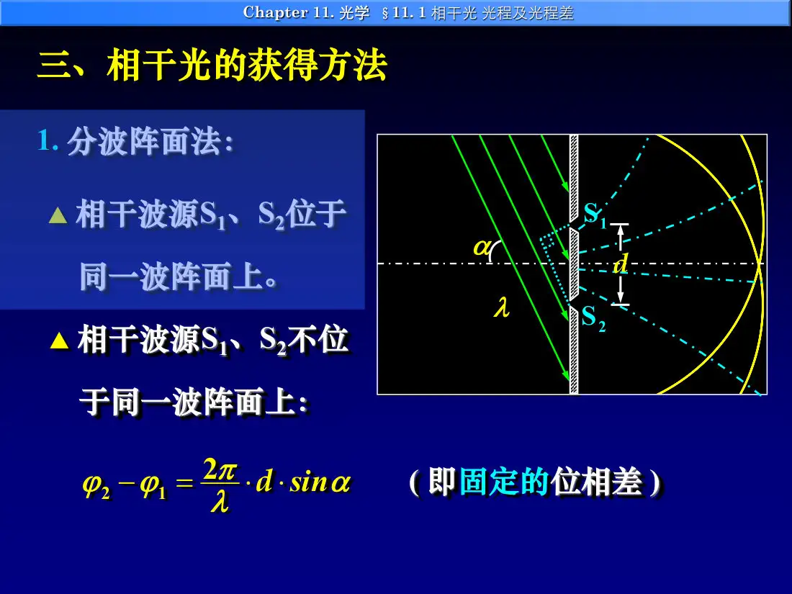

原文：

三、相干光的获得方法

1. 分波阵面法:

▲ 相干波源 $S_{1}$ 、 $S_{2}$ 位于同一波阵面上。

▲相干波源 $S_{1}$ 、 $S_{2}$ 不位于同一波阵面上：

$$
\varphi_ {2} - \varphi_ {1} = \frac {2 \pi}{\lambda} \cdot d \cdot \sin \alpha
$$

(即固定的位相差)

Chapter 11. 光学 § 11.1 相干光 光程及光程差

### 2. 分振幅法:

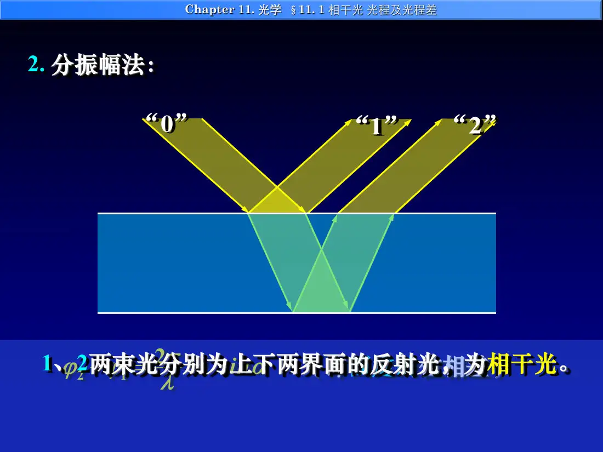

原文：

2. 分振幅法:

1、 $\varphi_{z}^{2}$ 两束光分别为上下两界面的反射光相为相干光。

Chapter 11. 光学 § 11.1 相干光 光程及光程差

### 四、光程与光程差

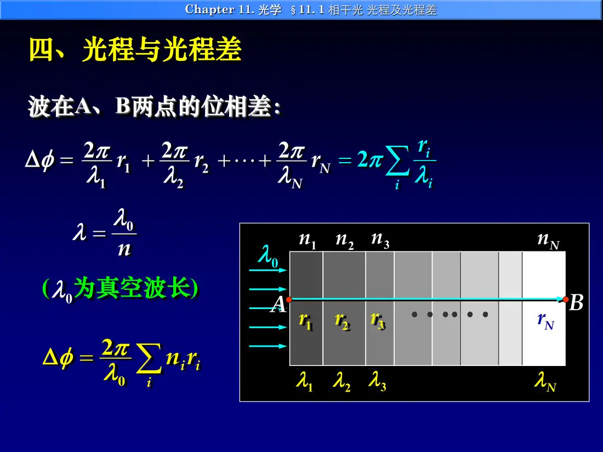

原文：

四、光程与光程差

波在A、B两点的位相差:

$$
\Delta \phi = \frac {2 \pi}{\lambda_ {1}} r _ {1} + \frac {2 \pi}{\lambda_ {2}} r _ {2} + \dots + \frac {2 \pi}{\lambda_ {N}} r _ {N} = 2 \pi \sum_ {i} \frac {r _ {i}}{\lambda_ {i}}
$$

$$
\lambda = \frac {\lambda_ {0}}{n}
$$

( $\lambda_{0}$ 为真空波长)

$$
\Delta \phi = \frac {2 \pi}{\lambda_ {0}} \sum_ {i} n _ {i} r _ {i}
$$

$$
\begin{array}{c c c c c c c c c c} & n _ {1} & n _ {2} & n _ {3} & & & & n _ {N} \\ \hline \lambda_ {0} & & & & & & & \\ \hline A & r _ {1} & r _ {2} & r _ {3} & \dots & \dots & \dots & r _ {N} \\ \hline & \lambda_ {1} & \lambda_ {2} & \lambda_ {3} & & & & \lambda_ {N} \end{array}
$$

Chapter 11. 光学 § 11.1 相干光 光程及光程差

### 定义 光波在传播空间的光程 L:

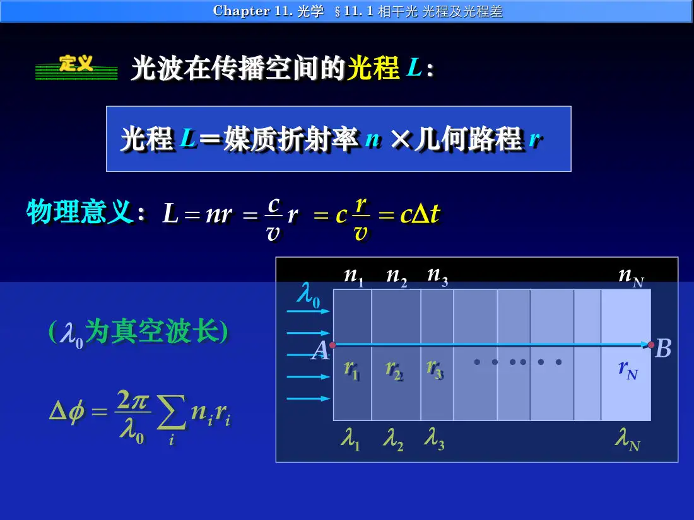

原文：

定义 光波在传播空间的光程 L:

光程 $L =$ 媒质折射率 $n \times$ 几何路程 $r$

物理意义: $L = n r = \frac{c}{v} r = c \frac{r}{v} = c \Delta t$

( $\lambda_0$ 为真空波长)

$$
\Delta \phi = \frac {2 \pi}{\lambda_ {0}} \sum_ {i} n _ {i} r _ {i}
$$

$$
\begin{array}{c c c c c c c c c c} & n _ {1} & n _ {2} & n _ {3} & & & & n _ {N} \\ \hline \lambda_ {0} & & & & & & & \\ \hline A & r _ {1} & r _ {2} & r _ {3} & \dots & \dots & \dots & \\ \hline & \lambda_ {1} & \lambda_ {2} & \lambda_ {3} & & & & \lambda_ {N} \end{array} B
$$

Chapter 11. 光学 § 11.1 相干光 光程及光程差

### 定义 光波在传播空间的光程 L:

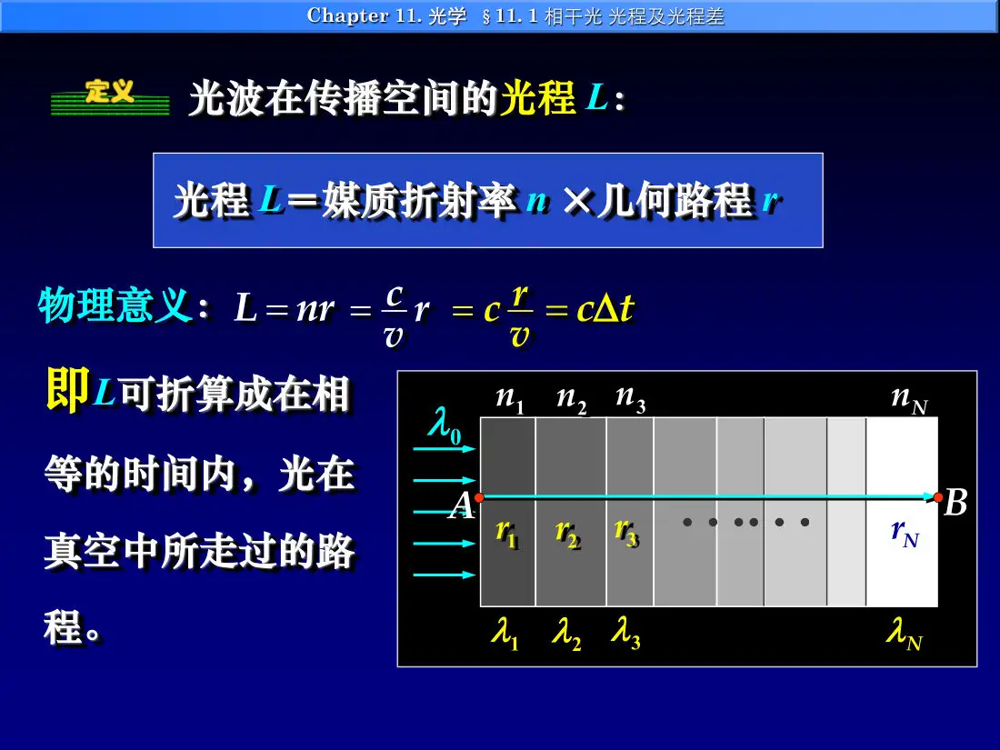

原文：

定义 光波在传播空间的光程 L:

光程 $L =$ 媒质折射率 $n\times$ 几何路程 $r$

物理意义: $L = n r = \frac{c}{v} r = c \frac{r}{v} = c \Delta t$

即 $L$ 可折算成在相等的时间内，光在真空中所走过的路程。

Chapter 11. 光学 § 11.1 相干光 光程及光程差

### $$

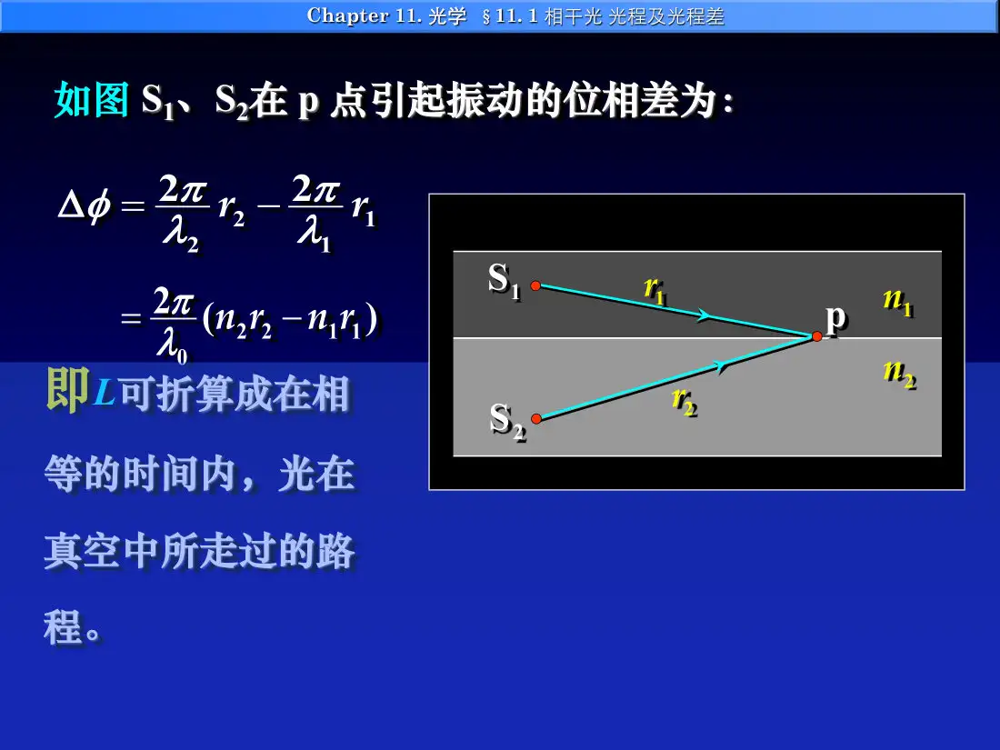

原文：

如图 $S_{1} 、 S_{2}$ 在 $\mathrm{p}$ 点引起振动的位相差为:

$$
\begin{array}{r l} \Delta \phi & = \frac {2 \pi}{\lambda_ {2}} r _ {2} - \frac {2 \pi}{\lambda_ {1}} r _ {1} \\ & = \frac {2 \pi}{\lambda_ {0}} (n _ {2} r _ {2} - n _ {1} r _ {1}) \end{array}
$$

即 $L$ 可折算成在相等的时间内，光在真空中所走过的路程。

Chapter 11. 光学 § 11.1 相干光 光程及光程差

### $$

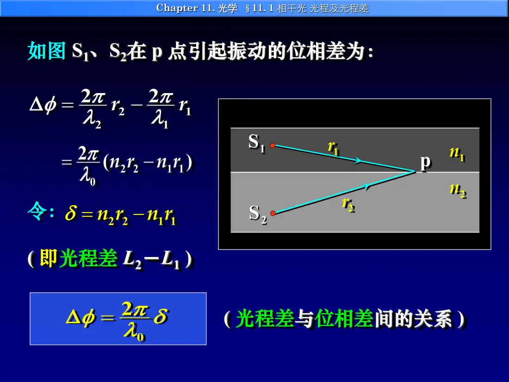

原文：

如图 $S_{1} 、 S_{2}$ 在 $\mathrm{p}$ 点引起振动的位相差为:

$$
\begin{array}{r l} \Delta \phi & = \frac {2 \pi}{\lambda_ {2}} r _ {2} - \frac {2 \pi}{\lambda_ {1}} r _ {1} \\ & = \frac {2 \pi}{\lambda_ {0}} (n _ {2} r _ {2} - n _ {1} r _ {1}) \end{array}
$$

令： $\delta=n_{2}r_{2}-n_{1}r_{1}$

(即光程差 $L_{2}-L_{1}$ )

$$
\Delta \phi = \frac {2 \pi}{\lambda_ {0}} \delta
$$

(光程差与位相差间的关系)

Chapter 11. 光学 § 11.1 相干光 光程及光程差

### 注意:

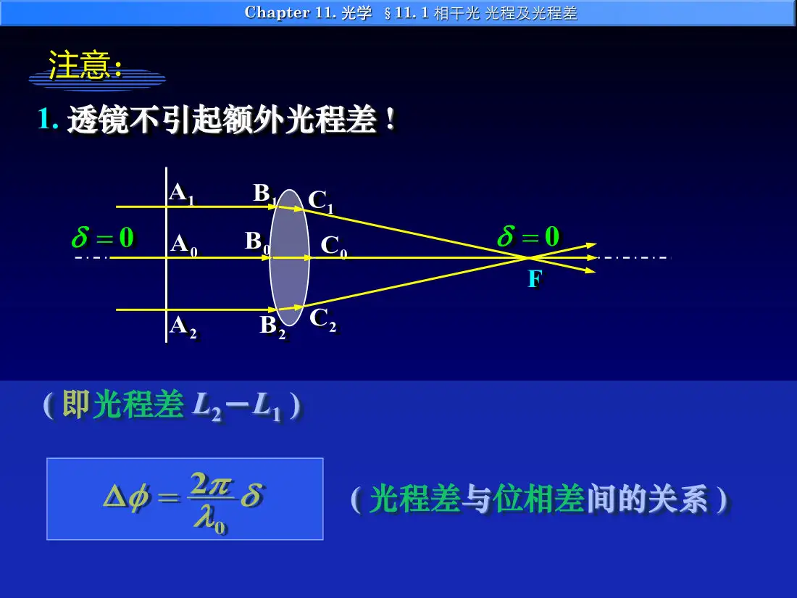

原文：

注意:

1. 透镜不引起额外光程差！

$$
\begin{array}{c c c} \text {A} _ {1} & B _ {1} & C _ {1} \\ \delta = 0 & A _ {0} & B _ {0} \\ \text {A} _ {2} & B _ {2} & C _ {2} \end{array} \quad \begin{array}{c c c} \text {B} _ {1} & C _ {1} \\ \text {B} _ {0} & C _ {0} \\ \text {B} _ {2} & C _ {2} \end{array} \quad \begin{array}{c c c} \text {δ = 0} \\ \text {δ = 0} \\ \text {F} \end{array}
$$

(即光程差 $L_{2} - L_{1}$ )

$$
\Delta \phi = \frac {2 \pi}{\lambda_ {0}} \delta
$$

(光程差与位相差间的关系)

Chapter 11. 光学 § 11.1 相干光 光程及光程差

### 注意:

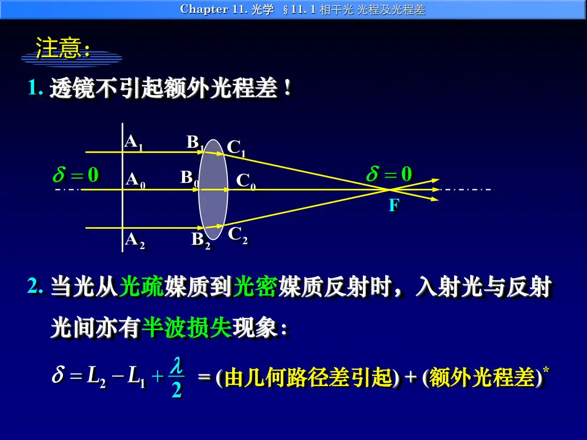

原文：

注意:

1. 透镜不引起额外光程差！

$$
\delta = 0 \quad \begin{array}{c c c} A _ {1} & B _ {1} & C _ {1} \\ A _ {0} & B _ {0} & C _ {0} \\ A _ {2} & B _ {2} & C _ {2} \end{array}
$$

$$
\delta \equiv 0
$$

2. 当光从光疏媒质到光密媒质反射时, 入射光与反射光间亦有半波损失现象:

$\delta = L_{2} - L_{1} + \frac{\lambda}{2} = (\text{由几何路径差引起}) + (\text{额外光程差})^{*}$

Chapter 11. 光学 § 11.1 相干光 光程及光程差

### 归纳：

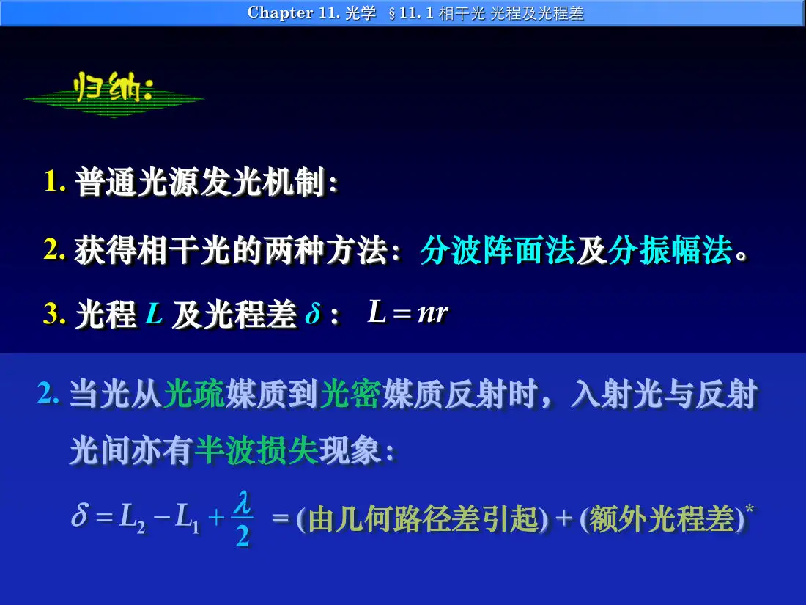

原文：

归纳：

1. 普通光源发光机制：

2. 获得相干光的两种方法：分波阵面法及分振幅法。

3. 光程 L 及光程差 $\delta: L = nr$

2. 当光从光疏媒质到光密媒质反射时, 入射光与反射光间亦有半波损失现象:

$\delta = L_{2} - L_{1} + \frac{\lambda}{2} = (\text{由几何路径差引起}) + (\text{额外光程差})^{*}$

Chapter 11. 光学 § 11.1 相干光 光程及光程差

### 归纳：

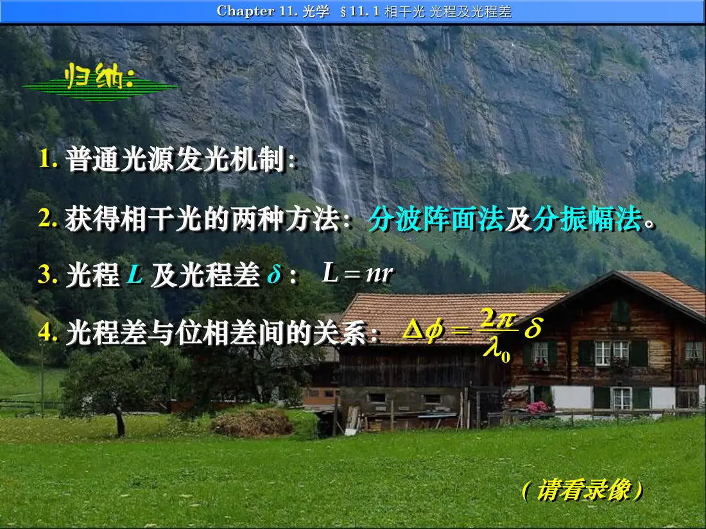

原文：

归纳：

1. 普通光源发光机制：

2. 获得相干光的两种方法：分波阵面法及分振幅法。

3. 光程 $L$ 及光程差 $\delta: L = nr$

4. 光程差与位相差间的关系:

(请看录像)

Chapter 11. 光学 § 11.1 相干光 光程及光程差

### 3'11" Chapter 11. 光学 § 11.1 相干光 光程及光程差

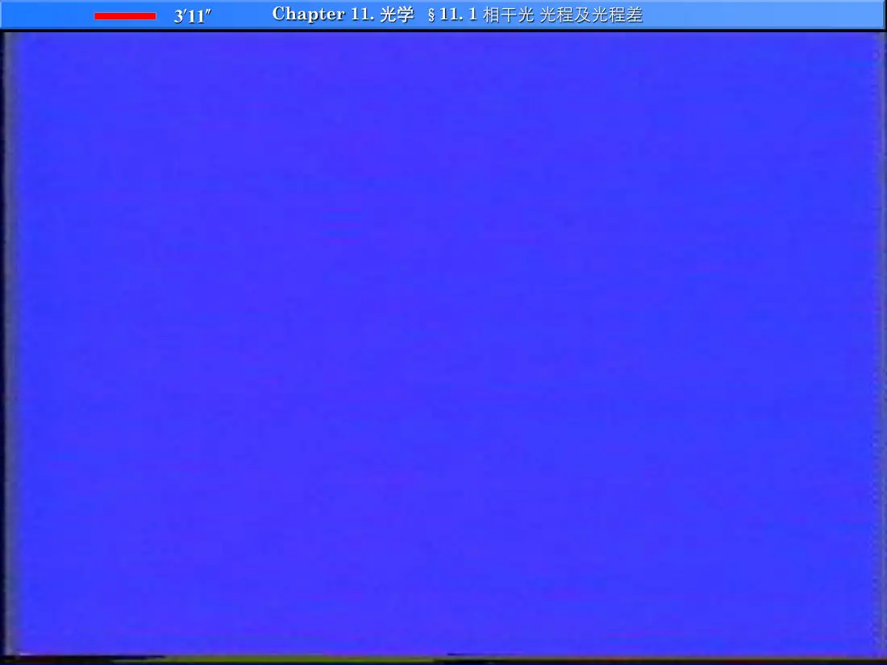

原文：

3'11" Chapter 11. 光学 § 11.1 相干光 光程及光程差
