# 《大学物理》第11章 §11.6 惠更斯－菲涅尔原理 §11.7 单缝衍射（课件）

原件的每一页，下面附识别出的文字。

### § 11.6 惠更斯 - 菲涅尔原理

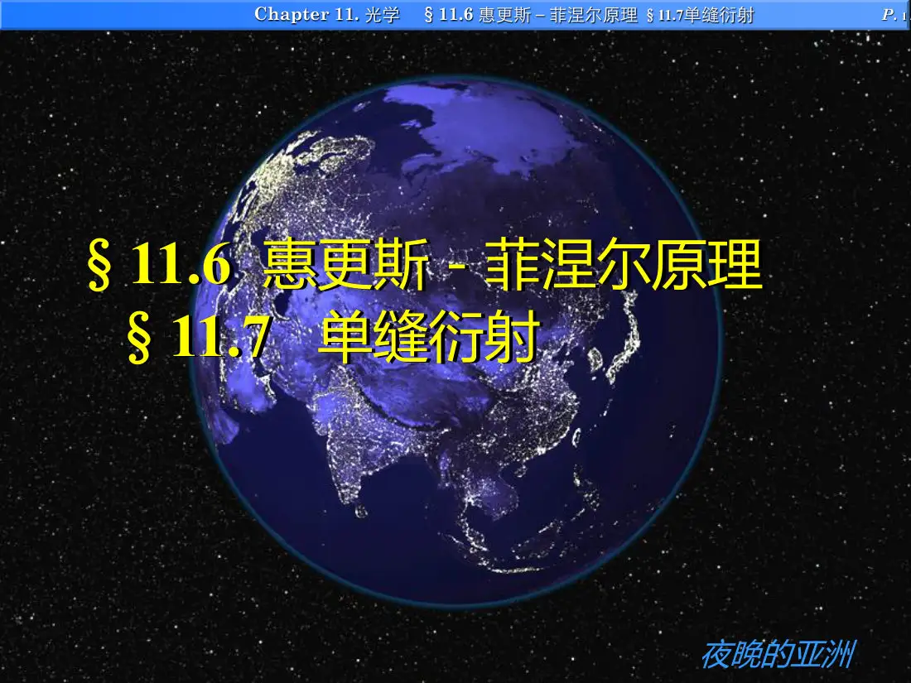

原文：

§ 11.6 惠更斯 - 菲涅尔原理
§ 11.7 单缝衍射

夜晚的亚洲

Chapter 11. 光学 § 11.6 惠更斯 - 菲涅尔原理 § 11.7 单缝衍射

### 一、光的衍射现象

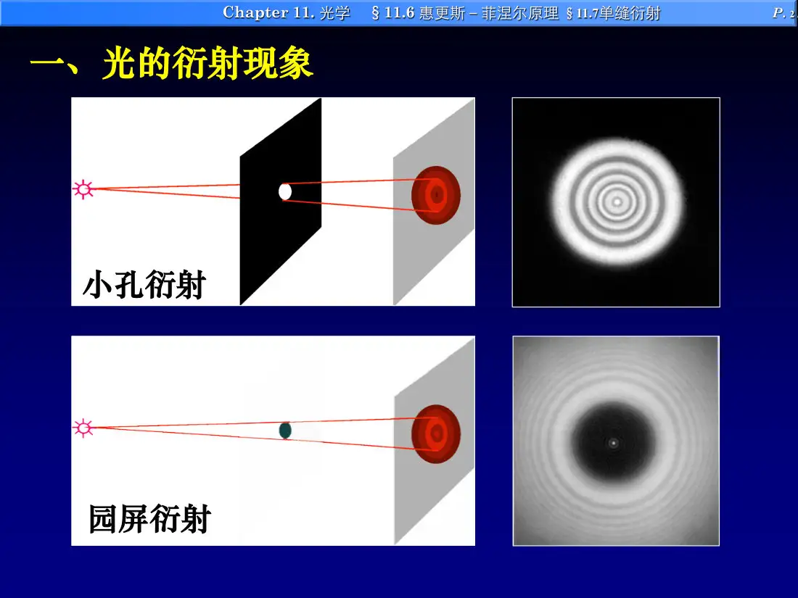

原文：

一、光的衍射现象

小孔衍射

园屏衍射

Chapter 11. 光学 § 11.6 惠更斯 - 菲涅尔原理 § 11.7 单缝衍射

P.2

### 方孔衍射

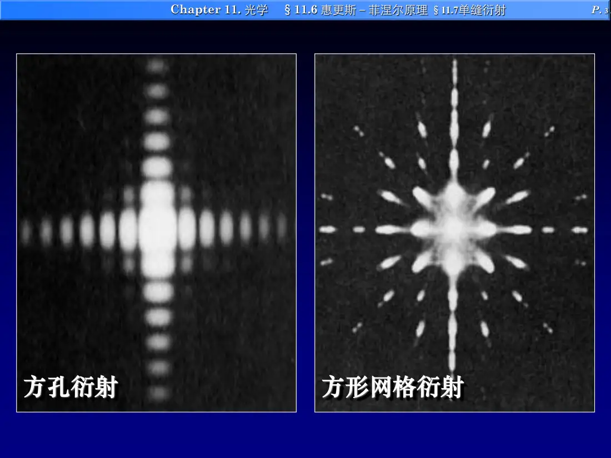

原文：

方孔衍射

Chapter 11. 光学 § 11.6 惠更斯 - 菲涅尔原理 § 11.7 单缝衍射

P. 3

### 二、惠更斯－菲涅尔原理

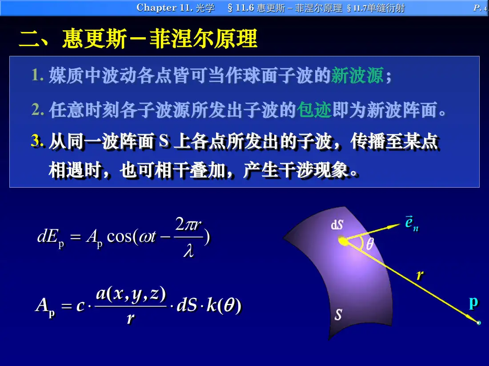

原文：

二、惠更斯－菲涅尔原理

1. 媒质中波动各点皆可当作球面子波的新波源；

2. 任意时刻各子波源所发出子波的包迹即为新波阵面。

3. 从同一波阵面 S 上各点所发出的子波，传播至某点相遇时，也可相干叠加，产生干涉现象。

$$
d E _ {\mathrm{p}} = A _ {\mathrm{p}} \cos (\omega t - \frac {2 \pi r}{\lambda})
$$

$$
A _ {\mathrm{p}} = c \cdot \frac {a (x , y , z)}{r} \cdot d S \cdot k (\theta)
$$

Chapter 11. 光学 § 11.6 惠更斯 - 菲涅尔原理 § 11.7 单缝衍射

P. 4

### $$

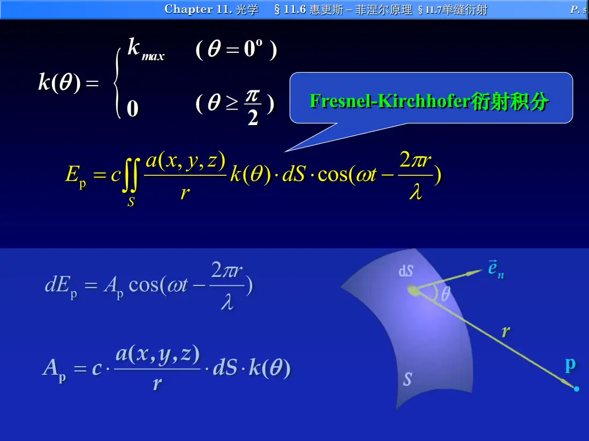

原文：

$$
k (\theta) = \left\{ \begin{array}{l l} k _ {\text { max }} & (\theta = 0 ^ {0}) \\ 0 & (\theta \geq \frac {\pi}{2}) \end{array} \right.
$$

Fresnel-Kirchhofer衍射积分

$$
E _ {\mathrm{p}} = c \iint_ {S} \frac {a (x , y , z)}{r} k (\theta) \cdot d S \cdot \cos (\omega t - \frac {2 \pi r}{\lambda})
$$

$$
d E _ {\mathrm{p}} = A _ {\mathrm{p}} \cos (\omega t - \frac {2 \pi r}{\lambda})
$$

$$
A _ {\mathrm{p}} = c \cdot \frac {a (x , y , z)}{r} \cdot d S \cdot k (\theta)
$$

Chapter 11. 光学 § 11.6 惠更斯 - 菲涅尔原理 § 11.7 单缝衍射

P. 5

### $$

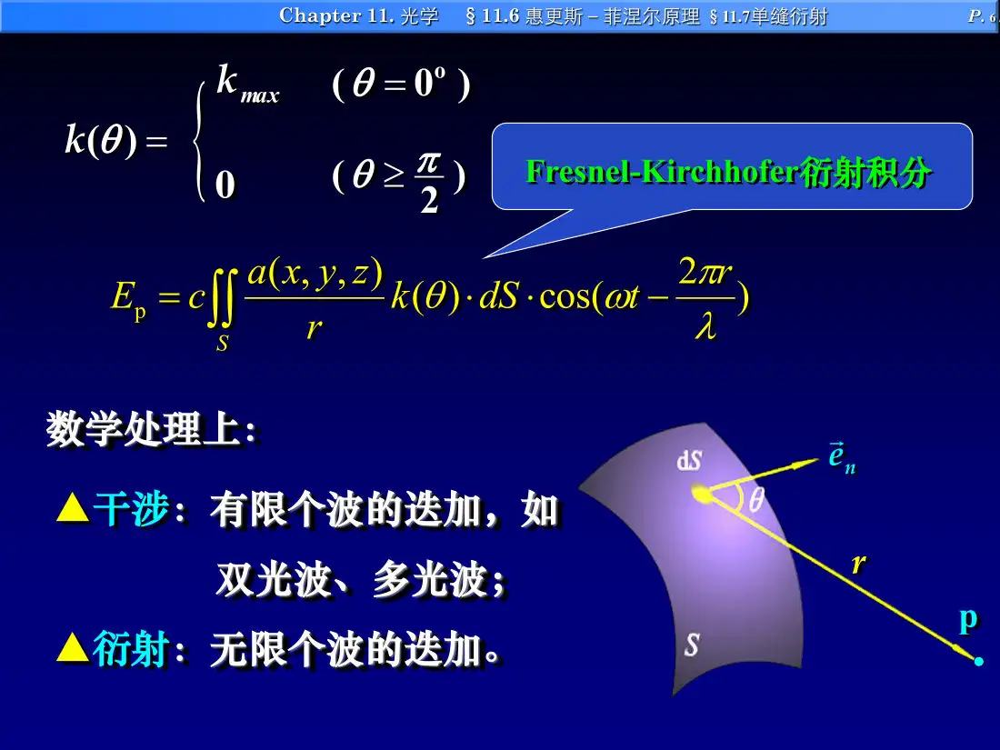

原文：

$$
k (\theta) = \left\{ \begin{array}{l l} k _ {\text { max }} & (\theta = 0 ^ {0}) \\ 0 & (\theta \geq \frac {\pi}{2}) \end{array} \right.
$$

Fresnel-Kirchhofer衍射积分

$$
E _ {\mathrm{p}} = c \iint_ {S} \frac {a (x , y , z)}{r} k (\theta) \cdot d S \cdot \cos (\omega t - \frac {2 \pi r}{\lambda})
$$

数学处理上:

▲干涉：有限个波的迭加，如双光波、多光波；

▲衍射：无限个波的迭加。

Chapter 11. 光学 § 11.6 惠更斯 - 菲涅尔原理 § 11.7 单缝衍射

P. 6

### 三、衍射的分类

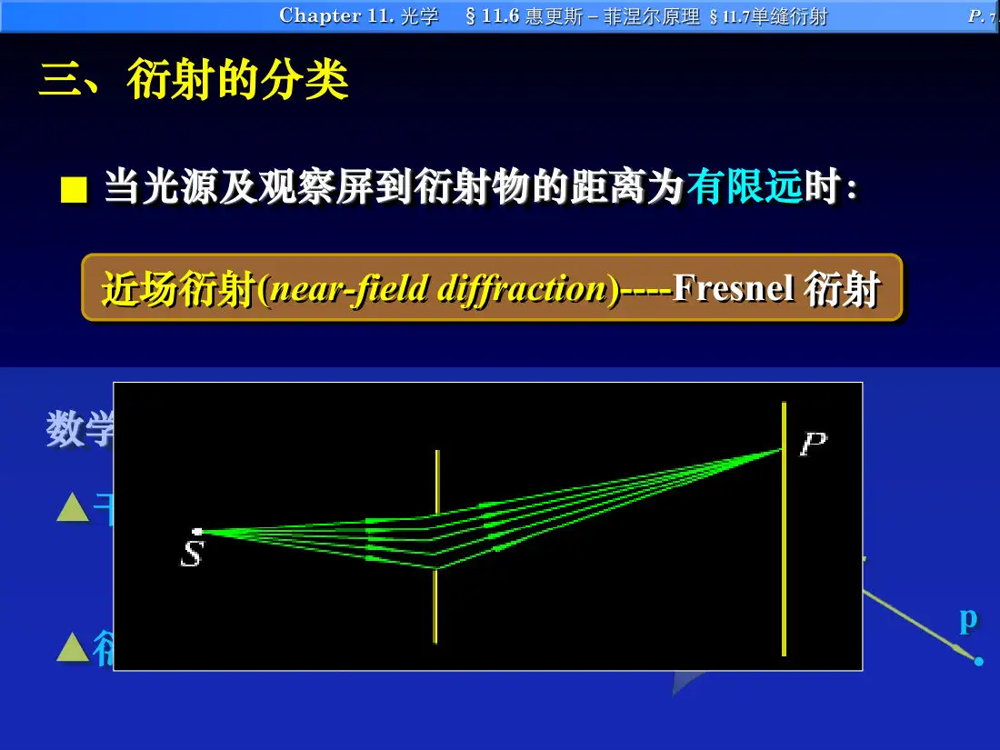

原文：

三、衍射的分类

当光源及观察屏到衍射物的距离为有限远时：

近场衍射(near-field diffraction)----Fresnel 衍射

Chapter 11. 光学 § 11.6 惠更斯 - 菲涅尔原理 § 11.7 单缝衍射

P.7

### 当光源及观察屏到衍射物的距离为无限远时

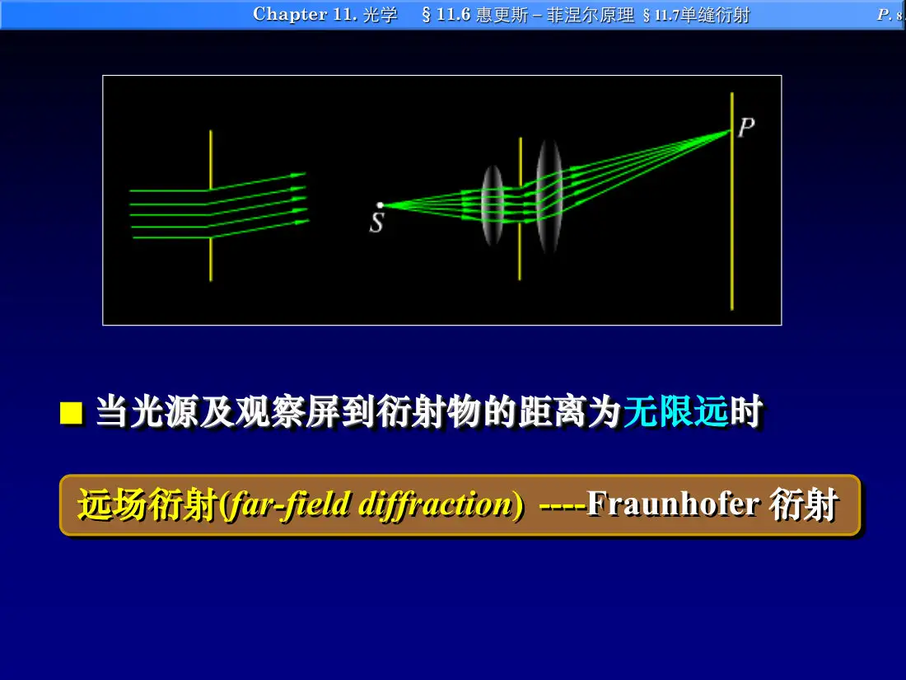

原文：

当光源及观察屏到衍射物的距离为无限远时

远场衍射(far-field diffraction) ----Fraunhofer 衍射

Chapter 11. 光学 § 11.6 惠更斯 - 菲涅尔原理 § 11.7 单缝衍射

P.8

### 单缝的衍射：

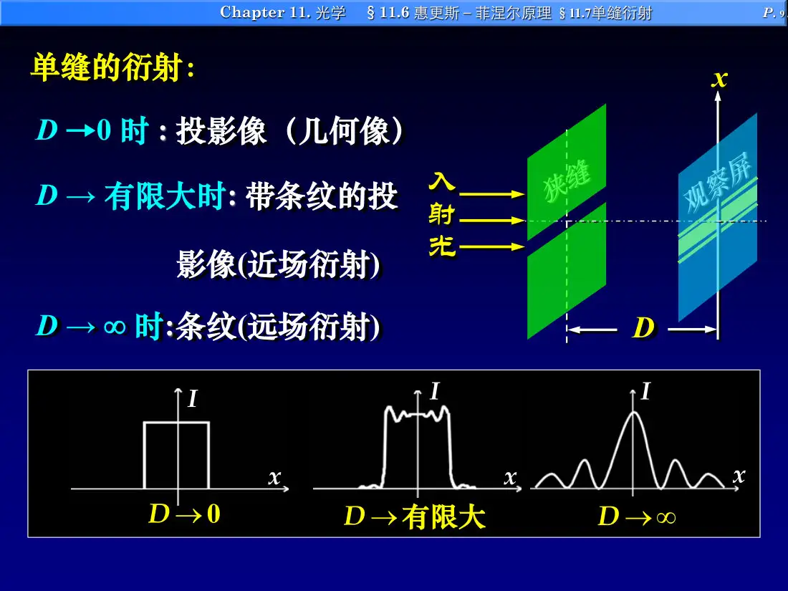

原文：

单缝的衍射：

$D \rightarrow 0$ 时：投影像（几何像）

$D \rightarrow$ 有限大时: 带条纹的投

影像(近场衍射)

$D \rightarrow \infty$ 时:条纹(远场衍射)

Chapter 11. 光学 § 11.6 惠更斯 - 菲涅尔原理 § 11.7 单缝衍射

P.9

### 四、单缝Fraunhofer衍射的半波带分析方法

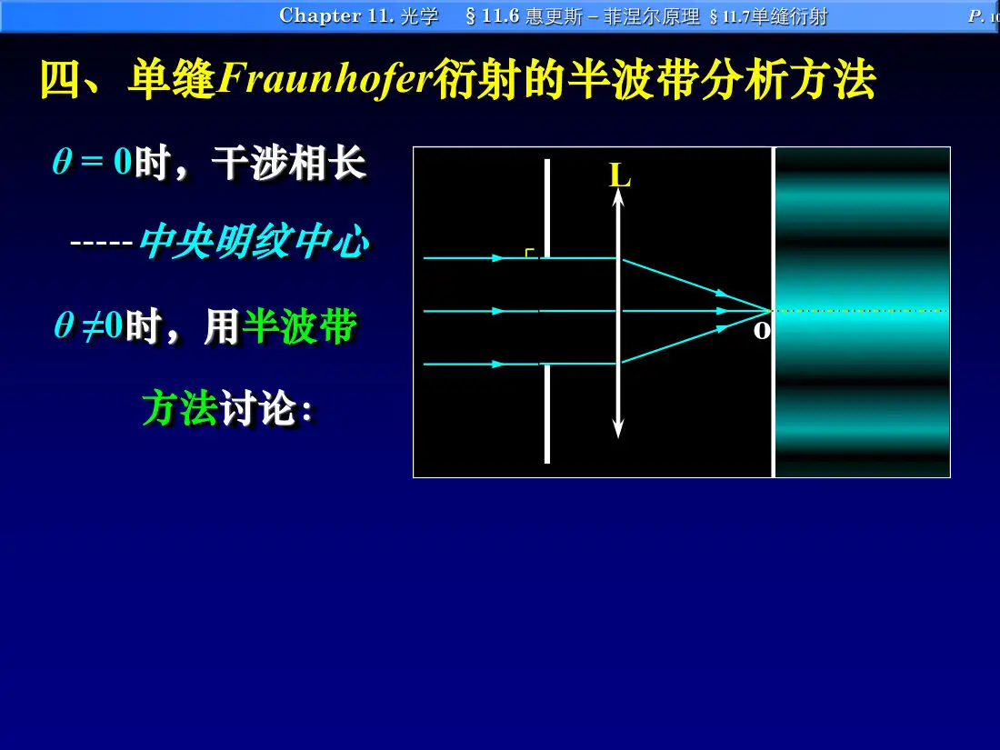

原文：

四、单缝Fraunhofer衍射的半波带分析方法

$\theta = 0$ 时，干涉相长

---- 中央明纹中心

$\theta \neq 0$ 时，用半波带

方法讨论：

Chapter 11. 光学 § 11.6 惠更斯 - 菲涅尔原理 § 11.7 单缝衍射

P. 10

### 四、单缝Fraunhofer衍射的半波带分析方法

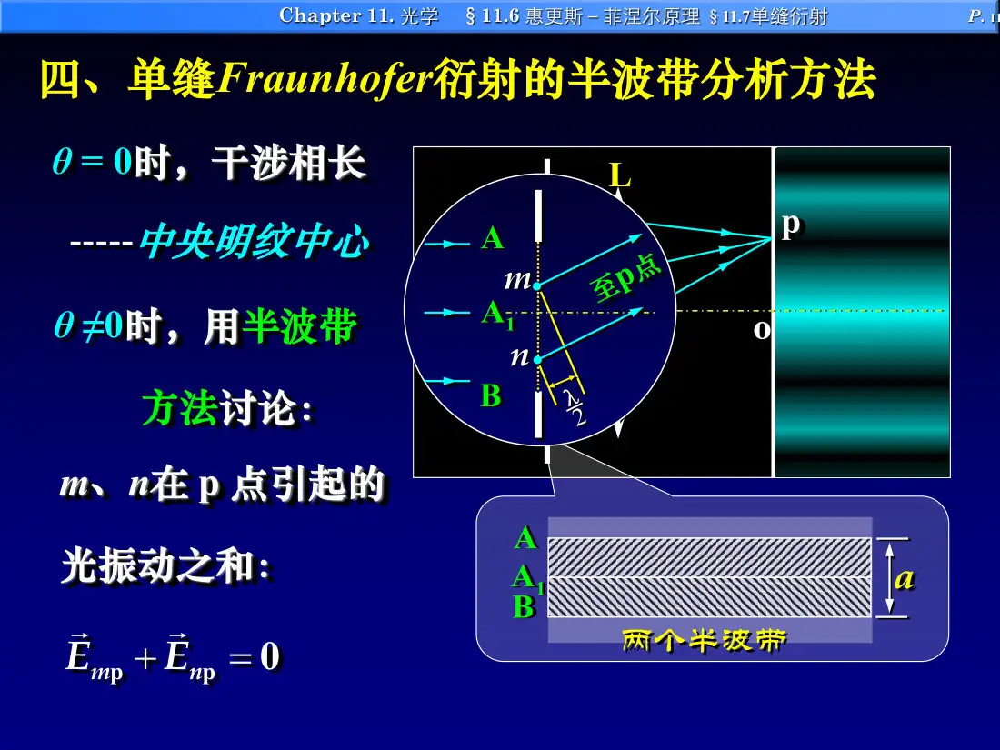

原文：

四、单缝Fraunhofer衍射的半波带分析方法

$\theta = 0$ 时，干涉相长

---- 中央明纹中心

$\theta \neq 0$ 时，用半波带

方法讨论:

m、n在p点引起的

光振动之和：

$$
\vec {E} _ {m \mathbf {p}} + \vec {E} _ {n \mathbf {p}} = \mathbf {0}
$$

Chapter 11. 光学 § 11.6 惠更斯 - 菲涅尔原理 § 11.7 单缝衍射

P. 11

### 结论：相邻两个半波带所发出的各子波在远处相遇时

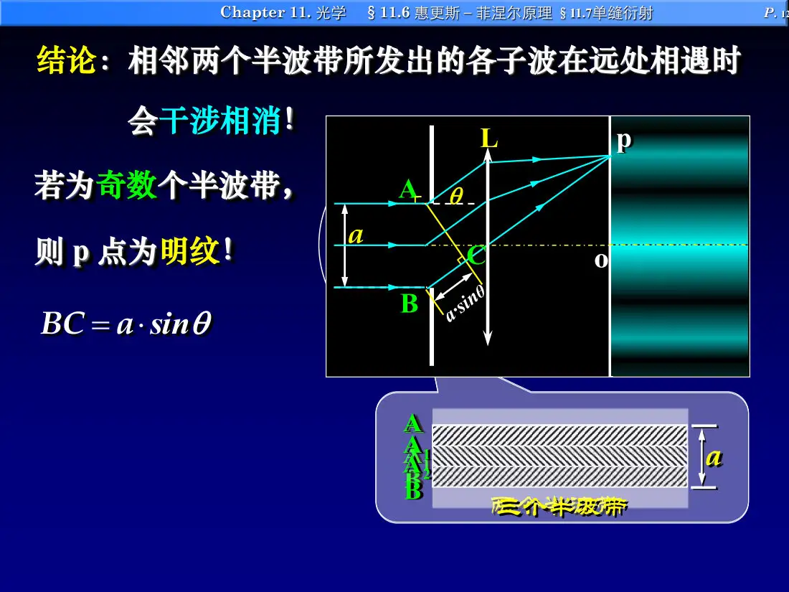

原文：

结论：相邻两个半波带所发出的各子波在远处相遇时

会干涉相消！

若为奇数个半波带，

则 p 点为明纹!

$$
B C = a \cdot \sin \theta
$$

Chapter 11. 光学 § 11.6 惠更斯-菲涅尔原理 § 11.7 单缝衍射

P. 12

### 结论：相邻两个半波带所发出的各子波在远处相遇时

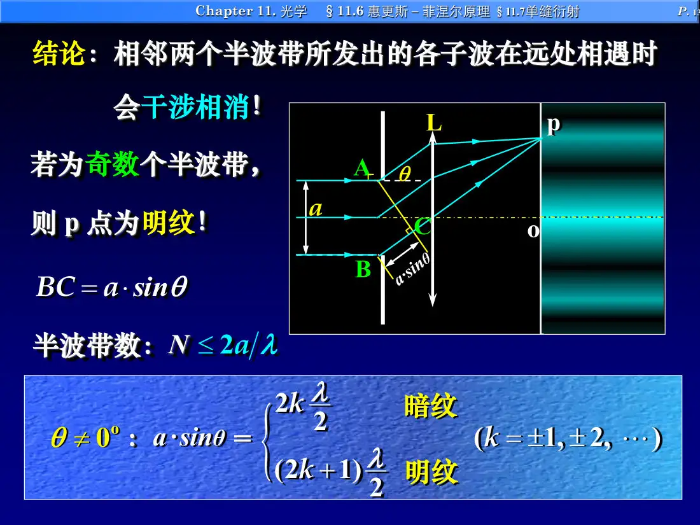

原文：

结论：相邻两个半波带所发出的各子波在远处相遇时

会干涉相消！

若为奇数个半波带，

则 p 点为明纹!

$BC = a \cdot \sin \theta$

半波带数: $N \leq 2a / \lambda$

$$
\theta \neq 0 ^ {\circ}: a \cdot \sin \theta =
$$

暗纹

$$
(k = \pm 1, \pm 2, \dots)
$$

(2k+1) $\frac{\lambda}{2}$ 明纹

Chapter 11. 光学 § 11.6 惠更斯 - 菲涅尔原理 § 11.7 单缝衍射

P. 13

### 五、单缝Fraunhofer衍射的条纹宽度

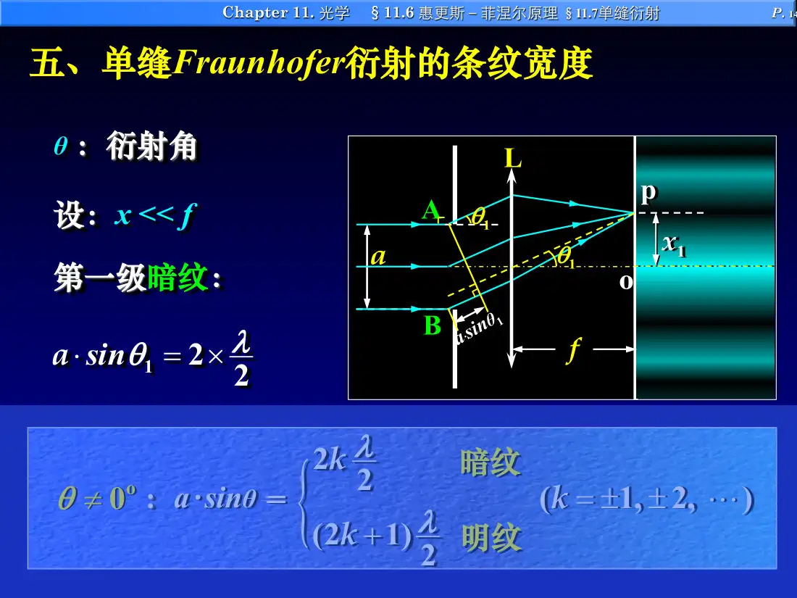

原文：

五、单缝Fraunhofer衍射的条纹宽度

θ : 衍射角

设: $x \ll f$

第一级暗纹：

$$
a \cdot \sin \theta_ {1} = 2 \times \frac {\lambda}{2}
$$

$$
\theta \neq 0 ^ {\circ}: a \cdot \sin \theta =
$$

暗纹

$$
(k = \pm 1, \pm 2, \dots)
$$

$(2k + 1)\frac{\lambda}{2}$ 明纹

Chapter 11. 光学 § 11.6 惠更斯 - 菲涅尔原理 § 11.7 单缝衍射

P. 14

### 五、单缝Fraunhofer衍射的条纹宽度

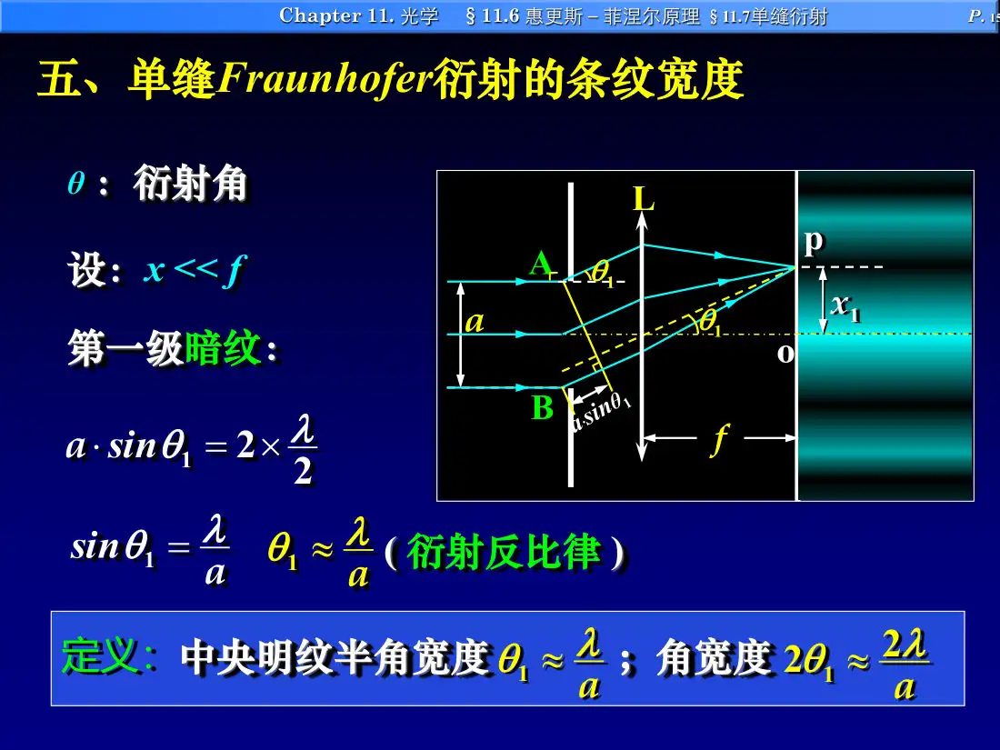

原文：

五、单缝Fraunhofer衍射的条纹宽度

θ : 衍射角

设: $x \ll f$

第一级暗纹：

$a \cdot \sin \theta_{1} = 2 \times \frac{\lambda}{2}$

$\sin\theta_{1}=\frac{\lambda}{a}\quad\theta_{1}\approx\frac{\lambda}{a}$ (衍射反比律)

定义: 中央明纹半角宽度 $\theta_{1} \approx \frac{\lambda}{a}$ ; 角宽度 $2\theta_{1} \approx \frac{2\lambda}{a}$

Chapter 11. 光学 § 11.6 惠更斯 - 菲涅尔原理 § 11.7 单缝衍射

P. 15

### 第二级暗纹：

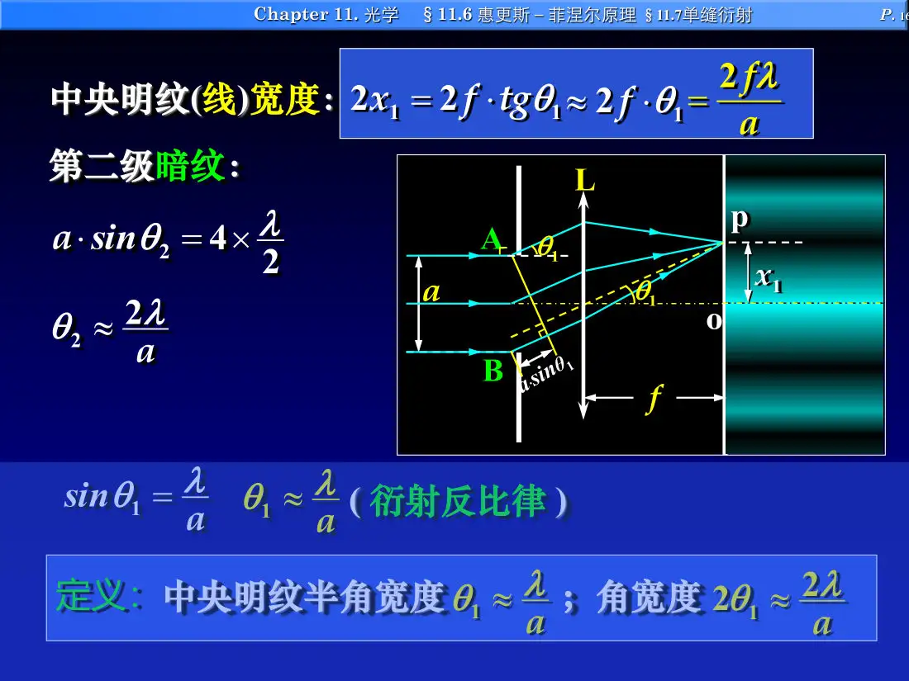

原文：

中央明纹(线)宽度: $2x_{1} = 2f \cdot tg\theta_{1} \approx 2f \cdot \theta_{1} = \frac{2f\lambda}{a}$

第二级暗纹：

$$
a \cdot \sin \theta_ {2} = 4 \times \frac {\lambda}{2}
$$

$$
\theta_ {2} \approx \frac {2 \lambda}{a}
$$

$\sin\theta_{1}=\frac{\lambda}{a}\quad\theta_{1}\approx\frac{\lambda}{a}$ (衍射反比律)

定义: 中央明纹半角宽度 $\theta_{1} \approx \frac{\lambda}{a}$ ; 角宽度 $2\theta_{1} \approx \frac{2\lambda}{a}$

Chapter 11. 光学 § 11.6 惠更斯 - 菲涅尔原理 § 11.7 单缝衍射

P. 16

### 第二级暗纹：

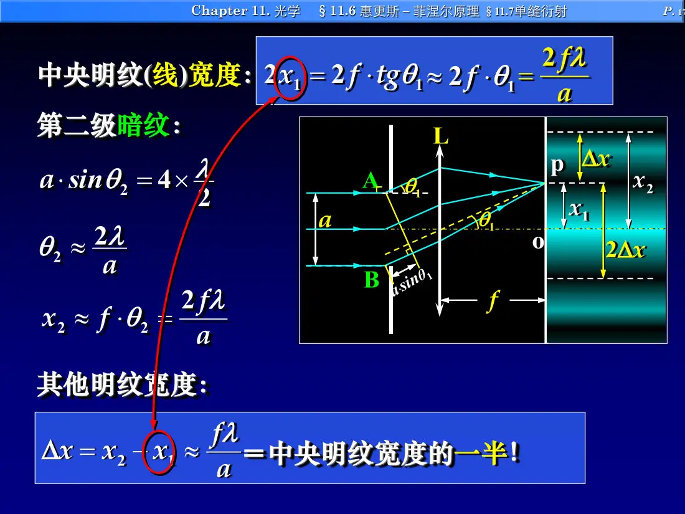

原文：

中央明纹(线)宽度: $2x_{1}=2f\cdot tg\theta_{1}\approx2f\cdot\theta_{1}=\frac{2f\lambda}{a}$

第二级暗纹：

$$
a \cdot \sin \theta_ {2} = 4 \times \frac {\lambda}{2}
$$

$$
\theta_ {2} \approx \frac {2 \lambda}{a}
$$

$$
x _ {2} \approx f \cdot \theta_ {2} = \frac {2 f \lambda}{a}
$$

其他明纹宽度:

$\Delta x = x_{2} - x_{1} \approx \frac{f\lambda}{a}$ = 中央明纹宽度的一半!

Chapter 11. 光学 § 11.6 惠更斯 - 菲涅尔原理 § 11.7 单缝衍射

P. 17

### 中央明纹线宽度:

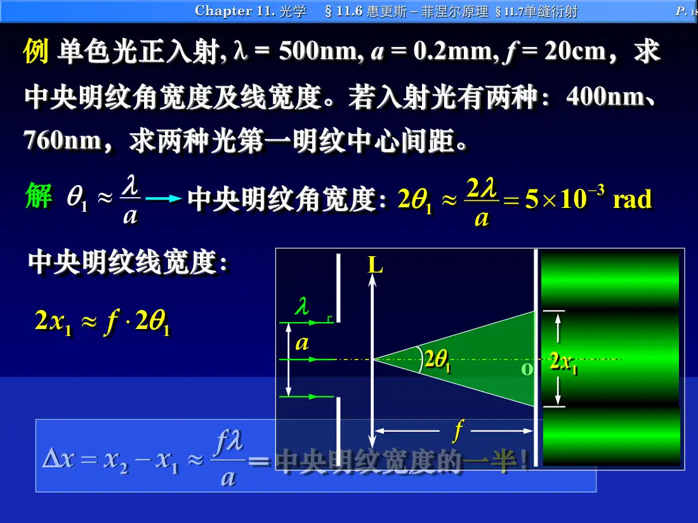

原文：

例 单色光正入射, $\lambda = 500\mathrm{nm}$ , $a = 0.2\mathrm{mm}$ , $f = 20\mathrm{cm}$ , 求中央明纹角宽度及线宽度。若入射光有两种: $400\mathrm{nm}$ 、 $760\mathrm{nm}$ , 求两种光第一明纹中心间距。

解 $\theta_{1} \approx \frac{\lambda}{a} \rightarrow$ 中央明纹角宽度: $2\theta_{1} \approx \frac{2\lambda}{a} = 5 \times 10^{-3} \mathrm{rad}$

中央明纹线宽度:

$2x_{1}\approx f\cdot 2\theta_{1}$

$$
\Delta x = x _ {2} - x _ {1} \approx \frac {f \lambda}{a} =
$$

Chapter 11. 光学 § 11.6 惠更斯 - 菲涅尔原理 § 11.7 单缝衍射

P. 18

### 中央明纹线宽度:

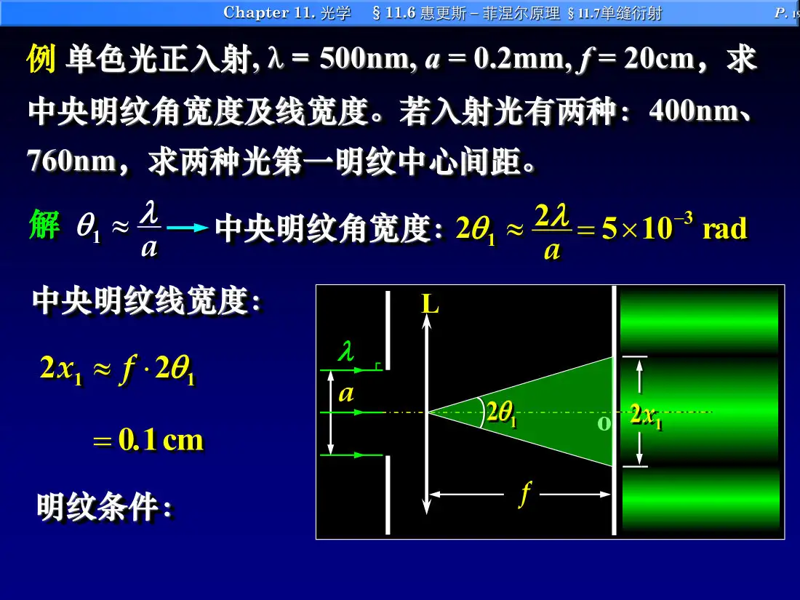

原文：

例 单色光正入射, $\lambda = 500\mathrm{nm}$ , $a = 0.2\mathrm{mm}$ , $f = 20\mathrm{cm}$ , 求中央明纹角宽度及线宽度。若入射光有两种: $400\mathrm{nm}$ 、 $760\mathrm{nm}$ , 求两种光第一明纹中心间距。

解 $\theta_{1} \approx \frac{\lambda}{a} \longrightarrow$ 中央明纹角宽度: $2\theta_{1} \approx \frac{2\lambda}{a} = 5 \times 10^{-3} \mathrm{rad}$

中央明纹线宽度:

$2x_{1}\approx f\cdot 2\theta_{1}$

$$
\equiv 0. 1 \mathrm{cm}
$$

明纹条件：

Chapter 11. 光学 § 11.6 惠更斯 - 菲涅尔原理 § 11.7 单缝衍射

P. 19

### $$

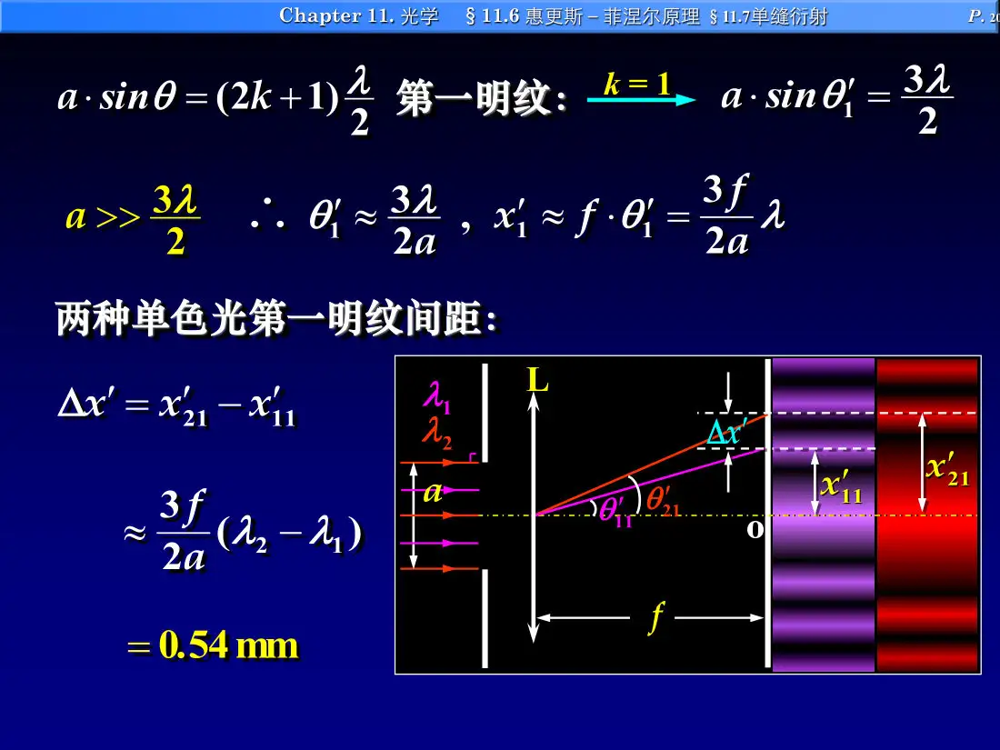

原文：

$$
a \cdot \sin \theta = (2 k + 1) \frac {\lambda}{2} \text {第一明纹:} \xrightarrow {k = 1} a \cdot \sin \theta_ {1} ^ {\prime} = \frac {3 \lambda}{2}
$$

$$
a > > \frac {3 \lambda}{2} \quad \therefore \theta_ {1} ^ {\prime} \approx \frac {3 \lambda}{2 a}, x _ {1} ^ {\prime} \approx f \cdot \theta_ {1} ^ {\prime} = \frac {3 f}{2 a} \lambda
$$

两种单色光第一明纹间距：

$$
\Delta x ^ {\prime} = x _ {2 1} ^ {\prime} - x _ {1 1} ^ {\prime}
$$

$$
\approx \frac {3 f}{2 a} (\lambda_ {2} - \lambda_ {1})
$$

$$
= 0. 5 4 \mathrm{mm}
$$

$$
\begin{array}{c c c} \lambda_ {1} & & \\ \lambda_ {2} & & \\ a & & \\ & \theta_ {1 1} ^ {\prime} & \theta_ {2 1} ^ {\prime} \\ & f & \end{array} \quad \begin{array}{c c c} L & & \\ & \Delta x ^ {\prime} & \\ & x _ {1 1} ^ {\prime} & x _ {2 1} ^ {\prime} \\ & o & \end{array}
$$

Chapter 11. 光学 § 11.6 惠更斯 - 菲涅尔原理 § 11.7 单缝衍射

P. 20

### 六、单缝Fraunhofer衍射的光强分布

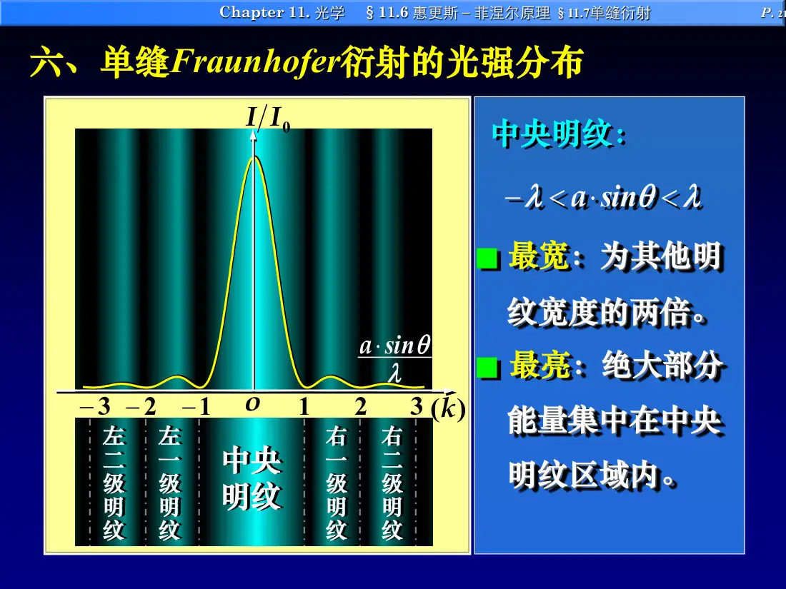

原文：

六、单缝Fraunhofer衍射的光强分布

中央明纹

中央明纹：

$$
- \lambda <   a \cdot \sin \theta <   \lambda
$$

最宽：为其他明纹宽度的两倍。

最亮：绝大部分能量集中在中央明纹区域内。

Chapter 11. 光学 § 11.6 惠更斯-菲涅尔原理 § 11.7 单缝衍射

P. 21

### 七、几点讨论

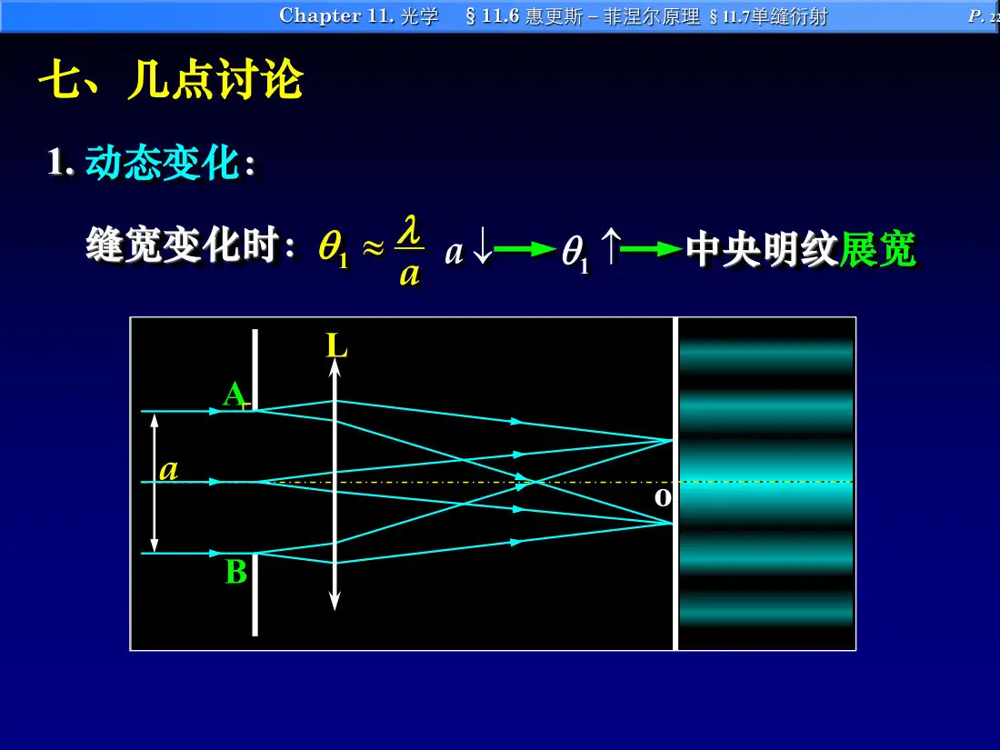

原文：

七、几点讨论

1. 动态变化:

缝宽变化时： $\theta_{1} \approx \frac{\lambda}{a}$ $a \downarrow \rightarrow \theta_{1} \uparrow \rightarrow$ 中央明纹展宽

Chapter 11. 光学 § 11.6 惠更斯 - 菲涅尔原理 § 11.7 单缝衍射

P. 22

### 透镜上下平移时:

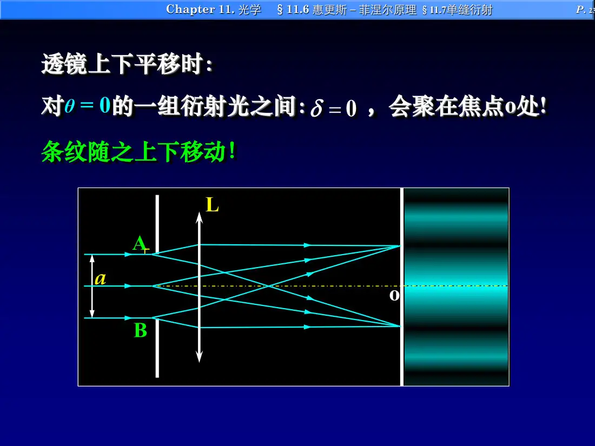

原文：

透镜上下平移时:

对 $\theta = 0$ 的一组衍射光之间: $\delta = 0$ , 会聚在焦点o处!

条纹随之上下移动!

Chapter 11. 光学 § 11.6 惠更斯 - 菲涅尔原理 § 11.7 单缝衍射

P. 23

### 缝平面上下平移时：

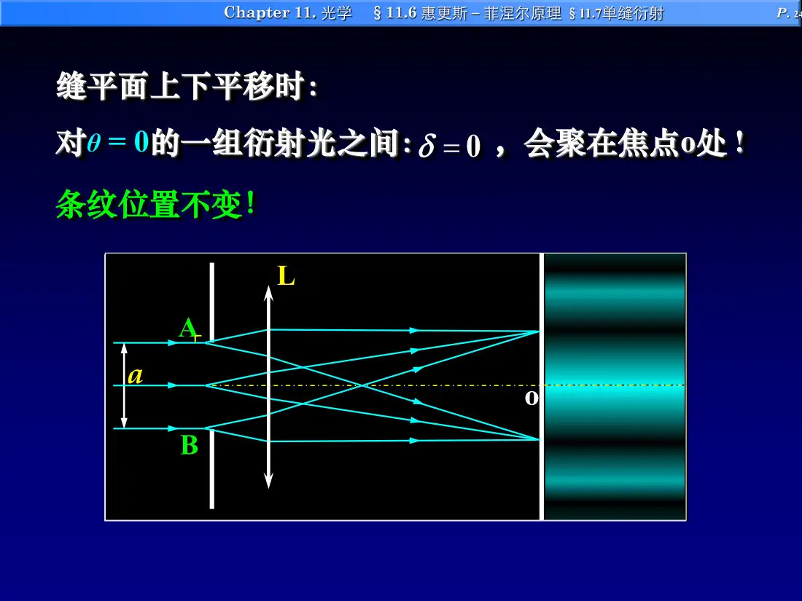

原文：

缝平面上下平移时：

对 $\theta = 0$ 的一组衍射光之间: $\delta = 0$ , 会聚在焦点o处!

条纹位置不变！

Chapter 11. 光学 § 11.6 惠更斯 - 菲涅尔原理 § 11.7 单缝衍射

P. 24

### 2. 单色平行光斜入射：

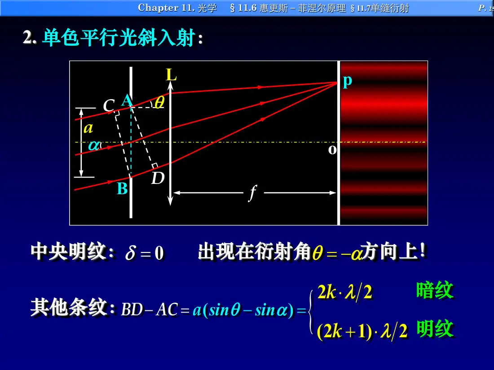

原文：

2. 单色平行光斜入射：

中央明纹： $\delta = 0$ 出现在衍射角 $\theta = -\alpha$ 方向上！

其他条纹: BD-AC=a(sinθ-sinα)= $\left\{\begin{aligned}&2k\cdot\lambda/2\\ &(2k+1)\cdot\lambda/2\end{aligned}\right.$ 暗纹 明纹

Chapter 11. 光学 § 11.6 惠更斯 - 菲涅尔原理 § 11.7 单缝衍射

P. 25

### 3. 白光入射:

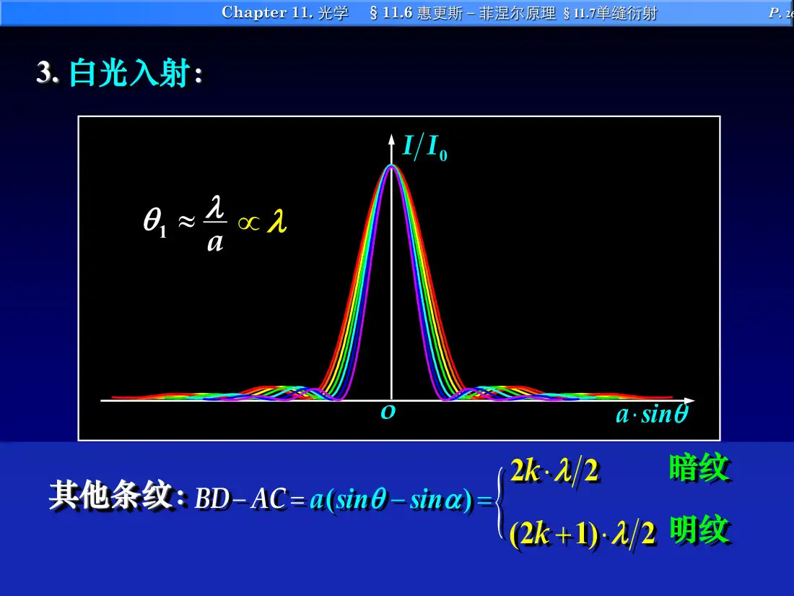

原文：

3. 白光入射:

其他条纹: $BD - AC = a(\sin \theta - \sin \alpha) =$

a·sinθ

2k·λ/2

暗纹

$(2k + 1)\cdot \lambda /2$ 明纹

Chapter 11. 光学 § 11.6 惠更斯 - 菲涅尔原理 § 11.7 单缝衍射

P. 26

### 3. 白光入射:

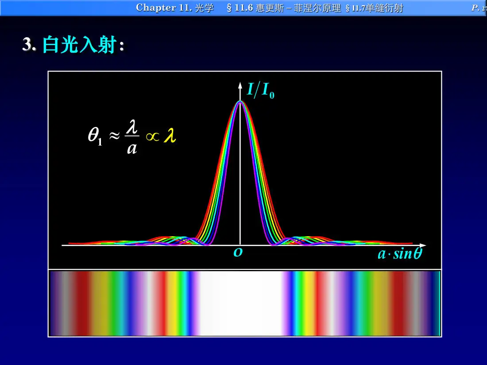

原文：

3. 白光入射:

Chapter 11. 光学 § 11.6 惠更斯 - 菲涅尔原理 § 11.7 单缝衍射

P. 27

### 归纳：

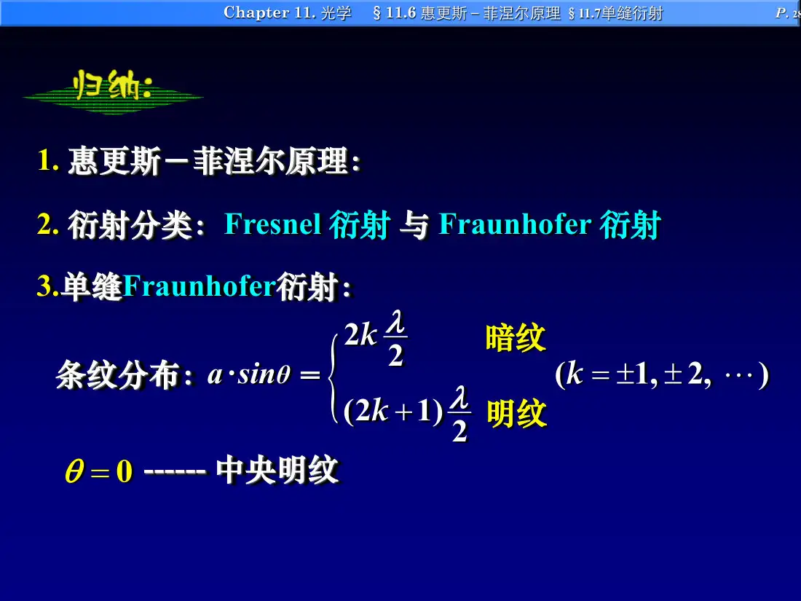

原文：

归纳：

1. 惠更斯—菲涅尔原理：

2. 衍射分类: Fresnel 衍射 与 Fraunhofer 衍射

3.单缝Fraunhofer衍射：

条纹分布： $a \cdot \sin \theta = \begin{cases} 2k \frac{\lambda}{2} & \text{暗纹} \\ (2k + 1) \frac{\lambda}{2} & \text{明纹} \end{cases} \quad (k = \pm 1, \pm 2, \cdots)$

$\theta=0$ —— 中央明纹

Chapter 11. 光学 § 11.6 惠更斯 - 菲涅尔原理 § 11.7 单缝衍射

P. 28

### 归纳:

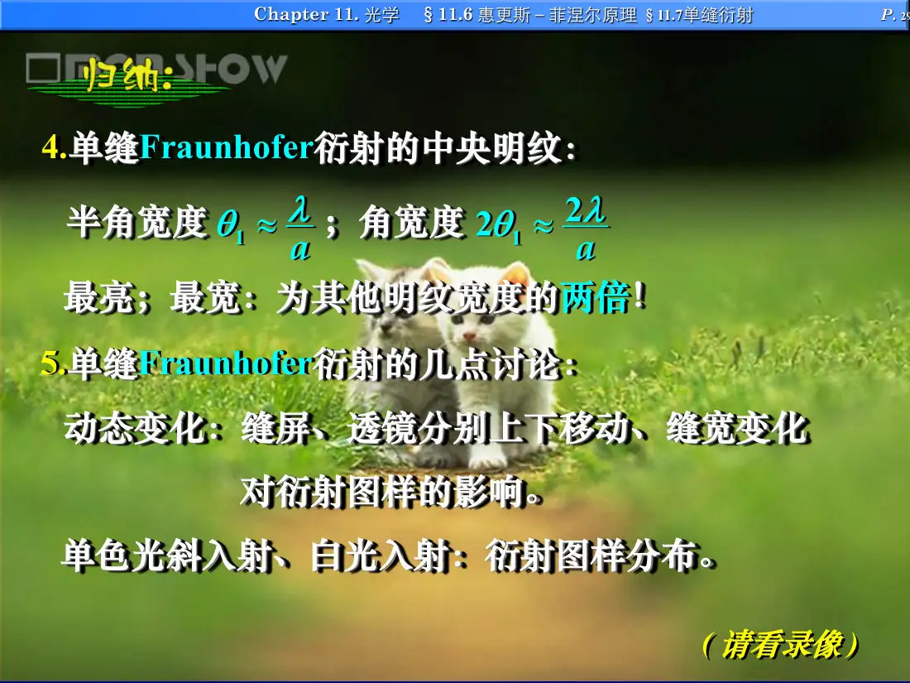

原文：

归纳:

4.单缝Fraunhofer衍射的中央明纹:

半角宽度 $\theta_{1} \approx \frac{\lambda}{a}$ ; 角宽度 $2\theta_{1} \approx \frac{2\lambda}{a}$

最亮；最宽：为其他明纹宽度的两倍！

5.单缝Fraunhofer衍射的几点讨论:

动态变化：缝屏、透镜分别上下移动、缝宽变化对衍射图样的影响。

单色光斜入射、白光入射：衍射图样分布。

(请看录像)

Chapter 11. 光学 § 11.6 惠更斯-菲涅尔原理 § 11.7 单缝衍射

P. 29

### 单缝衍

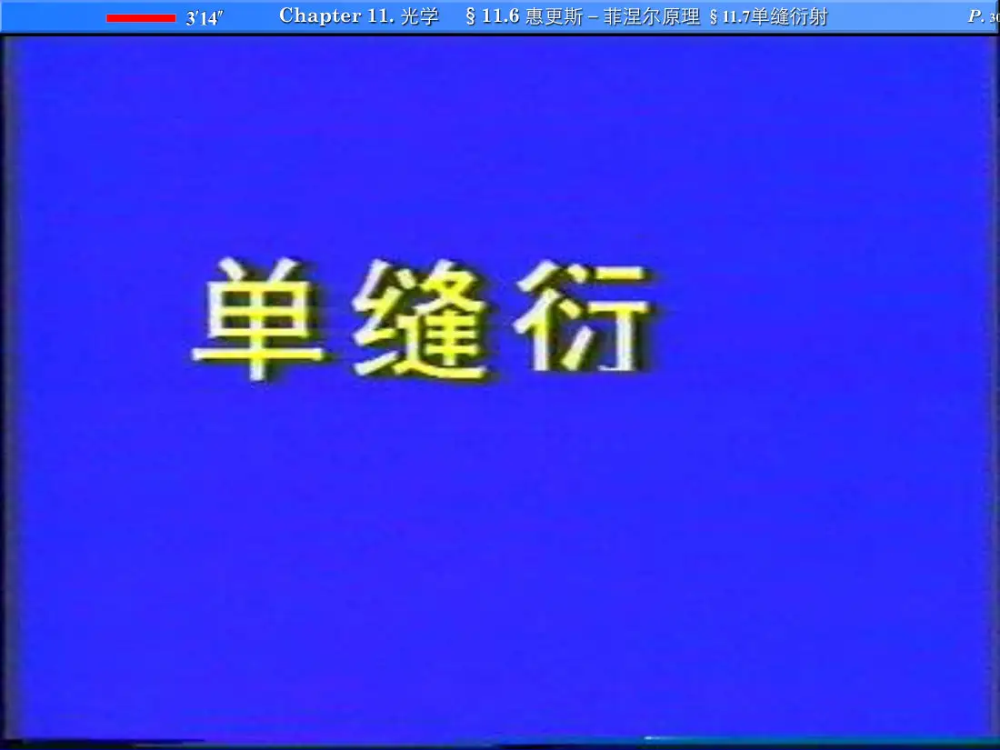

原文：

单缝衍

3'14" Chapter 11. 光学 § 11.6 惠更斯 - 菲涅尔原理 § 11.7 单缝衍射

P. 30
