# 《大学物理》第11章 §11.9 衍射光栅（课件）

原件的每一页，下面附识别出的文字。

### § 11.9 衍射光栅

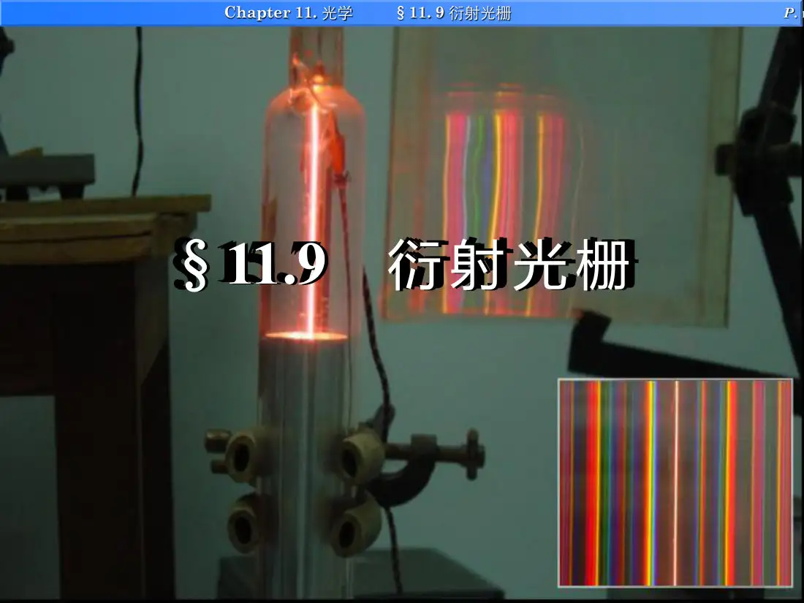

原文：

§ 11.9 衍射光栅

Chapter 11. 光学 § 11.9 衍射光栅

P.

### 一、光栅的结构

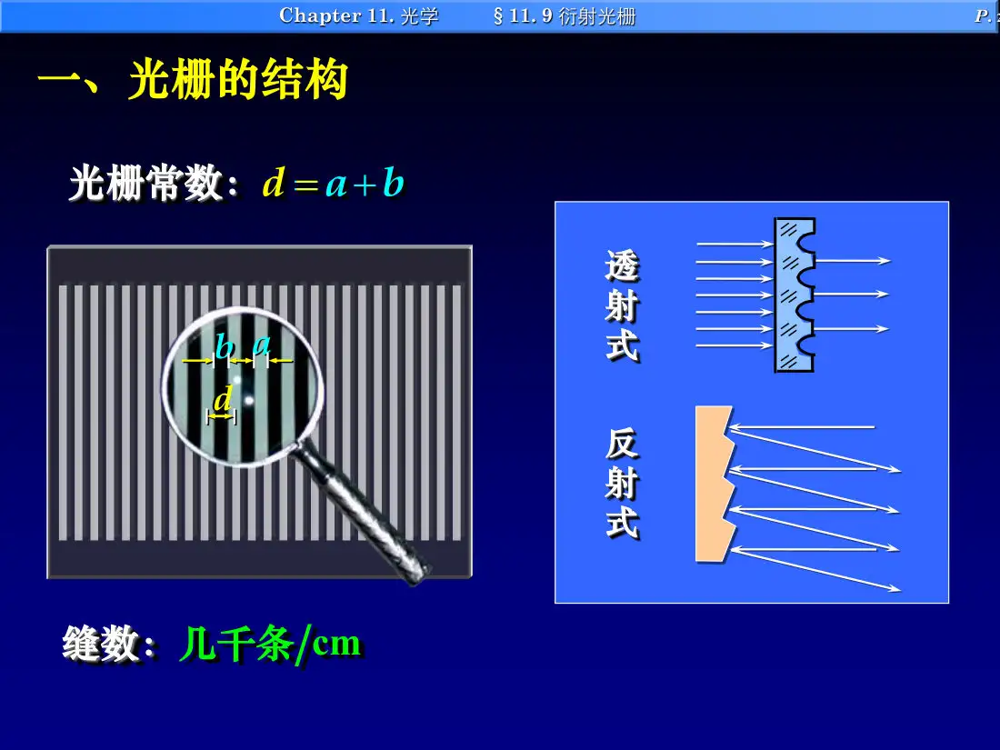

原文：

一、光栅的结构

光栅常数: $d = a + b$

缝数：几千条/cm

透射式反射式

Chapter 11. 光学 § 11.9 衍射光栅

P.

### 二、光栅衍射光的干涉

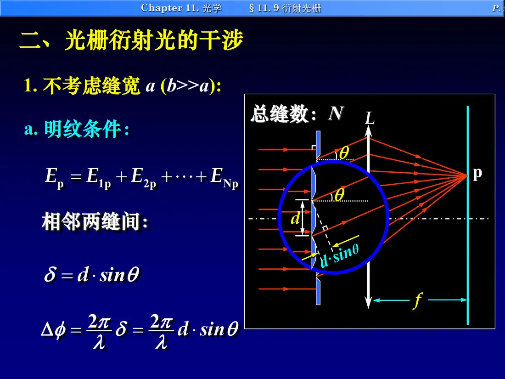

原文：

二、光栅衍射光的干涉

1. 不考虑缝宽 a (b>>a):

a. 明纹条件:

$$
E _ {\mathrm{p}} = E _ {1 \mathrm{p}} + E _ {2 \mathrm{p}} + \dots + E _ {\mathrm{Np}}
$$

相邻两缝间：

$$
\delta = d \cdot \sin \theta
$$

$$
\Delta \phi = \frac {2 \pi}{\lambda} \delta = \frac {2 \pi}{\lambda} d \cdot \sin \theta
$$

Chapter 11. 光学 § 11.9 衍射光栅

P.

### 二、光栅衍射光的干涉

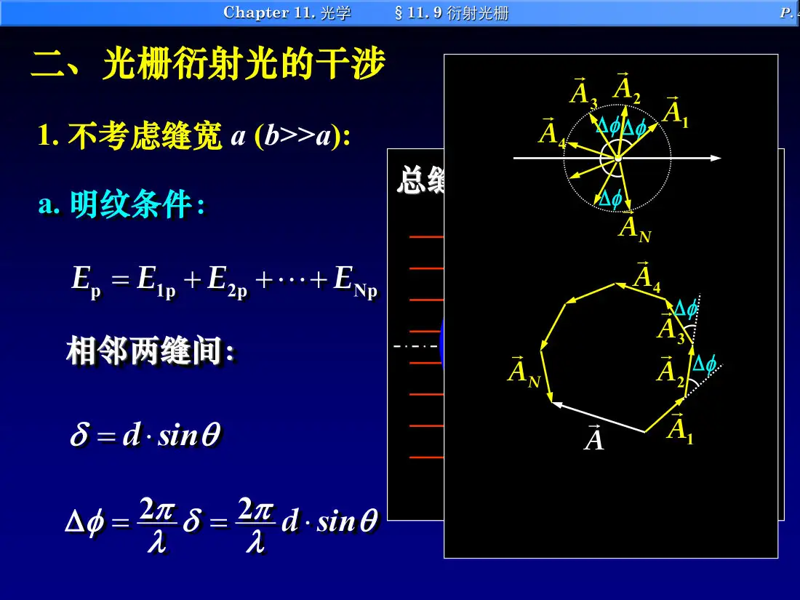

原文：

二、光栅衍射光的干涉

1. 不考虑缝宽 $a (b >> a)$ :

a. 明纹条件:

总编

$$
E _ {\mathrm{p}} = E _ {1 \mathrm{p}} + E _ {2 \mathrm{p}} + \dots + E _ {\mathrm{Np}}
$$

相邻两缝间：

$$
\delta = d \cdot \sin \theta
$$

$$
\Delta \phi = \frac {2 \pi}{\lambda} \delta = \frac {2 \pi}{\lambda} d \cdot \sin \theta
$$

Chapter 11. 光学 § 11.9 衍射光栅

P.

### p点干涉加强，即：明

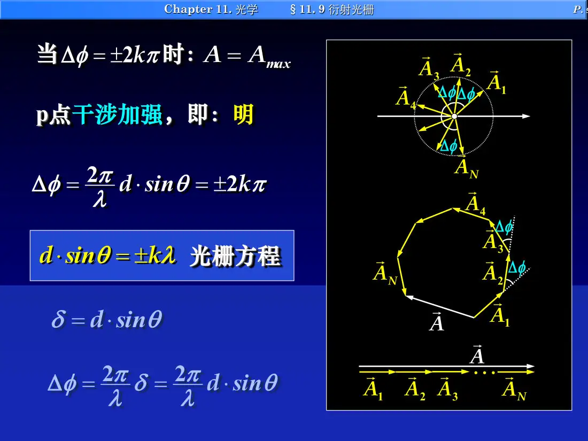

原文：

当 $\Delta \phi = \pm 2k\pi$ 时： $A = A_{max}$

p点干涉加强，即：明

$\Delta \phi = \frac{2\pi}{\lambda} d \cdot \sin \theta = \pm 2k\pi$

$d \cdot \sin \theta = \pm k \lambda$ 光栅方程

$\delta = d \cdot \sin \theta$

$\Delta \phi = \frac{2\pi}{\lambda}\delta = \frac{2\pi}{\lambda}d\cdot \sin \theta$

Chapter 11. 光学 § 11.9 衍射光栅

P.

### p点干涉加强，即：明

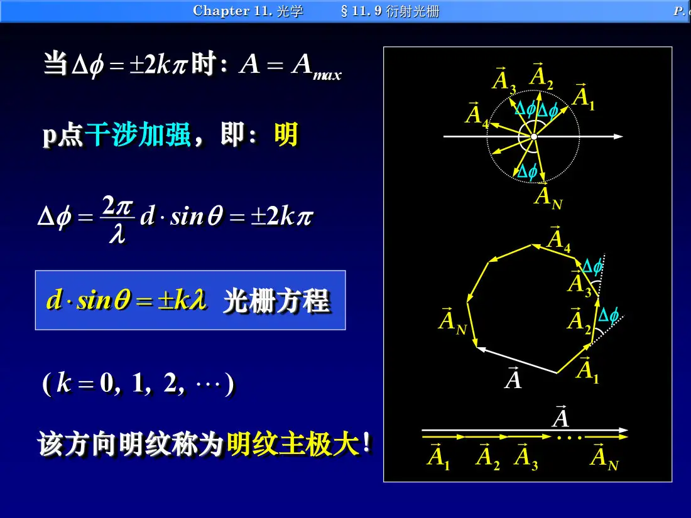

原文：

当 $\Delta \phi = \pm 2k\pi$ 时： $A = A_{max}$

p点干涉加强，即：明

$\Delta \phi = \frac{2\pi}{\lambda} d \cdot \sin \theta = \pm 2k\pi$

$d \cdot \sin\theta = \pm k\lambda$ 光栅方程

$$
(k = 0, 1, 2, \dots)
$$

该方向明纹称为明纹主极大!

Chapter 11. 光学

§ 11.9 衍射光栅

P.

### b. 暗纹条件:

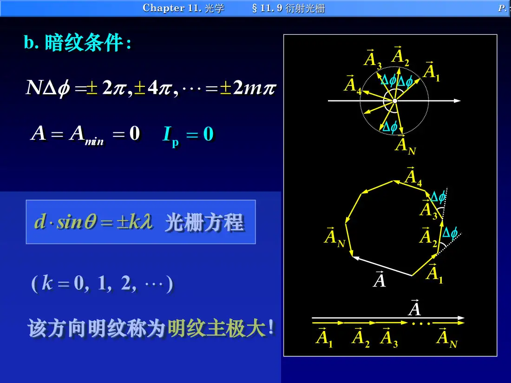

原文：

b. 暗纹条件:

$$
N \Delta \phi = \pm 2 \pi , \pm 4 \pi , \dots = \pm 2 m \pi
$$

$$
A = A _ {m i n} = 0 \quad I _ {\mathrm{p}} = 0
$$

$d \cdot \sin \theta = \pm k \lambda$ 光栅方程

$$
(k = 0, 1, 2, \dots)
$$

该方向明纹称为明纹主极大!

Chapter 11. 光学 § 11.9 衍射光栅

P.

### b. 暗纹条件:

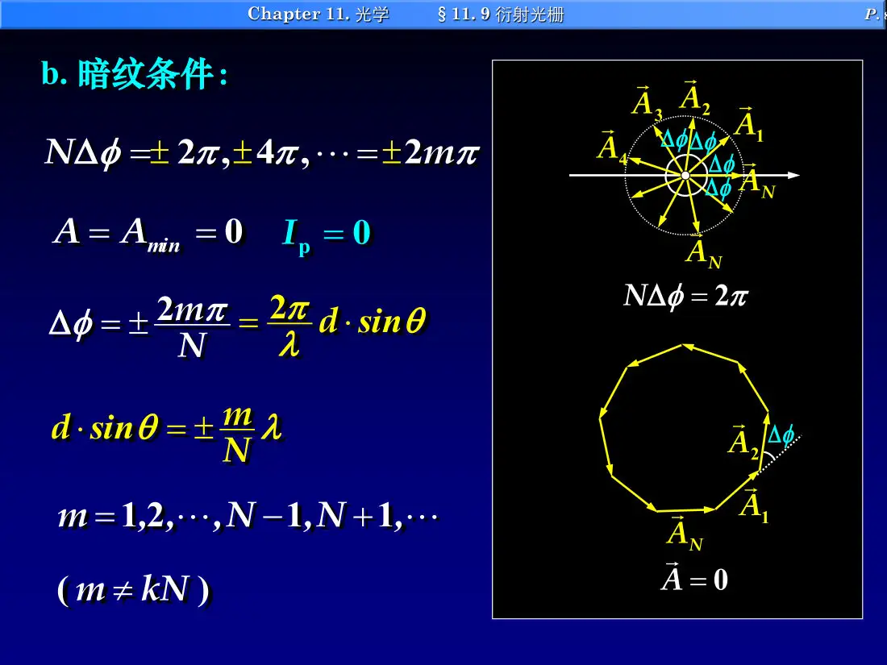

原文：

b. 暗纹条件:

$$
N \Delta \phi = \pm 2 \pi , \pm 4 \pi , \dots = \pm 2 m \pi
$$

$$
A = A _ {m i n} = 0 \quad I _ {\mathrm{p}} = 0
$$

$$
\Delta \phi = \pm \frac {2 m \pi}{N} = \frac {2 \pi}{\lambda} d \cdot \sin \theta
$$

$d \cdot \sin \theta = \pm \frac{m}{N} \lambda$

$$
m = 1, 2, \dots , N - 1, N + 1, \dots
$$

$$
(m \neq k N)
$$

Chapter 11. 光学 § 11.9 衍射光栅

P.

### 结论: 屏上干涉结果取决于 $d$ 与 $N!$

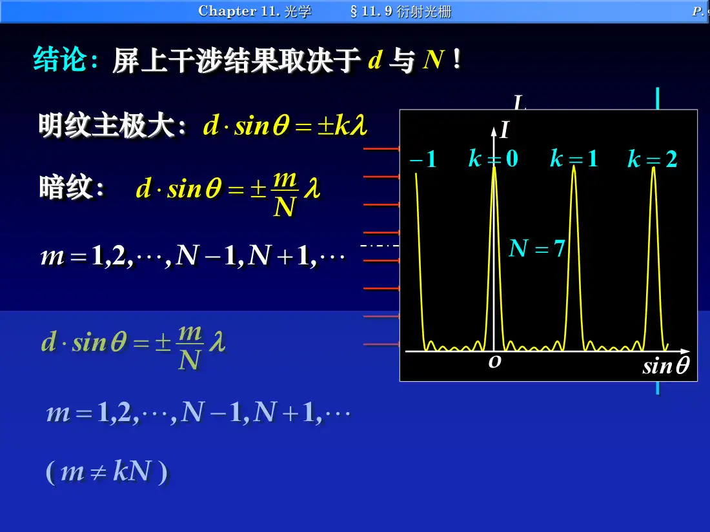

原文：

结论: 屏上干涉结果取决于 $d$ 与 $N!$

明纹主极大: $d \cdot \sin \theta = \pm k \lambda$

暗纹: $d \cdot \sin \theta = \pm \frac{m}{N} \lambda$

$$
m = 1, 2, \dots , N - 1, N + 1, \dots
$$

$d \cdot \sin \theta = \pm \frac{m}{N} \lambda$

$$
m = 1, 2, \dots , N - 1, N + 1, \dots
$$

$$
(m \neq k N)
$$

Chapter 11. 光学 § 11.9 衍射光栅

P.

### 结论：屏上干涉结果取决于 $d$ 与 $N!$

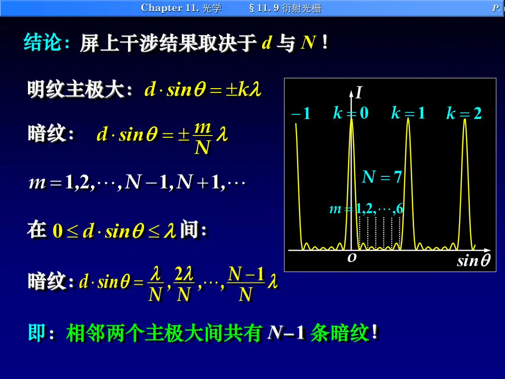

原文：

结论：屏上干涉结果取决于 $d$ 与 $N!$

明纹主极大: $d \cdot \sin \theta = \pm k \lambda$

暗纹: $d \cdot \sin \theta = \pm \frac{m}{N} \lambda$

$$
m = 1, 2, \dots , N - 1, N + 1, \dots
$$

在 $0 \leq d \cdot \sin \theta \leq \lambda$ 间：

暗纹: $d \cdot \sin \theta = \frac{\lambda}{N}, \frac{2\lambda}{N}, \cdots, \frac{N-1}{N} \lambda$

$$
\begin{array}{c c c c c c c c c} & & I & & \\ & - 1 & k = 0 & k = 1 & k = 2 \\ & & m = 1, 2, \dots , 6 & N = 7 \\ & & & & \end{array}
$$

即：相邻两个主极大间共有 $N - 1$ 条暗纹！

Chapter 11. 光学 § 11.9 衍射光栅

P.

### c. 条纹特点: $N$ 较大时, 背景较暗, 明纹细窄、明亮!

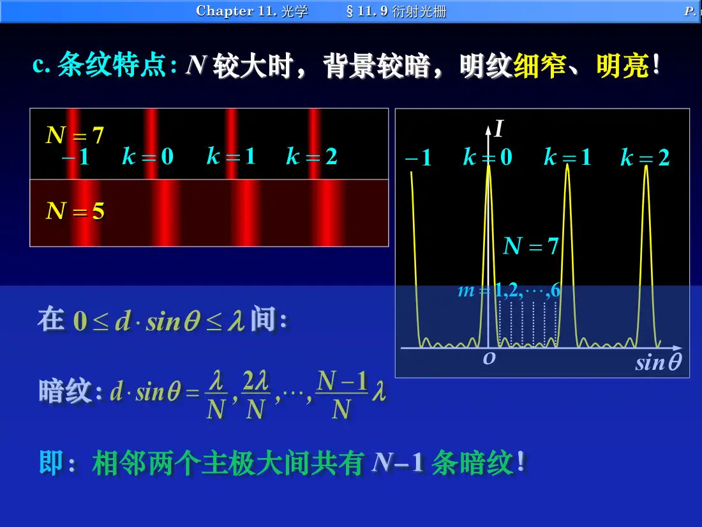

原文：

c. 条纹特点: $N$ 较大时, 背景较暗, 明纹细窄、明亮!

$$
\begin{array}{l l l l} N = 7 \\ - 1 & k = 0 & k = 1 & k = 2 \\ \hline N = 5 \end{array}
$$

在 $0 \leq d \cdot \sin \theta \leq \lambda$ 间:

$$
\begin{array}{c} I \\ \text {N = 7} \\ m = 1, 2, \dots , 6 \\ \text {sin} \theta \end{array}
$$

暗纹: $d \cdot \sin \theta = \frac{\lambda}{N}, \frac{2\lambda}{N}, \cdots, \frac{N-1}{N} \lambda$

即：相邻两个主极大间共有 $N - 1$ 条暗纹！

Chapter 11. 光学 § 11.9 衍射光栅

P.

### c. 条纹特点: $N$ 较大时, 背景较暗, 明纹细窄、明亮!

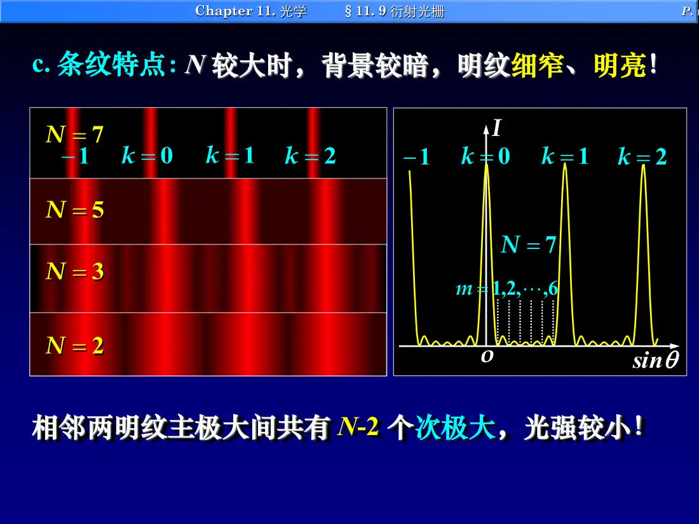

原文：

c. 条纹特点: $N$ 较大时, 背景较暗, 明纹细窄、明亮!

$$
\begin{array}{l l l l} N = 7 \\ - 1 & k = 0 & k = 1 & k = 2 \end{array}
$$

$$
N = 5
$$

$$
N \equiv 3
$$

$$
N \equiv 2
$$

$$
\begin{array}{c} I \\ \text {   k = 0   } \\ \text {   k = 1   } \\ \text {   k = 2   } \\ \text {   N = 7   } \\ m = 1, 2, \dots , 6 \end{array}
$$

相邻两明纹主极大间共有 N-2 个次极大，光强较小！

Chapter 11. 光学 § 11.9 衍射光栅

P.

### 2. 考虑缝宽 a：设入射光垂直入射

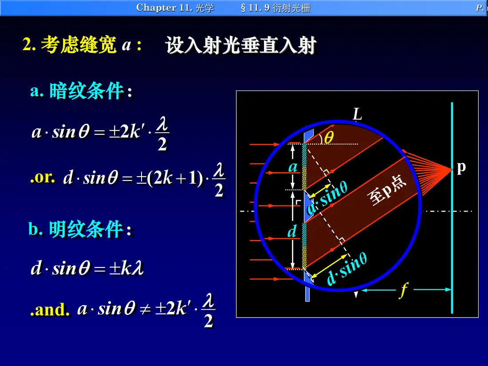

原文：

2. 考虑缝宽 a：设入射光垂直入射

a. 暗纹条件：

$$
a \cdot \sin \theta = \pm 2 k ^ {\prime} \cdot \frac {\lambda}{2}
$$

.or. $d \cdot \sin \theta = \pm(2k + 1) \cdot \frac{\lambda}{2}$

b. 明纹条件：

$d \cdot \sin \theta = \pm k \lambda$

.and. $a \cdot \sin \theta \neq \pm 2k' \cdot \frac{\lambda}{2}$

Chapter 11. 光学

§ 11.9 衍射光栅

P.

### c. 缺级现象：

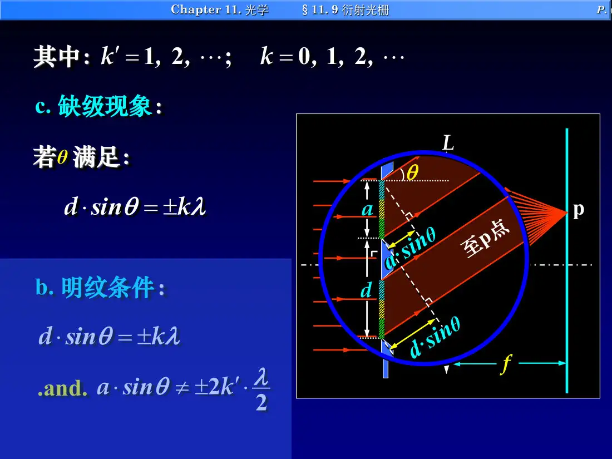

原文：

其中： $k' = 1, 2, \cdots; \quad k = 0, 1, 2, \cdots$

c. 缺级现象：

若θ满足:

$$
d \cdot \sin \theta = \pm k \lambda
$$

b. 明纹条件：

$d \cdot \sin \theta = \pm k \lambda$

.and. $a \cdot \sin \theta \neq \pm 2k' \cdot \frac{\lambda}{2}$ 其中： $k' = 1, 2, \cdots; \quad k = 0, 1, 2, \cdots$

Chapter 11. 光学

§ 11.9 衍射光栅

P.

### c. 缺级现象：

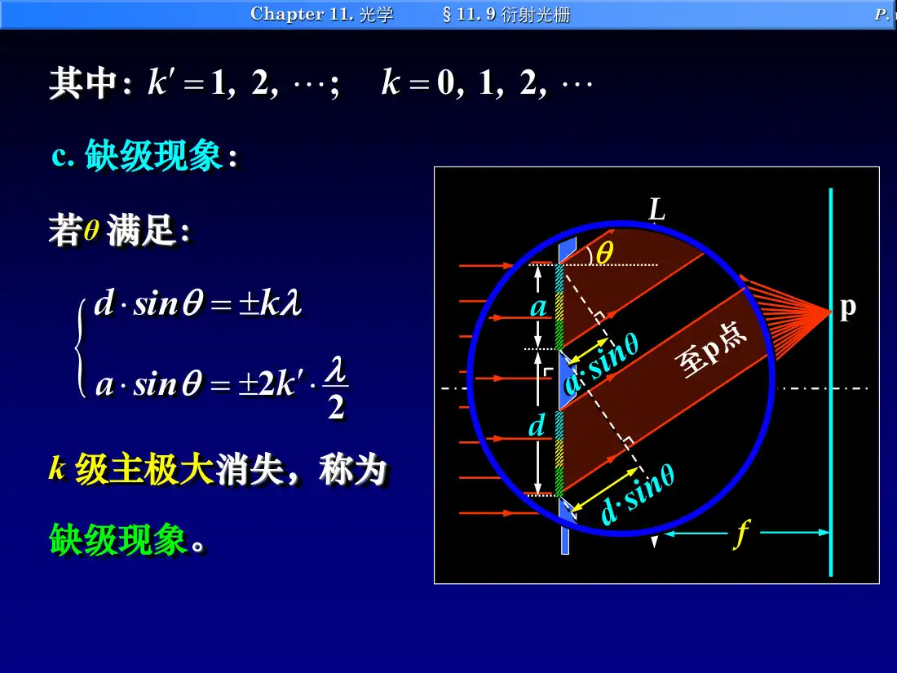

原文：

c. 缺级现象：

若θ满足:

$$
d \cdot \sin \theta = \pm k \lambda
$$

$$
a \cdot \sin \theta = \pm 2 k ^ {\prime} \cdot \frac {\lambda}{2}
$$

k 级主极大消失，称为缺级现象。

Chapter 11. 光学

§ 11.9 衍射光栅

P.

### d. 光强分布:

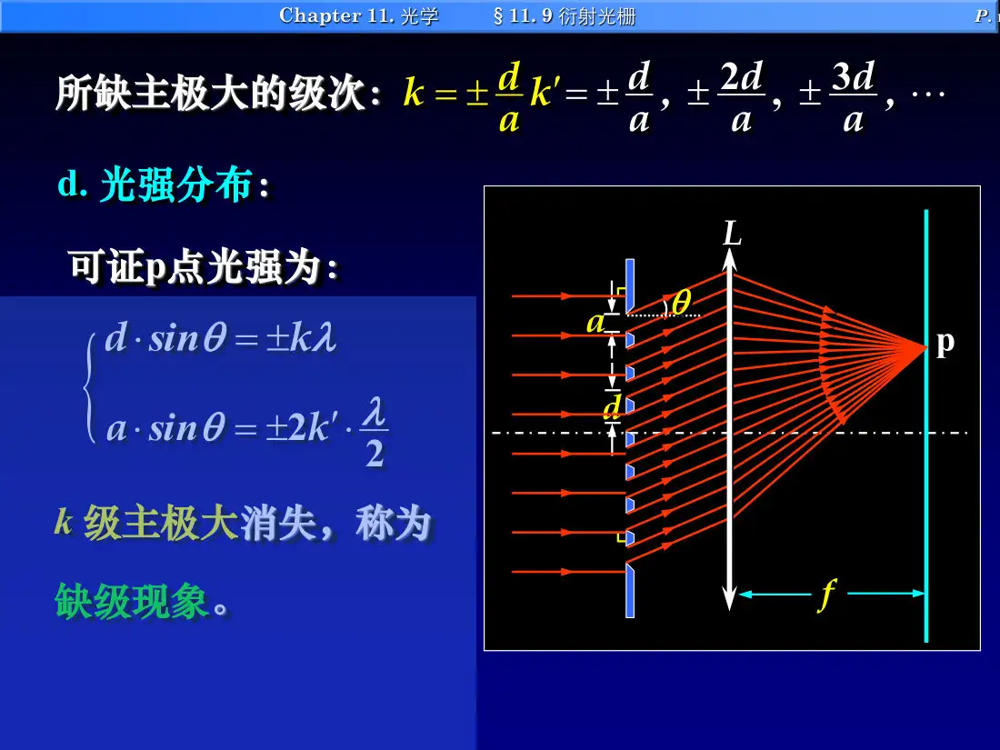

原文：

所缺主极大的级次： $k=\pm\frac{d}{a}k'=\pm\frac{d}{a},\pm\frac{2d}{a},\pm\frac{3d}{a},\cdots$

d. 光强分布:

可证p点光强为：

$d \cdot \sin \theta = \pm k \lambda$

$$
a \cdot \sin \theta = \pm 2 k ^ {\prime} \cdot \frac {\lambda}{2}
$$

k 级主极大消失，称为缺级现象。

Chapter 11. 光学

§ 11.9 衍射光栅

P.

### d. 光强分布：

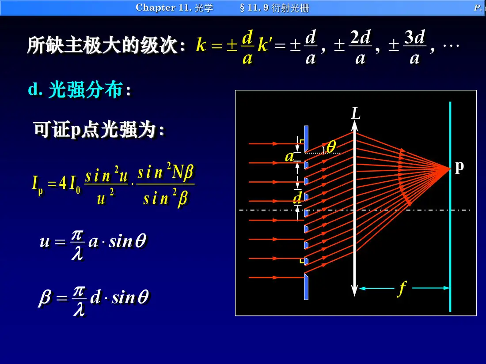

原文：

所缺主极大的级次： $k=\pm\frac{d}{a}k'=\pm\frac{d}{a},\pm\frac{2d}{a},\pm\frac{3d}{a},\cdots$

d. 光强分布：

可证p点光强为：

$$
I _ {\mathrm{p}} = 4 I _ {0} \frac {\sin^ {2} u}{u ^ {2}} \cdot \frac {\sin^ {2} N \beta}{\sin^ {2} \beta}
$$

$$
u = \frac {\pi}{\lambda} a \cdot \sin \theta
$$

$$
\beta = \frac {\pi}{\lambda} d \cdot \sin \theta
$$

Chapter 11. 光学 § 11.9 衍射光栅

P.

### $$

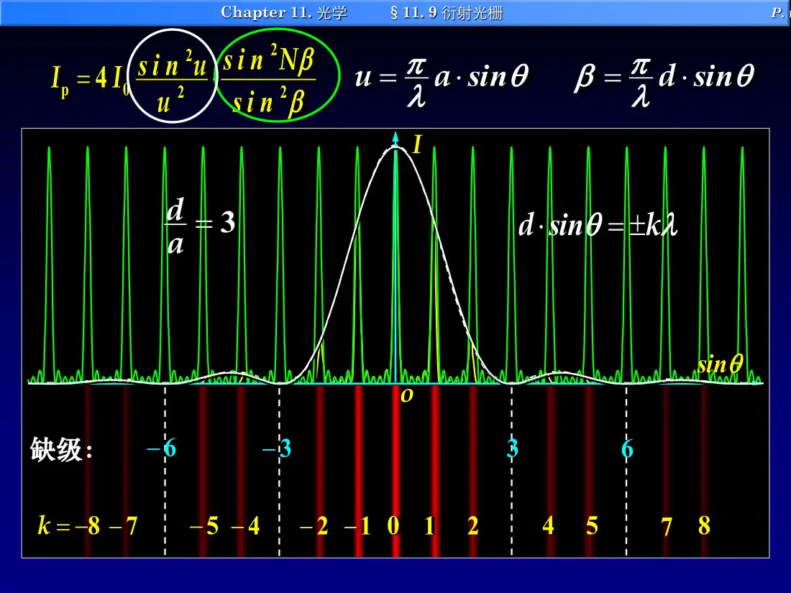

原文：

$$
I _ {\mathrm{p}} = 4 I _ {0} \frac {\sin^ {2} u}{u ^ {2}} \frac {\sin^ {2} N \beta}{\sin^ {2} \beta}
$$

$$
u = \frac {\pi}{\lambda} a \cdot \sin \theta
$$

$$
\beta = \frac {\pi}{\lambda} d \cdot \sin \theta
$$

$$
\frac {d}{a} = 3
$$

$$
d \cdot \sin \theta = \pm k \lambda
$$

缺级：

$$
k = - 8 - 7
$$

$$
7 8
$$

Chapter 11. 光学 § 11.9 衍射光栅

P.

### e. 中央明带内的条纹数：

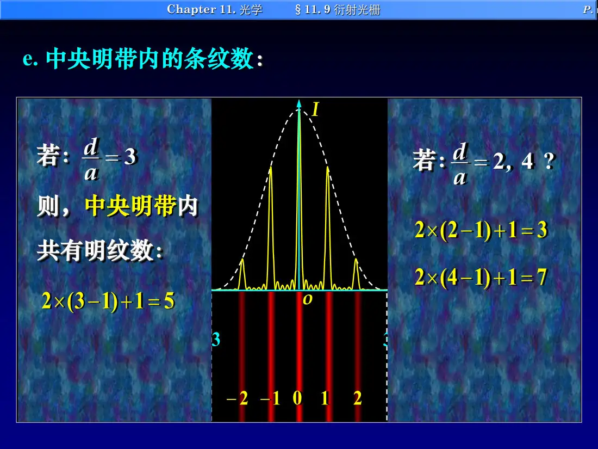

原文：

e. 中央明带内的条纹数：

若: $\frac{d}{a} = 3$ 则, 中央明带内
共有明纹数:

$$
2 \times (3 - 1) + 1 = 5
$$

若: $\frac{d}{a} = 2, 4$ ?

$$
2 \times (2 - 1) + 1 = 3
$$

$$
2 \times (4 - 1) + 1 = 7
$$

Chapter 11. 光学

§ 11.9 衍射光栅

P.

### 三、几点讨论

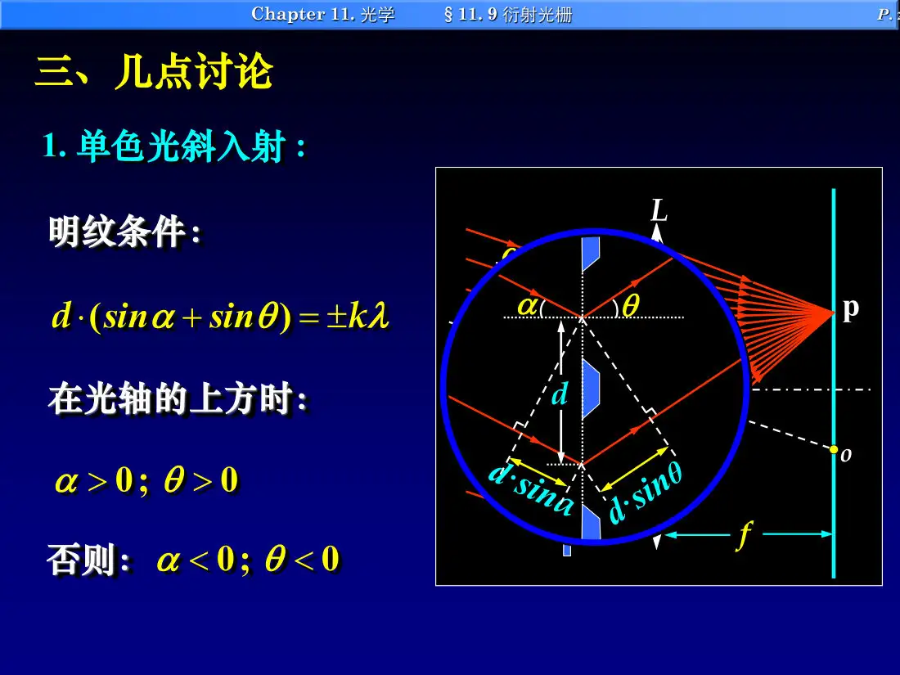

原文：

三、几点讨论

1. 单色光斜入射：

明纹条件：

$d \cdot (\sin \alpha + \sin \theta) = \pm k \lambda$

在光轴的上方时：

$\alpha > 0; \theta > 0$

否则： $\alpha < 0; \theta < 0$

Chapter 11. 光学 § 11.9 衍射光栅

P.

### $$

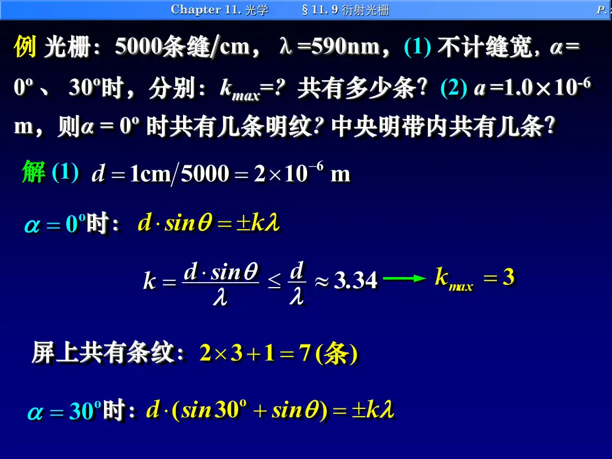

原文：

例 光栅: 5000条缝/cm, $\lambda = 590 \mathrm{~nm}$ , (1) 不计缝宽, $\alpha = 0^{\circ}$ 、 $30^{\circ}$ 时, 分别: $k_{\max} = ?$ 共有多少条? (2) $a = 1.0 \times 10^{-6} \mathrm{~m}$ , 则 $\alpha = 0^{\circ}$ 时共有几条明纹? 中央明带内共有几条?

解 (1) $d = 1 \mathrm{~cm} / 5000 = 2 \times 10^{-6} \mathrm{~m}$

$\alpha = 0^{\circ}$ 时： $d\cdot \sin \theta = \pm k\lambda$

$$
k = \frac {d \cdot \sin \theta}{\lambda} \leq \frac {d}{\lambda} \approx 3. 3 4 \longrightarrow k _ {\max} = 3
$$

屏上共有条纹: $2 \times 3 + 1 = 7$ (条)

$\alpha = 30^{\circ}$ 时： $d \cdot (\sin 30^{\circ} + \sin \theta) = \pm k\lambda$ (2) $a = 1.0 \times 10^{- 6} \mathrm{~m}$ , 则 $\alpha = 0^{\circ}$ 时共有几条明纹? 中央明带内共有几条?

Chapter 11. 光学 § 11.9 衍射光栅

P.

### $$

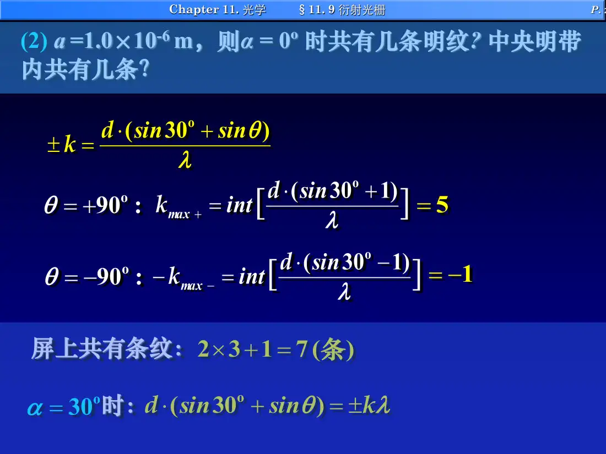

原文：

$$
\pm k = \frac {d \cdot (\sin 3 0 ^ {\circ} + \sin \theta)}{\lambda}
$$

$$
\theta = + 9 0 ^ {\circ}: k _ {m a x +} = i n t \left[ \frac {d \cdot (\sin 3 0 ^ {\circ} + 1)}{\lambda} \right] = 5
$$

$$
\theta = - 9 0 ^ {\circ}: - k _ {m a x -} = i n t \left[ \frac {d \cdot (\sin 3 0 ^ {\circ} - 1)}{\lambda} \right] = - 1
$$

屏上共有条纹: $2 \times 3 + 1 = 7$ (条)

$\alpha = 30^{\circ}$ 时: $d \cdot (\sin 30^{\circ} + \sin \theta) = \pm k \lambda$ (2) $a = 1.0 \times 10^{- 6} \mathrm{~m}$ , 则 $\alpha = 0^{\circ}$ 时共有几条明纹? 中央明带内共有几条?

Chapter 11. 光学 § 11.9 衍射光栅

P.

### $$

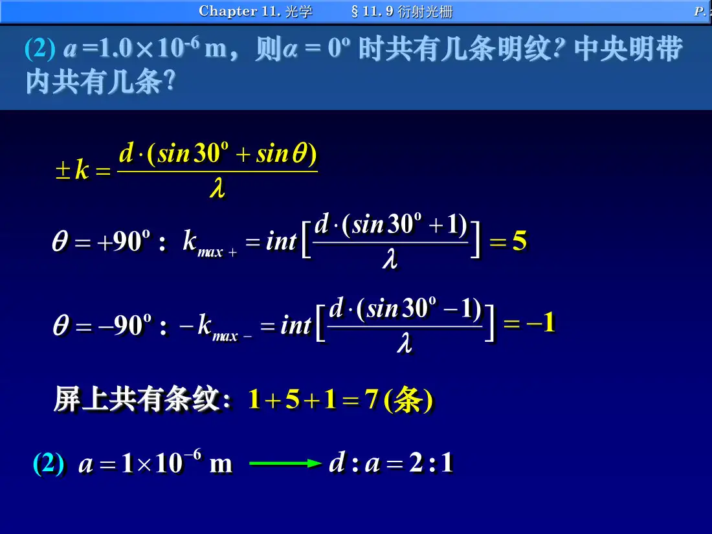

原文：

$$
\pm k = \frac {d \cdot (\sin 3 0 ^ {\circ} + \sin \theta)}{\lambda}
$$

$$
\theta = + 9 0 ^ {\circ}: k _ {m a x +} = i n t \left[ \frac {d \cdot (\sin 3 0 ^ {\circ} + 1)}{\lambda} \right] = 5
$$

$$
\theta = - 9 0 ^ {\circ}: - k _ {m a x -} = i n t \left[ \frac {d \cdot (\sin 3 0 ^ {\circ} - 1)}{\lambda} \right] = - 1
$$

屏上共有条纹: $1 + 5 + 1 = 7$ (条)

(2) $a=1\times10^{-6}m$ $\rightarrow$ d:a=2:1(2) $a = 1.0 \times 10^{- 6} \mathrm{~m}$ , 则 $\alpha = 0^{\circ}$ 时共有几条明纹? 中央明带内共有几条?

Chapter 11. 光学 § 11.9 衍射光栅

P.

### $$

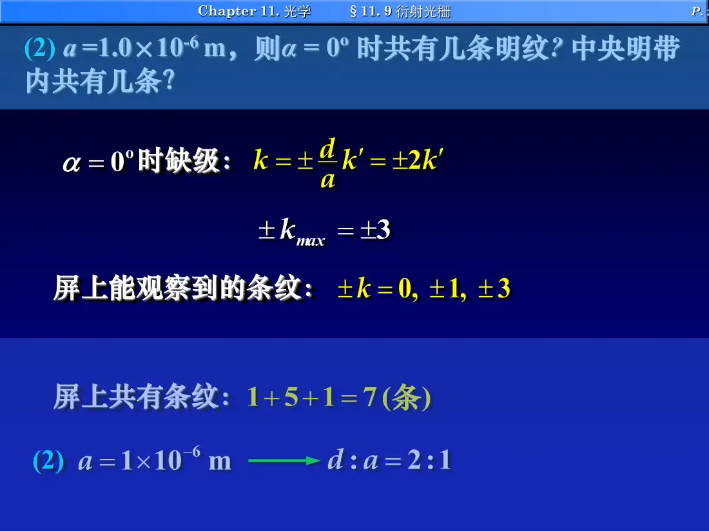

原文：

$\alpha = 0^{\circ}$ 时缺级: $k = \pm \frac{d}{a} k' = \pm 2k'$

$$
\pm k _ {m a x} = \pm 3
$$

屏上能观察到的条纹: $\pm k = 0, \pm 1, \pm 3$

屏上共有条纹: $1 + 5 + 1 = 7$ (条)

(2) $a = 1 \times 10^{-6} \, m \longrightarrow d : a = 2 : 1$ (2) $a = 1.0 \times 10^{- 6} \mathrm{~m}$ , 则 $\alpha = 0^{\circ}$ 时共有几条明纹? 中央明带内共有几条?

Chapter 11. 光学 § 11.9 衍射光栅

P.

### $$

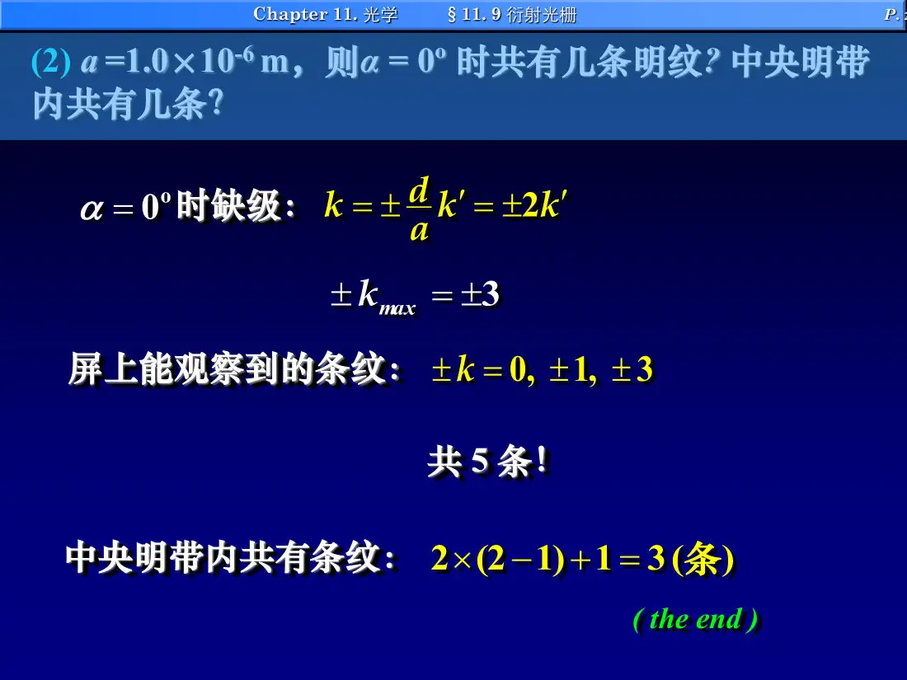

原文：

$\alpha = 0^{\circ}$ 时缺级: $k = \pm \frac{d}{a} k' = \pm 2k'$

$$
\pm k _ {m a x} = \pm 3
$$

屏上能观察到的条纹: $\pm k = 0, \pm 1, \pm 3$

共5条!

中央明带内共有条纹: $2 \times (2 - 1) + 1 = 3$ (条)

$$
((t h e e n d))
$$

Chapter 11. 光学 § 11.9 衍射光栅

P.

### 2. 白光入射：

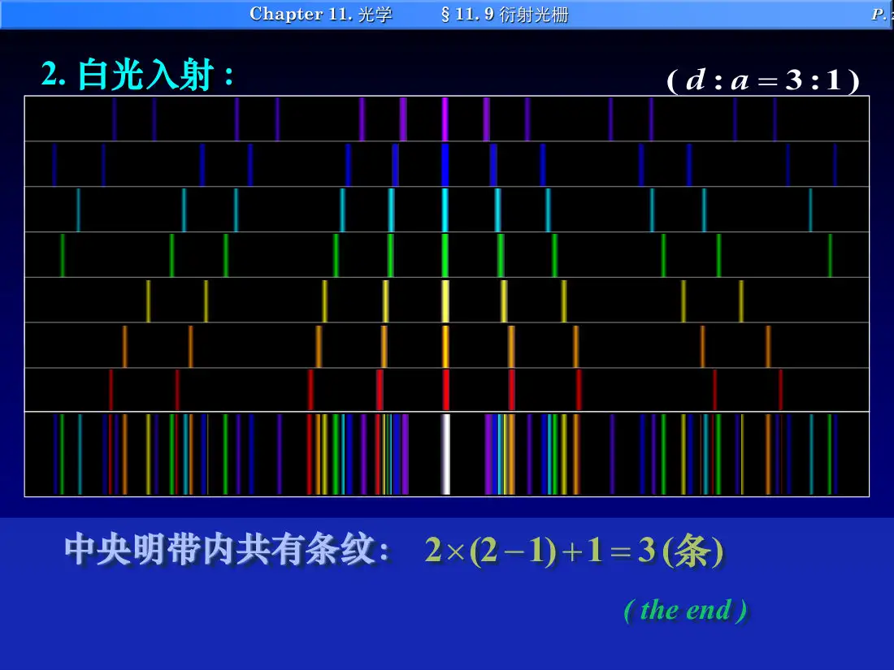

原文：

2. 白光入射：

$$
(d: a = 3: 1)
$$

中央明带内共有条纹: $2 \times (2 - 1) + 1 = 3$ (条)

(the end)

Chapter 11. 光学 § 11.9 衍射光栅

P.

### 2. 白光入射：

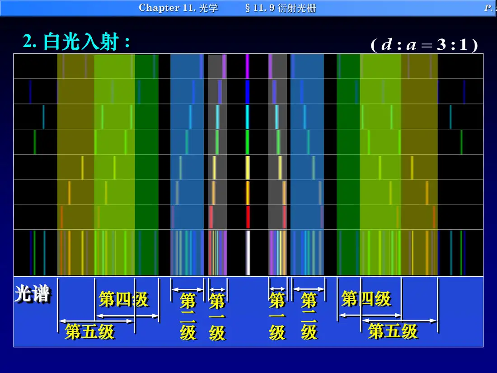

原文：

2. 白光入射：

Chapter 11. 光学 § 11.9 衍射光栅

P.

### Fig. 1 白光入射时光栅的衍射光谱

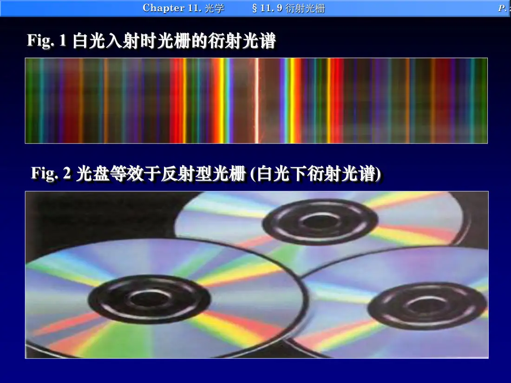

原文：

Fig. 1 白光入射时光栅的衍射光谱

Fig. 2 光盘等效于反射型光栅 (白光下衍射光谱)

Chapter 11. 光学 § 11.9 衍射光栅

P.

### $\lambda=\lambda_{1}=450nm:$

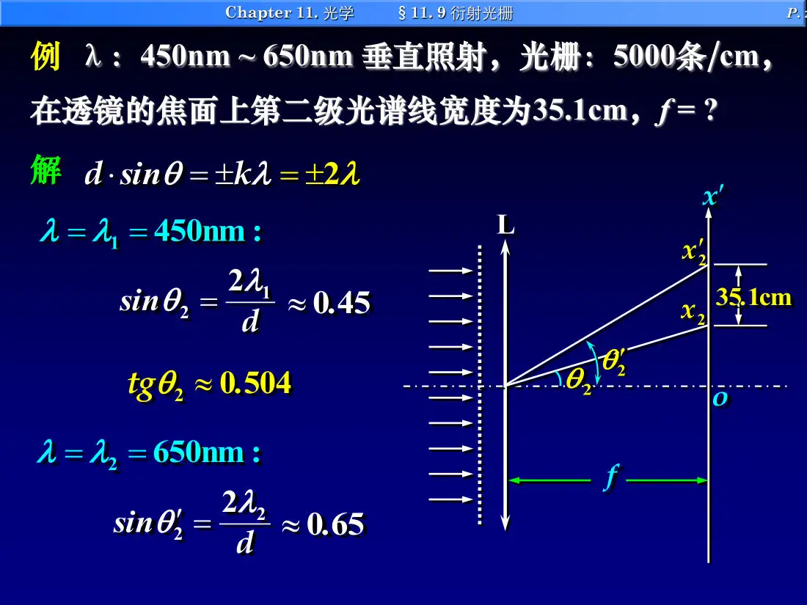

原文：

例 $\lambda: 450 \mathrm{~nm} \sim 650 \mathrm{~nm}$ 垂直照射, 光栅: $5000 \mathrm{条} / \mathrm{cm}$ , 在透镜的焦面上第二级光谱线宽度为 $35.1 \mathrm{~cm}, f = ?$

解 $d \cdot \sin \theta = \pm k\lambda = \pm 2\lambda$

$\lambda=\lambda_{1}=450nm:$

$$
\sin \theta_ {2} = \frac {2 \lambda_ {1}}{d} \approx 0. 4 5
$$

$$
t g \theta_ {2} \approx 0. 5 0 4
$$

$$
\lambda = \lambda_ {2} = 6 5 0 \mathrm{nm}:
$$

$$
\sin \theta_ {2} ^ {\prime} = \frac {2 \lambda_ {2}}{d} \approx 0. 6 5
$$

Chapter 11. 光学 § 11.9 衍射光栅

P.

### $tg\theta_{2}^{\prime}\approx0.855$

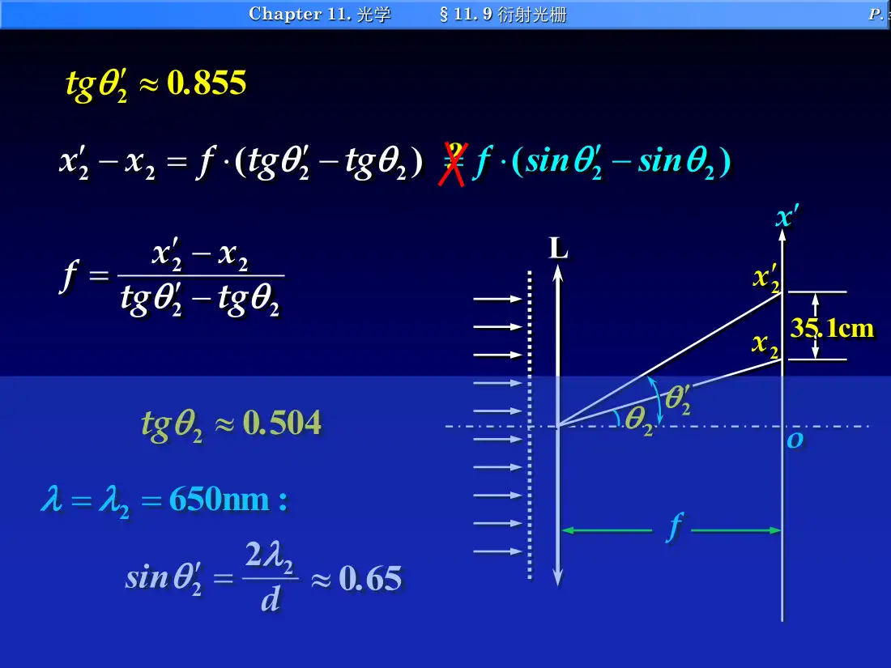

原文：

$tg\theta_{2}^{\prime}\approx0.855$

$x_{2}^{\prime}-x_{2}=f\cdot(tg\theta_{2}^{\prime}-tg\theta_{2})$ ✗ $f\cdot(sin\theta_{2}^{\prime}-sin\theta_{2})$

$$
f = \frac {x _ {2} ^ {\prime} - x _ {2}}{t g \theta_ {2} ^ {\prime} - t g \theta_ {2}}
$$

$$
t g \theta_ {2} \approx 0. 5 0 4
$$

$$
\lambda = \lambda_ {2} = 6 5 0 \mathrm{nm}:
$$

$$
\sin \theta_ {2} ^ {\prime} = \frac {2 \lambda_ {2}}{d} \approx 0. 6 5
$$

Chapter 11. 光学 § 11.9 衍射光栅

P.

### $tg\theta_{2}^{\prime}\approx0.855$

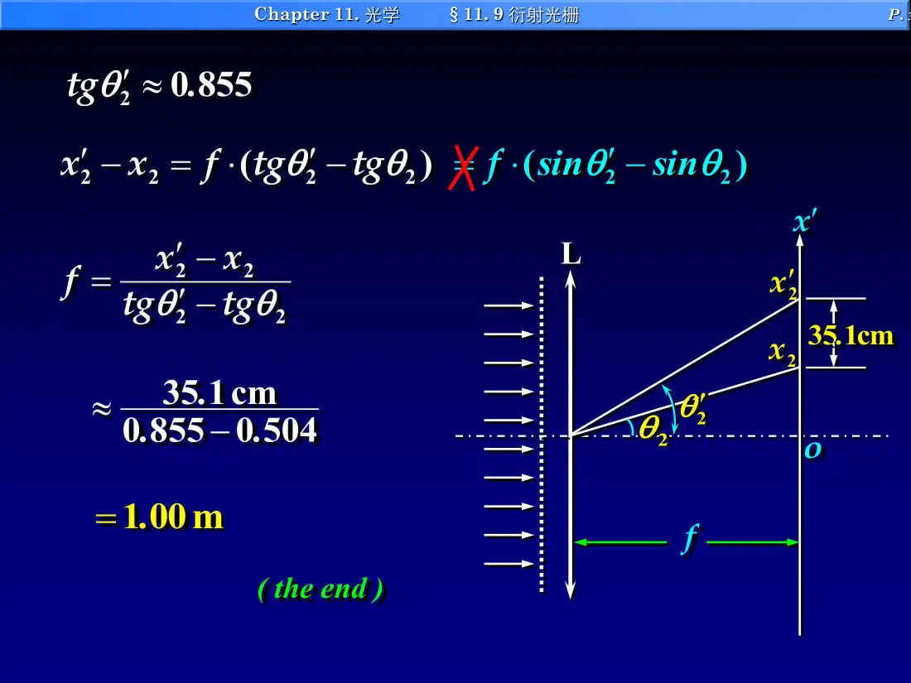

原文：

$tg\theta_{2}^{\prime}\approx0.855$

$x_{2}^{\prime}-x_{2}=f\cdot(tg\theta_{2}^{\prime}-tg\theta_{2})\neq f\cdot(sin\theta_{2}^{\prime}-sin\theta_{2})$

$$
f = \frac {x _ {2} ^ {\prime} - x _ {2}}{t g \theta_ {2} ^ {\prime} - t g \theta_ {2}}
$$

≈ 35.1 cm
0.855 - 0.504

≡1.00m

(the end)

Chapter 11. 光学 § 11.9 衍射光栅

P.

### 归纳：

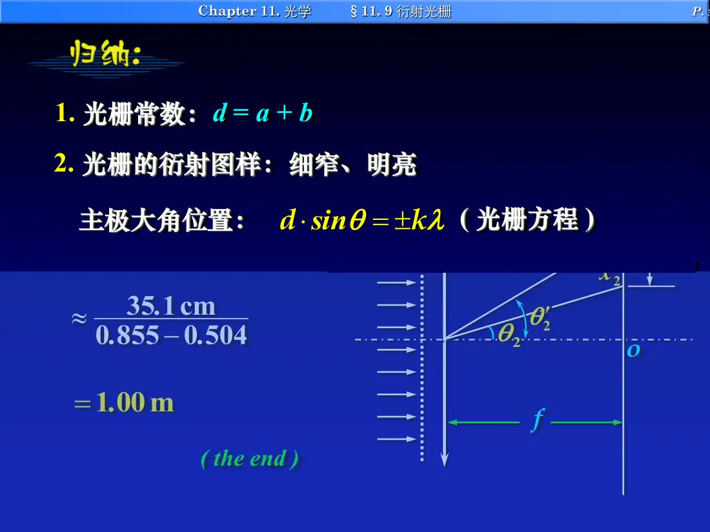

原文：

归纳：

1. 光栅常数: $d = a + b$

2. 光栅的衍射图样：细窄、明亮

主极大角位置： $d \cdot \sin \theta = \pm k \lambda$ （光栅方程）

≈ $\frac{35.1\text{ cm}}{0.855 - 0.504}$

$= 1.00 \mathrm{~m}$

(the end)

Chapter 11. 光学 § 11.9 衍射光栅

P.

### 归纳:

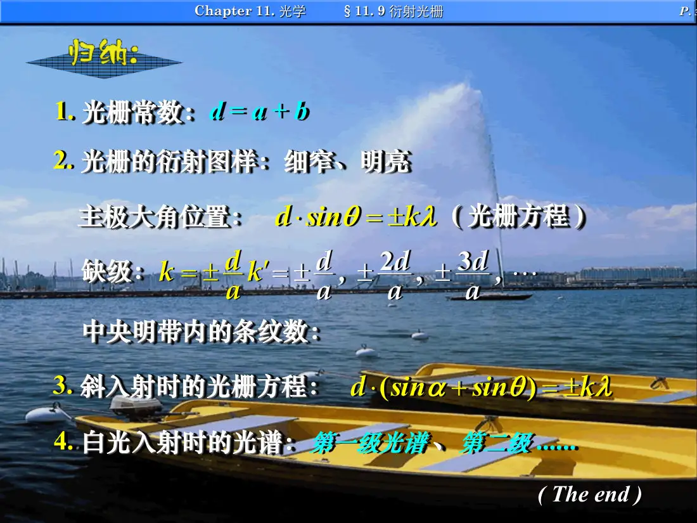

原文：

归纳:

1. 光栅常数: $d = a + b$

2. 光栅的衍射图样：细窄、明亮

主极大角位置: $d \cdot \sin \theta = \pm k \lambda$ (光栅方程)

缺级： $k=\pm\frac{d}{a}k'=\pm\frac{d}{a},\pm\frac{2d}{a},\pm\frac{3d}{a}$

中央明带内的条纹数：

3. 斜入射时的光栅方程: $d \cdot (\sin \alpha + \sin \theta) = \pm k \lambda$

4. 白光入射时的光谱：第一级光谱、第二级……

Chapter 11. 光学 § 11.9 衍射光栅

P.

(The end)
