# 《大学物理》第11章 光学 §11.11 反射光与折射光的偏振（课件）

原件的每一页，下面附识别出的文字。

### §11.11 反射光与折射光的偏振

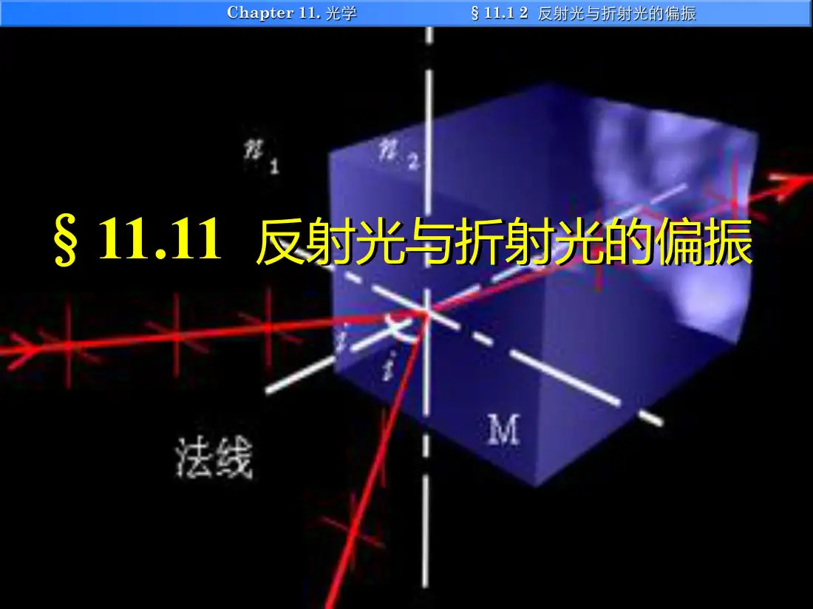

原文：

§11.11 反射光与折射光的偏振

法线

M

apter Chapter 4. 刚体的转11. 光学

刚体定轴定律 §11.1 2 反射光与折射光的偏振

### 一、反射光与折射光的偏振特性

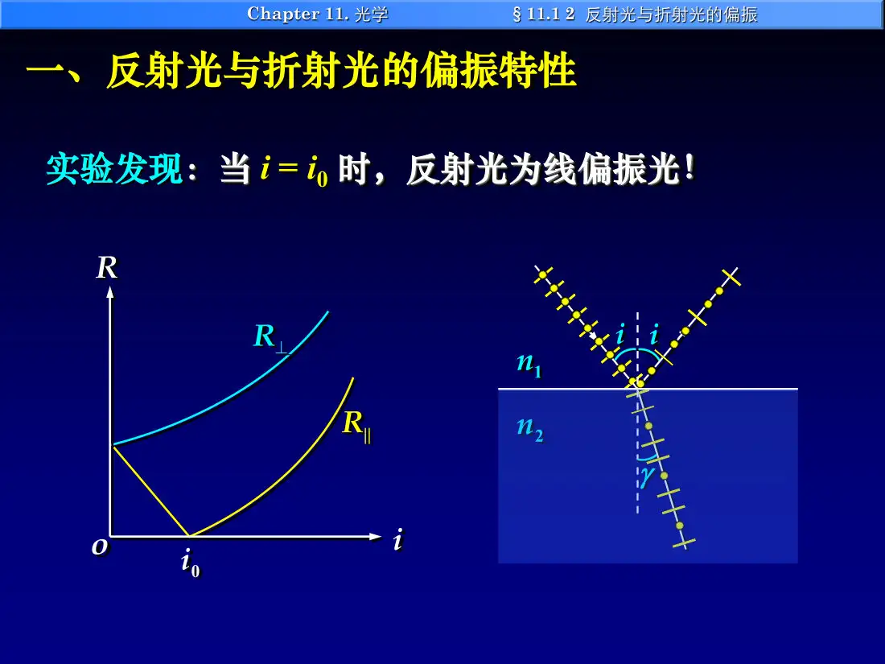

原文：

一、反射光与折射光的偏振特性

实验发现：当 $\land \lor \implies \lor$ 时，反射光为线偏振光！

apter Chapter 4. 刚体的转11. 光学

刚体定轴定律 §11.1 2 反射光与折射光的偏振

### 一、反射光与折射光的偏振特性

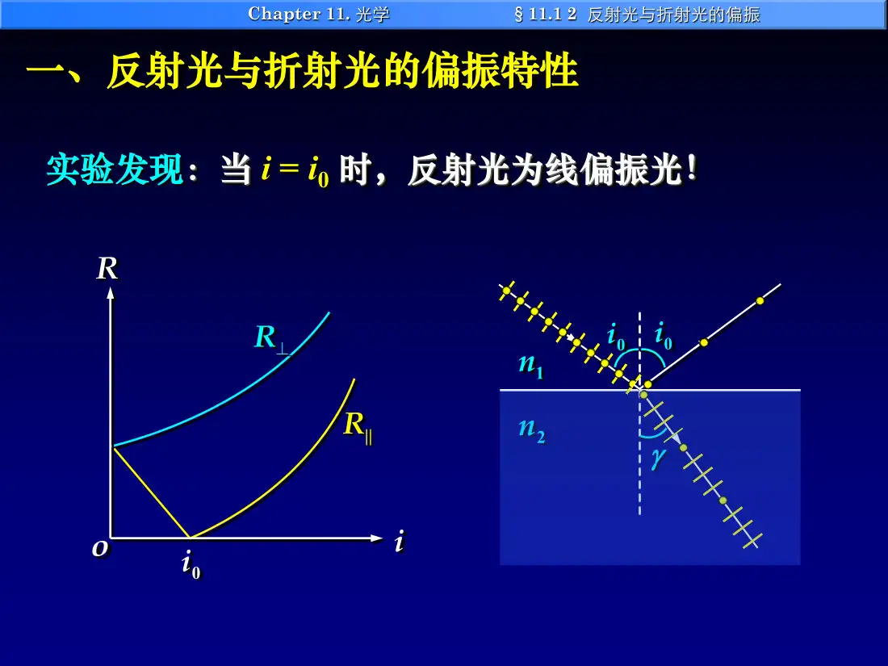

原文：

一、反射光与折射光的偏振特性

实验发现：当 $\land \lor \implies \lor$ 时，反射光为线偏振光！

apter Chapter 4. 刚体的转11. 光学

刚体定轴定律 §11.1 2 反射光与折射光的偏振

### 一、反射光与折射光的偏振特性

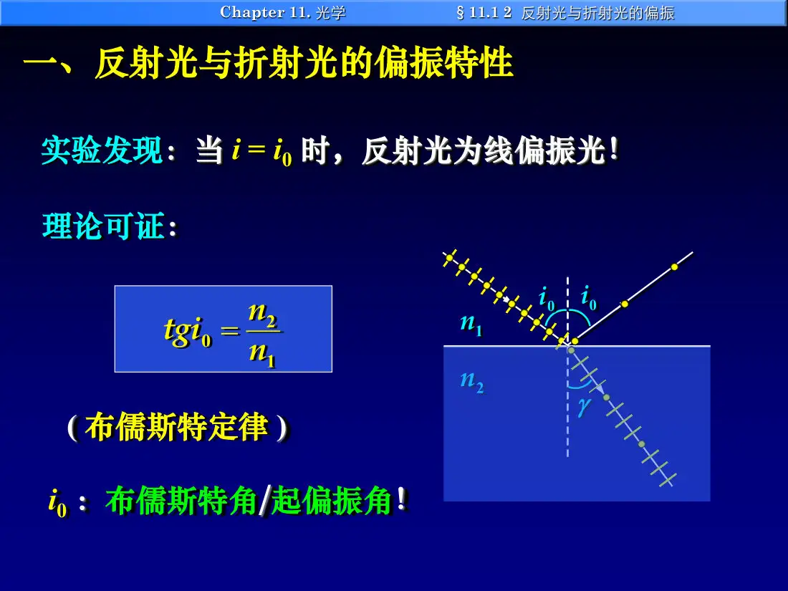

原文：

一、反射光与折射光的偏振特性

实验发现：当 $\therefore a = - 1 , 0$ 时，反射光为线偏振光！

理论可证：

$$
t g i _ {0} = \frac {n _ {2}}{n _ {1}}
$$

( 布儒斯特定律 )

$l 9 0$ 布儒斯特角/起偏振角！

apter Chapter 4. 刚体的转11. 光学

刚体定轴定律 §11.1 2 反射光与折射光的偏振

### 折射定律：

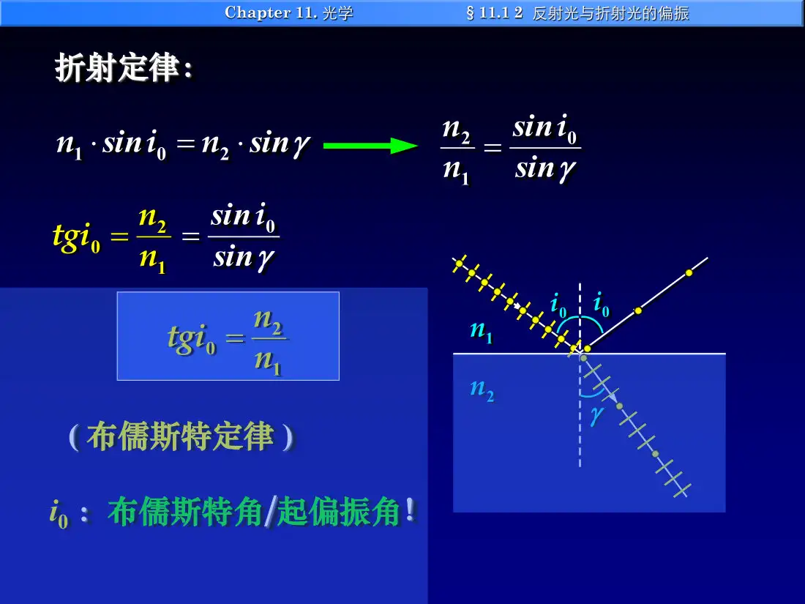

原文：

折射定律：

$$
n _ {1} \cdot \sin i _ {0} = n _ {2} \cdot \sin \gamma \longrightarrow \frac {n _ {2}}{n _ {1}} = \frac {\sin i _ {0}}{\sin \gamma}
$$

$$
t g i _ {0} = \frac {n _ {2}}{n _ {1}} = \frac {\sin i _ {0}}{\sin \gamma}
$$

$$
t g i _ {0} = \frac {n _ {2}}{n _ {1}}
$$

布儒斯特定律 )

$l 9 0$ 布儒斯特角/起偏振角！

apter Chapter 4. 刚体的转11. 光学

刚体定轴定律 §11.1 2 反射光与折射光的偏振

### 折射定律：

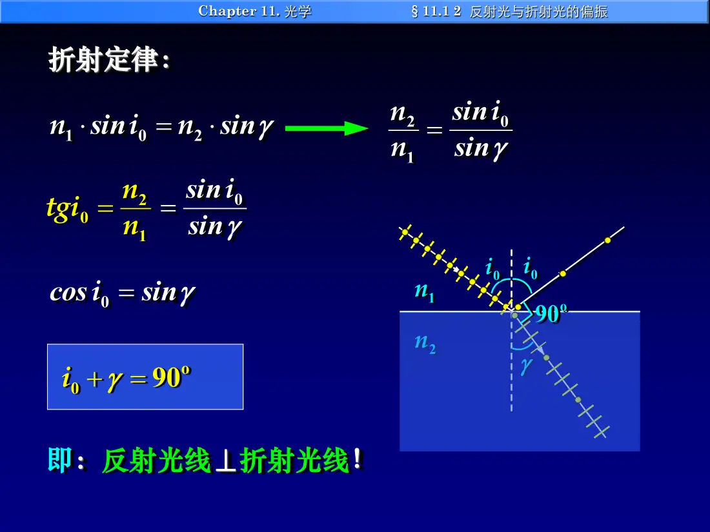

原文：

折射定律：

$$
n _ {1} \cdot \sin i _ {0} = n _ {2} \cdot \sin \gamma \longrightarrow \frac {n _ {2}}{n _ {1}} = \frac {\sin i _ {0}}{\sin \gamma}
$$

$$
t g i _ {0} = \frac {n _ {2}}{n _ {1}} = \frac {\sin i _ {0}}{\sin \gamma}
$$

$$
\cos i _ {0} = \sin \gamma
$$

$$
i _ {0} + \gamma = 9 0 ^ {\circ}
$$

即：反射光线⊥折射光线！

apter Chapter 4. 刚体的转11. 光学

刚体定轴定律 §11.1 2 反射光与折射光的偏振

### $$

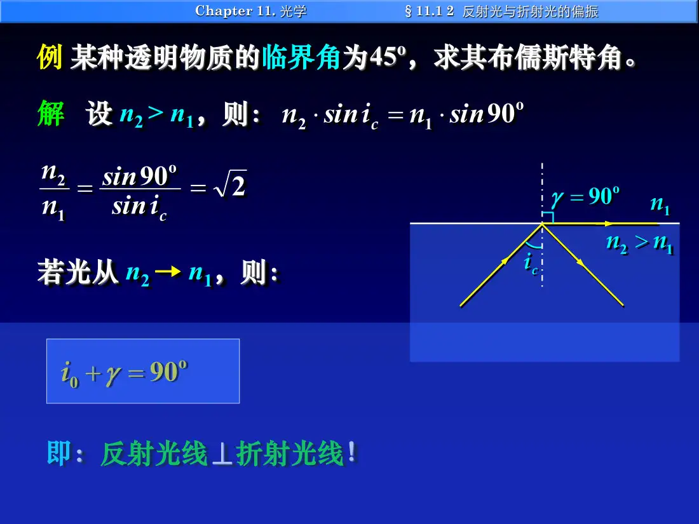

原文：

例 某种透明物质的临界角为 $\mathbf { \Delta } [ \mathbf { J } ] \mathbf { \Delta }$ ，求其布儒斯特角。

解 设 $1 0 0 > 1 0 0 0$ ，则： $( \sqrt { 2 } ) ( \sqrt { 1 + \sqrt { 2 } } ) = \sqrt { 1 + \sqrt { 2 } } ( \sqrt { 1 + \sqrt { 2 } } ) ( \sqrt { 1 + \sqrt { 2 } } )$

$$
\frac {n _ {2}}{n _ {1}} = \frac {\sin 9 0 ^ {\circ}}{\sin i _ {c}} = \sqrt {2}
$$

若光从 $1 0 0 = \Delta a _ { 4 } \Delta a$ 则：

$$
i _ {0} + \gamma = 9 0 ^ {\circ}
$$

即：反射光线⊥折射光线！

apter Chapter 4. 刚体的转11. 光学

刚体定轴定律 §11.1 2 反射光与折射光的偏振

### $$

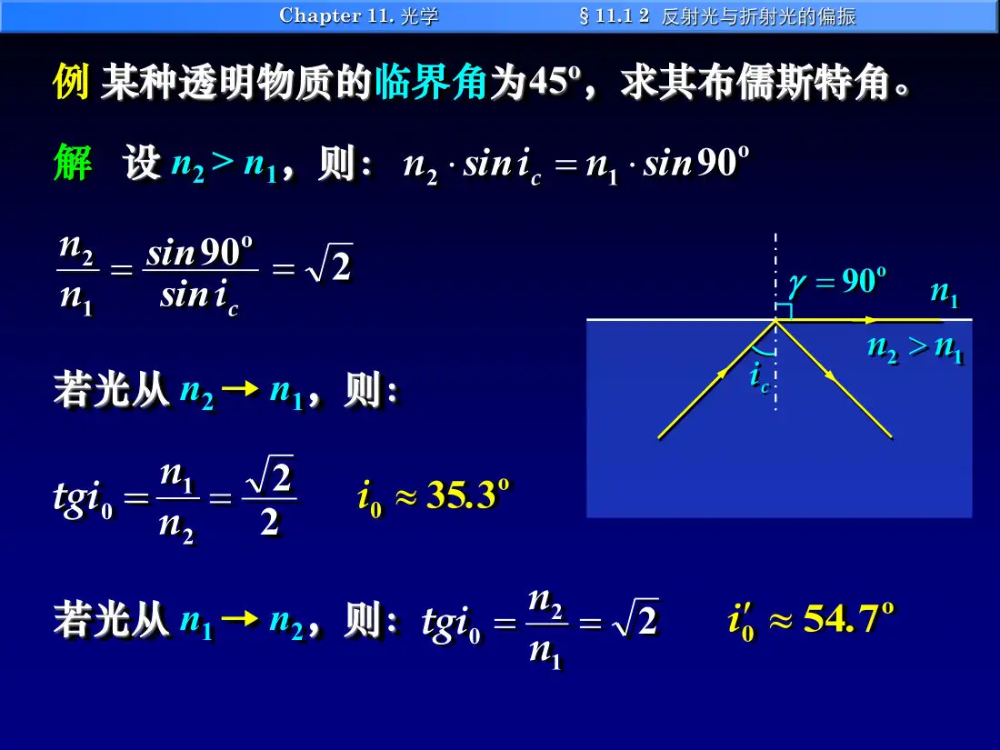

原文：

例 某种透明物质的临界角为 $\mathbf { \delta } [ \mathbf { A } ] \mathbf { \delta }$ ，求其布儒斯特角。

解 设 $1 0 0 > 1 0 0 0$ 则： $( 1 5 ) \times ( 1 7 / 1 7 ) = ( 1 5 ) \times ( 1 7 / 1 3 ) ( 1 1 )$

$$
\frac {n _ {2}}{n _ {1}} = \frac {\sin 9 0 ^ {\circ}}{\sin i _ {c}} = \sqrt {2}
$$

若光从 $1 0 0 = 2 0 0 0$ 则：

$$
t g i _ {0} = \frac {n _ {1}}{n _ {2}} = \frac {\sqrt {2}}{2} \quad i _ {0} \approx 3 5. 3 ^ {\circ}
$$

若光从 $1 4 5 = 2 1 6 0$ 则： $\frac { 1 3 0 } { 1 0 } = \frac { 1 3 0 } { 1 0 } = \frac { 1 3 } { 1 0 }$ $l _ { ( 1 ) } ^ { ( 2 ) } \approx \mathrm { k } ^ { 2 } = \mathrm { k } ^ { 2 }$

apter Chapter 4. 刚体的转11. 光学

刚体定轴定律 §11.1 2 反射光与折射光的偏振

### 课堂练习 说明下列情况下反射光与折射光的偏振特性。

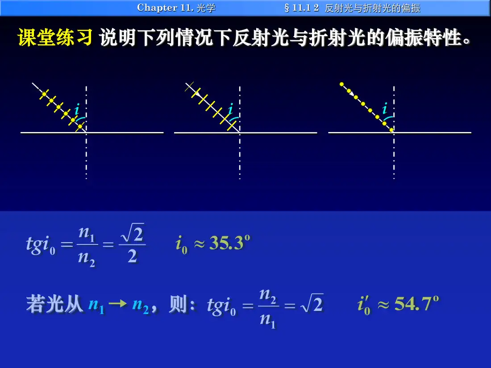

原文：

课堂练习 说明下列情况下反射光与折射光的偏振特性。

$$
t g i _ {0} = \frac {n _ {1}}{n _ {2}} = \frac {\sqrt {2}}{2} \quad i _ {0} \approx 3 5. 3 ^ {\circ}
$$

若光从 $1 4 - 2 = 1 4 2 0$ $\frac { 1 3 0 } { 1 0 } \times \frac { 1 } { 1 1 } = \frac { 1 3 0 } { 1 1 } = \frac { 1 } { 1 0 }$ $U _ { ( 1 ) } ^ { ( 2 ) } \approxeq 6 \sqrt { 6 } = 6 0$

apter Chapter 4. 刚体的转11. 光学

刚体定轴定律 §11.1 2 反射光与折射光的偏振

### 课堂练习 说明下列情况下反射光与折射光的偏振特性。

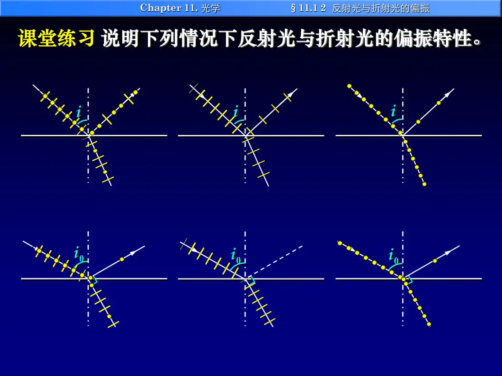

原文：

课堂练习 说明下列情况下反射光与折射光的偏振特性。

apter Chapter 4. 刚体的转11. 光学

刚体定轴定律 §11.1 2 反射光与折射光的偏振

### 二、反射面用作检偏器

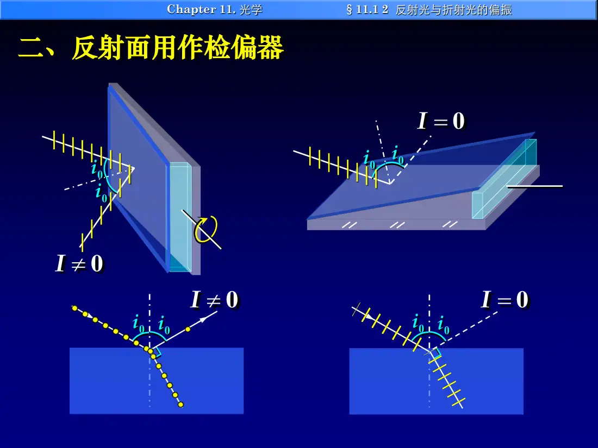

原文：

二、反射面用作检偏器

apter Chapter 4. 刚体的转11. 光学

刚体定轴定律 §11.1 2 反射光与折射光的偏振

### 三、玻璃片堆(反射光获得线偏振光的方法）

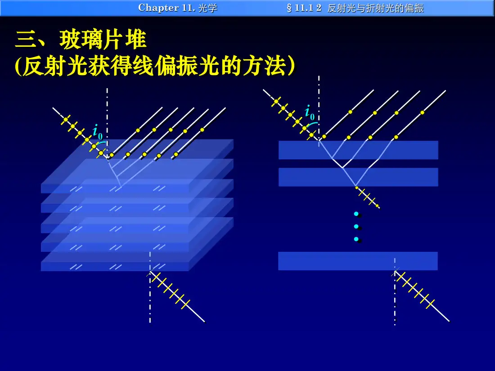

原文：

三、玻璃片堆(反射光获得线偏振光的方法）

apter Chapter 4. 刚体的转11. 光学

刚体定轴定律 §11.1 2 反射光与折射光的偏振

### 归纳：

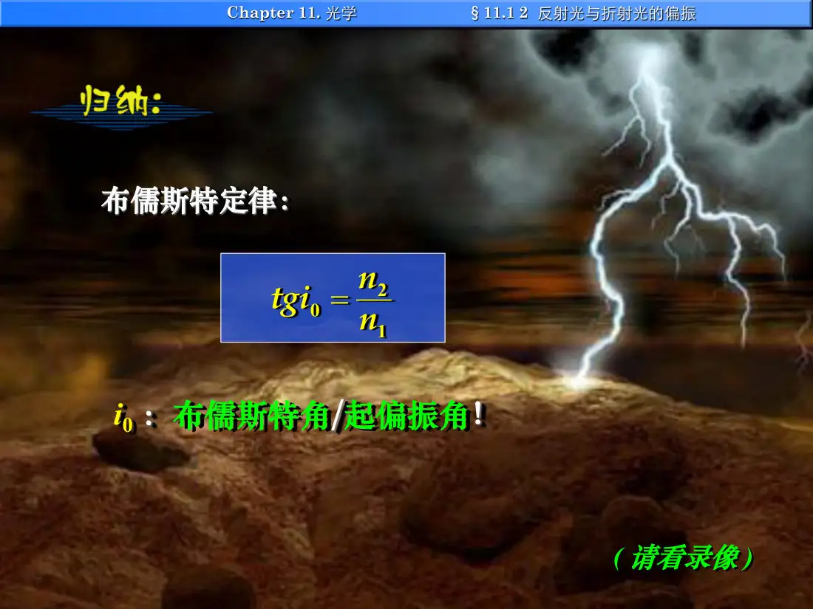

原文：

归纳：

布儒斯特定律：

$$
t g i _ {0} = \frac {n _ {2}}{n _ {1}}
$$

i ：布儒斯特角/起偏振角！

apter Chapter 4. 刚体的转11. 光学

刚体定轴定律 §11.1 2 反射光与折射光的偏振

请看录像 )

### 反射光折射光的偏振

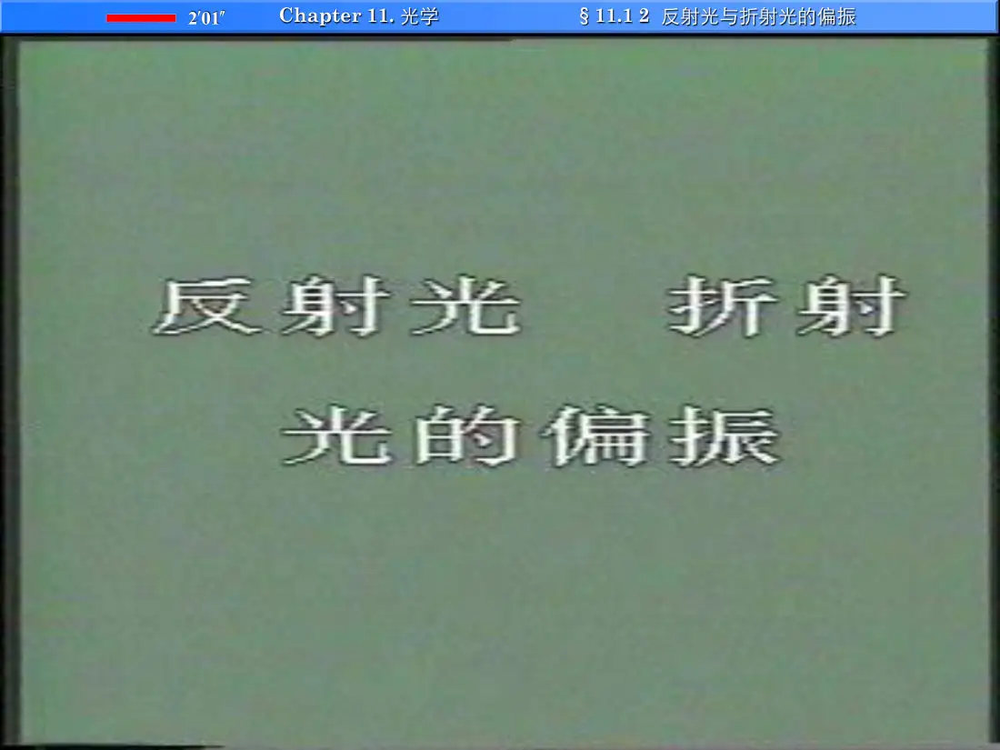

原文：

反射光折射光的偏振

2'01″ apter Chapter 4. 刚体的转11. 光学

刚体定轴定律 §11.1 2 反射光与折射光的偏振
