# 《大学物理》第11章 光学 §11.12 双折射（课件）

原件的每一页，下面附识别出的文字。

### o光主平面§11.12 双折射

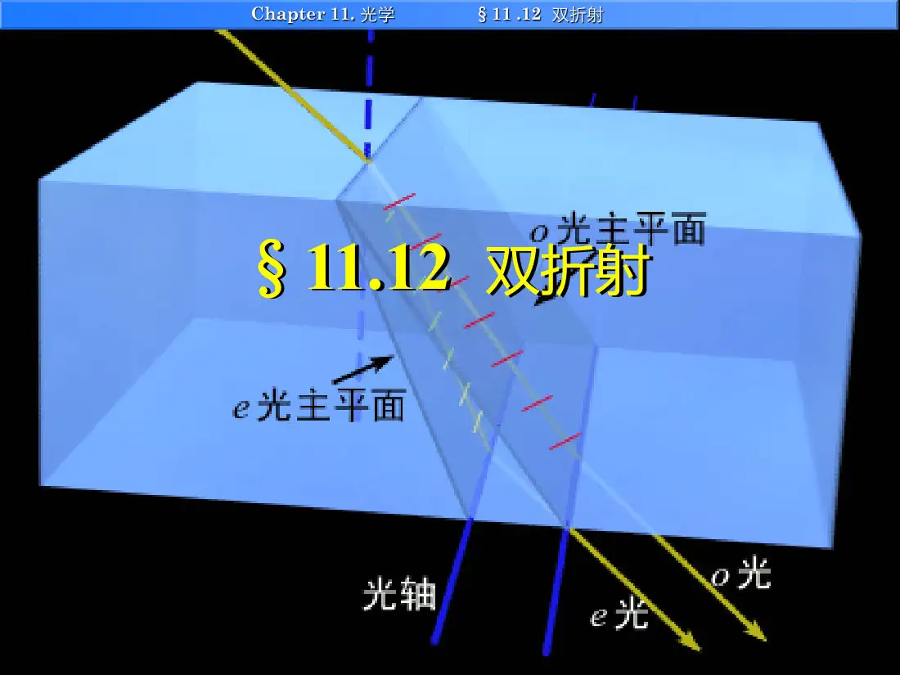

原文：

o光主平面§11.12 双折射

e光主平面

光轴

e光

0光

Chapter 11. 光学

茂田§11 .12 双折射

### 晶体的双折射现象

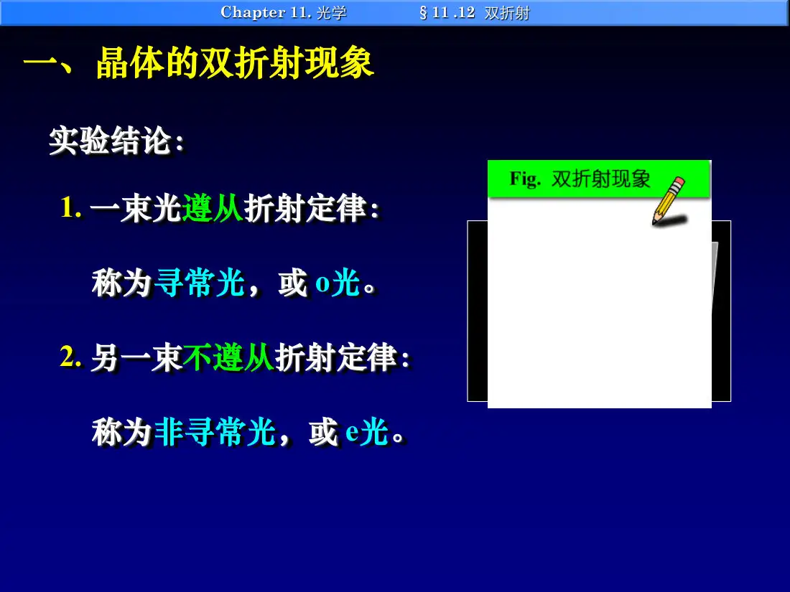

原文：

晶体的双折射现象

实验结论：

Fig. 双折射现象

1. 一束光遵从折射定律：

称为寻常光，或 o光。

2. 另一束不遵从折射定律：

称为非寻常光，或 e光。

Chapter 11. 光学

茂田§11 .12 双折射

### 晶体的双折射现象

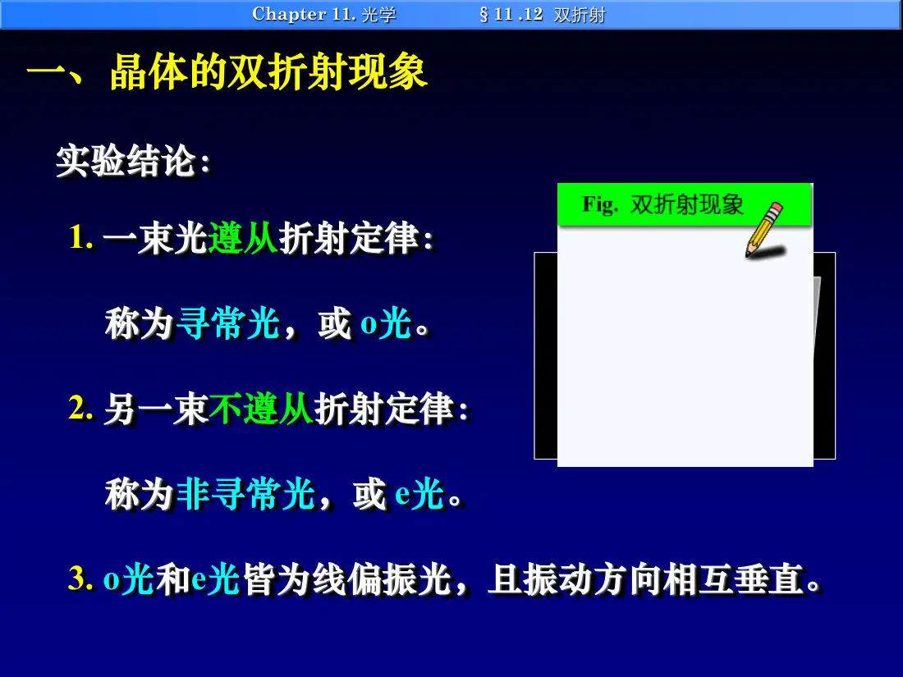

原文：

晶体的双折射现象

实验结论：

1. 一束光遵从折射定律：

Fig. 双折射现象

称为寻常光，或 o光。

2. 另一束不遵从折射定律：

称为非寻常光，或 e光。

3. o光和e光皆为线偏振光，且振动方向相互垂直。

Chapter 11. 光学

茂田§11 .12 双折射

### 二、晶体双折射现象的解释

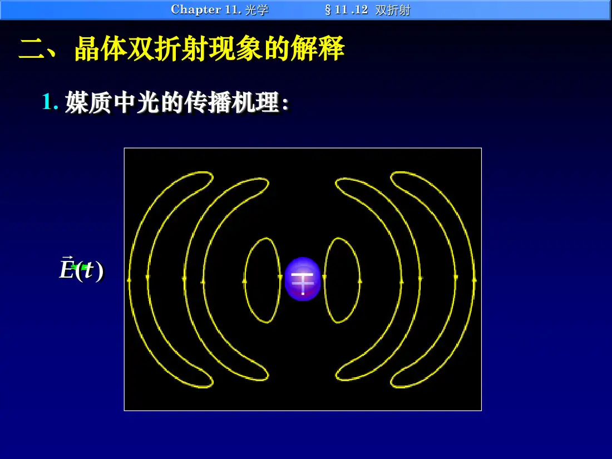

原文：

二、晶体双折射现象的解释

1. 媒质中光的传播机理：

É(t)

Chapter 11. 光学

茂田§11 .12 双折射

### 二、晶体双折射现象的解释

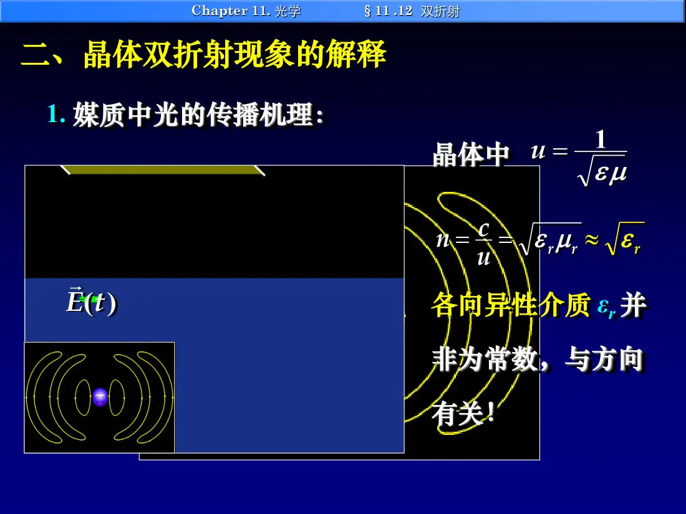

原文：

二、晶体双折射现象的解释

1. 媒质中光的传播机理：

(t)

晶体中 $1 1 0 = \frac { 1 1 } { 1 1 }$

$$
n = \frac {c}{u} = \sqrt {\varepsilon_ {r} \mu_ {r}} \approx \sqrt {\varepsilon_ {r}}
$$

各向异性介质 $\textcircled { 2 }$ 并非为常数，与方向

有关！

Chapter 11. 光学

茂田§11 .12 双折射

### 2. 晶体的各向异性电结构：

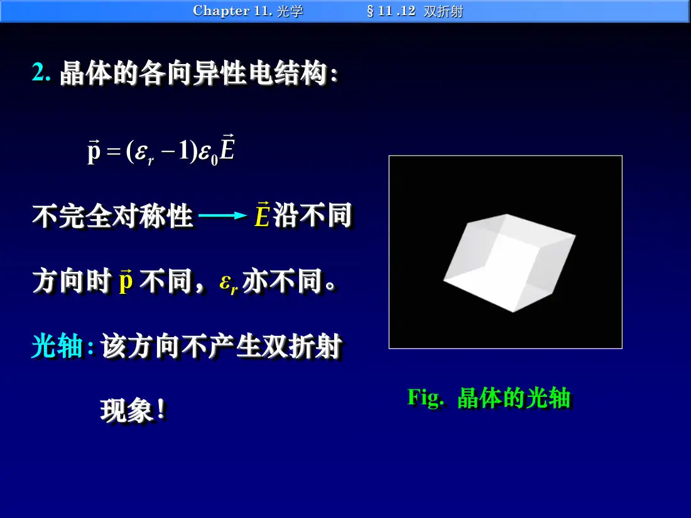

原文：

2. 晶体的各向异性电结构：

$$
\vec {\mathrm{p}} = (\varepsilon_ {r} - 1) \varepsilon_ {0} \vec {E}
$$

不完全对称性 E沿不同

方向时 不同， $\mathcal { G }$ 亦不同。

光轴：该方向不产生双折射

现象！

Fig. 晶体的光轴

Chapter 11. 光学

茂田§11 .12 双折射

### 3. 晶体中 o、e 光的特点：

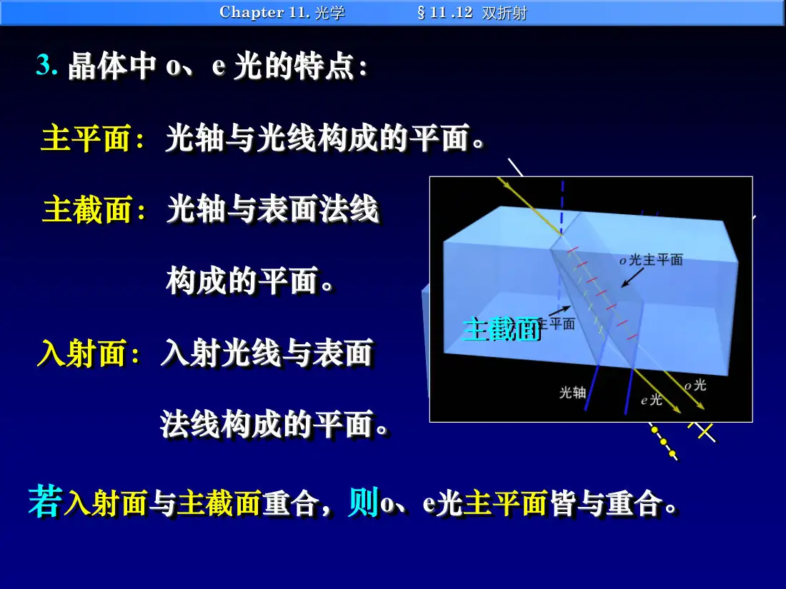

原文：

3. 晶体中 o、e 光的特点：

主平面：光轴与光线构成的平面。

主截面：光轴与表面法线

构成的平面。

入射面：入射光线与表面

法线构成的平面。

若入射面与主截面重合，则o、e光主平面皆与重合。

Chapter 11. 光学

茂田§11 .12 双折射

### 晶体中 o、e 光的子波波阵面：

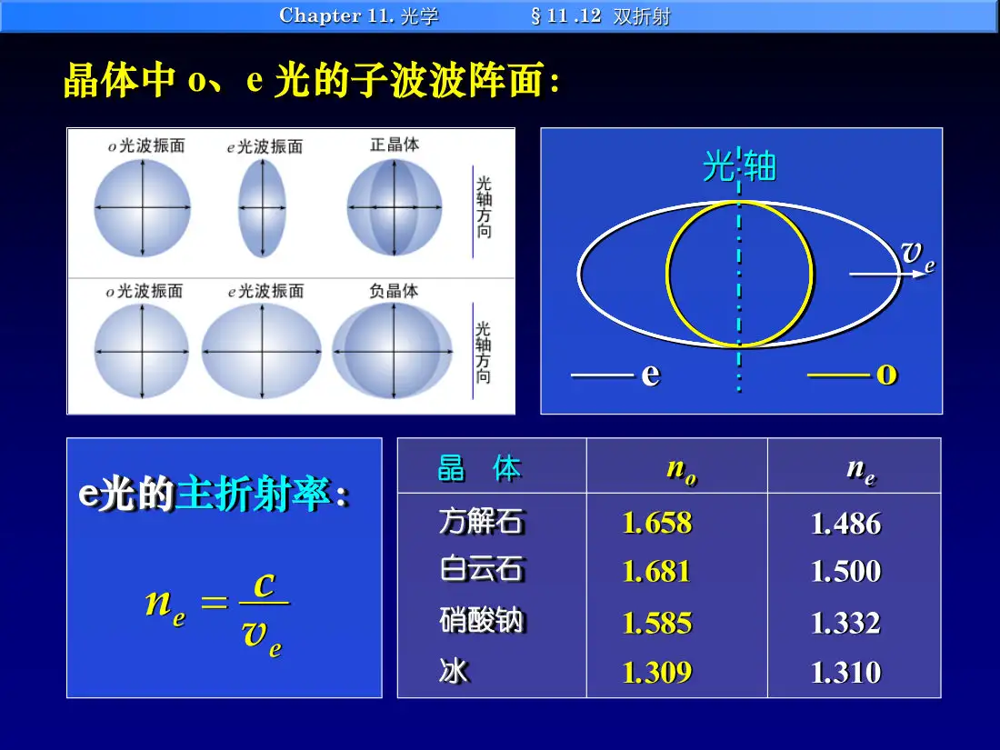

原文：

晶体中 o、e 光的子波波阵面：

o光波振面

e光的主折射率：

$$
n _ {e} = \frac {c}{v _ {e}}
$$

<table><tr><td>晶体</td><td> $n_o$ </td><td> $n_e$ </td></tr><tr><td>方解石</td><td>1.658</td><td>1.486</td></tr><tr><td>白云石</td><td>1.681</td><td>1.500</td></tr><tr><td>硝酸钠</td><td>1.585</td><td>1.332</td></tr><tr><td>冰</td><td>1.309</td><td>1.310</td></tr></table>

Chapter 11. 光学

茂田§11 .12 双折射

### 4. 惠更斯作图法的解释(以负晶体为例)：

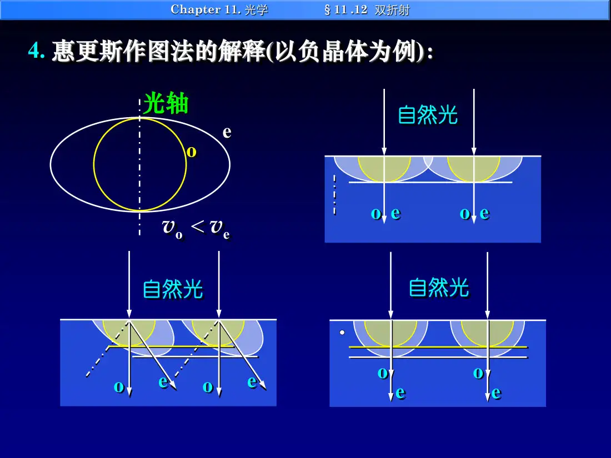

原文：

4. 惠更斯作图法的解释(以负晶体为例)：

自然光

自然光

自然光

Chapter 11. 光学

茂田§11 .12 双折射

### 三、Nicol 棱镜

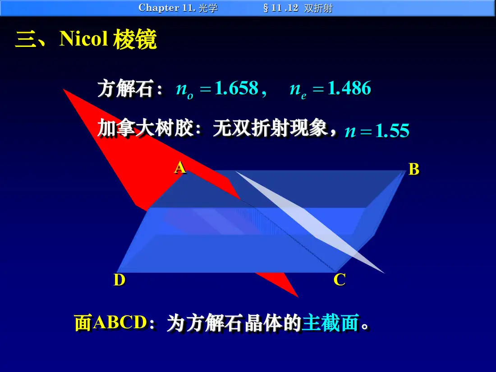

原文：

三、Nicol 棱镜

方解石： $1 4 0 = 1 1 0 0 0 0$ 9 $1 1 3 5 5 6 5 8 9 5 8$

加拿大树胶：无双折射现象， $1 1 3 = 1 1 3 5$

面ABCD：为方解石晶体的主截面。

Chapter 11. 光学

茂田§11 .12 双折射

### 三、Nicol 棱镜

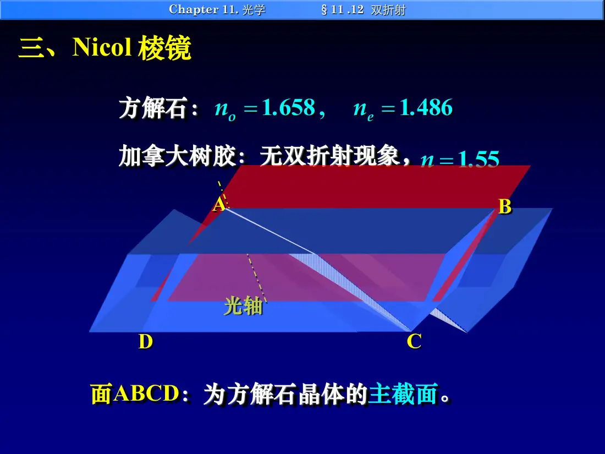

原文：

三、Nicol 棱镜

方解石： $1 4 0 = 1 1 0 0 0 0$ 9 $U _ { ( 2 ) } = \mathbb { I } | | \mathbb { R } | | \mathbb { I } | |$

加拿大树胶：无双折射现象， $1 1 - 1 1 = 1 1$

光轴

面ABCD：为方解石晶体的主截面。

Chapter 11. 光学

茂田§11 .12 双折射

### 三、Nicol 棱镜

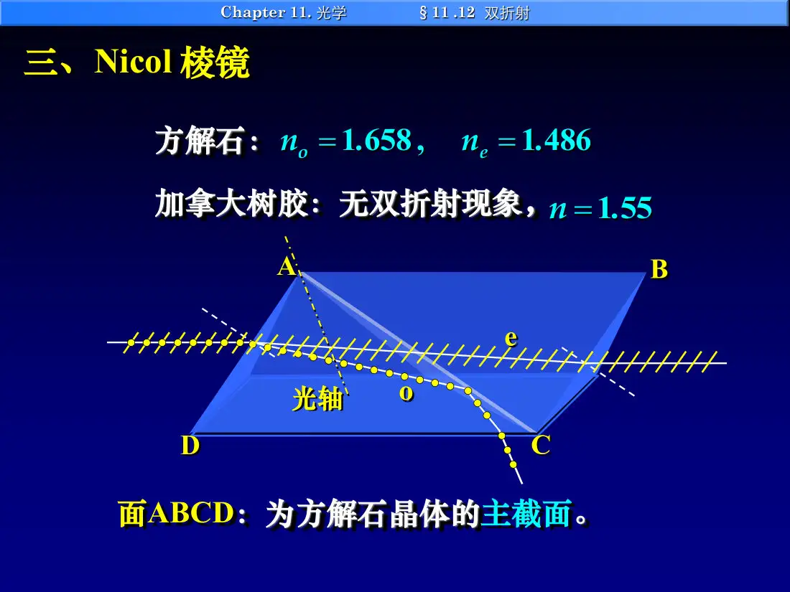

原文：

三、Nicol 棱镜

方解石： $1 4 0 = 1 1 0 0 0 0$ 9 $U _ { ( 2 ) } = \mathbb { I } | | \mathbb { R } | | \mathbb { I } | |$

加拿大树胶：无双折射现象， $1 1 - 1 1 = 1 1 0 ( s )$

面ABCD：为方解石晶体的主截面。

Chapter 11. 光学

茂田§11 .12 双折射

### 用作起偏器：出射光为线偏振光，偏振面//主截面！

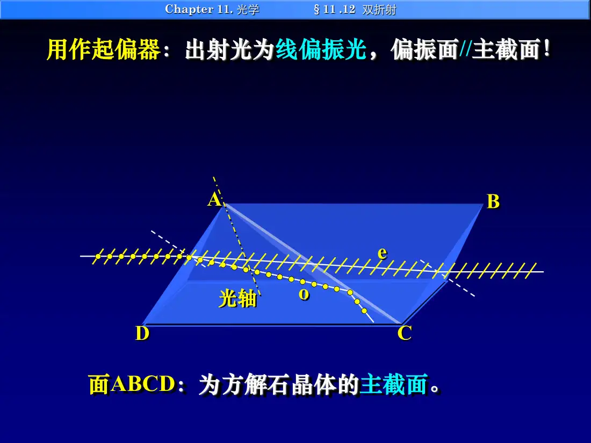

原文：

用作起偏器：出射光为线偏振光，偏振面//主截面！

面ABCD：为方解石晶体的主截面。

Chapter 11. 光学

### 用作起偏器：出射光为线偏振光，偏振面//主截面！

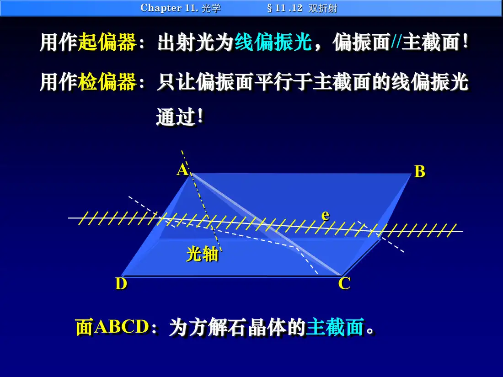

原文：

用作起偏器：出射光为线偏振光，偏振面//主截面！

用作检偏器：只让偏振面平行于主截面的线偏振光通过！

面ABCD：为方解石晶体的主截面。

Chapter 11. 光学

茂田§11 .12 双折射

### 用作起偏器：出射光为线偏振光，偏振面//主截面！

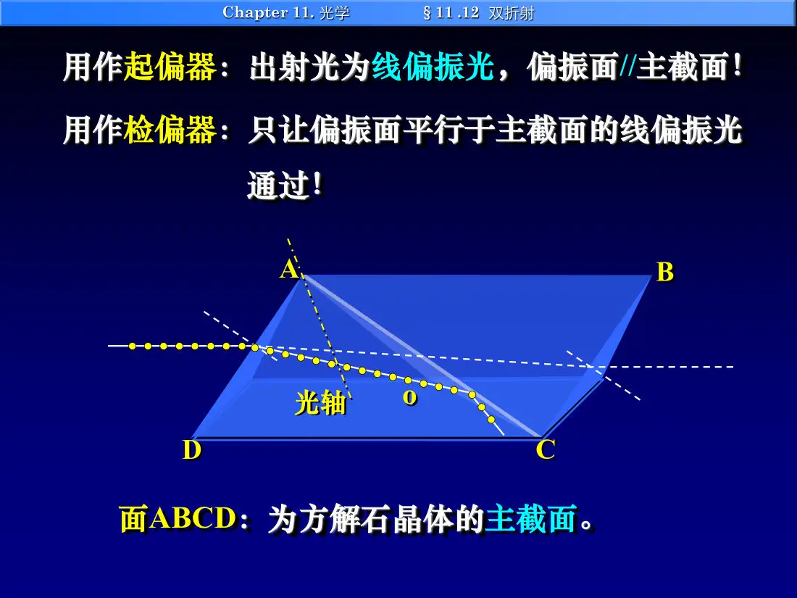

原文：

用作起偏器：出射光为线偏振光，偏振面//主截面！

用作检偏器：只让偏振面平行于主截面的线偏振光通过！

面ABCD：为方解石晶体的主截面。

Chapter 11. 光学

茂田§11 .12 双折射

### 四、波片 椭圆偏振光与圆偏振光

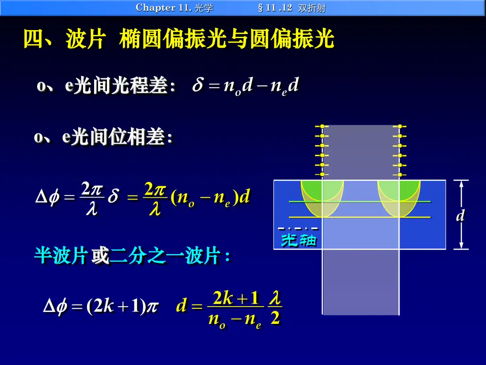

原文：

四、波片 椭圆偏振光与圆偏振光

o、e光间光程差： $\angle 2 = 1 4 0 ^ { \circ } , \angle 2 = 1 8 0 ^ { \circ }$

o、e光间位相差：

$$
\Delta \phi = \frac {2 \pi}{\lambda} \delta = \frac {2 \pi}{\lambda} (n _ {o} - n _ {e}) d
$$

半波片或二分之一波片：

$$
\Delta \phi = (2 k + 1) \pi d = \frac {2 k + 1}{n _ {o} - n _ {e}} \frac {\lambda}{2}
$$

Chapter 11. 光学

茂田§11 .12 双折射

### 自然光通过波片后：

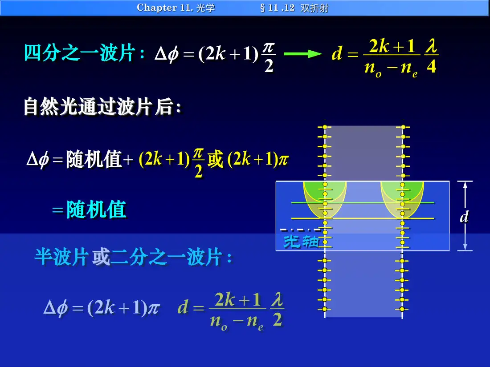

原文：

四分之一波片： $\Delta V _ { 2 } = ( 0 . 7 , - 3 . 6 ) = 3 . 6 ( - 3 . 5 )$

自然光通过波片后：

∆φ=随机值+(2k+1)π或(2k+1)π 2

=随机值

半波片或二分之一波片：

∆φ=(2k+1)π d = 2 1 k +2n n− e四分之一波片： $\Delta V _ { 2 } = ( 0 . 7 , 0 . 7 , 0 . 7 , 0 . 7 , 0 . 7 , 0 . 7 , 0 . 7 )$

Chapter 11. 光学

茂田§11 .12 双折射

### 自然光通过波片后：

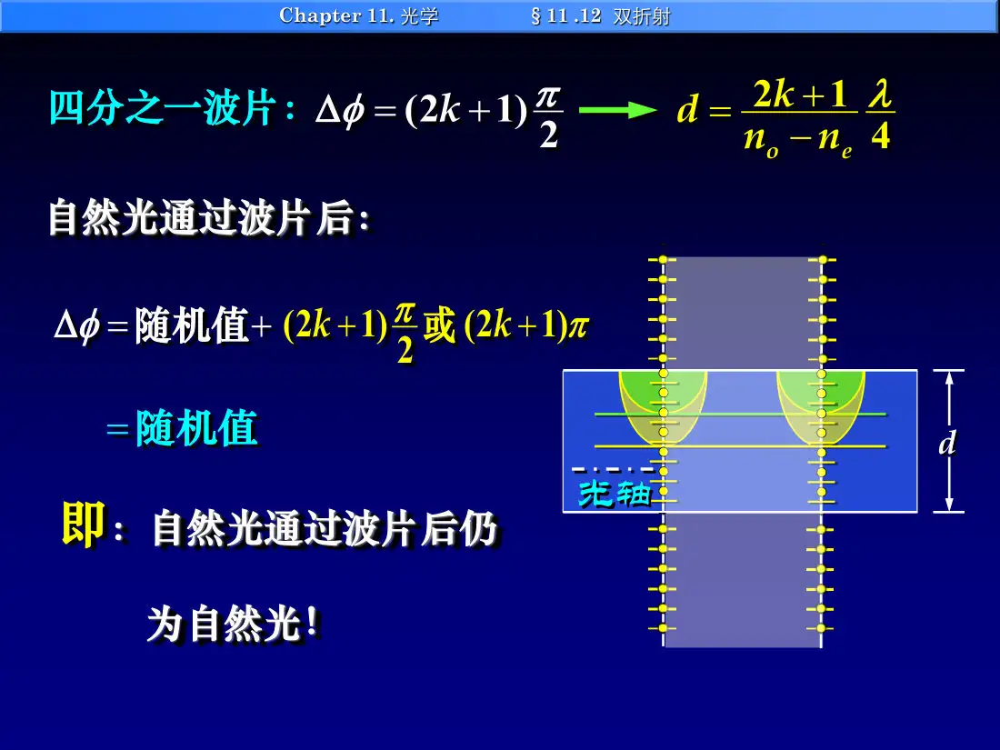

原文：

自然光通过波片后：

∆φ=随机值+(2k+1)π或(2k+1)π 2

=随机值

即：自然光通过波片后仍

为自然光！

Chapter 11. 光学

茂田§11 .12 双折射

### 线偏振光通过波片后偏振特性如何 ?

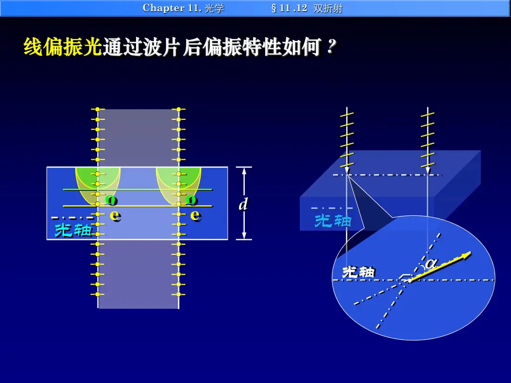

原文：

线偏振光通过波片后偏振特性如何 ?

Chapter 11. 光学 茂田§11 .12 双折射

### 线偏振光通过波片后偏振特性如何 ?

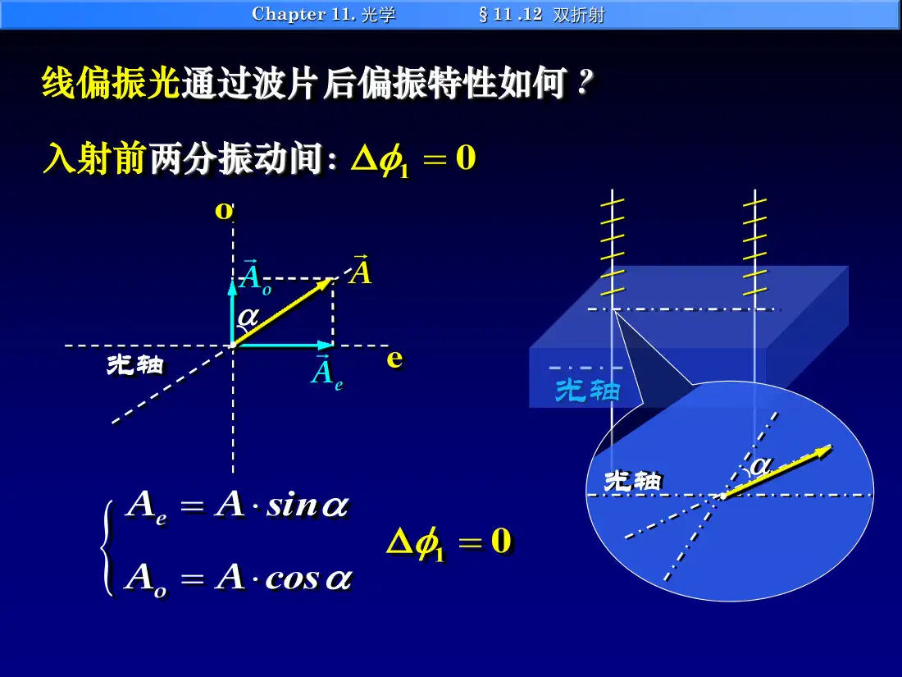

原文：

线偏振光通过波片后偏振特性如何 ?

入射前两分振动间： $\Delta \psi ( l )$

$$
A _ {e} = A \cdot \sin \alpha
$$

$$
A _ {o} = A \cdot \cos \alpha
$$

$$
\Delta \phi_ {1} = 0
$$

Chapter 11. 光学

茂田§11 .12 双折射

### 茂田§11 .12 双折射

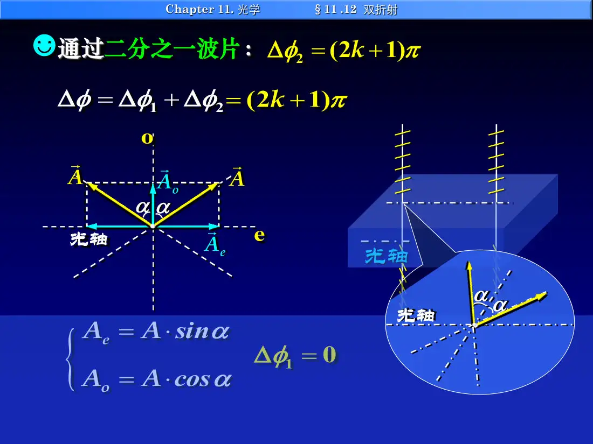

原文：

茂田§11 .12 双折射

☻通过二分之一波片： $( 1 ) ( 1 ) = ( 1 0 ) ( - 1 ) ( 1 )$

$$
\Delta \phi = \Delta \phi_ {1} + \Delta \phi_ {2} = (2 k + 1) \pi
$$

$$
A _ {e} = A \cdot \sin \alpha
$$

$$
\Delta \phi_ {1} = 0
$$

$$
A _ {o} = A \cdot \cos \alpha
$$

Chapter 11. 光学

### $$

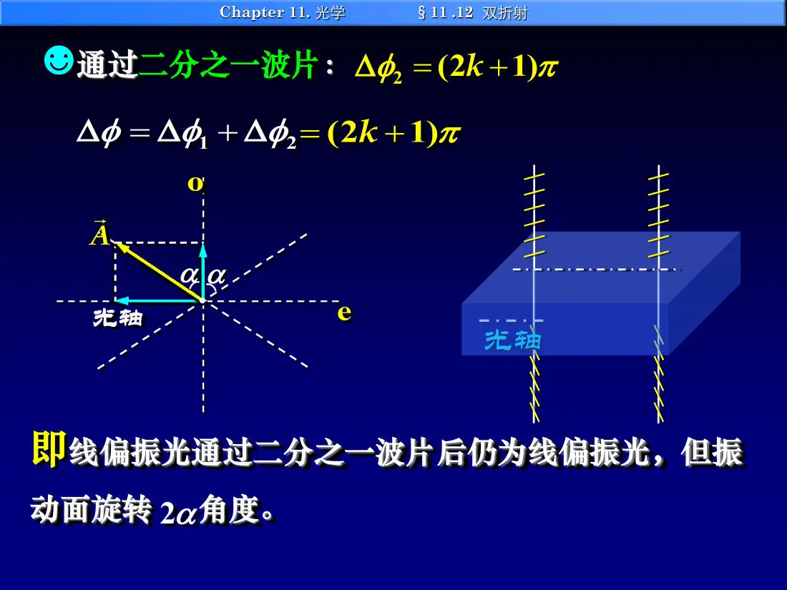

原文：

☻通过二分之一波片： $( 1 ) ( 1 ) = ( 1 0 ) ( - 1 ) ( 1 )$

$$
\Delta \phi = \Delta \phi_ {1} + \Delta \phi_ {2} = (2 k + 1) \pi
$$

即线偏振光通过二分之一波片后仍为线偏振光，但振动面旋转 $\textcircled { 1 } \textcircled { \bullet }$ 角度。

Chapter 11. 光学

茂田§11 .12 双折射

### $$

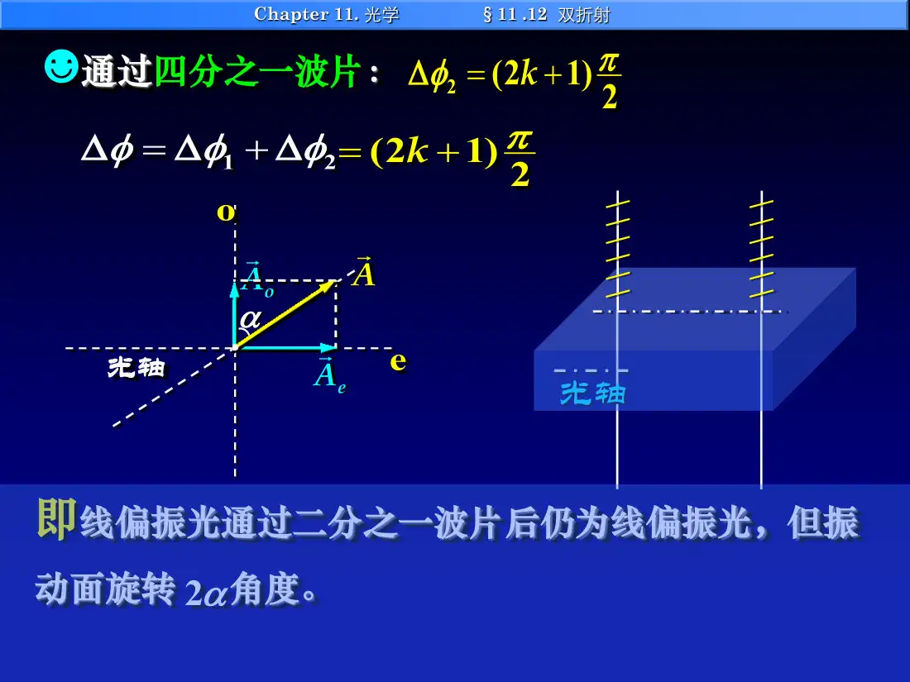

原文：

☻通过四分之一波片： $( 1 ) ( 1 2 - 1 ) \div ( 1 2 + 1 ) = ( 1 2 + 1 )$

$$
\Delta \phi = \Delta \phi_ {1} + \Delta \phi_ {2} = (2 k + 1) \frac {\pi}{2}
$$

光轴

即线偏振光通过二分之一波片后仍为线偏振光，但振动面旋转 $2 \sqrt { 1 0 }$ 角度。

Chapter 11. 光学

茂田§11 .12 双折射

### $$

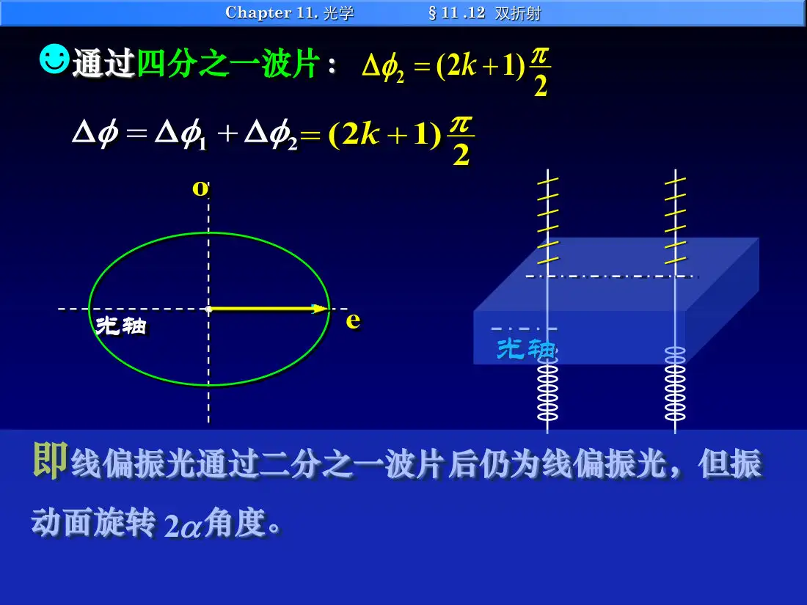

原文：

☻通过四分之一波片： $( 1 ) ( 1 2 - 1 ) \div ( 1 2 + 1 ) = ( 1 2 + 1 )$

$$
\Delta \phi = \Delta \phi_ {1} + \Delta \phi_ {2} = (2 k + 1) \frac {\pi}{2}
$$

即线偏振光通过二分之一波片后仍为线偏振光，但振动面旋转 $2 \sqrt { 1 0 }$ 角度。

Chapter 11. 光学

茂田§11 .12 双折射

### 茂田§11 .12 双折射

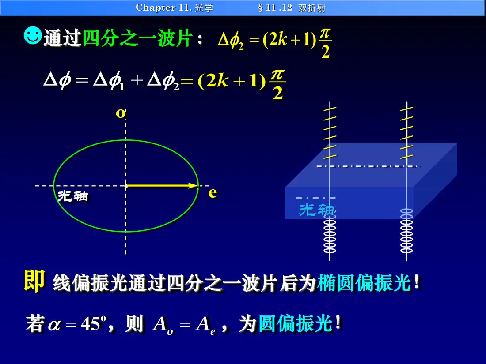

原文：

茂田§11 .12 双折射

☻通过四分之一波片： $( 1 ) ( 1 ) = ( 1 ) ( 1 - 1 ) ( 1 )$

$$
\Delta \phi = \Delta \phi_ {1} + \Delta \phi_ {2} = (2 k + 1) \frac {\pi}{2}
$$

即 线偏振光通过四分之一波片后为椭圆偏振光！若 $\angle C = \angle B ^ { \prime }$ ，则 $\textcircled { 4 } \textcircled { > } \textcircled { 4 }$ ，为圆偏振光！

Chapter 11. 光学

### 五、偏振光的区分

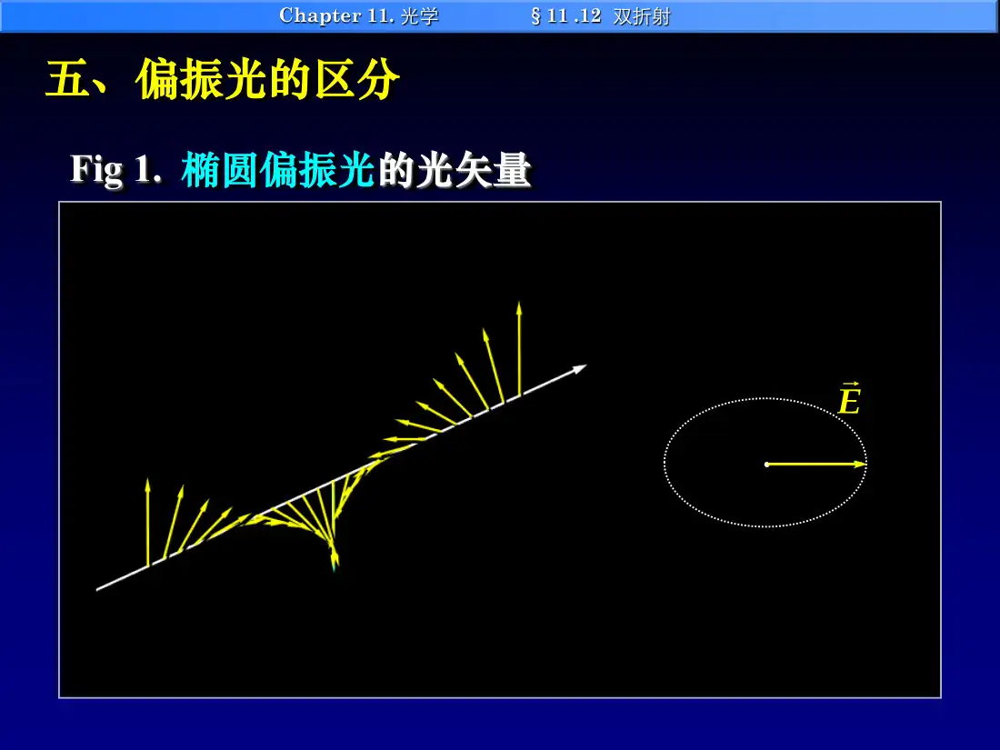

原文：

五、偏振光的区分

Fig 1. 椭圆偏振光的光矢量

Chapter 11. 光学

茂田§11 .12 双折射

### Chapter 11. 光学

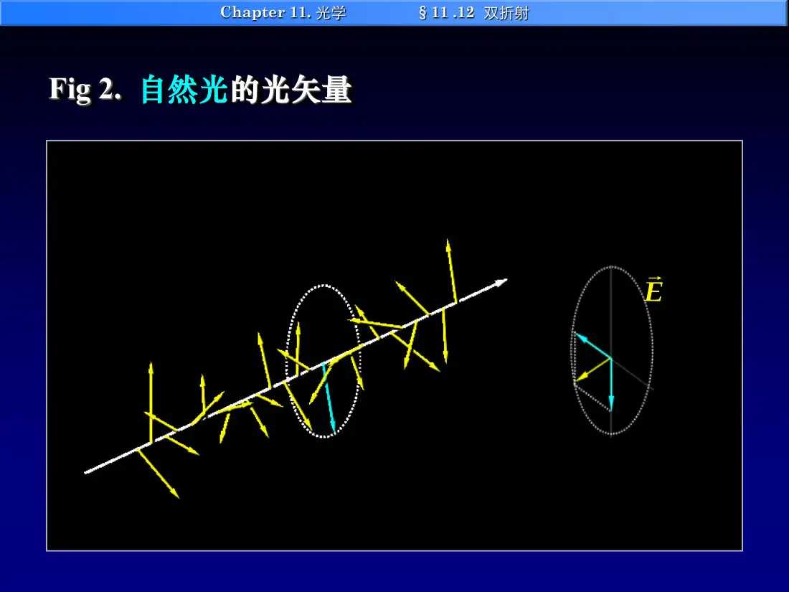

原文：

Chapter 11. 光学

茂田§11 .12 双折射

### Chapter 11. 光学

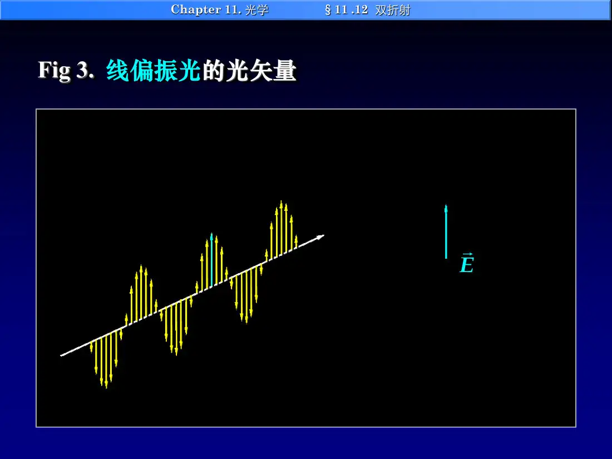

原文：

Chapter 11. 光学

茂田§11 .12 双折射

### Fig 4. 偏振特性的比较

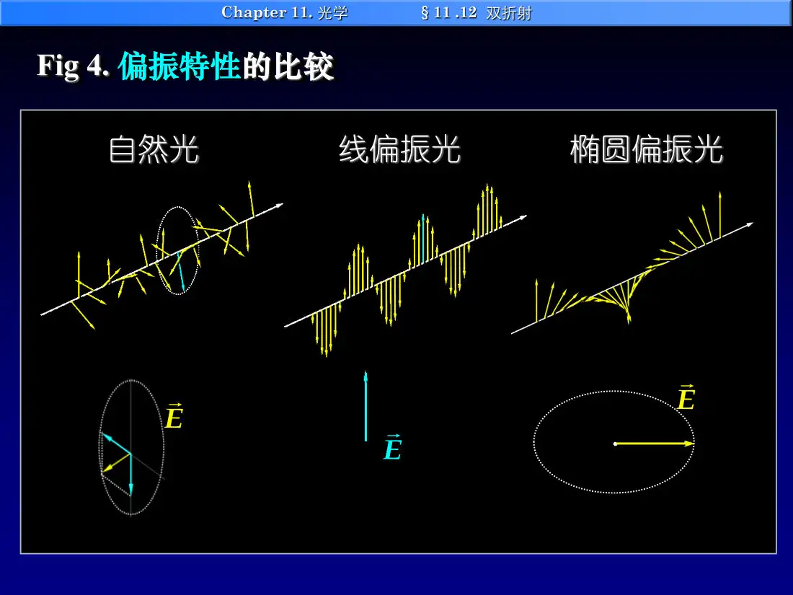

原文：

Fig 4. 偏振特性的比较

自然光

线偏振光

椭圆偏振光

Chapter 11. 光学

茂田§11 .12 双折射

### 四分之一波片

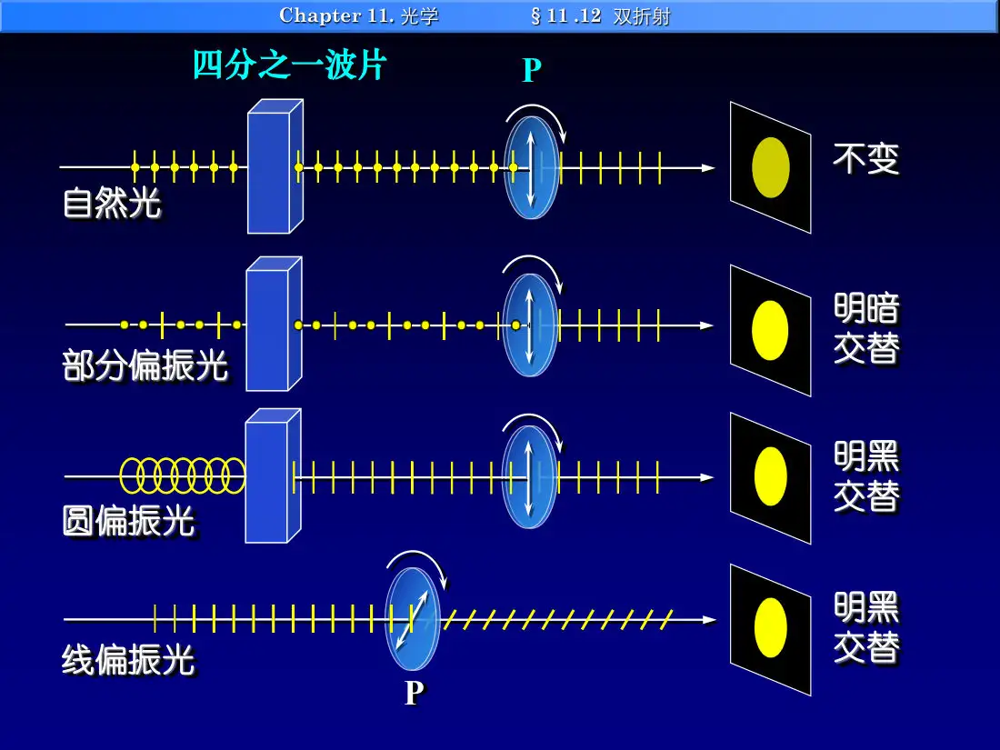

原文：

四分之一波片

自然光

・・・部分偏振光

0000000圆偏振光

线偏振光

不变

明暗交替

明黑交替

明黑交替

Chapter 11. 光学

茂田§11 .12 双折射

P

### 归纳：

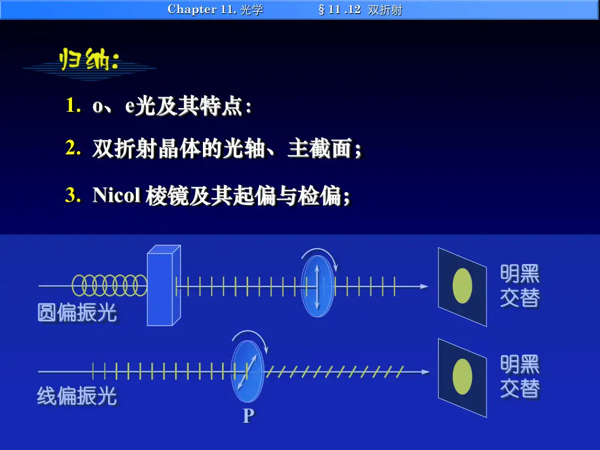

原文：

归纳：

1. o、e光及其特点：

2. 双折射晶体的光轴、主截面；

3. Nicol 棱镜及其起偏与检偏；

0111110圆偏振光

线偏振光

O

O 明黑 交替

明黑交替

Chapter 11. 光学

茂田§11 .12 双折射

P

### 归纳：

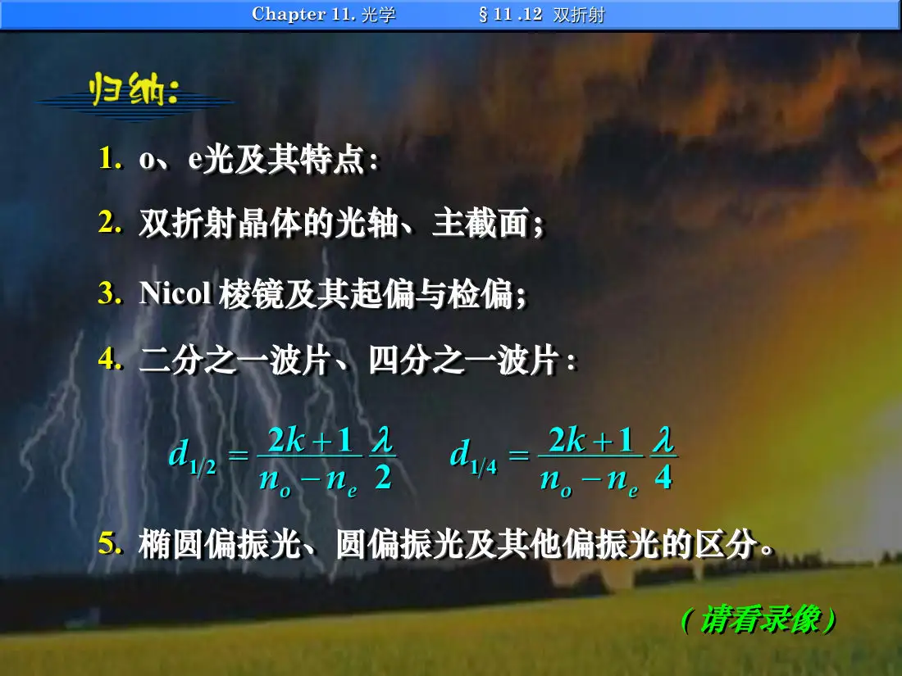

原文：

归纳：

1. o、e光及其特点：

2. 双折射晶体的光轴、主截面；

3. Nicol 棱镜及其起偏与检偏；

4. 二分之一波片、四分之一波片：

$$
d _ {1 / 2} = \frac {2 k + 1}{n _ {o} - n _ {e}} \frac {\lambda}{2}
$$

$$
d _ {1 / 4} = \frac {2 k + 1}{n _ {o} - n _ {e}} \frac {\lambda}{4}
$$

5. 椭圆偏振光、圆偏振光及其他偏振光的区分。

请看录像 )

Chapter 11. 光学

茂田§11 .12 双折射

### 第 33 页

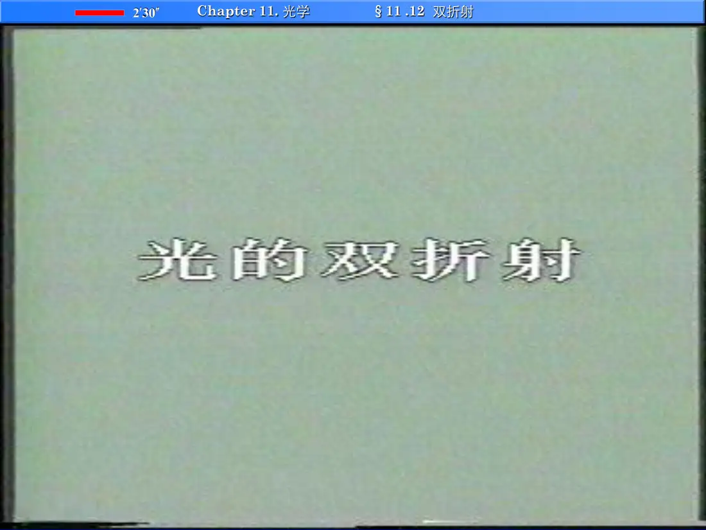

原文：

<table><tr><td>2&#x27;30&quot;</td><td>Chapter 11. 光学</td><td>§ 11.12 双折射</td></tr><tr><td colspan="3">光的双折射</td></tr></table>
