# 《大学物理》第11章 光学 §11.2 杨氏双缝干涉（课件）

原件的每一页，下面附识别出的文字。

### § 11.2 杨氏双缝干涉

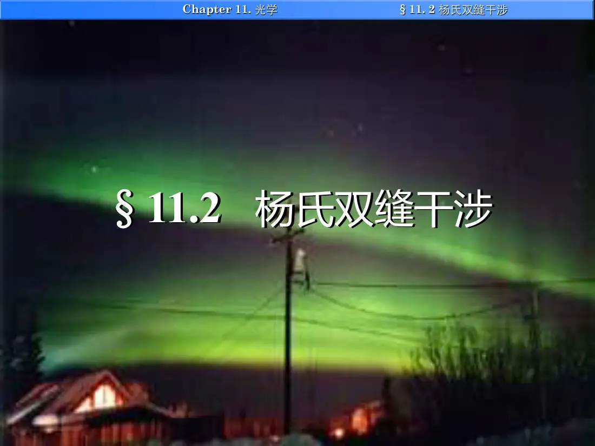

原文：

§ 11.2 杨氏双缝干涉

Chapter 11. 光学

§ 11.2 杨氏双缝干涉

### 1773\~1829

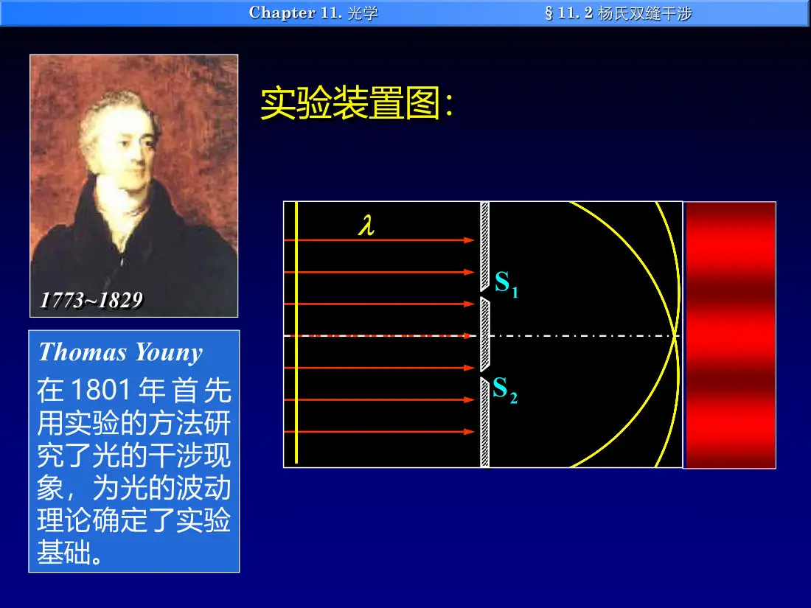

原文：

1773\~1829

Thomas Youny
在1801年首先用实验的方法研究了光的干涉现象，为光的波动理论确定了实验基础。

实验装置图：

Chapter 11. 光学

§ 11.2 杨氏双缝干涉

### 一、观测屏上的光强分布

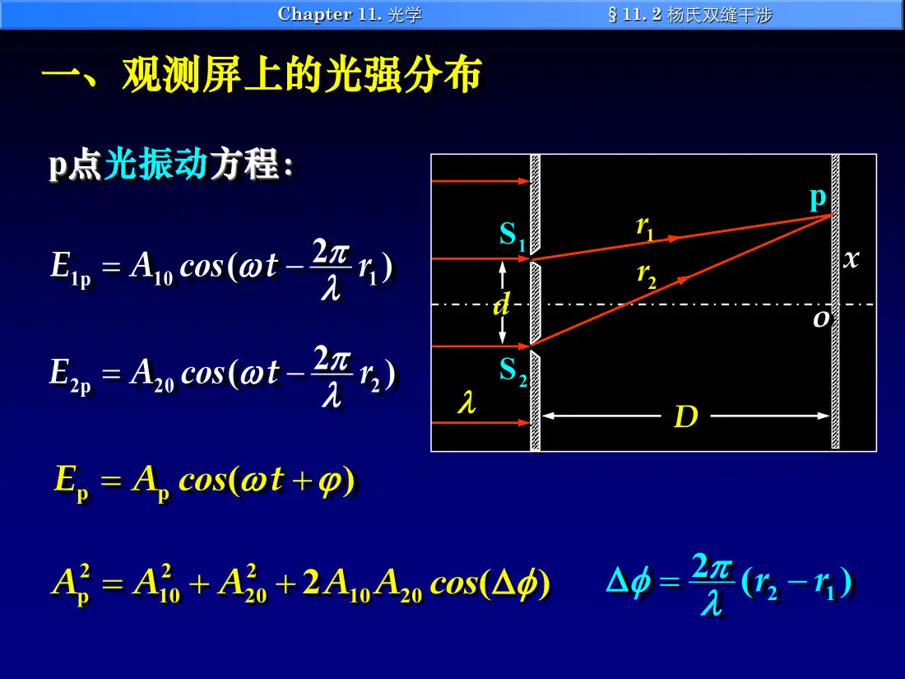

原文：

一、观测屏上的光强分布

p点光振动方程:

$$
E _ {\mathrm{1p}} = A _ {1 0} \cos (\omega t - \frac {2 \pi}{\lambda} r _ {1})
$$

$$
E _ {2 \mathrm{p}} = A _ {2 0} \cos (\omega t - \frac {2 \pi}{\lambda} r _ {2})
$$

$$
E _ {\mathrm{p}} = A _ {\mathrm{p}} \cos (\omega t + \varphi)
$$

$$
A _ {\mathrm{p}} ^ {2} = A _ {1 0} ^ {2} + A _ {2 0} ^ {2} + 2 A _ {1 0} A _ {2 0} \cos (\Delta \phi)
$$

$$
\Delta \phi = \frac {2 \pi}{\lambda} (r _ {2} - r _ {1})
$$

Chapter 11. 光学

§ 11.2 杨氏双缝干涉

### $$

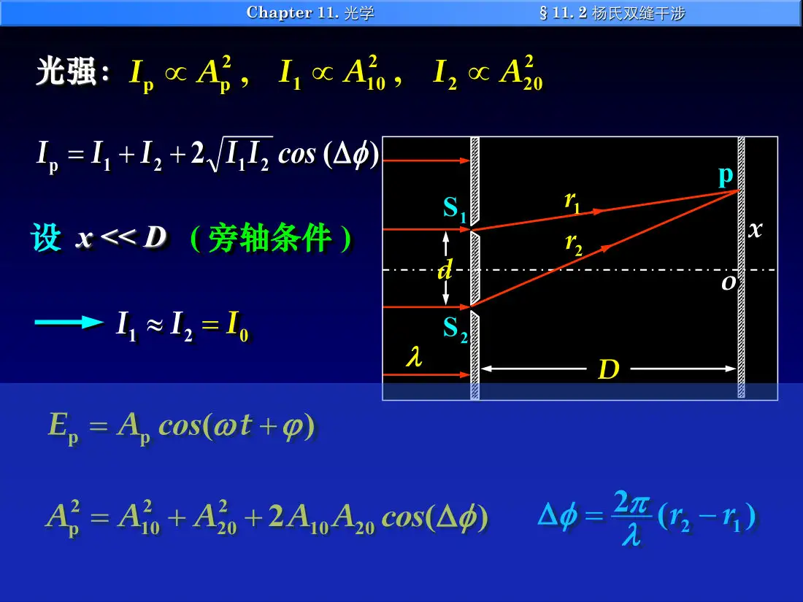

原文：

光强： $I_{p} \propto A_{p}^{2}$ ， $I_{1} \propto A_{10}^{2}$ ， $I_{2} \propto A_{20}^{2}$

$$
I _ {\mathrm{p}} = I _ {1} + I _ {2} + 2 \sqrt {I _ {1} I _ {2}} \cos (\Delta \phi)
$$

设 $x \ll D$ （旁轴条件）

$$
\longrightarrow I _ {1} \approx I _ {2} = I _ {0}
$$

$$
E _ {\mathrm{p}} = A _ {\mathrm{p}} \cos (\omega t + \varphi)
$$

$$
A _ {\mathrm{p}} ^ {2} = A _ {1 0} ^ {2} + A _ {2 0} ^ {2} + 2 A _ {1 0} A _ {2 0} \cos (\Delta \phi)
$$

$$
\Delta \phi = \frac {2 \pi}{\lambda} (r _ {2} - r _ {1})
$$

Chapter 11. 光学

§ 11.2 杨氏双缝干涉

### $$

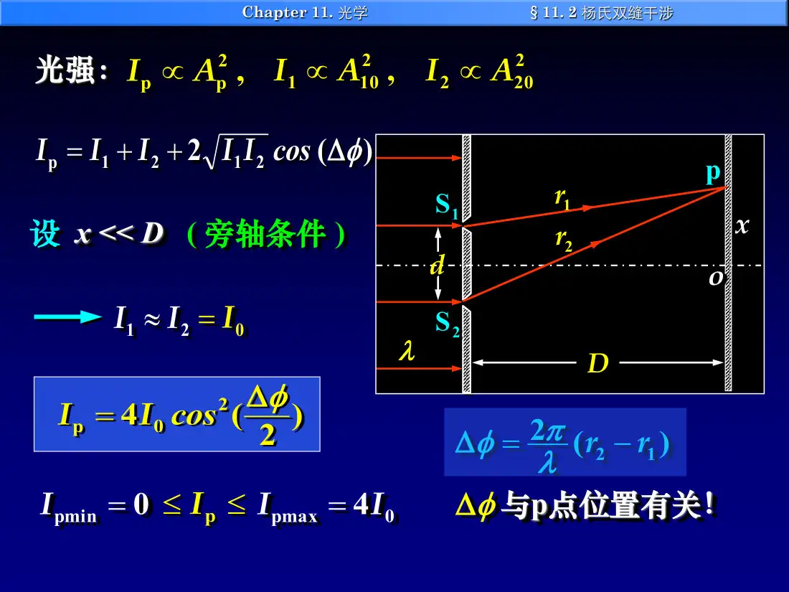

原文：

光强： $I_{p} \propto A_{p}^{2}$ ， $I_{1} \propto A_{10}^{2}$ ， $I_{2} \propto A_{20}^{2}$

$$
I _ {\mathrm{p}} = I _ {1} + I _ {2} + 2 \sqrt {I _ {1} I _ {2}} \cos (\Delta \phi)
$$

设 $x \ll D$ （旁轴条件）

$$
\longrightarrow I _ {1} \approx I _ {2} = I _ {0}
$$

$$
I _ {\mathrm{p}} = 4 I _ {0} \cos^ {2} (\frac {\Delta \phi}{2})
$$

$$
\Delta \phi = \frac {2 \pi}{\lambda} (r _ {2} - r _ {1})
$$

$I_{\mathrm{pmin}} = 0 \leq I_{\mathrm{p}} \leq I_{\mathrm{pmax}} = 4I_{0}$ $\Delta \phi$ 与p点位置有关！

Chapter 11. 光学

§ 11.2 杨氏双缝干涉

### $$

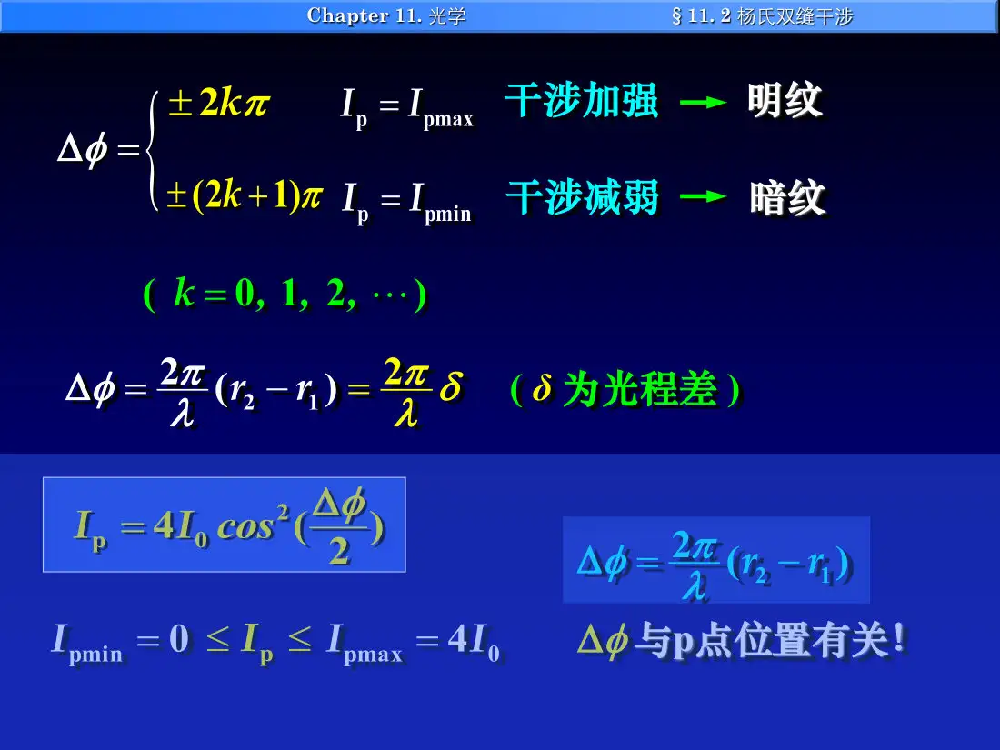

原文：

$$
\Delta \phi = \left\{ \begin{array}{l l} \pm 2 k \pi & I _ {\mathrm{p}} = I _ {\mathrm{pmax}} \\ \pm (2 k + 1) \pi & I _ {\mathrm{p}} = I _ {\mathrm{pmin}} \end{array} \right.
$$

干涉加强 → 明纹

干涉减弱 → 暗纹

$$
(k = 0, 1, 2, \dots)
$$

$\Delta \phi = \frac{2\pi}{\lambda} (r_2 - r_1) = \frac{2\pi}{\lambda}\delta$ （δ为光程差）

$$
I _ {\mathrm{p}} = 4 I _ {0} \cos^ {2} (\frac {\Delta \phi}{2})
$$

$$
\Delta \phi = \frac {2 \pi}{\lambda} (r _ {2} - r _ {1})
$$

$$
I _ {\mathrm{pmin}} = 0 \leq I _ {\mathrm{p}} \leq I _ {\mathrm{pmax}} = 4 I _ {0}
$$

$\Delta \phi$ 与p点位置有关!

Chapter 11. 光学

§ 11.2 杨氏双缝干涉

### $$

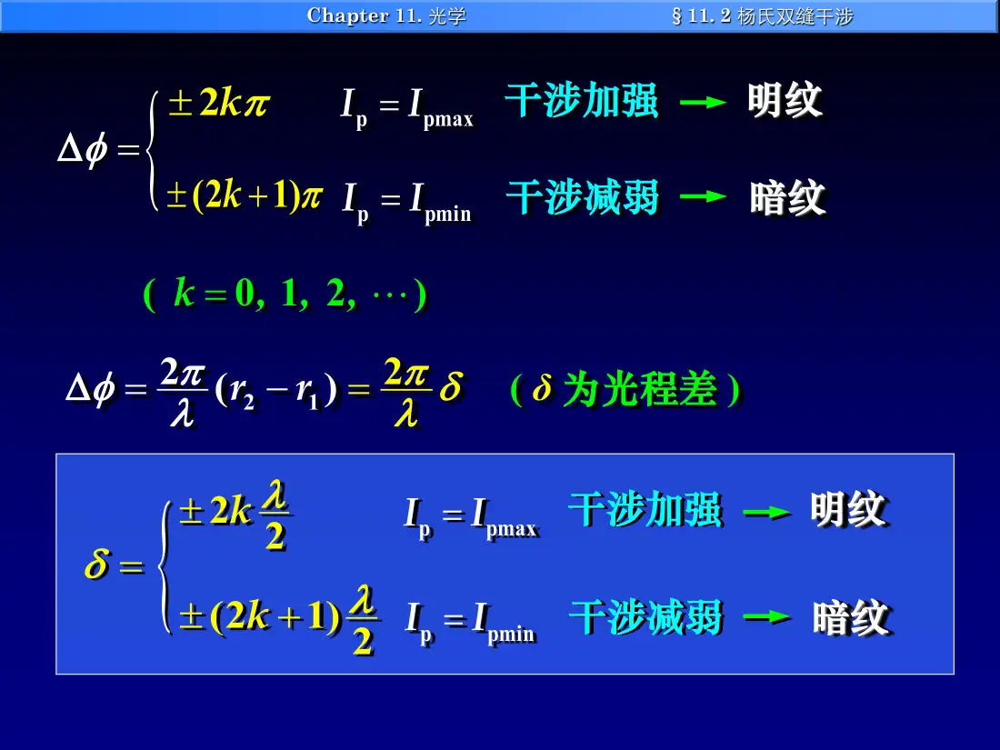

原文：

$$
\Delta \phi = \left\{ \begin{array}{l l} \pm 2 k \pi & I _ {\mathrm{p}} = I _ {\mathrm{pmax}} \\ \pm (2 k + 1) \pi & I _ {\mathrm{p}} = I _ {\mathrm{pmin}} \end{array} \right.
$$

干涉加强 → 明纹

干涉减弱 → 暗纹

$$
(k = 0, 1, 2, \dots)
$$

$\Delta \phi = \frac{2\pi}{\lambda} (r_2 - r_1) = \frac{2\pi}{\lambda}\delta$ （δ为光程差）

$$
\delta = \left\{ \begin{array}{l l} \pm 2 k \frac {\lambda}{2} & I _ {\mathrm{p}} = I _ {\mathrm{pmax}} \\ \pm (2 k + 1) \frac {\lambda}{2} & I _ {\mathrm{p}} = I _ {\mathrm{pmin}} \end{array} \right.
$$

干涉加强 → 明纹

干涉减弱 → 暗纹

Chapter 11. 光学

§ 11.2 杨氏双缝干涉

### 观测屏上光强分布曲线：

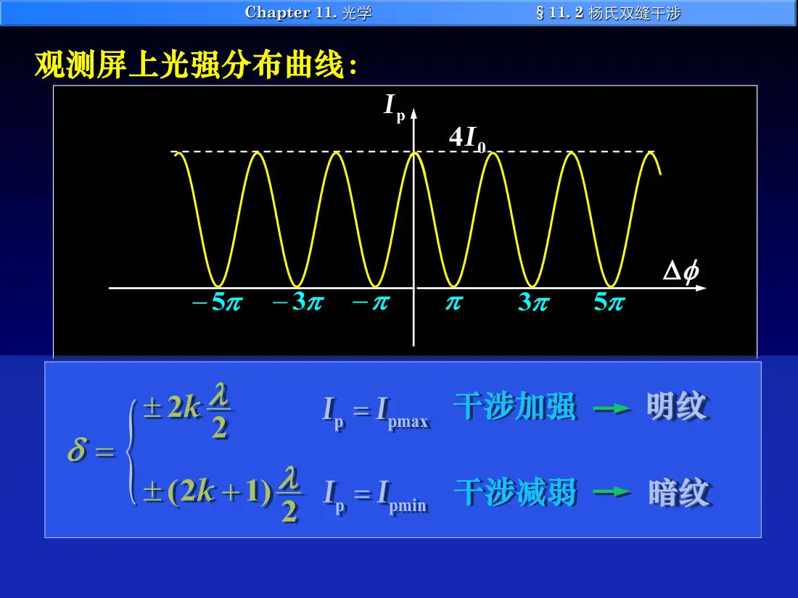

原文：

观测屏上光强分布曲线：

$$
\delta = \left\{ \begin{array}{l l} \pm 2 k \frac {\lambda}{2} & I _ {\mathrm{p}} = I _ {\mathrm{pmax}} \\ \pm (2 k + 1) \frac {\lambda}{2} & I _ {\mathrm{p}} = I _ {\mathrm{pmin}} \end{array} \right.
$$

干涉加强 → 明纹

干涉减弱 → 暗纹

Chapter 11. 光学

§ 11.2 杨氏双缝干涉

### 观测屏上光强分布曲线：

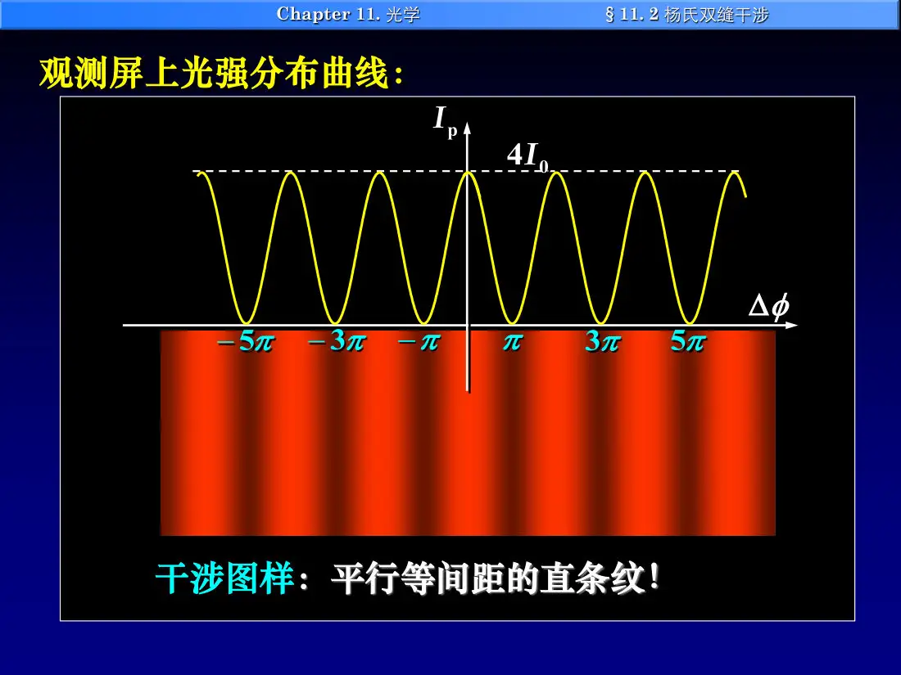

原文：

观测屏上光强分布曲线：

干涉图样：平行等间距的直条纹！

Chapter 11. 光学

§ 11.2 杨氏双缝干涉

### 二、干涉条纹位置分布

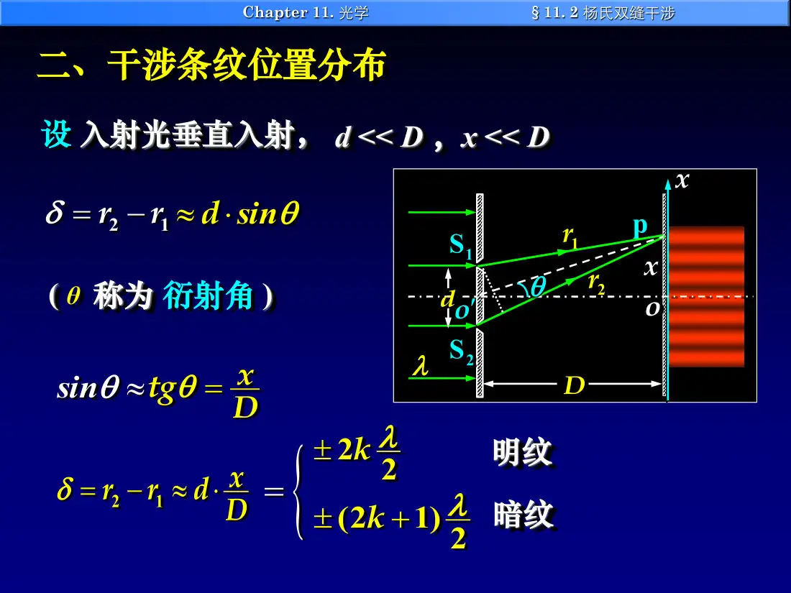

原文：

二、干涉条纹位置分布

设 入射光垂直入射， $d \ll D$ ， $x \ll D$

$$
\delta = r _ {2} - r _ {1} \approx d \cdot \sin \theta
$$

(θ 称为 衍射角)

sinθ≈tgθ= $\frac{x}{D}$

$\delta = r_{2} - r_{1}\approx d\cdot \frac{x}{D} = \left\{ \begin{array}{ll}\pm 2k\frac{\lambda}{2} & \text{明纹}\\ \pm (2k + 1)\frac{\lambda}{2} & \text{暗纹} \end{array} \right.$

Chapter 11. 光学

§ 11.2 杨氏双缝干涉

### 中央明纹: $k = 0, \delta = 0$

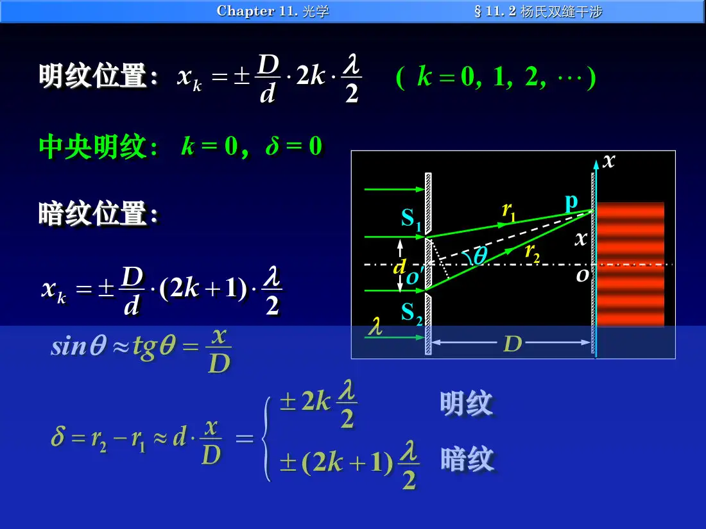

原文：

明纹位置: $x_{k} = \pm \frac{D}{d} \cdot 2k \cdot \frac{\lambda}{2}$ ( $k = 0, 1, 2, \cdots$ )

中央明纹: $k = 0, \delta = 0$

暗纹位置:

$$
x _ {k} = \pm \frac {D}{d} \cdot (2 k + 1) \cdot \frac {\lambda}{2}
$$

$\sin \theta \approx tg\theta = \frac{x}{D}$

$\delta = r_{2} - r_{1}\approx d\cdot \frac{x}{D} = \left\{ \begin{array}{ll}\pm 2k\frac{\lambda}{2} & \text{明纹}\\ \pm (2k + 1)\frac{\lambda}{2} & \text{暗纹} \end{array} \right.$

Chapter 11. 光学

§ 11.2 杨氏双缝干涉

### 中央明纹: $k = 0, \delta = 0$

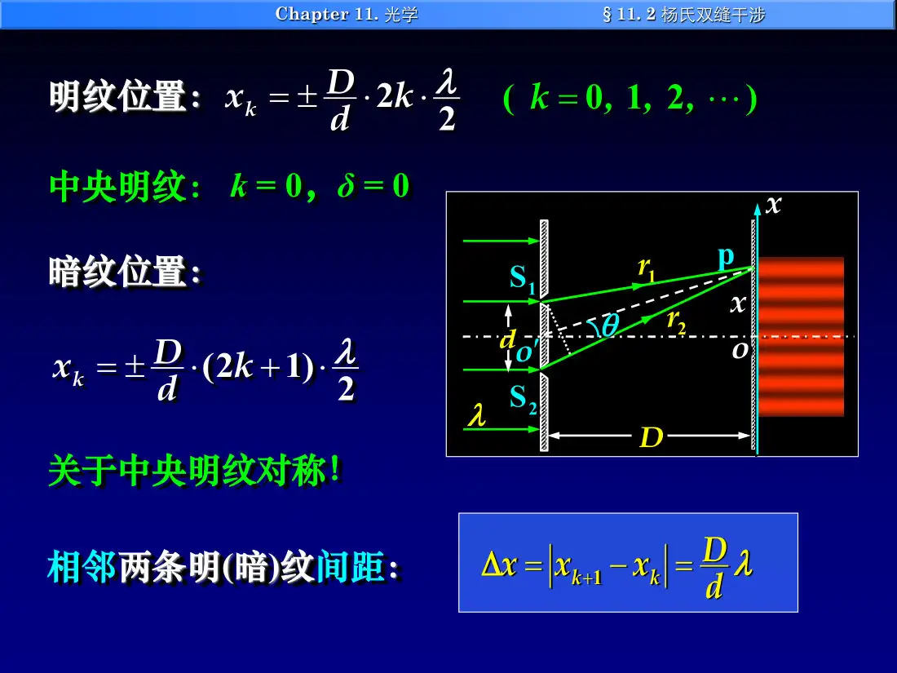

原文：

明纹位置: $x_{k} = \pm \frac{D}{d} \cdot 2k \cdot \frac{\lambda}{2}$ ( $k = 0, 1, 2, \cdots$ )

中央明纹: $k = 0, \delta = 0$

暗纹位置:

$$
x _ {k} = \pm \frac {D}{d} \cdot (2 k + 1) \cdot \frac {\lambda}{2}
$$

关于中央明纹对称！

相邻两条明(暗)纹间距:

$$
\Delta x = \left| x _ {k + 1} - x _ {k} \right| = \frac {D}{d} \lambda
$$

Chapter 11. 光学

§ 11.2 杨氏双缝干涉

### 观测屏上光强曲线(按位置分布):

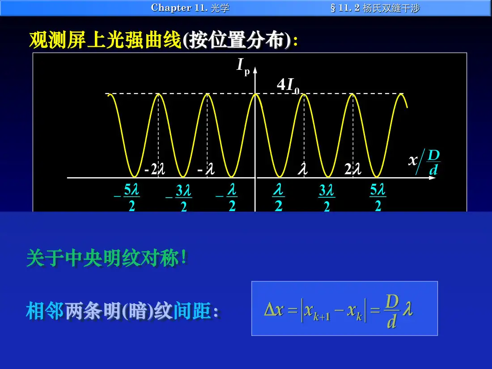

原文：

观测屏上光强曲线(按位置分布):

关于中央明纹对称！

相邻两条明(暗)纹间距:

$$
\Delta x = \left| x _ {k + 1} - x _ {k} \right| = \frac {D}{d} \lambda
$$

Chapter 11. 光学

§ 11.2 杨氏双缝干涉

### 观测屏上光强曲线(按位置分布):

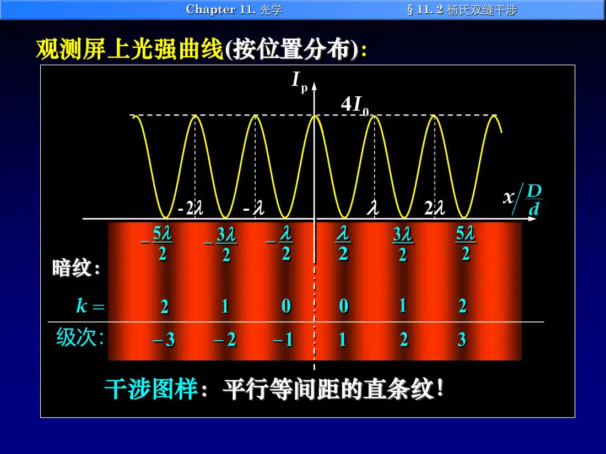

原文：

观测屏上光强曲线(按位置分布):

暗纹：

级次:

干涉图样：平行等间距的直条纹！

Chapter 11. 光学

§ 11.2 杨氏双缝干涉

### 观测屏上光强曲线(按位置分布):

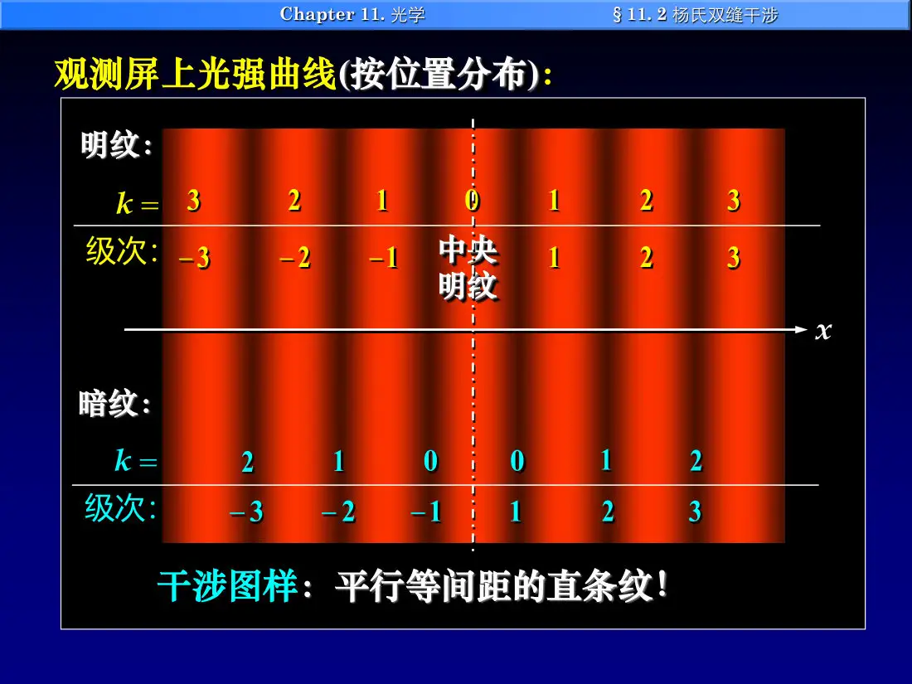

原文：

观测屏上光强曲线(按位置分布):

明纹：

级次：

暗纹：

级次:

干涉图样：平行等间距的直条纹！

Chapter 11. 光学

§ 11.2 杨氏双缝干涉

### 解 求第10级明纹间距：

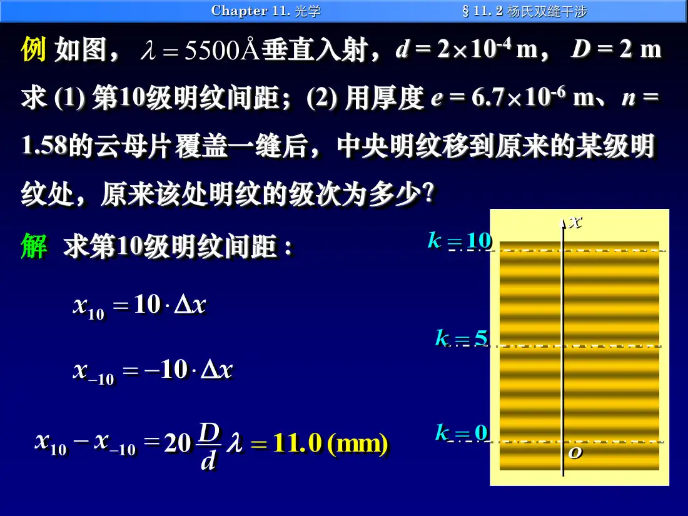

原文：

例如图， $\lambda = 5500 \, \text{Å}$ 垂直入射， $d = 2 \times 10^{-4} \, \text{m}$ ， $D = 2 \, \text{m}$ 求 (1) 第10级明纹间距；(2) 用厚度 $e = 6.7 \times 10^{-6} \, \text{m}$ 、 $n = 1.58$ 的云母片覆盖一缝后，中央明纹移到原来的某级明纹处，原来该处明纹的级次为多少？

解 求第10级明纹间距：

$$
x _ {1 0} = 1 0 \cdot \Delta x
$$

$$
x _ {- 1 0} = - 1 0 \cdot \Delta x
$$

$$
x _ {1 0} - x _ {- 1 0} = 2 0 \frac {D}{d} \lambda = 1 1. 0 (\mathrm{mm})
$$

Chapter 11. 光学

§ 11.2 杨氏双缝干涉

### 后: $\delta' = r_2 - (r_1 - e + ne) = 0$

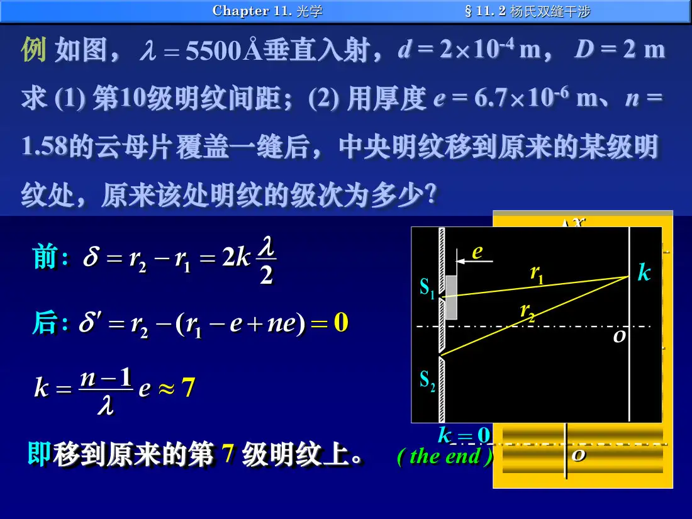

原文：

例如图, $\lambda = 5500 \AA$ 垂直入射, $d = 2 \times 10^{- 4} \mathrm{~m}$ , $D = 2 \mathrm{~m}$ 求 (1) 第10级明纹间距; (2) 用厚度 $e = 6.7 \times 10^{- 6} \mathrm{~m}$ 、 $n = 1.58$ 的云母片覆盖一缝后, 中央明纹移到原来的某级明纹处, 原来该处明纹的级次为多少?

前: $\delta = r_{2} - r_{1} = 2k\frac{\lambda}{2}$

后: $\delta' = r_2 - (r_1 - e + ne) = 0$

$$
k = \frac {n - 1}{\lambda} e \approx 7
$$

即移到原来的第 7 级明纹上。 (the end)

Chapter 11. 光学

§ 11.2 杨氏双缝干涉

### 三、几点讨论

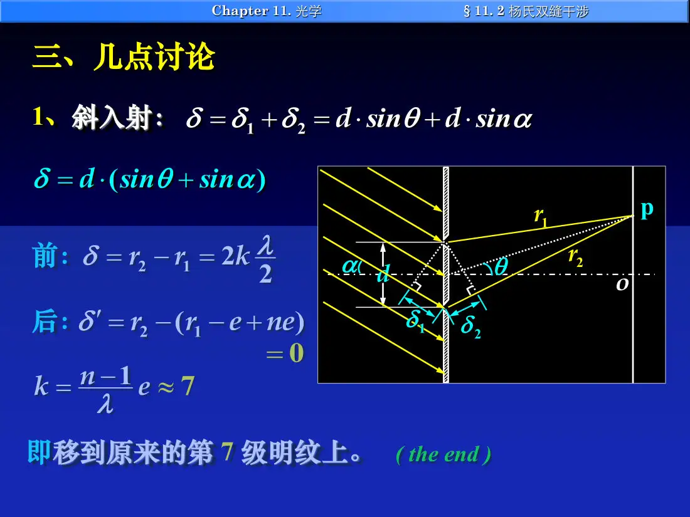

原文：

三、几点讨论

1、斜入射： $\delta=\delta_{1}+\delta_{2}=d\cdot\sin\theta+d\cdot\sin\alpha$

$$
\delta = d \cdot (\sin \theta + \sin \alpha)
$$

前: $\delta = r_{2} - r_{1} = 2k\frac{\lambda}{2}$

$$
\begin{array}{r l} \text {后:} & \delta^ {\prime} = r _ {2} - (r _ {1} - e + n e) \\ & = 0 \end{array}
$$

$$
k = \frac {n - 1}{\lambda} e \approx 7
$$

即移到原来的第 7 级明纹上。(the end)

Chapter 11. 光学

§ 11.2 杨氏双缝干涉

### 三、几点讨论

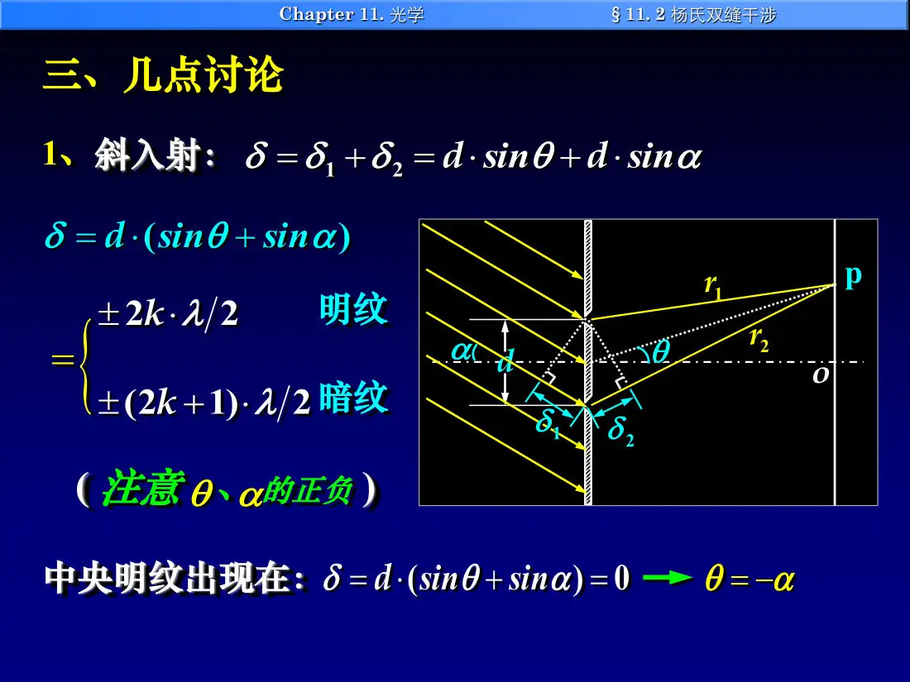

原文：

三、几点讨论

1、斜入射： $\delta=\delta_{1}+\delta_{2}=d\cdot\sin\theta+d\cdot\sin\alpha$

$$
\delta = d \cdot (\sin \theta + \sin \alpha)
$$

= $\left\{\begin{array}{l}\pm2k\cdot\lambda/2\quad 明纹 \\ \pm(2k+1)\cdot\lambda/2\quad 暗纹\end{array}\right.$

(注意 $\theta$ 、 $\alpha$ 的正负)

中央明纹出现在: $\delta = d \cdot (\sin \theta + \sin \alpha) = 0 \rightarrow \theta = -\alpha$

Chapter 11. 光学

§ 11.2 杨氏双缝干涉

### 2、白光入射：

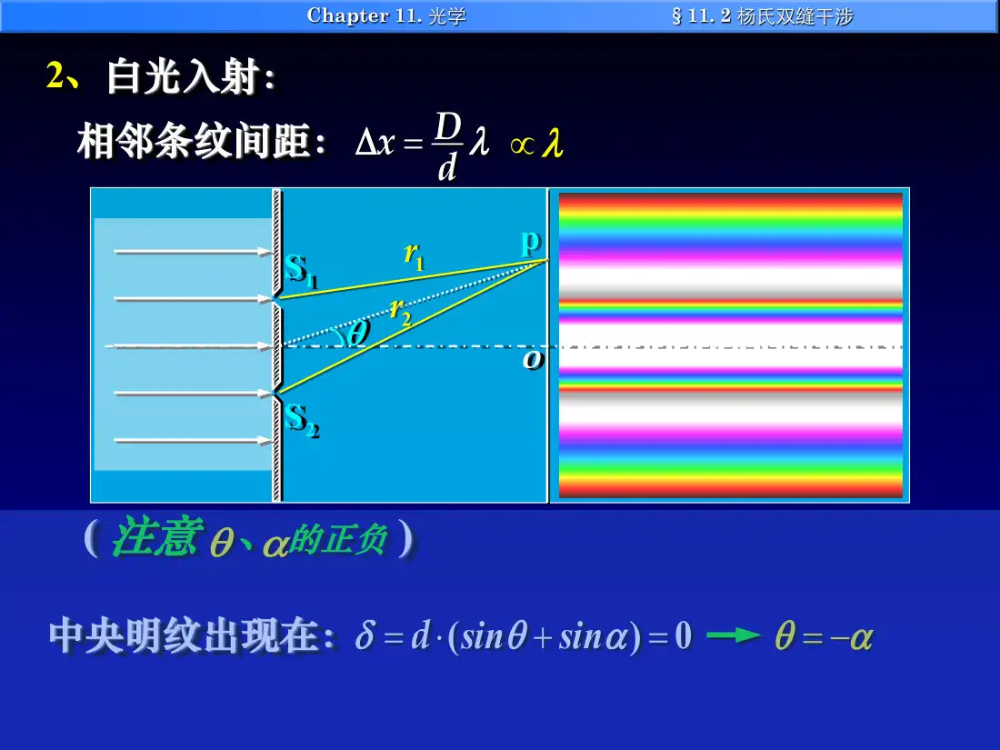

原文：

2、白光入射：

相邻条纹间距: $\Delta x = \frac{D}{d} \lambda \propto \lambda$

(注意 $\theta$ 、 $\alpha$ 的正负)

中央明纹出现在: $\delta = d \cdot (\sin \theta + \sin \alpha) = 0 \rightarrow \theta = -\alpha$

Chapter 11. 光学

§ 11.2 杨氏双缝干涉

### 2、白光入射:

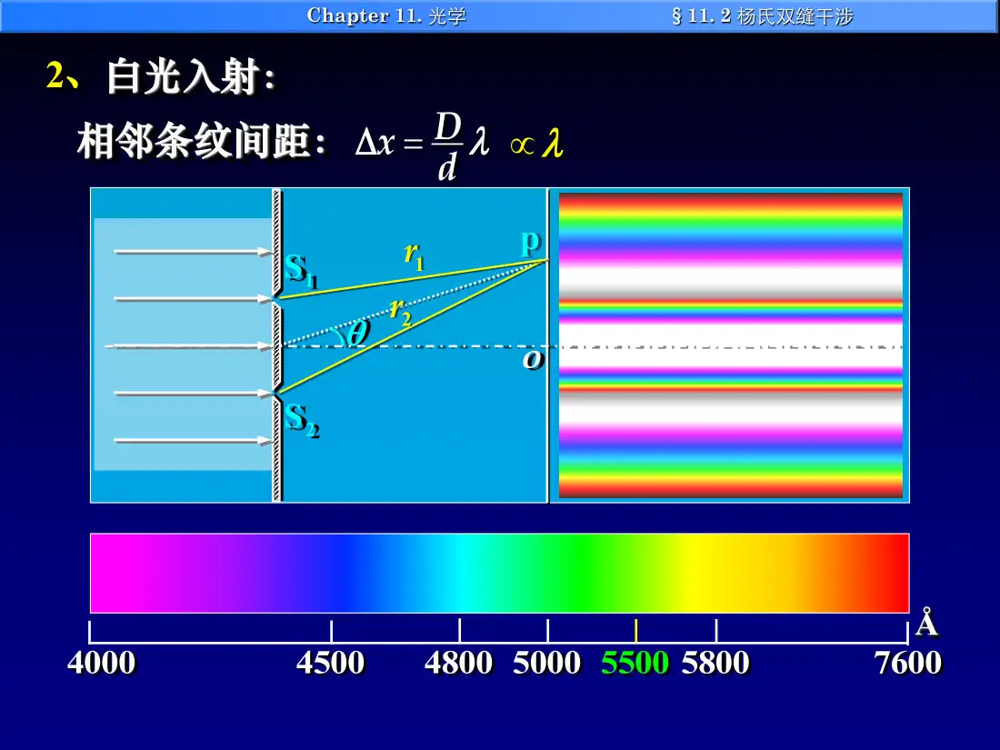

原文：

2、白光入射:

相邻条纹间距: $\Delta x = \frac{D}{d} \lambda \propto \lambda$

Chapter 11. 光学

§ 11.2 杨氏双缝干涉

### 四、另外几种分波阵面法干涉实验

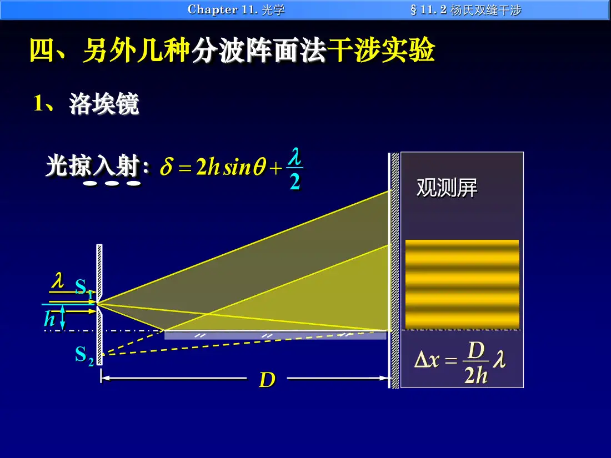

原文：

四、另外几种分波阵面法干涉实验

1、洛埃镜

光掠入射: $\delta = 2h\sin\theta + \frac{\lambda}{2}$

观测屏

$$
\Delta x = \frac {D}{2 h} \lambda
$$

Chapter 11. 光学

§ 11.2 杨氏双缝干涉

### 2、菲涅尔双镜

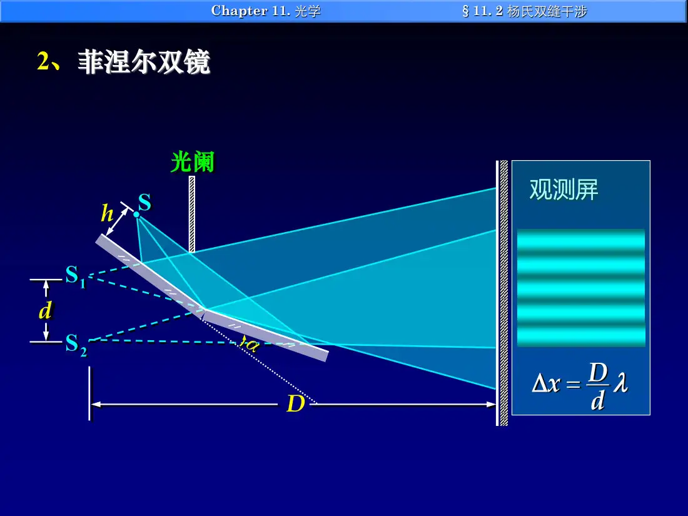

原文：

2、菲涅尔双镜

观测屏

$$
\Delta x = \frac {D}{d} \lambda
$$

Chapter 11. 光学

§ 11.2 杨氏双缝干涉

### 归纳：

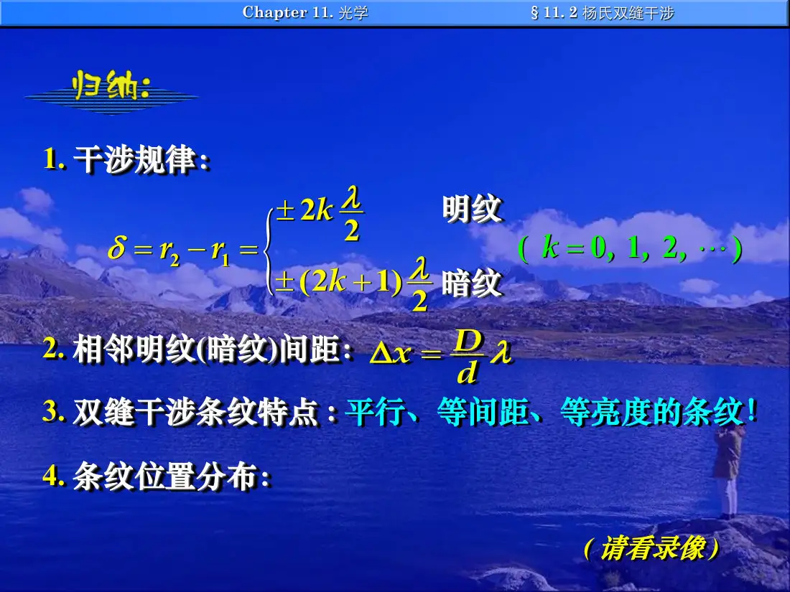

原文：

归纳：

1. 干涉规律：

$\delta = r_{2} - r_{1} = \left\{ \begin{array}{ll}\pm 2k\frac{\lambda}{2} & \text{明纹}\\ \pm (2k + 1)\frac{\lambda}{2} & \text{暗纹} \end{array} \right.$

$$
(k = 0, 1, 2, \dots)
$$

2. 相邻明纹(暗纹)间距: $\Delta x = \frac{D}{d} \lambda$

3. 双缝干涉条纹特点：平行、等间距、等亮度的条纹！

4. 条纹位置分布:

(请看录像)

Chapter 11. 光学

§ 11.2 杨氏双缝干涉

### 杨氏双缝干涉

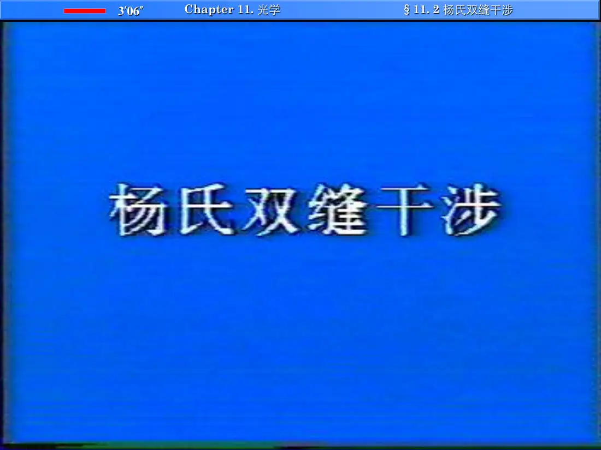

原文：

杨氏双缝干涉

3'06" Chapter 11. 光学

§ 11.2 杨氏双缝干涉
