# 《大学物理》第11章 光学 §11.5 迈克尔逊干涉仪（课件）

原件的每一页，下面附识别出的文字。

### § 11.5 迈克尔逊干涉仪 时间相干性

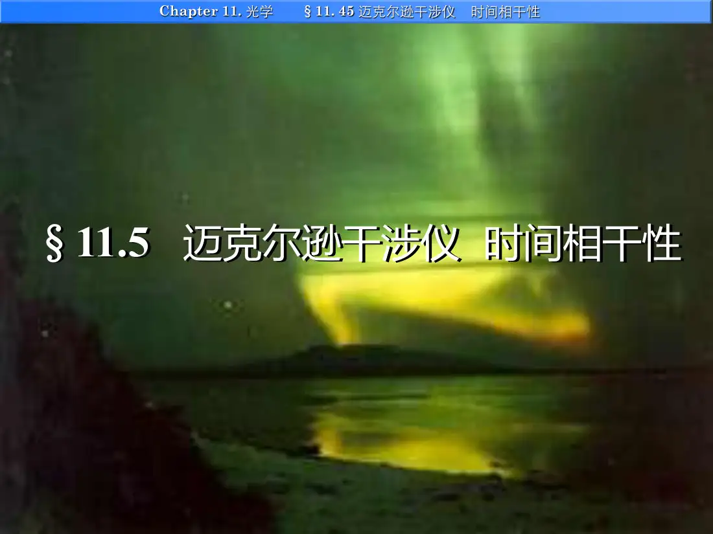

原文：

§ 11.5 迈克尔逊干涉仪 时间相干性

Chapter 11. 光学 § 11.45 迈克尔逊干涉仪 时间相干性

### 一、等倾干涉

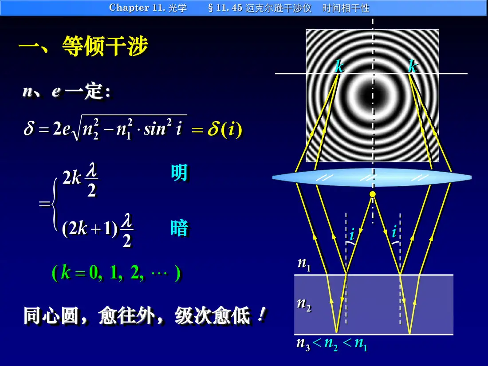

原文：

一、等倾干涉

n、e一定：

$$
\delta = 2 e \sqrt {n _ {2} ^ {2} - n _ {1} ^ {2} \cdot \sin^ {2} i} = \delta (i)
$$

$$
= \left\{ \begin{array}{l l} 2 k \frac {\lambda}{2} & \text {明} \\ (2 k + 1) \frac {\lambda}{2} & \text {暗} \end{array} \right.
$$

$$
(k = 0, 1, 2, \dots)
$$

同心圆，愈往外，级次愈低！

$$
n _ {3} <   n _ {2} <   n _ {1}
$$

Chapter 11. 光学 § 11.45 迈克尔逊干涉仪 时间相干性

### 一、等倾干涉

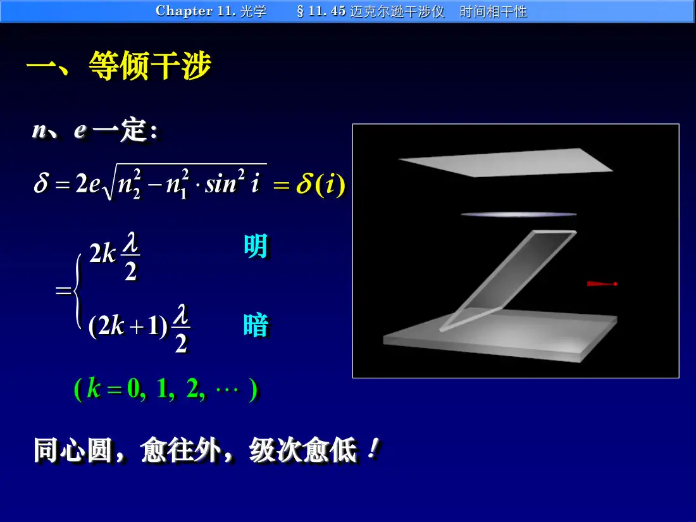

原文：

一、等倾干涉

n、e一定：

$$
\delta = 2 e \sqrt {n _ {2} ^ {2} - n _ {1} ^ {2} \cdot \sin^ {2} i} = \delta (i)
$$

$$
= \left\{ \begin{array}{l l} 2 k \frac {\lambda}{2} & \text {明} \\ (2 k + 1) \frac {\lambda}{2} & \text {暗} \end{array} \right.
$$

$$
(k = 0, 1, 2, \dots)
$$

同心圆，愈往外，级次愈低！

Chapter 11. 光学 § 11.45 迈克尔逊干涉仪 时间相干性

### 二、迈克尔逊干涉仪

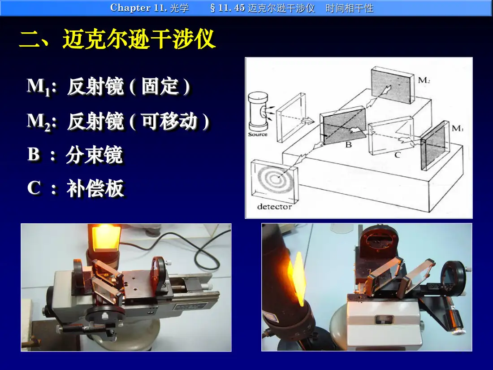

原文：

二、迈克尔逊干涉仪

$M_{1}$ : 反射镜（固定）

$M_{2}$ : 反射镜（可移动）

B：分束镜

C：补偿板

Chapter 11. 光学 § 11.45 迈克尔逊干涉仪 时间相干性

### 若中心 $(i = 0)$ 为明纹：

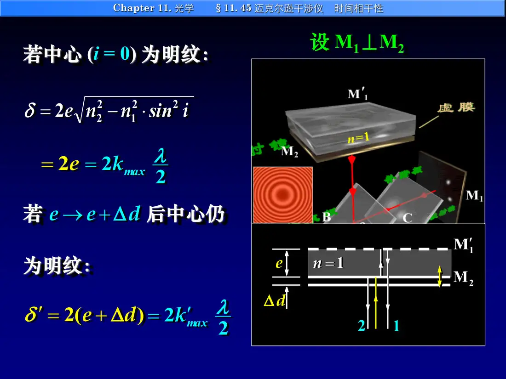

原文：

若中心 $(i = 0)$ 为明纹：

$$
\delta = 2 e \sqrt {n _ {2} ^ {2} - n _ {1} ^ {2} \cdot \sin^ {2} i}
$$

$$
= 2 e = 2 k _ {\max} \frac {\lambda}{2}
$$

若 $e \to e + \Delta d$ 后中心仍

为明纹:

$$
\delta^ {\prime} = 2 (e + \Delta d) = 2 k _ {m a x} ^ {\prime} \frac {\lambda}{2}
$$

设 $\mathrm{M}_{1} \perp \mathrm{M}_{2}$

Chapter 11. 光学 § 11.45 迈克尔逊干涉仪 时间相干性

### 若从中心冒出条纹数:

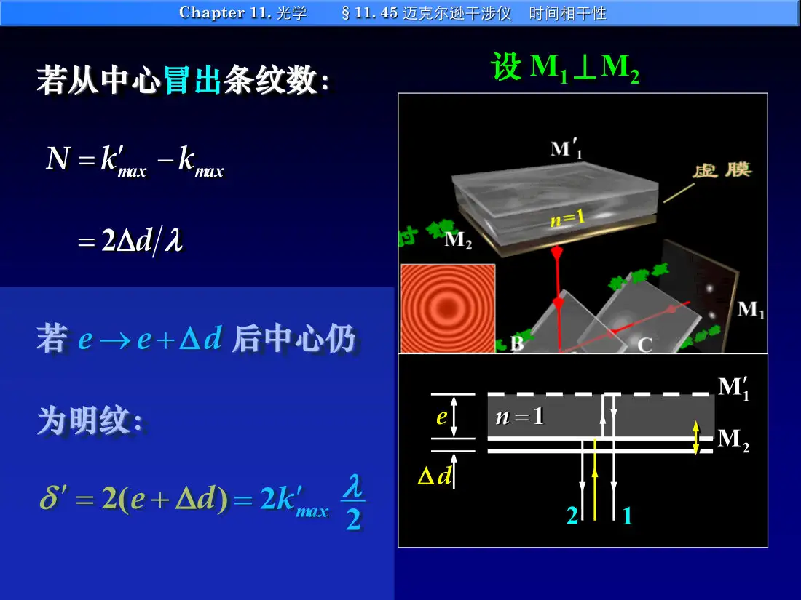

原文：

若从中心冒出条纹数:

$$
N = k _ {m a x} ^ {\prime} - k _ {m a x}
$$

$$
= 2 \Delta d / \lambda
$$

若 $e \rightarrow e + \Delta d$ 后中心仍

为明纹:

$$
\delta^ {\prime} = 2 (e + \Delta d) = 2 k _ {m a x} ^ {\prime} \frac {\lambda}{2}
$$

设 $\mathrm{M}_{1} \perp \mathrm{M}_{2}$

Chapter 11. 光学 § 11.45 迈克尔逊干涉仪 时间相干性

### 若从中心冒出条纹数:

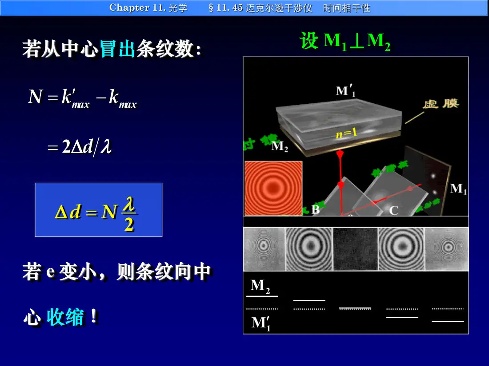

原文：

若从中心冒出条纹数:

$$
N = k _ {m a x} ^ {\prime} - k _ {m a x}
$$

$$
= 2 \Delta d / \lambda
$$

$$
\Delta d = N \frac {\lambda}{2}
$$

若 e 变小，则条纹向中

心收缩！

设 $\mathrm{M}_{1} \perp \mathrm{M}_{2}$

Chapter 11. 光学 § 11.45 迈克尔逊干涉仪 时间相干性

### Chapter 11. 光学 § 11.45 迈克尔逊干涉仪 时间相干性

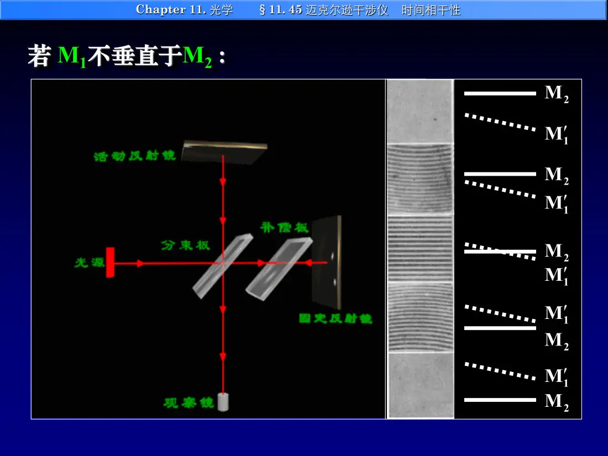

原文：

若 $\mathrm{M}_{1}$ 不垂直于 $\mathrm{M}_{2}$ :

Chapter 11. 光学 § 11.45 迈克尔逊干涉仪 时间相干性

### 三、迈克尔逊干涉仪的应用

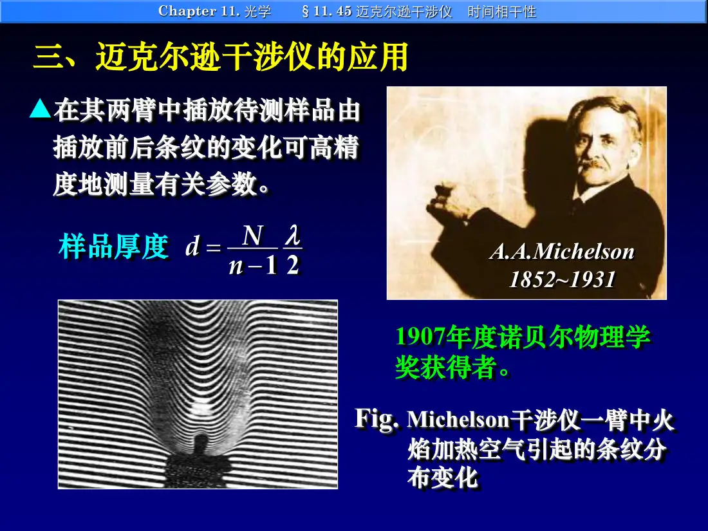

原文：

三、迈克尔逊干涉仪的应用

▲在其两臂中插放待测样品由插放前后条纹的变化可高精度地测量有关参数。

样品厚度 $d=\frac{N}{n-1}\frac{\lambda}{2}$

A.A.Michelson
1852\~1931

1907年度诺贝尔物理学奖获得者。

Fig. Michelson干涉仪一臂中火焰加热空气引起的条纹分布变化

Chapter 11. 光学 § 11.45 迈克尔逊干涉仪 时间相干性

### A.A.Michelson

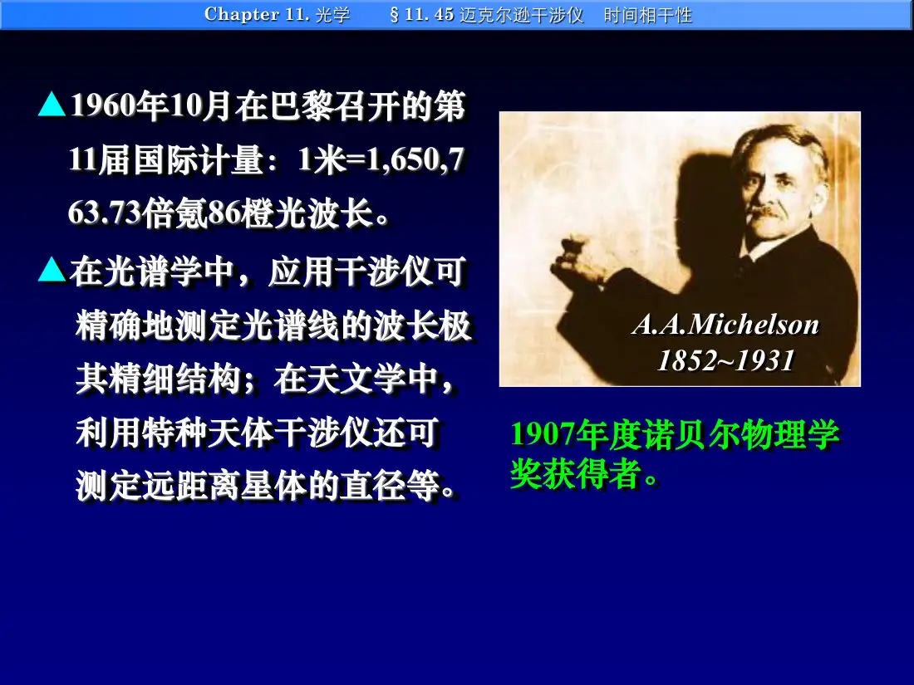

原文：

1960年10月在巴黎召开的第11届国际计量：1米=1,650,763.73倍氪86橙光波长。

在光谱学中，应用干涉仪可精确地测定光谱线的波长极其精细结构；在天文学中，利用特种天体干涉仪还可测定远距离星体的直径等。

A.A.Michelson
1852\~1931

1907年度诺贝尔物理学奖获得者。

Chapter 11. 光学 § 11.45 迈克尔逊干涉仪 时间相干性

### 归纳：

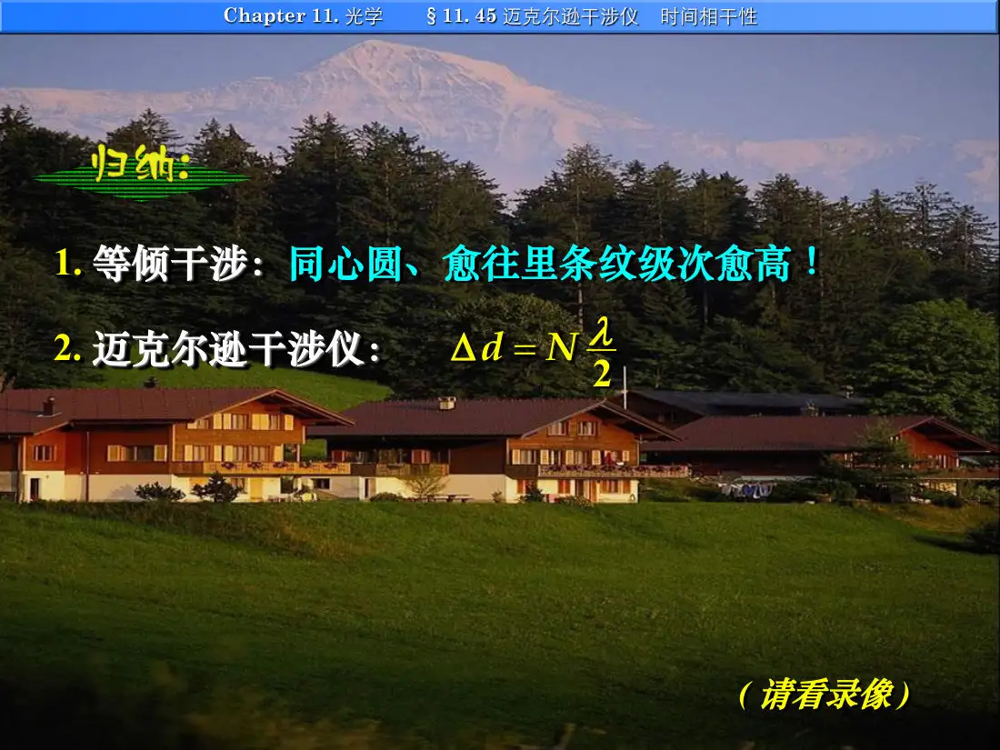

原文：

归纳：

1. 等倾干涉：同心圆、愈往里条纹级次愈高！

2. 迈克尔逊干涉仪: $\Delta d = N \frac{\lambda}{2}$

(请看录像)

Chapter 11. 光学 § 11.45 迈克尔逊干涉仪 时间相干性

### 光的干涉 的应用

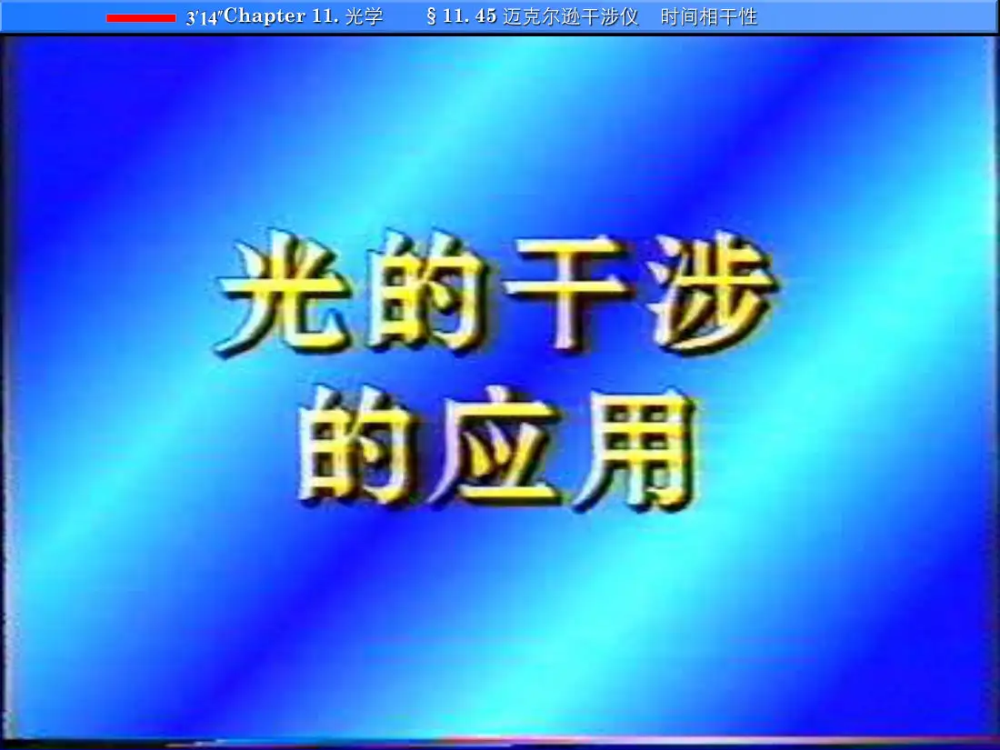

原文：

光的干涉 的应用

3'14"Chapter 11. 光学 § 11.45 迈克尔逊干涉仪 时间相干性
