# 《大学物理》第11章 光学 §11.8 圆孔衍射 光学仪器的分辨本领（课件）

原件的每一页，下面附识别出的文字。

### § 11.8 圆孔衍射 光学仪器的分辨本领

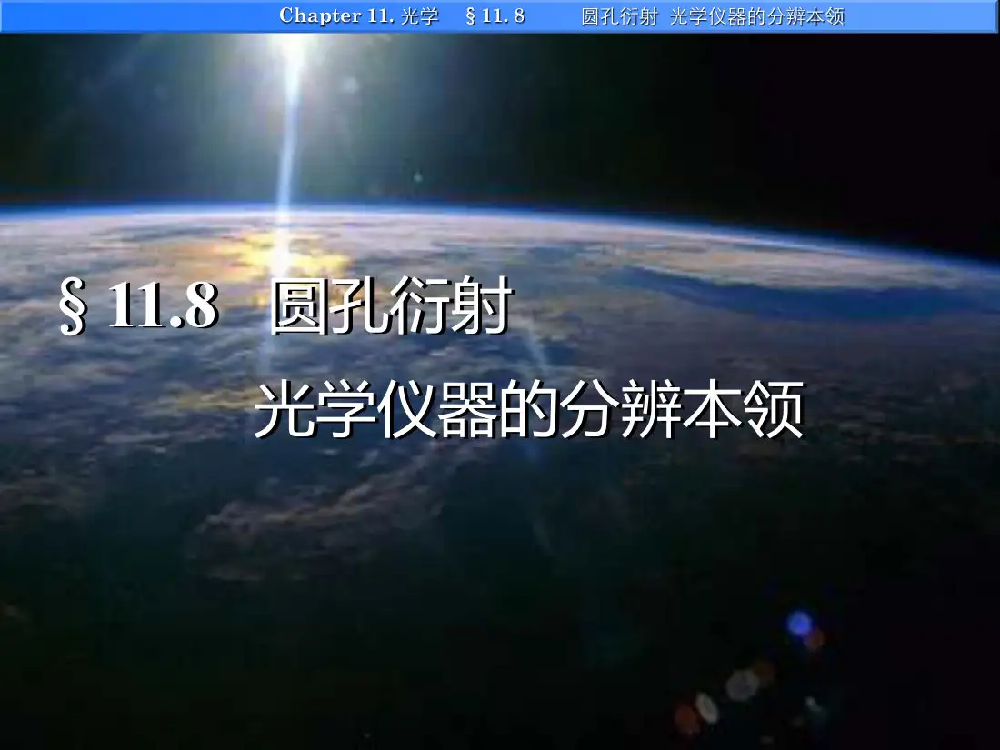

原文：

§ 11.8 圆孔衍射 光学仪器的分辨本领

Chapter 11. 光学 § 11.8

圆孔衍射 光学仪器的分辨本领

### 一、圆孔Fraunhofer衍射

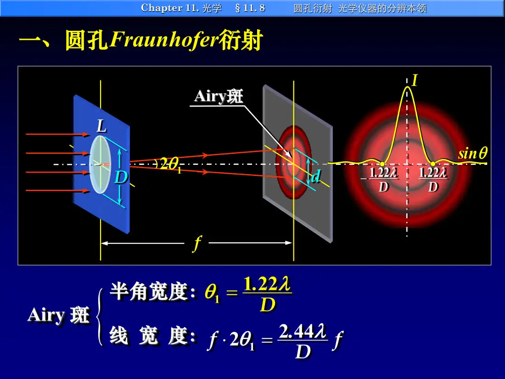

原文：

一、圆孔Fraunhofer衍射

Airy 斑 $\left\{\begin{array}{l}\text { 半角宽度: } \theta_{1}=\frac{1.22\lambda}{D}\\ \text { 线宽度: } f\cdot2\theta_{1}=\frac{2.44\lambda}{D}f\end{array}\right.$

Chapter 11. 光学 § 11.8

圆孔衍射 光学仪器的分辨本领

### 二、光学仪器的分辨本领

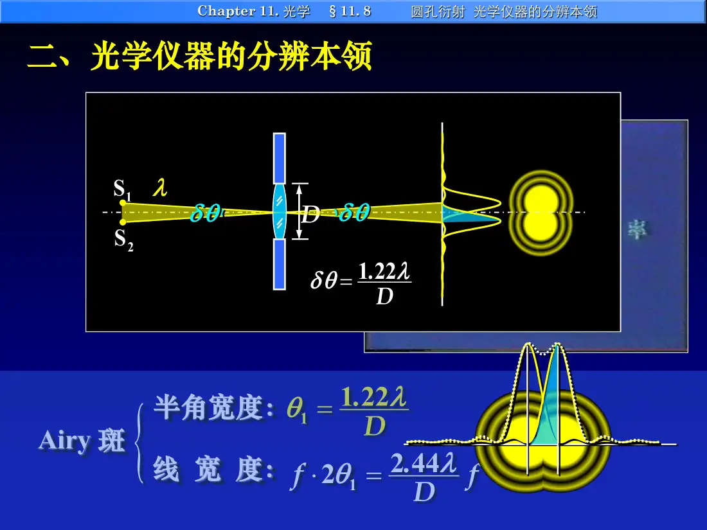

原文：

二、光学仪器的分辨本领

半角宽度: $\theta_{1} = \frac{1.22\lambda}{D}$

Airy 斑

线 宽 度: $f \cdot 2\theta_{1} = \frac{2.44\lambda}{D}$

Chapter 11. 光学 § 11.8

圆孔衍射 光学仪器的分辨本领

### 二、光学仪器的分辨本领

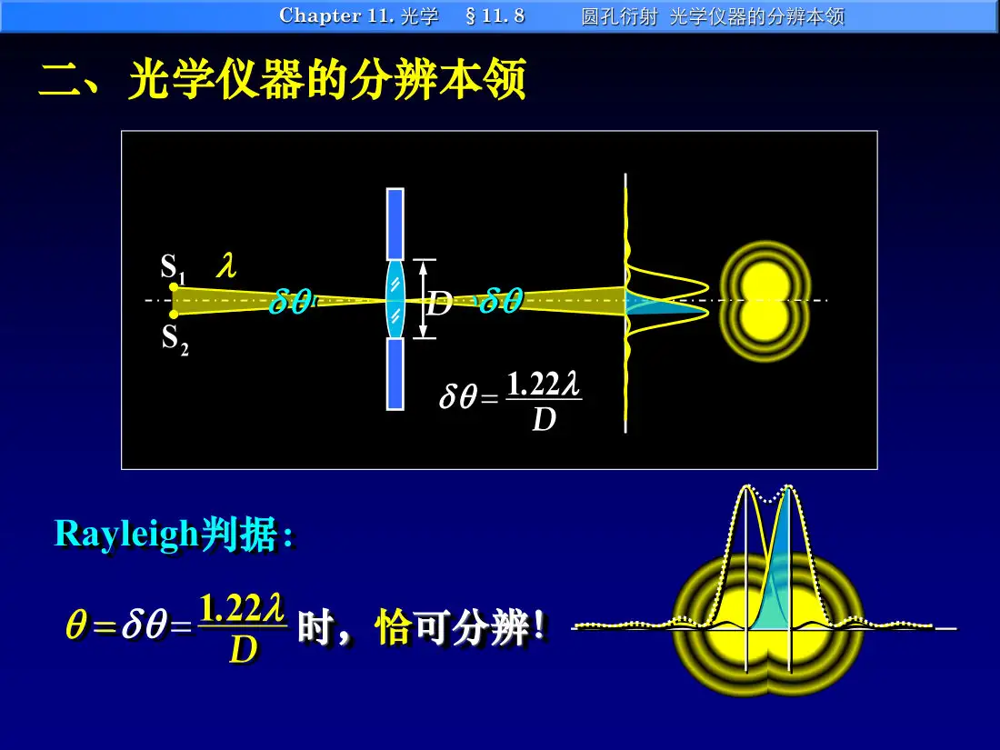

原文：

二、光学仪器的分辨本领

Rayleigh判据：

$\theta = \delta \theta = \frac{1.22\lambda}{D}$ 时，恰可分辨！

Chapter 11. 光学 § 11.8

圆孔衍射 光学仪器的分辨本领

### 可分辨: $\theta \geq \delta \theta$

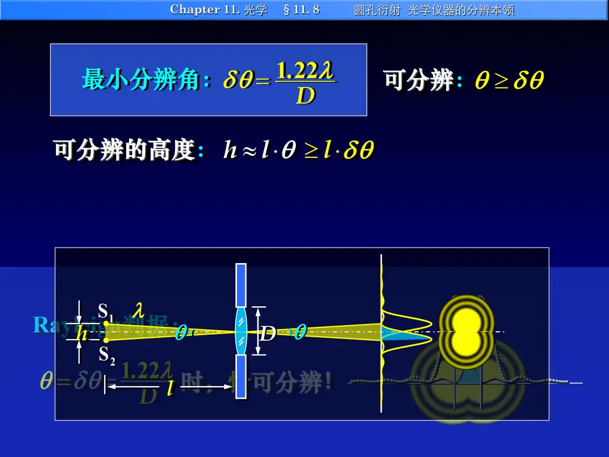

原文：

最小分辨角: $\delta\theta=\frac{1.22\lambda}{D}$

可分辨: $\theta \geq \delta \theta$

可分辨的高度: $h \approx l \cdot \theta \geq l \cdot \delta \theta$

Chapter 11. 光学 § 11.8

圆孔衍射 光学仪器的分辨本领

### 可分辨: $\theta \geq \delta \theta$

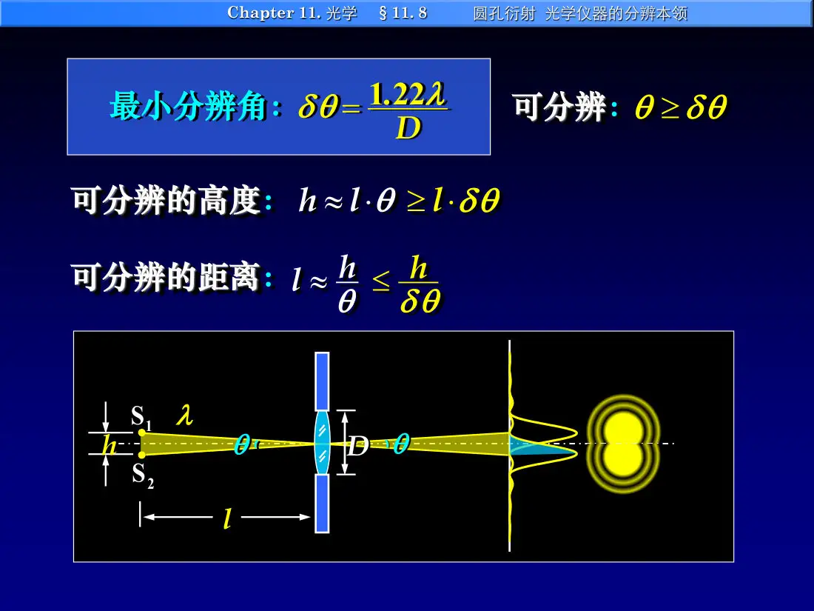

原文：

最小分辨角: $\delta\theta=\frac{1.22\lambda}{D}$

可分辨: $\theta \geq \delta \theta$

可分辨的高度: $h \approx l \cdot \theta \geq l \cdot \delta \theta$

可分辨的距离: $l \approx \frac{h}{\theta} \leq \frac{h}{\delta \theta}$

Chapter 11. 光学 § 11.8

圆孔衍射 光学仪器的分辨本领

### Chapter 11. 光学 § 11.8

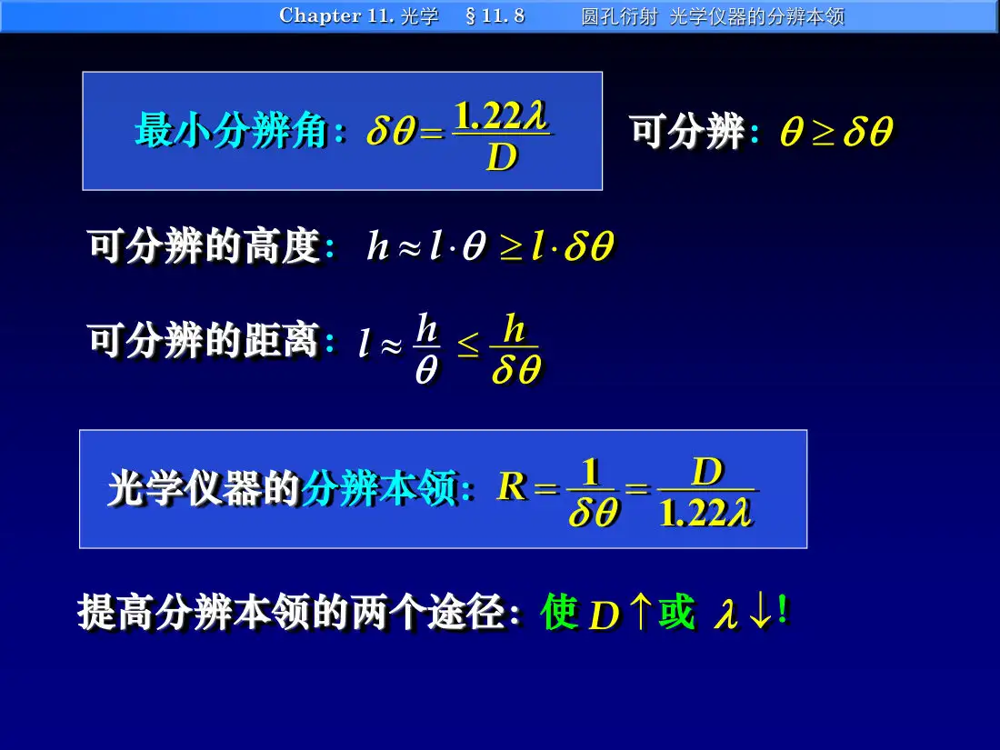

原文：

最小分辨角: $\delta\theta=\frac{1.22\lambda}{D}$ 可分辨: $\theta\geq\delta\theta$ 可分辨的高度: $h\approx l\cdot\theta\geq l\cdot\delta\theta$ 可分辨的距离: $l\approx\frac{h}{\theta}\leq\frac{h}{\delta\theta}$ 光学仪器的分辨本领: $R=\frac{1}{\delta\theta}=\frac{D}{1.22\lambda}$ 提高分辨本领的两个途径: 使 $D$ ↑或 $\lambda\downarrow!$

Chapter 11. 光学 § 11.8

圆孔衍射 光学仪器的分辨本领

### 大型现代天文望远镜（增加孔径）

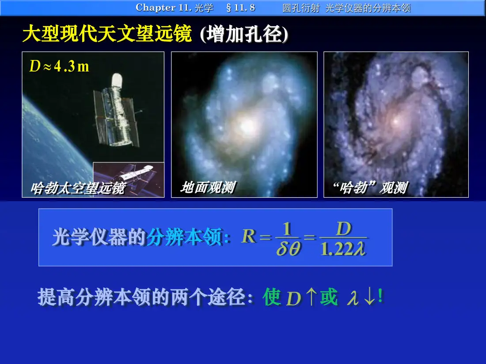

原文：

大型现代天文望远镜（增加孔径）

光学仪器的分辨本领: $R = \frac{1}{\delta \theta} = \frac{D}{1.22 \lambda}$

提高分辨本领的两个途径: 使 $D \uparrow$ 或 $\lambda \downarrow!$

Chapter 11. 光学 § 11.8

圆孔衍射 光学仪器的分辨本领

### 大型现代天文望远镜（增加孔径）

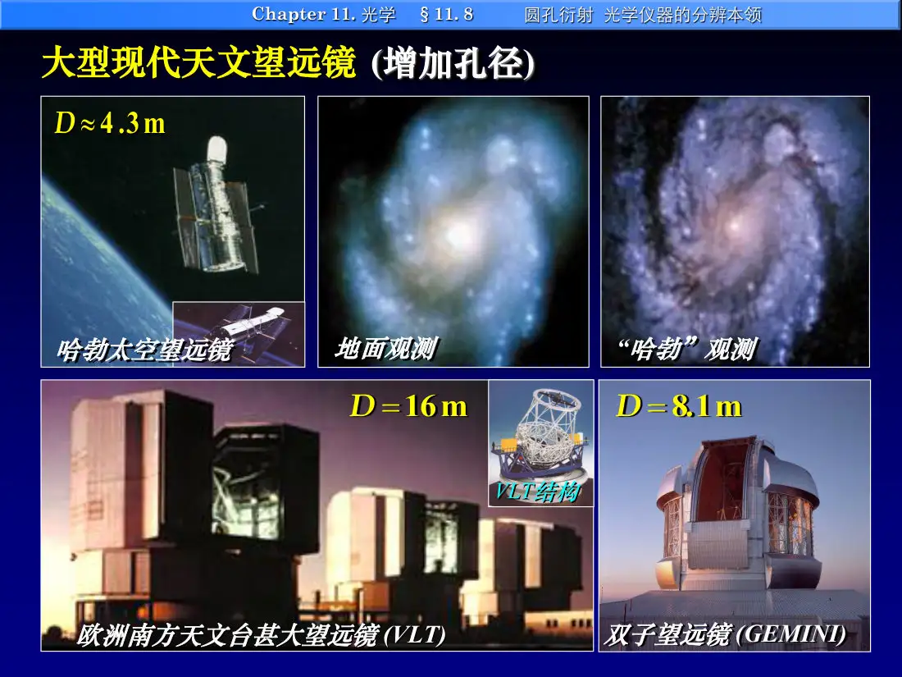

原文：

大型现代天文望远镜（增加孔径）

Chapter 11. 光学 § 11.8

圆孔衍射 光学仪器的分辨本领

### 电子显微镜 (减小波长)

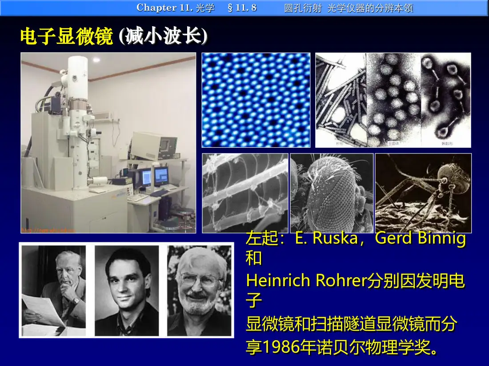

原文：

电子显微镜 (减小波长)

左起: E. Ruska, Gerd Binnig 和

Heinrich Rohrer分别因发明电子

显微镜和扫描隧道显微镜而分享1986年诺贝尔物理学奖。

Chapter 11. 光学 § 11.8

圆孔衍射 光学仪器的分辨本领

### 最小分辨角：

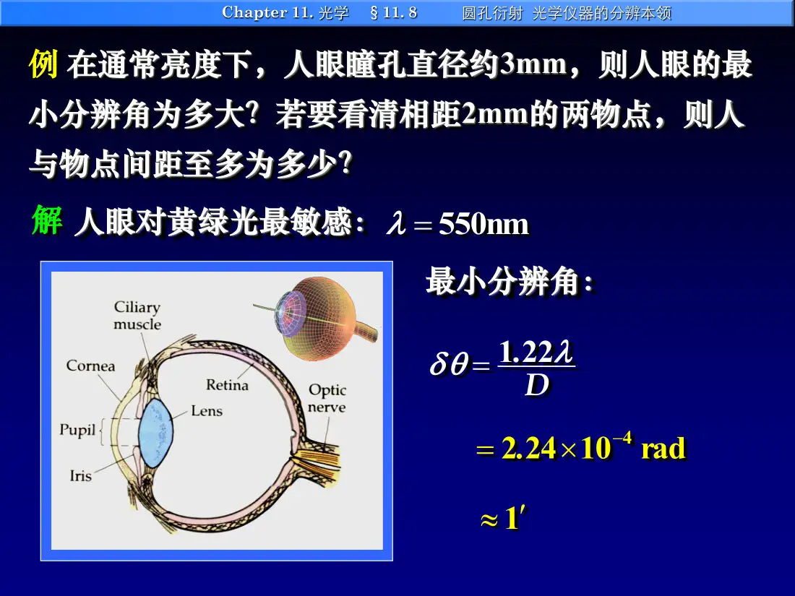

原文：

例 在通常亮度下，人眼瞳孔直径约3mm，则人眼的最小分辨角为多大？若要看清相距2mm的两物点，则人与物点间距至多为多少？

解 人眼对黄绿光最敏感: $\lambda = 550 \mathrm{~nm}$

最小分辨角：

$$
\begin{array}{r l} \delta \theta & = \frac {1 . 2 2 \lambda}{D} \\ & = 2. 2 4 \times 1 0 ^ {- 4} \mathrm{rad} \\ & \approx 1 ^ {\prime} \end{array}
$$

Chapter 11. 光学 § 11.8

圆孔衍射 光学仪器的分辨本领

### 设：两物点间距为 $h$ ，人与两物点间距为 $l$ ，则

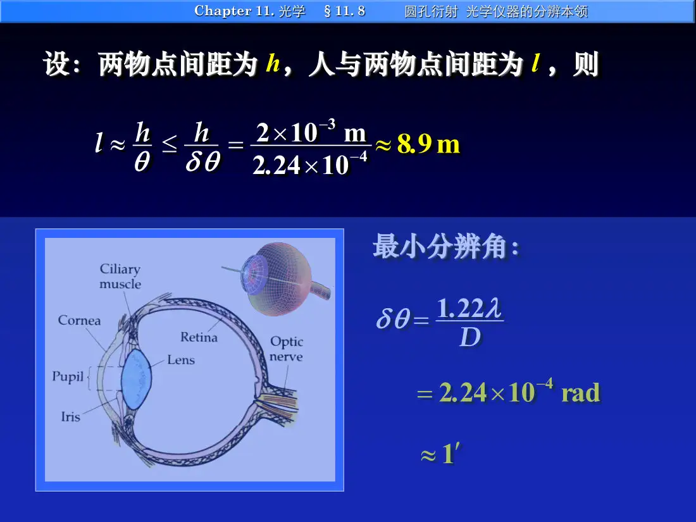

原文：

设：两物点间距为 $h$ ，人与两物点间距为 $l$ ，则

$$
l \approx \frac {h}{\theta} \leq \frac {h}{\delta \theta} = \frac {2 \times 1 0 ^ {- 3} \mathrm{m}}{2 . 2 4 \times 1 0 ^ {- 4}} \approx 8. 9 \mathrm{m}
$$

最小分辨角：

$$
\begin{array}{r l} \delta \theta & = \frac {1 . 2 2 \lambda}{D} \\ & = 2. 2 4 \times 1 0 ^ {- 4} \mathrm{rad} \\ & \approx 1 ^ {\prime} \end{array}
$$

Chapter 11. 光学 § 11.8

圆孔衍射 光学仪器的分辨本领

### 设：两物点间距为 $h$ ，人与两物点间距为 $l$ ，则

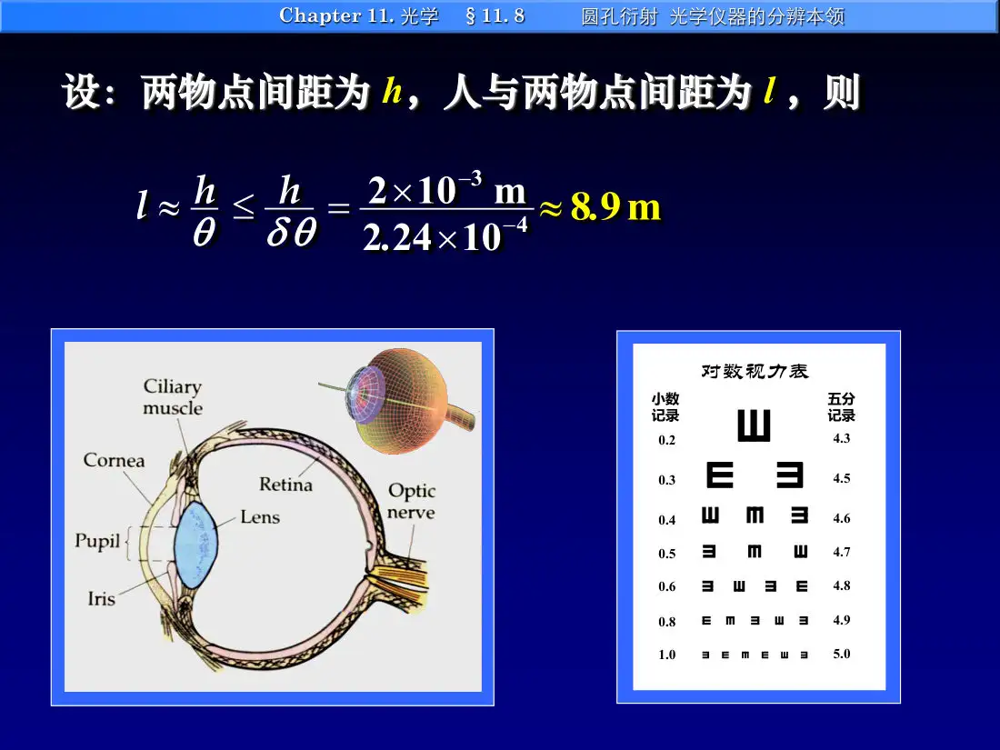

原文：

设：两物点间距为 $h$ ，人与两物点间距为 $l$ ，则

$$
l \approx \frac {h}{\theta} \leq \frac {h}{\delta \theta} = \frac {2 \times 1 0 ^ {- 3} \mathrm{m}}{2 . 2 4 \times 1 0 ^ {- 4}} \approx 8. 9 \mathrm{m}
$$

对数视力表
<table><tr><td>小数记录</td><td>五分记录</td></tr><tr><td>0.2</td><td>4.3</td></tr><tr><td>0.3</td><td>4.5</td></tr><tr><td>0.4</td><td>4.6</td></tr><tr><td>0.5</td><td>4.7</td></tr><tr><td>0.6</td><td>4.8</td></tr><tr><td>0.8</td><td>4.9</td></tr><tr><td>1.0</td><td>5.0</td></tr></table>

Chapter 11. 光学 § 11.8

圆孔衍射 光学仪器的分辨本领

### 归纳：

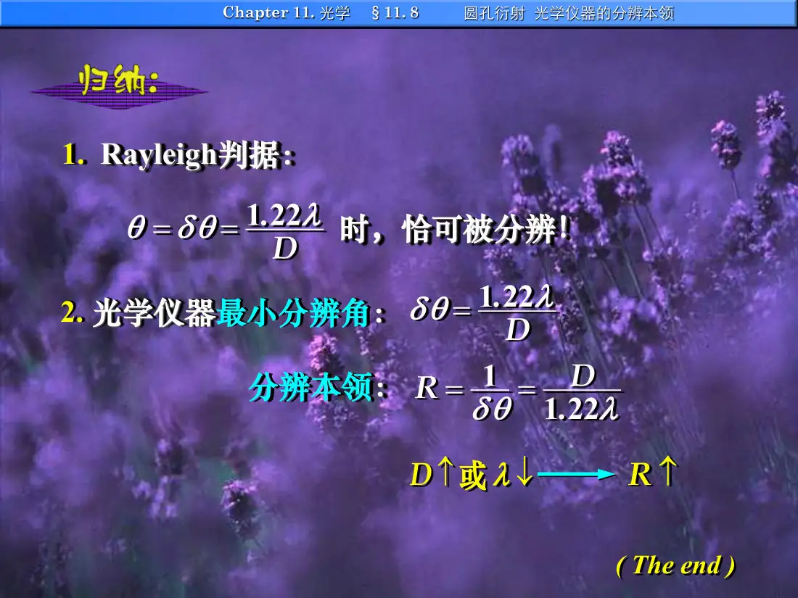

原文：

归纳：

1. Rayleigh判据:

$\theta = \delta \theta = \frac{1.22 \lambda}{D}$ 时，恰可被分辨！

2. 光学仪器最小分辨角: $\delta \theta = \frac{1.22 \lambda}{D}$

分辨本领: $R = \frac{1}{\delta \theta} = \frac{D}{1.22 \lambda}$

$D\uparrow$ 或 $\lambda \downarrow \longrightarrow R\uparrow$

Chapter 11. 光学 § 11.8

圆孔衍射 光学仪器的分辨本领

(The end)
