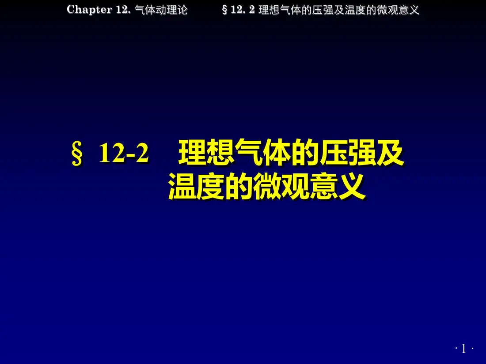
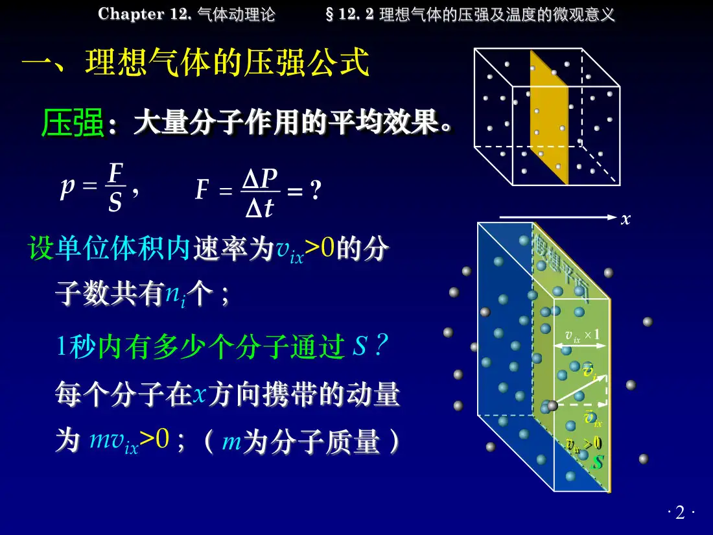
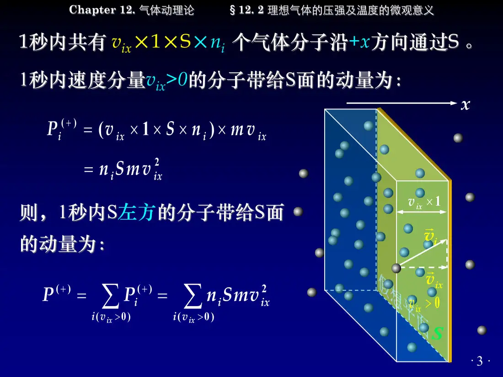
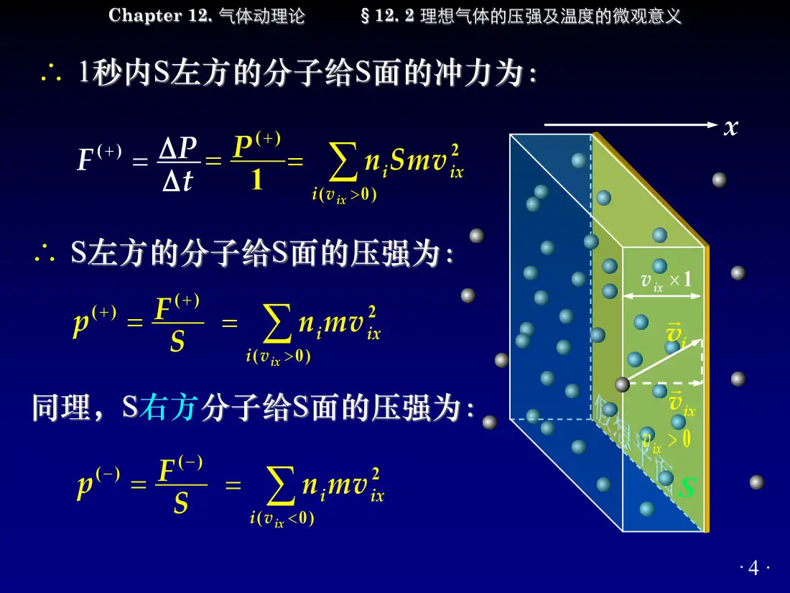
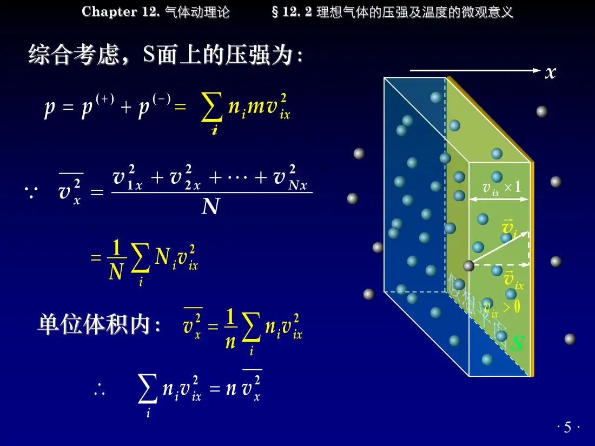
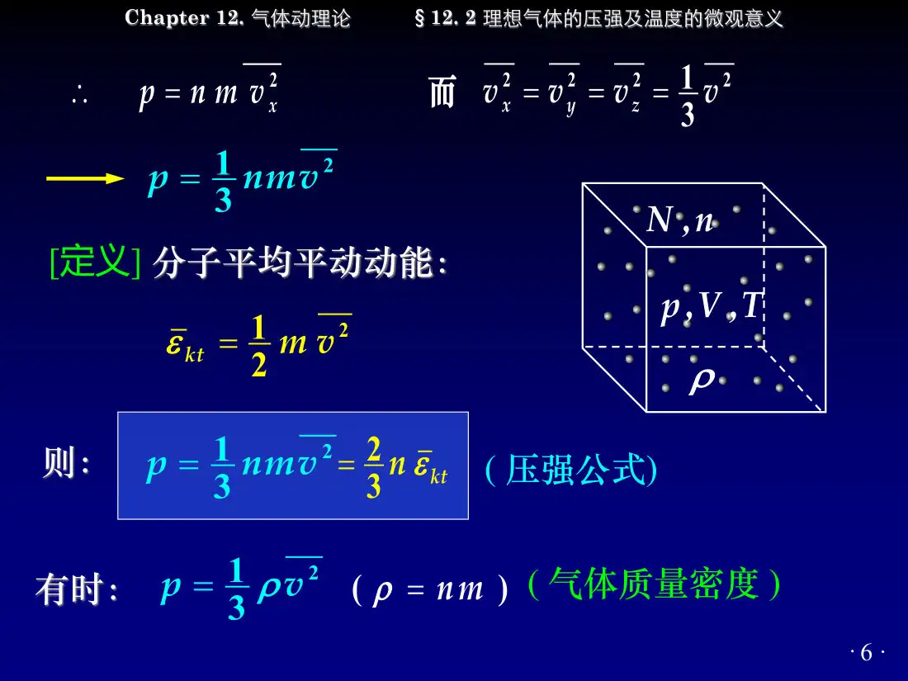
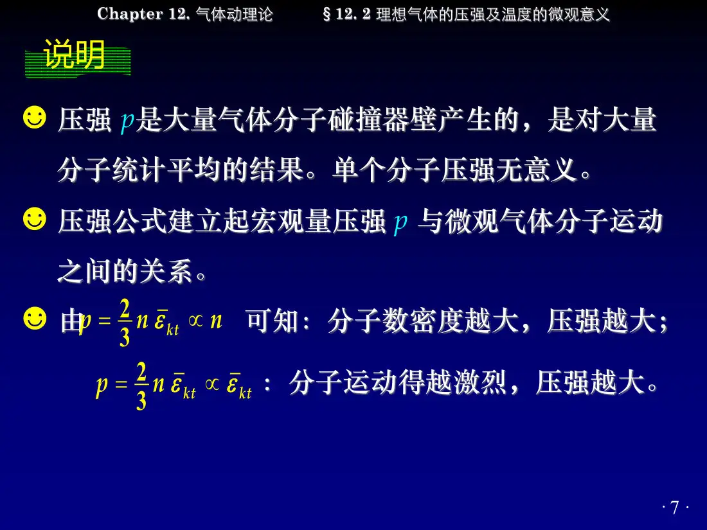
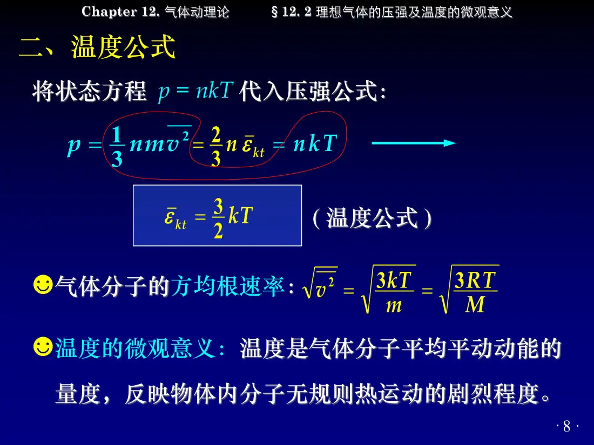
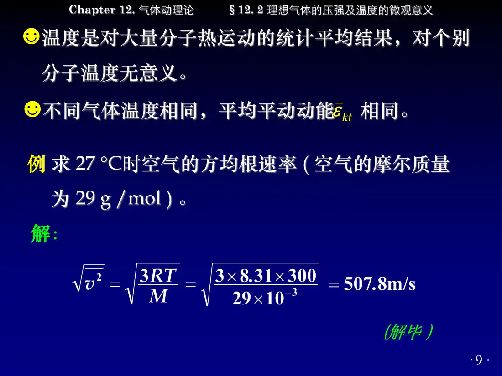
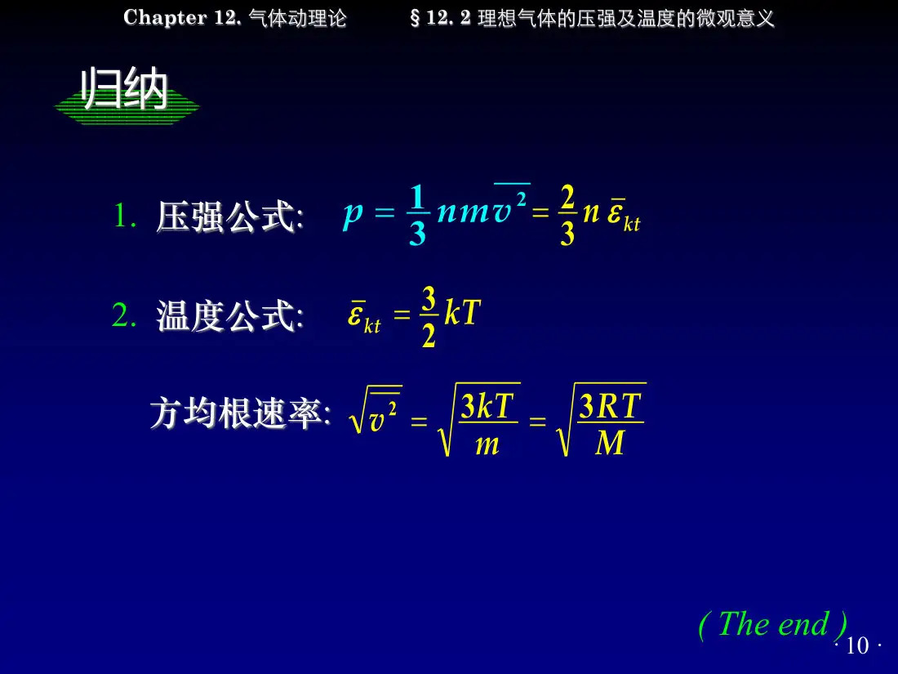

# 《大学物理》第12章 气体动理论 §12.2 理想气体的压强及温度的微观意义（课件）

原件的每一页，下面附识别出的文字。

### 12-2 理想气体的压强及 温度的微观意义

原文：

12-2 理想气体的压强及 温度的微观意义

Chapter 12. 气体动理论

§12. 2 理想气体的压强及温度的微观意义

1

### Chapter 12. 气体动理论

原文：

Chapter 12. 气体动理论

一、理想气体的压强公式

压强：大量分子作用的平均效果。

$$
p = \frac {F}{S},
$$

$$
F = \frac {\Delta P}{\Delta t} = ?
$$

设单位体积内速率为 $( 0 ) \textcircled { + } ( 0 . 5 ) = ( 0 . 5 )$ 的分子数共有ni个 ;

1秒内有多少个分子通过 S ?每个分子在x方向携带的动量为 $1 0 0 0 0 0 0 0$ ;（ m为分子质量 ）

§12. 2 理想气体的压强及温度的微观意义

· 2

### Chapter 12. 气体动理论

原文：

Chapter 12. 气体动理论

§12. 2 理想气体的压强及温度的微观意义

1秒内共有 $\textcircled { 1 } m = \frac { 1 } { 2 } \times 1 0 ^ { 3 } m = 2 \times 1 0$ 个气体分子沿+x方向通过S 。

1秒内速度分量 $\frac { 5 } { 6 } \times \frac { 1 } { 2 } = \frac { 1 } { 2 }$ 的分子带给S面的动量为：

$$
\begin{array}{r l} P _ {i} ^ {(+)} & = (v _ {i x} \times 1 \times S \times n _ {i}) \times m v _ {i x} \\ & = n _ {i} S m v _ {i x} ^ {2} \end{array}
$$

则，1秒内S左方的分子带给S面的动量为：

$$
P ^ {(+)} = \sum_ {i (v _ {i x} > 0)} P _ {i} ^ {(+)} = \sum_ {i (v _ {i x} > 0)} n _ {i} S m v _ {i x} ^ {2}
$$

· 3

### Chapter 12. 气体动理论

原文：

Chapter 12. 气体动理论

§12. 2 理想气体的压强及温度的微观意义

∴ 1秒内S左方的分子给S面的冲力为：

$$
F ^ {(+)} = \frac {\Delta P}{\Delta t} = \frac {P ^ {(+)}}{1} = \sum_ {i (v _ {i x} > 0)} n _ {i} S m v _ {i x} ^ {2}
$$

∴ S左方的分子给S面的压强为：

$$
p ^ {(+)} = \frac {F ^ {(+)}}{S} = \sum_ {i (v _ {i x} > 0)} n _ {i} m v _ {i x} ^ {2}
$$

同理，S右方分子给S面的压强为：

$$
p ^ {(-)} = \frac {F ^ {(-)}}{S} = \sum_ {i (v _ {i x} <   0)} n _ {i} m v _ {i x} ^ {2}
$$

· 4

### Chapter 12. 气体动理论

原文：

Chapter 12. 气体动理论

综合考虑，S面上的压强为：

$$
p = p ^ {(+)} + p ^ {(-)} = \sum_ {i} n _ {i} m v _ {i x} ^ {2}
$$

$$
\because \overline {{v _ {x} ^ {2}}} = \frac {v _ {1 x} ^ {2} + v _ {2 x} ^ {2} + \cdots + v _ {N x} ^ {2}}{N}
$$

$$
= \frac {1}{N} \sum_ {i} N _ {i} v _ {i x} ^ {2}
$$

单位体积内： $\textcircled { 1 } \frac { 1 } { 2 } = \frac { 1 } { 1 1 } \textcircled { 2 } \frac { 1 } { 1 1 } \times \frac { 1 } { 2 } = \frac { 1 } { 1 1 }$

$$
\sum_ {i} n _ {i} v _ {i x} ^ {2} = n \overline {{v _ {x} ^ {2}}}
$$

§12. 2 理想气体的压强及温度的微观意义

· 5

### Chapter 12. 气体动理论

原文：

Chapter 12. 气体动理论

§12. 2 理想气体的压强及温度的微观意义

$$
\therefore \quad p = n m \overline {{v _ {x} ^ {2}}}
$$

而 2 v x = 2 v y = 2 v = 231 v

$$
p = \frac {1}{3} n m v ^ {2}
$$

[定义] 分子平均平动动能：

$$
\overline {{\varepsilon}} _ {k t} = \frac {1}{2} m \overline {{v ^ {2}}}
$$

$$
\begin{array}{c} N, n \\ p, V, T \\ \rho \end{array}
$$

则： $1 0 2 = \frac { 1 1 } { 8 } ( 1 5 \times 1 0 \times 6 ) = \frac { 1 2 } { 8 } ( 1 5 \times 1 0 \times 2 )$ ( 压强公式)

有时： $1 0 2 = \frac { 1 1 } { 1 0 } \times 0 . 2 5 ( c m ^ { 2 } )$ $[ \pmb { \mathscr { P } } ] = [ \pmb { \mathscr { W } } | \pmb { \mathscr { W } } ]$ ( 气体质量密度 )

· 6

### 说明

原文：

说明

☻ 压强 p是大量气体分子碰撞器壁产生的，是对大量分子统计平均的结果。单个分子压强无意义。

☻ 压强公式建立起宏观量压强 p 与微观气体分子运动之间的关系。

☻ 由 $y = \frac { 1 } { 6 } ( 1 - x )$ 可知：分子数密度越大，压强越大；$1 2 = \frac { 1 2 } { 6 } \times \frac { 1 } { 7 } = \frac { 1 } { 7 }$ ：分子运动得越激烈，压强越大。

Chapter 12. 气体动理论 §12. 2 理想气体的压强及温度的微观意义

· 7

### 二、温度公式

原文：

二、温度公式

将状态方程 $1 0 0 = 1 0 0 0$ 代入压强公式：

$$
p = \frac {1}{3} n m \overline {{v ^ {2}}} = \frac {2}{3} n \bar {\varepsilon} _ {k t} = n k T
$$

$$
\overline {{\varepsilon}} _ {k t} = \frac {3}{2} k T
$$

( 温度公式 )

气体分子的方均根速率： $\frac { 1 } { 1 0 } x = \frac { 1 0 \times 1 0 } { 1 0 } = \frac { 1 0 \times 1 0 } { 1 0 }$

☻温度的微观意义：温度是气体分子平均平动动能的量度，反映物体内分子无规则热运动的剧烈程度。

Chapter 12. 气体动理论

§12. 2 理想气体的压强及温度的微观意义

· 8

### Chapter 12. 气体动理论 §12. 2 理想气体的压强及温度的微观意义

原文：

Chapter 12. 气体动理论 §12. 2 理想气体的压强及温度的微观意义

☻温度是对大量分子热运动的统计平均结果，对个别分子温度无意义。

☻不同气体温度相同，平均平动动能 $\textcircled { 2 } \textcircled { 2 }$ 相同。

例 求 $\boxed { 2 } \boxed { 5 } \boxed { < }$ 时空气的方均根速率 ( 空气的摩尔质量为 $\mathbf { \hat { \rho } } [ \mathbf { \vec { \rho } } ] = \mathbf { \hat { \rho } } [ \mathbf { \vec { \rho } } [ \mathbf { \vec { \rho } } ] ]$ 。

解：

$$
\sqrt {v ^ {2}} = \sqrt {\frac {3 R T}{M}} = \sqrt {\frac {3 \times 8 . 3 1 \times 3 0 0}{2 9 \times 1 0 ^ {- 3}}} = 5 0 7. 8 \mathrm{m/s}
$$

(解毕)

· 9

### 归纳

原文：

归纳

1. 压强公式: $1 0 0 \div \frac { 1 } { 8 } = \frac { 1 } { 8 } ( 1 8 0 \times 6 ) = \frac { 1 } { 8 } ( 1 8 0 \times 6 )$

2. 温度公式: $\frac { 1 } { 2 } = \frac { 1 } { 2 } \times \frac { 1 } { 2 }$

方均根速率: $\frac { \sqrt { 5 } } { 1 0 } = \frac { \sqrt { 5 } \times 1 0 } { 1 0 } = \frac { \sqrt { 5 } } { 1 0 }$

Chapter 12. 气体动理论

§12. 2 理想气体的压强及温度的微观意义

The end )

10
