# 《大学物理》第12章 气体动理论 §12.3 能量均分定理 理想气体的内能（课件）

原件的每一页，下面附识别出的文字。

### 12-3 能量均分定理 理想气体的内能

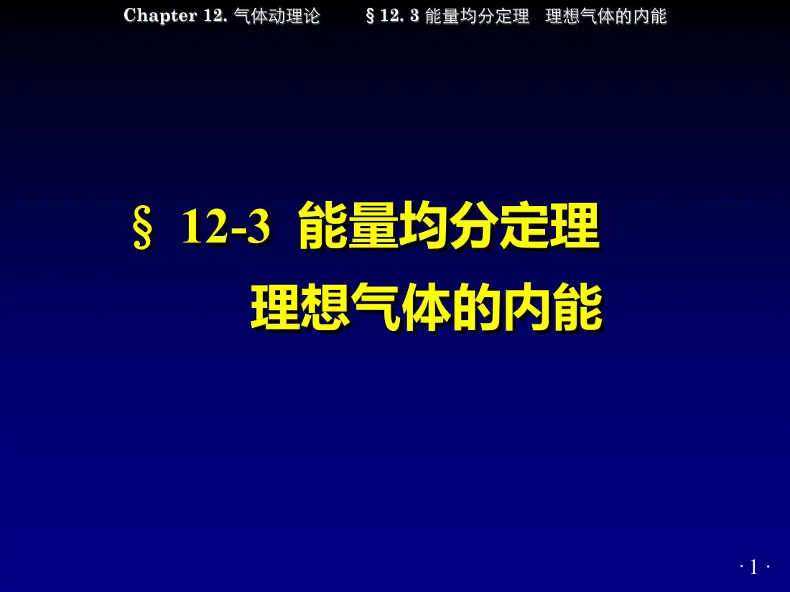

原文：

12-3 能量均分定理 理想气体的内能

Chapter 12. 气体动理论 §12. 3 能量均分定理 理想气体的内能

1

### 一、自由度

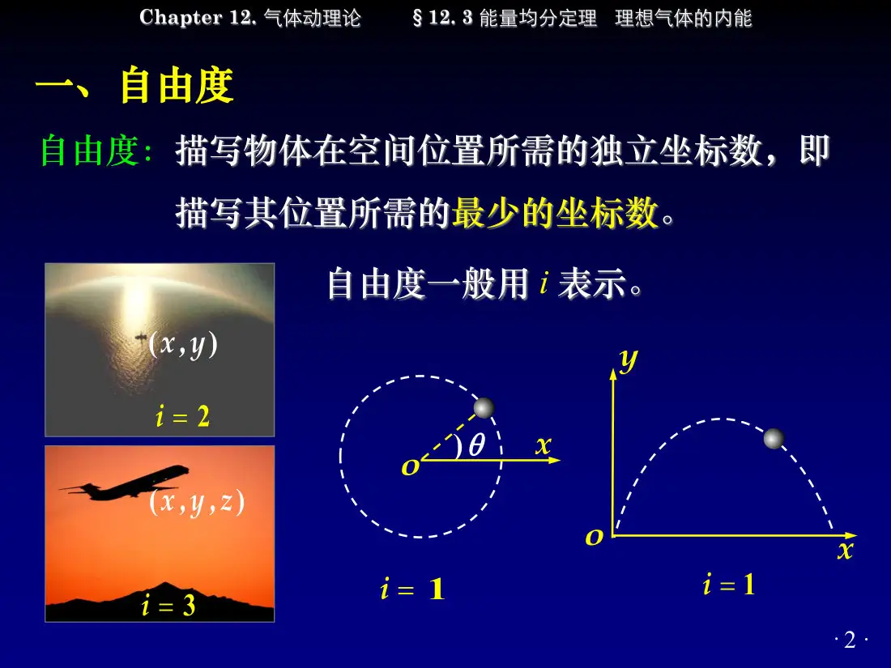

原文：

一、自由度

自由度：描写物体在空间位置所需的独立坐标数，即描写其位置所需的最少的坐标数。

自由度一般用 i 表示。

Chapter 12. 气体动理论 §12. 3 能量均分定理 理想气体的内能

· 2

### 1. 一个质点

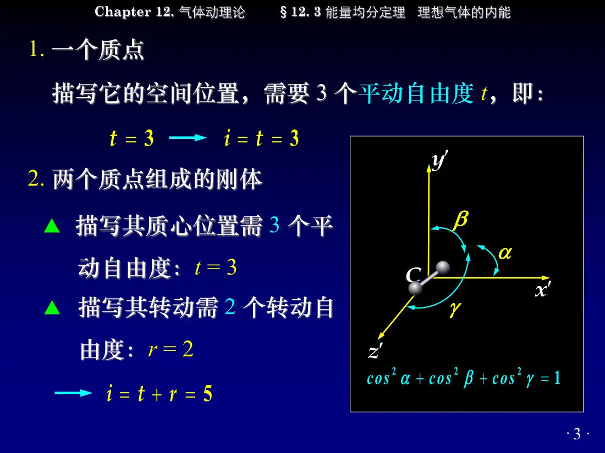

原文：

1. 一个质点

描写它的空间位置，需要 3 个平动自由度 t，即：

$$
t = 3 \longrightarrow i = t = 3
$$

2. 两个质点组成的刚体

描写其质心位置需 3 个平

动自由度：t = 3

描写其转动需 2 个转动自

由度：r = 2

$$
i = t + r = 5
$$

Chapter 12. 气体动理论 §12. 3 能量均分定理 理想气体的内能

· 3

### Chapter 12. 气体动理论 §12. 3 能量均分定理 理想气体的内能

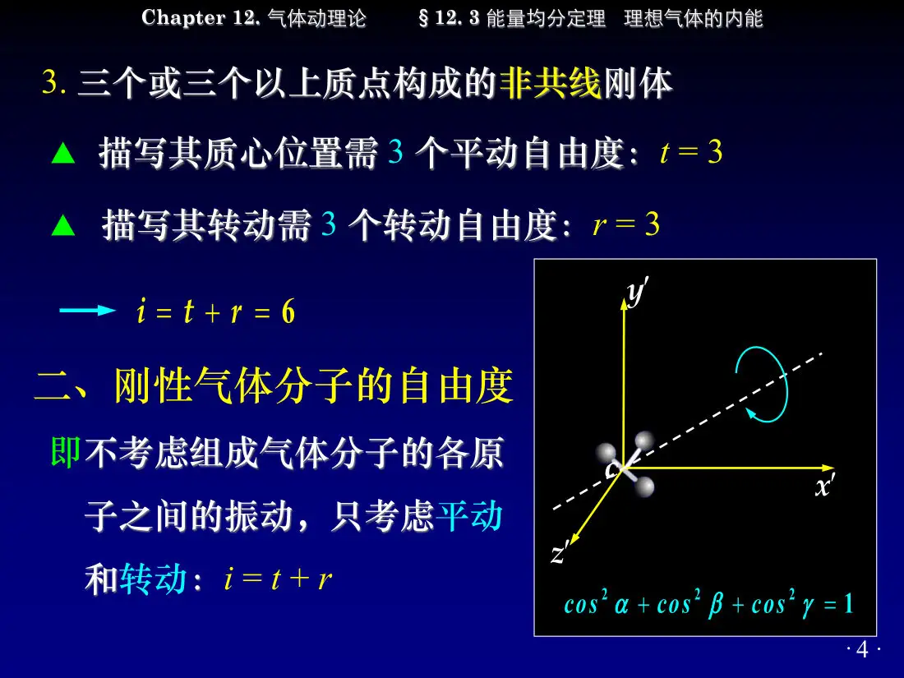

原文：

Chapter 12. 气体动理论 §12. 3 能量均分定理 理想气体的内能

3. 三个或三个以上质点构成的非共线刚体

▲ 描写其质心位置需 3 个平动自由度：t = 3

▲ 描写其转动需 3 个转动自由度：r = 3

i = t + r = 6

二、刚性气体分子的自由度即不考虑组成气体分子的各原子之间的振动，只考虑平动和转动：i = t + r

4

### 单原子分子如：He 、Ne 、Ar 等气体；

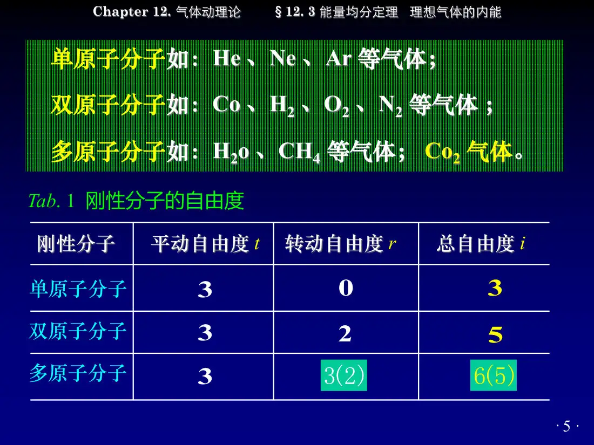

原文：

单原子分子如：He 、Ne 、Ar 等气体；

Tab. 1 刚性分子的自由度

<table><tr><td>刚性分子</td><td>平动自由度t</td><td>转动自由度r</td><td>总自由度i</td></tr><tr><td>单原子分子</td><td>3</td><td>0</td><td>3</td></tr><tr><td>双原子分子</td><td>3</td><td>2</td><td>5</td></tr><tr><td>多原子分子</td><td>3</td><td>3(2)</td><td>6(5)</td></tr></table>

Chapter 12. 气体动理论 §12. 3 能量均分定理 理想气体的内能

· 5

### 三、能量均分定理

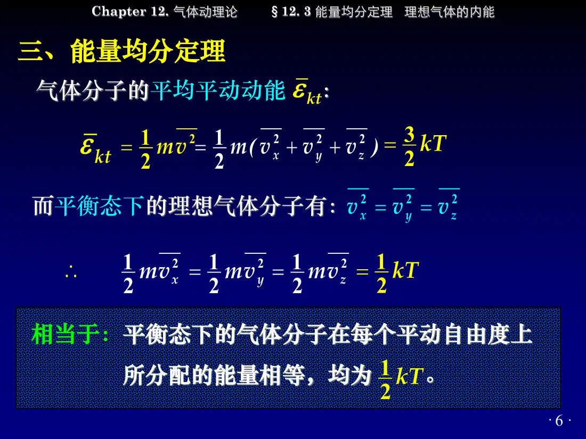

原文：

三、能量均分定理

气体分子的平均平动动能 $\textcircled { 2 } \textcircled { 2 }$

$$
\overline {{\mathcal {E}}} _ {k t} = \frac {1}{2} m \overline {{v ^ {2}}} = \frac {1}{2} m (\overline {{v _ {x} ^ {2}}} + \overline {{v _ {y} ^ {2}}} + \overline {{v _ {z} ^ {2}}}) = \frac {3}{2} k T
$$

而平衡态下的理想气体分子有： $\textcircled { 1 } \frac { 1 } { 2 } = \frac { 1 } { 1 0 } \times \frac { 1 } { 2 } = \frac { 1 } { 1 0 }$

$$
\frac {1}{2} m \overline {{v _ {x} ^ {2}}} = \frac {1}{2} m \overline {{v _ {y} ^ {2}}} = \frac {1}{2} m \overline {{v _ {z} ^ {2}}} = \frac {1}{2} k T
$$

所分配的能量相等，均为 kT。

Chapter 12. 气体动理论 §12. 3 能量均分定理 理想气体的内能

6

### ☻转动动能为多少?

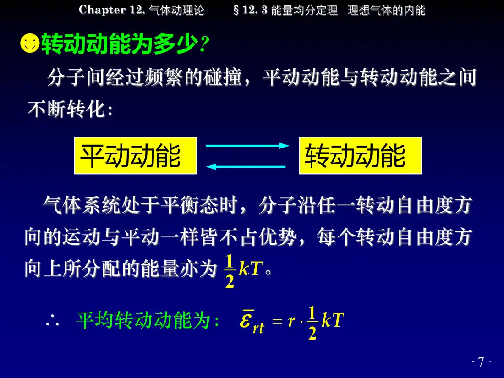

原文：

☻转动动能为多少?

分子间经过频繁的碰撞，平动动能与转动动能之间不断转化：

平动动能 转动动能

气体系统处于平衡态时，分子沿任一转动自由度方向的运动与平动一样皆不占优势，每个转动自由度方向上所分配的能量亦为 kT。1

∴ 平均转动动能为： $\textcircled { 2 } \frac { 1 } { 4 } = \frac { 1 } { 4 } \frac { 1 } { 2 } \times \frac { 1 } { 3 } = \frac { 1 } { 4 }$

Chapter 12. 气体动理论

§12. 3 能量均分定理 理想气体的内能

· 7

### Chapter 12. 气体动理论 §12. 3 能量均分定理 理想气体的内能

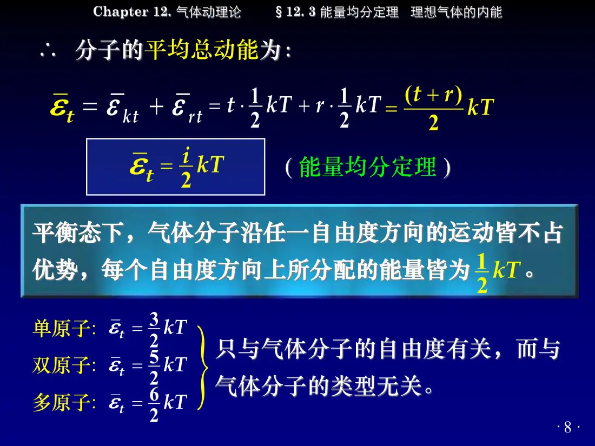

原文：

Chapter 12. 气体动理论 §12. 3 能量均分定理 理想气体的内能

$\mathtt { a } \mathtt { a }$ 分子的平均总动能为：

$$
\overline {{\boldsymbol {\varepsilon}}} _ {t} = \overline {{\boldsymbol {\varepsilon}}} _ {k t} + \overline {{\boldsymbol {\varepsilon}}} _ {r t} = t \cdot \frac {1}{2} k T + r \cdot \frac {1}{2} k T = \frac {(t + r)}{2} k T
$$

$$
\overline {{\boldsymbol {\mathcal {E}}}} _ {t} = \frac {i}{2} k T
$$

( 能量均分定理 )

平衡态下，气体分子沿任一自由度方向的运动皆不占优势，每个自由度方向上所分配的能量皆为 kT。1

单原子: $\frac { 1 } { 2 } = \frac { ( 1 ) } { ( 2 ) } = \frac { ( 1 ) } { ( 2 ) }$

双原子: $\frac { 1 } { 2 } = \frac { 1 } { 2 } \times 1 1$

多原子: $\textcircled { 2 } = \frac { 1 1 } { 6 } \times 1 0$

只与气体分子的自由度有关，而与气体分子的类型无关。

· 8

### Chapter 12. 气体动理论 §12. 3 能量均分定理 理想气体的内能

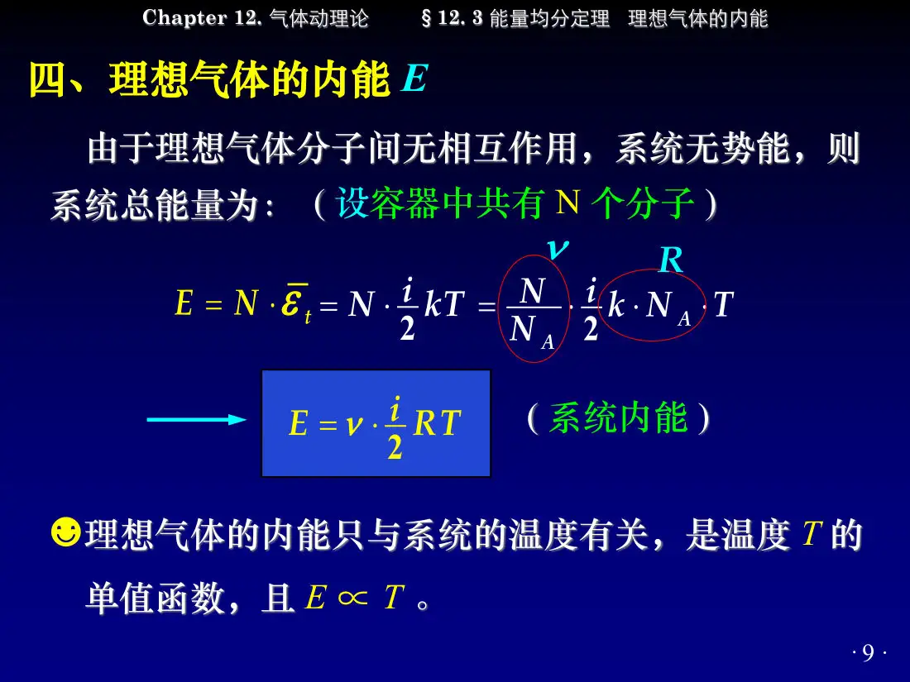

原文：

Chapter 12. 气体动理论 §12. 3 能量均分定理 理想气体的内能

四、理想气体的内能 E

由于理想气体分子间无相互作用，系统无势能，则系统总能量为： ( 设容器中共有 N 个分子 )

$$
E = N \cdot \overline {{\mathcal {E}}} _ {t} = N \cdot \frac {i}{2} k T = \frac {N}{N _ {A}} \cdot \frac {i}{2} k \cdot N _ {A} \cdot T
$$

$$
E = \nu \cdot \frac {i}{2} R T
$$

( 系统内能 )

☻理想气体的内能只与系统的温度有关，是温度 T 的单值函数，且 $\bigstar$

· 9

### 例 计算1mol同温度的H2和He气体系统三种能量比值。

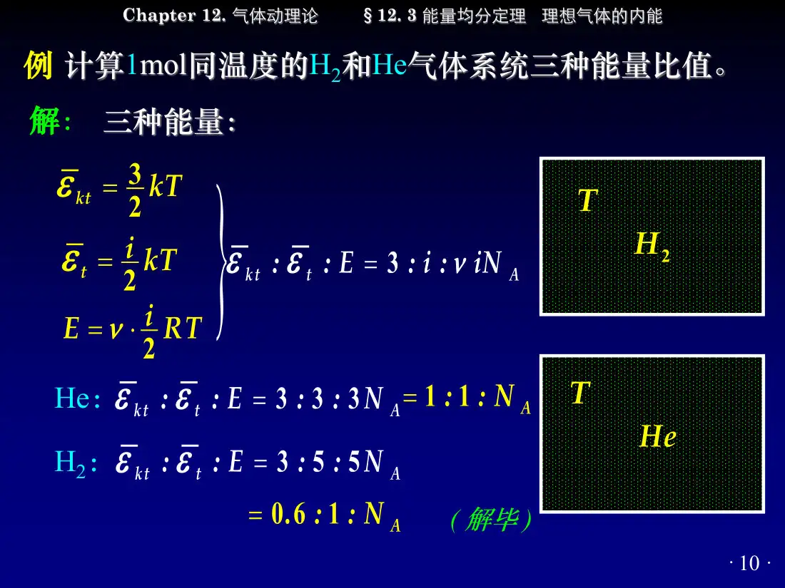

原文：

例 计算1mol同温度的H2和He气体系统三种能量比值。

解： 三种能量：

$$
\begin{array}{l} \overline {{\mathcal {E}}} _ {k t} = \frac {3}{2} k T \\ \overline {{\mathcal {E}}} _ {t} = \frac {i}{2} k T \\ E = \nu \cdot \frac {i}{2} R T \end{array}
$$

$$
\overline {{\boldsymbol {\mathcal {E}}}} _ {k t}: \overline {{\boldsymbol {\mathcal {E}}}} _ {t}: E = 3: i: \nu i N
$$

He： $( 2 7 . 2 7 2 \div 2 . 2 7 . 2 7 2 \div 2 . 2 7 . 2 7 2 \div 2 . 2 7 . 2 7 2$

$$
\begin{array}{r l} \mathrm{H} _ {2}: & \overline {{\mathcal {E}}} _ {k t}: \overline {{\mathcal {E}}} _ {t}: E = 3: 5: 5 N _ {A} \\ & = 0. 6: 1: N _ {A} \end{array}
$$

( 解毕 )

§12. 3 能量均分定理 理想气体的内能

10

### Chapter 12. 气体动理论 §12. 3 能量均分定理 理想气体的内能

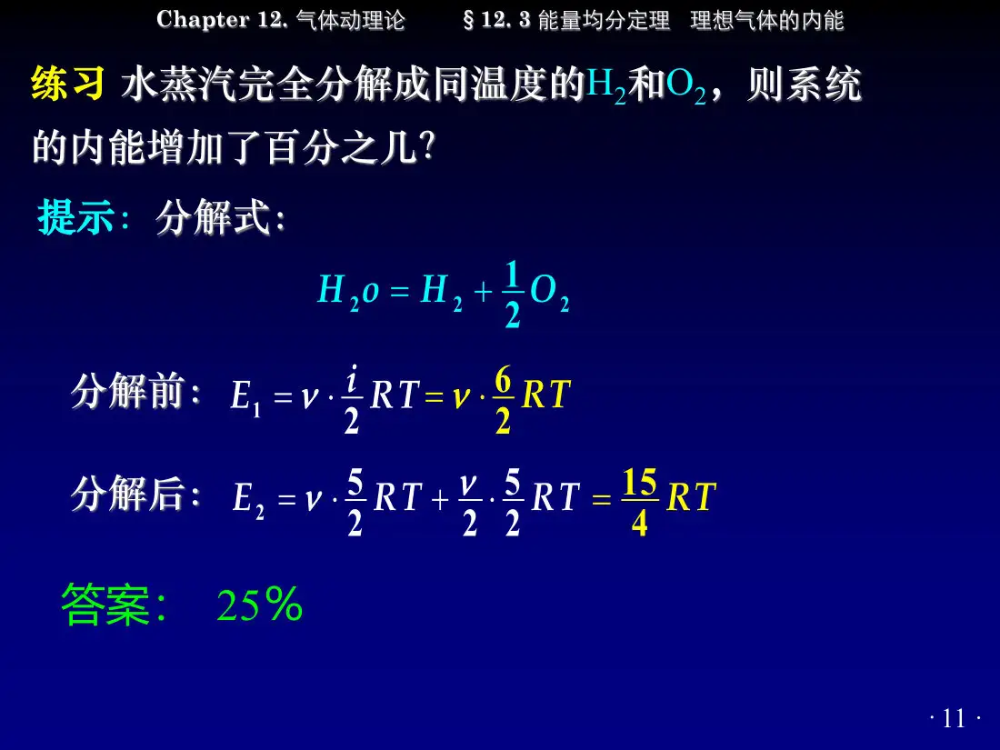

原文：

Chapter 12. 气体动理论 §12. 3 能量均分定理 理想气体的内能

练习 水蒸汽完全分解成同温度的 $\boxed { \frac { 1 0 } { 1 0 } } \boxed { 1 }$ 和 $\textcircled{9}$ ，则系统的内能增加了百分之几？

提示：分解式：

$$
H _ {2} o = H _ {2} + \frac {1}{2} O _ {2}
$$

分解前： $1 0 0 \div 2 = 1 0 0 \div 2 = 1 0 0 ( m )$

分解后： $1 5 \div ( 4 \dot { 5 } ) = \frac { 1 5 } { 1 5 } \dot { 5 } \dot { 6 } \dot { 6 } \dot { 6 } \dot { 6 } \dot { 6 } \dot { 6 } \dot { 6 } \dot { 6 } \dot { 6 } \dot { 6 } \dot { 6 } \dot { 6 } \dot { 6 } \dot { 6 } \dot { 6 } \dot { 6 } \dot { 6 } \dot { 6 } \dot { 6 } \dot { 6 } \dot { 6 } \dot { 6 } \dot { 6 } \dot { 6 } \dot { 6 } \dot { 6 } \dot { 6 } \dot { 6 } \dot { 6 } \dot { 6 } \dot { 6 } \dot { 6 } \dot { 6 } \dot { 6 } \dot { 6 } \dot { 6 } \dot { 6 } \dot { 6 } \dot { 6 } \dot { 6 } \dot { 6 } \dot { 6 } \dot { 6 } \dot { 6 } \dot { 6 } \dot { 6 } \dot { 6 } \dot { 6 } \dot { 6 } \dot { 6 } \dot { 6 } \dot { 6 } \dot { 6 } \dot { 6 } \dot { 6 } \dot { 6 } \dot { 6 } \dot { 6 } \dot { 6 } \dot { 6 } \dot { 6 } \dot { 6 } \dot { 6 } \dot { 6 } \dot { 6 } \dot { 6 } \dot { 6 } \dot { 6 } \dot { 6 } \dot { 6 } \dot { 6 } \dot { 6 } \dot { 6 } \dot { 6 } \dot { 6 } \dot { 6 } \dot { 6 } \dot { 6 } \dot { 6 } \dot { 6 } \dot { 6 } \dot { 6 } \dot { 6 } \dot { 6 } \dot { 6 } \dot { 6 } \dot { 6 } \dot { 6 } \dot { 6 } \dot { 6 } \dot { 6 } \dot { 6 } \dot { 6 } \dot { 6 } \dot { 6 } \dot { 6 } \dot { 6 } \dot { 6 } \dot { 6 } \dot { 6 } \dot { 6 } \dot { 6 } \dot { 6 } \dot { 6 } \dot { 6 } \dot { 6 } \dot 6 \dot { 6 } \dot { 6 } \dot { 6 } \dot 6 \dot { 6 } \dot { 6 } \dot 6 \dot { 6 } \dot \dot { 6 } \dot 6 \dot { 6 } \dot 6 \dot { 6 } \dot 6 \dot \dot { 6 } \dot 6 \dot 6 \dot { 6 } $

答案： $0 . 5 \%$

· 11

### 归纳

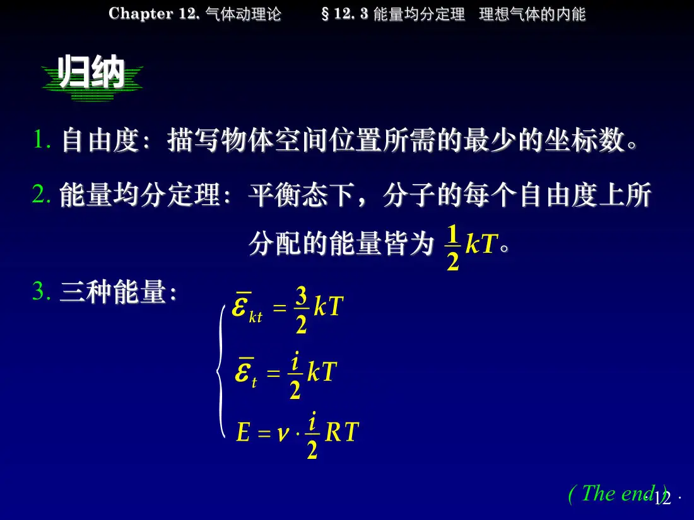

原文：

归纳

1. 自由度：描写物体空间位置所需的最少的坐标数。

2. 能量均分定理：平衡态下，分子的每个自由度上所分配的能量皆为 $5 0 \div 5 = \frac { 1 } { 5 }$ O

3. 三种能量：

$$
\overline {{\boldsymbol {\varepsilon}}} _ {k t} = \frac {3}{2} k T
$$

$$
\overline {{\boldsymbol {\varepsilon}}} _ {t} = \frac {i}{2} k T
$$

$$
E = \nu \cdot \frac {i}{2} R T
$$

Chapter 12. 气体动理论 §12. 3 能量均分定理 理想气体的内能

( The end ) · 12
