# 《大学物理》第12章 气体动理论 §12.4 Maxwell速率分布律（课件）

原件的每一页，下面附识别出的文字。

### § 12-4 Maxwell速率分布律

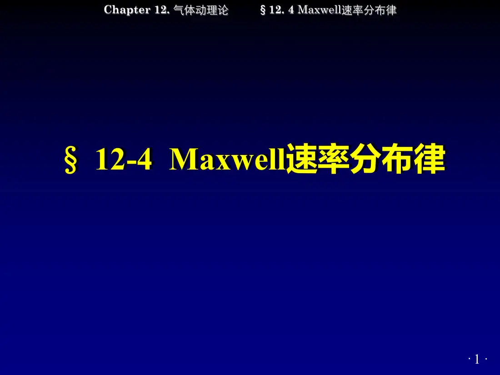

原文：

§ 12-4 Maxwell速率分布律

Chapter 12. 气体动理论 §12. 4 Maxwell速率分布律

· 1

### Chapter 12. 气体动理论 §12. 4 Maxwell速率分布律

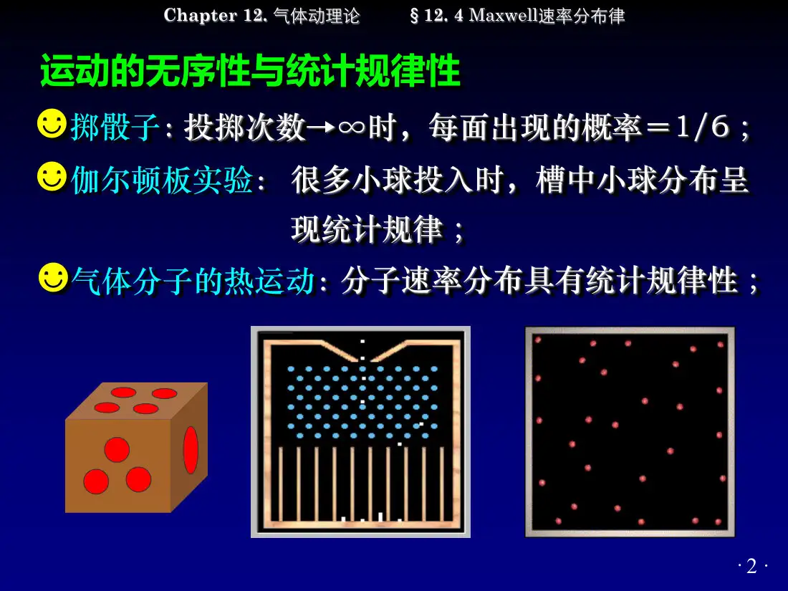

原文：

Chapter 12. 气体动理论 §12. 4 Maxwell速率分布律

运动的无序性与统计规律性

☻掷骰子：投掷次数→∞时，每面出现的概率＝1/6 ;

☻伽尔顿板实验： 很多小球投入时，槽中小球分布呈现统计规律 ;

☻气体分子的热运动：分子速率分布具有统计规律性 ;

· 2

### Chapter 12. 气体动理论 §12. 4 Maxwell速率分布律

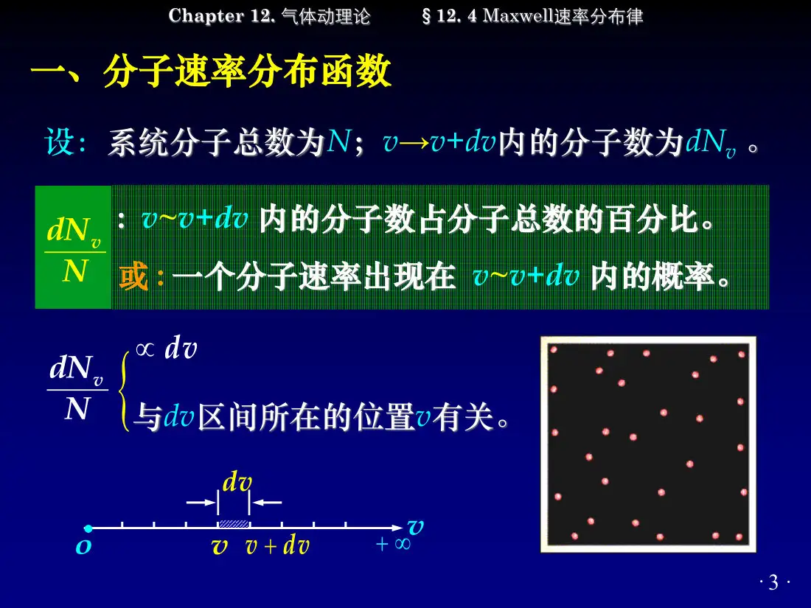

原文：

Chapter 12. 气体动理论 §12. 4 Maxwell速率分布律

一、分子速率分布函数

设：系统分子总数为N；v→v+dv内的分子数为dNv 。

dNv : v\~v+dv 内的分子数占分子总数的百分比。N 或 : 一个分子速率出现在 v\~v+dv 内的概率。

∝dvdN VN 与dv区间所在的位置v有关。

· 3

### f(v)的物理意义

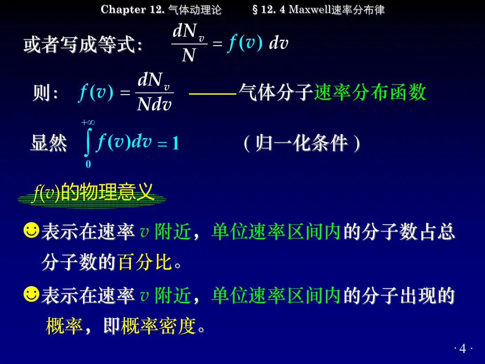

原文：

或者写成等式： $\frac { ( 1 ) } { 1 5 } = \frac { ( 1 ) } { 1 5 } = \frac { ( 1 ) } { 1 5 }$

则： $1 2 \times 2 = 1 2 8 ( c m )$ 气体分子速率分布函数显然 $\vert \vert \vert \vert \langle \vert o \rangle \vert o \vert \vert \vert o \vert \vert$ ( 归一化条件 )

f(v)的物理意义

☻表示在速率 v 附近，单位速率区间内的分子数占总分子数的百分比。

☻表示在速率 v 附近，单位速率区间内的分子出现的概率，即概率密度。

· 4

### Chapter 12. 气体动理论

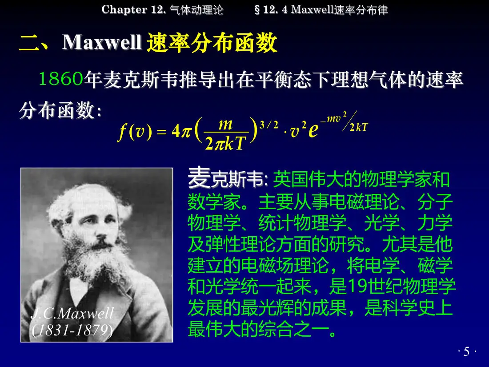

原文：

Chapter 12. 气体动理论

二、Maxwell 速率分布函数

1860年麦克斯韦推导出在平衡态下理想气体的速率分布函数： mv

$$
f (v) = 4 \pi \left(\frac {m}{2 \pi k T}\right) ^ {3 / 2} \cdot v ^ {2} e ^ {- m v ^ {2} / 2 k T}
$$

麦克斯韦: 英国伟大的物理学家和数学家。主要从事电磁理论、分子物理学、统计物理学、光学、力学及弹性理论方面的研究。尤其是他建立的电磁场理论，将电学、磁学和光学统一起来，是19世纪物理学发展的最光辉的成果，是科学史上最伟大的综合之一。

§12. 4 Maxwell速率分布律

· 5

### Chapter 12. 气体动理论

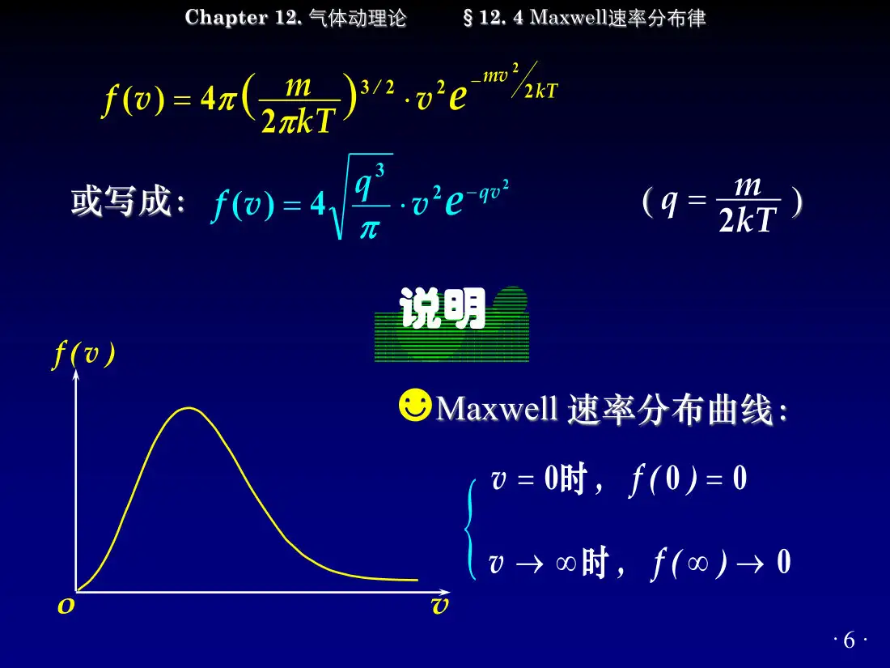

原文：

Chapter 12. 气体动理论

§12. 4 Maxwell速率分布律

$$
f (v) = 4 \pi \left(\frac {m}{2 \pi k T}\right) ^ {3 / 2} \cdot v ^ {2} e ^ {- m v ^ {2} / 2 k T}
$$

或写成： $: ( 0 ) = ( 1 0 - 1 ) \times ( 0 . 2 ) = ( 1 0 - 1 ) \times ( 0 . 2 ) = ( 1 0 - 1 ) \times ( 0 . 2 )$

$$
(q = \frac {m}{2 k T})
$$

说明

☻Maxwell 速率分布曲线：

v = 0时， $l i ( 0 ) = 0$

$[ \pmb { \eta } ] = \pmb { \eta } \pmb { \Sigma } \pmb { \big ( } \pmb { \eta } \pmb { 0 } ]$ 时， $1 1 ( 0 0 ) = 1 1$

· 6

### Chapter 12. 气体动理论

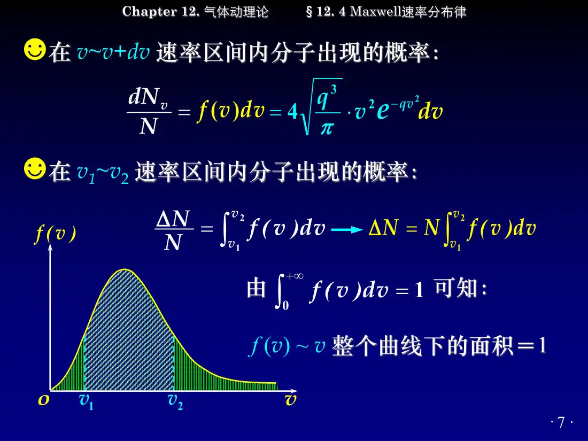

原文：

Chapter 12. 气体动理论

§12. 4 Maxwell速率分布律

☻在 v\~v+dv 速率区间内分子出现的概率：

$$
\frac {d N _ {v}}{N} = f (v) d v = 4 \sqrt {\frac {q ^ {3}}{\pi}} \cdot v ^ {2} e ^ {- q v ^ {2}} d v
$$

☻在 $\textcircled { \bullet } F = \textcircled { \bullet }$ 速率区间内分子出现的概率：

$$
\frac {\Delta N}{N} = \int_ {v _ {1}} ^ {v _ {2}} f (v) d v \longrightarrow \Delta N = N \int_ {v _ {1}} ^ {v _ {2}} f (v) d v
$$

由 $( 1 ) ( 1 0 0 0 ) \times 1 0 = 1 1$ 可知：

$1 1 \textcircled { ( 6 ) } 1 = 1 0$ 整个曲线下的面积＝1

· 7

### Chapter 12. 气体动理论 §12. 4 Maxwell速率分布律

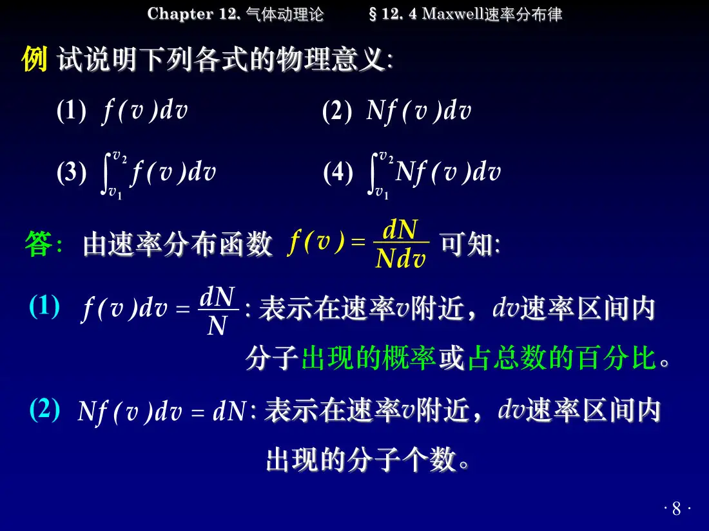

原文：

Chapter 12. 气体动理论 §12. 4 Maxwell速率分布律

例 试说明下列各式的物理意义:

(1) $1 1 ( 1 0 ) > 1 1 ( 0 )$

(2) $| | \nabla | | ^ { 2 } ( \phi ^ { 2 } ) | | \phi | | ^ { 2 }$

(3) $1 1 \times ( 1 0 - 2 ) = 1 8 0$

(4) $( \frac { x _ { 2 } } { 2 } ) \times ( \frac { x _ { 2 } } { 2 } + \frac { 1 } { 2 } ) \times ( \frac { x _ { 2 } } { 2 } ) = \frac { 1 } { 2 } \times ( \frac { 1 } { 2 } - \frac { 1 } { 2 } )$

答：由速率分布函数 $1 8 ( c m ) = \frac { 1 8 ( m ) } { 1 8 ( m ) }$ 可知:

(1) $1 1 ( 1 0 ) \times 1 0 = \frac { 1 1 8 } { 1 8 }$ 表示在速率v附近，dv速率区间内分子出现的概率或占总数的百分比。

(2) $W / ( ( 0 ) ) : ( 1 0 ) = ( 1 0 ) : ( 1 0 ) =$ 表示在速率v附近，dv速率区间内出现的分子个数。

8

### Chapter 12. 气体动理论 §12. 4 Maxwell速率分布律

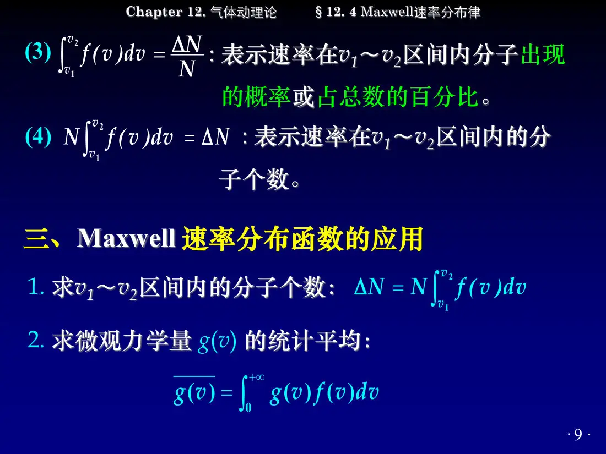

原文：

Chapter 12. 气体动理论 §12. 4 Maxwell速率分布律

(3) $\frac { \sqrt { 3 } } { 2 } \times \frac { \sqrt { 3 } } { 2 } = \frac { \sqrt { 3 } } { 2 }$ 表示速率在 $\textcircled { \bullet } \textcircled { < } \textcircled { < } \textcircled { < } \textcircled { < } \textcircled { < }$ 区间内分子出现的概率或占总数的百分比。

(4) $\because \vert \overrightarrow { a } \vert = \vert \overrightarrow { b } \vert = \vert \overrightarrow { a } \vert = \vert \overrightarrow { b } \vert$ : 表示速率在 $( 0 ) \textcircled { < } 2$ 区间内的分子个数。

三、Maxwell 速率分布函数的应用

1. 求 $( 0 ) \sim ( 0 )$ 区间内的分子个数： $\vert \overrightarrow { a } \vert \vert \overrightarrow { b } \vert = \vert \overrightarrow { b } \vert \vert \vert \overrightarrow { a } \vert / \vert \vert \overrightarrow { b } \vert / \vert \vert \overrightarrow { b } \vert$

2. 求微观力学量 g(v) 的统计平均：

$$
\overline {{g (v)}} = \int_ {0} ^ {+ \infty} g (v) f (v) d v
$$

· 9

### Chapter 12. 气体动理论 §12. 4 Maxwell速率分布律

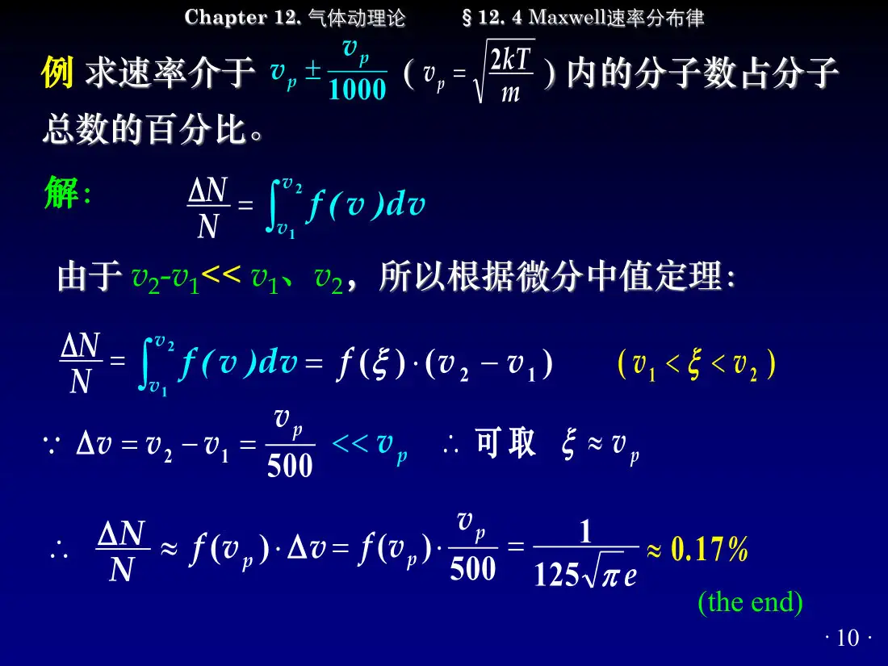

原文：

Chapter 12. 气体动理论 §12. 4 Maxwell速率分布律

例 求速率介于 $\frac { \langle \theta \rangle } { \langle \theta \rangle } = \frac { \langle \theta \rangle } { \langle \theta \rangle } = \frac { \langle \theta \rangle \langle \theta \rangle } { \langle \theta \rangle } = \frac { \langle \theta \rangle \langle \theta \rangle } { \langle \theta \rangle }$ 内的分子数占分子总数的百分比。

解：

$$
\frac {\Delta N}{N} = \int_ {v _ {1}} ^ {v _ {2}} f (v) d v
$$

由于 $( 0 ) ( 0 ) \times ( 0 . 7 ) \times ( 0 . 7 ) \times ( 0 . 7 )$ ，所以根据微分中值定理：

$$
\frac {\Delta N}{N} = \int_ {v _ {1}} ^ {v _ {2}} f (v) d v = f (\xi) \cdot \left(v _ {2} - v _ {1}\right) \quad \left(v _ {1} <   \xi <   v _ {2}\right)
$$

$\angle A _ { 2 } A O _ { 3 } = \angle O _ { 2 } = \angle O _ { 2 } = 9 0 ^ { \circ }$  可 取 $3 \times ( 0 . 7 ) ^ { 2 } = 1 . 2 ( c m ^ { 2 } )$

ΔN 7 ( p= f v v p 1 ≈0.17% N p p 500 125√πe

(the end)

10

### (the end)

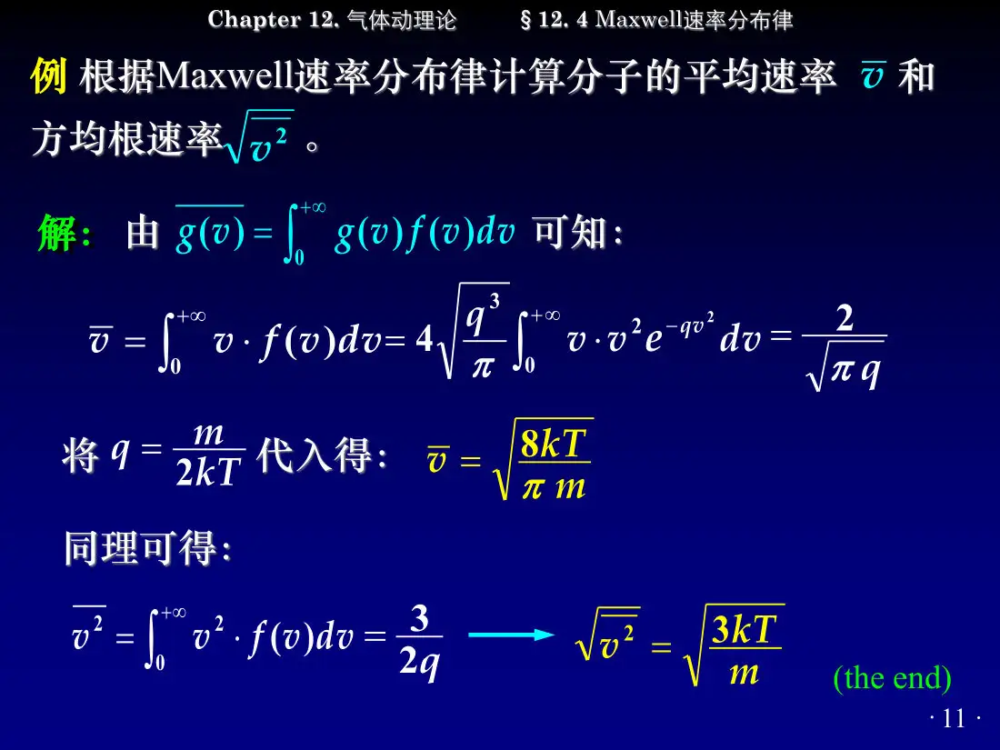

原文：

(the end)

Chapter 12. 气体动理论 §12. 4 Maxwell速率分布律

例 根据Maxwell速率分布律计算分子的平均速率 和v方均根速率 $\sqrt { \frac { 1 } { ( 6 ) ^ { 2 } } }$

解：由 $3 ( 0 ) = 1 1 ( 0 ) 1 ( 0 ) 1 ( 0 )$ 可知：

$$
\overline {{v}} = \int_ {0} ^ {+ \infty} v \cdot f (v) d v = 4 \sqrt {\frac {q ^ {3}}{\pi}} \int_ {0} ^ {+ \infty} v \cdot v ^ {2} e ^ {- q v ^ {2}} d v = \frac {2}{\sqrt {\pi q}}
$$

将 $q = \frac { 1 1 1 } { 1 1 3 }$ 代入得： $\textcircled { 6 } = \frac { 1 } { 6 } \textcircled { 6 } \frac { 1 } { 6 }$

同理可得：

$$
\overline {{v ^ {2}}} = \int_ {0} ^ {+ \infty} v ^ {2} \cdot f (v) d v = \frac {3}{2 q} \longrightarrow \sqrt {\overline {{v ^ {2}}}} = \sqrt {\frac {3 k T}{m}}
$$

· 11

### 四、三种分子速率

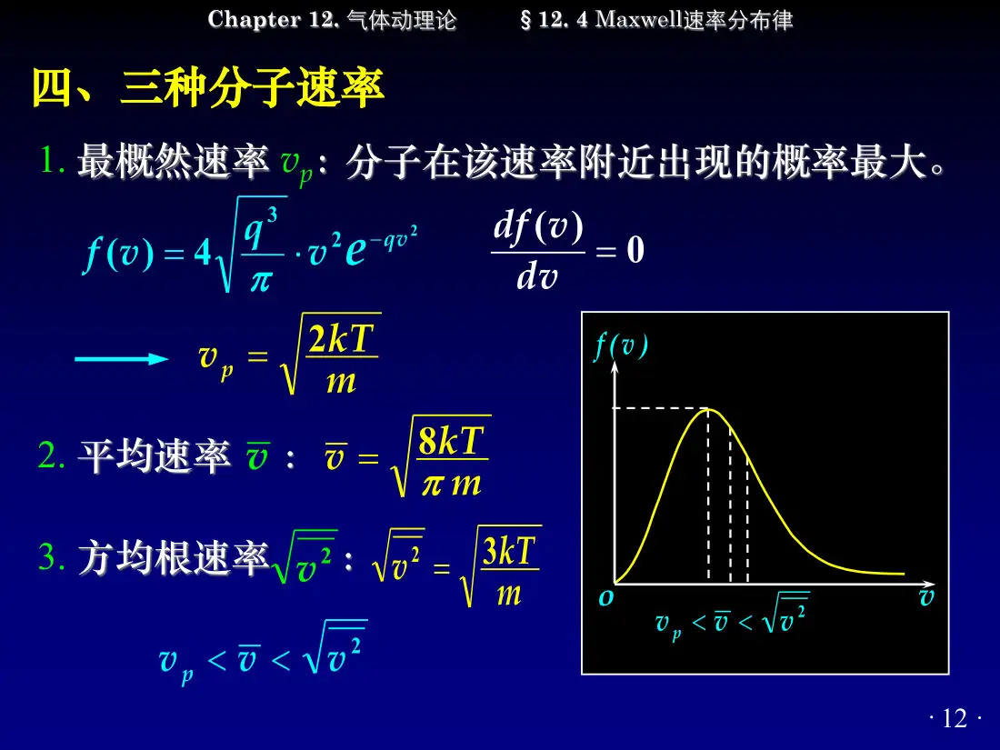

原文：

四、三种分子速率

1. 最概然速率 $\textcircled { \bullet } \frac { 9 } { 1 0 }$ ：分子在该速率附近出现的概率最大。

$$
f (v) = 4 \sqrt {\frac {q ^ {3}}{\pi}} \cdot v ^ {2} e ^ {- q v ^ {2}}
$$

$$
\frac {d f (v)}{d v} = 0
$$

$$
v _ {p} = \sqrt {\frac {2 k T}{m}}
$$

2. 平均速率 v ： $\frac { 1 } { ( 6 ) } = \frac { 1 } { 1 } \frac { 1 } { ( 6 ) } = \frac { 1 } { ( 6 ) }$

3. 方均根速率 $\frac { 1 } { 1 0 } \times \frac { 1 } { 1 0 } = \frac { 1 } { 1 0 }$

$$
v _ {p} <   \overline {{v}} <   \sqrt {\overline {{v ^ {2}}}}
$$

Chapter 12. 气体动理论 §12. 4 Maxwell速率分布律

· 12

### 讨论

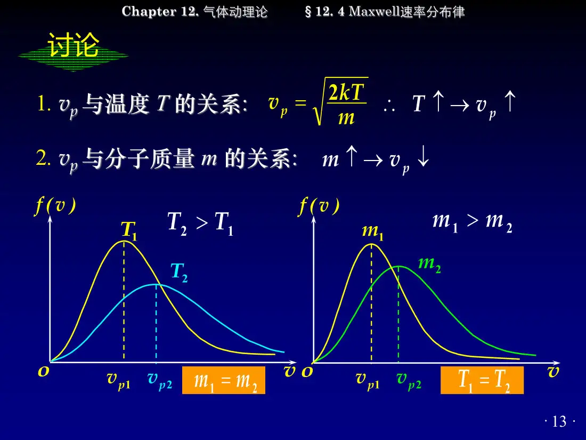

原文：

讨论

$( \bullet )$ 与温度 T 的关系: $\frac { 1 } { 2 } \times \frac { 1 } { 3 } = \frac { 1 } { 3 } ( m ^ { 2 } )$

2. $( \pmb { \mathscr { P } } )$ 与分子质量 m 的关系: $1 1 0 \times 1 = 2 ( 0 . 0 2 ) \times 1 0$

Chapter 12. 气体动理论 §12. 4 Maxwell速率分布律

· 13

### 归纳

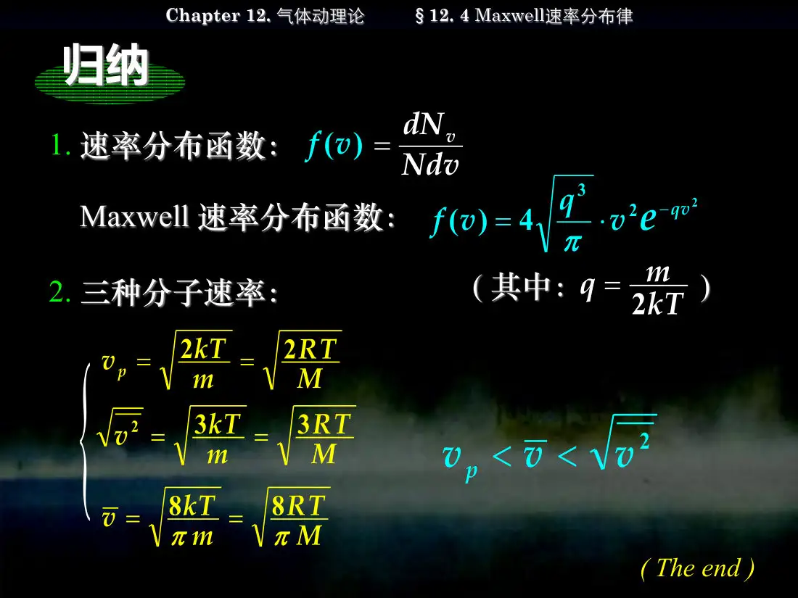

原文：

归纳

1. 速率分布函数： $1 1 \textcircled { 1 } 1 = \frac { 1 } { 1 } \times 1 0$ Maxwell 速率分布函数： $: ( 0 ) = ( 1 0 ) \times ( 2 0 - 1 ) = ( 2 0 ) ( 2 0 - 1 ) = ( 2 0 ) ( 2 0 - 1 ) = ( 2 0 ) ( 2 0 - 1 ) ( 2 0 - 1 ) = ( 2 0 ) ( 2 0 - 1 ) ( 2 0 - 1 ) ( 2 0 - 1 ) = ( 2 0 ) ( 2 0 - 1 ) ( 2 0 - 1 ) ( 2 0 - 1 ) = ( 2 0 ) ( 2 0 - 1 ) ( 2 0 - 1 ) ( 2 0 - 1 ) = ( 2 0 ) ( 2 0 - 1 ) ( 2 0 - 1 ) ( 2 0 - 1 ) = ( 2 0 ) ( 2 0 - 1 ) ( 2 0 - 1 ) ( 2 0 - 1 ) = ( 2 0 ) ( 2 0 - 1 ) ( 2 0 - 1 ) ( 2 0 - 1 ) ( 2 0 - 1 ) = ( 2 0 ) ( 2 0 - 1 ) ( 2 0 - 1 ) ( 2 0 - 1 ) ( 2 0 - 1 ) ( 2 0 - 1 ) = ( 2 0 )$

2. 三种分子速率：

$$
\left\{ \begin{array}{l} v _ {p} = \sqrt {\frac {2 k T}{m}} = \sqrt {\frac {2 R T}{M}} \\ \sqrt {v ^ {2}} = \sqrt {\frac {3 k T}{m}} = \sqrt {\frac {3 R T}{M}} \end{array} \right.
$$

$$
\overline {{v}} = \sqrt {\frac {8 k T}{\pi m}} = \sqrt {\frac {8 R T}{\pi M}}
$$

( 其中： $q = \frac { ( 1 1 1 2 } { 1 1 3 } )$

$$
v _ {p} <   \overline {{v}} <   \sqrt {\overline {{v ^ {2}}}}
$$

Chapter 12. 气体动理论

§12. 4 Maxwell速率分布律

( The end )· 1
