# 《大学物理》第12章 气体动理论（§12.1 理想气体的描述及其状态方程）

原件的每一页，下面附识别出的文字。

### 12-1 理想气体的描述及其物态方程

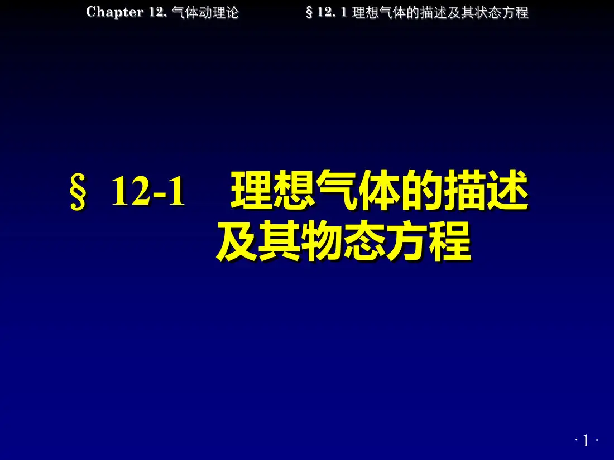

原文：

12-1 理想气体的描述及其物态方程

Chapter 12. 气体动理论

§12. 1 理想气体的描述及其状态方程

1

### Chapter 12. 气体动理论

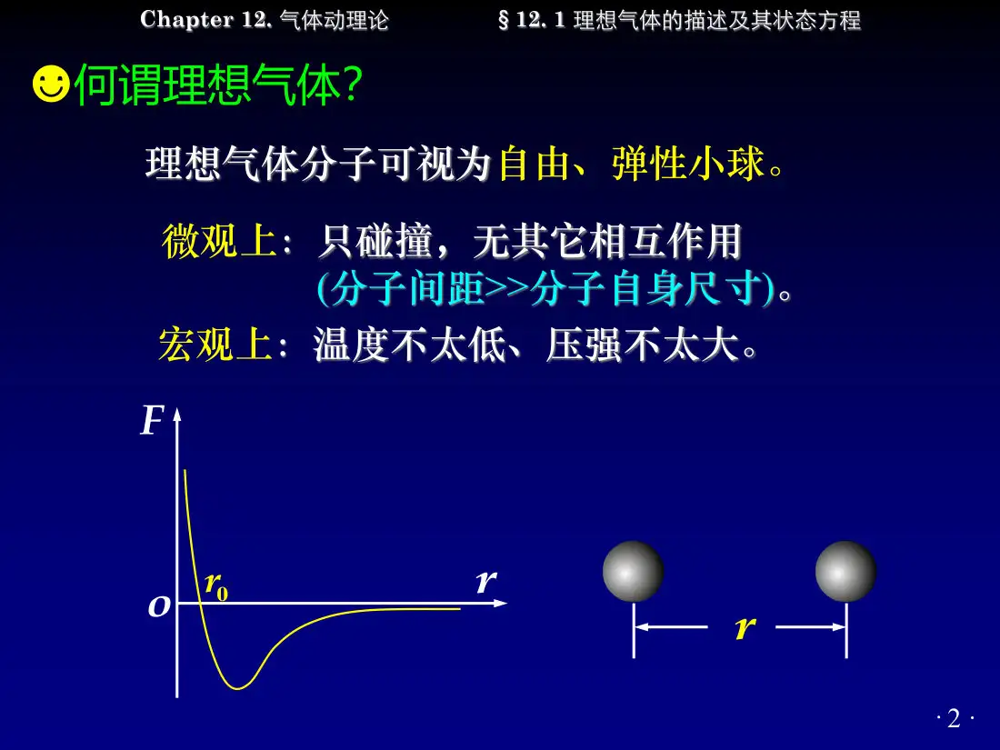

原文：

Chapter 12. 气体动理论

§12. 1 理想气体的描述及其状态方程

☻何谓理想气体？

理想气体分子可视为自由、弹性小球。

微观上：只碰撞，无其它相互作用(分子间距>>分子自身尺寸)。

宏观上：温度不太低、压强不太大。

· 2

### Chapter 12. 气体动理论

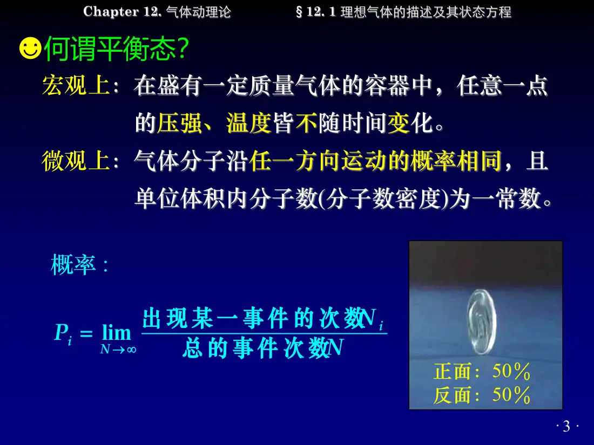

原文：

Chapter 12. 气体动理论

§12. 1 理想气体的描述及其状态方程

☻何谓平衡态？

宏观上：在盛有一定质量气体的容器中，任意一点的压强、温度皆不随时间变化。

微观上：气体分子沿任一方向运动的概率相同，且单位体积内分子数(分子数密度)为一常数。

概率 :

出现某一事件的次数VPi = limN→∞ 总的事件次数N

正面：50％

反面：50％

· 3

### Chapter 12. 气体动理论

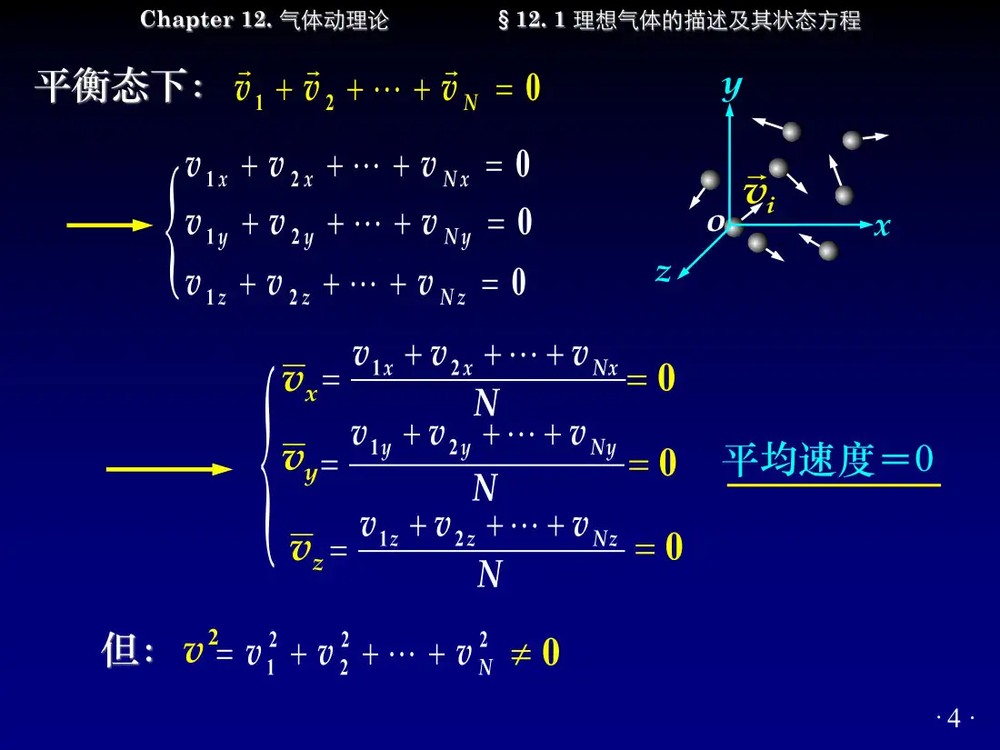

原文：

Chapter 12. 气体动理论

§12. 1 理想气体的描述及其状态方程

平衡态下： $( 0 ) \because ( 0 . 5 ) = ( 0 . 5 ) \times ( 0 . 5 ) = ( 1 )$

$$
\left\{ \begin{array}{l} v _ {1 x} + v _ {2 x} + \dots + v _ {N x} = 0 \\ v _ {1 y} + v _ {2 y} + \dots + v _ {N y} = 0 \\ v _ {1 z} + v _ {2 z} + \dots + v _ {N z} = 0 \end{array} \right.
$$

$$
\begin{array}{c c c} \text { y } & & \\ & \vec {v} _ {i} \\ \text { x } & & \\ z & & \end{array}
$$

$$
\left\{ \begin{array}{l} \overline {{\boldsymbol {v}}} _ {x} = \frac {\boldsymbol {v} _ {1 x} + \boldsymbol {v} _ {2 x} + \cdots + \boldsymbol {v} _ {N x}}{N} = \mathbf {0} \\ \overline {{\boldsymbol {v}}} _ {y} = \frac {\boldsymbol {v} _ {1 y} + \boldsymbol {v} _ {2 y} + \cdots + \boldsymbol {v} _ {N y}}{N} = \mathbf {0} \\ \overline {{\boldsymbol {v}}} _ {z} = \frac {\boldsymbol {v} _ {1 z} + \boldsymbol {v} _ {2 z} + \cdots + \boldsymbol {v} _ {N z}}{N} = \mathbf {0} \end{array} \right.
$$

平均速度＝0

但： $( 0 ) = ( 0 . 5 - 0 . 5 ) \times ( 0 . 5 ) = ( 0 . 5 ) ( 0 . 5 ) = ( 1 . )$

· 4

### Chapter 12. 气体动理论

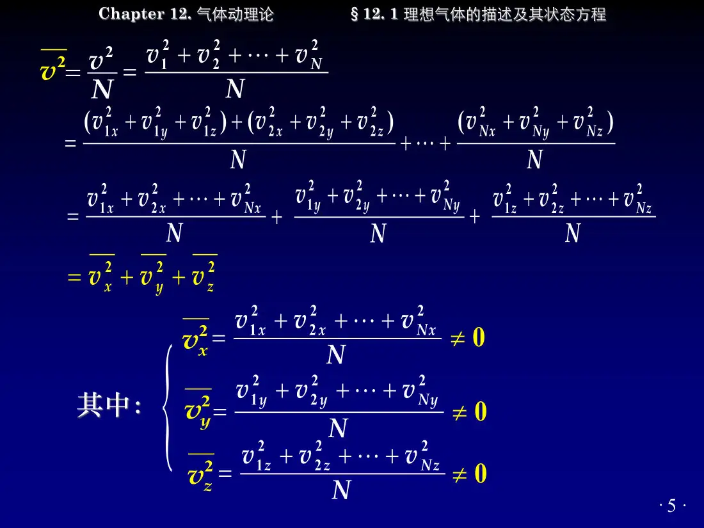

原文：

Chapter 12. 气体动理论

§12. 1 理想气体的描述及其状态方程

$$
\begin{array}{r l} & {\overline {{{v ^ {2}}}} = \frac {v ^ {2}}{N} = \frac {v _ {1} ^ {2} + v _ {2} ^ {2} + \cdots + v _ {N} ^ {2}}{N}} \\ & {\quad = \frac {(v _ {1 x} ^ {2} + v _ {1 y} ^ {2} + v _ {1 z} ^ {2}) + (v _ {2 x} ^ {2} + v _ {2 y} ^ {2} + v _ {2 z} ^ {2})}{N} + \dots + \frac {(v _ {N x} ^ {2} + v _ {N y} ^ {2} + v _ {N z} ^ {2})}{N}} \\ & {\quad = \frac {v _ {1 x} ^ {2} + v _ {2 x} ^ {2} + \cdots + v _ {N x} ^ {2}}{N} + \frac {v _ {1 y} ^ {2} + v _ {2 y} ^ {2} + \cdots + v _ {N y} ^ {2}}{N} + \frac {v _ {1 z} ^ {2} + v _ {2 z} ^ {2} + \cdots + v _ {N z} ^ {2}}{N}} \\ & {\quad = \overline {{{v _ {x} ^ {2}}}} + \overline {{{v _ {y} ^ {2}}}} + \overline {{{v _ {z} ^ {2}}}}} \\ & {\text {其中:} \left\{ \begin{array}{l l} {\overline {{{v _ {x} ^ {2}}}} = \frac {v _ {1 x} ^ {2} + v _ {2 x} ^ {2} + \cdots + v _ {N x} ^ {2}}{N} \neq 0} \\ {\overline {{{v _ {y} ^ {2}}}} = \frac {v _ {1 y} ^ {2} + v _ {2 y} ^ {2} + \cdots + v _ {N y} ^ {2}}{N} \neq 0} \\ {\overline {{{v _ {z} ^ {2}}}} = \frac {v _ {1 z} ^ {2} + v _ {2 z} ^ {2} + \cdots + v _ {N z} ^ {2}}{N} \neq 0} \end{array} \right.} \end{array}
$$

· 5

### Chapter 12. 气体动理论

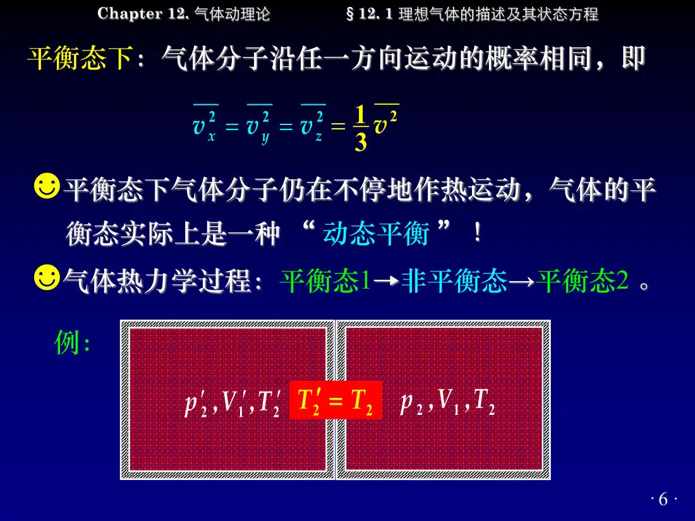

原文：

Chapter 12. 气体动理论

§12. 1 理想气体的描述及其状态方程

平衡态下：气体分子沿任一方向运动的概率相同，即

$$
\overline {{v _ {x} ^ {2}}} = \overline {{v _ {y} ^ {2}}} = \overline {{v _ {z} ^ {2}}} = \frac {1}{3} \overline {{v ^ {2}}}
$$

☻平衡态下气体分子仍在不停地作热运动，气体的平衡态实际上是一种 “ 动态平衡 ” ！

☻气体热力学过程：平衡态1→非平衡态→平衡态2 。

例：

$$
p _ {2} ^ {\prime}, V _ {1} ^ {\prime}, T _ {2} ^ {\prime} \quad T _ {2} ^ {\prime} = T _ {2} \quad p _ {2}, V _ {1}, T _ {2}
$$

· 6

### Chapter 12. 气体动理论

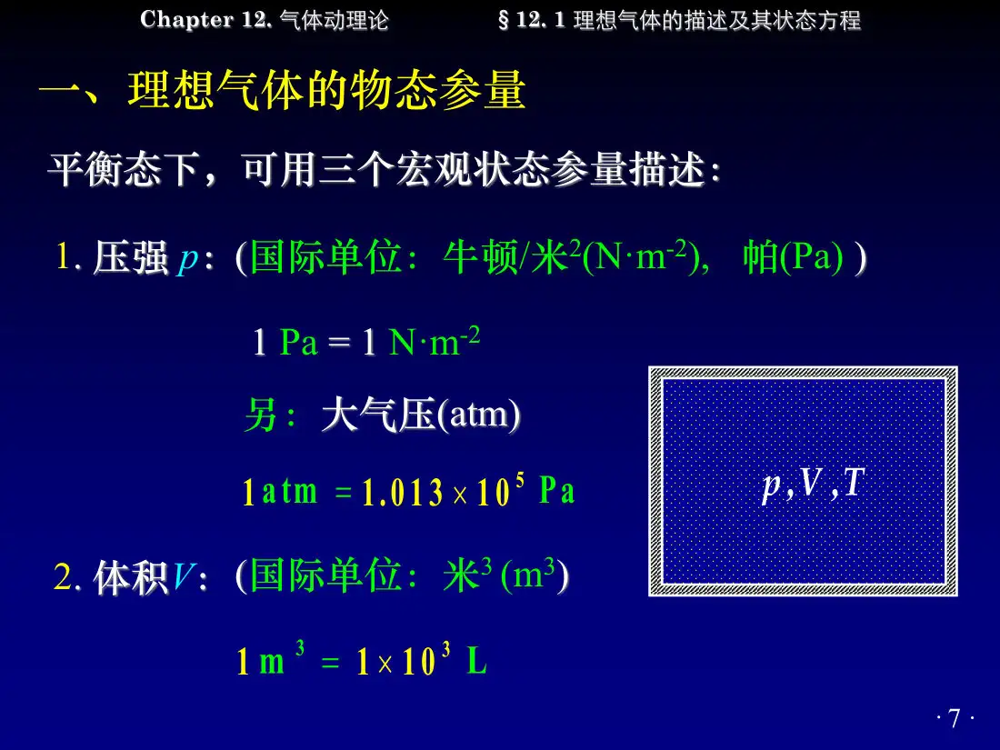

原文：

Chapter 12. 气体动理论

§12. 1 理想气体的描述及其状态方程

一、 理想气体的物态参量

平衡态下，可用三个宏观状态参量描述：

1. 压强 p：(国际单位：牛顿/米2(N·m-2), 帕(Pa) )

1 Pa = 1 N·m-2

另：大气压(atm)

1atm =1.013 ×10⁵ Pa

2. 体积V：(国际单位：米3 (m3)

$$
1 \mathrm{m} ^ {3} = 1 \times 1 0 ^ {3} \mathrm{L}
$$

· 7

### Chapter 12. 气体动理论

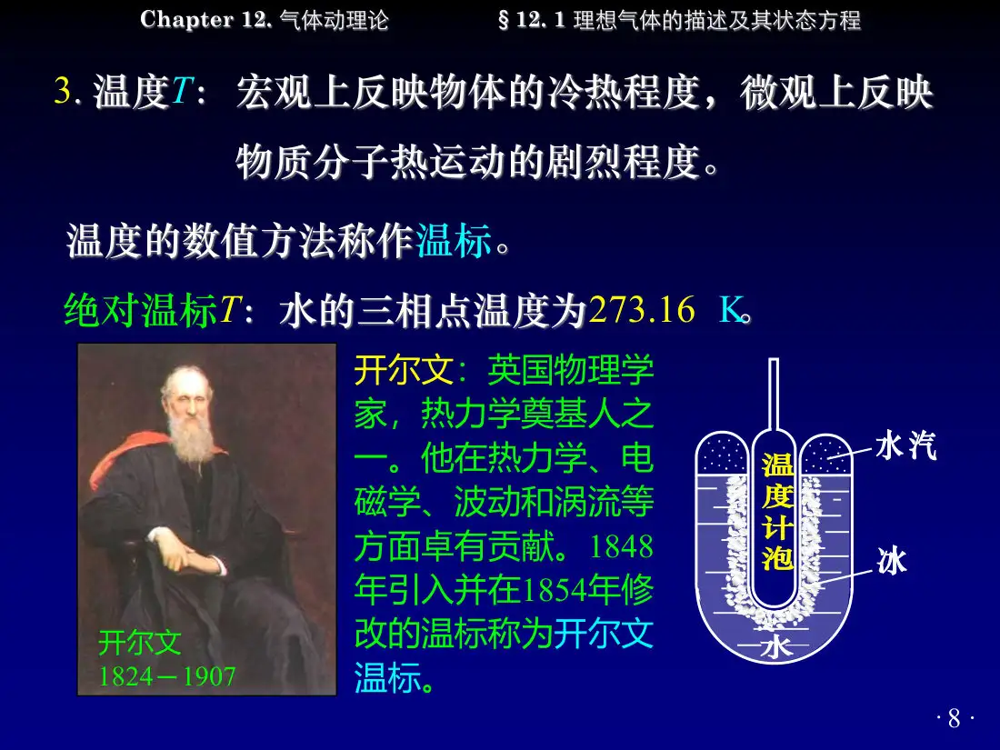

原文：

Chapter 12. 气体动理论

§12. 1 理想气体的描述及其状态方程

3. 温度T：宏观上反映物体的冷热程度，微观上反映物质分子热运动的剧烈程度。

温度的数值方法称作温标。

绝对温标T：水的三相点温度为273.16 K。

开尔文：英国物理学家，热力学奠基人之一。他在热力学、电磁学、波动和涡流等方面卓有贡献。1848年引入并在1854年修改的温标称为开尔文温标。

8

### 摄氏温标 t 与绝对温标T 关系：

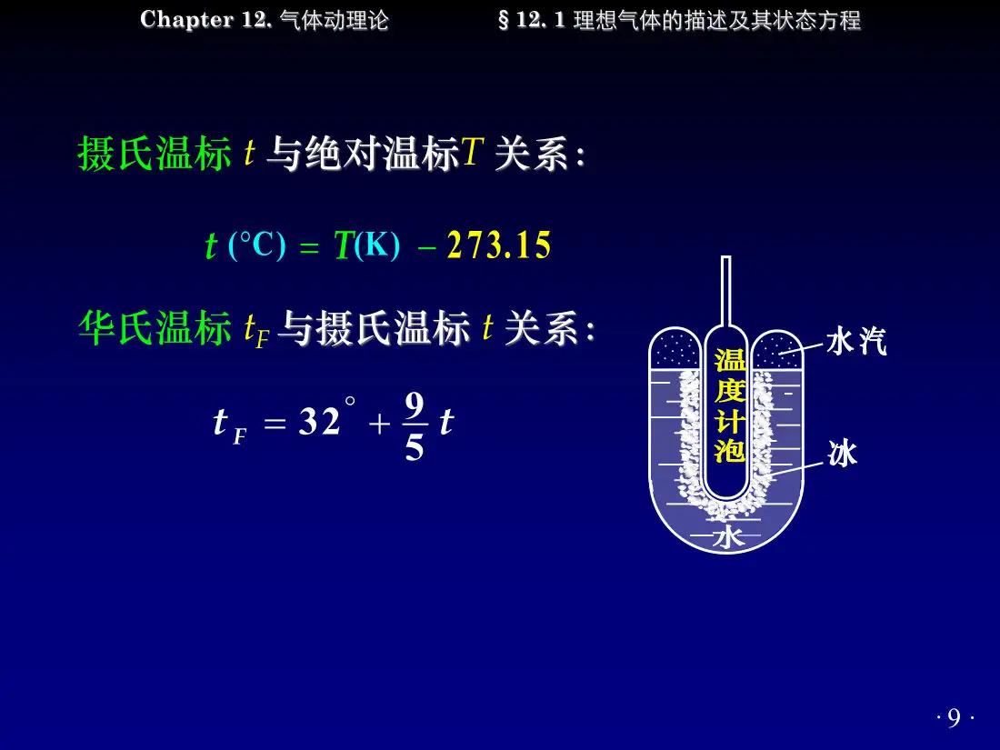

原文：

摄氏温标 t 与绝对温标T 关系：

t (°C) = T(K) − 273.15

华氏温标 $1 \frac { 1 3 } { 2 }$ 与摄氏温标 t 关系：

$$
t _ {F} = 3 2 ^ {\circ} + \frac {9}{5} t
$$

Chapter 12. 气体动理论

§12. 1 理想气体的描述及其状态方程

· 9

### 二、理想气体的物态方程

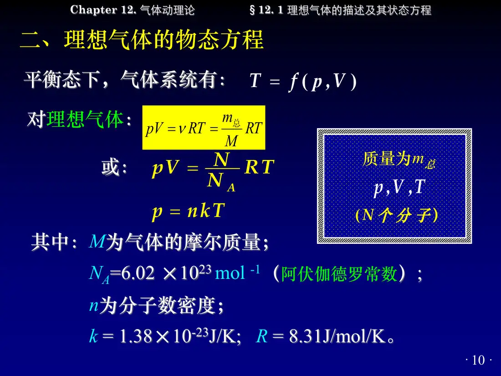

原文：

二、理想气体的物态方程

平衡态下，气体系统有： $1 1 = 1 1 0 2 0 0$

对理想气体：

$$
p V = \nu R T = \frac {m _ {\text {总}}}{M} R T
$$

或： $1 2 ^ { \circ } = \frac { 1 8 ^ { \circ } } { 1 8 ^ { \circ } } = 1 8 ^ { \circ }$

$$
p = n k T
$$

其中：M为气体的摩尔质量；

$W _ { 1 } = ( 1 ) ( 1 ) ( 1 ) ( 1 0 ) = ( 1 0 ) ( 0 )$ （阿伏伽德罗常数）;

n为分子数密度；

$l _ { 1 } = l l _ { 2 } : 2 : ( 1 ) = 1 : 1 : 1 0 : 1 1 :$ ; $v _ { i } = - 3 . 5 m / \min \cdot 0 . 0 5 m ^ { 3 }$ 。

Chapter 12. 气体动理论

§12. 1 理想气体的描述及其状态方程

10

### Chapter 12. 气体动理论

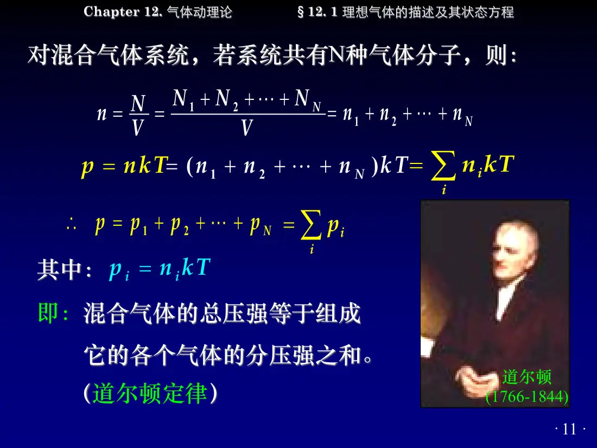

原文：

Chapter 12. 气体动理论

§12. 1 理想气体的描述及其状态方程

对混合气体系统，若系统共有N种气体分子，则：

$$
n = \frac {N}{V} = \frac {N _ {1} + N _ {2} + \cdots + N _ {N}}{V} = n _ {1} + n _ {2} + \dots + n _ {N}
$$

$$
p = n k T = (n _ {1} + n _ {2} + \dots + n _ {N}) k T = \sum n _ {i} k T
$$

$$
\therefore p = p _ {1} + p _ {2} + \dots + p _ {N} = \sum_ {i} p _ {i}
$$

其中： $1 4 \times 1 = 1 4 8 ( m ^ { 2 } )$

即：混合气体的总压强等于组成它的各个气体的分压强之和。（道尔顿定律）

11

### 注意

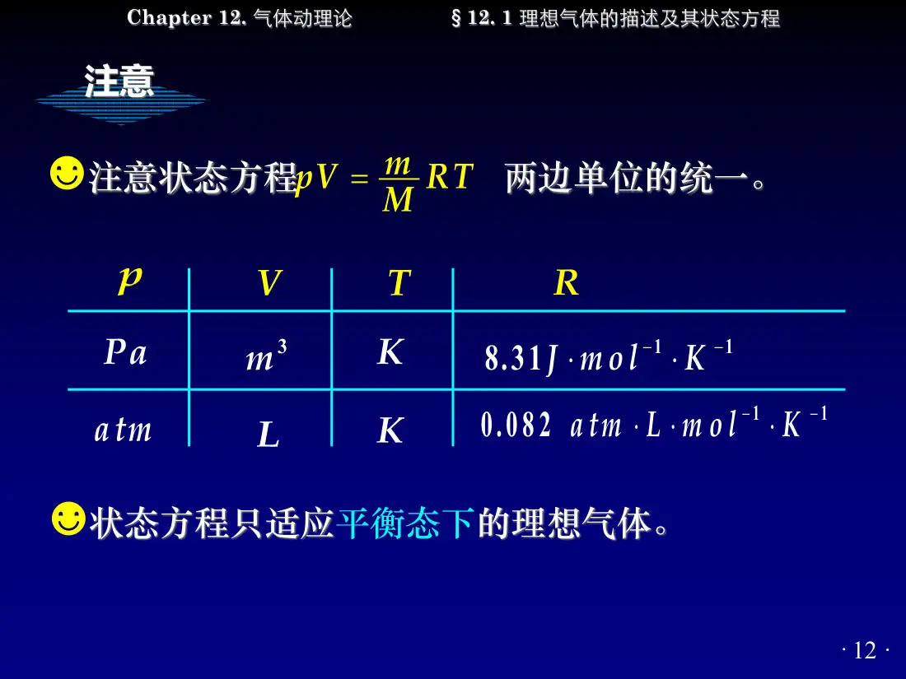

原文：

注意

☻注意状态方程 $V _ { 2 } = \frac { 1 1 0 } { 1 1 } = 1 0 0$ 两边单位的统一。

<table><tr><td>p</td><td>V</td><td>T</td><td>R</td></tr><tr><td>Pa</td><td> $m^{3}$ </td><td>K</td><td> $8.31J \cdot mol^{-1} \cdot K^{-1}$ </td></tr><tr><td>atm</td><td>L</td><td>K</td><td> $0.082 \text{ atm } \cdot L \cdot mol^{-1} \cdot K^{-1}$ </td></tr></table>

☻状态方程只适应平衡态下的理想气体。

Chapter 12. 气体动理论

§12. 1 理想气体的描述及其状态方程

· 12

### 解：由理想气体状态方程：

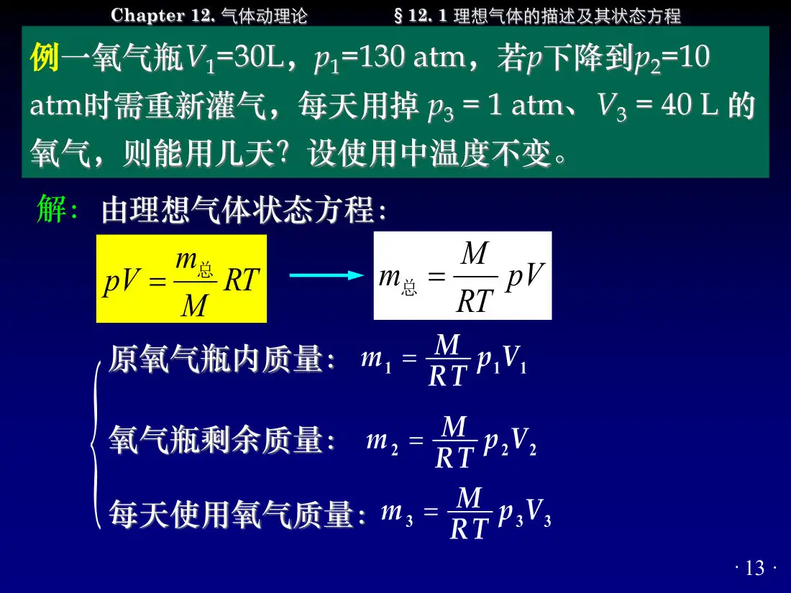

原文：

例一氧气瓶 $V _ { n } = 6 3 0 \pi$ $1 0 0 = 1 1 0 ( 1 ) \div 2 = 1 0 0 ( c m )$ ，若p下降到 $1 0 0 \div 1 0 0$ atm时需重新灌气，每天用掉 $1 2 . 5 \times 1 0 ^ { 3 } k g \times 1 0 ^ { 3 } k g = 1 0 ^ { 3 } k g$ 的氧气，则能用几天？设使用中温度不变。

解：由理想气体状态方程：

$$
p V = \frac {m _ {\text {总}}}{M} R T \quad \longrightarrow \quad m _ {\text {总}} = \frac {M}{R T} p V
$$

原氧气瓶内质量： $1 1 4 \times \frac { 1 1 4 } { 1 2 4 } = \frac { 1 1 4 } { 1 2 4 } = \frac { 1 1 4 } { 1 2 4 }$

氧气瓶剩余质量： $m _ { 2 } = \frac { n ! } { 1 2 } \times ( - \frac { 1 } { 2 } ) \times ( - 1 ) \times ( - 1 )$

每天使用氧气质量： $m _ { k } = \frac { n _ { k } } { 1 2 } - \frac { n _ { k } } { 1 2 }$

· 13

### 归纳

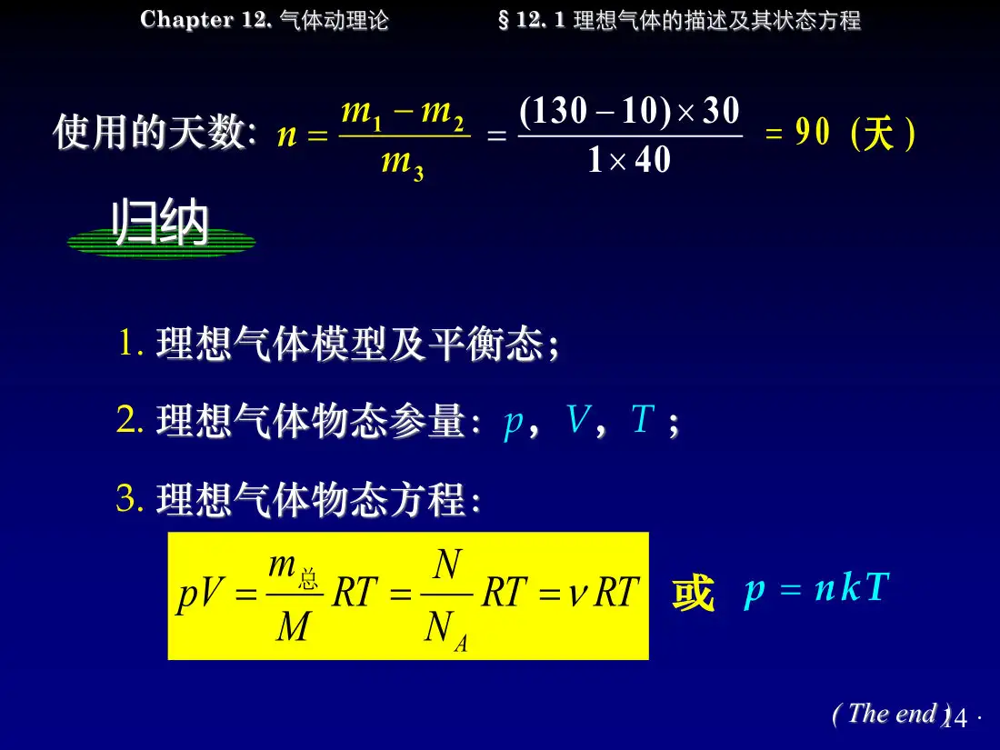

原文：

使用的天数: $( 1 5 - 1 4 ) \times ( 2 5 - 1 1 ) = ( 1 5 - 1 1 ) ( 1 ) ( 1 ) ( 1 ) ( 1 ) ( 1 ) ( 1 ) ( 1 ) ( 1 ) ( 1 ) ( 1 ) ( 1 ) ( 1 ) ( 1 ) ( 1 ) ( 1 ) ( 1 ) ( 1 ) ( 1 ) ( 1 ) ( 1 ) ( 1 ) ( 1 ) ( 1 ) ( 1 ) ( 1 ) ( 1 ) ( 1 ) ( 1 ) ( 1 ) ( 1 ) ( 1 ) ( ) ( 1 ) ( 1 ) ( ) ( 1 ) ( ) ( 1 ) ( ) ( 1 ) ( ) ( 1 ) ( ) ( 1 ) ( ) ( 1 ) ( ) ( 1 ) ( ) ( 1 ) ( ) ( 1 ) ( ) ( 1 ) ( ) ( 1 ) ( ) ( 1 ) ( ) ( 1 ) ( ) ( 1 ) ( ) ( 1 ) ( ) ( 1 ) ( ) ( 1 ) ( ) ( 1 ) ( ) ( 1 ) ( ) ( 1 ) ( ) ( 1 ) ( ) ( 1 ) ( ) ( ) ( 1 ) ( ) ( ) ( 1 ) ( ) ( ) ( 1 ) ( ) ( ) ( 1 ) ( ) ( ) ( 1 ) ( ) ( ) ( 1 ) ( ) ( ) ( 1 ) ( ) ( ) ( ) ( 1 ) ( ) ( ) ( ) ( 1 ) ( ) ( ) ( ) ( 1 ) ( ) ( ) ( ) ( ) ( 1 ) ( ) ( ) ( ) ( ) ( 1 ) ( ) ( ) ( ) ( ) ( ) ( 1 ) ( ) ( ) ( ) ( ) ( ) ( ) ( 1 ) ) ( ) ( ) ( ) ( ) ( ) ( 1 ) ( ) ( ) ( ) ( ) ( ) ) ( ) ( ) ( ) ( 1 ) ( ) ( ) ( ) ( ) ) ( ) ( ) ( ) ( ) ( ) ( ) 1 ) ( ) ( ) ( ) ( ) ( ) ( ) ) ( ) ( ) ( ) ( ) ( ) ( ) ) ( ) ( ) ( ) ( ) ( ) ) ( ) ( ) ( ) ( ) ) ( ) ( ) ( ) ( ) ) ( ) ( ) ( ) ( ) ) ( ) ( ) ( ) ( ) ( ) ) ( ) ( ) ( ) ) ( ) ( ) ( ) ( ) ) ( ) ( ) ( ) ) ( ) ( ) ( ) ( ) ) ( ) ( ) ( ) ) ( ) ( ) ( ) ) ( ) ( ) ( ) ) ( ) ( ) ) ( ) ( ) ( ) ) ( ) ( ) ) ( ) ( ) ( ) ) ( ) ( ) ) ( $ (天)

归纳

1. 理想气体模型及平衡态；

2. 理想气体物态参量：p，V，T ；

3. 理想气体物态方程：

$$
p V = \frac {m _ {\text {总}}}{M} R T = \frac {N}{N _ {A}} R T = \nu R T
$$

或 $1 0 = 1 0 0 0$

Chapter 12. 气体动理论

§12. 1 理想气体的描述及其状态方程

( The end ) · 14
