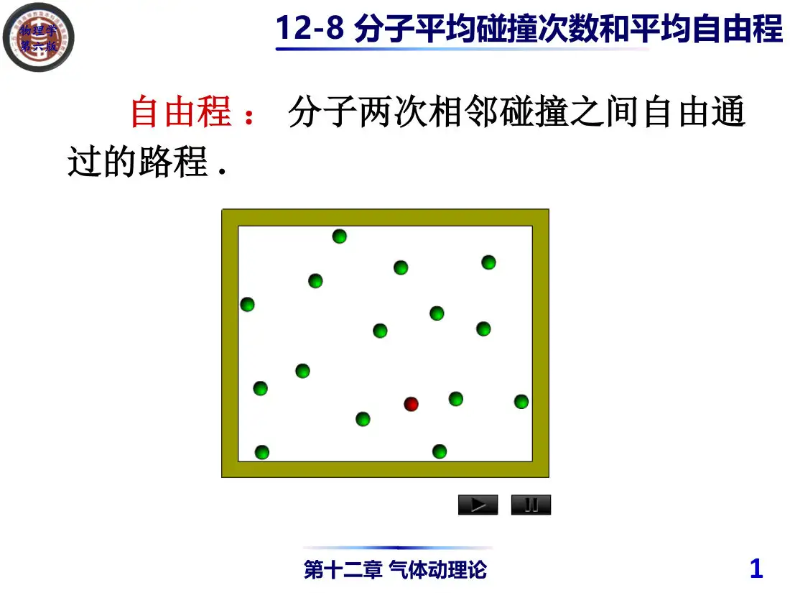
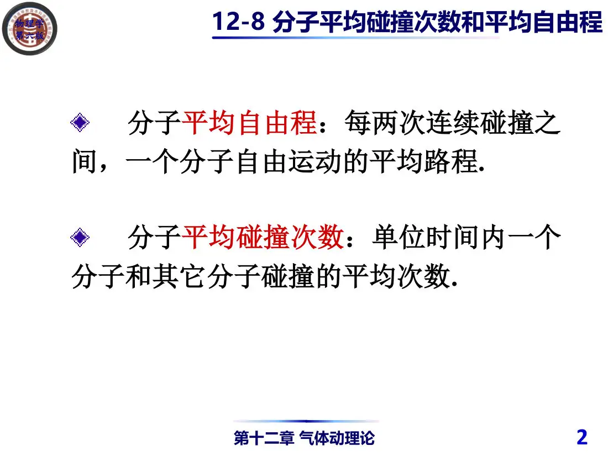
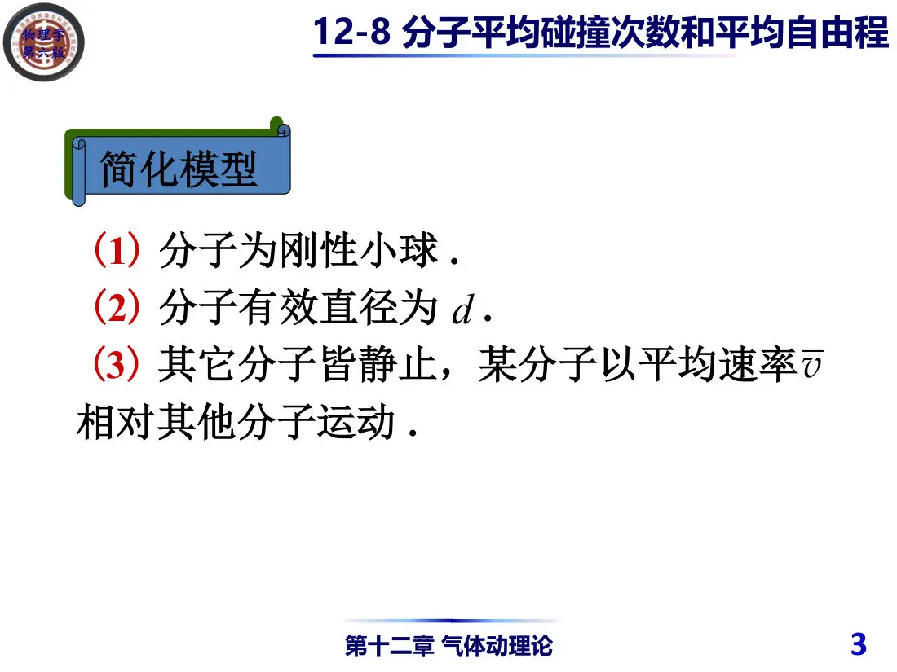
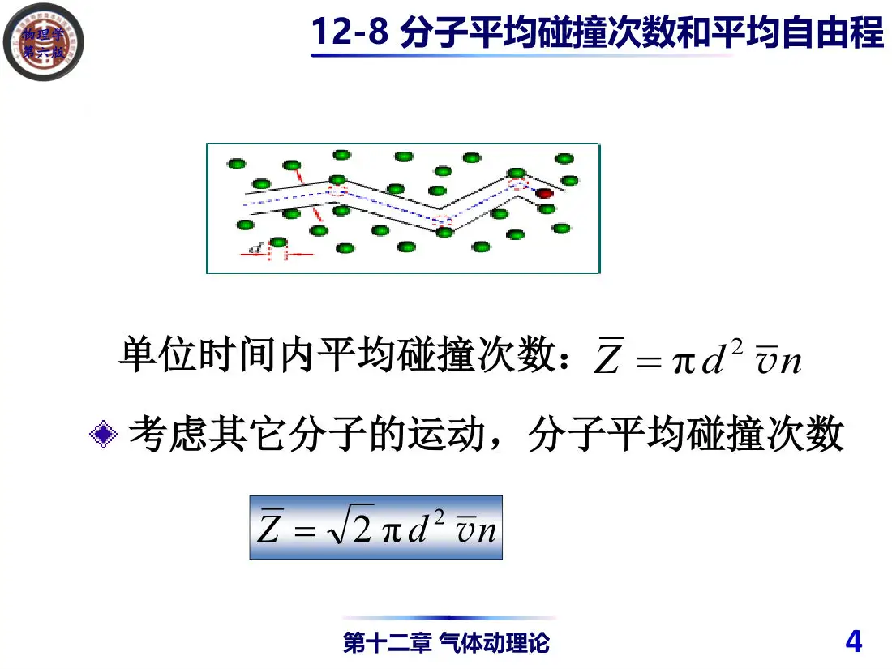
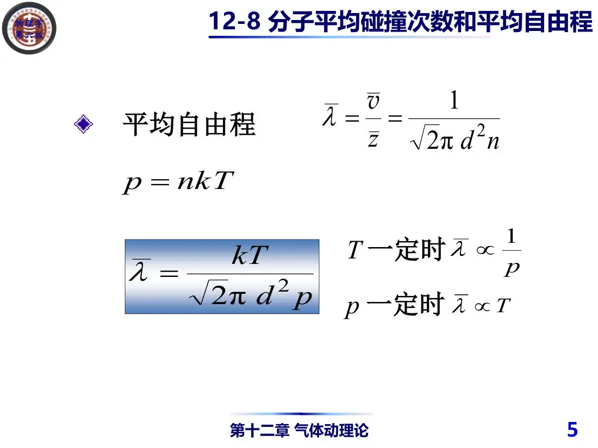
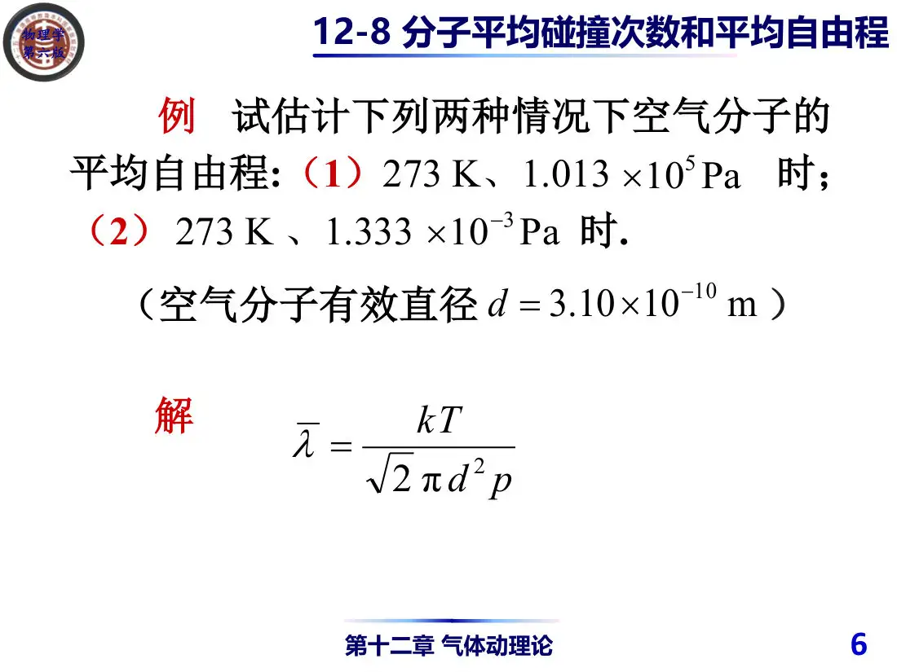
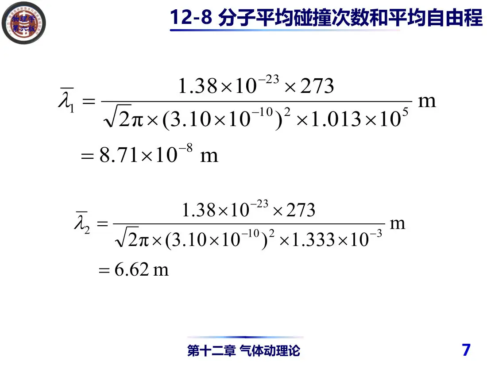

# 《大学物理》第12章 气体动理论：分子平均碰撞次数和平均自由程（课件）

原件的每一页，下面附识别出的文字。

### 自由程 ： 分子两次相邻碰撞之间自由通过的路程 .

原文：

自由程 ： 分子两次相邻碰撞之间自由通过的路程 .

物理学第六版

12-8 分子平均碰撞次数和平均自由程

第十二章 气体动理论

1

### 分子平均自由程：每两次连续碰撞之间，一个分子自由运动的平均路程.

原文：

分子平均自由程：每两次连续碰撞之间，一个分子自由运动的平均路程.

分子平均碰撞次数：单位时间内一个分子和其它分子碰撞的平均次数.

物理学第六版

12-8 分子平均碰撞次数和平均自由程

第十二章 气体动理论

2

### 简化模型

原文：

简化模型

(1) 分子为刚性小球 .

(2) 分子有效直径为 .

(3) 其它分子皆静止，某分子以平均速率相对其他分子运动 .

物理学第六版

12-8 分子平均碰撞次数和平均自由程

第十二章 气体动理论

3

### 考虑其它分子的运动，分子平均碰撞次数

原文：

单位时间内平均碰撞次数： $\overline { { Z } } = \pi d ^ { 2 } \overline { { v } } n$

考虑其它分子的运动，分子平均碰撞次数

$$
\overline {{Z}} = \sqrt {2} \pi d ^ {2} \overline {{v}} n
$$

物理学第六版

12-8 分子平均碰撞次数和平均自由程

第十二章 气体动理论

4

### 平均自由程

原文：

平均自由程

$$
p = n k T
$$

$$
\overline {{\lambda}} = \frac {\overline {{v}}}{\overline {{z}}} = \frac {1}{\sqrt {2} \pi d ^ {2} n}
$$

$$
\overline {{\lambda}} = \frac {k T}{\sqrt {2} \pi d ^ {2} p}
$$

$T$ 一定时 $\overline { { \lambda } } \propto \frac { 1 } { p }$

$p$ 一定时 $\overline { { \lambda } } \propto T$

物理学第六版

12-8 分子平均碰撞次数和平均自由程

第十二章 气体动理论

5

### $$

原文：

例 试估计下列两种情况下空气分子的平均自由程:（1） $2 7 3 \mathrm { K } , \ 1 . 0 1 3 \times 1 0 ^ { 5 } \mathrm { P a }$ 时；

（2） $2 7 3 \mathrm { K } \setminus 1 . 3 3 3 \times 1 0 ^ { - 3 } \mathrm { P a }$ 时.

（空气分子有效直径 $d = 3 . 1 0 { \times } 1 0 ^ { - 1 0 } \mathrm { ~ m ~ } )$

解

$$
\overline {{\lambda}} = \frac {k T}{\sqrt {2} \pi d ^ {2} p}
$$

物理学第六版

12-8 分子平均碰撞次数和平均自由程

第十二章 气体动理论

6

### $$

原文：

$$
\begin{array}{r l} & {\overline {{\lambda_ {1}}} = \frac {1 . 3 8 \times 1 0 ^ {- 2 3} \times 2 7 3}{\sqrt {2} \pi \times (3 . 1 0 \times 1 0 ^ {- 1 0}) ^ {2} \times 1 . 0 1 3 \times 1 0 ^ {5}} \mathrm{m}} \\ & {\quad = 8. 7 1 \times 1 0 ^ {- 8} \mathrm{m}} \end{array}
$$

$$
\begin{array}{r l} \overline {{\lambda}} _ {2} & = \frac {1 . 3 8 \times 1 0 ^ {- 2 3} \times 2 7 3}{\sqrt {2} \pi \times (3 . 1 0 \times 1 0 ^ {- 1 0}) ^ {2} \times 1 . 3 3 3 \times 1 0 ^ {- 3}} \mathrm{m} \\ & = 6. 6 2 \mathrm{m} \end{array}
$$

物理学第六版

12-8 分子平均碰撞次数和平均自由程

第十二章 气体动理论

7
