# 《大学物理》第12章 电磁感应 §12.3 感生电场与感生电动势（课件）

原件的每一页，下面附识别出的文字。

### § 12.3 感生电场与感生电动势

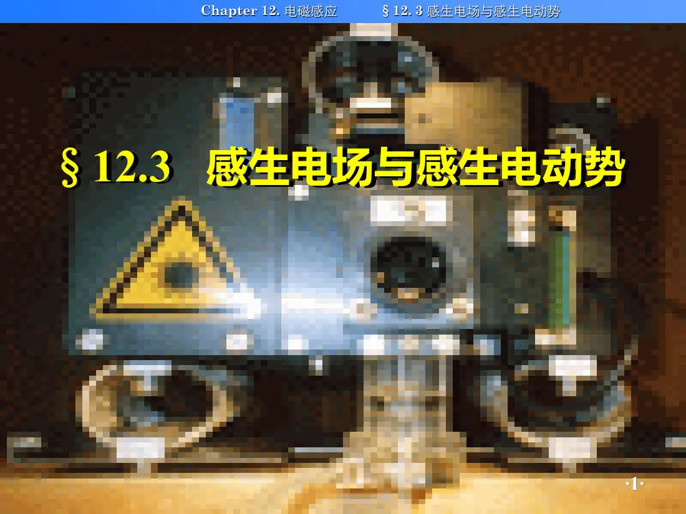

原文：

§ 12.3 感生电场与感生电动势

Chapter 12. 电磁感应

§ 12.3 感生电场与感生电动势

### 演示实验：因磁场变化产生的感生电动势。

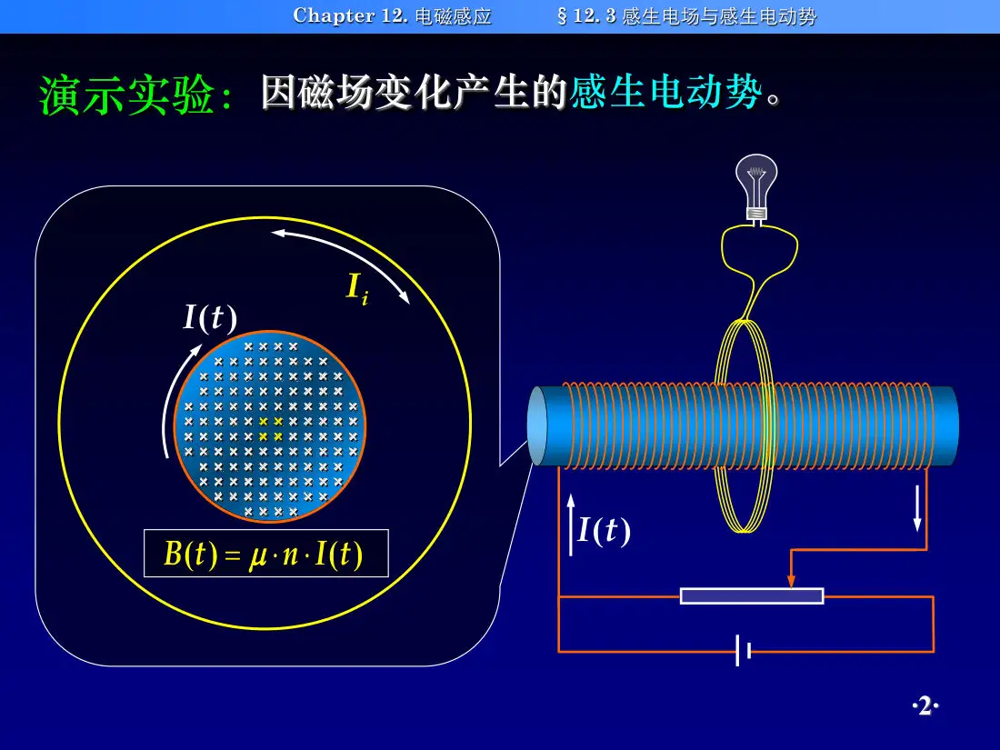

原文：

演示实验：因磁场变化产生的感生电动势。

Chapter 12. 电磁感应

§ 12.3 感生电场与感生电动势

2

### 演示实验：因磁场变化产生的感生电动势。

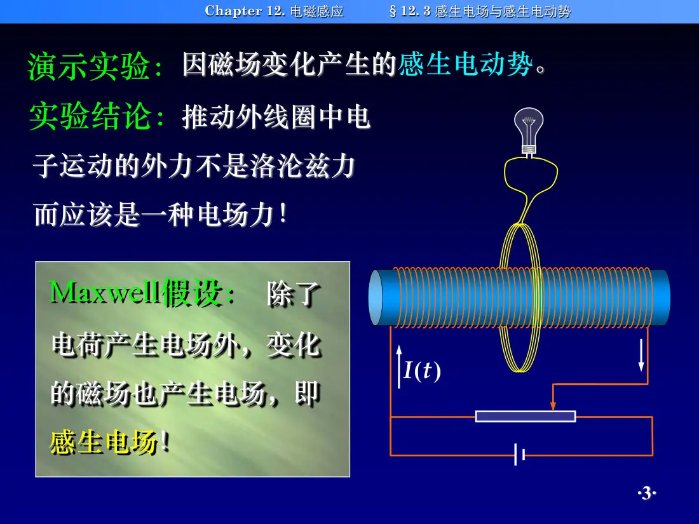

原文：

演示实验：因磁场变化产生的感生电动势。

实验结论：推动外线圈中电

子运动的外力不是洛沦兹力

而应该是一种电场力！

Maxwell假设：除了电荷产生电场外，变化的磁场也产生电场，即感生电场！

Chapter 12. 电磁感应

§ 12.3 感生电场与感生电动势

3.

### 一、感生电场及其性质

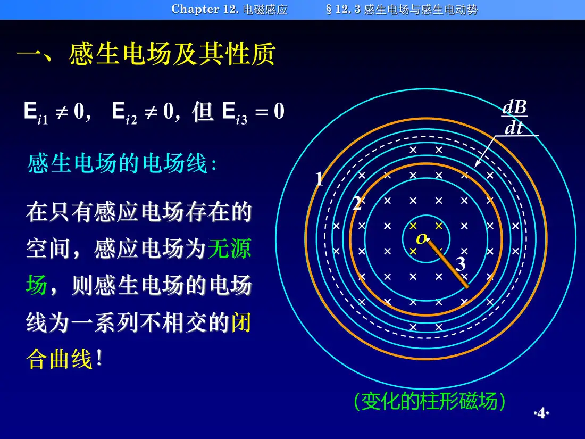

原文：

一、感生电场及其性质

$E_{i1} \neq 0,\quad E_{i2} \neq 0, \text{但 } E_{i3} = 0$ 感生电场的电场线：

在只有感应电场存在的空间，感应电场为无源场，则感生电场的电场线为一系列不相交的闭合曲线！

(变化的柱形磁场)

Chapter 12. 电磁感应

§ 12.3 感生电场与感生电动势

4

### 如何判定感生电场的电场线的方向？

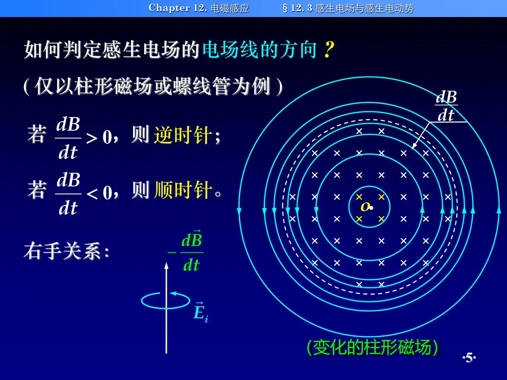

原文：

如何判定感生电场的电场线的方向？

(仅以柱形磁场或螺线管为例)

若 $\frac{dB}{dt} > 0$ ，则逆时针；
若 $\frac{dB}{dt}<0$ ，则顺时针。

右手关系：

(变化的柱形磁场)

Chapter 12. 电磁感应 § 12.3 感生电场与感生电动势

5.

### 感生电场与静电场的比较:

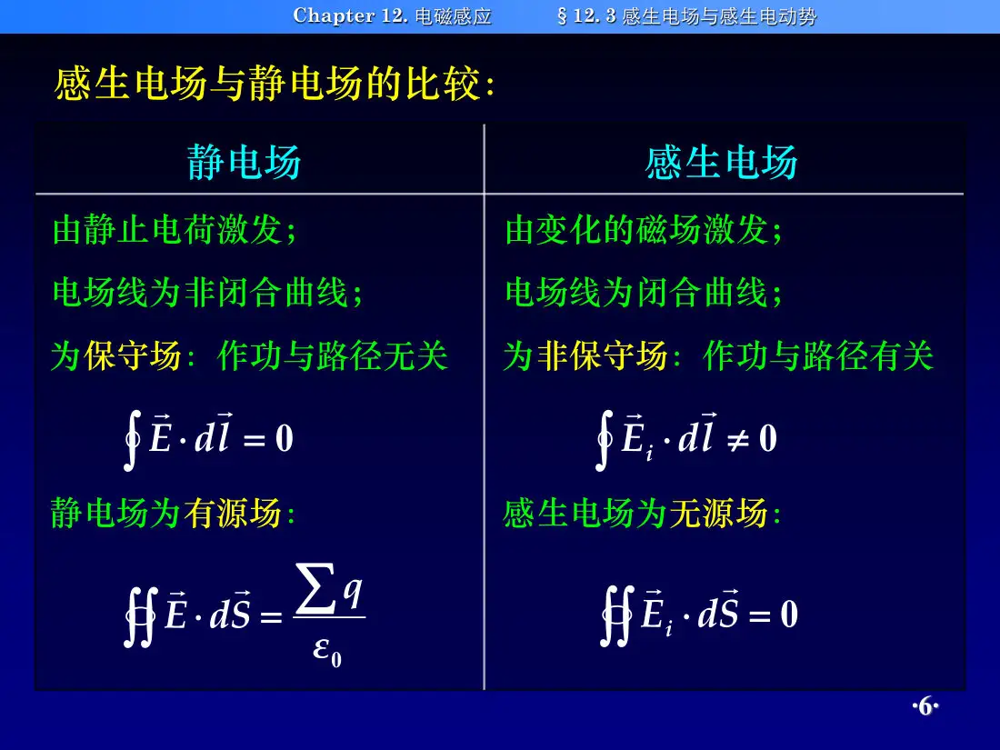

原文：

感生电场与静电场的比较:

静电场

由静止电荷激发；

电场线为非闭合曲线；

为保守场：作功与路径无关

$\oint \vec{E} \cdot d\vec{l} = 0$

静电场为有源场:

$$
\oiint \vec {E} \cdot d \vec {S} = \frac {\sum q}{\varepsilon_ {0}}
$$

感生电场

由变化的磁场激发；

电场线为闭合曲线；

为非保守场：作功与路径有关

$$
\oint \vec {E} _ {i} \cdot d \vec {l} \neq 0
$$

感生电场为无源场:

$$
\oiint \vec {E} _ {i} \cdot d \vec {S} = 0
$$

Chapter 12. 电磁感应

§ 12.3 感生电场与感生电动势

6.

### 二、感生电动势及涡电流

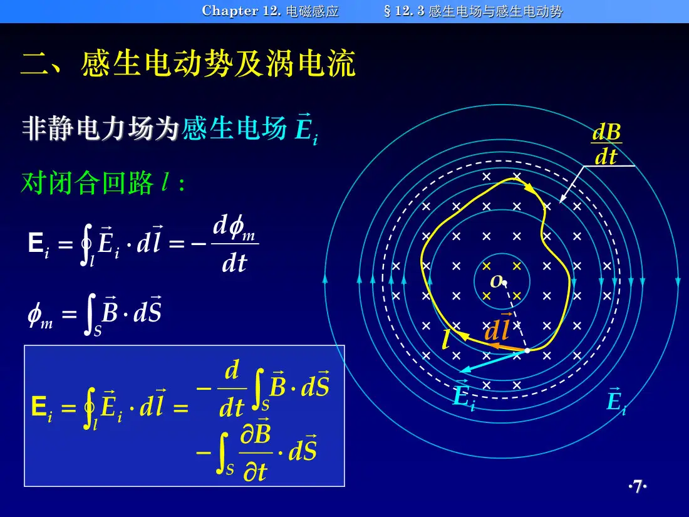

原文：

二、感生电动势及涡电流

非静电力场为感生电场 $\vec{E}_{i}$

对闭合回路 $l$ :

$$
\mathbf {E} _ {i} = \oint_ {l} \vec {E} _ {i} \cdot d \vec {l} = - \frac {d \phi_ {m}}{d t}
$$

$$
\phi_ {m} = \int_ {S} \vec {B} \cdot d \vec {S}
$$

$$
\begin{array}{r} \mathbf {E} _ {i} = \oint_ {l} \vec {E} _ {i} \cdot d \vec {l} = - \frac {d}{d t} \int_ {s} \vec {B} \cdot d \vec {S} \\ - \int_ {s} \frac {\partial \vec {B}}{\partial t} \cdot d \vec {S} \end{array}
$$

Chapter 12. 电磁感应

§ 12.3 感生电场与感生电动势

7

### 对于开路 ab：作辅助回路oabo，则

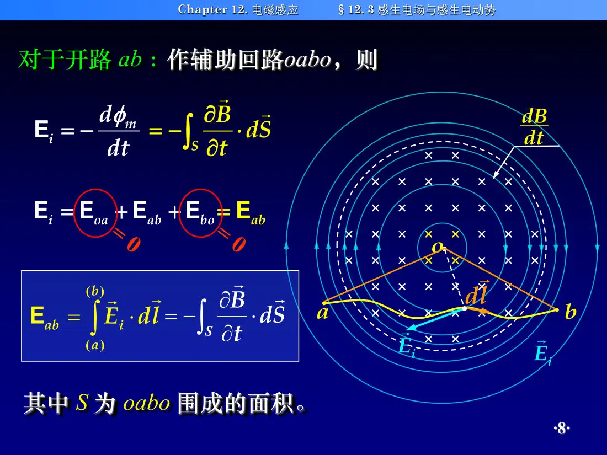

原文：

对于开路 ab：作辅助回路oabo，则

$$
\mathsf {E} _ {i} = - \frac {d \phi_ {m}}{d t} = - \int_ {s} \frac {\partial \vec {B}}{\partial t} \cdot d \vec {S}
$$

$$
E _ {i} = E _ {o a} + E _ {a b} + E _ {b o} = E _ {a b}
$$

$$
\mathbf {E} _ {a b} = \int_ {(a)} ^ {(b)} \vec {E} _ {i} \cdot d \vec {l} = - \int_ {s} \frac {\partial \vec {B}}{\partial t} \cdot d \vec {S}
$$

其中 S 为 oabo 围成的面积。

Chapter 12. 电磁感应

§ 12.3 感生电场与感生电动势

8.

### Chapter 12. 电磁感应

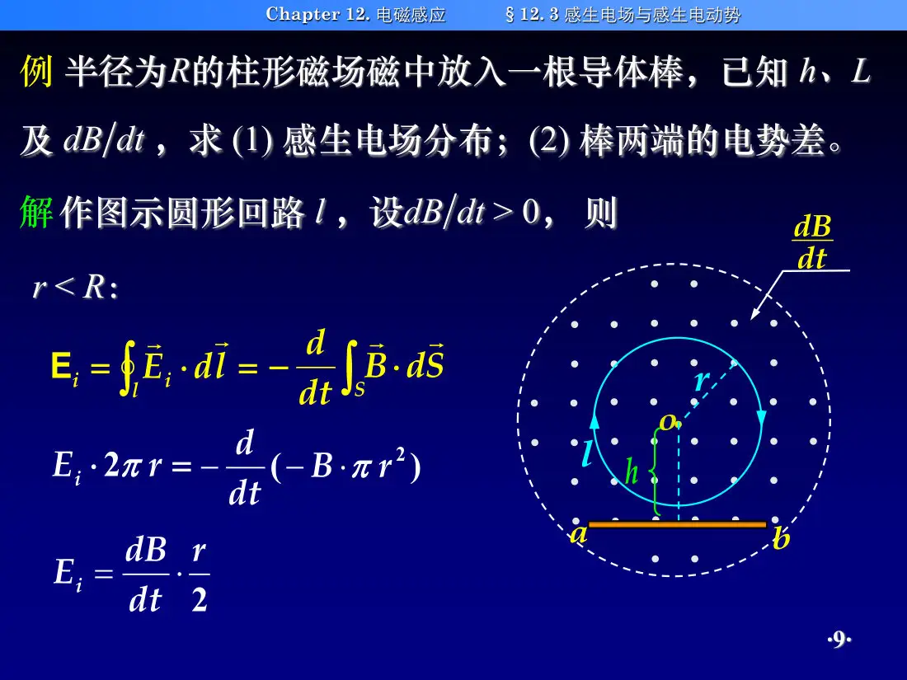

原文：

Chapter 12. 电磁感应

§ 12.3 感生电场与感生电动势

例 半径为R的柱形磁场磁中放入一根导体棒，已知 h、L 及 dB/dt，求(1)感生电场分布；(2)棒两端的电势差。
解作图示圆形回路 l，设dB/dt > 0，则 dB

$r <   R$ :

$$
\mathbf {E} _ {i} = \oint_ {l} \vec {E} _ {i} \cdot d \vec {l} = - \frac {d}{d t} \int_ {S} \vec {B} \cdot d \vec {S}
$$

$$
E _ {i} \cdot 2 \pi r = - \frac {d}{d t} (- B \cdot \pi r ^ {2})
$$

$$
E _ {i} = \frac {d B}{d t} \cdot \frac {r}{2}
$$

9.

### $$

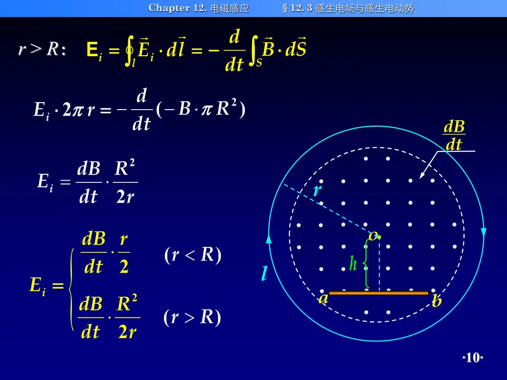

原文：

$$
r > R \colon \mathbf {E} _ {i} = \oint_ {l} \vec {E} _ {i} \cdot d \vec {l} = - \frac {d}{d t} \int_ {S} \vec {B} \cdot d \vec {S}
$$

$$
E _ {i} \cdot 2 \pi r = - \frac {d}{d t} (- B \cdot \pi R ^ {2})
$$

$$
E _ {i} = \frac {d B}{d t} \cdot \frac {R ^ {2}}{2 r}
$$

$$
E _ {i} = \left\{ \begin{array}{l l} \frac {d B}{d t} \cdot \frac {r}{2} & (r <   R) \\ \frac {d B}{d t} \cdot \frac {R ^ {2}}{2 r} & (r > R) \end{array} \right.
$$

$$
\begin{array}{c} \frac {d B}{d t} \\ l \end{array}
$$

Chapter 12. 电磁感应

§ 12.3 感生电场与感生电动势

•10•

### $$

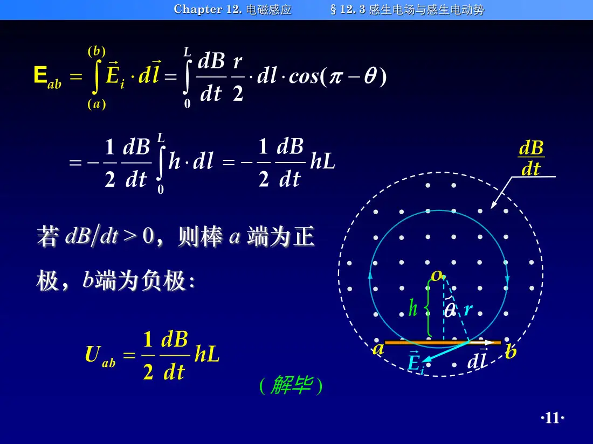

原文：

$$
\mathsf {E} _ {a b} = \int_ {(a)} ^ {(b)} \vec {E} _ {i} \cdot d \vec {l} = \int_ {0} ^ {L} \frac {d B}{d t} \frac {r}{2} \cdot d l \cdot c o s (\pi - \theta)
$$

$$
= - \frac {1}{2} \frac {d B}{d t} \int_ {0} ^ {L} h \cdot d l = - \frac {1}{2} \frac {d B}{d t} h L
$$

若 $dB / dt > 0$ ，则棒 $a$ 端为正极， $b$ 端为负极：

$$
U _ {a b} = \frac {1}{2} \frac {d B}{d t} h L
$$

$$
\begin{array}{c} \text {   d   t   } \\ \text {   o   } \\ \text {   h   } \\ \text {   r   } \\ \text {   a   } \\ \text {   b   } \\ \text {   d   l   } \\ \text {   E   i   } \end{array}
$$

(解毕)

Chapter 12. 电磁感应

§ 12.3 感生电场与感生电动势

•11•

### 涡电流(简称涡流): 在变化的磁场中, 导体内产生的感生电流。

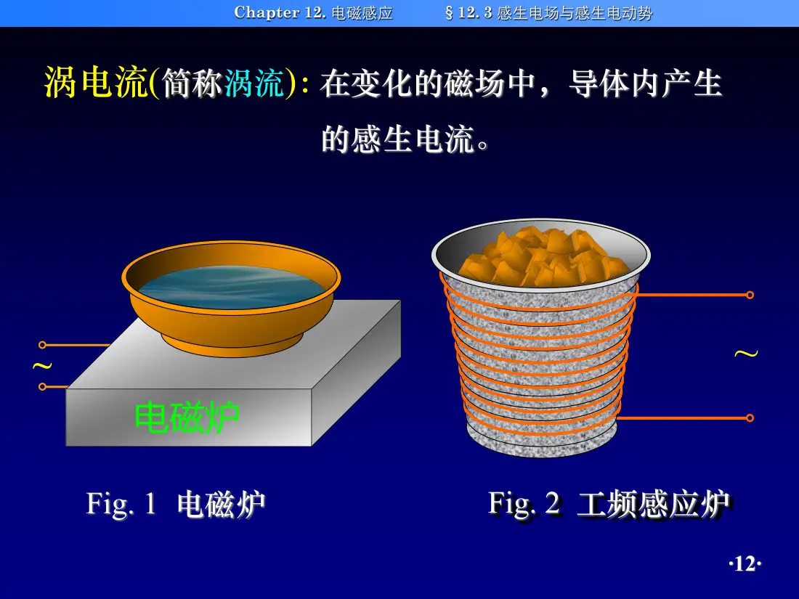

原文：

涡电流(简称涡流): 在变化的磁场中, 导体内产生的感生电流。

Fig. 1 电磁炉

Fig. 2 工频感应炉

Chapter 12. 电磁感应

§ 12.3 感生电场与感生电动势

·12·

### 电子感应加速器

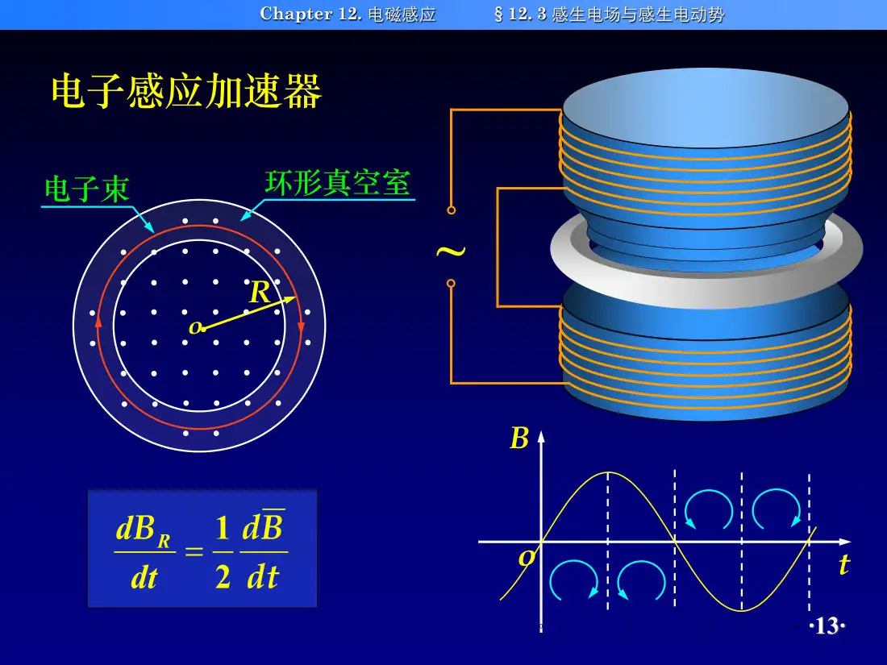

原文：

电子感应加速器

电子束

环形真空室

$\frac{dB_{R}}{dt} = \frac{1}{2}\frac{d\overline{B}}{dt}$

Chapter 12. 电磁感应

§ 12.3 感生电场与感生电动势

### 1. 感生电场及其特性

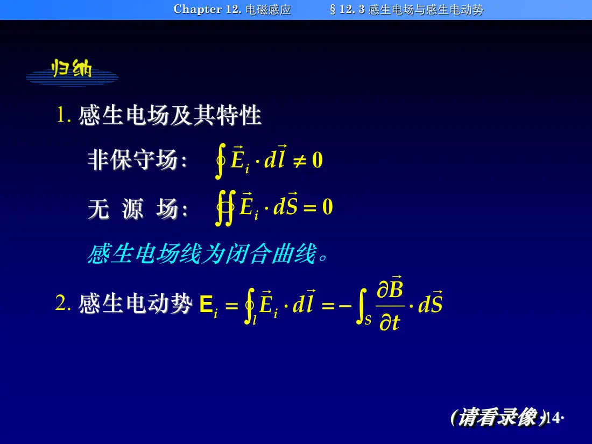

原文：

1. 感生电场及其特性

非保守场： $\oint \vec{E}_i\cdot d\vec{l}\neq 0$

无源场: $\iint\vec{E}_{i}\cdot d\vec{S}=0$

感生电场线为闭合曲线。

2. 感生电动势 $E_{i}=\oint_{l}\vec{E}_{i}\cdot d\vec{l}=-\int_{s}\frac{\partial\vec{B}}{\partial t}\cdot d\vec{S}$

Chapter 12. 电磁感应

§ 12.3 感生电场与感生电动势

(请看录像)14·

### Chapter 12. 电磁感应

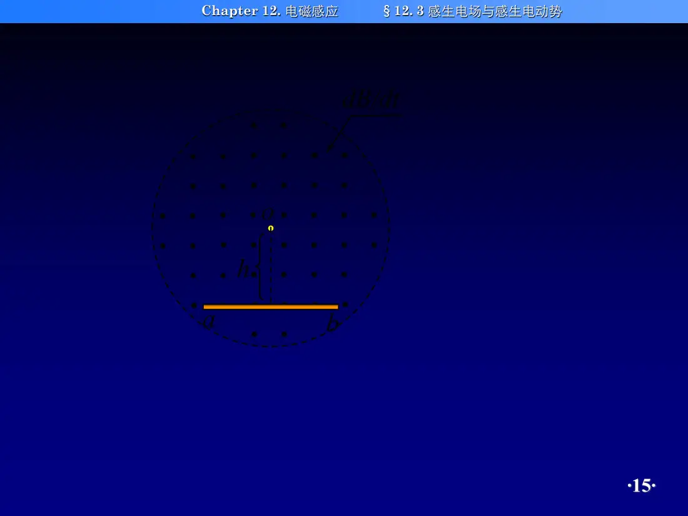

原文：

Chapter 12. 电磁感应

§ 12.3 感生电场与感生电动势

•15•
