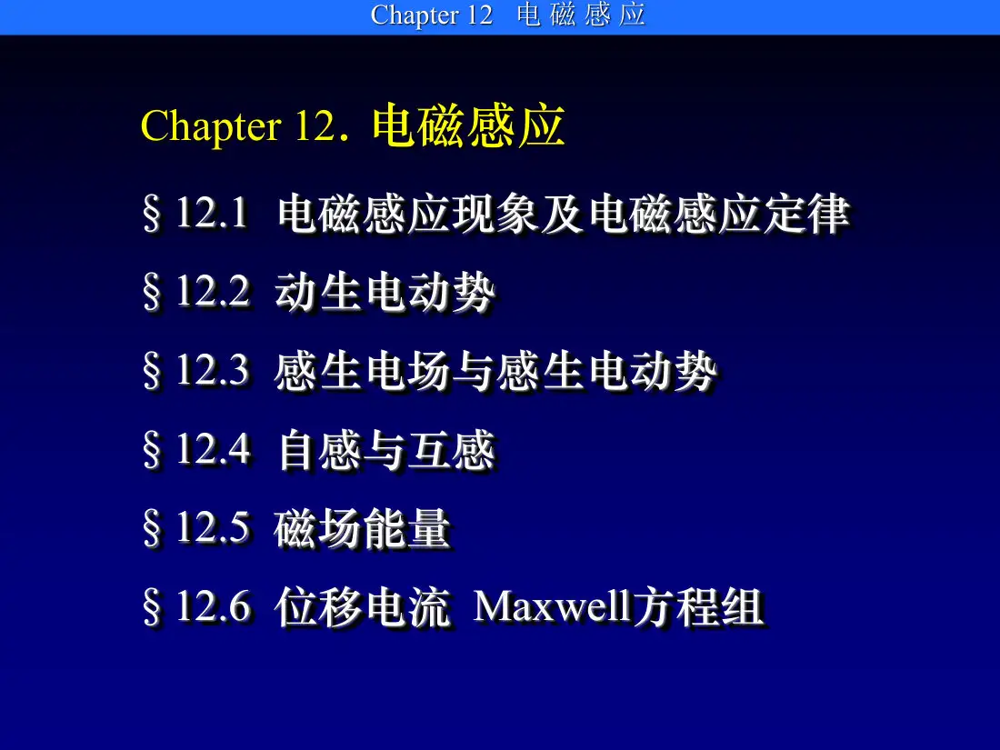

# 《大学物理》第12章 电磁感应（课件）

原件的每一页，下面附识别出的文字。

### Chapter 12. 电磁感应

原文：

Chapter 12. 电磁感应

§ 12.1 电磁感应现象及电磁感应定律

§ 12.2 动生电动势

§ 12.3 感生电场与感生电动势

§ 12.4 自感与互感

§ 12.5 磁场能量

§ 12.6 位移电流 Maxwell方程组

Chapter 12 电磁感应
