# 《大学物理》第13章 热力学基础 13-7 熵 熵增加原理（课件）

原件的每一页，下面附识别出的文字。

### 一 熵

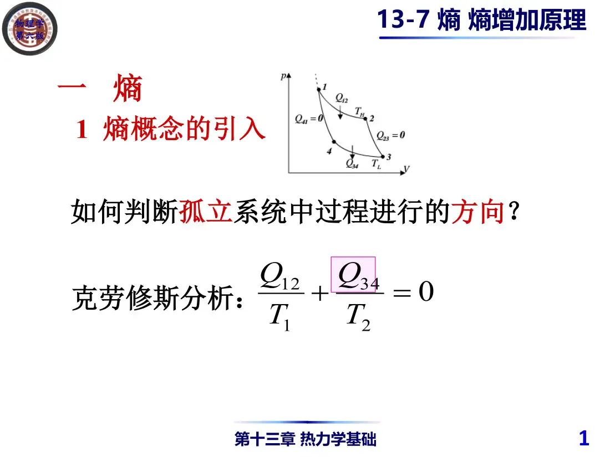

原文：

一 熵

1 熵概念的引入

如何判断孤立系统中过程进行的方向？

克劳修斯分析： $\frac { Q _ { 1 2 } } { T _ { 1 } } + \frac { Q _ { 3 4 } } { T _ { 2 } } = 0$ 热温比 等温过程中吸收或放出的热T 量与热源温度之比 .

物理学第六版

13-7 熵 熵增加原理

第十三章 热力学基础

1

### 结论 ：卡诺循环是可逆循环，热温比总和为零 .

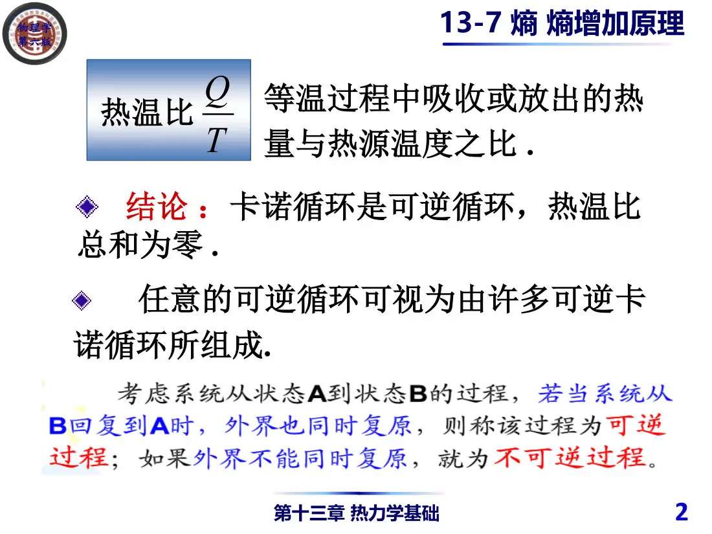

原文：

结论 ：卡诺循环是可逆循环，热温比总和为零 .

任意的可逆循环可视为由许多可逆卡 诺循环所组成.

考虑系统从状态A到状态B的过程，若当系统从B回复到A时，外界也同时复原，则称该过程为可逆过程；如果外界不能同时复原，就为不可逆过程。

物理学第六版

13-7 熵 熵增加原理

第十三章 热力学基础

2

### 一微小可逆卡诺循环

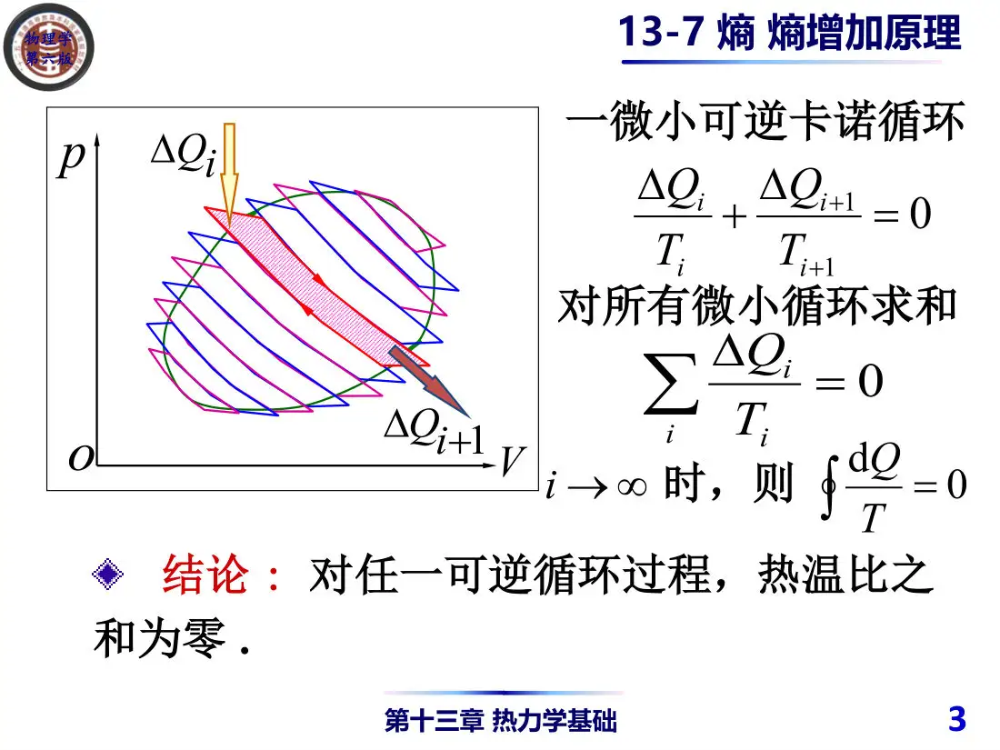

原文：

一微小可逆卡诺循环

$$
\frac {\Delta Q _ {i}}{T _ {i}} + \frac {\Delta Q _ {i + 1}}{T _ {i + 1}} = 0
$$

对所有微小循环求和

$$
\sum_ {i} \frac {\Delta Q _ {i}}{T _ {i}} = 0
$$

$$
i \to \infty
$$

$$
\oint \frac {\mathrm{d} Q}{T} = 0
$$

结论 : 对任一可逆循环过程，热温比之和为零 .

物理学第六版

13-7 熵 熵增加原理

第十三章 热力学基础

3

### 2 熵是状态函数

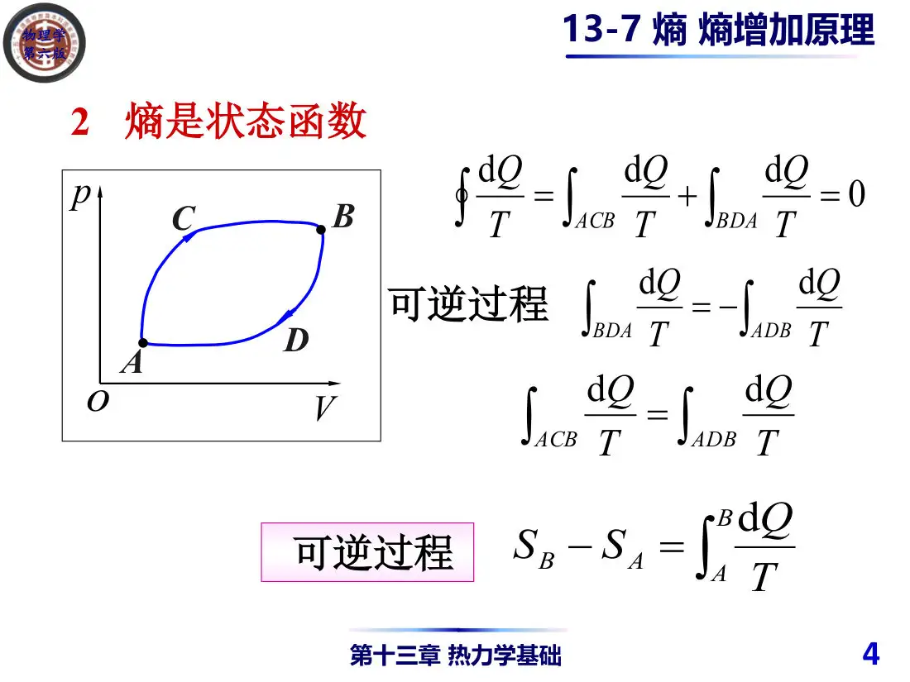

原文：

2 熵是状态函数

$$
\oint \frac {\mathrm{d} Q}{T} = \int_ {A C B} \frac {\mathrm{d} Q}{T} + \int_ {B D A} \frac {\mathrm{d} Q}{T} = 0
$$

可逆过程 $\int _ { B D A } { \frac { \mathrm { d } Q } { T } } = - \int _ { A D B } { \frac { \mathrm { d } Q } { T } }$

$$
\int_ {A C B} \frac {\mathrm{d} Q}{T} = \int_ {A D B} \frac {\mathrm{d} Q}{T}
$$

可逆过程 $S _ { B } - S _ { A } = \int _ { A } ^ { B } { \frac { \mathrm { d } Q } { T } }$

物理学第六版

13-7 熵 熵增加原理

第十三章 热力学基础

4

### 物理意义

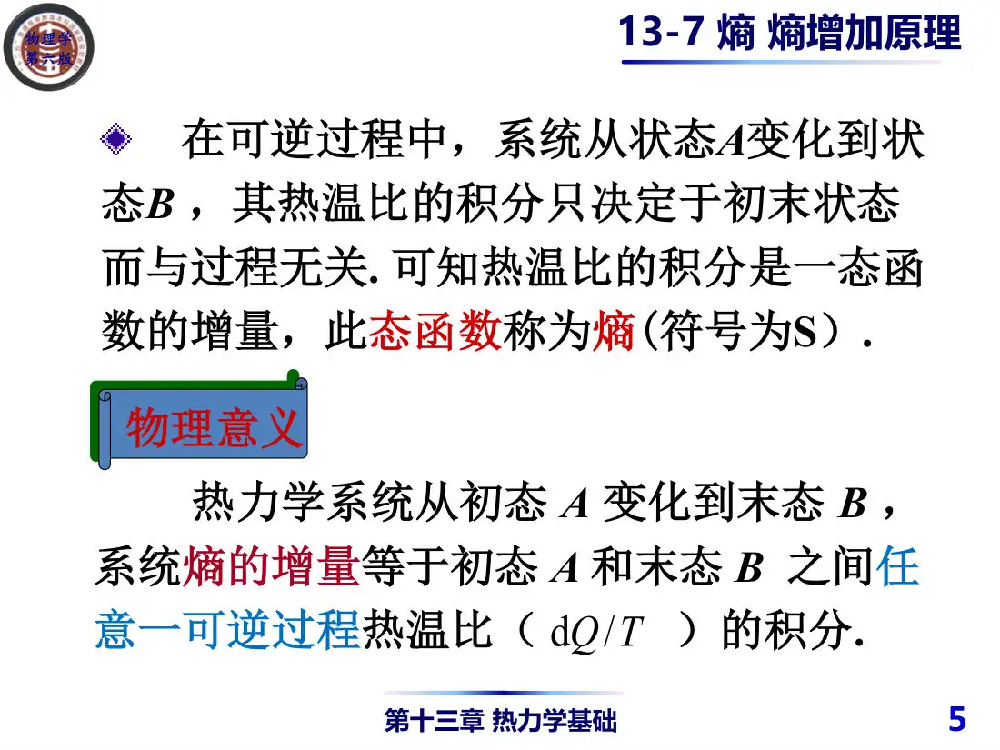

原文：

在可逆过程中，系统从状态A变化到状态B ，其热温比的积分只决定于初末状态而与过程无关. 可知热温比的积分是一态函数的增量，此态函数称为熵(符号为S）.

物理意义

热力学系统从初态A 变化到末态 B ，系统熵的增量等于初态A 和末态B 之间任意一可逆过程热温比（ dQ/T ）的积分.

物理学第六版

13-7 熵 熵增加原理

第十三章 热力学基础

5

### 可逆过程

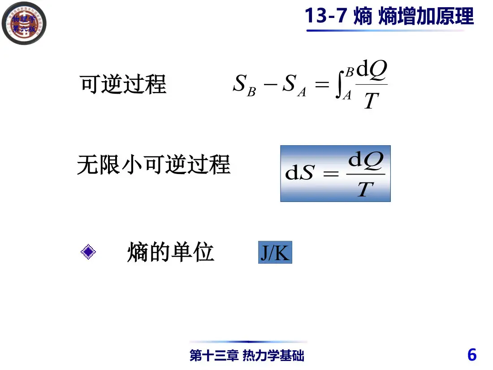

原文：

可逆过程

$$
S _ {B} - S _ {A} = \int_ {A} ^ {B} \frac {\mathrm{d} Q}{T}
$$

无限小可逆过程

$$
\mathrm{d} S = \frac {\mathrm{d} Q}{T}
$$

熵的单位

$$
\mathrm{J} / \mathrm{K}
$$

物理学第六版

13-7 熵 熵增加原理

第十三章 热力学基础

6

### 二 熵变的计算

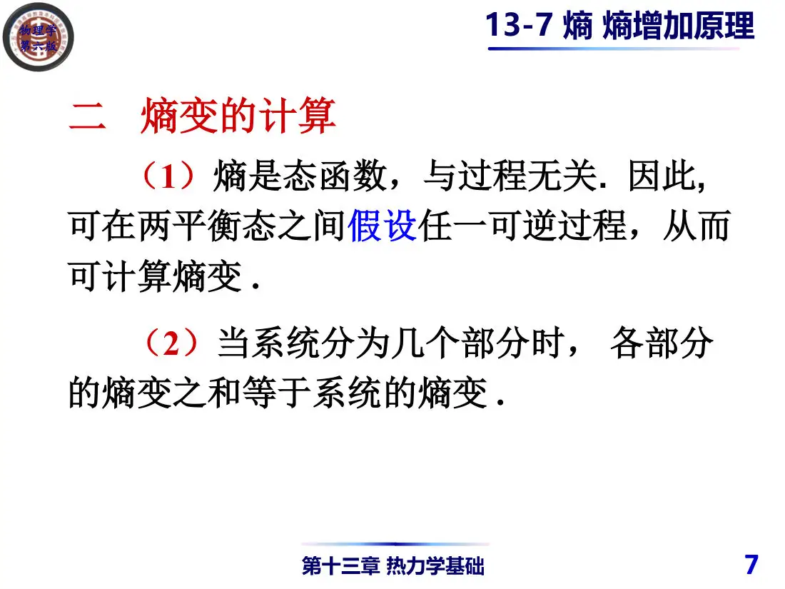

原文：

二 熵变的计算

（1）熵是态函数，与过程无关. 因此,可在两平衡态之间假设任一可逆过程，从而可计算熵变 .

（2）当系统分为几个部分时，各部分的熵变之和等于系统的熵变.

物理学第六版

13-7 熵 熵增加原理

第十三章 热力学基础

7

### 例1 求热传导中的熵变.

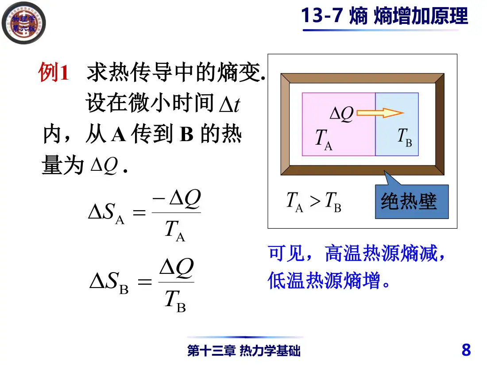

原文：

例1 求热传导中的熵变.

设在微小时间 $\Delta t$ 内，从 A 传到 B 的热量为 $\Delta Q$

$$
\Delta S _ {\mathrm{A}} = \frac {- \Delta Q}{T _ {\mathrm{A}}}
$$

$$
\Delta S _ {\mathrm{B}} = \frac {\Delta Q}{T _ {\mathrm{B}}}
$$

绝热壁

可见，高温热源熵减，低温热源熵增。

物理学第六版

13-7 熵 熵增加原理

第十三章 热力学基础

8

### $$

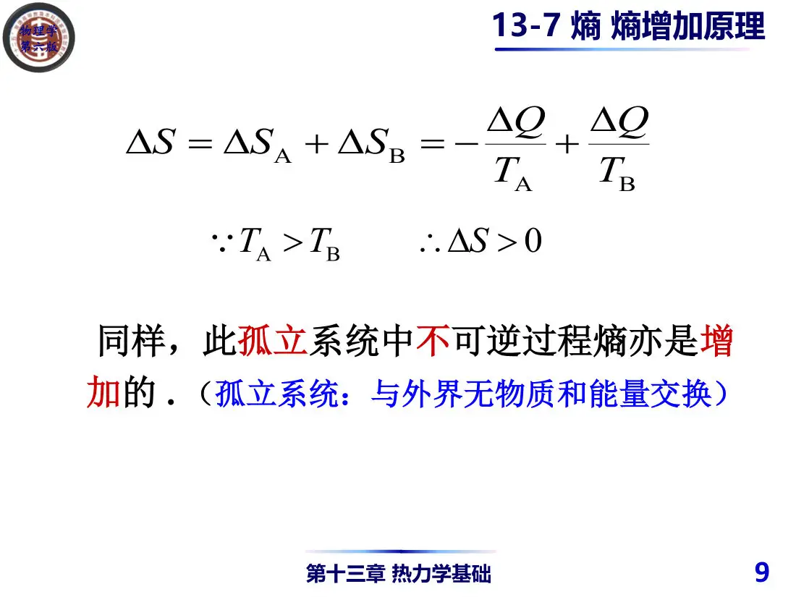

原文：

$$
\begin{array}{r l} \Delta S = \Delta S _ {\mathrm{A}} + \Delta S _ {\mathrm{B}} & = - \frac {\Delta Q}{T _ {\mathrm{A}}} + \frac {\Delta Q}{T _ {\mathrm{B}}} \\ \because T _ {\mathrm{A}} > T _ {\mathrm{B}} & \therefore \Delta S > 0 \end{array}
$$

同样，此孤立系统中不可逆过程熵亦是增加的 . （孤立系统：与外界无物质和能量交换）

物理学第六版

13-7 熵 熵增加原理

第十三章 热力学基础

9

### 三 熵增加原理：

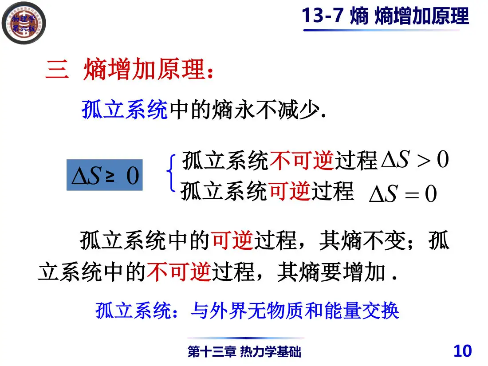

原文：

三 熵增加原理：

孤立系统中的熵永不减少.

$$
\Delta S \ge 0
$$

孤立系统不可逆过程 $\Delta S > 0$ 孤立系统可逆过程 $\Delta S = 0$

孤立系统中的可逆过程，其熵不变；孤立系统中的不可逆过程，其熵要增加 .

孤立系统：与外界无物质和能量交换

物理学第六版

13-7 熵 熵增加原理

第十三章 热力学基础

10

### 四 熵增加原理与热力学第二定律

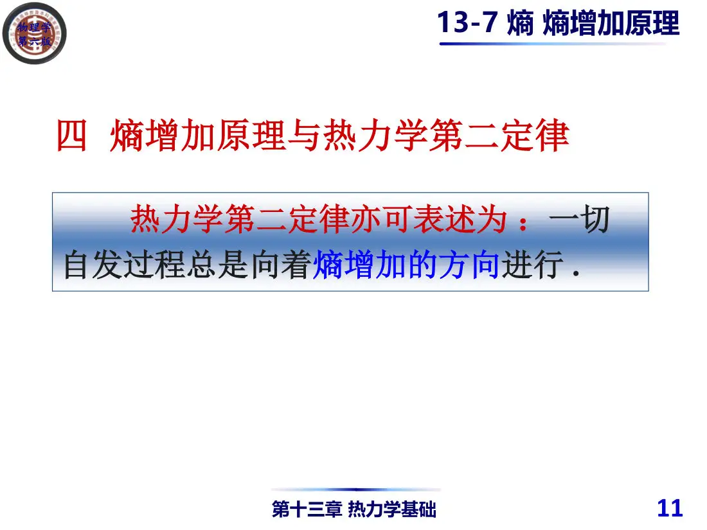

原文：

四 熵增加原理与热力学第二定律

热力学第二定律亦可表述为 ：一切自发过程总是向着熵增加的方向进行.

物理学第六版

13-7 熵 熵增加原理

第十三章 热力学基础

11

### 物理学第六版

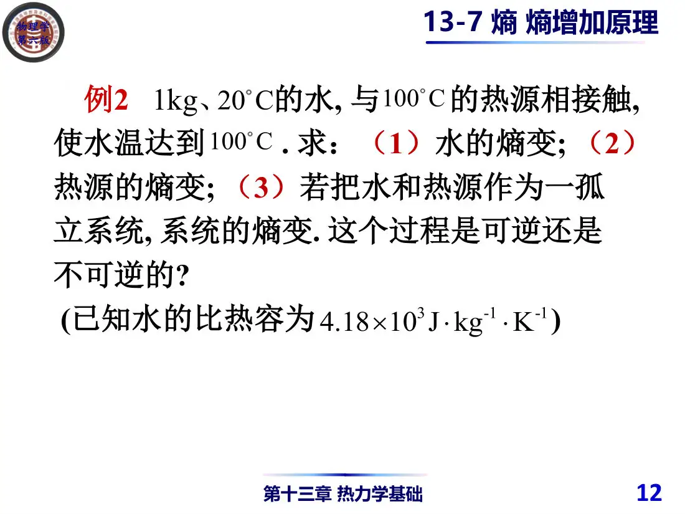

原文：

例2 $1 \mathrm { k g } , 2 0 ^ { \circ } \mathrm { C }$ 的水, 与 $1 0 0 ^ { \circ } C$ 的热源相接触,使水温达到 $1 0 0 ^ { \circ } C$ . 求：（1）水的熵变; （2）热源的熵变; （3）若把水和热源作为一孤立系统, 系统的熵变. 这个过程是可逆还是不可逆的?(已知水的比热容为 $4 . 1 8 { \times } 1 0 ^ { 3 } \mathrm { J } \cdot \mathrm { k g } ^ { - 1 } \cdot \mathrm { K } ^ { - 1 } )$

物理学第六版

13-7 熵 熵增加原理

第十三章 热力学基础

12

### 解（1）水的熵变 $\Delta S _ { 1 }$ 为

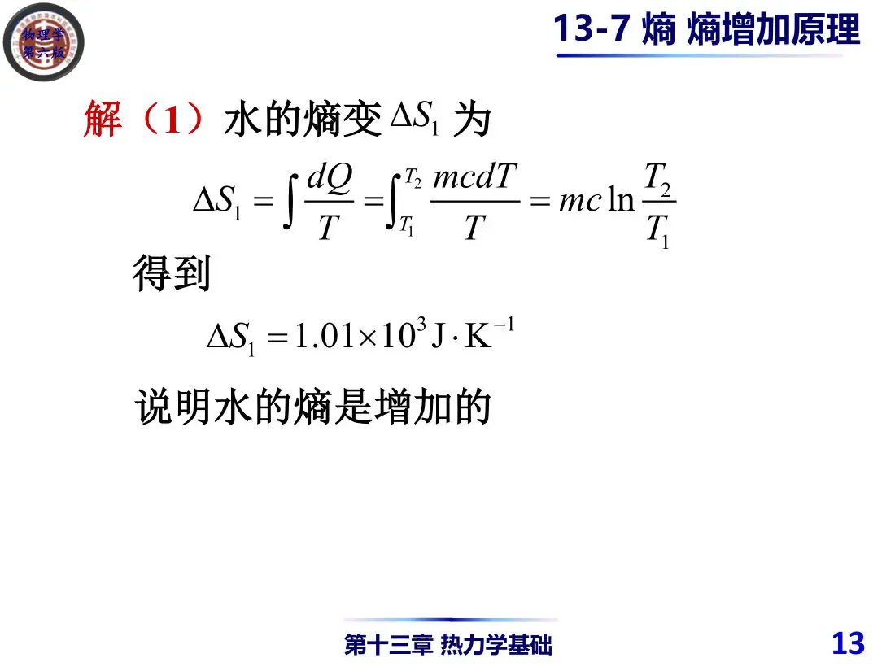

原文：

解（1）水的熵变 $\Delta S _ { 1 }$ 为

$$
\Delta S _ {1} = \int \frac {d Q}{T} = \int_ {T _ {1}} ^ {T _ {2}} \frac {m c d T}{T} = m c \ln \frac {T _ {2}}{T _ {1}}
$$

得到

$$
\Delta S _ {1} = 1. 0 1 \times 1 0 ^ {3} \mathrm{J} \cdot \mathrm{K} ^ {- 1}
$$

说明水的熵是增加的

物理学第六版

13-7 熵 熵增加原理

第十三章 热力学基础

13

### （2）热源的熵变

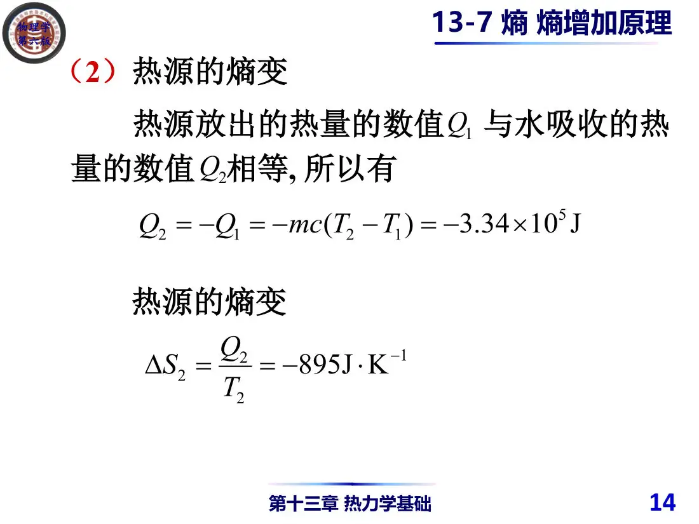

原文：

（2）热源的熵变

热源放出的热量的数值 $\mathcal { Q } _ { 1 }$ 与水吸收的热量的数值 $\mathcal { Q } _ { 2 }$ 相等, 所以有

$$
Q _ {2} = - Q _ {1} = - m c \left(T _ {2} - T _ {1}\right) = - 3. 3 4 \times 1 0 ^ {5} \mathrm{J}
$$

热源的熵变

$$
\Delta S _ {2} = \frac {Q _ {2}}{T _ {2}} = - 8 9 5 \mathrm{J} \cdot \mathrm{K} ^ {- 1}
$$

物理学第六版

13-7 熵 熵增加原理

第十三章 热力学基础

14

### $$

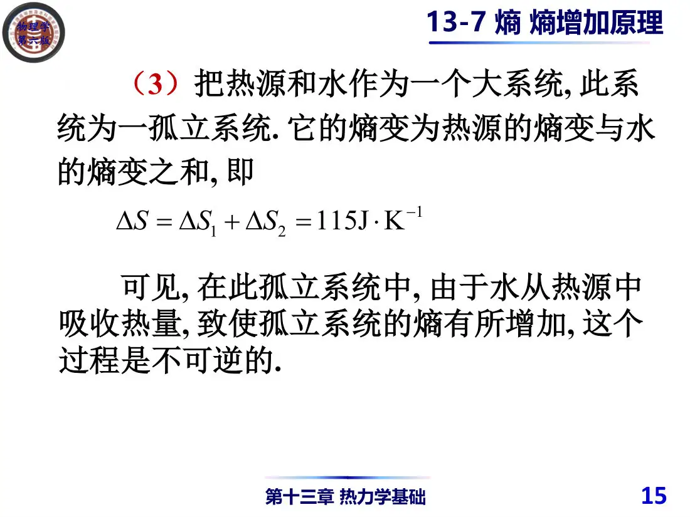

原文：

（3）把热源和水作为一个大系统, 此系统为一孤立系统. 它的熵变为热源的熵变与水的熵变之和, 即

$$
\Delta S = \Delta S _ {1} + \Delta S _ {2} = 1 1 5 \mathrm{J} \cdot \mathrm{K} ^ {- 1}
$$

可见, 在此孤立系统中, 由于水从热源中吸收热量, 致使孤立系统的熵有所增加, 这个过程是不可逆的.

物理学第六版

13-7 熵 熵增加原理

第十三章 热力学基础

15

### $$

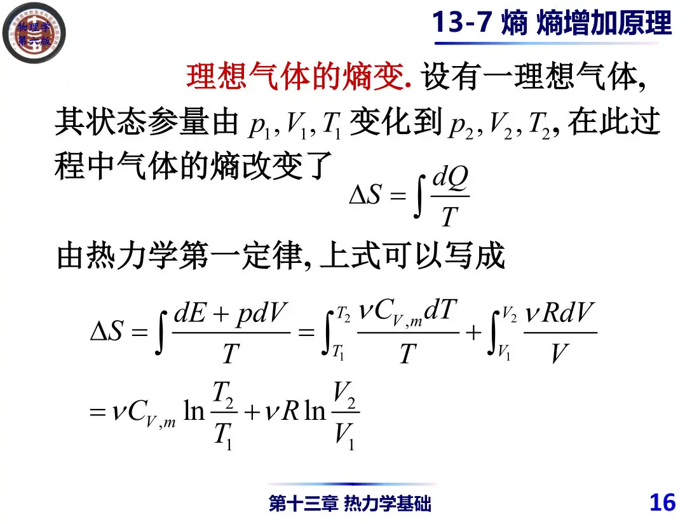

原文：

理想气体的熵变. 设有一理想气体,其状态参量由 $p _ { 1 } , V _ { 1 } , T _ { 1 }$ 变化到 $p _ { 2 } , V _ { 2 } , T _ { 2 }$ , 在此过程中气体的熵改变了 $\Delta S = \int { \frac { d Q } { T } }$ 由热力学第一定律, 上式可以写成

$$
\begin{array}{l} \Delta S = \int \frac {d E + p d V}{T} = \int_ {T _ {1}} ^ {T _ {2}} \frac {\nu C _ {V , m} d T}{T} + \int_ {V _ {1}} ^ {V _ {2}} \frac {\nu R d V}{V} \\ = \nu C _ {V, m} \ln \frac {T _ {2}}{T _ {1}} + \nu R \ln \frac {V _ {2}}{V _ {1}} \end{array}
$$

物理学第六版

13-7 熵 熵增加原理

第十三章 热力学基础

16

### 理想气体在等温过程中的熵变为

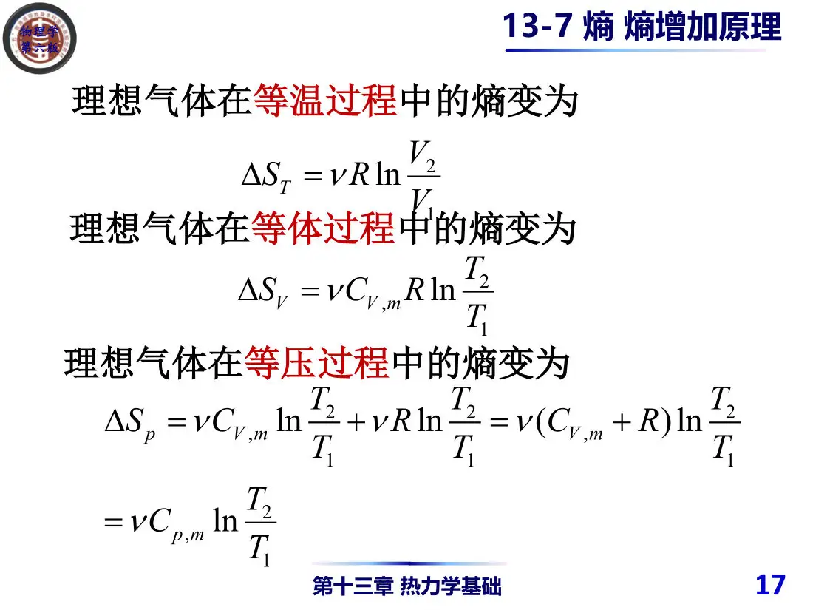

原文：

理想气体在等温过程中的熵变为

∆S = vR ln V2理想气体在等体过程中的熵变为

$$
\Delta S _ {V} = \nu C _ {V, m} R \ln \frac {T _ {2}}{T _ {1}}
$$

理想气体在等压过程中的熵变为

$$
\begin{array}{l} \Delta S _ {p} = \nu C _ {V, m} \ln \frac {T _ {2}}{T _ {1}} + \nu R \ln \frac {T _ {2}}{T _ {1}} = \nu (C _ {V, m} + R) \ln \frac {T _ {2}}{T _ {1}} \\ = \nu C _ {p, m} \ln \frac {T _ {2}}{T _ {1}} \end{array}
$$

物理学第六版

13-7 熵 熵增加原理

第十三章 热力学基础

17
