# 《大学物理》第13章 热力学基础 §13.1 热力学平衡过程及过程参量（课件）

原件的每一页，下面附识别出的文字。

### §13. 1 热力学平衡过程及过程参量

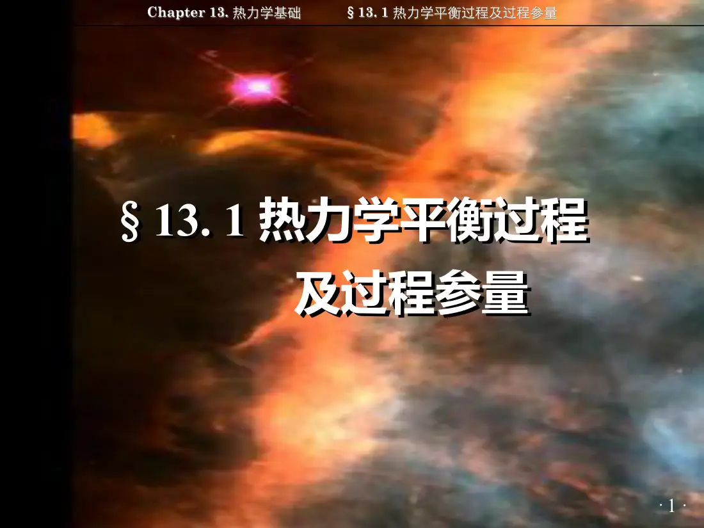

原文：

§13. 1 热力学平衡过程及过程参量

Chapter 13. 热力学基础

§13. 1 热力学平衡过程及过程参量

· 1

### Chapter 13. 热力学基础

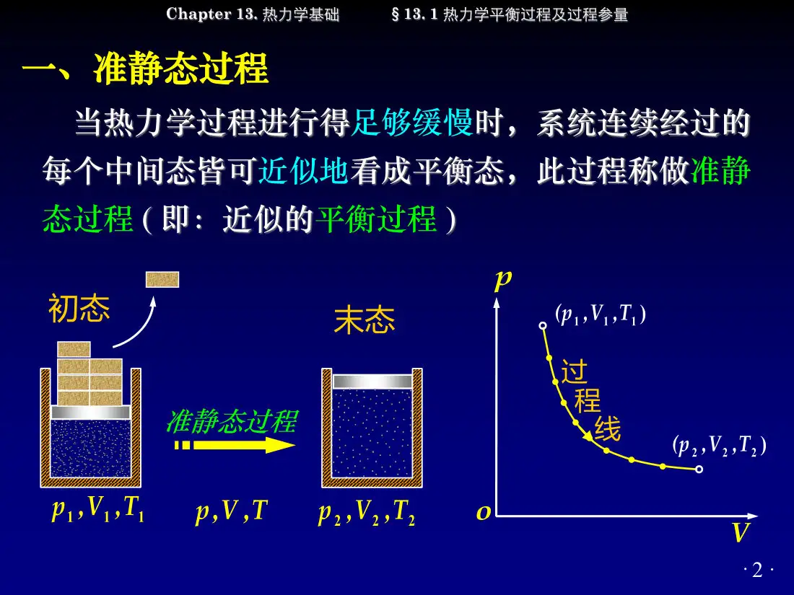

原文：

Chapter 13. 热力学基础

一、准静态过程

当热力学过程进行得足够缓慢时，系统连续经过的每个中间态皆可近似地看成平衡态，此过程称做准静态过程 ( 即：近似的平衡过程 )

初态

准静态过程

$$
p, V, T
$$

末态

$$
p _ {2}, V _ {2}, T _ {2}
$$

$$
(p _ {1}, V _ {1}, T _ {1})
$$

$$
(p _ {2}, V _ {2}, T _ {2})
$$

§13. 1 热力学平衡过程及过程参量

· 2

### 对准静态升温过程也是如此，即升温过程非常缓慢。

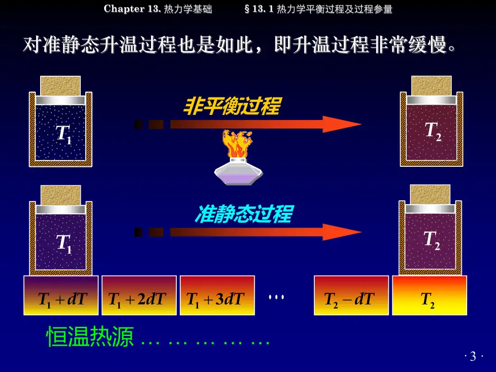

原文：

对准静态升温过程也是如此，即升温过程非常缓慢。

非平衡过程

$$
T _ {1} + d T
$$

准静态过程

$$
T _ {1} + 2 d T
$$

T1+3dT

$$
T _ {2} - d T
$$

$$
T _ {2}
$$

恒温热源

Chapter 13. 热力学基础

§13. 1 热力学平衡过程及过程参量

· 3

### 常见的准静态过程：

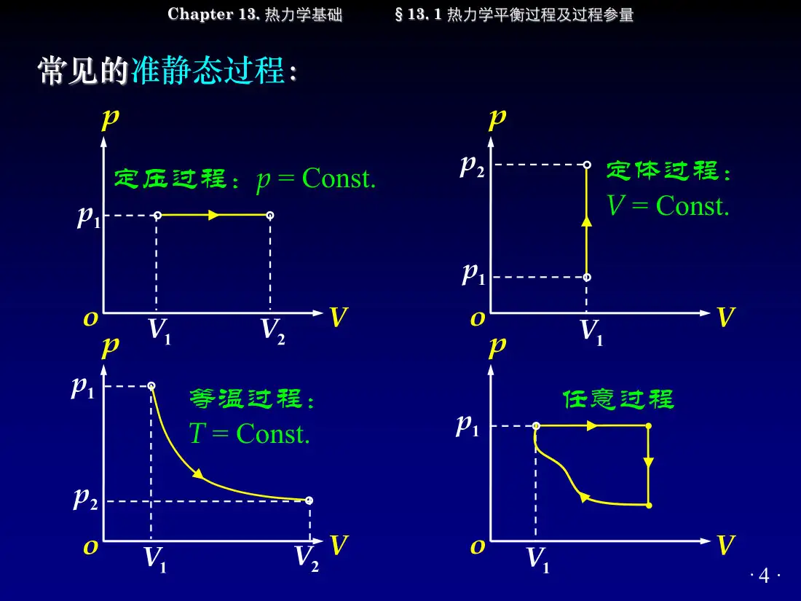

原文：

常见的准静态过程：

Chapter 13. 热力学基础

§13. 1 热力学平衡过程及过程参量

· 4

### Chapter 13. 热力学基础

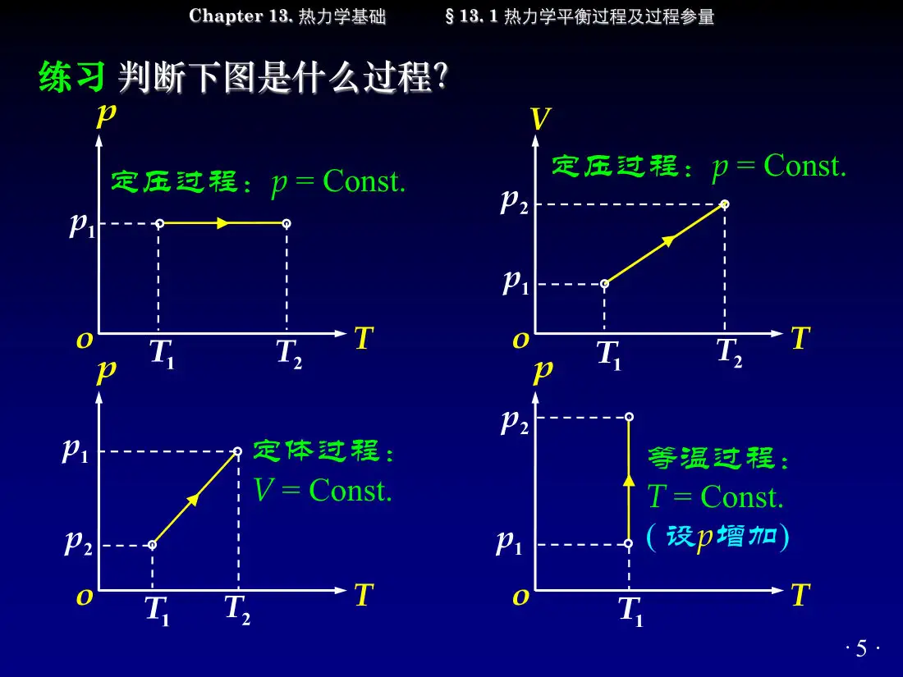

原文：

Chapter 13. 热力学基础

练习 判断下图是什么过程？

§13. 1 热力学平衡过程及过程参量

· 5

### Chapter 13. 热力学基础

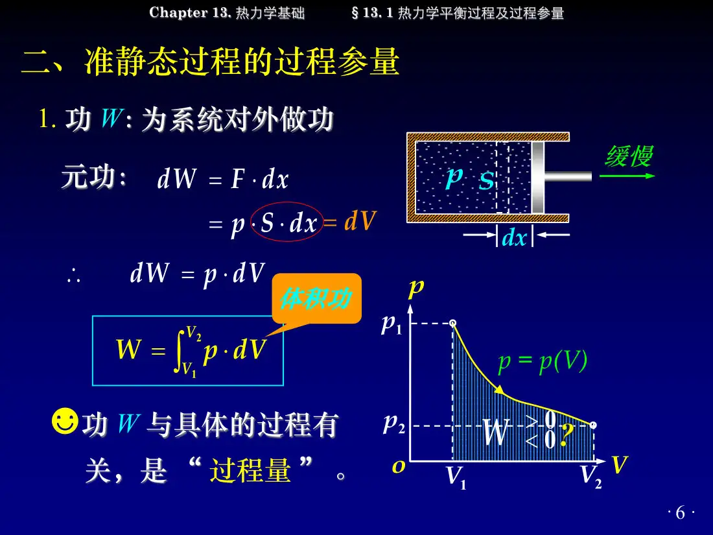

原文：

Chapter 13. 热力学基础

§13. 1 热力学平衡过程及过程参量

二、准静态过程的过程参量

1. 功 W：为系统对外做功

元功： dW = F·dx= p·S·dx= dV

$$
d W = p \cdot d V
$$

$$
W = \int_ {V _ {1}} ^ {V _ {2}} p \cdot d V
$$

☻功 W 与具体的过程有关，是 “ 过程量 ”

· 6

### Chapter 13. 热力学基础

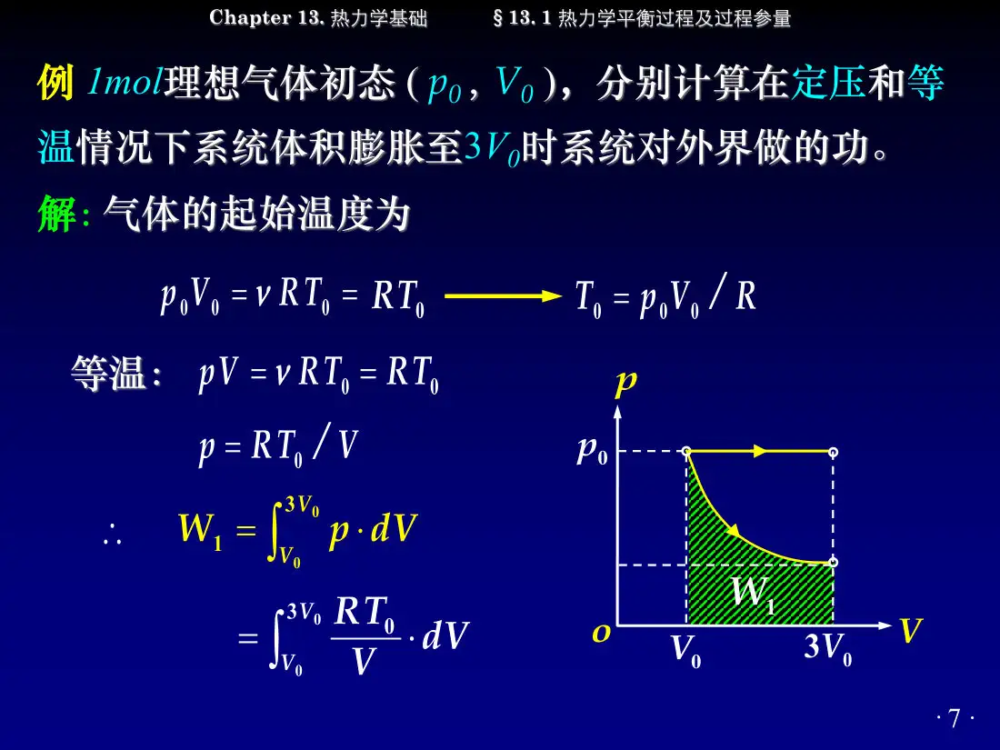

原文：

Chapter 13. 热力学基础

§13. 1 热力学平衡过程及过程参量

例 1mol理想气体初态 $( 1 1 0 , 1 0 )$ 分别计算在定压和等温情况下系统体积膨胀至3V时系统对外界做的功。

解：气体的起始温度为

$$
p _ {0} V _ {0} = \nu R T _ {0} = R T _ {0} \longrightarrow T _ {0} = p _ {0} V _ {0} / R
$$

$$
\begin{array}{r l} & p V = \nu R T _ {0} = R T _ {0} \\ & p = R T _ {0} / V \\ & W _ {1} = \int_ {V _ {0}} ^ {3 V _ {0}} p \cdot d V \\ & = \int_ {V _ {0}} ^ {3 V _ {0}} \frac {R T _ {0}}{V} \cdot d V \end{array}
$$

· 7

### Chapter 13. 热力学基础

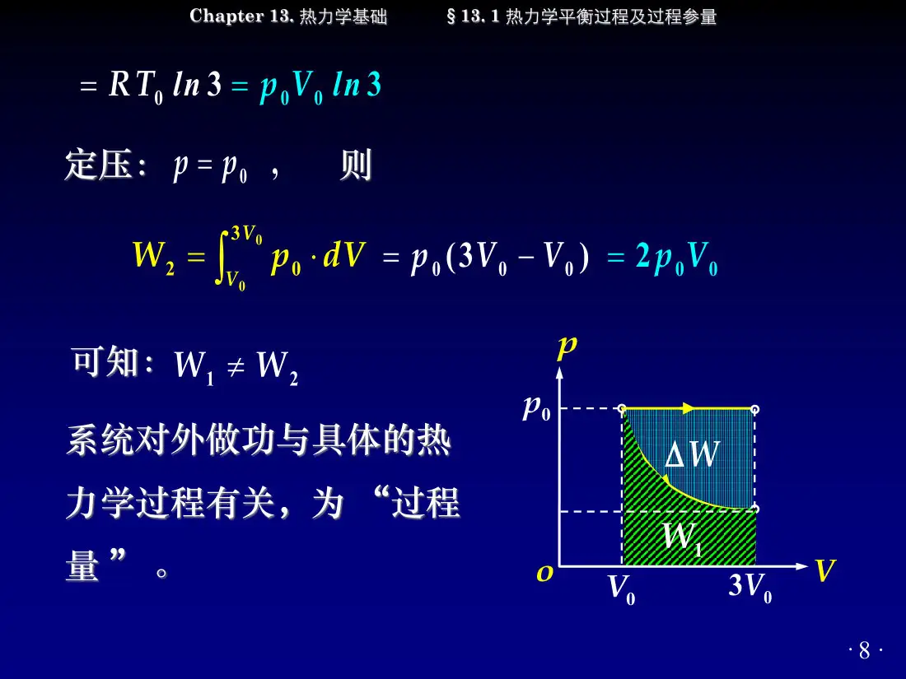

原文：

Chapter 13. 热力学基础

§13. 1 热力学平衡过程及过程参量

$$
= R T _ {0} \ln 3 = p _ {0} V _ {0} \ln 3
$$

定压： $1 9 - 1 9 = 1 9$ ， 则

$$
W _ {2} = \int_ {V _ {0}} ^ {3 V _ {0}} p _ {0} \cdot d V = p _ {0} (3 V _ {0} - V _ {0}) = 2 p _ {0} V _ {0}
$$

可知： $\textcircled { 4 } \textcircled { 2 } \textcircled { 2 } \textcircled { 2 } \textcircled { 2 } \textcircled { 2 }$ 系统对外做功与具体的热力学过程有关，为 “过程量 ”

8

### Chapter 13. 热力学基础

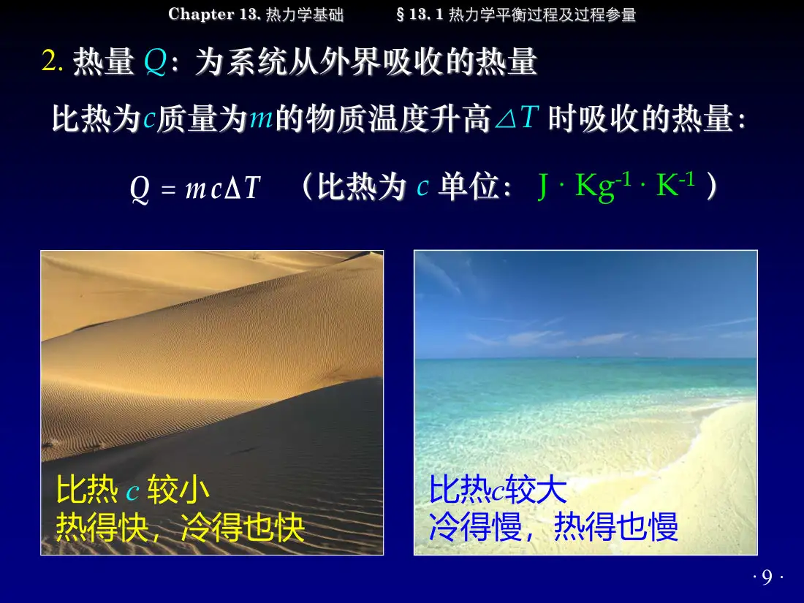

原文：

Chapter 13. 热力学基础

2. 热量 Q：为系统从外界吸收的热量

比热为c质量为m的物质温度升高△T 时吸收的热量：

$\textcircled { 9 } = \textcircled { 1 1 } \textcircled { 9 } \textcircled { 1 }$ （比热为 c 单位： $1 1 0 1 5 0 0 1 5 0 0 1 5 0 0 1 5 0 0 1$

比热 c 较小热得快，冷得也快

比热c较大冷得慢，热得也慢

§13. 1 热力学平衡过程及过程参量

· 9

### Chapter 13. 热力学基础 §13. 1 热力学平衡过程及过程参量

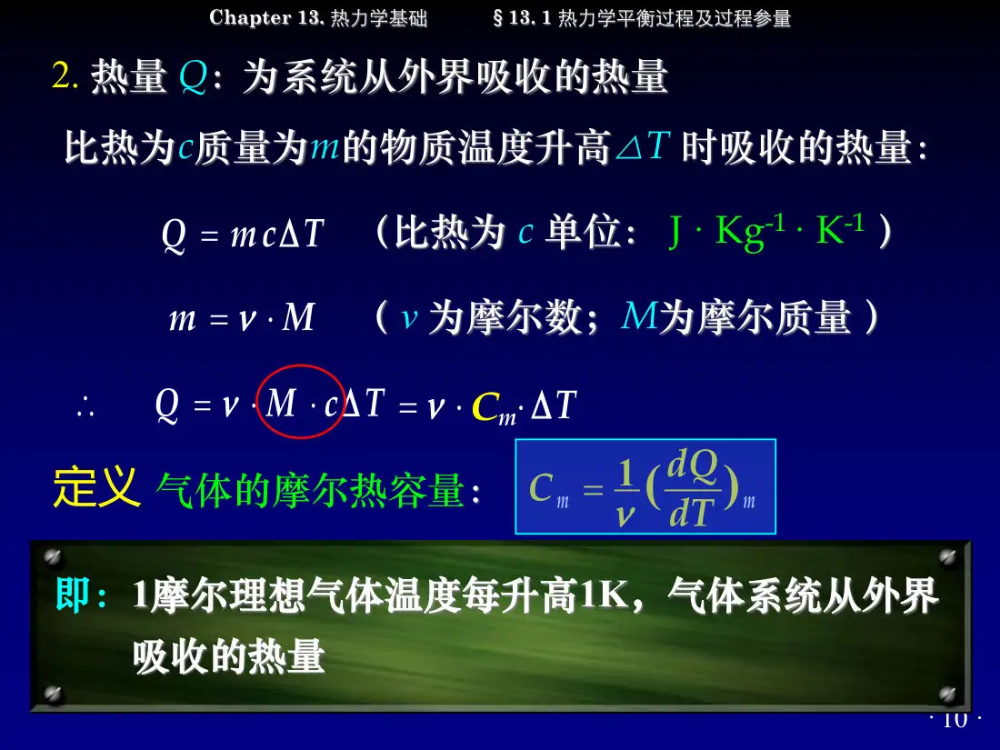

原文：

Chapter 13. 热力学基础 §13. 1 热力学平衡过程及过程参量

2. 热量 Q：为系统从外界吸收的热量

比热为c质量为m的物质温度升高△T 时吸收的热量：

$\textcircled { 1 } = 1 1 0 0 \times 1 1$ （比热为 c 单位： $| | \cos | \leq | | \cos | | < | | \sin | |$

$1 7 0 - 1 7 = 1 7 2 0 1 1$ （ v 为摩尔数；M为摩尔质量 ）

$$
Q = \nu \cdot M \cdot c \Delta T = \nu \cdot C _ {m} \cdot \Delta T
$$

定义 气体的摩尔热容量： $\frac { 1 0 } { 1 1 } = \frac { 1 1 } { 1 1 } ( \frac { 1 0 } { 1 1 } )$

即：1摩尔理想气体温度每升高1K，气体系统从外界吸收的热量

· 10

### Chapter 13. 热力学基础

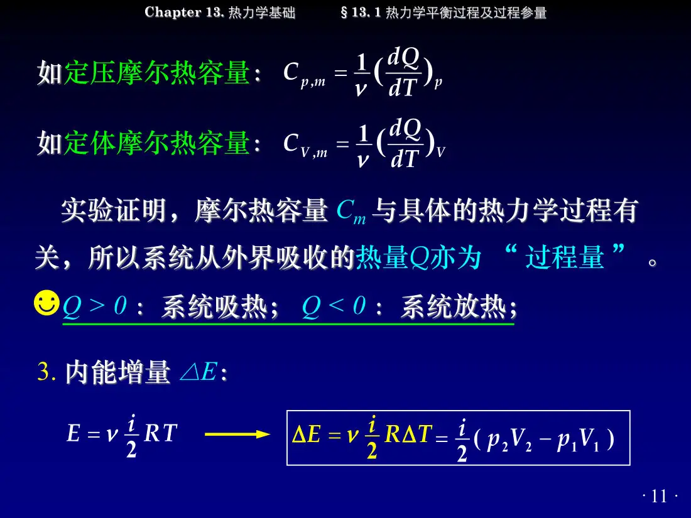

原文：

Chapter 13. 热力学基础

§13. 1 热力学平衡过程及过程参量

如定压摩尔热容量： $\frac { 1 } { 2 } \times \frac { 1 } { 3 } = \frac { 1 } { 2 } ( c m ^ { 2 } )$

如定体摩尔热容量： $\frac { 1 } { 2 } \times \frac { 1 } { 3 } = \frac { 1 } { 2 } ( c m ^ { 2 } )$

实验证明，摩尔热容量 $\textcircled { \bullet }$ 与具体的热力学过程有关，所以系统从外界吸收的热量Q亦为 “ 过程量 ”$\odot$ ：系统吸热； $\textcircled { 4 } \times \textcircled { 4 }$ ：系统放热；

3. 内能增量 $\angle A D B$ ：

$$
E = \nu \frac {i}{2} R T \longrightarrow \Delta E = \nu \frac {i}{2} R \Delta T = \frac {i}{2} (p _ {2} V _ {2} - p _ {1} V _ {1})
$$

· 11

### §13. 1 热力学平衡过程及过程参量

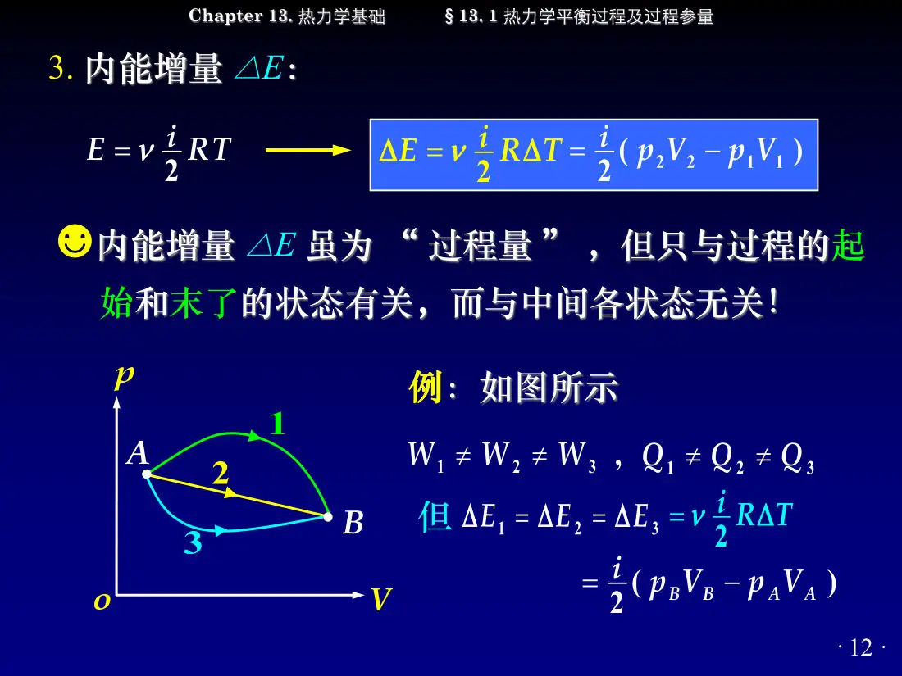

原文：

§13. 1 热力学平衡过程及过程参量

3. 内能增量 $\textcircled { 4 } \textcircled { 2 }$

$$
E = \nu \frac {i}{2} R T \longrightarrow \Delta E = \nu \frac {i}{2} R \Delta T = \frac {i}{2} (p _ {2} V _ {2} - p _ {1} V _ {1})
$$

☻内能增量 $\Delta V _ { 2 }$ 虽为 “ 过程量 ” ，但只与过程的起始和末了的状态有关，而与中间各状态无关！

例：如图所示

$$
\begin{array}{r l} & W _ {1} \neq W _ {2} \neq W _ {3}, Q _ {1} \neq Q _ {2} \neq Q _ {3} \\ & \text {但} \Delta E _ {1} = \Delta E _ {2} = \Delta E _ {3} = \nu \frac {i}{2} R \Delta T \\ & \quad = \frac {i}{2} (p _ {B} V _ {B} - p _ {A} V _ {A}) \end{array}
$$

· 12

### 归纳

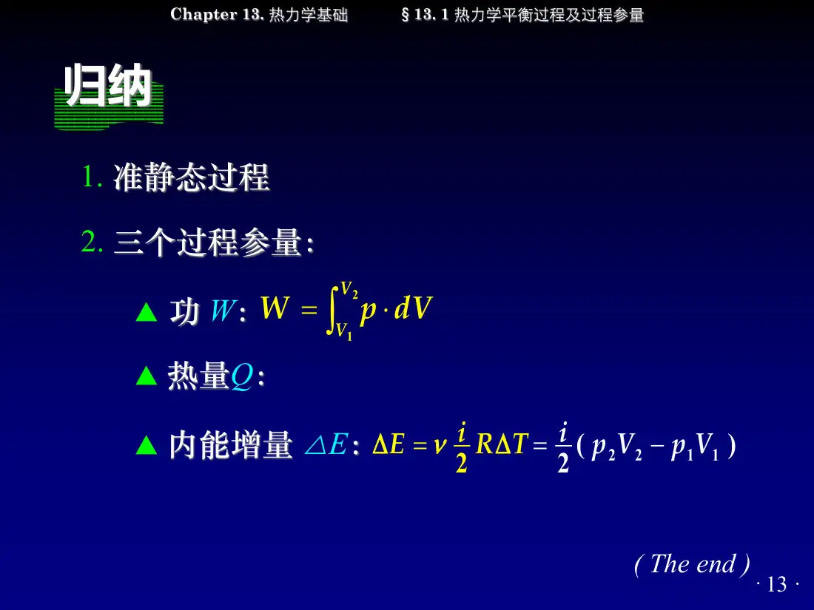

原文：

归纳

1. 准静态过程

2. 三个过程参量：

功 W： $1 0 0 - 1 1 = 1 1 0 0 0 1 1 1$

热量Q：

▲ 内能增量 $\angle B A B = \angle B A D = \angle B A C = \angle C A B = \angle C A C = \angle C A C$

Chapter 13. 热力学基础

§13. 1 热力学平衡过程及过程参量

( The end )

13
