# 《大学物理》第13章 热力学基础 §13.3 绝热过程 多方过程（课件）

原件的每一页，下面附识别出的文字。

### §13. 3 绝热过程 多方过程

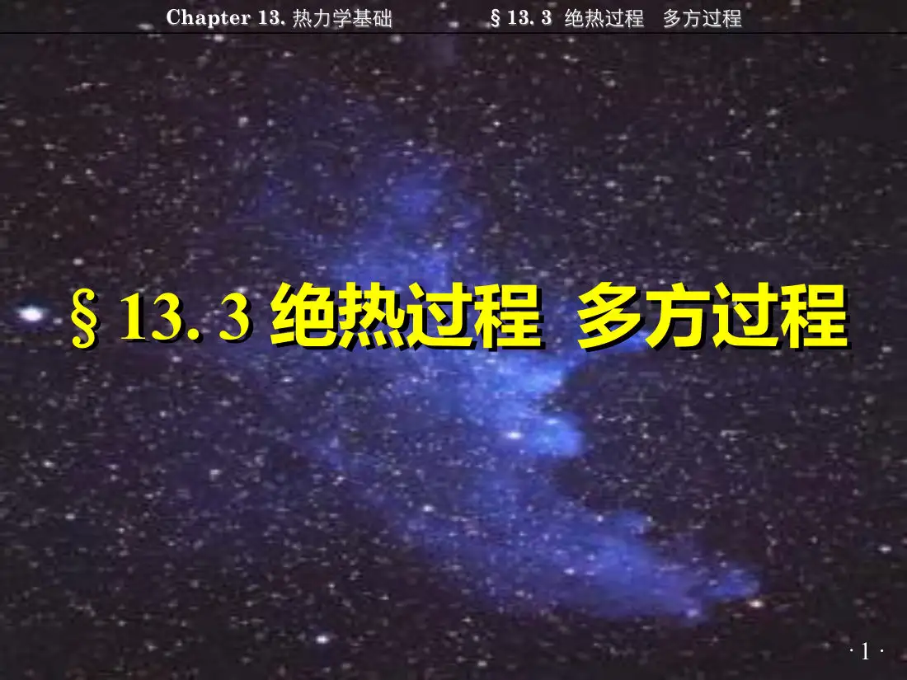

原文：

§13. 3 绝热过程 多方过程

Chapter 13. 热力学基础 §13. 3 绝热过程 多方过程

· 1

### 一、准静态绝热过程

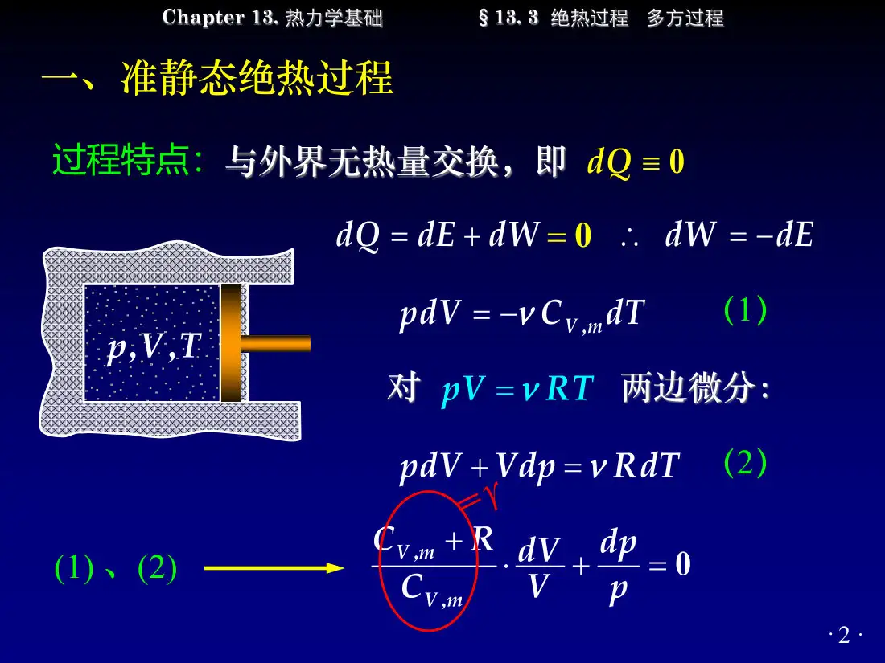

原文：

一、准静态绝热过程

过程特点：与外界无热量交换，即 $0 . 0 0 \times 0 . 0 0 = 0 . 0 0$

dQ =dE +dW=0 ∴ dW =−dE

$$
p d V = - \nu C _ {V, m} d T
$$

对 $1 2 4 - 1 2 2 = 1 2 4 1$ 两边微分：

$$
p d V + V d p = \nu R d T
$$

Cv,m 十 -R dV dp(1) 、(2) = 0Cv,m p

Chapter 13. 热力学基础

§13. 3 绝热过程 多方过程

· 2

### Chapter 13. 热力学基础

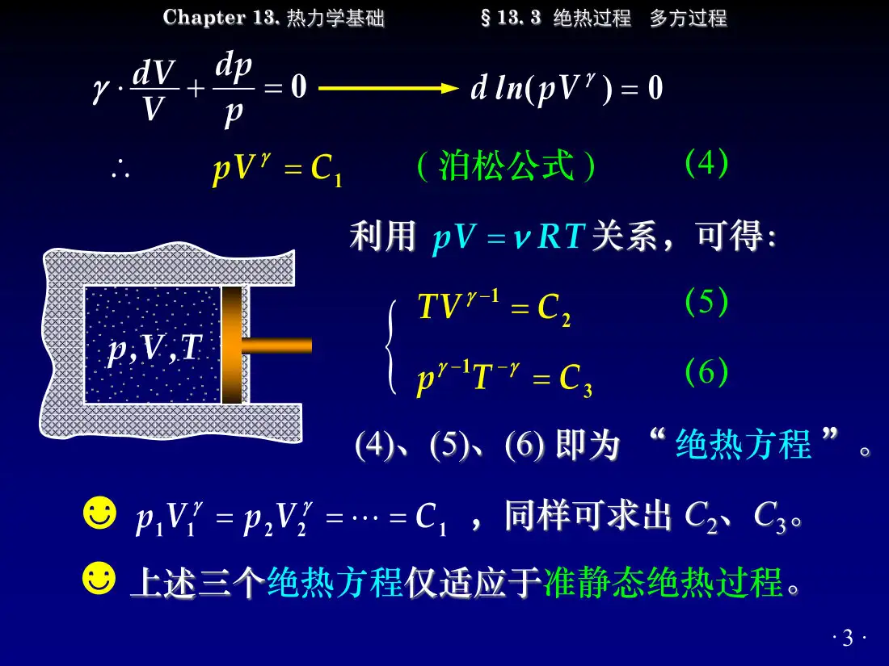

原文：

Chapter 13. 热力学基础

§13. 3 绝热过程 多方过程

$$
\gamma \cdot \frac {d V}{V} + \frac {d p}{p} = 0 \longrightarrow d \ln (p V ^ {\gamma}) = 0
$$

$$
p V ^ {\gamma} = C _ {1}
$$

( 泊松公式 ) （4）

利用 $1 2 \times 2 = 1 2 ( m ^ { 2 } )$ 关系，可得：

$$
T V ^ {\gamma - 1} = C _ {2}
$$

（5）

$$
p ^ {\gamma - 1} T ^ {- \gamma} = C _ {3}\tag{6}
$$

(4)、(5)、(6) 即为 “ 绝热方程 ”。

☻ $1 2 7 4 \div 2 = 1 2 7 4 \div 2 = 1 0 9$ ，同样可求出 $\textcircled { 4 }$

☻ 上述三个绝热方程仅适应于准静态绝热过程。

· 3

### Chapter 13. 热力学基础

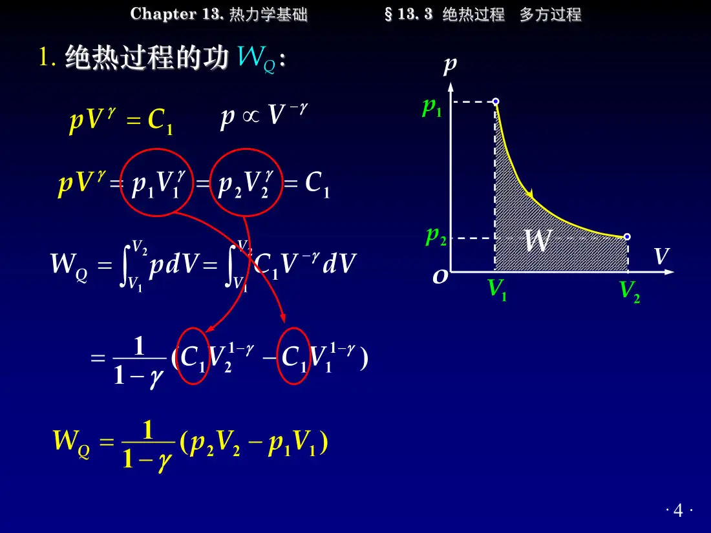

原文：

Chapter 13. 热力学基础

1. 绝热过程的功 $1 \%$

$$
p V ^ {\gamma} = C _ {1} \quad p \propto V ^ {- \gamma}
$$

$$
p V ^ {\gamma} = \left(p _ {1} V _ {1} ^ {\gamma}\right) = \left(p _ {2} V _ {2} ^ {\gamma}\right) = C _ {1}
$$

$$
\begin{array}{l} W _ {Q} = \int_ {V _ {1}} ^ {V _ {2}} p d V = \int_ {V _ {1}} ^ {V _ {2}} C _ {1} V ^ {- \gamma} d V \\ = \frac {1}{1 - \gamma} (C _ {1} V _ {2} ^ {1 - \gamma} - C _ {1} V _ {1} ^ {1 - \gamma}) \end{array}
$$

$$
W _ {Q} = \frac {1}{1 - \gamma} (p _ {2} V _ {2} - p _ {1} V _ {1})
$$

§13. 3 绝热过程 多方过程

· 4

### Chapter 13. 热力学基础

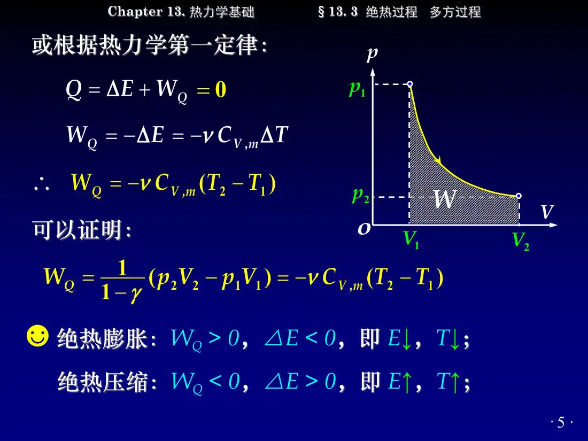

原文：

Chapter 13. 热力学基础

或根据热力学第一定律：

$$
Q = \Delta E + W _ {Q} = 0
$$

$$
W _ {Q} = - \Delta E = - \nu C _ {V, m} \Delta T
$$

WQ =−vCv,m(T2-T1)

可以证明：

§13. 3 绝热过程 多方过程

WQ 1−(p2V2−p,V1)=-−vCv,m(T2−T1)

绝热膨胀： $V _ { 2 } = \frac { V } { 2 }$ $V _ { L } ( 0 ) = \lambda \lambda \lambda ^ { \prime \prime }$ 即 E↓，T↓；绝热压缩： $\because \angle A ^ { \prime } ( 0 ) = \angle O A ^ { \prime } ( 1 ) = 9 0 ^ { \circ }$ ，即 E↑，T↑；

· 5

### Chapter 13. 热力学基础

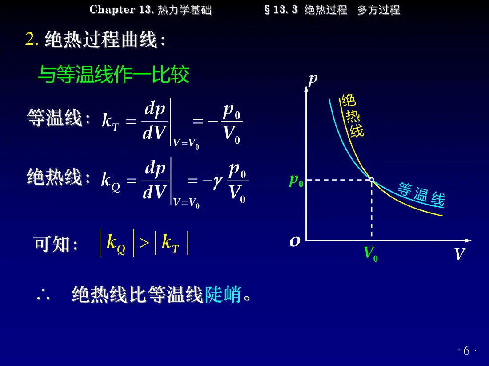

原文：

Chapter 13. 热力学基础

§13. 3 绝热过程 多方过程

2. 绝热过程曲线：

与等温线作一比较

等温线： $1 0 \div \frac { 1 } { 4 } = \frac { 1 } { 4 }$

绝热线： $1 0 0 - \frac { 1 2 0 } { 1 0 0 } = 1 0 0$

可知： $|$

$\mathtt { a } _ { \mathtt { a } }$ 绝热线比等温线陡峭。

· 6

### 如图所示

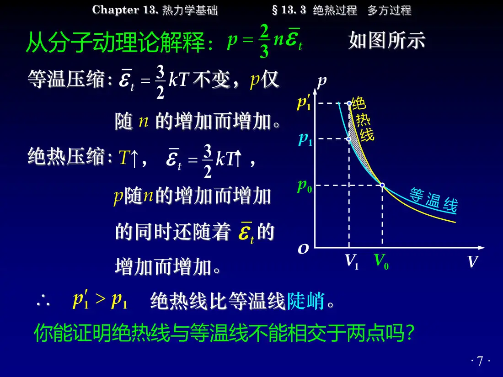

原文：

如图所示

从分子动理论解释： $1 0 - \frac { 1 } { 6 } \times 2 = \frac { 1 } { 6 }$ 等温压缩： $\frac { 1 } { 2 } - \frac { 1 } { 3 } = \frac { 1 } { 2 }$ 不变，p仅随 n 的增加而增加。绝热压缩：T↑， $\frac { 2 } { 3 } = \frac { 3 } { 2 }$ 9p随n的增加而增加的同时还随着 $\circledast$ 的增加而增加。

$1 2 \times 1 2 = 1 2$ 绝热线比等温线陡峭。

你能证明绝热线与等温线不能相交于两点吗？

Chapter 13. 热力学基础

§13. 3 绝热过程 多方过程

· 7

### Chapter 13. 热力学基础

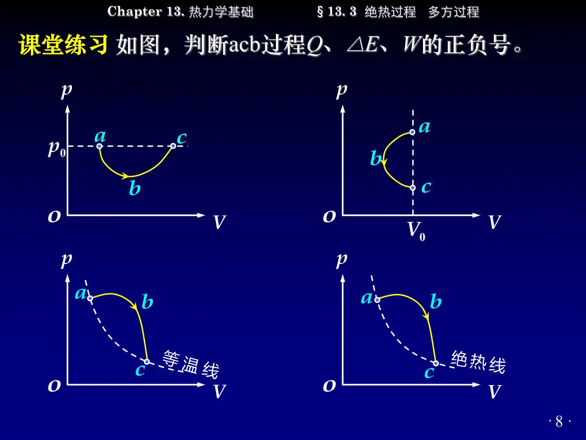

原文：

Chapter 13. 热力学基础

§13. 3 绝热过程 多方过程

课堂练习 如图，判断acb过程Q、△E、W的正负号。

8

### Chapter 13. 热力学基础

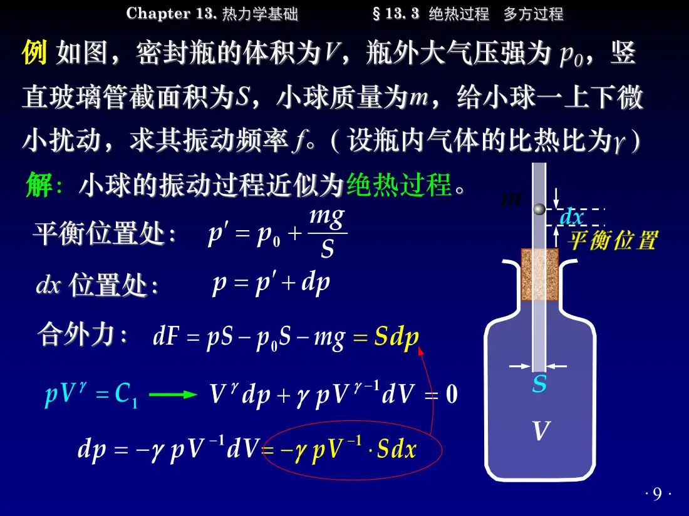

原文：

Chapter 13. 热力学基础

§13. 3 绝热过程 多方过程

例 如图，密封瓶的体积为V，瓶外大气压强为 $1 \textcircled { \div } 2$ 竖直玻璃管截面积为S，小球质量为m，给小球一上下微小扰动，求其振动频率 f。( 设瓶内气体的比热比为γ )

解：小球的振动过程近似为绝热过程。

平衡位置处： $1 2 - 1 2 = 1 4 2$

dx 位置处：

$$
p = p ^ {\prime} + d p
$$

合外力： $( 1 ) 1 2 \div ( 1 2 0 \div 2 ) = 1 2 0 \div 2 = 1 1 2 0 ( m )$

pVγ = C1  Vγdp + γ pVγ-1dV = 0

$$
d p = - \gamma p V ^ {- 1} d V = - \gamma p V ^ {- 1} \cdot S d x
$$

平衡位置

· 9

### Chapter 13. 热力学基础

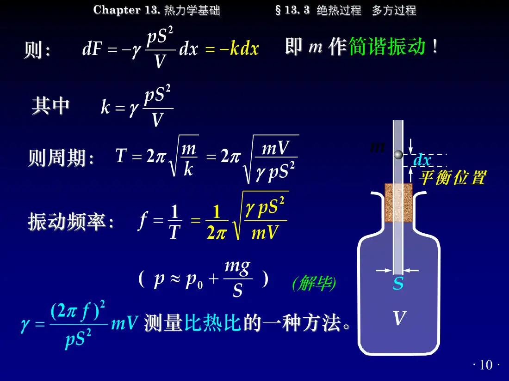

原文：

Chapter 13. 热力学基础

§13. 3 绝热过程 多方过程

则： $\because \frac { 1 } { 2 } = \frac { 1 } { 2 } \frac { 1 2 } { 3 } \times \frac { 1 } { 2 } = \frac { 1 } { 2 } \times \frac { 1 } { 2 }$ 即 m 作简谐振动 !

其中 $1 3 - 1 2 = 1 9$

则周期： $1 1 0 = 2 \times 1 0 = 2 \times 1 0 = 2 \times 1 0 = 2 \times 1 0 = 2 \times 1 0 = 2 \times 1 0 = 2 \times 1 0 = 2 \times 1 0 = 2 \times 1 0$

振动频率： $1 2 - \frac { 1 } { 1 1 } = \frac { 1 } { 1 2 }$

$( 1 0 2 \div 1 2 0 \div \frac { 1 1 4 } { 9 } )$ (解毕)

dx平衡位置

$\frac { \sqrt { 3 } } { 4 } = \frac { \sqrt { 3 } \sqrt { 3 } } { 1 2 } = \frac { \sqrt { 3 } } { 3 }$ 测量比热比的一种方法。

10

### 二、绝热自由膨胀

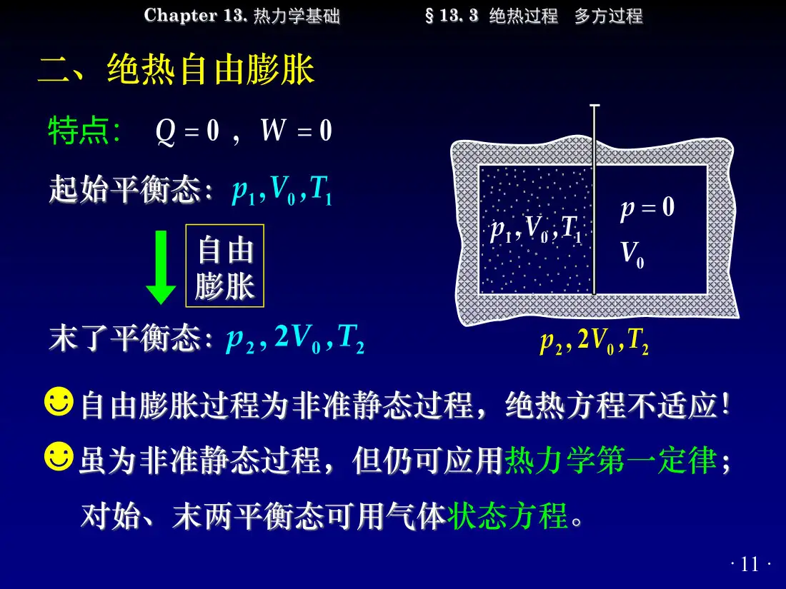

原文：

二、绝热自由膨胀

特点： $\mathbb { W } = \mathbb { I }$

起始平衡态： $1 2 \times 1 7 = 1 4$

自由膨胀

末了平衡态： $1 0 0 0 0 0 0 0 0 0 0$

$$
\begin{array}{c} p = 0 \\ V _ {0} \end{array}
$$

2 0 2p , 2V ,T

☻自由膨胀过程为非准静态过程，绝热方程不适应！

☻虽为非准静态过程，但仍可应用热力学第一定律；

对始、末两平衡态可用气体状态方程。

Chapter 13. 热力学基础

§13. 3 绝热过程 多方过程

· 11

### 自由膨胀过程：

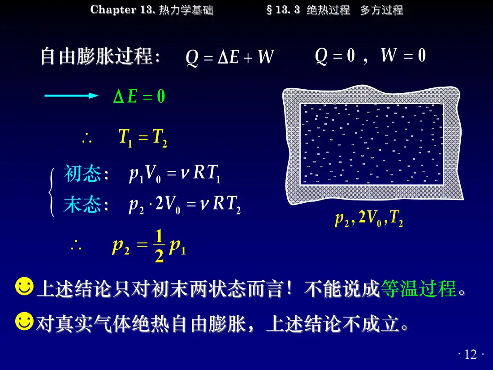

原文：

自由膨胀过程：

$$
Q = \Delta E + W
$$

$$
\Delta E = 0
$$

$1 4 = 1 6$

初态： $1 2 \times 1 0 = 1 2 0 ( m ^ { 2 } )$

末态： $1 0 0 0 \times 1 0 0 = 1 0 0 ( c m )$

$1 4 \times - \frac { 1 1 } { 5 } \times 1 2$

$$
Q = 0, W = 0
$$

p2, 2V0, T{2}

☻上述结论只对初末两状态而言！不能说成等温过程。

☻对真实气体绝热自由膨胀，上述结论不成立。

Chapter 13. 热力学基础

§13. 3 绝热过程 多方过程

· 12

### 三、多方过程

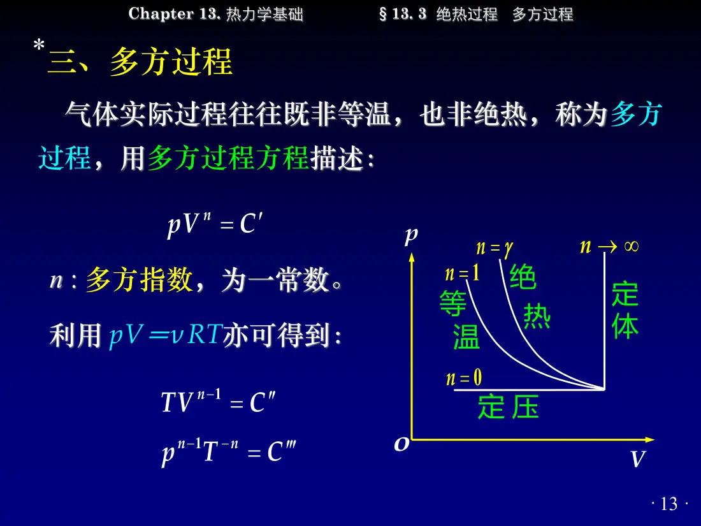

原文：

三、多方过程

气体实际过程往往既非等温，也非绝热，称为多方过程，用多方过程方程描述：

$$
p V ^ {n} = C ^ {\prime}
$$

n : 多方指数，为一常数。

利用 pV＝νRT亦可得到：

$$
T V ^ {n - 1} = C ^ {\prime \prime}
$$

$$
p ^ {n - 1} T ^ {- n} = C ^ {\prime \prime \prime}
$$

定 压

Chapter 13. 热力学基础

§13. 3 绝热过程 多方过程

· 13

### 归纳

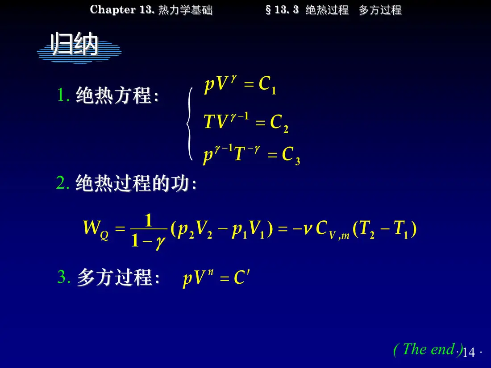

原文：

归纳

1. 绝热方程：

pVγ = C1 TVγ-1 =C2 31p T = C − −

2. 绝热过程的功：

$$
W _ {Q} = \frac {1}{1 - \gamma} (p _ {2} V _ {2} - p _ {1} V _ {1}) = - \nu C _ {V, m} (T _ {2} - T _ {1})
$$

3. 多方过程： $\textcircled { 1 } \textcircled { 4 } = \textcircled { 2 }$

Chapter 13. 热力学基础

§13. 3 绝热过程 多方过程

14
