# 《大学物理》第13章 热力学基础 §13.4 循环过程（课件）

原件的每一页，下面附识别出的文字。

### §13. 4 循环过程

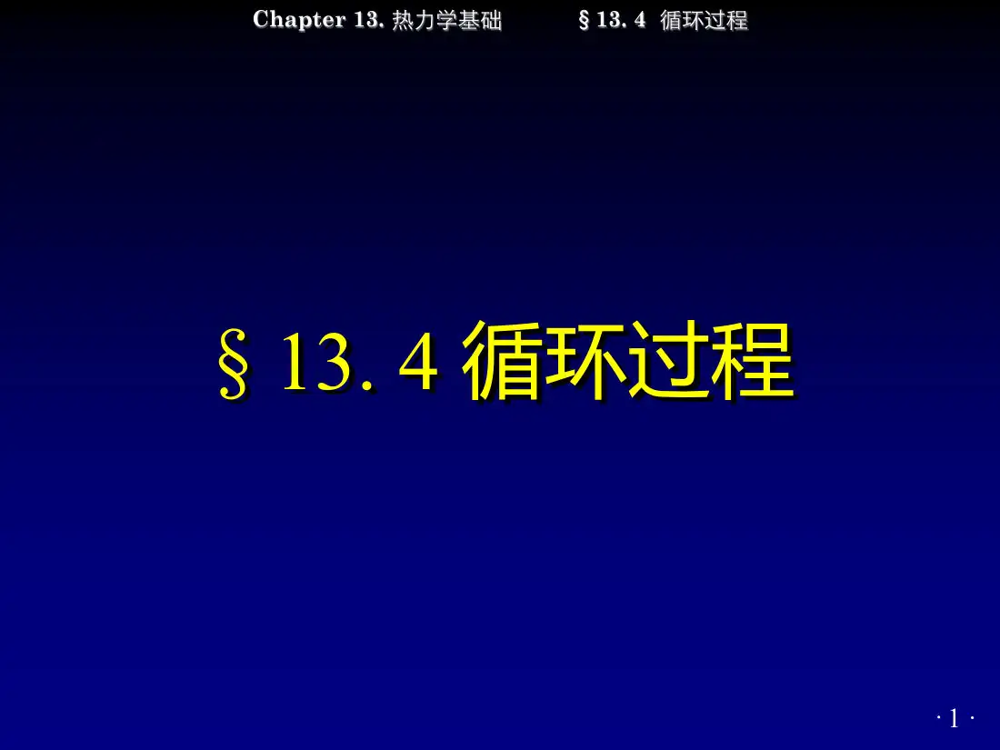

原文：

§13. 4 循环过程

Chapter 13. 热力学基础

§13. 4 循环过程

1

### Chapter 13. 热力学基础

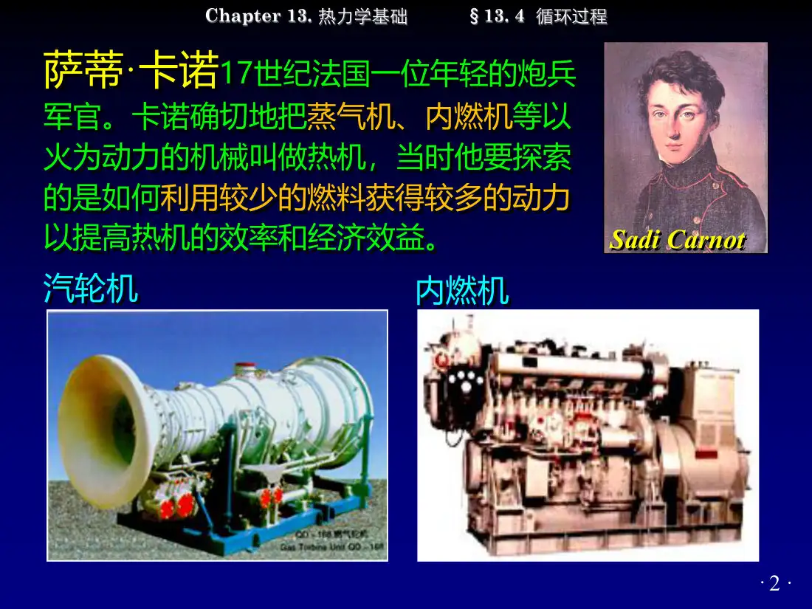

原文：

Chapter 13. 热力学基础

§13. 4 循环过程

萨蒂·卡诺17世纪法国一位年轻的炮兵军官。卡诺确切地把蒸气机、内燃机等以火为动力的机械叫做热机，当时他要探索的是如何利用较少的燃料获得较多的动力以提高热机的效率和经济效益。

汽轮机

内燃机

· 2

### §13. 4 循环过程

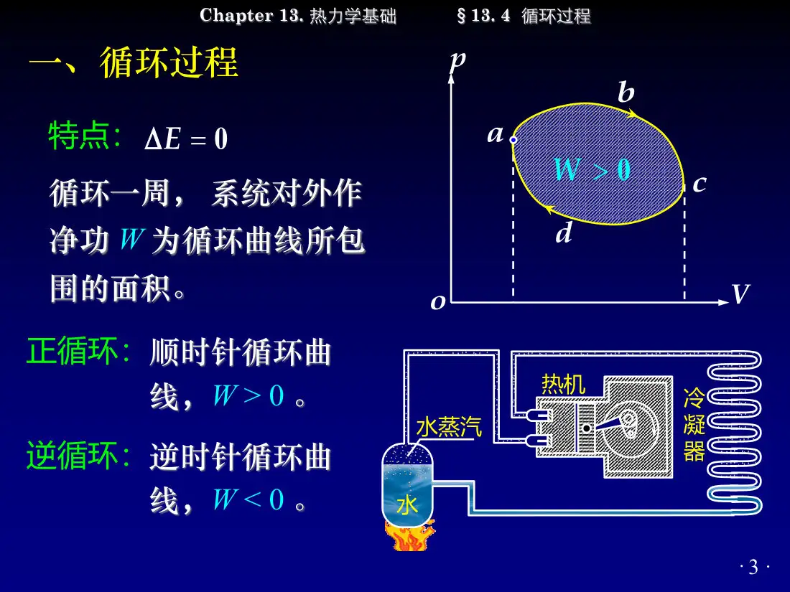

原文：

§13. 4 循环过程

一、循环过程

特点： $\mathbb { A } \mathbb { B } { \mathrm { = } } \mathbb { U }$ 循环一周， 系统对外作净功 W 为循环曲线所包围的面积。

正循环：顺时针循环曲线，W > 0 。

逆循环：逆时针循环曲线， $\angle P C = \angle C$

Chapter 13. 热力学基础

· 3

### Chapter 13. 热力学基础

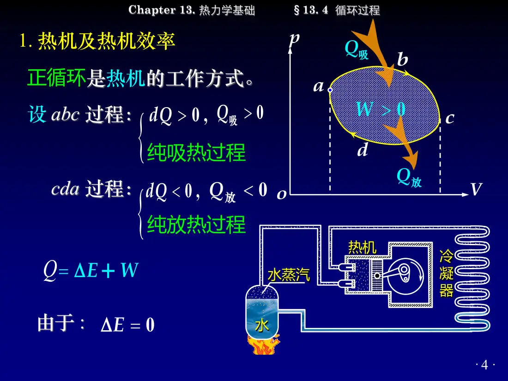

原文：

Chapter 13. 热力学基础

1. 热机及热机效率

正循环是热机的工作方式。

设 abc 过程： $U _ { 2 } ( 0 ) = ( 1 ) ( 0 ) = ( 1 )$

纯吸热过程

cda 过程： $( 1 5 0 ) \times ( 1 1 0 0 ) \times ( 1 ) \times ( 0 )$

纯放热过程

Q=ΔE + W

由于 : $\mathbb { A } \mathbb { B } = \mathbb { 0 }$

§13. 4 循环过程

· 4

### Chapter 13. 热力学基础

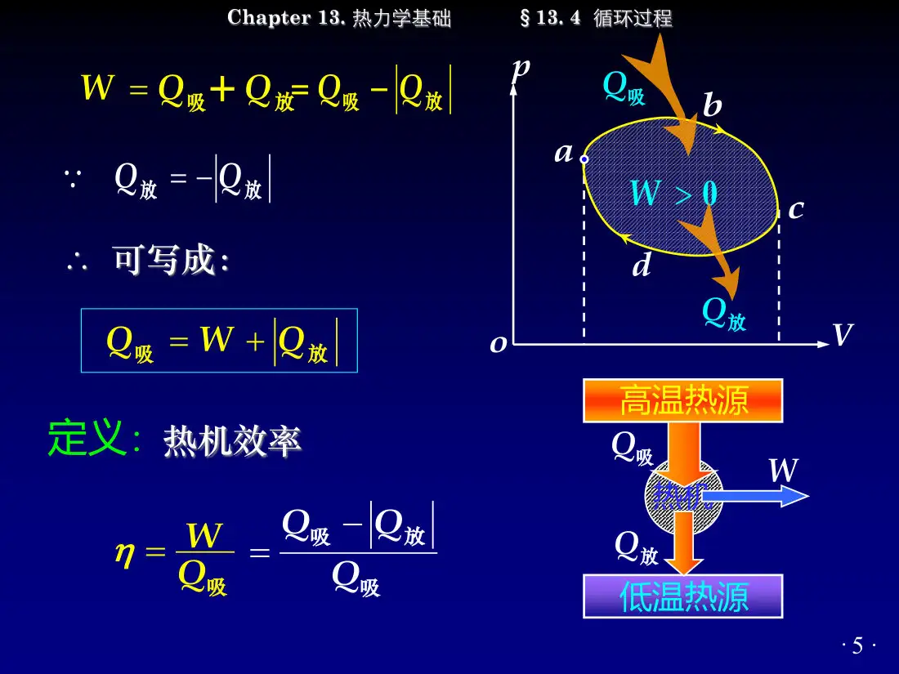

原文：

Chapter 13. 热力学基础

$$
W = Q _ {\text {吸}} + Q _ {\text {放}} = Q _ {\text {吸}} - \left| Q _ {\text {放}} \right.
$$

$$
\because Q _ {\text {放}} = - \left| Q _ {\text {放}} \right|
$$

$a _ { 0 } = \frac { a _ { 0 } } { a _ { 0 } }$ 可写成：

Q吸 =W+Q放|

定义：热机效率

$$
\eta = \frac {W}{Q _ {\text {吸}}} = \frac {Q _ {\text {吸}} - | Q _ {\text {放}} |}{Q _ {\text {吸}}}
$$

§13. 4 循环过程

高温热源

低温热源

· 5

### 注意

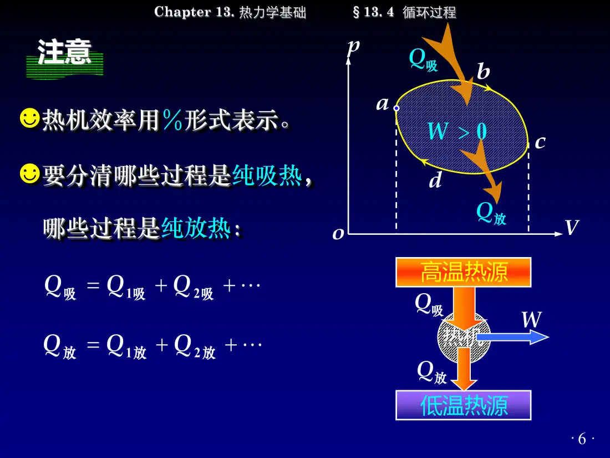

原文：

注意

☻热机效率用％形式表示。

☻要分清哪些过程是纯吸热，

哪些过程是纯放热：

Q吸=Q1吸+Q2吸+…

Q放=Q1放+Q2放+…

Chapter 13. 热力学基础

§13. 4 循环过程

6

### Chapter 13. 热力学基础 §13. 4 循环过程

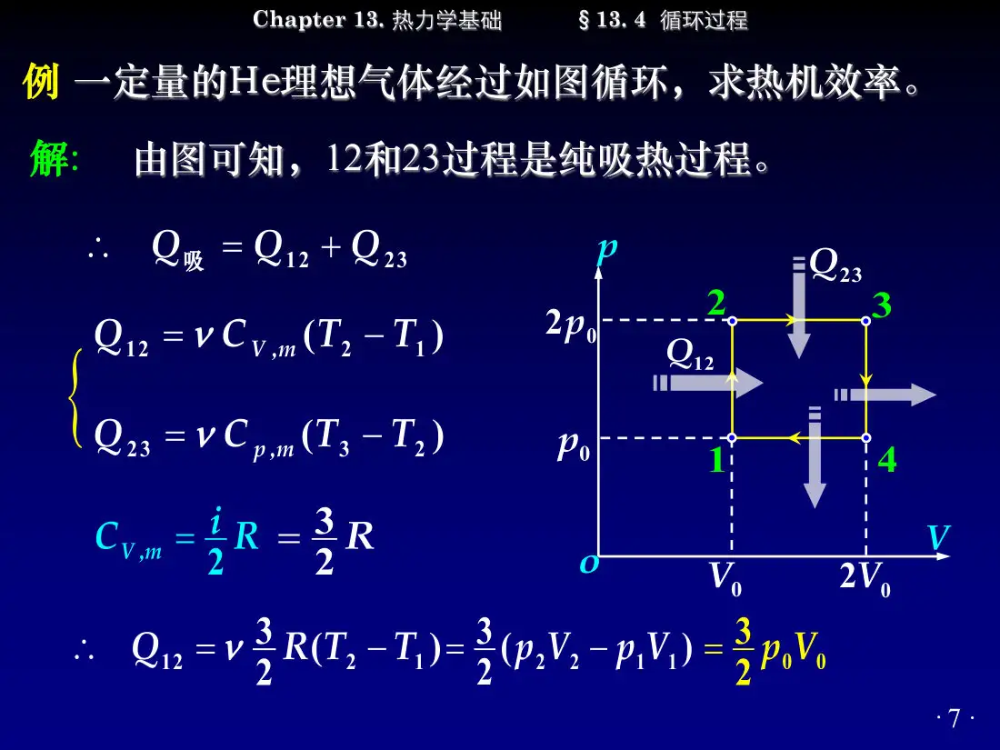

原文：

Chapter 13. 热力学基础 §13. 4 循环过程

例 一定量的He理想气体经过如图循环，求热机效率。

解: 由图可知，12和23过程是纯吸热过程。

$$
\therefore Q _ {\text {吸}} = Q _ {1 2} + Q _ {2 3}
$$

$$
Q _ {1 2} = \nu C _ {V, m} (T _ {2} - T _ {1})
$$

$$
Q _ {2 3} = \nu C _ {p, m} (T _ {3} - T _ {2})
$$

$$
C _ {V, m} = \frac {i}{2} R = \frac {3}{2} R
$$

$$
\therefore Q _ {1 2} = \nu \frac {3}{2} R \left(T _ {2} - T _ {1}\right) = \frac {3}{2} \left(p _ {2} V _ {2} - p _ {1} V _ {1}\right) = \frac {3}{2} p _ {0} V _ {0}
$$

· 7

### Chapter 13. 热力学基础

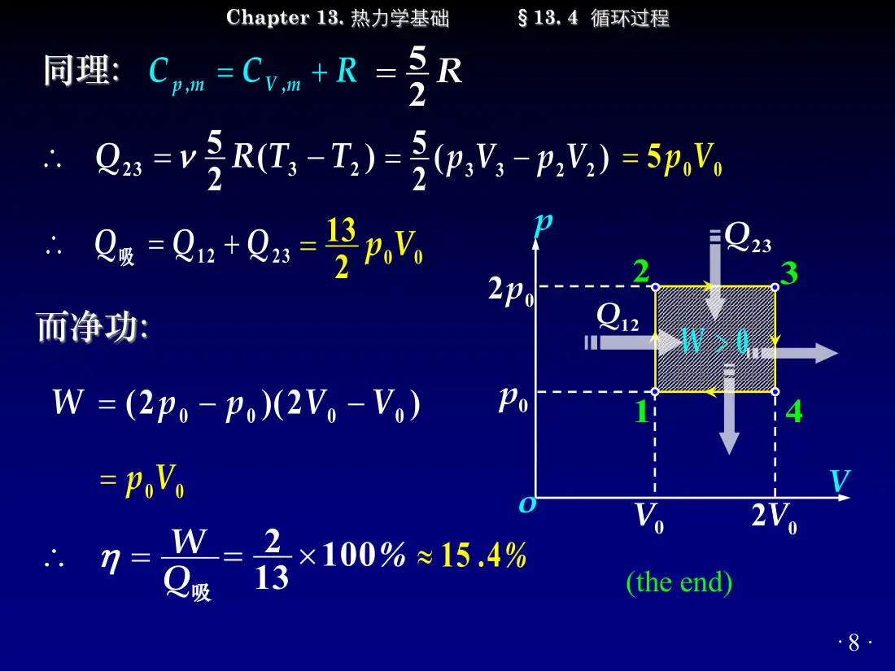

原文：

Chapter 13. 热力学基础

§13. 4 循环过程

同理: $\frac { 1 0 } { 1 0 } \times 1 0 = \frac { 1 0 } { 1 0 } \times 1 0 = \frac { 1 0 } { 1 0 } \times 1 0$

$$
\therefore Q _ {2 3} = \nu \frac {5}{2} R \left(T _ {3} - T _ {2}\right) = \frac {5}{2} \left(p _ {3} V _ {3} - p _ {2} V _ {2}\right) = 5 p _ {0} V _ {0}
$$

$$
\therefore Q _ {\text {吸}} = Q _ {1 2} + Q _ {2 3} = \frac {1 3}{2} p _ {0} V _ {0}
$$

而净功:

$$
\begin{array}{r l} W & = (2 p _ {0} - p _ {0}) (2 V _ {0} - V _ {0}) \\ & = p _ {0} V _ {0} \end{array}
$$

$$
\therefore \eta = \frac {W}{Q _ {\text {吸}}} = \frac {2}{13} \times 100 \% \approx 15.4 \%
$$

(the end)

8

### Chapter 13. 热力学基础

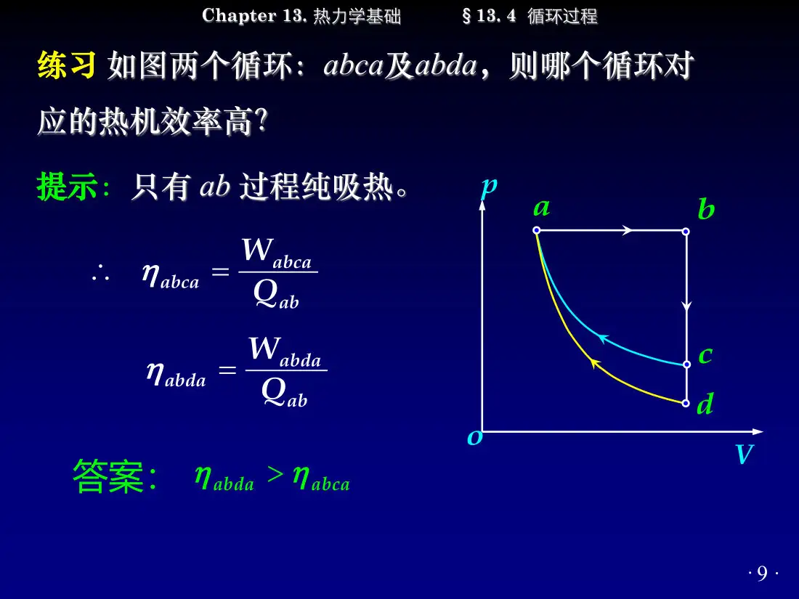

原文：

Chapter 13. 热力学基础

§13. 4 循环过程

练习 如图两个循环：abca及abda，则哪个循环对应的热机效率高？

提示：只有 ab 过程纯吸热。

$$
\therefore \eta_ {a b c a} = \frac {W _ {a b c a}}{Q _ {a b}}
$$

$$
\eta_ {a b d a} = \frac {W _ {a b d a}}{Q _ {a b}}
$$

答案： $( 1 ) \pi ( \pi ) = \frac { \pi } { 2 } ( 1 - \pi ) \pi ( \pi )$

· 9

### Chapter 13. 热力学基础

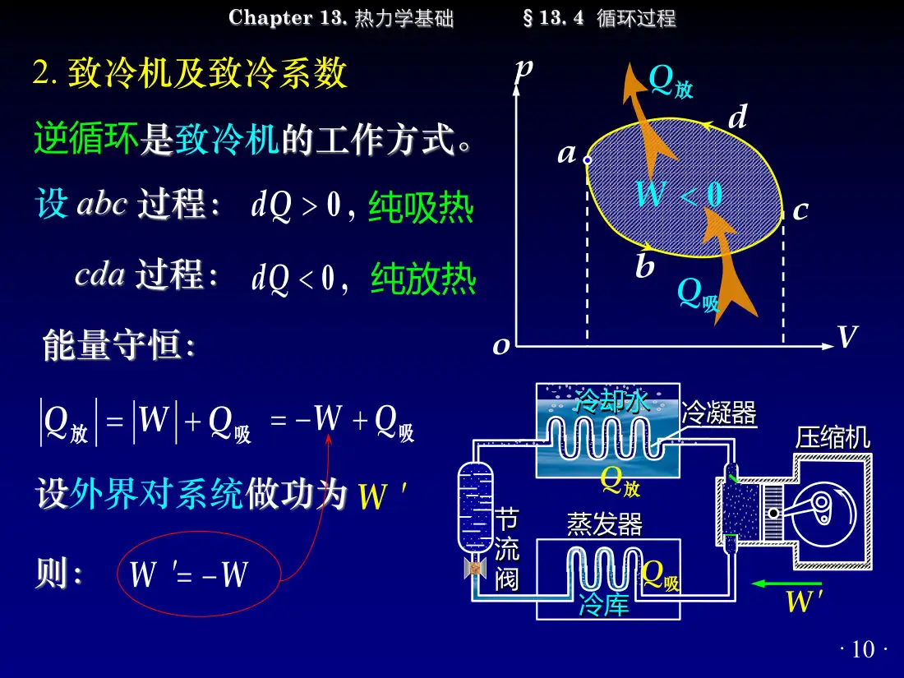

原文：

Chapter 13. 热力学基础

2. 致冷机及致冷系数

逆循环是致冷机的工作方式。

设 abc 过程： 纯吸热

cda 过程： $0 . 1 0 2 < 0 . 1 1$ 纯放热

能量守恒：

$$
\left| Q _ {\text {放}} \right| = \left| W \right| + Q _ {\text {吸}} = - W + Q _ {\text {吸}}
$$

设外界对系统做功为

则：W '=-W

§13. 4 循环过程

10

### $$

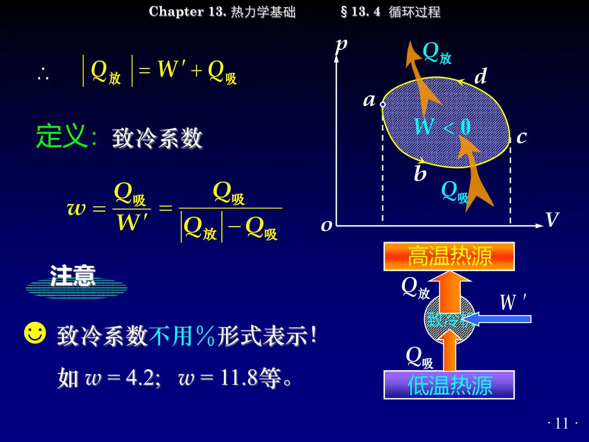

原文：

$$
\therefore \quad \left| Q _ {\text {放}} \right| = W ^ {\prime} + Q _ {\text {吸}}
$$

定义：致冷系数

$$
w = \frac {Q _ {\text {吸}}}{W ^ {\prime}} = \frac {Q _ {\text {吸}}}{\left| Q _ {\text {放}} \right| - Q _ {\text {吸}}}
$$

注意

致冷系数不用％形式表示！

如 $( 1 0 ) = ( 1 0 ) \times ( 1 0 ) = ( 1 1 0 )$ 等。

低温热源

Chapter 13. 热力学基础

§13. 4 循环过程

· 11

### Chapter 13. 热力学基础 §13. 4 循环过程

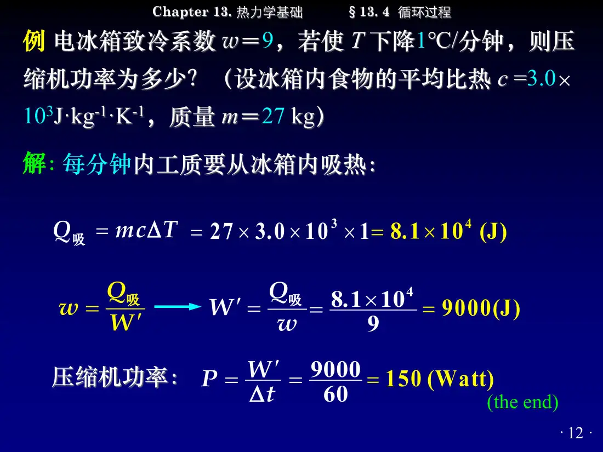

原文：

Chapter 13. 热力学基础 §13. 4 循环过程

例 电冰箱致冷系数 $( { a / } ) = 0$ 若使 T 下降 $1 1 \%$ 分钟，则压缩机功率为多少？ （设冰箱内食物的平均比热 $( \pmb { \theta } - \pmb { \theta } ) \pmb { \theta } \pmb { \theta } \pmb { \theta } \pmb { \theta } = \pmb { \theta } \pmb { \theta } \pmb { \theta } \pmb { \theta } \pmb { \theta } \pmb { \theta } \pmb { \theta } \pmb { \theta } \pmb { \theta } \pmb { \theta } \pmb { \theta } \pmb { \theta } \pmb { \theta } \pmb { \theta } \pmb { \theta } \pmb { \theta } \pmb { \theta } \pmb { \theta } \pmb { \theta } \pmb { \theta } \pmb { \theta } \pmb { \theta } \pmb { \theta } \pmb { \theta } \pmb { \theta } \pmb { \theta } \pmb { \theta } \pmb { \theta } \pmb { \theta } \pmb { \theta } \pmb { \theta } \pmb { \theta } \pmb { \theta } \pmb { \theta } \pmb { \theta } \pmb { \theta } \pmb { \theta } \pmb { \theta } \pmb { \theta } \pmb { \theta } \pmb { \theta } \pmb { \theta } \pmb { \theta } \pmb { \theta } \pmb { \theta } \pmb { \theta } \pmb { \theta } \pmb { \theta } \pmb { \theta } \pmb { \theta } \pmb { \theta }$ $1 0 ^ { \circ } - \angle A B C = \angle B C C$ ，质量 $u v = 0 . 0 0 5 = 0 . 0 2$

解：每分钟内工质要从冰箱内吸热：

$$
Q _ {\text {吸}} = m c \Delta T = 2 7 \times 3. 0 \times 1 0 ^ {3} \times 1 = 8. 1 \times 1 0 ^ {4} (\mathrm{J})
$$

$$
w = \frac {Q _ {\text {吸}}}{W ^ {\prime}} \longrightarrow W ^ {\prime} = \frac {Q _ {\text {吸}}}{w} = \frac {8 . 1 \times 1 0 ^ {4}}{9} = 9 0 0 0 (\mathrm{J})
$$

压缩机功率： $1 2 = 1 \times 1 2 = 1 1 1 1 1 1 1 1 1 1 1 1 1 1 1 1 1 1 1 1 1 1 1 1 1 1 1 1 1 1 1 1 1 1 1 1 1 1 1 1 1 1 1 1 1 1 1 1 1 1 1 1 1 1 1 1 1 1 1 1 1 1 1 1 1 1 1 1 1 1 1 1 1 1 1 1 1 1 1 1 1 1 1 1 1 1 1 1 1 1 1 1 1 1 1 1 1 1 1 1 1 1 1 1 1 1 1 1 1 1 1 1 1 1 1 1 1 1 1 1 1 1 1 1 1 1 1 1 1 1 1 1 1 1 1 1 1 1 1 1 1 1 1 1 1 1 1 1 1 1 1 1 1 1 1 1 1 1 1 1 1 1 1 1 1 1 1 1 1 1 1 1 1 1 1 1 1 1 1 1 1 1 1 1 1 1 1 1 1 1 1 1 1 1 1 1 1 1 1 1 1 1 1 1 1 1 1 1 1 1 1 1 1 1 1 1 1 1 1 1 1 1 1 1 1 1 1 1 1 1 1 1 1 1 1 1 1 1 1 1 1 1 1 1 1 1 1 1 1 1 1 1 1 1 1 1 1 1 1 1 1 1 1 1 1 1 1 1 1 1 1 1 1 1 1 1 1 1 1 1 1 1 1 1 1 1 1 1 1 1 1 1 1 1 1 1 1 1 1 1 1 1 1 1 1 1 1 1 1 1 1 1 1 1 1 1 1 1 1 1 1 1 1 1 1 1 1 1 1 1 1 1 1 1 1 1 1 1 1 1 1 1 1 1 1 1 1 1 1 1 1 1 1 1 1 1 1 1 1 1 1 1 1 1 1 1 1 1 1 1 1 1 1 1 1 1 1 1 1 1 1 1 1 1 1 1 1 1 1 1 1 1 1 1 1 1 1 1 1 1 1 1 1 1 1 1 1 1 1 1 1 1 1 1 1 1 1 1 1 1 1 1 1 1 1 1 1 1 1 1 1 1 1 1 1 1 1 1 1 1 1 1 1 1 1 1 1 1 1 1 1 1 1 1 1 1 1 1 1 1 1 1 1 1 1 1 1 1 1 1 1 1 1 1 1 1 1 1 1 1 1 1 1 1 1 1 1 1 1 1 1 1 1 1 1 1 1 1 1 1 1 1 1 1 1 1 1 1 1 1 1 1 1 1 1 1 1 1 1 1 1 1 1 1 1 1 1 1 1 1 1 1 1 1 1 1 1 1 1 1 1 1 1 1 1 1 1 1 1 1 1 1 1 1 1 1 1 1 1 1 1 1 1 1 1 1 1 $ (the end)

12

### Chapter 13. 热力学基础

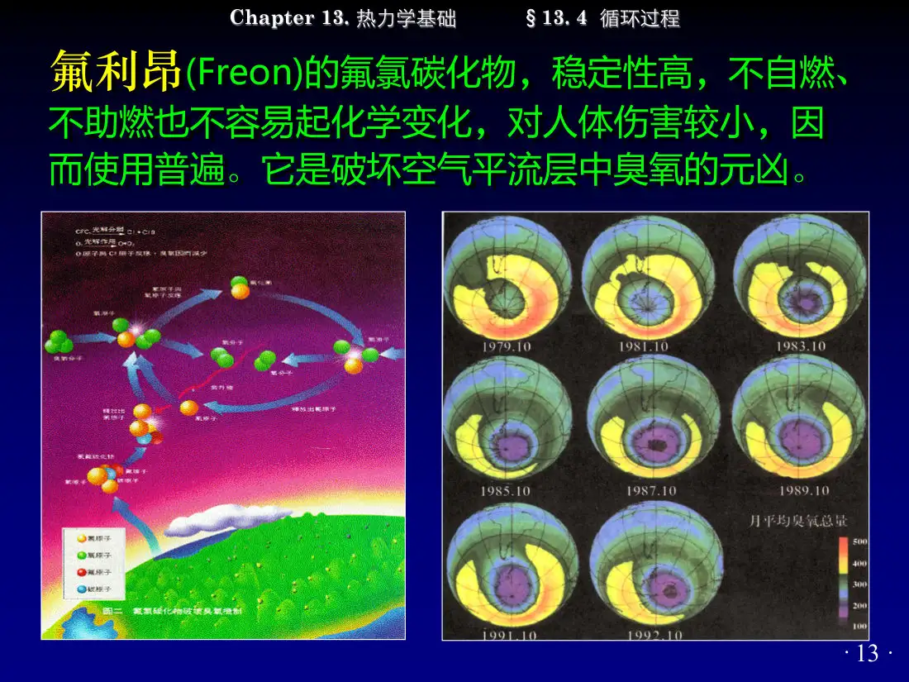

原文：

Chapter 13. 热力学基础

§13. 4 循环过程

氟利昂(Freon)的氟氯碳化物，稳定性高，不自燃、不助燃也不容易起化学变化，对人体伤害较小，因而使用普遍。它是破坏空气平流层中臭氧的元凶。 O

13

### 归纳

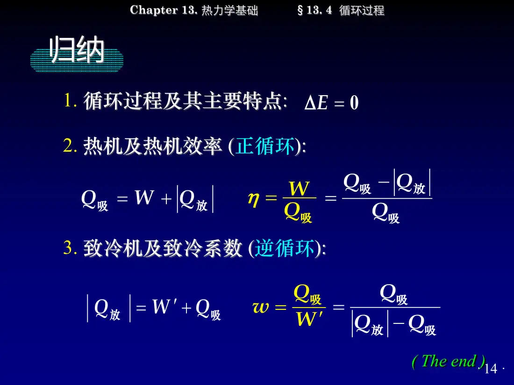

原文：

归纳

1. 循环过程及其主要特点: $\mathbb { A } \mathbb { B } { \mathrm { = } } \mathbb { D }$

2. 热机及热机效率 (正循环):

$$
Q _ {\text {吸}} = W + \left| Q _ {\text {放}} \right| \quad \eta = \frac {W}{Q _ {\text {吸}}} = \frac {Q _ {\text {吸}} - \left| Q _ {\text {放}} \right|}{Q _ {\text {吸}}}
$$

3. 致冷机及致冷系数 (逆循环):

$$
\left| Q _ {\text {放}} \right| = W ^ {\prime} + Q _ {\text {吸}} \quad w = \frac {Q _ {\text {吸}}}{W ^ {\prime}} = \frac {Q _ {\text {吸}}}{\left| Q _ {\text {放}} \right| - Q _ {\text {吸}}}
$$

Chapter 13. 热力学基础

§13. 4 循环过程

14
