# 《大学物理》第13章 热力学基础 §13.6 热力学第二定律及其统计意义（课件）

原件的每一页，下面附识别出的文字。

### §13. 6 热力学第二定律

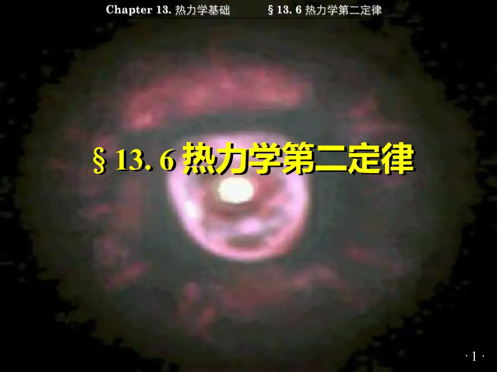

原文：

§13. 6 热力学第二定律

Chapter 13. 热力学基础

§13. 6 热力学第二定律

· 1

### 自然现象的不可逆性

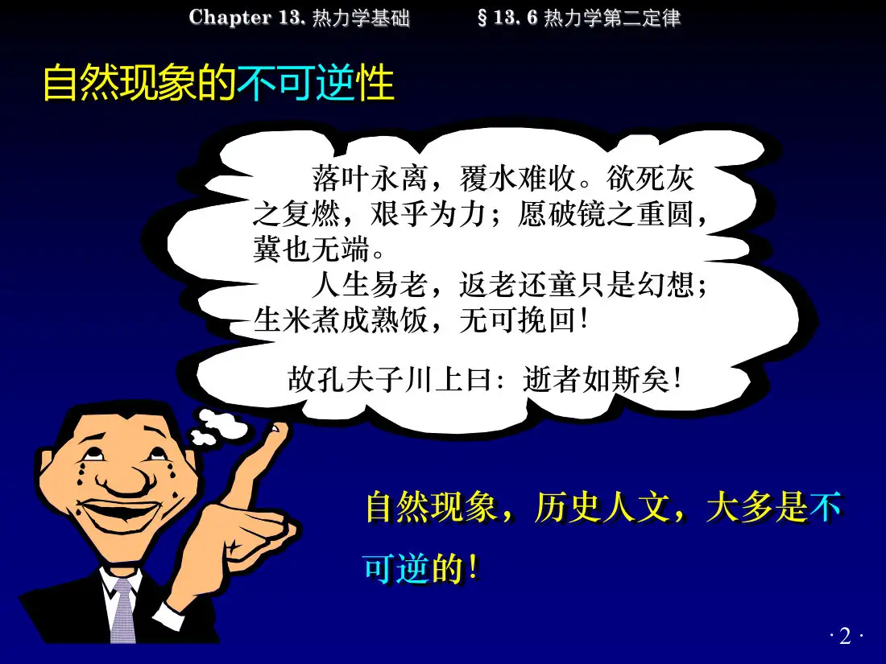

原文：

自然现象的不可逆性

落叶永离，覆水难收。欲死灰之复燃，艰乎为力；愿破镜之重圆，冀也无端。

人生易老，返老还童只是幻想；生米煮成熟饭，无可挽回！

故孔夫子川上曰：逝者如斯矣！

自然现象，历史人文，大多是不可逆的！

Chapter 13. 热力学基础

§13. 6 热力学第二定律

· 2

### Chapter 13. 热力学基础

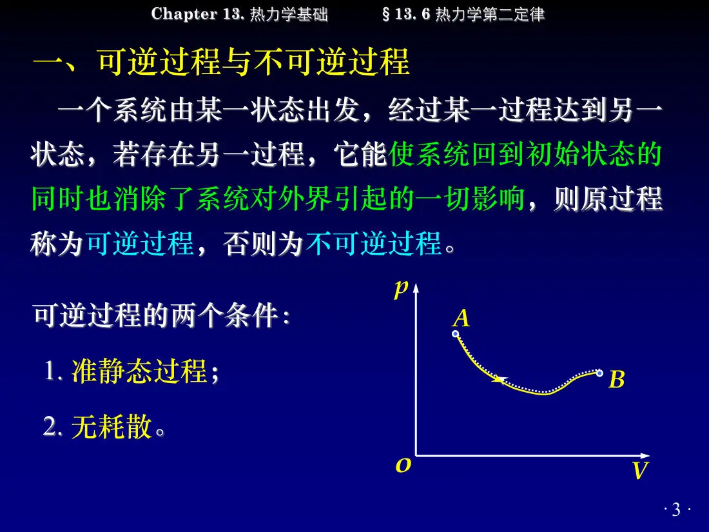

原文：

Chapter 13. 热力学基础

§13. 6 热力学第二定律

一、可逆过程与不可逆过程

一个系统由某一状态出发，经过某一过程达到另一状态，若存在另一过程，它能使系统回到初始状态的同时也消除了系统对外界引起的一切影响，则原过程称为可逆过程，否则为不可逆过程。

可逆过程的两个条件：

1. 准静态过程；

2. 无耗散。

· 3

### Chapter 13. 热力学基础 §13. 6 热力学第二定律

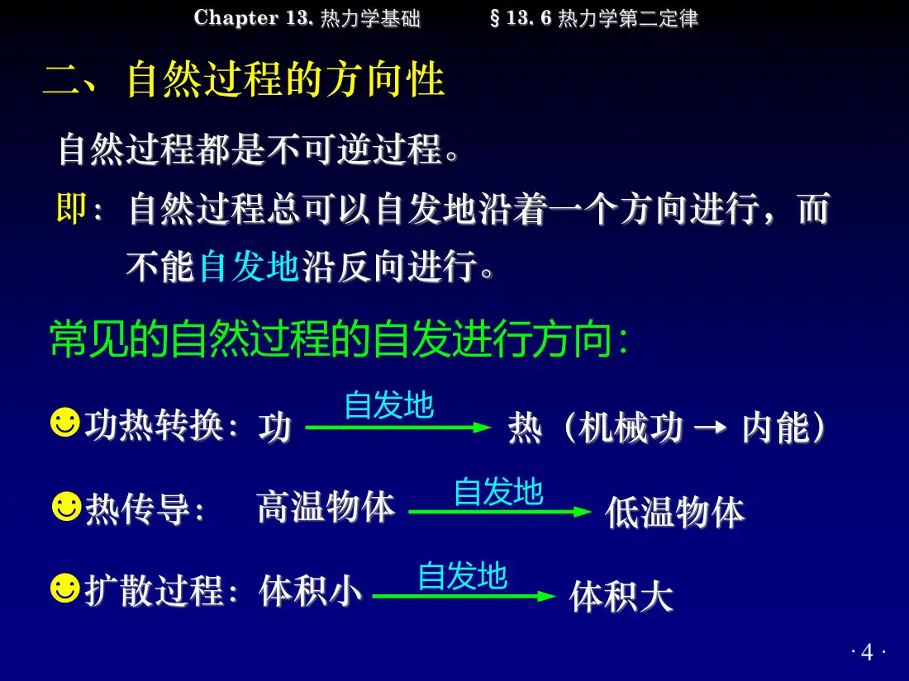

原文：

Chapter 13. 热力学基础 §13. 6 热力学第二定律

二、自然过程的方向性

自然过程都是不可逆过程。

即：自然过程总可以自发地沿着一个方向进行，而不能自发地沿反向进行。

常见的自然过程的自发进行方向：

自发地☻功热转换：功 热（机械功 → 内能）

☻热传导： 高温物体 自发地 低温物体

☻扩散过程：体积小 自发地 体积大

· 4

### Chapter 13. 热力学基础

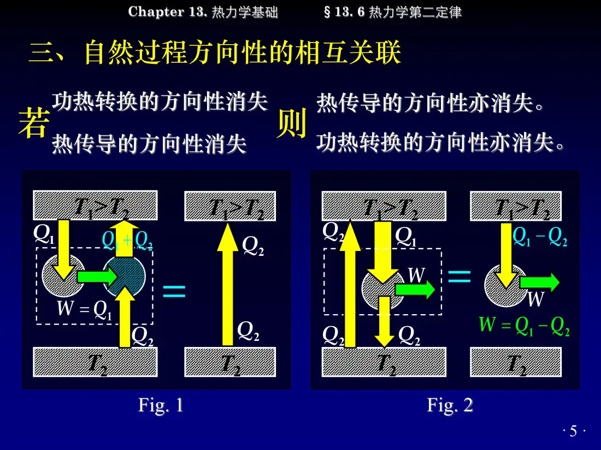

原文：

Chapter 13. 热力学基础

§13. 6 热力学第二定律

三、自然过程方向性的相互关联

若

功热转换的方向性消失热传导的方向性消失

则

热传导的方向性亦消失。

功热转换的方向性亦消失。

· 5

### Chapter 13. 热力学基础

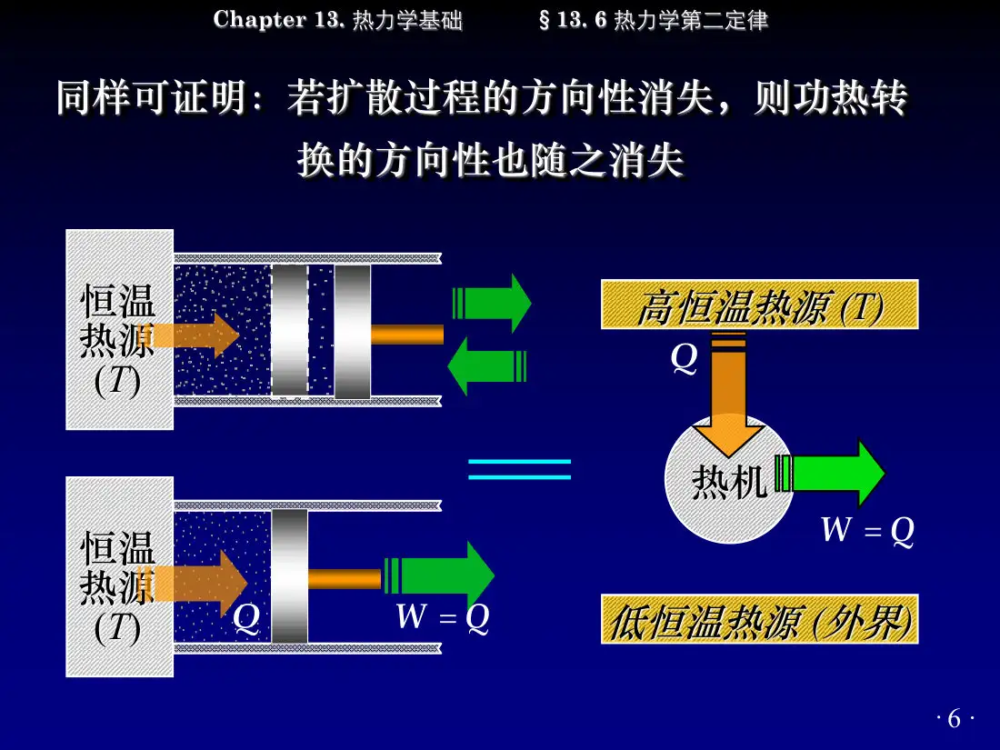

原文：

Chapter 13. 热力学基础

§13. 6 热力学第二定律

同样可证明：若扩散过程的方向性消失，则功热转换的方向性也随之消失

恒温热源

恒温热源

W = Q

热机

W = Q

6

### Chapter 13. 热力学基础

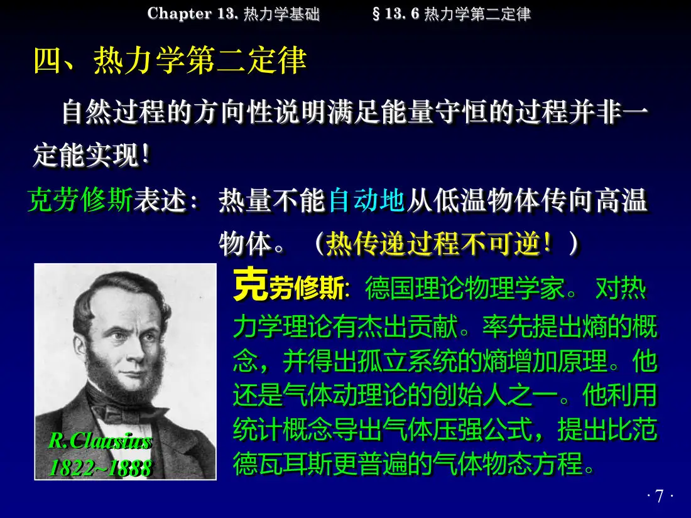

原文：

Chapter 13. 热力学基础

§13. 6 热力学第二定律

四、热力学第二定律

自然过程的方向性说明满足能量守恒的过程并非一定能实现！

克劳修斯表述： 热量不能自动地从低温物体传向高温物体。 （热传递过程不可逆！）

克劳修斯: 德国理论物理学家。 对热力学理论有杰出贡献。率先提出熵的概念，并得出孤立系统的熵增加原理。他还是气体动理论的创始人之一。他利用统计概念导出气体压强公式，提出比范德瓦耳斯更普遍的气体物态方程。

· 7

### Chapter 13. 热力学基础

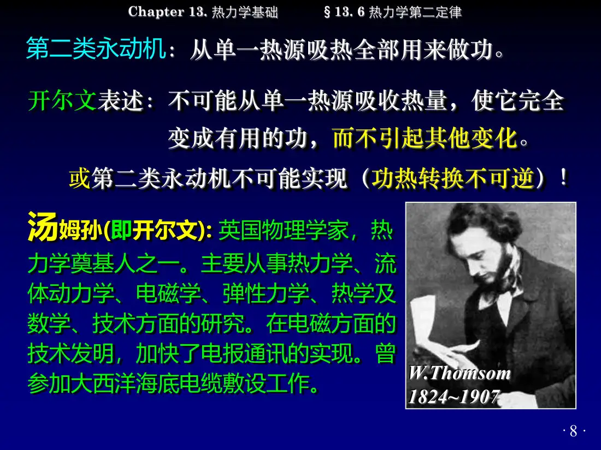

原文：

Chapter 13. 热力学基础

§13. 6 热力学第二定律

第二类永动机：从单一热源吸热全部用来做功。

开尔文表述：不可能从单一热源吸收热量，使它完全变成有用的功，而不引起其他变化。

或第二类永动机不可能实现（功热转换不可逆）！

汤姆孙(即开尔文): 英国物理学家，热力学奠基人之一。主要从事热力学、流体动力学、电磁学、弹性力学、热学及数学、技术方面的研究。在电磁方面的技术发明，加快了电报通讯的实现。曾参加大西洋海底电缆敷设工作。

8

### Chapter 13. 热力学基础

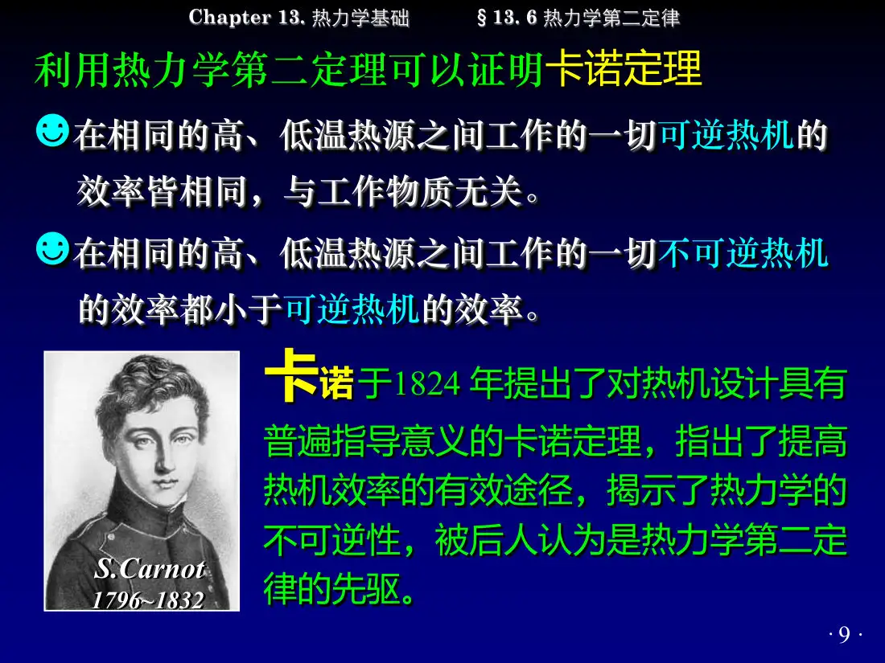

原文：

Chapter 13. 热力学基础

§13. 6 热力学第二定律

利用热力学第二定理可以证明卡诺定理

☻在相同的高、低温热源之间工作的一切可逆热机的效率皆相同，与工作物质无关。

☻在相同的高、低温热源之间工作的一切不可逆热机的效率都小于可逆热机的效率。

卡诺于1824 年提出了对热机设计具有普遍指导意义的卡诺定理，指出了提高热机效率的有效途径，揭示了热力学的不可逆性，被后人认为是热力学第二定律的先驱。

· 9

### Chapter 13. 热力学基础

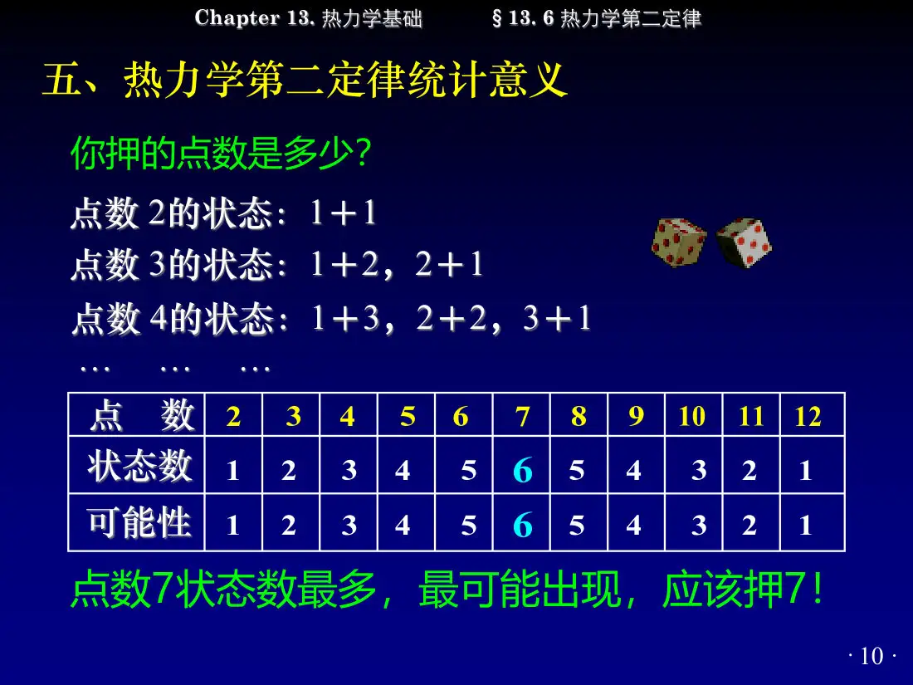

原文：

Chapter 13. 热力学基础

§13. 6 热力学第二定律

五、热力学第二定律统计意义

你押的点数是多少？

点数 2的状态：1＋1

点数 3的状态：1＋2，2＋1

点数 4的状态：1＋3，2＋2，3＋1

<table><tr><td>点数</td><td>2</td><td>3</td><td>4</td><td>5</td><td>6</td><td>7</td><td>8</td><td>9</td><td>10</td><td>11</td><td>12</td></tr><tr><td>状态数</td><td>1</td><td>2</td><td>3</td><td>4</td><td>5</td><td>6</td><td>5</td><td>4</td><td>3</td><td>2</td><td>1</td></tr><tr><td>可能性</td><td>1</td><td>2</td><td>3</td><td>4</td><td>5</td><td>6</td><td>5</td><td>4</td><td>3</td><td>2</td><td>1</td></tr></table>

点数7状态数最多，最可能出现，应该押7！

10

### Chapter 13. 热力学基础

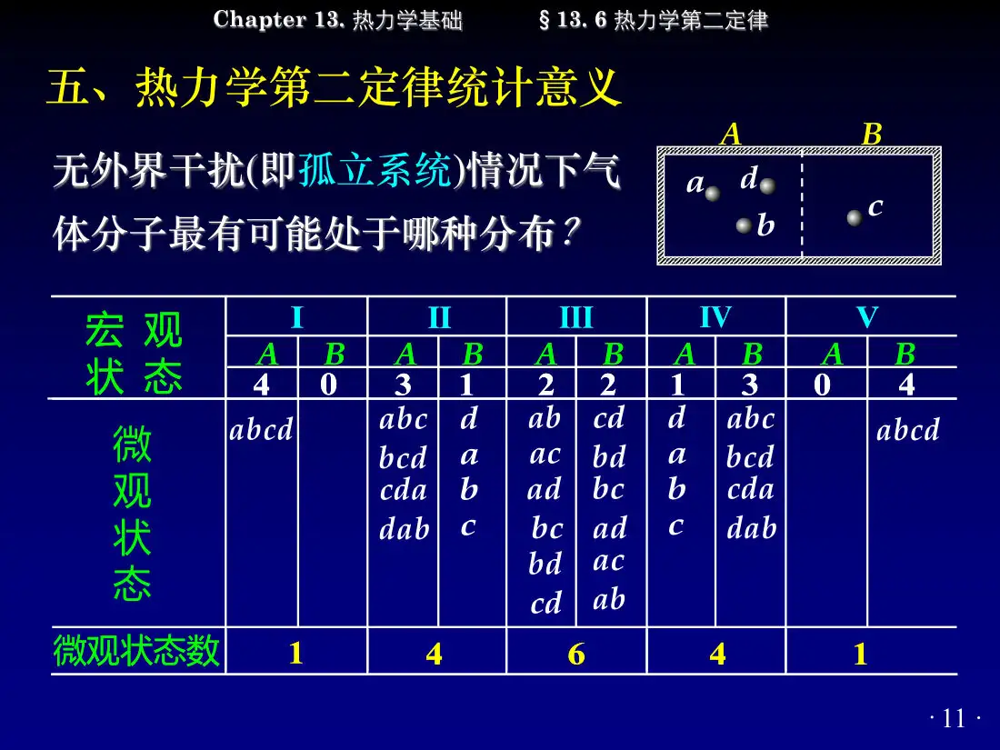

原文：

Chapter 13. 热力学基础

§13. 6 热力学第二定律

五、热力学第二定律统计意义

无外界干扰(即孤立系统)情况下气体分子最有可能处于哪种分布？

宏 状 观态

微
观
状
态

微观状态数

11

### Chapter 13. 热力学基础

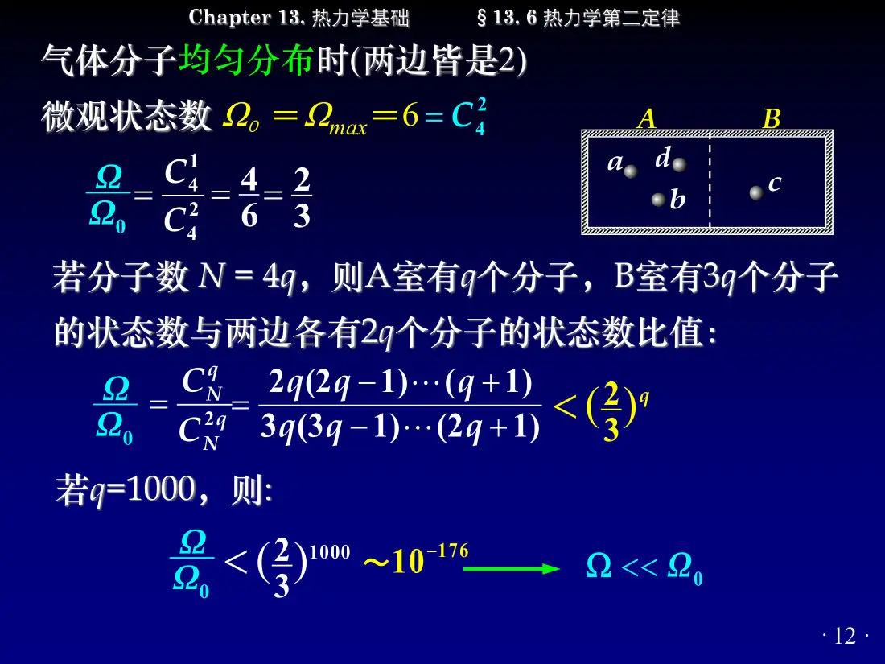

原文：

Chapter 13. 热力学基础

气体分子均匀分布时(两边皆是2)微观状态数 $\textcircled { 9 } _ { 1 0 } = \textcircled { 9 } _ { 2 0 } = \textcircled { 1 } _ { 2 } = \textcircled { 9 }$

$$
\frac {\Omega}{\Omega_ {0}} = \frac {C _ {4} ^ {1}}{C _ {4} ^ {2}} = \frac {4}{6} = \frac {2}{3}
$$

若分子数 N = 4q，则A室有q个分子，B室有3q个分子的状态数与两边各有2q个分子的状态数比值：

$$
\frac {\Omega}{\Omega_ {0}} = \frac {C _ {N} ^ {q}}{C _ {N} ^ {2 q}} = \frac {2 q (2 q - 1) \cdots (q + 1)}{3 q (3 q - 1) \cdots (2 q + 1)} <   \left(\frac {2}{3}\right) ^ {q}
$$

若q=1000，则:

$$
\frac {\Omega}{\Omega_ {0}} <   \left(\frac {2}{3}\right) ^ {1 0 0 0} \sim 1 0 ^ {- 1 7 6} \longrightarrow \Omega <   <   \Omega_ {0}
$$

§13. 6 热力学第二定律

· 12

### Chapter 13. 热力学基础 §13. 6 热力学第二定律

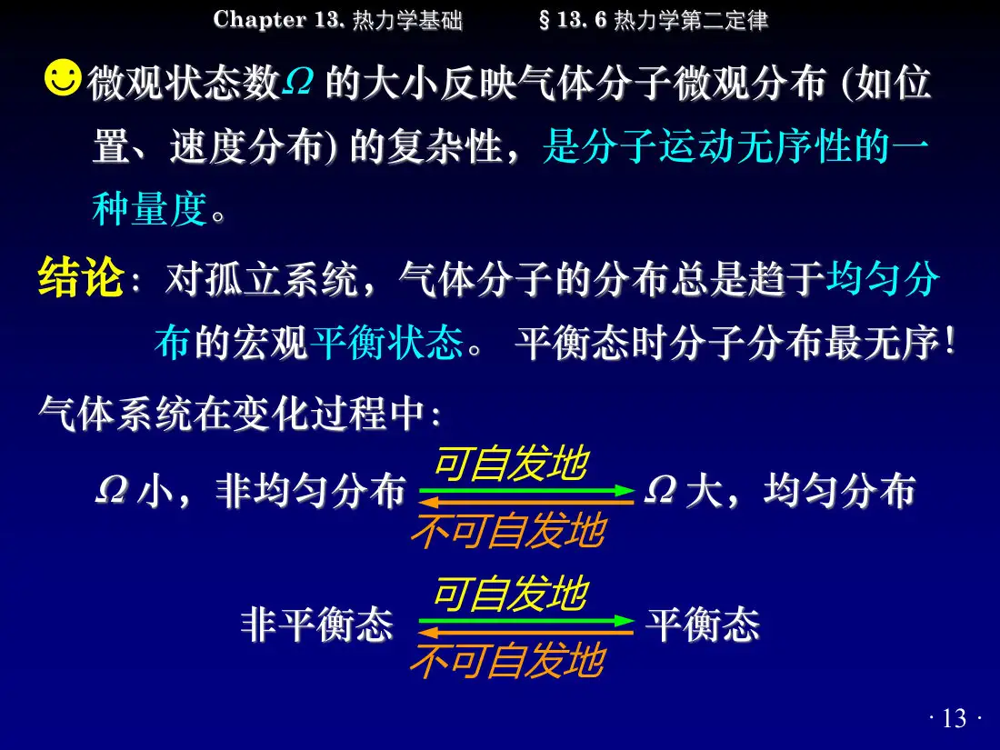

原文：

Chapter 13. 热力学基础 §13. 6 热力学第二定律

☻微观状态数Ω 的大小反映气体分子微观分布 (如位置、速度分布) 的复杂性，是分子运动无序性的种量度。

结论：对孤立系统，气体分子的分布总是趋于均匀分布的宏观平衡状态。 平衡态时分子分布最无序！气体系统在变化过程中：

可自发地小，非均匀分布 大，均匀分布不可自发地

可自发地非平衡态 平衡态不可自发地

· 13

### Chapter 13. 热力学基础

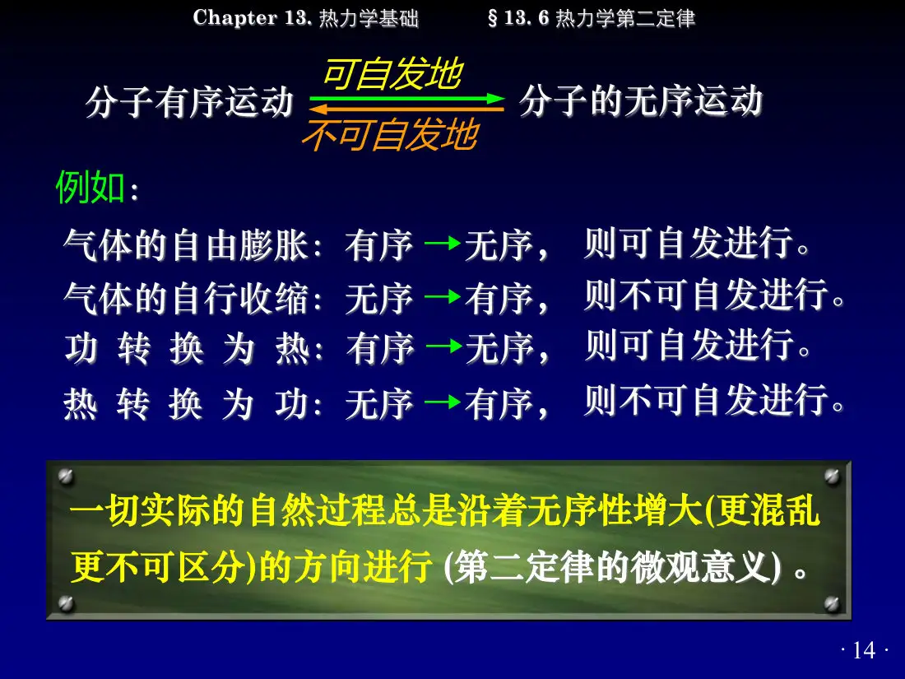

原文：

Chapter 13. 热力学基础

§13. 6 热力学第二定律

可自发地分子有序运动 分子的无序运动不可自发地

例如：

气体的自由膨胀：有序 →无序， 则可自发进行。

气体的自行收缩：无序 →有序， 则不可自发进行。

功 转 换 为 热：有序 →无序， 则可自发进行。

热 转 换 为 功：无序 →有序， 则不可自发进行。

切实际的自然过程总是沿着无序性增大(更混乱更不可区分)的方向进行 (第二定律的微观意义) 。

14

### Chapter 13. 热力学基础

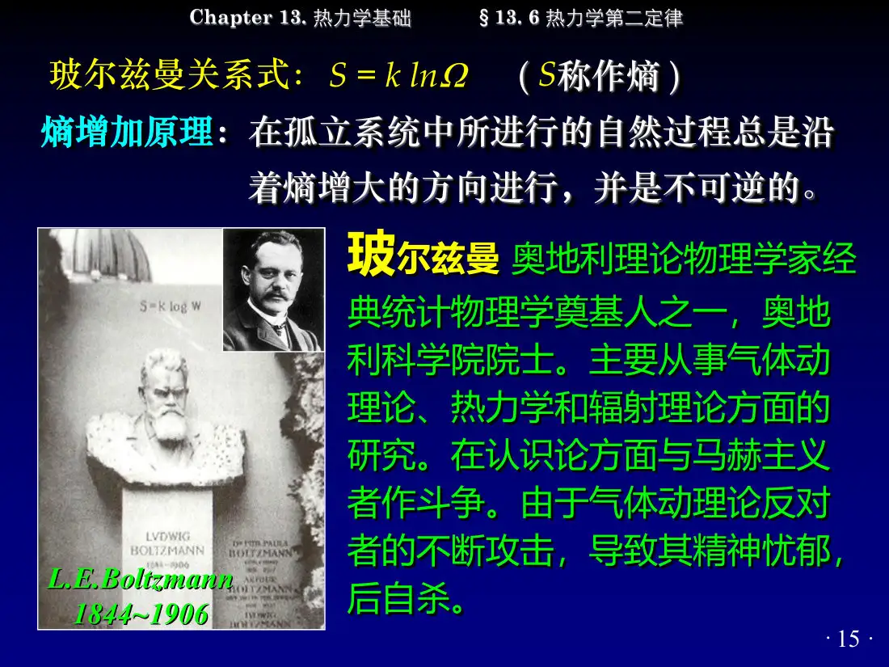

原文：

Chapter 13. 热力学基础

§13. 6 热力学第二定律

玻尔兹曼关系式：S = k lnΩ ( S称作熵 )熵增加原理：在孤立系统中所进行的自然过程总是沿着熵增大的方向进行，并是不可逆的。

玻尔兹曼 奥地利理论物理学家经典统计物理学奠基人之一，奥地利科学院院士。主要从事气体动理论、热力学和辐射理论方面的研究。在认识论方面与马赫主义者作斗争。由于气体动理论反对者的不断攻击，导致其精神忧郁，后自杀。

· 15
