# 《大学物理》第14章 波的传播与叠加 §14.7 多普勒效应 冲击波（课件）

原件的每一页，下面附识别出的文字。

### Chapter 14. 波的传播与叠加作者：杨茂田

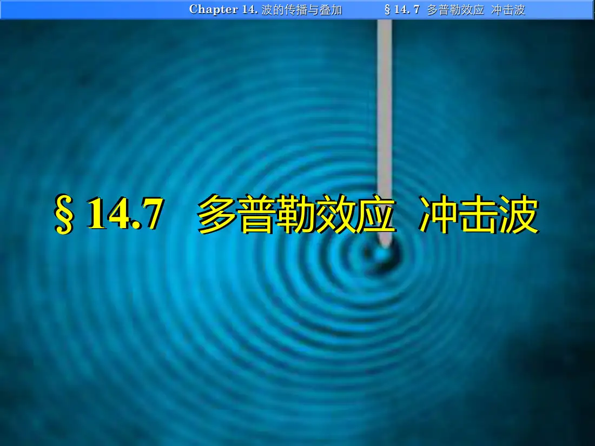

原文：

Chapter 14. 波的传播与叠加作者：杨茂田

§14.7 多普勒效应 冲击波

### 一、多普勒效应 波的观测频率

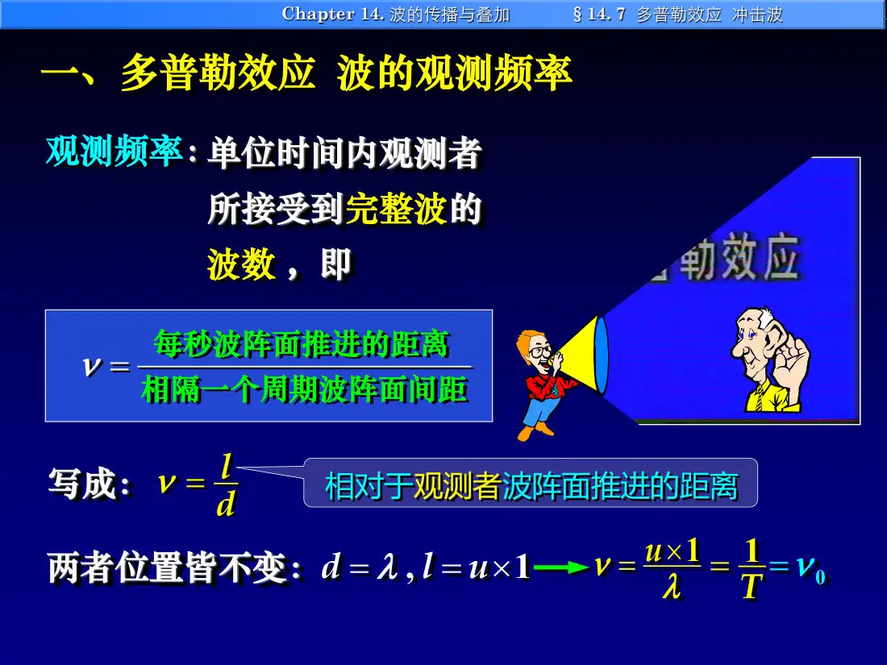

原文：

一、多普勒效应 波的观测频率

观测频率：单位时间内观测者

所接受到完整波的

波数 ，即

每秒波阵面推进的距离相隔一个周期波阵面间距

勒效应

写成：

$$
\nu = \frac {l}{d}
$$

相对于观测者波阵面推进的距离

两者位置皆不变： $( 1 ) \angle A = \angle B = \angle C A = \angle C = \angle C = \angle C = \angle C$

Chapter 14. 波的传播与叠加 作者：杨茂田

§14. 7 多普勒效应 冲击波

### Chapter 14. 波的传播与叠加作者：杨茂田

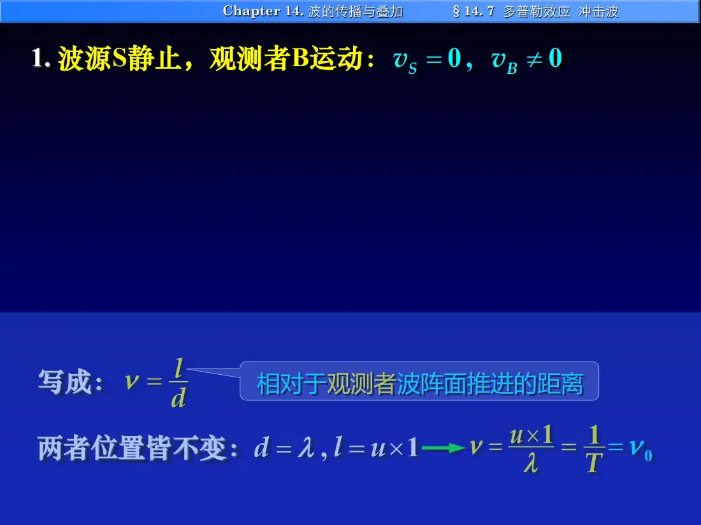

原文：

1. 波源S静止，观测者B运动： $( 0 ) ( 3 - 1 ) \times ( 0 ) ( 1 ) = ( 1 )$

写成： $V _ { 2 } = \frac { 1 1 } { 1 0 }$ 相对于观测者波阵面推进的距离

两者位置皆不变： $( 1 5 - 2 ) \times 1 5 = 1 1 5 5 ( m ) = 2 5 = 1 0 0 ( m ) = \frac { 1 } { 1 1 } = 1 0 ( m )$

Chapter 14. 波的传播与叠加作者：杨茂田

§14. 7 多普勒效应 冲击波

### 观测频率：

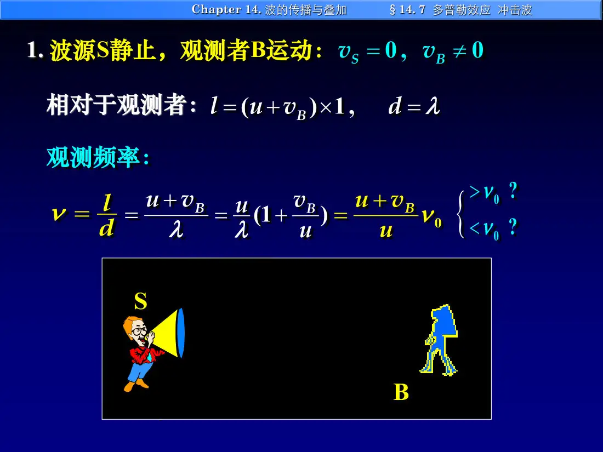

原文：

1. 波源S静止，观测者B运动： $( 0 ) ( 3 - 1 ) \times ( 0 ) ( 1 ) = ( 1 )$

相对于观测者： $U _ { 2 } = ( U _ { 2 } , \phi _ { 2 } ) = 0 . 5 \Omega$ d = λ

观测频率：

$$
\nu = \frac {l}{d} = \frac {u + v _ {B}}{\lambda} = \frac {u}{\lambda} (1 + \frac {v _ {B}}{u}) = \frac {u + v _ {B}}{u} \nu_ {0} \left\{ \begin{array}{l l} > \nu_ {0}? \\ <   \nu_ {0}? \end{array} \right.
$$

Chapter 14. 波的传播与叠加作者：杨茂田

§14. 7 多普勒效应 冲击波

### Chapter 14. 波的传播作者：Chapter 14. 波的传播与叠加

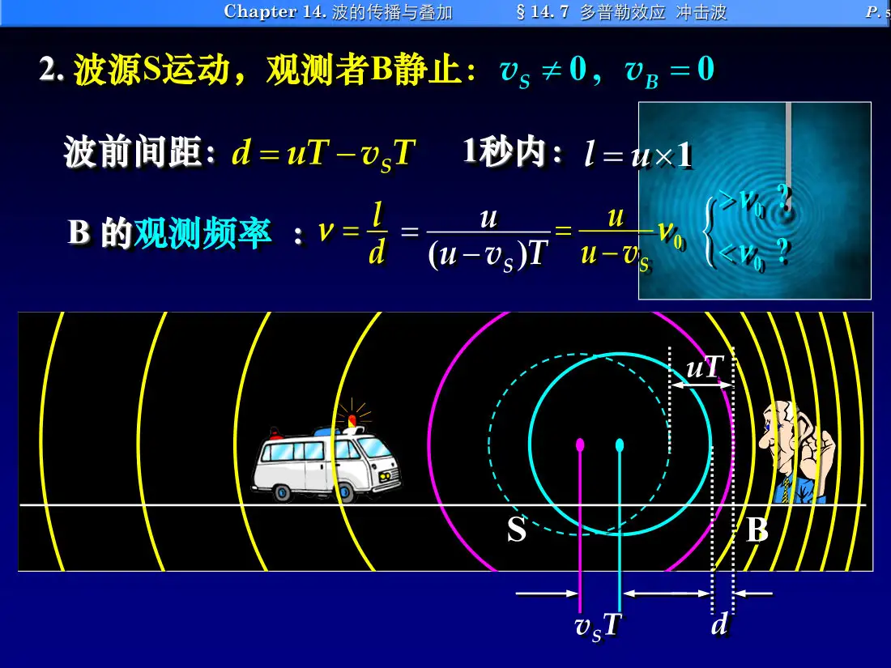

原文：

2. 波源S运动，观测者B静止： $( 0 ) ( 0 - 1 ) = ( 1 ) ( 0 - 1 ) ( 0 - 1 ) = ( 1 )$

波前间距： $C O _ { 2 } = C O _ { 2 } = C O _ { 2 } \downarrow$ 1秒内： $V = \pi \times 1 1$

B 的观测频率 $\angle B A C = \angle C D E = \angle C A C = \angle B A C = 1 8 0 ^ { \circ }$

Chapter 14. 波的传播作者：Chapter 14. 波的传播与叠加

§14. 7 多普勒效应§14. 7 多普勒效应 冲击波

P. 5

### $$

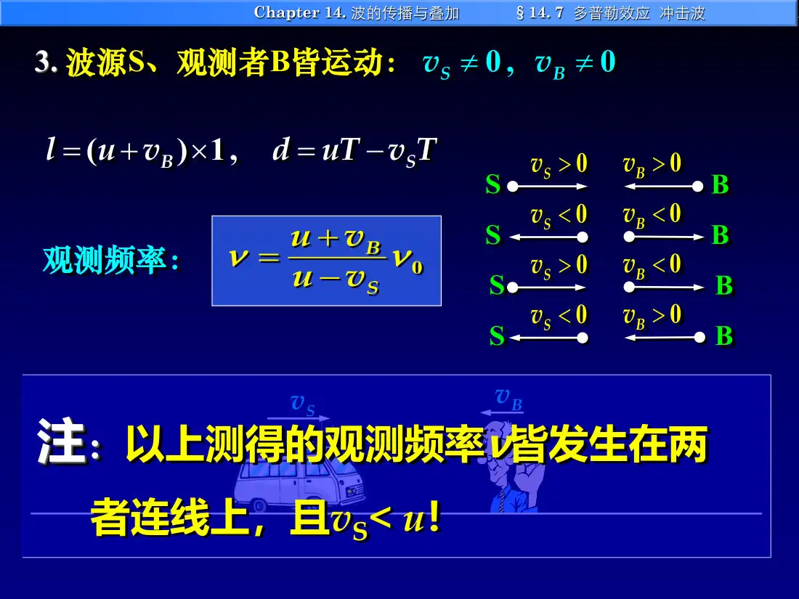

原文：

3. 波源S、观测者B皆运动： $( 0 ) ( 0 , 0 ) = ( 1 ) ( 0 , 0 ) = ( 1 )$

$$
l = (u + v _ {B}) \times 1, d = u T - v _ {s} T
$$

观测频率：

$$
\nu \equiv \frac {u + v _ {B}}{u - v _ {s}} \nu_ {0}
$$

$$
\begin{array}{c c c} \text {S} & v _ {S} > 0 & v _ {B} > 0 \\ \text {S} & v _ {S} <   0 & v _ {B} <   0 \\ \text {S} & v _ {S} > 0 & v _ {B} <   0 \\ \text {S} & v _ {S} <   0 & v _ {B} > 0 \end{array}
$$

注：以上测得的观测频率ν皆发生在两者连线上，且v < u！

Chapter 14. 波的传播与叠加 作者：杨茂田

§14. 7 多普勒效应 冲击波

### 解 B直接接收S 的频率 :

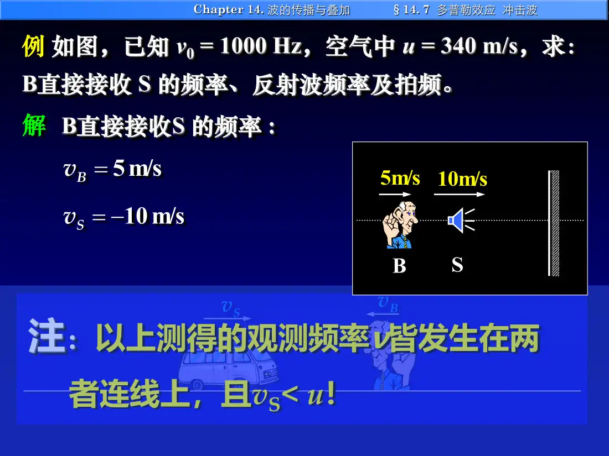

原文：

例 如图，已知 $\mathfrak { W } \equiv \mathfrak { W } \mathfrak { W } \ V \ V$ 空气中 $U _ { 2 } = \mathbb { S } \mathbb { Z } \mathbb { I } \mathbb { I } \mathbb { I } \mathbb { I }$ 求：B直接接收 S 的频率、反射波频率及拍频。

解 B直接接收S 的频率 :

$$
v _ {B} = 5 \mathrm{m/s}
$$

$$
v _ {s} = - 1 0 \mathrm{m/s}
$$

注：以上测得的观测频率ν皆发生在两者连线上，且v < u！

Chapter 14. 波的传播与叠加作者：杨茂田

§14. 7 多普勒效应 冲击波

### 解 B直接接收S 的频率 :

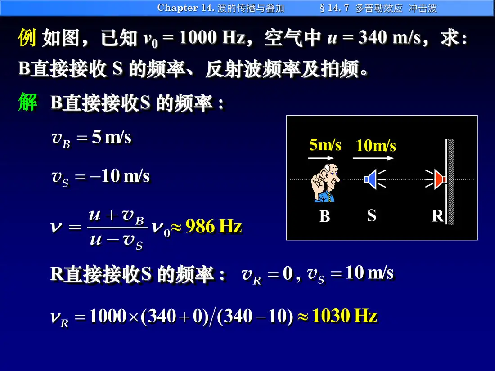

原文：

例 如图，已知 $\Longrightarrow \Longrightarrow \Longrightarrow \Longrightarrow \Longrightarrow \Longrightarrow \Longrightarrow \Longrightarrow \Longrightarrow \Longrightarrow \Longrightarrow \Longrightarrow \Longrightarrow \Longrightarrow \Longrightarrow \Longrightarrow \Longrightarrow \Longrightarrow \Longrightarrow \Longrightarrow \Longrightarrow \Longrightarrow \Longrightarrow \Longrightarrow \Longrightarrow \Longrightarrow \Longrightarrow \Longrightarrow \Longrightarrow \Longrightarrow \Longrightarrow \Longrightarrow \Longrightarrow \Longrightarrow \Longrightarrow \Longrightarrow \Longrightarrow \Longrightarrow \Longrightarrow \Longrightarrow \Longrightarrow \Longrightarrow \Longrightarrow \Longrightarrow \Longrightarrow \Longrightarrow \Longrightarrow \Longrightarrow \Longrightarrow \Longrightarrow \Longrightarrow \Longrightarrow \Longrightarrow \Longrightarrow \Longrightarrow \Longrightarrow \Longrightarrow \Longrightarrow \Longrightarrow \Longrightarrow \Longrightarrow \Longrightarrow \Longrightarrow \Longrightarrow \Longrightarrow \Longrightarrow \Longrightarrow \Longrightarrow \Longrightarrow \quad \langle \langle \pm \pm \sqrt { 1 } \rangle \Longrightarrow \langle \pm \langle \pm \pm \sqrt { 1 \rangle \pm \rangle \mit \mit } \mit \mit \mit \mit \mathrm  = \langle \mit \ m \mit \mit \ m \ m \ m \ m \ m \ m \ m \ m \ m \ m \ m \ m \ m \ m \ m \ m \ m \ m \ m \ m \ m \ m \ m \ m \ m \ m \ m \ m \ m \ m \ m \ m \ m \ m \ m \ m \ m \ m \ m \ m \ m \ m \ m \ m \ m \ m \ m \ m \ m \ m \ m \ m \ m \ m \ m \ m \ m \ m \ m \ m \ m \ m \ m \ m \ m \ m \ m \ m \ m \ m \ m \ m \ m \ m \ m \ m \ m \ m \ m \ m \ m \ m \ m \ m \ m \ m \ m \ m \ m \ m \ m \ m \ m \ m \ m \ m \ m \ m \ m \ m \ m \ m \ m \ m \ m \ m \ m \ m \ m \ m \ m \ m \ m \ m \ m \ m \ m \ m \ m \ m \ m \ m \ m \ m \ m \ m \ m \ m \ m \ m \ m \ m \ m \ m \ m \ m \ m \ m \ m \ m \ m \ m \ m \ m \ m \ m \ m \ m \ m \ m \ m \ m \ m \ m \ m \ m \ m \ m \ m \ m m \ m \ m m \ m \ m \ m \ m m m \ m \ m \ m m m \ m m \ m m m \ m \ m \ m m m \ m \ m \ m m m m \ m m \ m m m m m \ m m \ m m m m \ m \ m m m m m m m \ m m m m m \ m \ m m m m m \ m m m m m m m m m m m m \ m m m m m m \ m m m m m m m m m m m m m m m m m m m m m m m m m m m m m m m m m m m m m m m m m m m m m m m m m m m m m m m m m m m m m m m m m m m m m m m m m m m m m m m m m m m m m m m m m m m m m m m m m m m m m m m m m m m m m m m m m m m m m m m m m m m m m m m m m m m m m m m m m m m m m m m m m m m m m m m m m m m m m m m m m m m m m m m m m m m m m m m m m m m m m m m m m m m m m m m m m m m m m m m m m m m m m m m m m m m m m m m m m m m m m m m$ 空气中 ${ \cal U } = 8 2 0 0 0$ 求：B直接接收 S 的频率、反射波频率及拍频。

解 B直接接收S 的频率 :

$$
v _ {B} = 5 \mathrm{m/s}
$$

$$
v _ {s} = - 1 0 \mathrm{m/s}
$$

$$
\nu = \frac {u + v _ {B}}{u - v _ {S}} \nu_ {0} \approx 9 8 6 \mathrm{Hz}
$$

R直接接收S 的频率 : $( 0 ) _ { 1 0 } = ( 1 ) ( 0 . 0 0 - 0 . 0 0 ) ( 1 ) ( 1 ) ( 1 )$

VR =1000×(340+0)/(340-10)≈1030Hz

Chapter 14. 波的传播与叠加 作者：杨茂田

§14. 7 多普勒效应 冲击波

### $$

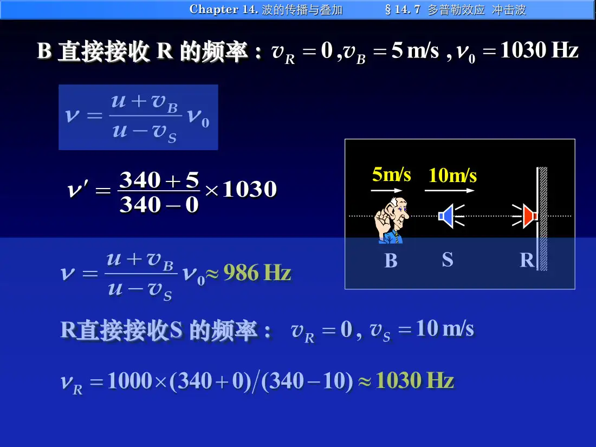

原文：

B 直接接收 R 的频率 : $\begin{array} { r } { ( 2 ) _ { 1 } = ( 1 2 0 0 0 - 2 ) ( 1 1 0 0 0 0 - 1 1 0 0 0 0 ) ( 1 1 8 1 0 ) \div ( 2 1 1 0 0 0 0 - 2 ) ( 1 1 8 1 0 ) ( 1 1 8 1 0 ) \div ( 2 1 1 0 0 0 0 0 - 2 ) ( 1 1 8 1 0 0 0 ) ( 1 1 8 1 0 0 ) } \end{array}$

$$
\nu = \frac {u + v _ {B}}{u - v _ {S}} \nu_ {0}
$$

$$
\nu^ {\prime} = \frac {3 4 0 + 5}{3 4 0 - 0} \times 1 0 3 0
$$

$$
\nu = \frac {u + v _ {B}}{u - v _ {S}} \nu_ {0} \approx 9 8 6 \mathrm{Hz}
$$

R直接接收S 的频率 : $( 0 ) _ { ( 1 ) } = ( 1 ) ( 0 , 0 ) = ( 1 ) ( 1 ) ( 1 ) ( 1 )$

$$
\nu_ {R} = 1 0 0 0 \times (3 4 0 + 0) / (3 4 0 - 1 0) \approx 1 0 3 0 \mathrm{Hz}
$$

Chapter 14. 波的传播与叠加 作者：杨茂田

§14. 7 多普勒效应 冲击波

### $$

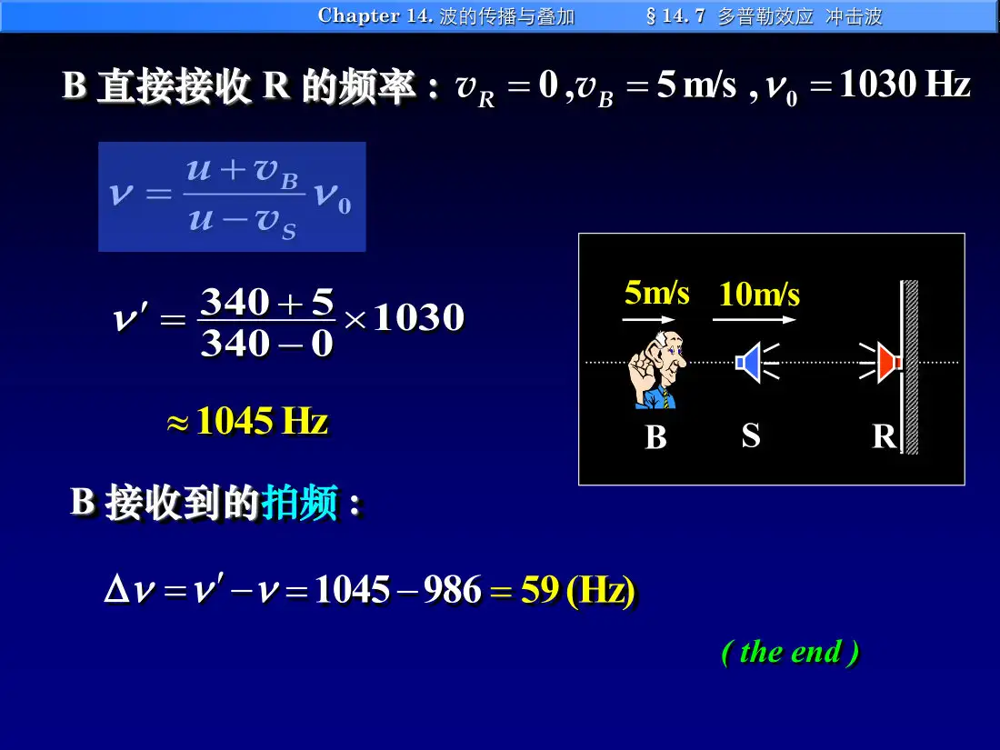

原文：

B 直接接收 R 的频率 : $( 2 ) 1 2 \div ( 1 2 0 \% = 2 ) 1 1 1 \times 2 0 \% = 1 1 \times 1 1 ) 1 0 \%$

$$
\nu = \frac {u + v _ {B}}{u - v _ {S}} \nu_ {0}
$$

$$
\nu^ {\prime} = \frac {3 4 0 + 5}{3 4 0 - 0} \times 1 0 3 0
$$

≈1045Hz

B 接收到的拍频 :

$$
\Delta \nu = \nu^ {\prime} - \nu = 1 0 4 5 - 9 8 6 = 5 9 (\mathrm{Hz})
$$

$$
(t h e e n d)
$$

Chapter 14. 波的传播与叠加 作者：杨茂田

§14. 7 多普勒效应 冲击波

### 二、冲击波 ( shock wave )

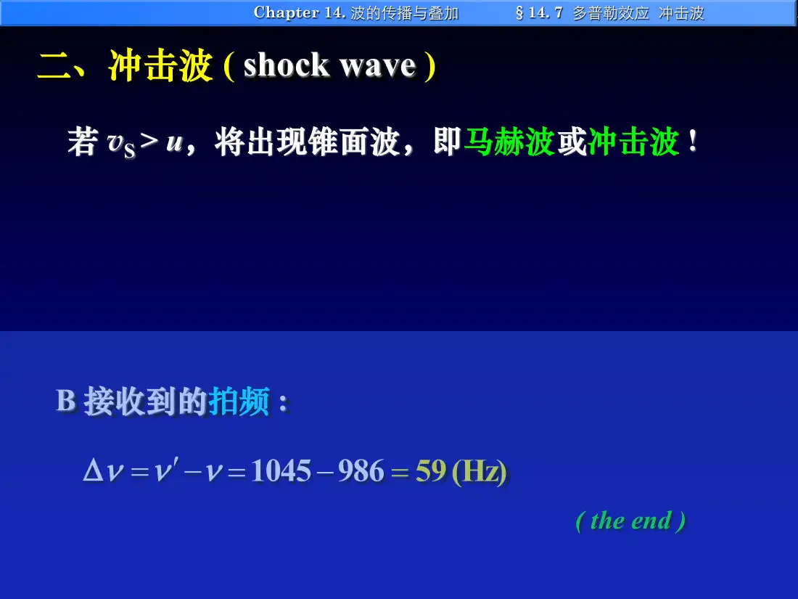

原文：

二、冲击波 ( shock wave )

若 $z = 0$ ，将出现锥面波，即马赫波或冲击波 !

B 接收到的拍频 :

$$
\Delta \nu = \nu^ {\prime} - \nu = 1 0 4 5 - 9 8 6 = 5 9 (\mathrm{Hz})
$$

$$
(t h e e n d)
$$

Chapter 14. 波的传播与叠加作者：杨茂田

§14. 7 多普勒效应 冲击波

### 二、冲击波 ( shock wave )

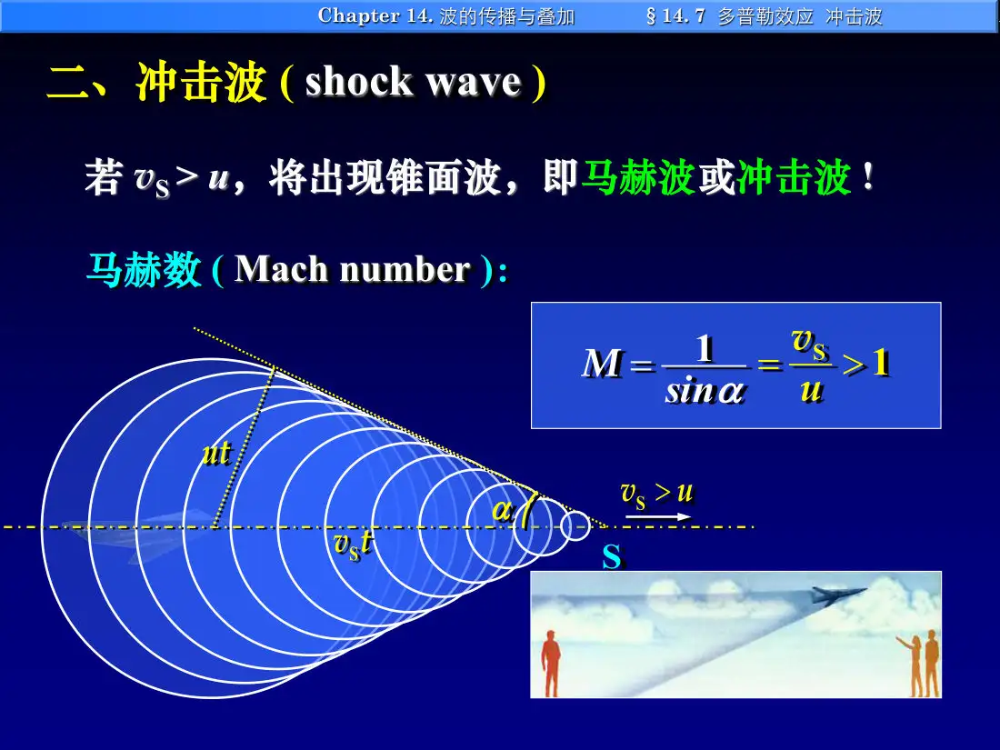

原文：

二、冲击波 ( shock wave )

若 $v _ { 0 }$ ，将出现锥面波，即马赫波或冲击波 !

马赫数 ( Mach number )：

Chapter 14. 波的传播与叠加 作者：杨茂田

§14. 7 多普勒效应 冲击波

### 归纳：

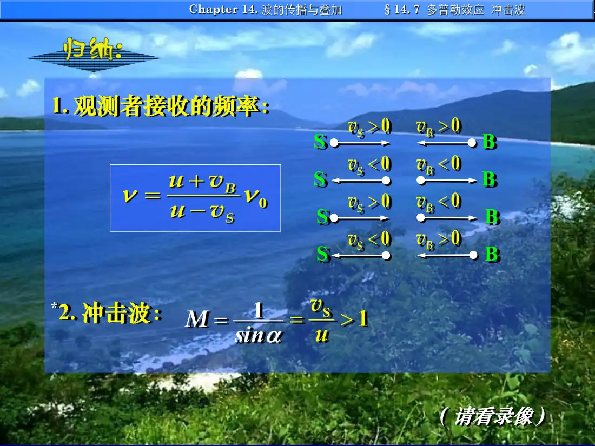

原文：

归纳：

1. 观测者接收的频率：

$$
\nu = \frac {u + v _ {B}}{u - v _ {S}} \nu_ {0}
$$

$$
\begin{array}{c c c} \text {S} & v _ {s} > 0 & v _ {B} > 0 \\ \text {S} & v _ {s} <   0 & v _ {B} <   0 \\ \text {S} & v _ {s} > 0 & v _ {B} <   0 \\ \text {S} & v _ {s} <   0 & v _ {B} > 0 \end{array}
$$

\*2. 冲击波：

$$
M = \frac {1}{\sin \alpha} = \frac {v _ {\mathrm{S}}}{u} > 1
$$

Chapter 14. 波的传播与叠加 作者：杨茂田

§14. 7 多普勒效应 冲击波

请看录像 )

### 电磁振荡

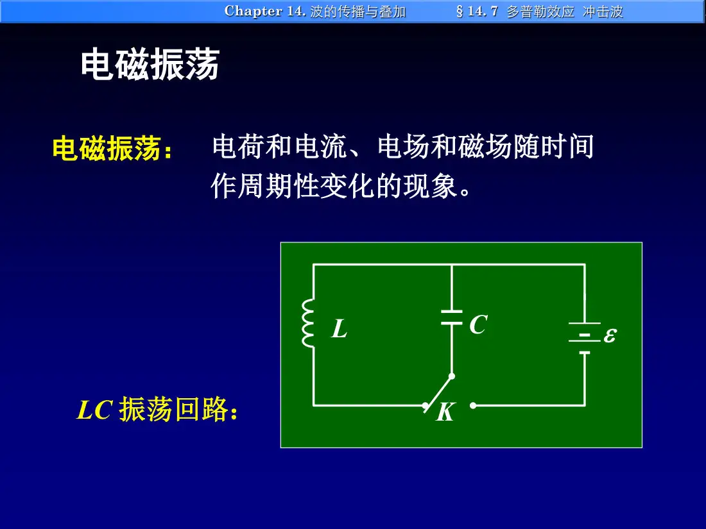

原文：

电磁振荡

电磁振荡： 电荷和电流、电场和磁场随时间作周期性变化的现象。

LC 振荡回路：

$$
\begin{array}{c c c} \text {   L   } & C & \varepsilon \\ K & \end{array}
$$

Chapter 14. 波的传播与叠加作者：杨茂田

§14. 7 多普勒效应 冲击波

### (1)

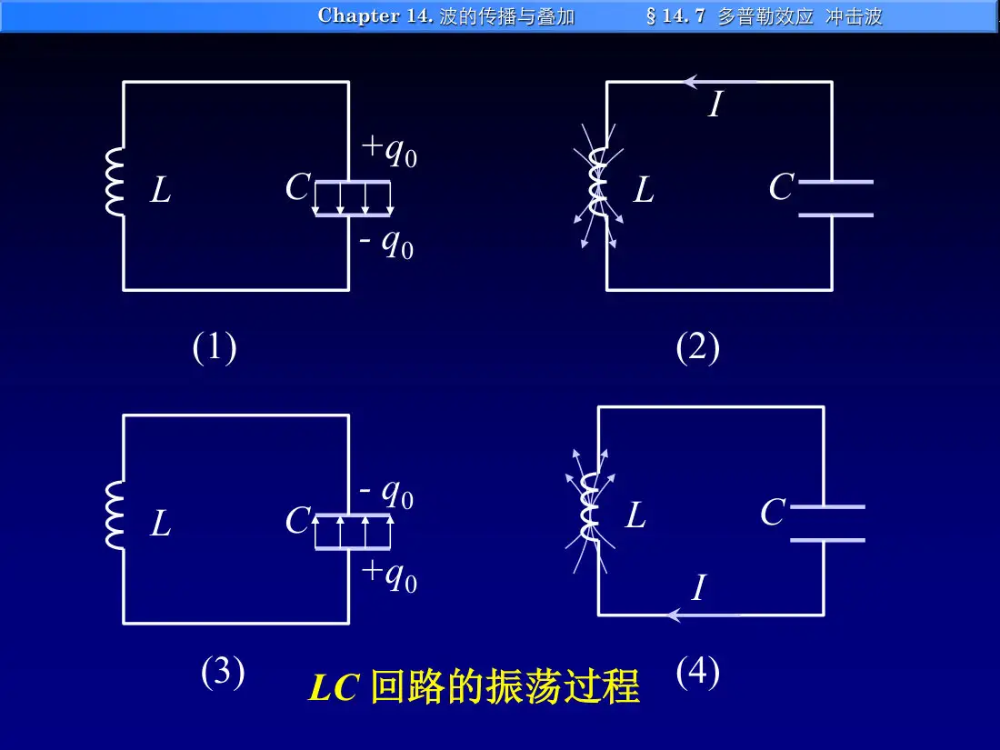

原文：

(1)

(2)

(3)

$| \overline { { \mu ( \pmb { \mathscr { L } } ) } }$ 回路的振荡过程 (4)

Chapter 14. 波的传播与叠加 作者：杨茂田

§14. 7 多普勒效应 冲击波

### Chapter 14. 波的传播与叠加作者：杨茂田

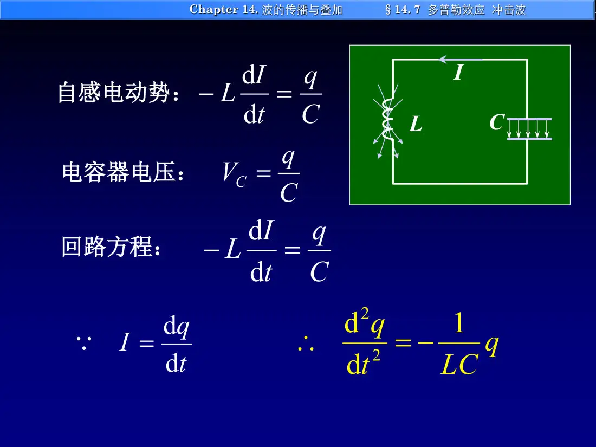

原文：

自感电动势： $- \frac { 1 } { 2 } \frac { 1 } { 3 } = \frac { 3 } { 2 }$ $\boxed { 1 } \boxed { 2 }$ 电容器电压： $1 4 - \frac { 1 } { 1 0 } = \frac { 1 } { 1 0 }$ 回路方程： $\frac { 1 } { 2 } \times \frac { 1 } { 3 } = \frac { 3 } { 2 }$ byd $\frac { A E } { A B } = \frac { A E } { A F } = \frac { 1 } { 2 } \sqrt { 1 0 } \times 2$ 电量： $\textcircled { 9 } = \textcircled { 9 } \textcircled { 1 0 } \textcircled { 1 0 } \textcircled { 2 } \textcircled { 2 } \textcircled { 1 } \textcircled { 2 }$

Chapter 14. 波的传播与叠加作者：杨茂田

§14. 7 多普勒效应 冲击波

### $$

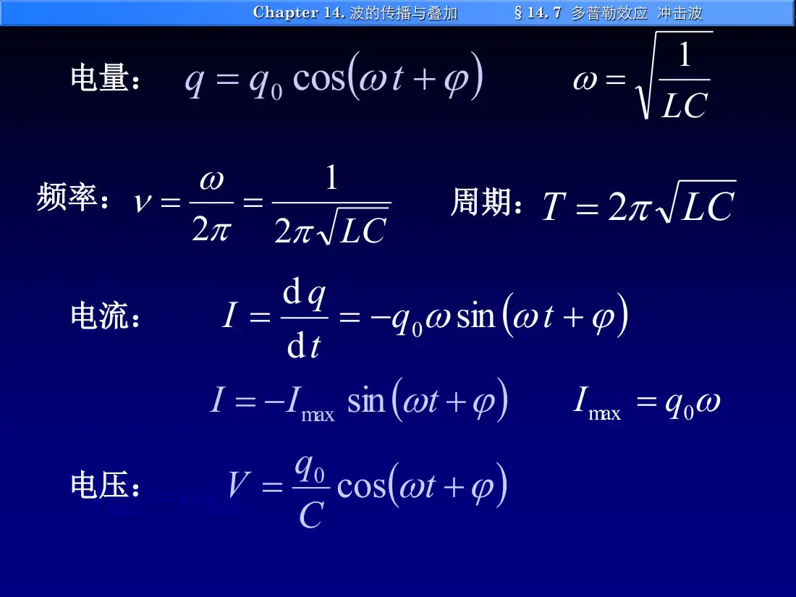

原文：

$$
\omega = \sqrt {\frac {1}{L C}}
$$

频率： $\frac { 1 } { 2 } = \frac { 1 0 } { 2 } = \frac { 1 } { 2 }$ 周期： $1 1 0 - 1 9 \times 1 0 = 1 0 0 ( c m )$

电流： $\frac { 1 } { 1 0 } \times \frac { 1 1 } { 1 0 } = \frac { 1 1 } { 1 0 } ( 1 0 0 0 0 ) \times ( 0 . 1 2 \times 2 )$

$$
I = - I _ {\mathrm{max}} \sin (\omega t + \varphi) \quad I _ {\mathrm{max}} = q _ {0} \omega
$$

电压：

$$
V = \frac {q _ {0}}{C} \cos (\omega t + \varphi)
$$

Chapter 14. 波的传播与叠加作者：杨茂田

§14. 7 多普勒效应 冲击波

### 在 LC 电路中，电流、电压、电荷都随时间结论：作简谐振动。

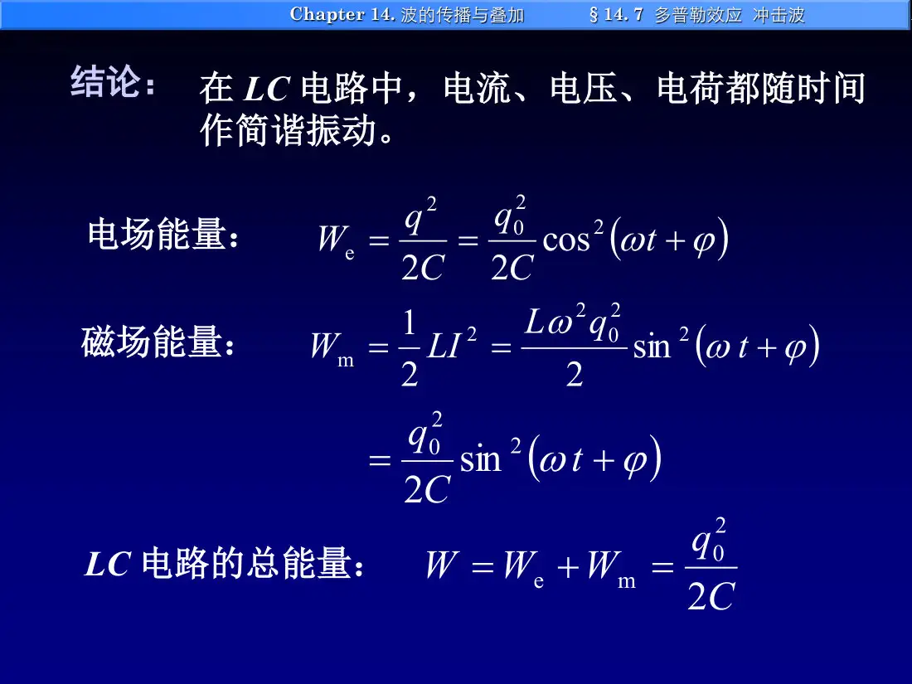

原文：

在 LC 电路中，电流、电压、电荷都随时间结论：作简谐振动。

电场能量：

$$
W _ {\mathrm{e}} = \frac {q ^ {2}}{2 C} = \frac {q _ {0} ^ {2}}{2 C} \cos^ {2} (\omega t + \varphi)
$$

磁场能量：

$$
\begin{array}{r l} W _ {\mathrm{m}} & = \frac {1}{2} L I ^ {2} = \frac {L \omega^ {2} q _ {0} ^ {2}}{2} \sin^ {2} (\omega t + \varphi) \\ & = \frac {q _ {0} ^ {2}}{2 C} \sin^ {2} (\omega t + \varphi) \end{array}
$$

LC 电路的总能量： $1 4 \% = 1 4 \% = 1 4 \% = \frac { 9 6 } { 1 0 0 }$

Chapter 14. 波的传播与叠加 作者：杨茂田

§14. 7 多普勒效应 冲击波

### 电磁波

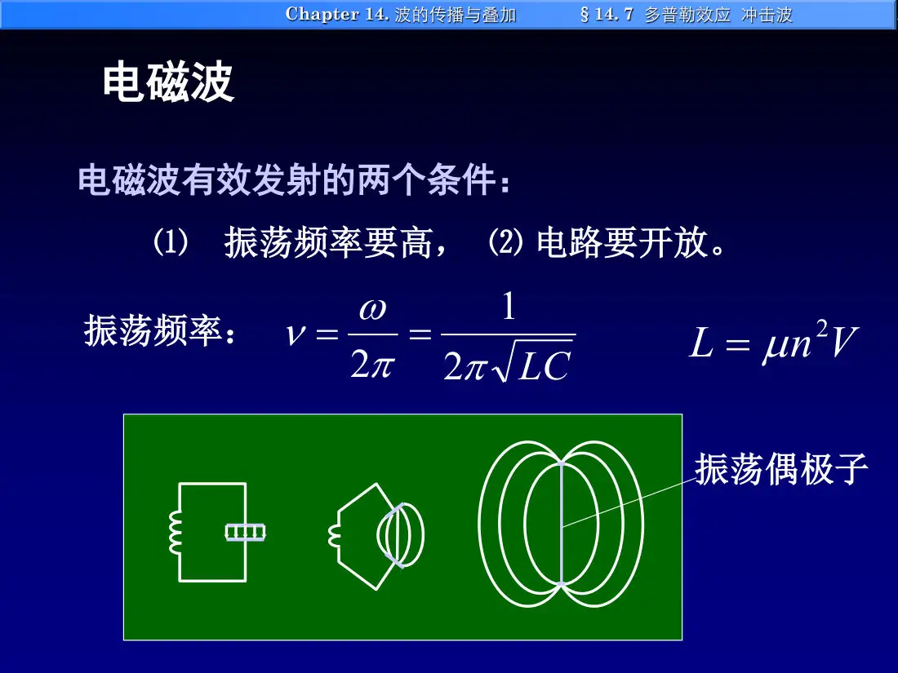

原文：

电磁波

电磁波有效发射的两个条件：

⑴ 振荡频率要高， ⑵ 电路要开放。

振荡频率： $\frac { 1 } { 2 } = \frac { 1 0 } { 2 } = \frac { 1 } { 2 } \times \frac { 1 } { 2 0 } = \frac { 1 } { 2 0 }$

$$
L = \mu n ^ {2} V
$$

振荡偶极子

Chapter 14. 波的传播与叠加作者：杨茂田

§14. 7 多普勒效应 冲击波

### $$

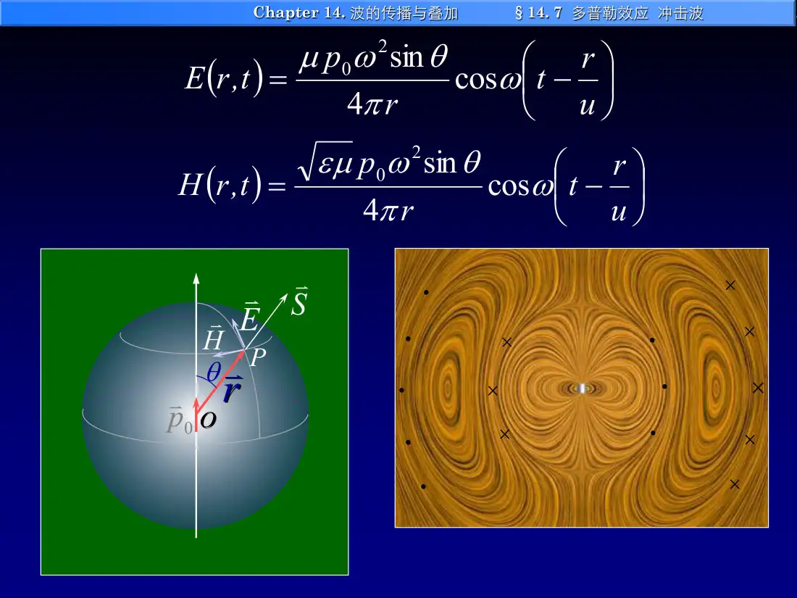

原文：

$$
E (r, t) = \frac {\mu p _ {0} \omega^ {2} \sin \theta}{4 \pi r} \cos \omega \left(t - \frac {r}{u}\right)
$$

$$
H (r, t) = \frac {\sqrt {\varepsilon \mu} p _ {0} \omega^ {2} \sin \theta}{4 \pi r} \cos \omega \left(t - \frac {r}{u}\right)
$$

Chapter 14. 波的传播与叠加作者：杨茂田

§14. 7 多普勒效应 冲击波

### 平面电磁波的主要性质：

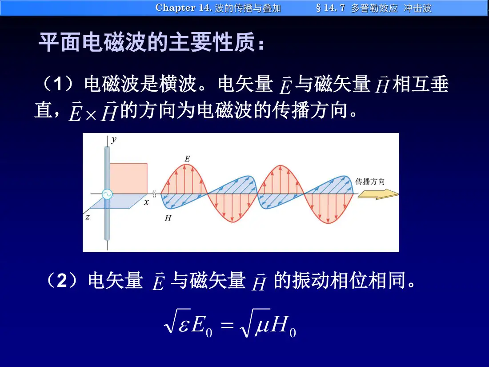

原文：

平面电磁波的主要性质：

（1）电磁波是横波。电矢量 与磁矢量 相互垂直， 的方向为电磁波的传播方向。

（2）电矢量 E 与磁矢量 的振动相位相同。H

$$
\sqrt {\varepsilon} E _ {0} = \sqrt {\mu} H _ {0}
$$

Chapter 14. 波的传播与叠加 作者：杨茂田

§14. 7 多普勒效应 冲击波

### （4）真空中电磁波的传播速度：

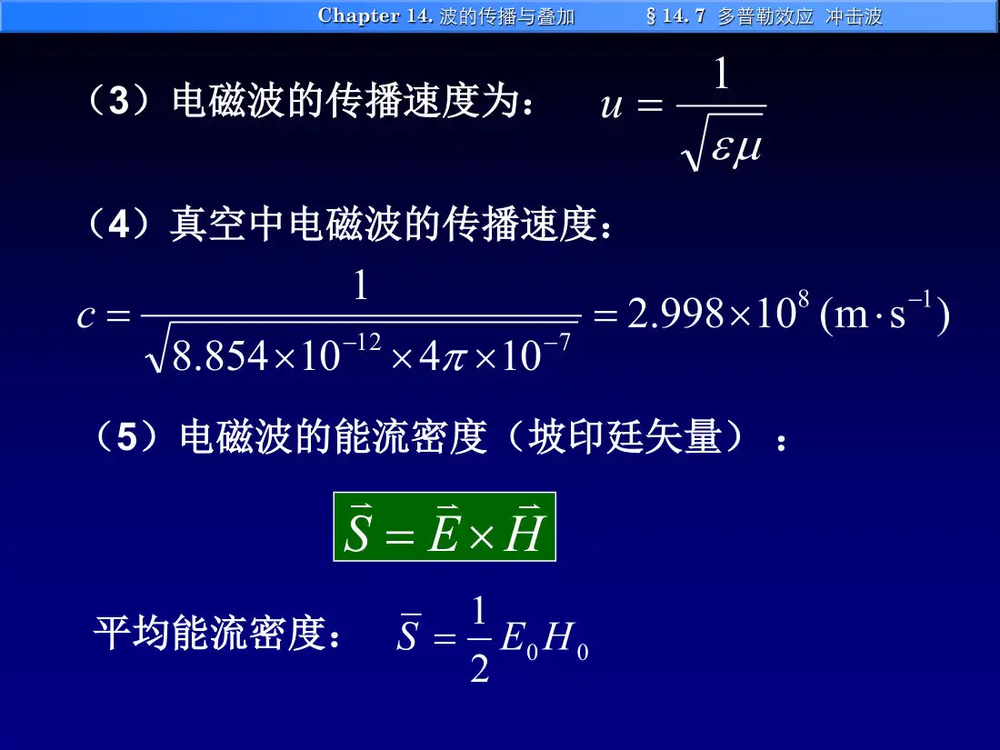

原文：

（3）电磁波的传播速度为： $( 1 ) \frac { 1 } { 2 } = \frac { 1 } { 2 }$

（4）真空中电磁波的传播速度：

$$
c = \frac {1}{\sqrt {8 . 8 5 4 \times 1 0 ^ {- 1 2} \times 4 \pi \times 1 0 ^ {- 7}}} = 2. 9 9 8 \times 1 0 ^ {8} (\mathrm{m} \cdot \mathrm{s} ^ {- 1})
$$

（5）电磁波的能流密度（坡印廷矢量） ：

$$
\vec {S} = \vec {E} \times \vec {H}
$$

平均能流密度： $( 3 ) = \frac { 1 } { 2 } \times 1 0 0 \%$

Chapter 14. 波的传播与叠加 作者：杨茂田

§14. 7 多普勒效应 冲击波

### 电磁波的能流密度：

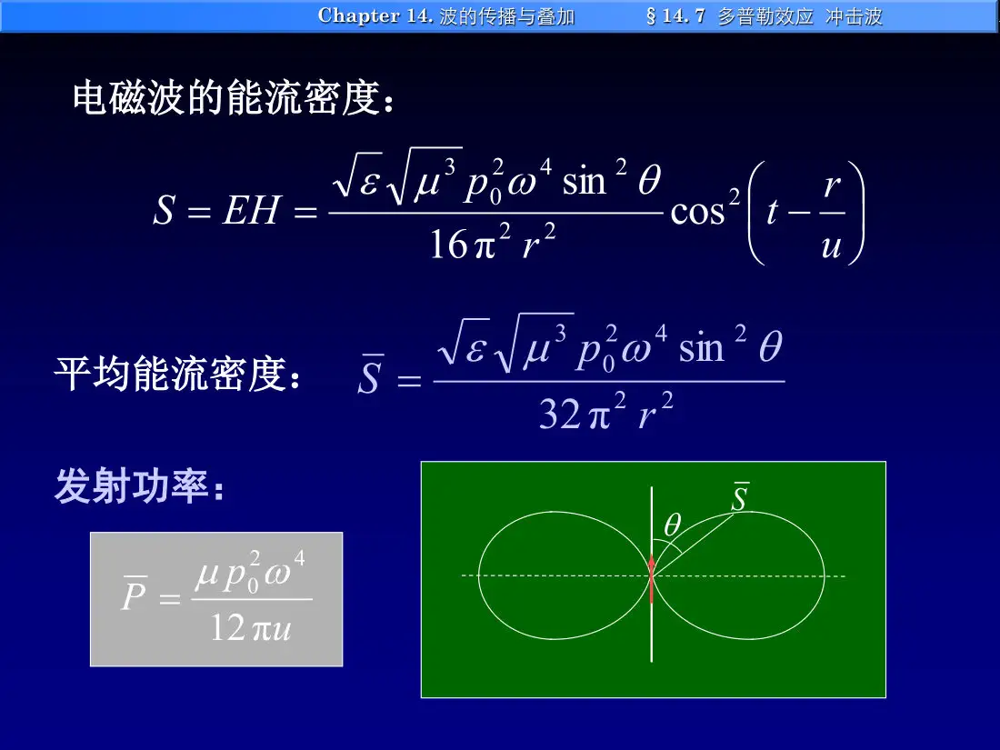

原文：

电磁波的能流密度：

$$
S = E H = \frac {\sqrt {\varepsilon} \sqrt {\mu^ {3}} p _ {0} ^ {2} \omega^ {4} \sin^ {2} \theta}{1 6 \pi^ {2} r ^ {2}} \cos^ {2} \left(t - \frac {r}{u}\right)
$$

平均能流密度：

$$
\overline {{S}} = \frac {\sqrt {\varepsilon} \sqrt {\mu^ {3}} p _ {0} ^ {2} \omega^ {4} \sin^ {2} \theta}{3 2 \pi^ {2} r ^ {2}}
$$

发射功率：

$$
\overline {{P}} = \frac {\mu p _ {0} ^ {2} \omega^ {4}}{1 2 \pi u}
$$

Chapter 14. 波的传播与叠加 作者：杨茂田

§14. 7 多普勒效应 冲击波

### 电磁波谱

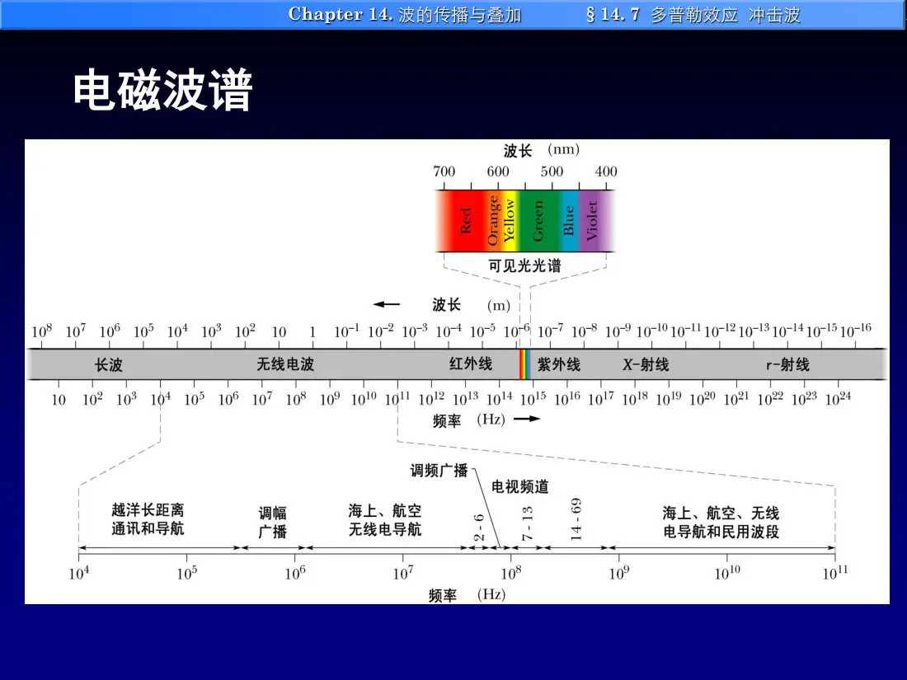

原文：

电磁波谱

Chapter 14. 波的传播与叠加作者：杨茂田

§14. 7 多普勒效应 冲击波

### ⑴ 无线电波

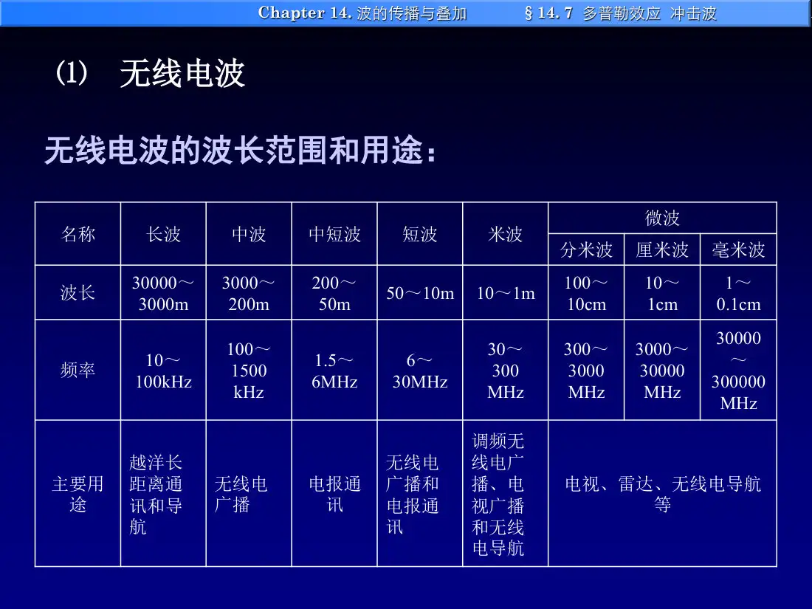

原文：

⑴ 无线电波

无线电波的波长范围和用途：

<table><tr><td rowspan="2">名称</td><td rowspan="2">长波</td><td rowspan="2">中波</td><td rowspan="2">中短波</td><td rowspan="2">短波</td><td rowspan="2">米波</td><td colspan="3">微波</td></tr><tr><td>分米波</td><td>厘米波</td><td>毫米波</td></tr><tr><td>波长</td><td>30000~3000m</td><td>3000~200m</td><td>200~50m</td><td>50~10m</td><td>10~1m</td><td>100~10cm</td><td>10~1cm</td><td>1~0.1cm</td></tr><tr><td>频率</td><td>10~100kHz</td><td>100~1500kHz</td><td>1.5~6MHz</td><td>6~30MHz</td><td>30~300MHz</td><td>300~3000MHz</td><td>3000~30000MHz</td><td>30000~300000MHz</td></tr><tr><td>主要用途</td><td>越洋长距离通讯和导航</td><td>无线电广播</td><td>电报通讯</td><td>无线电广播和电报通讯</td><td>调频无线电广播、电视广播和无线电导航</td><td colspan="3">电视、雷达、无线电导航等</td></tr></table>

Chapter 14. 波的传播与叠加作者：杨茂田

§14. 7 多普勒效应 冲击波

### ⑵ 红外线 0.6 mm～760 nm热效应；不易被大气和浓雾吸收。

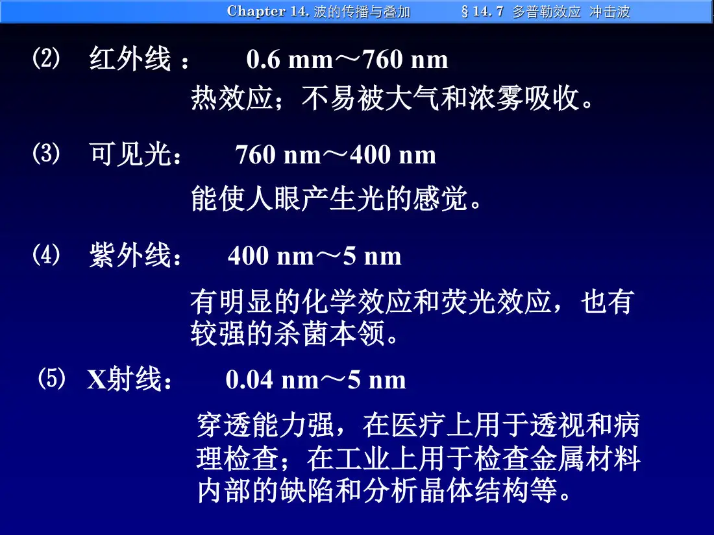

原文：

⑵ 红外线 0.6 mm～760 nm热效应；不易被大气和浓雾吸收。

⑶ 可见光： 760 nm～400 nm能使人眼产生光的感觉。

⑷ 紫外线： 400 nm～5 nm有明显的化学效应和荧光效应，也有较强的杀菌本领。

⑸ X射线： 0.04 nm～5 nm穿透能力强，在医疗上用于透视和病理检查；在工业上用于检查金属材料内部的缺陷和分析晶体结构等。

Chapter 14. 波的传播与叠加 作者：杨茂田

§14. 7 多普勒效应 冲击波

### ⑹ γ射线：小于0.04 nm

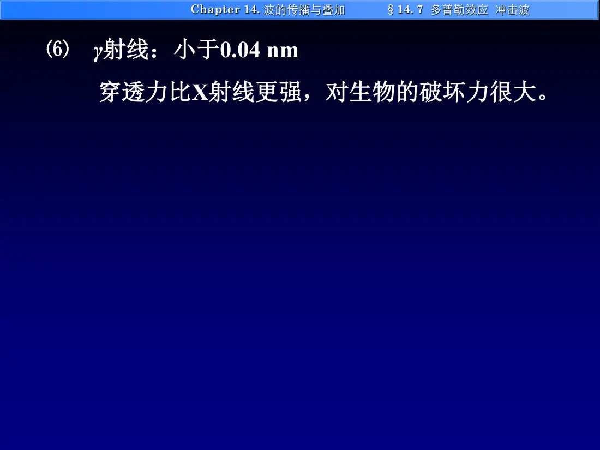

原文：

⑹ γ射线：小于0.04 nm

穿透力比X射线更强，对生物的破坏力很大。

Chapter 14. 波的传播与叠加作者：杨茂田

§14. 7 多普勒效应 冲击波

### 多普勒效应

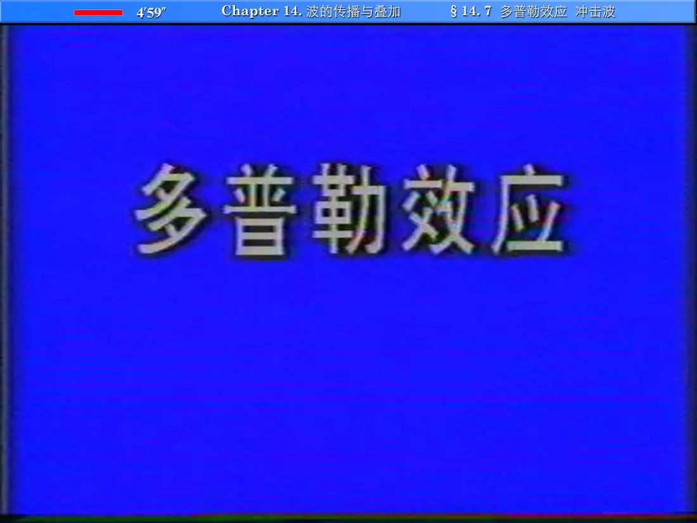

原文：

多普勒效应

4'59″

Chapter 14. 波的传播与叠加 作者：杨茂田

§14. 7 多普勒效应 冲击波
