# 《大学物理》第14章 狭义相对论的历史背景（课件）

原件的每一页，下面附识别出的文字。

### §14-1伽利略变换式 牛顿的绝对时空观

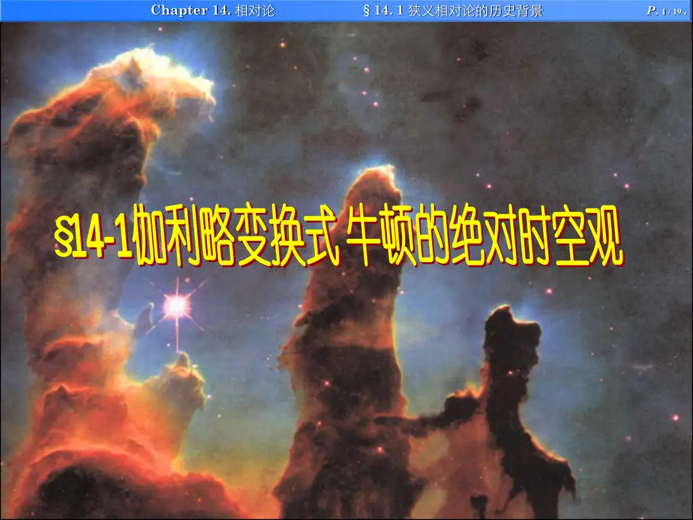

原文：

§14-1伽利略变换式 牛顿的绝对时空观

Chapter 14. 相对论

§ 14.1 狭义相对论的历史背景

P. 1/19.

### 一.狭义相对论产生的基础

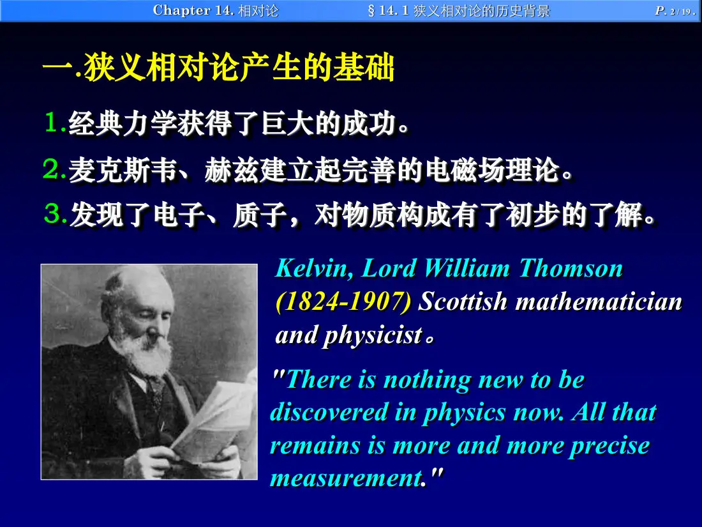

原文：

一.狭义相对论产生的基础

1. 经典力学获得了巨大的成功。

2. 麦克斯韦、赫兹建立起完善的电磁场理论。

3. 发现了电子、质子，对物质构成有了初步的了解。

Kelvin, Lord William Thomson (1824-1907) Scottish mathematician and physicist.

"There is nothing new to be discovered in physics now. All that remains is more and more precise measurement."

Chapter 14. 相对论

§ 14.1 狭义相对论的历史背景

P. 2/19.

### 相对论诞生

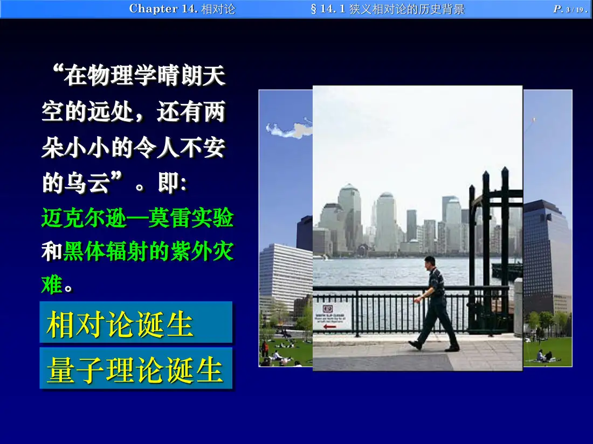

原文：

“在物理学晴朗天空的远处，还有两朵小小的令人不安的乌云”。即：迈克尔逊—莫雷实验和黑体辐射的紫外灾难。

相对论诞生

量子理论诞生

Chapter 14. 相对论

§ 14.1 狭义相对论的历史背景

P. 3 / 19.

### 二.经典理论所遇到的挑战

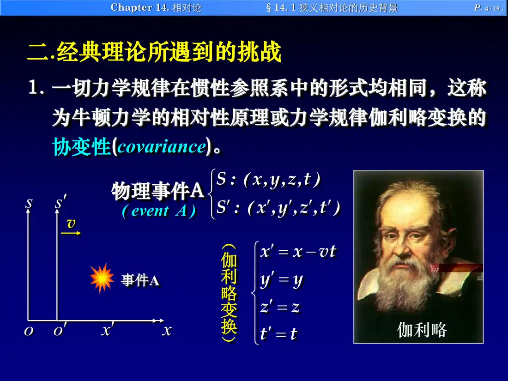

原文：

二.经典理论所遇到的挑战

1. 一切力学规律在惯性参照系中的形式均相同，这称为牛顿力学的相对性原理或力学规律伽利略变换的协变性(covariance)。

物理事件A (event A)

$\left\{ \begin{array}{l}S:(x,y,z,t)\\ S^{\prime}:(x^{\prime},y^{\prime},z^{\prime},t^{\prime}) \end{array} \right.$

(伽利略变换)

事件A

$$
\left\{ \begin{array}{l} x ^ {\prime} = x - v t \\ y ^ {\prime} = y \\ z ^ {\prime} = z \\ t ^ {\prime} = t \end{array} \right.
$$

Chapter 14. 相对论

§ 14.1 狭义相对论的历史背景

P. 4/19.

### 两事件A、B的时、空间隔分别为：

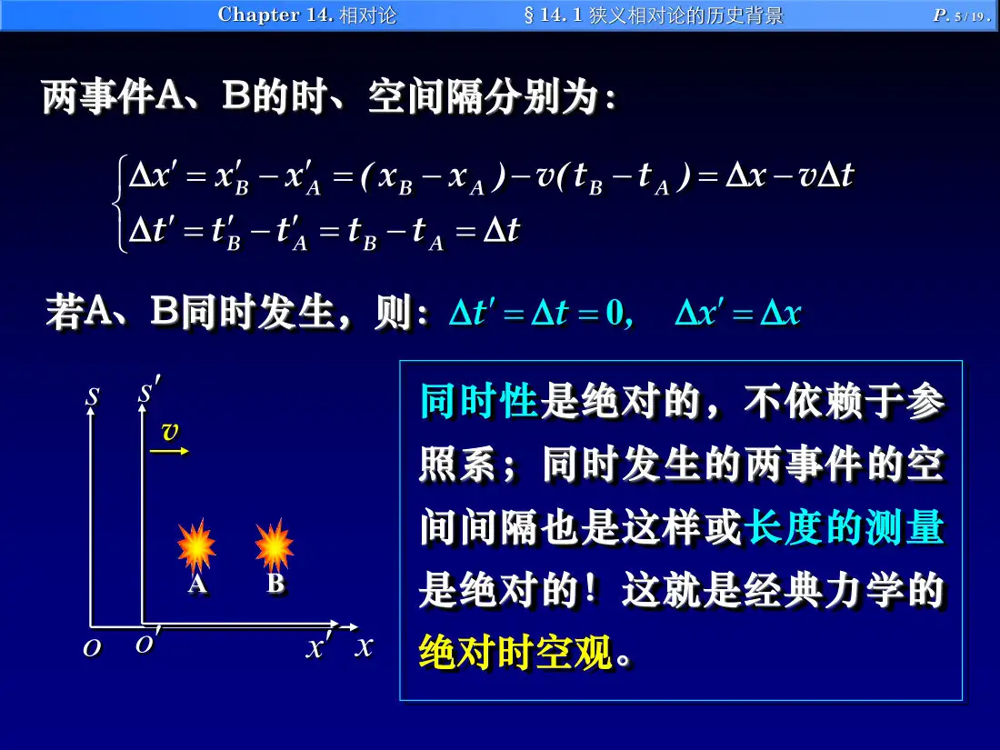

原文：

两事件A、B的时、空间隔分别为：

$$
\left\{ \begin{array}{l} \Delta x ^ {\prime} = x _ {B} ^ {\prime} - x _ {A} ^ {\prime} = (x _ {B} - x _ {A}) - v (t _ {B} - t _ {A}) = \Delta x - v \Delta t \\ \Delta t ^ {\prime} = t _ {B} ^ {\prime} - t _ {A} ^ {\prime} = t _ {B} - t _ {A} = \Delta t \end{array} \right.
$$

若A、B同时发生，则： $\Delta t' = \Delta t = 0$ ， $\Delta x' = \Delta x$

同时性是绝对的，不依赖于参照系；同时发生的两事件的空间间隔也是这样或长度的测量是绝对的！这就是经典力学的绝对时空观。

Chapter 14. 相对论

§ 14.1 狭义相对论的历史背景

P. 5/19.

### $$

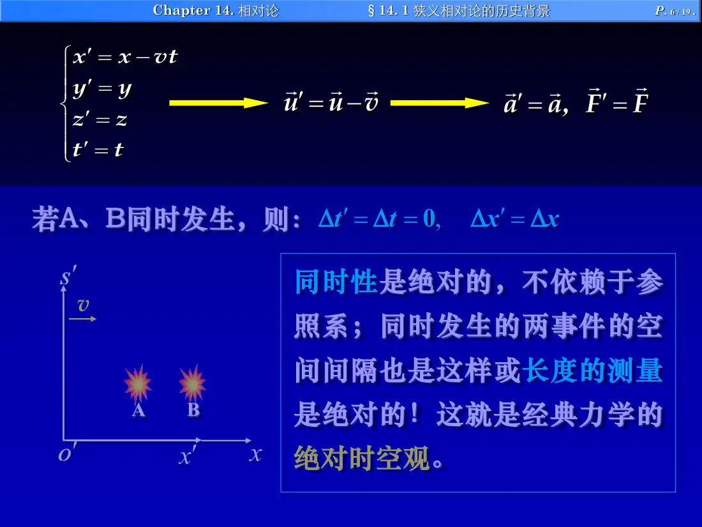

原文：

$$
\left\{ \begin{array}{l} x ^ {\prime} = x - v t \\ y ^ {\prime} = y \\ z ^ {\prime} = z \\ t ^ {\prime} = t \end{array} \right.
$$

$$
\vec {u} ^ {\prime} = \vec {u} - \vec {v}
$$

$$
\vec {a} ^ {\prime} = \vec {a}, \vec {F} ^ {\prime} = \vec {F}
$$

若A、B同时发生，则： $\Delta t' = \Delta t = 0, \quad \Delta x' = \Delta x$

同时性是绝对的，不依赖于参照系；同时发生的两事件的空间间隔也是这样或长度的测量是绝对的！这就是经典力学的绝对时空观。

Chapter 14. 相对论

§ 14.1 狭义相对论的历史背景

P. 6/19.

### $$

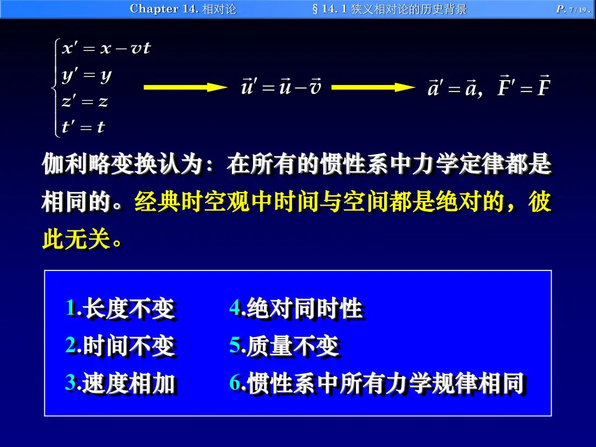

原文：

$$
\left\{ \begin{array}{l} x ^ {\prime} = x - v t \\ y ^ {\prime} = y \\ z ^ {\prime} = z \\ t ^ {\prime} = t \end{array} \right.
$$

$$
\vec {u} ^ {\prime} = \vec {u} - \vec {v}
$$

$$
\vec {a} ^ {\prime} = \vec {a}, \vec {F} ^ {\prime} = \vec {F}
$$

伽利略变换认为：在所有的惯性系中力学定律都是相同的。经典时空观中时间与空间都是绝对的，彼此无关。

1. 长度不变 
4. 绝对同时性

2.时间不变 5.质量不变

3.速度相加

6.惯性系中所有力学规律相同矛盾：S系中两个静止的点电荷间只有静电力的作用；但在S'系中却发现两者除了有静电力作用外，还有磁力相互作用。

Chapter 14. 相对论

§ 14.1 狭义相对论的历史背景

P. 7/19.

### Chapter 14. 相对论

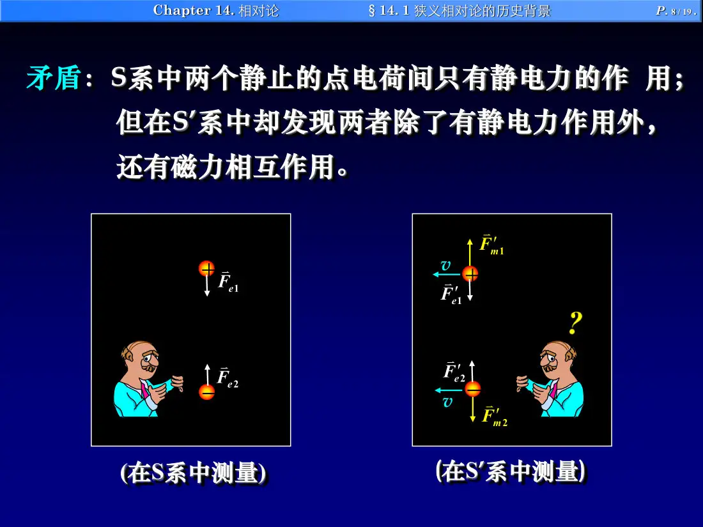

原文：

Chapter 14. 相对论

§ 14.1 狭义相对论的历史背景

P. 8/19.

### $$

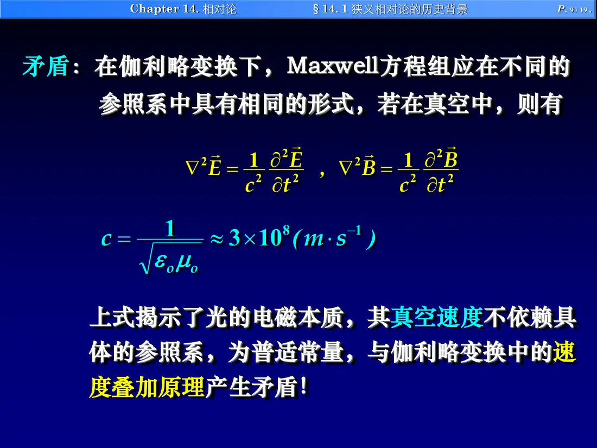

原文：

矛盾：在伽利略变换下，Maxwell方程组应在不同的参照系中具有相同的形式，若在真空中，则有

$$
\nabla^ {2} \vec {E} = \frac {1}{c ^ {2}} \frac {\partial^ {2} \vec {E}}{\partial t ^ {2}}, \nabla^ {2} \vec {B} = \frac {1}{c ^ {2}} \frac {\partial^ {2} \vec {B}}{\partial t ^ {2}}
$$

$$
c = \frac {1}{\sqrt {\varepsilon_ {o} \mu_ {o}}} \approx 3 \times 1 0 ^ {8} (m \cdot s ^ {- 1})
$$

上式揭示了光的电磁本质，其真空速度不依赖具体的参照系，为普适常量，与伽利略变换中的速度叠加原理产生矛盾！

Chapter 14. 相对论

§ 14.1 狭义相对论的历史背景

P. 9/19.

### 那么，在真空中光的传播所依赖的媒质是什么？——以太(ether)!

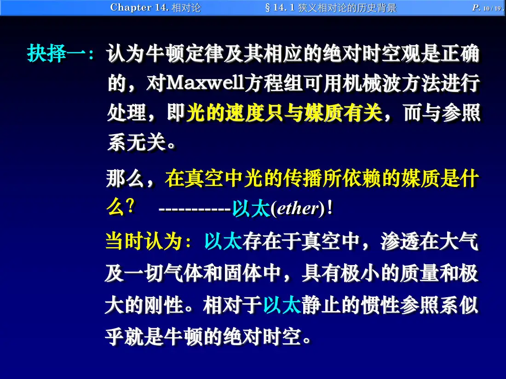

原文：

抉择一：认为牛顿定律及其相应的绝对时空观是正确的，对Maxwell方程组可用机械波方法进行处理，即光的速度只与媒质有关，而与参照系无关。

那么，在真空中光的传播所依赖的媒质是什么？——以太(ether)!

当时认为：以太存在于真空中，渗透在大气及一切气体和固体中，具有极小的质量和极大的刚性。相对于以太静止的惯性参照系似乎就是牛顿的绝对时空。

Chapter 14. 相对论

§ 14.1 狭义相对论的历史背景

P. 10 / 19.

### Chapter 14. 相对论

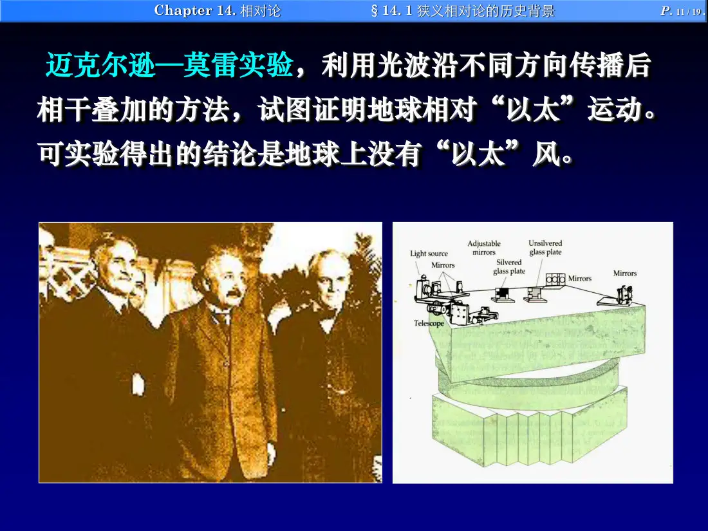

原文：

迈克尔逊—莫雷实验，利用光波沿不同方向传播后相干叠加的方法，试图证明地球相对“以太”运动。可实验得出的结论是地球上没有“以太”风。

Chapter 14. 相对论

§ 14.1 狭义相对论的历史背景

P. 11/19.

### 迈克耳孙-莫雷实验

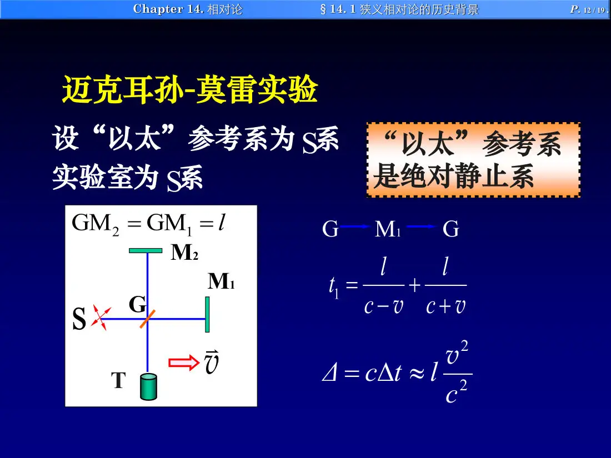

原文：

迈克耳孙-莫雷实验

设“以太”参考系为S系实验室为S系

$$
\begin{array}{c} \mathrm{GM} _ {2} = \mathrm{GM} _ {1} = l \\ \mathrm{M} _ {2} \\ \mathrm{M} _ {1} \\ \mathrm{S} \\ \mathrm{T} \end{array}
$$

“以太”参考系是绝对静止系

$$
\begin{array}{l} \mathrm{G} \longrightarrow \mathrm{M} _ {1} \longrightarrow \mathrm{G} \\ t _ {1} = \frac {l}{c - v} + \frac {l}{c + v} \end{array}
$$

$$
\varDelta = c \Delta t \approx l \frac {v ^ {2}}{c ^ {2}}
$$

Chapter 14. 相对论

§ 14.1 狭义相对论的历史背景

P. 12 / 19.

### $$

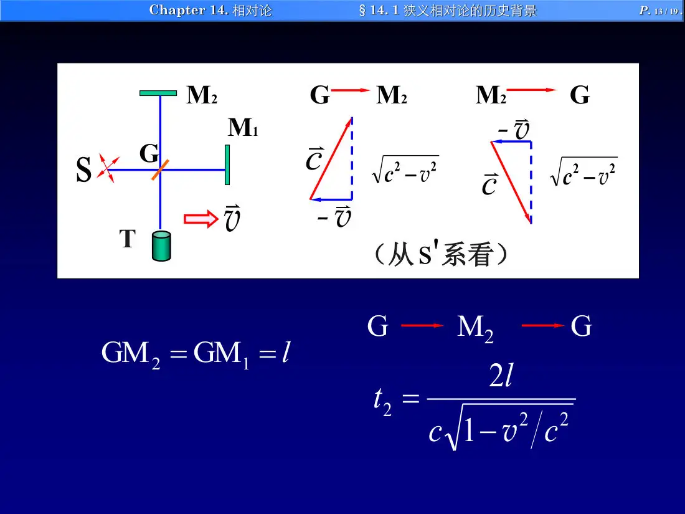

原文：

$$
\begin{array}{c c} \mathbf {G} \longrightarrow \mathbf {M} _ {2} & \mathbf {M} _ {2} \longrightarrow \mathbf {G} \\ \overrightarrow {\mathcal {C}} \Bigg / - \overrightarrow {\mathcal {V}} & \overrightarrow {\mathcal {C}} \Bigg / - \overrightarrow {\mathcal {V}} \\ & \sqrt {c ^ {2} - v ^ {2}} \\ & \sqrt {c ^ {2} - v ^ {2}} \end{array}
$$

(从S'系看)

$$
\mathrm{GM} _ {2} = \mathrm{GM} _ {1} = l
$$

$$
\begin{array}{l} \mathrm{G} \longrightarrow \mathrm{M} _ {2} \longrightarrow \mathrm{G} \\ t _ {2} = \frac {2 l}{c \sqrt {1 - v ^ {2} / c ^ {2}}} \end{array}
$$

Chapter 14. 相对论

§ 14.1 狭义相对论的历史背景

P. 13 / 19.

### 结论：作为绝对参考系的以太不存在.

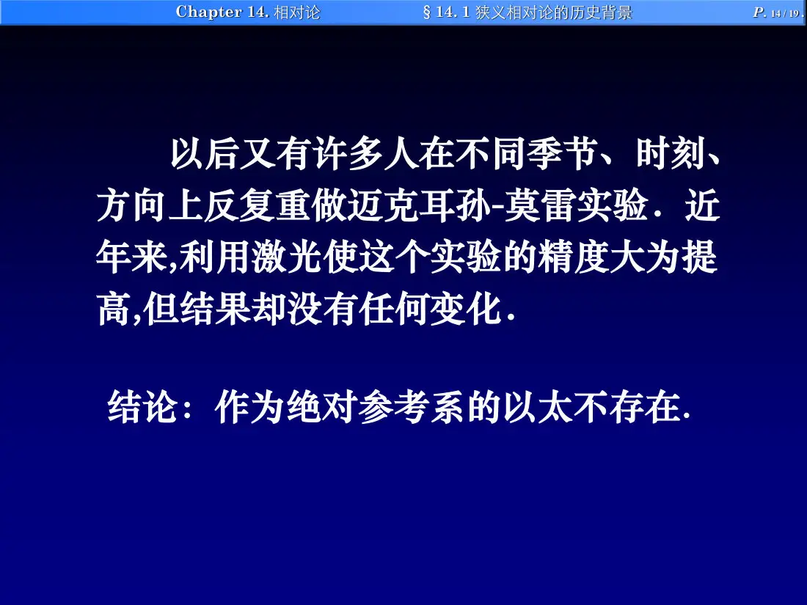

原文：

以后又有许多人在不同季节、时刻、方向上反复重做迈克耳孙-莫雷实验。近年来,利用激光使这个实验的精度大为提高,但结果却没有任何变化。

结论：作为绝对参考系的以太不存在.

Chapter 14. 相对论

§ 14.1 狭义相对论的历史背景

P. 14/19.

### Chapter 14. 相对论

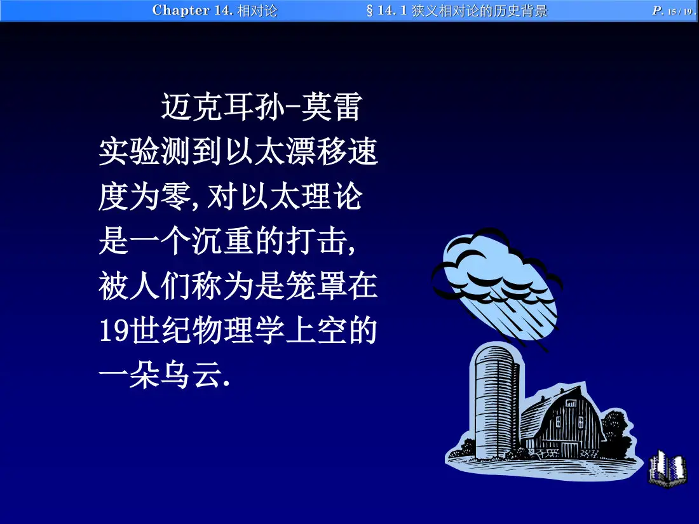

原文：

迈克耳孙-莫雷实验测到以太漂移速度为零, 对以太理论是一个沉重的打击, 被人们称为是笼罩在19世纪物理学上空的一朵乌云.

Chapter 14. 相对论

§ 14.1 狭义相对论的历史背景

P. 15/19.

### 2. 光速为一常量，与惯性参照系的选择无关。（光速不变原理）

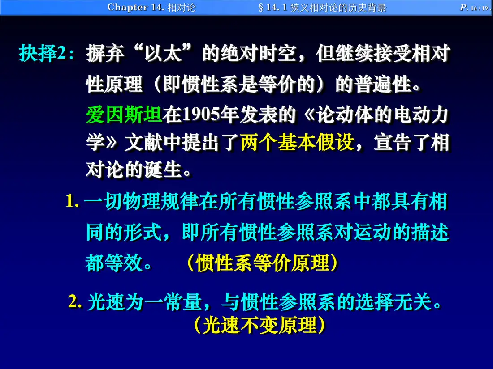

原文：

抉择2：摒弃“以太”的绝对时空，但继续接受相对性原理（即惯性系是等价的）的普遍性。爱因斯坦在1905年发表的《论动体的电动力学》文献中提出了两个基本假设，宣告了相对论的诞生。

1. 一切物理规律在所有惯性参照系中都具有相同的形式，即所有惯性参照系对运动的描述都等效。（惯性系等价原理）

2. 光速为一常量，与惯性参照系的选择无关。（光速不变原理）

Chapter 14. 相对论

§ 14.1 狭义相对论的历史背景

P. 16 / 19.

### 1905年首次提出了光量子假设，为此获得1921年诺贝尔物理奖。

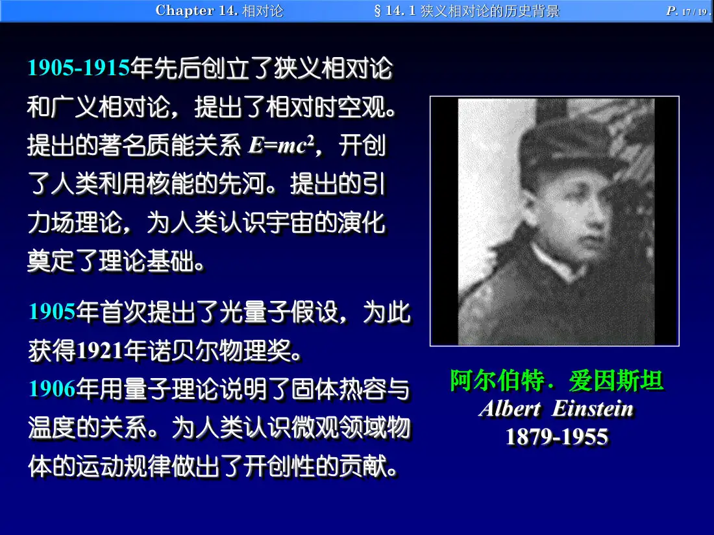

原文：

1905- 1915年先后创立了狭义相对论和广义相对论，提出了相对时空观。提出的著名质能关系 $E = mc^{2}$ ，开创了人类利用核能的先河。提出的引力场理论，为人类认识宇宙的演化奠定了理论基础。

1905年首次提出了光量子假设，为此获得1921年诺贝尔物理奖。

1906年用量子理论说明了固体热容与温度的关系。为人类认识微观领域物体的运动规律做出了开创性的贡献。

阿尔伯特·爱因斯坦
Albert Einstein
1879-1955

Chapter 14. 相对论

§ 14.1 狭义相对论的历史背景

P. 17 / 19.

### 1912年用量子理论建立了光化学定律。

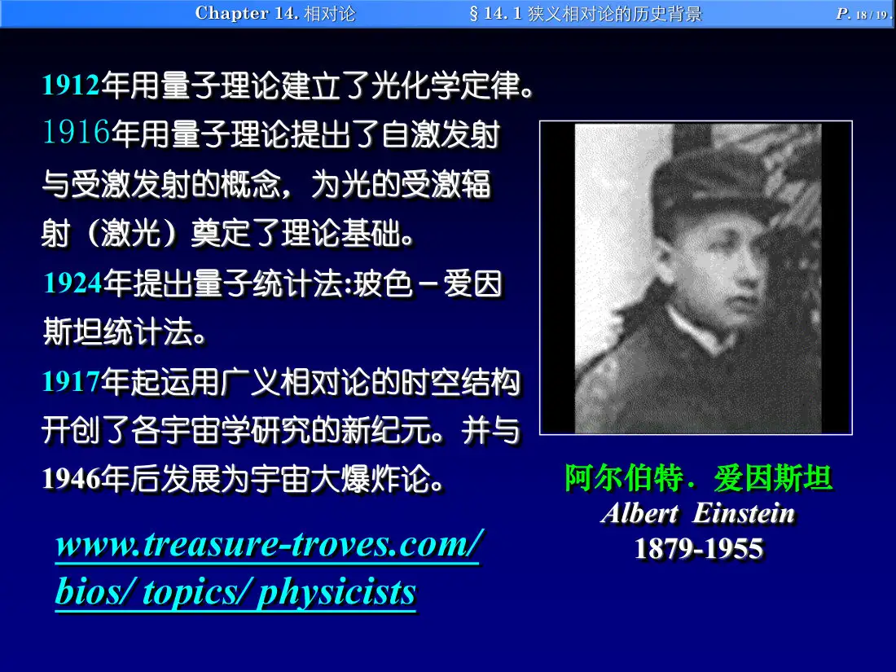

原文：

1912年用量子理论建立了光化学定律。  
1916年用量子理论提出了自激发射与受激发射的概念，为光的受激辐射（激光）奠定了理论基础。  
1924年提出量子统计法:玻色-爱因斯坦统计法。

1917年起运用广义相对论的时空结构开创了各宇宙学研究的新纪元。并与1946年后发展为宇宙大爆炸论。

www.treasure-troves.com/

bios/ topics/ physicists 阿尔伯特．爱因斯坦
Albert Einstein
1879-1955

Chapter 14. 相对论

§ 14.1 狭义相对论的历史背景

P. 18/19.

### “魅星”现象

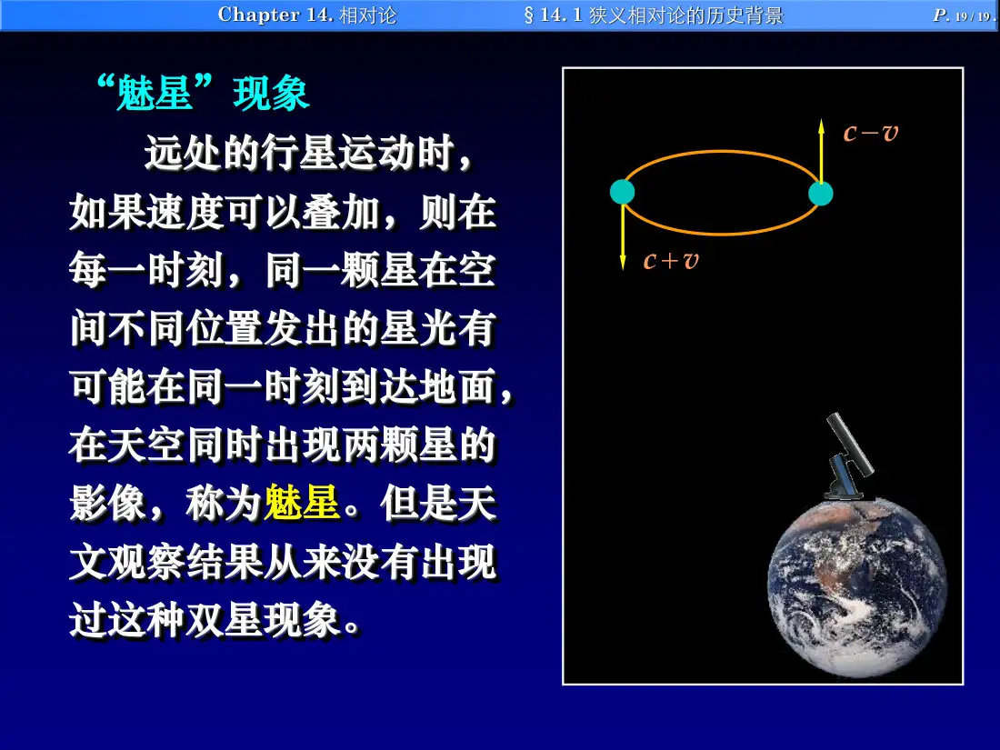

原文：

“魅星”现象

远处的行星运动时，如果速度可以叠加，则在每一时刻，同一颗星在空间不同位置发出的星光有可能在同一时刻到达地面，在天空同时出现两颗星的影像，称为魅星。但是天文观察结果从来没有出现过这种双星现象。

Chapter 14. 相对论

§ 14.1 狭义相对论的历史背景

P. 19 / 19.
