# 《大学物理》第14章 相对论 §14-2 洛伦兹变换（课件）

原件的每一页，下面附识别出的文字。

### §14-2狭义相对论的基本原理 洛伦兹变换式

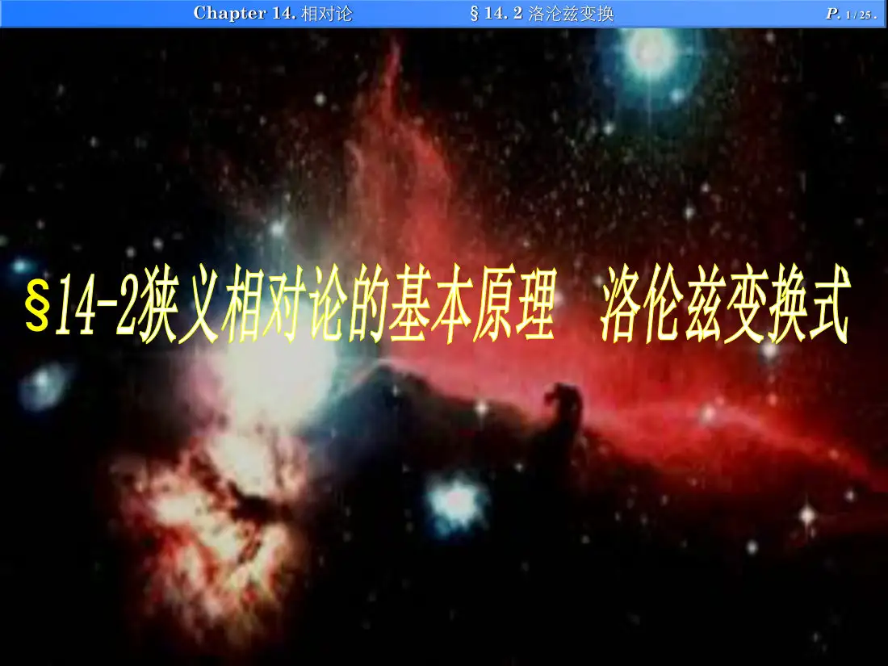

原文：

§14-2狭义相对论的基本原理 洛伦兹变换式

Chapter 14. 相对论

§ 14.2 洛沦兹变换

### 一、相对论的时空变换----洛沦兹变换

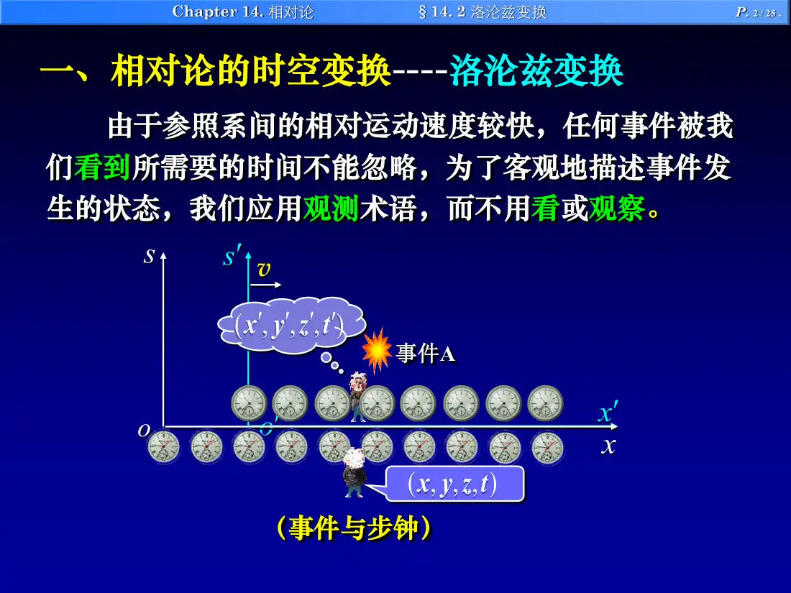

原文：

一、相对论的时空变换----洛沦兹变换

由于参照系间的相对运动速度较快，任何事件被我们看到所需要的时间不能忽略，为了客观地描述事件发生的状态，我们应用观测术语，而不用看或观察。

Chapter 14. 相对论

§ 14.2 洛沦兹变换

P. 2/25.

### 设原点 $o$ 、 $o'$ 重合的物理事件的时空坐标为：

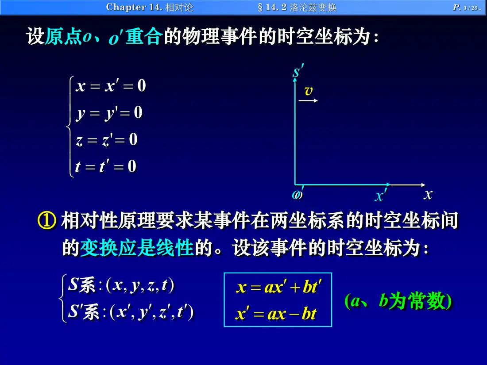

原文：

设原点 $o$ 、 $o'$ 重合的物理事件的时空坐标为：

$$
\left\{ \begin{array}{l} x = x ^ {\prime} = 0 \\ y = y ^ {\prime} = 0 \\ z = z ^ {\prime} = 0 \\ t = t ^ {\prime} = 0 \end{array} \right.
$$

① 相对性原理要求某事件在两坐标系的时空坐标间的变换应是线性的。设该事件的时空坐标为：

S系:(x,y,z,t)

$S^{\prime}$ 系: $(x^{\prime},y^{\prime},z^{\prime},t^{\prime})$

$x = ax' + bt'$

$$
x ^ {\prime} = a x - b t
$$

(a、b为常数)

Chapter 14. 相对论

§ 14.2 洛沦兹变换

P. 3/25.

### ② 观测 $S'$ 的原点 $o'$ 的运动:

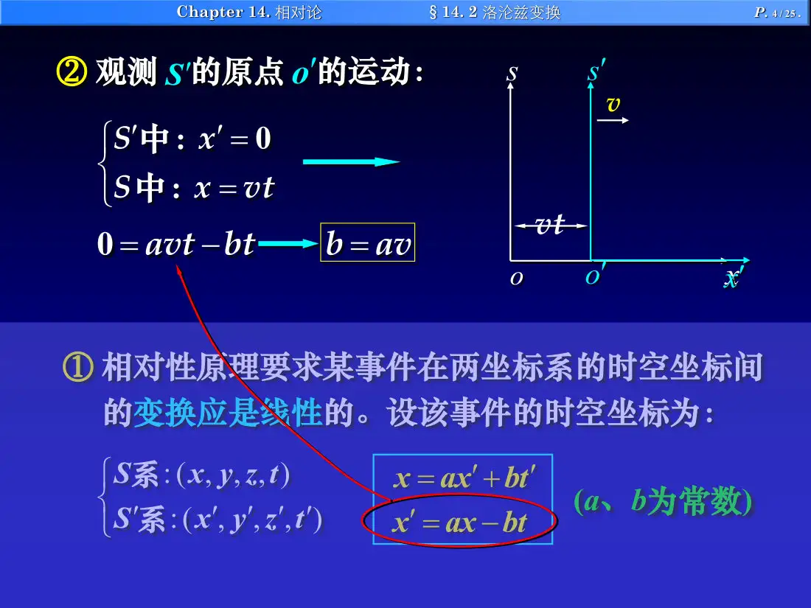

原文：

② 观测 $S'$ 的原点 $o'$ 的运动:

$S'$ 中： $x' = 0$

S中: x = vt

$$
0 = a v t - b t \longrightarrow b = a v
$$

① 相对性原理要求某事件在两坐标系的时空坐标间的变换应是线性的。设该事件的时空坐标为：

S系:(x,y,z,t)

$S'$ 系: $(x', y', z', t')$

$$
x = a x ^ {\prime} + b t ^ {\prime}
$$

$$
x ^ {\prime} = a x - b t
$$

(a、b为常数)

Chapter 14. 相对论

§ 14.2 洛沦兹变换

P. 4/25.

### ② 观测 $S'$ 的原点 $o'$ 的运动:

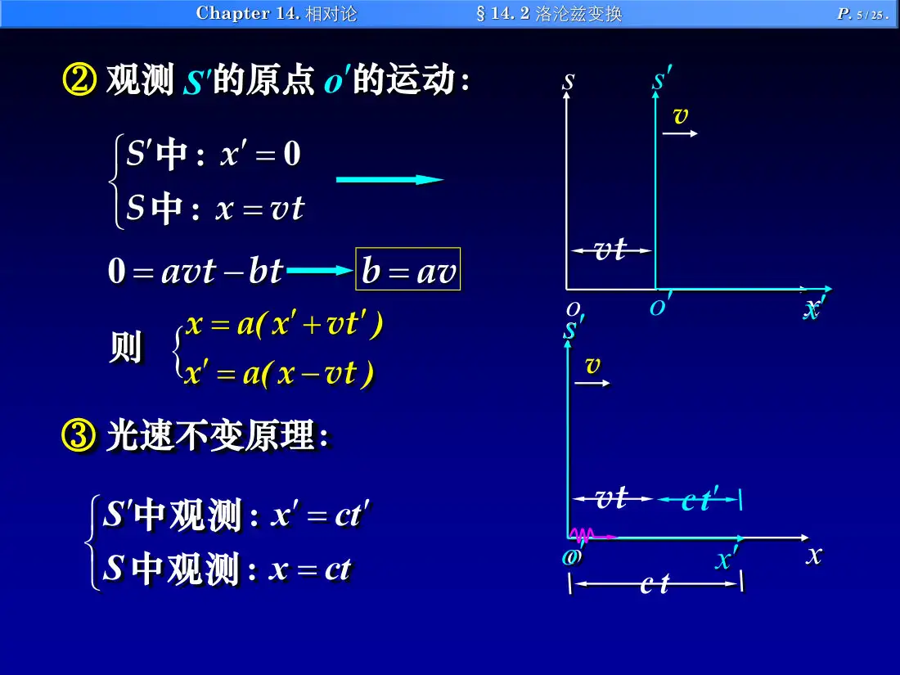

原文：

② 观测 $S'$ 的原点 $o'$ 的运动:

$S'$ 中： $x' = 0$

S中：x = vt

$$
0 = a v t - b t \longrightarrow b = a v
$$

则

$$
\left\{ \begin{array}{l} x = a (x ^ {\prime} + v t ^ {\prime}) \\ x ^ {\prime} = a (x - v t) \end{array} \right.
$$

③ 光速不变原理：

$S'$ 中观测: $x' = ct'$

S中观测: x = ct

Chapter 14. 相对论

§ 14.2 洛沦兹变换

### $$

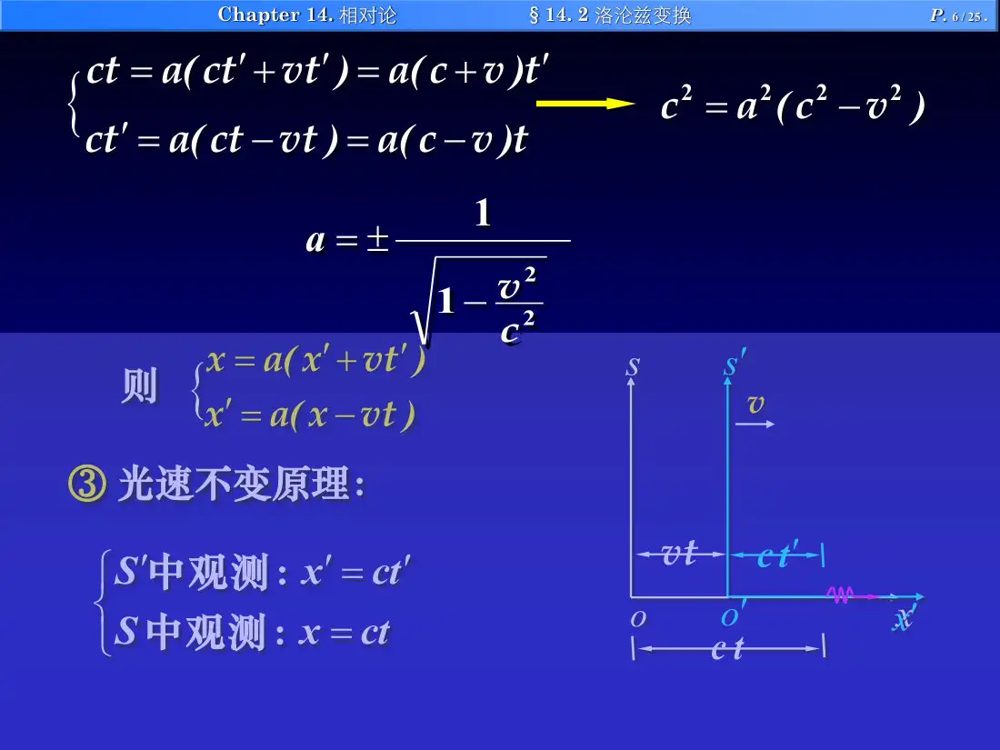

原文：

$$
c t = a (c t ^ {\prime} + v t ^ {\prime}) = a (c + v) t ^ {\prime}
$$

$$
c t ^ {\prime} = a (c t - v t) = a (c - v) t
$$

$$
a = \pm \frac {1}{\sqrt {1 - \frac {v ^ {2}}{c ^ {2}}}}
$$

$$
c ^ {2} = a ^ {2} \left(c ^ {2} - v ^ {2}\right)
$$

则

$$
\left\{ \begin{array}{l} x = a (x ^ {\prime} + v t ^ {\prime}) \\ x ^ {\prime} = a (x - v t) \end{array} \right.
$$

③ 光速不变原理：

S'中观测: $x' = ct'$

S中观测: $x = ct$

P. 6/25.

Chapter 14. 相对论

§ 14.2 洛沦兹变换

### $$

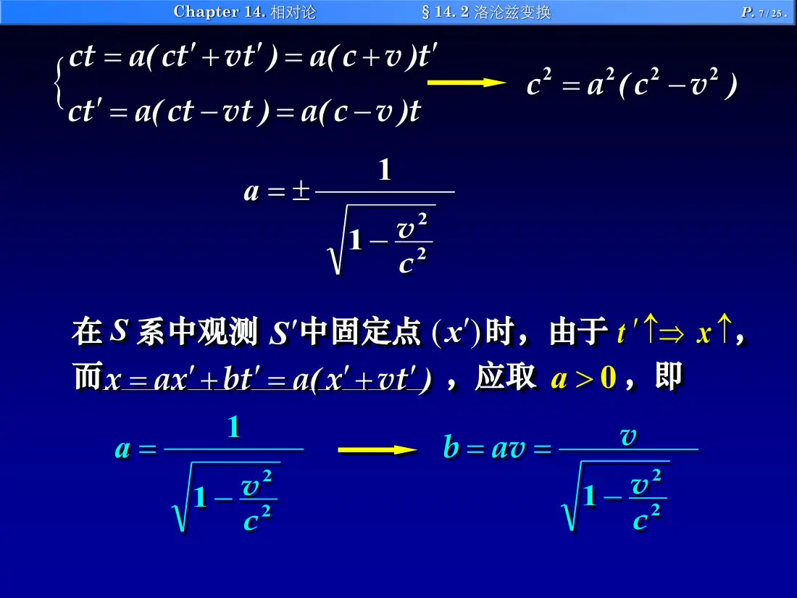

原文：

$$
\left\{ \begin{array}{l} c t = a (c t ^ {\prime} + v t ^ {\prime}) = a (c + v) t ^ {\prime} \\ c t ^ {\prime} = a (c t - v t) = a (c - v) t \\ a = \pm \frac {1}{\sqrt {1 - \frac {v ^ {2}}{c ^ {2}}}} \end{array} \right. \longrightarrow c ^ {2} = a ^ {2} (c ^ {2} - v ^ {2})
$$

在 S 系中观测 $S'$ 中固定点 $(x')$ 时，由于 $t'\uparrow \Rightarrow x\uparrow$ ，而 $x = ax' + bt' = a(x' + vt')$ ，应取 a > 0，即

$$
a = \frac {1}{\sqrt {1 - \frac {v ^ {2}}{c ^ {2}}}} \quad \Longrightarrow \quad b = a v = \frac {v}{\sqrt {1 - \frac {v ^ {2}}{c ^ {2}}}}
$$

Chapter 14. 相对论

§ 14.2 洛沦兹变换

P. 7/25.

### $$

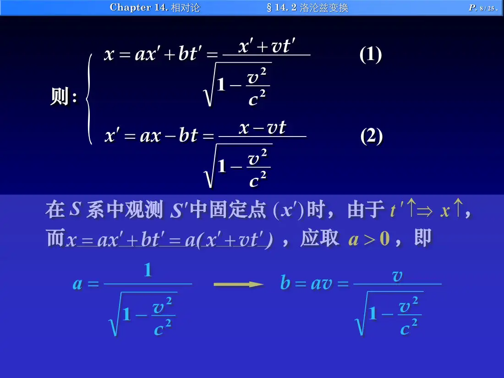

原文：

$$
x = a x ^ {\prime} + b t ^ {\prime} = \frac {x ^ {\prime} + v t ^ {\prime}}{\sqrt {1 - \frac {v ^ {2}}{c ^ {2}}}}\tag{1}
$$

则：

$$
x ^ {\prime} = a x - b t = \frac {x - v t}{\sqrt {1 - \frac {v ^ {2}}{c ^ {2}}}}\tag{2}
$$

在 S 系中观测 $S'$ 中固定点 $(x')$ 时，由于 $t'\uparrow \Rightarrow x\uparrow$ ，而 $x = ax' + bt' = a(x' + vt')$ ，应取 a > 0，即

$$
a = \frac {1}{\sqrt {1 - \frac {v ^ {2}}{c ^ {2}}}} \quad \Longrightarrow \quad b = a v = \frac {v}{\sqrt {1 - \frac {v ^ {2}}{c ^ {2}}}}
$$

Chapter 14. 相对论

§ 14.2 洛沦兹变换

P. 8/25.

### $$

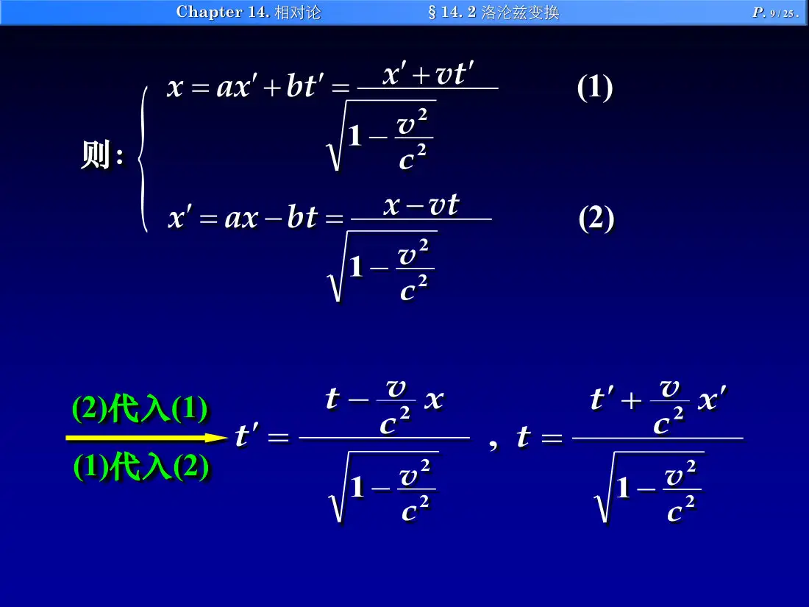

原文：

$$
x = a x ^ {\prime} + b t ^ {\prime} = \frac {x ^ {\prime} + v t ^ {\prime}}{\sqrt {1 - \frac {v ^ {2}}{c ^ {2}}}}\tag{1}
$$

则：

$$
x ^ {\prime} = a x - b t = \frac {x - v t}{\sqrt {1 - \frac {v ^ {2}}{c ^ {2}}}}\tag{2}
$$

(2)代入(1)

(1)代入(2)

$$
t ^ {\prime} = \frac {t - \frac {v}{c ^ {2}} x}{\sqrt {1 - \frac {v ^ {2}}{c ^ {2}}}}, t = \frac {t ^ {\prime} + \frac {v}{c ^ {2}} x ^ {\prime}}{\sqrt {1 - \frac {v ^ {2}}{c ^ {2}}}}
$$

Chapter 14. 相对论

§ 14.2 洛沦兹变换

P. 9/25.

### 两惯性参照系之间变换(洛沦兹变化Lorentz transformation)

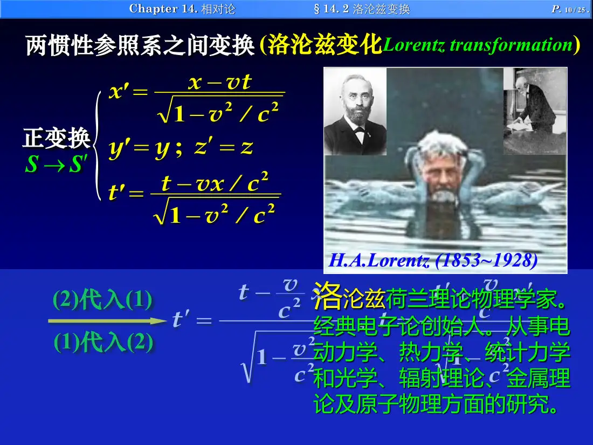

原文：

两惯性参照系之间变换(洛沦兹变化Lorentz transformation)

正变换

$$
S \rightarrow S ^ {\prime}
$$

$$
\left\{ \begin{array}{l} x ^ {\prime} = \frac {x - v t}{\sqrt {1 - v ^ {2} / c ^ {2}}} \\ y ^ {\prime} = y; z ^ {\prime} = z \\ t ^ {\prime} = \frac {t - v x / c ^ {2}}{\sqrt {1 - v ^ {2} / c ^ {2}}} \end{array} \right.
$$

(2)代入(1)

H.A.Lorentz (1853\~1928)

(1)代入(2)

洛伦兹荷兰理论物理学家。经典电子论创始人。从事电动力学、热力学、统计力学和光学、辐射理论、金属理论及原子物理方面的研究。

Chapter 14. 相对论

§ 14.2 洛沦兹变换

P. 10 / 25.

### 两惯性参照系之间变换(洛沦兹变化Lorentz transformation)

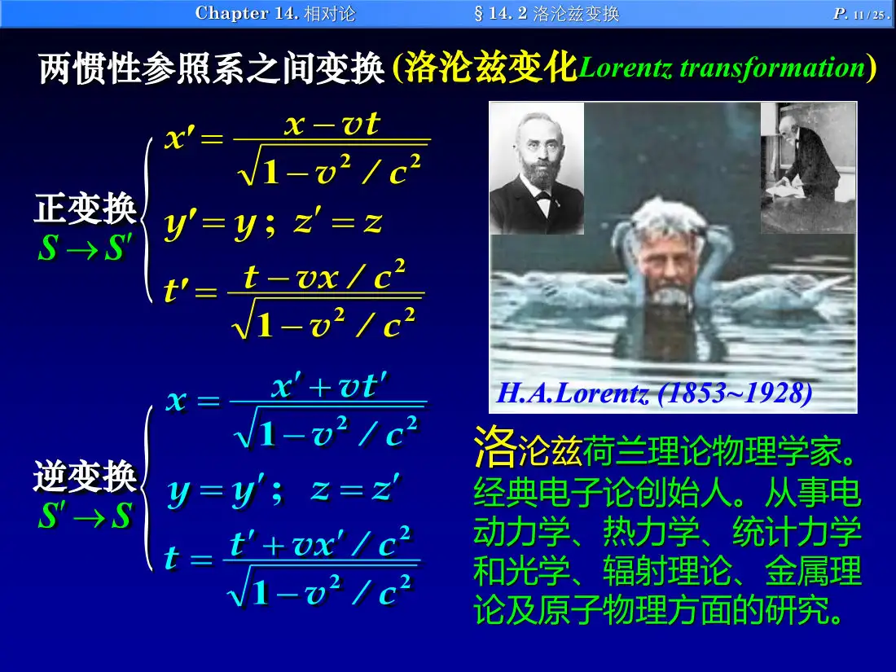

原文：

两惯性参照系之间变换(洛沦兹变化Lorentz transformation)

$$
x ^ {\prime} = \frac {x - v t}{\sqrt {1 - v ^ {2} / c ^ {2}}}
$$

正变换

$$
S \rightarrow S ^ {\prime \prime}
$$

$$
y ^ {\prime} = y; z ^ {\prime} = z
$$

$$
t ^ {\prime} = \frac {t - v x / c ^ {2}}{\sqrt {1 - v ^ {2} / c ^ {2}}}
$$

$$
x = \frac {x ^ {\prime} + v t ^ {\prime}}{\sqrt {1 - v ^ {2} / c ^ {2}}}
$$

逆变换

$$
S ^ {\prime \prime} \rightarrow S
$$

$$
y = y ^ {\prime}; z = z ^ {\prime}
$$

$$
t = \frac {t ^ {\prime} + v x ^ {\prime} / c ^ {2}}{\sqrt {1 - v ^ {2} / c ^ {2}}}
$$

洛沦兹荷兰理论物理学家。经典电子论创始人。从事电动力学、热力学、统计力学和光学、辐射理论、金属理论及原子物理方面的研究。

Chapter 14. 相对论

§ 14.2 洛沦兹变换

P. 11/25.

### 洛伦兹变换和逆变换为

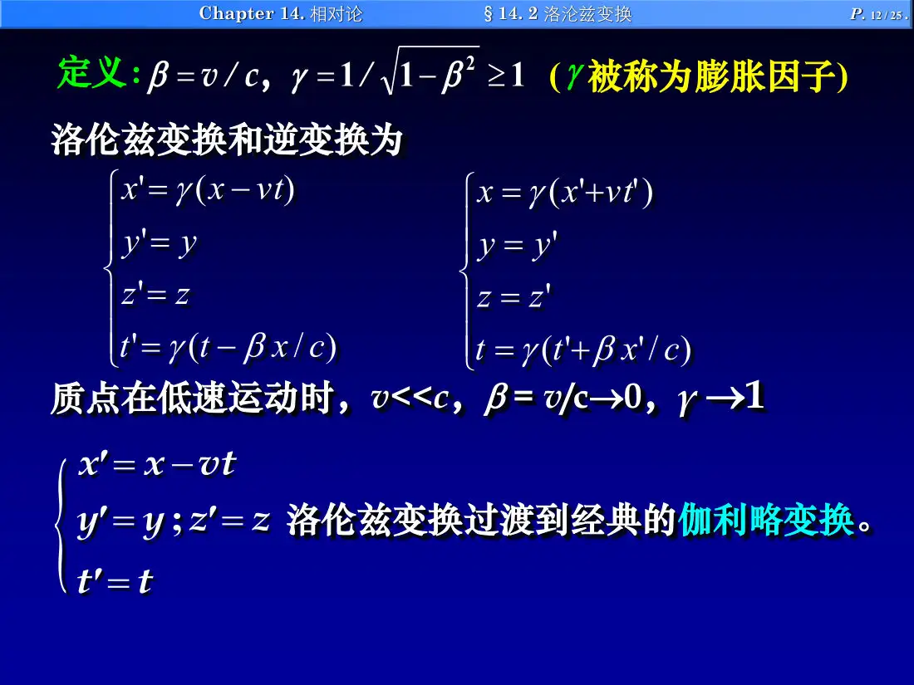

原文：

定义: $\beta = v / c, \gamma = 1 / \sqrt{1 - \beta^2} \geq 1$ (γ被称为膨胀因子)

洛伦兹变换和逆变换为

$$
\left\{ \begin{array}{l} x ^ {\prime} = \gamma (x - v t) \\ y ^ {\prime} = y \\ z ^ {\prime} = z \\ t ^ {\prime} = \gamma (t - \beta x / c) \end{array} \right.
$$

$$
\left\{ \begin{array}{l} x = \gamma (x ^ {\prime} + v t ^ {\prime}) \\ y = y ^ {\prime} \\ z = z ^ {\prime} \\ t = \gamma (t ^ {\prime} + \beta x ^ {\prime} / c) \end{array} \right.
$$

质点在低速运动时，v<<c， $\beta=v/c\rightarrow0,\gamma\rightarrow1$

$y'=y;z'=z$ 洛伦兹变换过渡到经典的伽利略变换。

Chapter 14. 相对论

§ 14.2 洛沦兹变换

P. 12 / 25.

### 说明

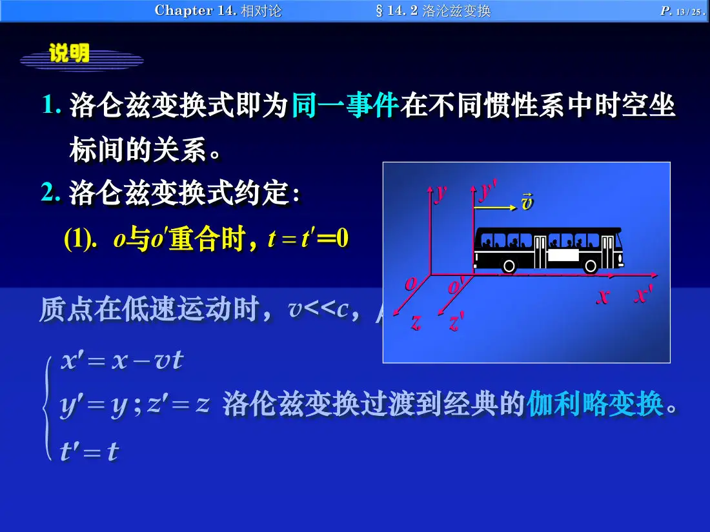

原文：

说明

1. 洛仑兹变换式即为同一事件在不同惯性系中时空坐标间的关系。

2. 洛仑兹变换式约定:

(1). o与 $o'$ 重合时， $t=t'=0$

质点在低速运动时，v<<c，

$y'=y;z'=z$ 洛伦兹变换过渡到经典的伽利略变换。

Chapter 14. 相对论

§ 14.2 洛沦兹变换

P. 13 / 25.

### 说明

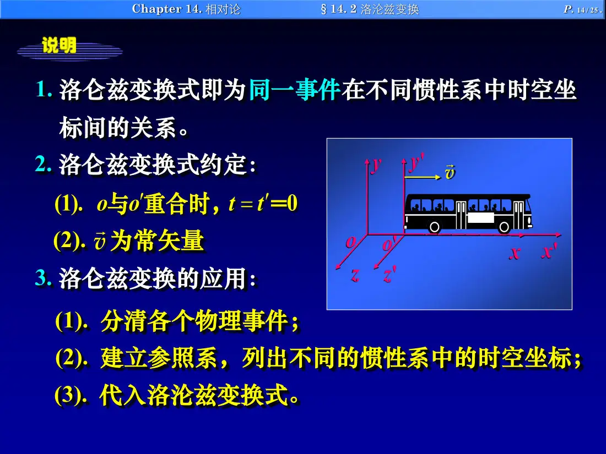

原文：

说明

1. 洛仑兹变换式即为同一事件在不同惯性系中时空坐标间的关系。

2. 洛仑兹变换式约定:

(1). o与 $o'$ 重合时， $t=t'=0$

(2). $\vec{v}$ 为常矢量

3. 洛仑兹变换的应用:

(1). 分清各个物理事件；

(2). 建立参照系，列出不同的惯性系中的时空坐标；

(3). 代入洛沦兹变换式。

P. 14 / 25.

Chapter 14. 相对论

§ 14.2 洛沦兹变换

### 解：建立参照系如图所示。设北京、上海发车分别为

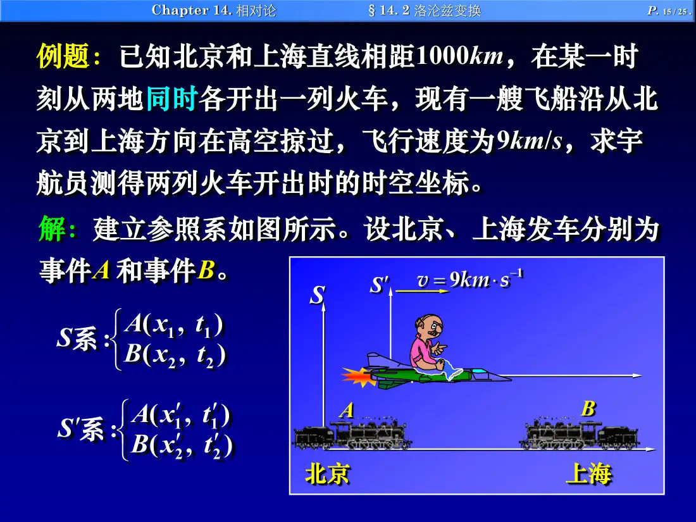

原文：

例题：已知北京和上海直线相距1000km，在某一时刻从两地同时各开出一列火车，现有一艘飞船沿从北京到上海方向在高空掠过，飞行速度为9km/s，求宇航员测得两列火车开出时的时空坐标。

解：建立参照系如图所示。设北京、上海发车分别为

S系: $\left\{\begin{aligned}A(x_{1},&t_{1})\\ B(x_{2},&t_{2})\end{aligned}\right.$

$S'$ 系: $\left\{\begin{aligned}A(x_{1}^{\prime},t_{1}^{\prime})\\ B(x_{2}^{\prime},t_{2}^{\prime})\end{aligned}\right.$

北京

上海

Chapter 14. 相对论

§ 14.2 洛沦兹变换

P. 15/25.

### 北京

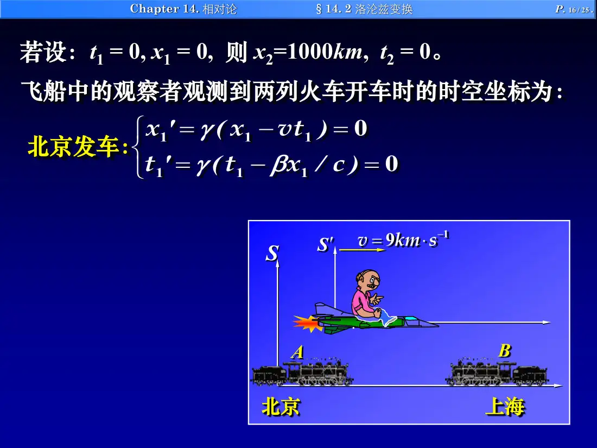

原文：

若设: $t_{1} = 0, x_{1} = 0$ , 则 $x_{2} = 1000km, t_{2} = 0$ 。飞船中的观察者观测到两列火车开车时的时空坐标为: 北京发车: $\left\{ \begin{array}{l} x_{1}' = \gamma (x_{1} - vt_{1}) = 0 \\ t_{1}' = \gamma (t_{1} - \beta x_{1}/c) = 0 \end{array} \right.$

北京

上海

Chapter 14. 相对论

§ 14.2 洛沦兹变换

### 飞船中的观察者观测到两列火车开车时的时空坐标为：

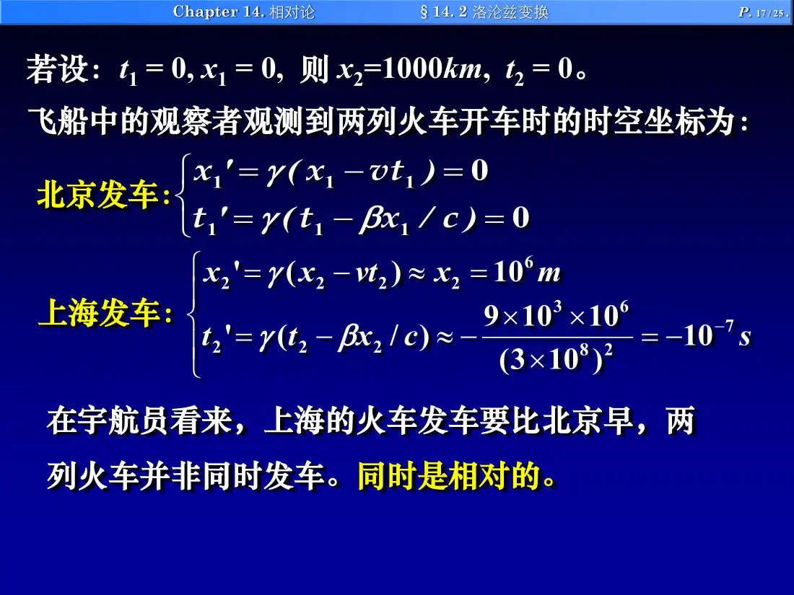

原文：

若设： $t_{1}=0, x_{1}=0$ ，则 $x_{2}=1000km, t_{2}=0$ 。
飞船中的观察者观测到两列火车开车时的时空坐标为：
北京发车： $\left\{\begin{aligned}x_{1}'&=\gamma(x_{1}-vt_{1})=0\\ t_{1}'&=\gamma(t_{1}-\beta x_{1}/c)=0\end{aligned}\right.$ 上海发车： $\left\{\begin{aligned}x_{2}'&=\gamma(x_{2}-vt_{2})\approx x_{2}=10^{6}m\\ t_{2}'&=\gamma(t_{2}-\beta x_{2}/c)\approx-\frac{9\times10^{3}\times10^{6}}{(3\times10^{8})^{2}}=-10^{-7}s\end{aligned}\right.$ 在宇航员看来，上海的火车发车要比北京早，两列火车并非同时发车。同时是相对的。

P. 17 / 25.

Chapter 14. 相对论

§ 14.2 洛沦兹变换

### 利用洛伦兹时空坐标变换，可以得到洛伦兹变换下的速度变换。

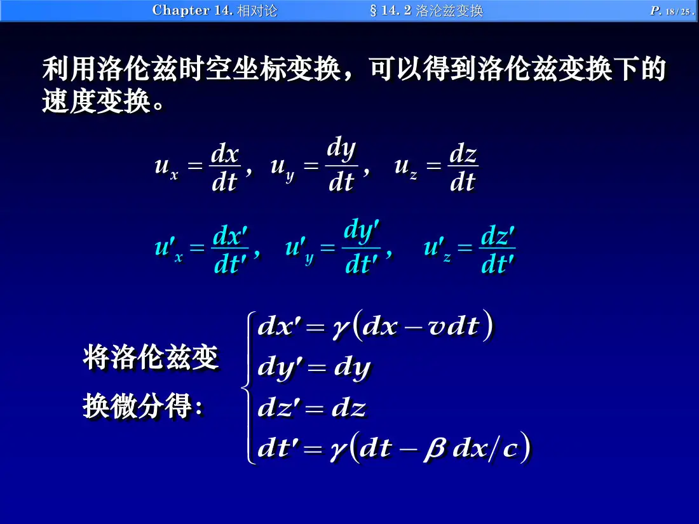

原文：

利用洛伦兹时空坐标变换，可以得到洛伦兹变换下的速度变换。

$$
u _ {x} = \frac {d x}{d t}, u _ {y} = \frac {d y}{d t}, u _ {z} = \frac {d z}{d t}
$$

$$
u _ {x} ^ {\prime} = \frac {d x ^ {\prime}}{d t ^ {\prime}}, \quad u _ {y} ^ {\prime} = \frac {d y ^ {\prime}}{d t ^ {\prime}}, \quad u _ {z} ^ {\prime} = \frac {d z ^ {\prime}}{d t ^ {\prime}}
$$

将洛伦兹变

$$
d x ^ {\prime} = \gamma (d x - v d t)
$$

换微分得:

$$
d y ^ {\prime} = d y
$$

$$
d z ^ {\prime} = d z
$$

$$
d t ^ {\prime} = \gamma (d t - \beta d x / c)
$$

Chapter 14. 相对论

§ 14.2 洛沦兹变换

P. 18/25.

### $$

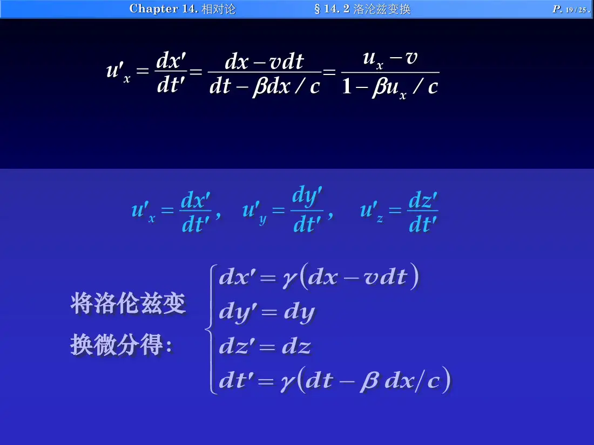

原文：

$$
u _ {x} ^ {\prime} = \frac {d x ^ {\prime}}{d t ^ {\prime}} = \frac {d x - v d t}{d t - \beta d x / c} = \frac {u _ {x} - v}{1 - \beta u _ {x} / c}
$$

$$
u _ {x} ^ {\prime} = \frac {d x ^ {\prime}}{d t ^ {\prime}}, \quad u _ {y} ^ {\prime} = \frac {d y ^ {\prime}}{d t ^ {\prime}}, \quad u _ {z} ^ {\prime} = \frac {d z ^ {\prime}}{d t ^ {\prime}}
$$

$$
d x ^ {\prime} = \gamma (d x - v d t)
$$

将洛伦兹变

$$
d y ^ {\prime} = d y
$$

换微分得:

$$
d z ^ {\prime} = d z
$$

$$
d t ^ {\prime} = \gamma (d t - \beta d x / c)
$$

Chapter 14. 相对论

§ 14.2 洛沦兹变换

P. 19/25.

### $$

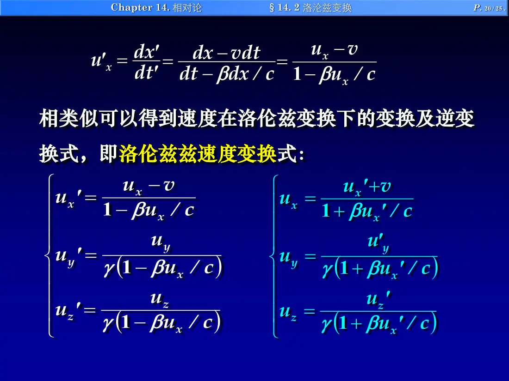

原文：

$$
u _ {x} ^ {\prime} = \frac {d x ^ {\prime}}{d t ^ {\prime}} = \frac {d x - v d t}{d t - \beta d x / c} = \frac {u _ {x} - v}{1 - \beta u _ {x} / c}
$$

相类似可以得到速度在洛伦兹变换下的变换及逆变换式，即洛伦兹兹速度变换式：

$$
\left\{ \begin{array}{l} u _ {x} ^ {\prime} = \frac {u _ {x} - v}{1 - \beta u _ {x} / c} \\ u _ {y} ^ {\prime} = \frac {u _ {y}}{\gamma (1 - \beta u _ {x} / c)} \\ u _ {z} ^ {\prime} = \frac {u _ {z}}{\gamma (1 - \beta u _ {x} / c)} \end{array} \right.
$$

$$
\left\{ \begin{array}{l} u _ {x} = \frac {u _ {x} ^ {\prime} + v}{1 + \beta u _ {x} ^ {\prime} / c} \\ u _ {y} = \frac {u _ {y} ^ {\prime}}{\gamma (1 + \beta u _ {x} ^ {\prime} / c)} \\ u _ {z} = \frac {u _ {z} ^ {\prime}}{\gamma (1 + \beta u _ {x} ^ {\prime} / c)} \end{array} \right.
$$

Chapter 14. 相对论

§ 14.2 洛沦兹变换

P. 20 / 25.

### $$

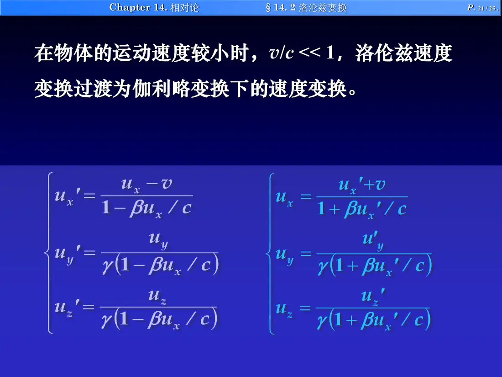

原文：

在物体的运动速度较小时， $v / c \ll 1$ ，洛伦兹速度变换过渡为伽利略变换下的速度变换。

$$
\left\{ \begin{array}{l} u _ {x} ^ {\prime} = \frac {u _ {x} - v}{1 - \beta u _ {x} / c} \\ u _ {y} ^ {\prime} = \frac {u _ {y}}{\gamma (1 - \beta u _ {x} / c)} \\ u _ {z} ^ {\prime} = \frac {u _ {z}}{\gamma (1 - \beta u _ {x} / c)} \end{array} \right.
$$

$$
\left\{ \begin{array}{l} u _ {x} = \frac {u _ {x} ^ {\prime} + v}{1 + \beta u _ {x} ^ {\prime} / c} \\ u _ {y} = \frac {u _ {y} ^ {\prime}}{\gamma (1 + \beta u _ {x} ^ {\prime} / c)} \\ u _ {z} = \frac {u _ {z} ^ {\prime}}{\gamma (1 + \beta u _ {x} ^ {\prime} / c)} \end{array} \right.
$$

Chapter 14. 相对论

§ 14.2 洛沦兹变换

P. 21 / 25.

### $$

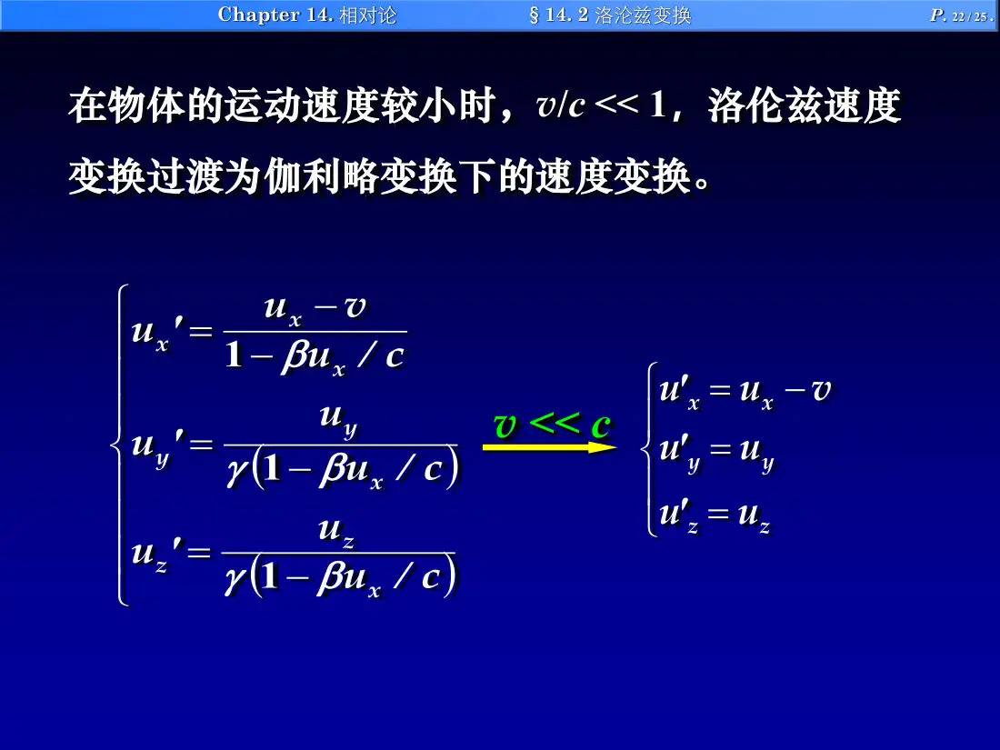

原文：

在物体的运动速度较小时， $v / c \ll 1$ ，洛伦兹速度变换过渡为伽利略变换下的速度变换。

$$
\left\{ \begin{array}{l} u _ {x ^ {\prime}} = \frac {u _ {x} - v}{1 - \beta u _ {x} / c} \\ u _ {y ^ {\prime}} = \frac {u _ {y}}{\gamma (1 - \beta u _ {x} / c)} \\ u _ {z ^ {\prime}} = \frac {u _ {z}}{\gamma (1 - \beta u _ {x} / c)} \end{array} \right. \xrightarrow {v <   <   c} \left\{ \begin{array}{l} u _ {x} ^ {\prime} = u _ {x} - v \\ u _ {y} ^ {\prime} = u _ {y} \\ u _ {z} ^ {\prime} = u _ {z} \end{array} \right.
$$

Chapter 14. 相对论

§ 14.2 洛沦兹变换

P. 22 / 25.

### 验证运动参照系内观察者接收到光信号的速率不变。

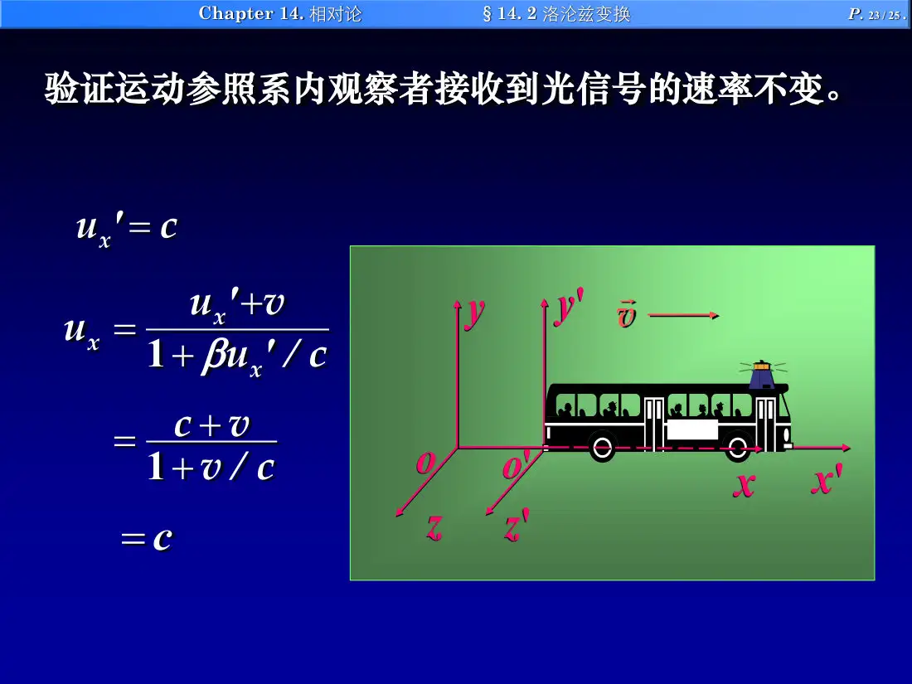

原文：

验证运动参照系内观察者接收到光信号的速率不变。

$$
u _ {x} ^ {\prime} = c
$$

$$
\begin{array}{r l} u _ {x} & = \frac {u _ {x} ^ {\prime} + v}{1 + \beta u _ {x} ^ {\prime} / c} \\ & = \frac {c + v}{1 + v / c} \\ & = c \end{array}
$$

Chapter 14. 相对论

§ 14.2 洛沦兹变换

P. 23 / 25.

### 例题：在地面上观测到两艘相向飞行的飞船的速度皆为0.9c，求它们之间的相对速度。

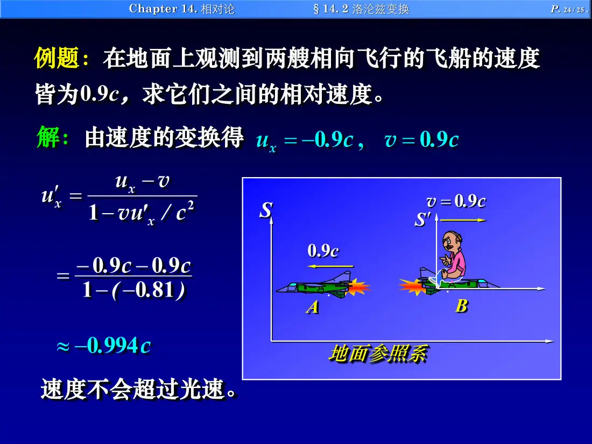

原文：

例题：在地面上观测到两艘相向飞行的飞船的速度皆为0.9c，求它们之间的相对速度。

解: 由速度的变换得 $u_{x} = -0.9c$ , $v = 0.9c$

$$
u _ {x} ^ {\prime} = \frac {u _ {x} - v}{1 - v u _ {x} ^ {\prime} / c ^ {2}}
$$

$$
= \frac {- 0 . 9 c - 0 . 9 c}{1 - (- 0 . 8 1)}
$$

≈-0.994c

地面参照系

速度不会超过光速。

P. 24 / 25.

Chapter 14. 相对论

§ 14.2 洛沦兹变换

### 归纳

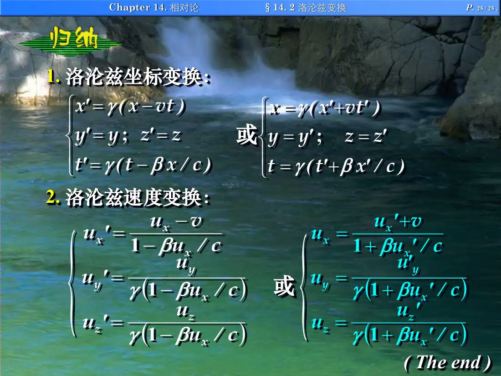

原文：

归纳

1. 洛沦兹坐标变换：

$$
\left\{ \begin{array}{l} x ^ {\prime} = \gamma (x - v t) \\ y ^ {\prime} = y; z ^ {\prime} = z \\ t ^ {\prime} = \gamma (t - \beta x / c) \end{array} \right.
$$

或

$$
\left\{ \begin{array}{l} x = \gamma (x ^ {\prime} + v t ^ {\prime}) \\ y = y ^ {\prime}; \quad z = z ^ {\prime} \\ t = \gamma (t ^ {\prime} + \beta x ^ {\prime} / c) \end{array} \right.
$$

2. 洛沦兹速度变换：

$$
\left\{ \begin{array}{l} u _ {x} ^ {\prime} = \frac {u _ {x} - v}{1 - \beta u _ {x} / c} \\ u _ {y} ^ {\prime} = \frac {u _ {y}}{\gamma (1 - \beta u _ {x} / c)} \\ u _ {z} ^ {\prime} = \frac {u _ {z}}{\gamma (1 - \beta u _ {x} / c)} \end{array} \right.
$$

或

$$
\left\{ \begin{array}{l} u _ {x} = \frac {u _ {x} ^ {\prime} + v}{1 + \beta u _ {x} ^ {\prime} / c} \\ u _ {y} = \frac {u _ {y} ^ {\prime}}{\gamma (1 + \beta u _ {x} ^ {\prime} / c)} \\ u _ {z} = \frac {u _ {z} ^ {\prime}}{\gamma (1 + \beta u _ {x} ^ {\prime} / c)} \end{array} \right.
$$

Chapter 14. 相对论

§ 14.2 洛沦兹变换

P. 25 / 25 .

(The end)
