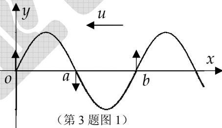
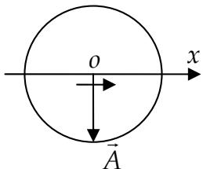
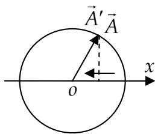
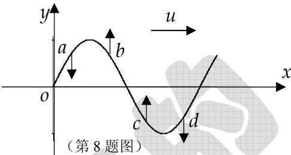
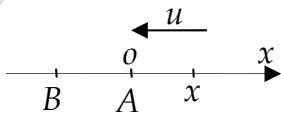
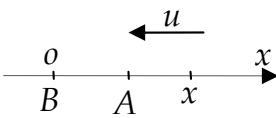
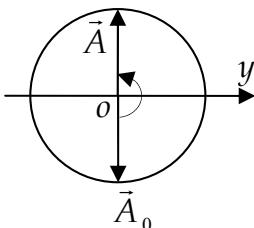
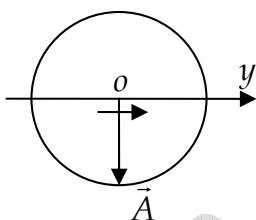

# 《大学物理》第14章 简谐波 同步练习册答案

原件经识别和整理；“参考解答”是我们补的。

## 一、选择题

### 选择 1

波函数标准形式： $y ( x , t ) = A \cos [ \omega ( t \mp \frac { x } { u } ) + \varphi _ { o } ]$ 与表达式： $y = A \cos ( a t - b x ) = A \cos [ a ( t - { \frac { b } { a } } x ) ]$ 比较得：
（1）该波沿x轴正方向传播；
（2）角频率 $\omega = a$ ；
（3） $\frac { \omega } { u } = \frac { 2 \pi } { \lambda } = b$ ；
（4） $\varphi _ { o } = 0$ ；

则该简谐波的频率： $\nu = \frac { \omega } { 2 \pi } = \frac { a } { 2 \pi }$ ；
波速： $u = \frac { \omega } { b } = \frac { a } { b }$ ；
波长： $\lambda = \frac { 2 \pi } { b }$ ；
周期： $T = \frac { 2 \pi } { \omega } = \frac { 2 \pi } { a }$ .

答案：D。

知识点：[平面简谐波的波函数 y=Acos(ω(t±x/u)+φ)](../../../topics/大学物理/平面简谐波方程.md)、[简谐振动的运动学方程（振幅、角频率、相位）](../../../topics/大学物理/简谐振动运动学.md)

### 选择 2

波函数： $y ( x , t ) = A \cos [ \omega ( t - \frac { x } { u } ) + \varphi _ { o } ]$ ，则x处质点振动速度：
$$v ( x , t ) = \frac { \partial y } { \partial t } = - \omega A \sin [ \omega ( t - \frac { x } { u } ) + \varphi _ { o } ]$$

相距 $\frac { \lambda } { 2 }$ ，在 $x + \frac { \lambda } { 2 }$ 处质点的振动速度：
$$v ( x + \frac { \lambda } { 2 } , t ) = - \omega A \sin [ \omega ( t - \frac { x + \frac { \lambda } { 2 } } { u } ) + \varphi _ { o } ]$$

由于 $\frac { \omega } { u } = \frac { 2 \pi } { \lambda } \Rightarrow v ( x + \frac { \lambda } { 2 } , t ) = - \omega A \sin [ \omega ( t - \frac { x } { u } ) + \varphi _ { o } - \pi ] = \omega A \sin [ \omega ( t - \frac { x } { u } ) + \varphi _ { o } ] .$

相距 $\frac { \lambda } { 2 }$ 两点 $v ( x , t ) = - \omega A \sin [ \omega ( t - \frac { x } { u } ) + \varphi _ { o } ]$ 和 $v ( x + \frac { \lambda } { 2 } , t ) = \omega A \sin [ \omega ( t - \frac { x } { u } ) + \varphi _ { o } ]$ 大小相等、方向相反。

方法二：由波形图判断：相距 $\frac { \lambda } { 2 }$ 两点速度大小相等、方向相反。例如：第 3 题图 1 中 a、b 两点。

答案：A。

知识点：[平面简谐波的波函数 y=Acos(ω(t±x/u)+φ)](../../../topics/大学物理/平面简谐波方程.md)、[简谐振动的运动学方程（振幅、角频率、相位）](../../../topics/大学物理/简谐振动运动学.md)、[机械波的形成、横波与纵波](../../../topics/大学物理/机械波的产生与传播.md)

### 选择 3

如图 1 所示，t = 0时原点o处质点在平衡位置 $y = 0$ 且向正方向运动，对应旋转矢量图如图 2 所示，所以初相位： $\varphi _ { o } = - \frac { \pi } { 2 }$ 或 $\varphi _ { o } = \frac { 3 \pi } { 2 }$

答案：D。

知识点：[简谐振动的运动学方程（振幅、角频率、相位）](../../../topics/大学物理/简谐振动运动学.md)、[用旋转矢量法确定初相与运动状态](../../../topics/大学物理/旋转矢量法.md)

### 选择 4

机械波传播过程中，媒质中各质元的动能和势能时刻相等：当质元处于平衡位置时，动能最大，势能最大（此时形变最大）；当质元处于最大位移（波峰或波谷）时，动能最小，势能最小。所以当质元处于平衡位置，动能和势能最大。

答案：C。

知识点：[机械波的形成、横波与纵波](../../../topics/大学物理/机械波的产生与传播.md)、[波动过程中的能量传播与能流密度](../../../topics/大学物理/波的能量.md)

### 选择 5

由波形图可得：
（1）该波沿x轴负方向传播；
（2）振幅 $A = 0 . 0 1 \mathrm { m }$
（3）波速 $u = 2 0 0 \mathrm { m / s }$ ；
（4）波长 $\lambda = 2 0 0 \mathrm { m }$ ；

$\frac { \omega } { u } = \frac { 2 \pi } { \lambda }$ 角频率 $\omega = { \frac { 2 \pi } { \lambda } } u = 2 \pi \mathrm { r a d / s }$ ；

又由波形图，t = 2s时 P点在 $y = 0 . 0 0 5 \mathrm { m }$ 处，且向y轴的负方向运动，对应旋转矢量A，如图所示。

由于 $t = 2 \mathrm { s }$ 时间内，旋转矢量转过角度： $\Delta \theta = \omega t = 4 \pi$ ，所以t = 0时 P点对应的旋转矢量为 $\vec { A } ^ { \prime }$ （与 $\vec { A }$ 重合），如图，则 P点的振动初相位： $\varphi _ { o } = \frac { \pi } { 3 } - 4 \pi$ 或者 $\varphi _ { o } = { \frac { \pi } { 3 } } + 2 k \pi$ 都可以， $( k \in Z$ 整数）；

⇒ P点的振动方程： $y _ { P } = 0 . 0 1 \mathrm { c o s } ( 2 \pi t + { \frac { \pi } { 3 } } - 4 \pi ) \mathrm { m } = 0 . 0 1 \mathrm { c o s } [ 2 \pi ( t - 2 ) + { \frac { \pi } { 3 } } ] \mathrm { m }$

答案：C。

知识点：[平面简谐波的波函数 y=Acos(ω(t±x/u)+φ)](../../../topics/大学物理/平面简谐波方程.md)、[用旋转矢量法确定初相与运动状态](../../../topics/大学物理/旋转矢量法.md)

### 选择 6

波源 $S _ { 1 }$ 比 $S _ { \mathrm { 2 } }$ 相位超前 $0.5\pi$，即 $\varphi _ { 1 } - \varphi _ { 2 } = { \frac { \pi } { 2 } }$ 或 $\varphi _ { 2 } - \varphi _ { 1 } = - \frac { \pi } { 2 }$ ；

则P点的相位差：
$$ \Delta \phi = ( \varphi _ { 2 } - \varphi _ { 1 } ) - \frac { 2 \pi } { \lambda } ( r _ { 2 } - r _ { 1 } ) = ( \varphi _ { 2 } - \varphi _ { 1 } ) - \frac { 2 \pi } { \lambda } ( \overline { { S _ { 2 } P } } - \overline { { S _ { 1 } P } } ) = - \frac { \pi } { 2 } - \frac { 2 \pi } { \lambda } \frac { \lambda } { 4 } = - \pi $$

$\Delta \phi = \pm 2 k \pi$ ，干涉加强； $\Delta \phi = \pm 2 k \pi + \pi$ ，干涉减弱；即相位差 $\Delta \phi$ 加减 $2k\pi$ 不影响干涉结果。

答案：B。

知识点：[波的叠加原理与干涉条件](../../../topics/大学物理/波的干涉.md)、[平面简谐波的波函数 y=Acos(ω(t±x/u)+φ)](../../../topics/大学物理/平面简谐波方程.md)

### 计算 7

波函数 $y = 0.025 \cos (125 t - 0.37 x ) \mathrm{m}$ 与标准形式 $y ( x , t ) = A \cos [ \omega ( t \mp \frac { x } { u } ) + \varphi _ { o } ]$ 比较，可得：
（1）该波沿 $x$ 轴正方向传播；
（2）振幅 $A = 0.025 \mathrm{m}$；
（3）角频率 $\omega = 125 \mathrm{rad/s}$；
（4）$\frac{\omega}{u} = 0.37$；
（5）$\varphi _ { o } = 0$。

由 $\left\{ \begin{array}{l} \omega = 125 \\ \frac{\omega}{u} = 0.37 \end{array} \right.$ $\Rightarrow$ 波速：
$$ u = \frac{\omega}{0.37} = \frac{125}{0.37} \approx 337.8 \mathrm{m/s} $$

由 $\frac{\omega}{u} = \frac{2\pi}{\lambda} = 0.37 \Rightarrow$ 波长：
$$ \lambda = \frac{2\pi}{0.37} = \frac{20\pi}{3.7} \approx 17 \mathrm{m} $$
*(注：原文此处写为 $5.4\pi \mathrm{m}$，数值上 $\frac{2\pi}{0.37} \approx 16.99 \approx 17$，而 $5.4\pi \approx 16.96$，两者近似相等，保留原文表述或修正为更精确值均可，此处按原文逻辑整理)*

参考解答：结论：振幅 $A=0.025\,\mathrm{m}$，角频率 $\omega=125\,\mathrm{rad/s}$，波速 $u\approx 337.8\,\mathrm{m/s}$，波长 $\lambda\approx 17.0\,\mathrm{m}$，初相位 $\varphi_0=0$，波沿 $+x$ 方向传播。

简算：

$$
y=0.025\cos(125t-0.37x)
$$

与行波标准式

$$
y=A\cos\left[\omega\left(t-\frac{x}{u}\right)+\varphi_0\right]
$$

比较，$-x$ 项说明波向 $+x$ 方向传播。

$$
A=0.025\,\mathrm{m},\qquad \omega=125\,\mathrm{rad/s},\qquad \varphi_0=0
$$

且

$$
\frac{\omega}{u}=0.37
$$

所以

$$
u=\frac{\omega}{0.37}=\frac{125}{0.37}\approx 337.8\,\mathrm{m/s}
$$

又因为

$$
\frac{\omega}{u}=k=\frac{2\pi}{\lambda}=0.37
$$

故

$$
\lambda=\frac{2\pi}{0.37}\approx 16.99\,\mathrm{m}\approx 17.0\,\mathrm{m}
$$

若要写成频率，也可得

$$
f=\frac{\omega}{2\pi}=\frac{125}{2\pi}\approx 19.9\,\mathrm{Hz}
$$

知识点：[平面简谐波的波函数 y=Acos(ω(t±x/u)+φ)](../../../topics/大学物理/平面简谐波方程.md)、[机械波的形成、横波与纵波](../../../topics/大学物理/机械波的产生与传播.md)

### 计算 8

由行波向右传播，各点运动方向如图所示：
- a 点速度沿 $y$ 轴负方向；
- b 点速度沿 $y$ 轴正方向；
- c 点速度沿 $y$ 轴正方向；
- d 点速度沿 $y$ 轴负方向。

参考解答：**结论：** a 点速度沿 $y$ 轴负方向，b 点沿 $y$ 轴正方向，c 点沿 $y$ 轴正方向，d 点沿 $y$ 轴负方向。

**推理过程：**

行波向右传播时，各质点的振动方向可用**“波形微平移法”**判断：将整条波形曲线沿传播方向（$+x$ 方向）做一微小平移 $\Delta x$，比较各点在平移前后的 $y$ 坐标变化，即可确定其瞬时速度方向。

- **a 点**处于波形下降段（从波峰向平衡位置运动），波形右移后该处 $y$ 值降低，故 $v_a < 0$，沿 $y$ 轴负方向。
- **b 点**处于波形上升段（从波谷向平衡位置运动），波形右移后该处 $y$ 值升高，故 $v_b > 0$，沿 $y$ 轴正方向。
- **c 点**同样处于波形上升段，波形右移后 $y$ 值升高，故 $v_c > 0$，沿 $y$ 轴正方向。
- **d 点**处于波形下降段，波形右移后 $y$ 值降低，故 $v_d < 0$，沿 $y$ 轴负方向。

> **关键规律总结：** 对向右传播的横波，位于波形**上升段**（斜率 $\frac{\partial y}{\partial x}>0$）的质点速度沿 $+y$ 方向；位于**下降段**（斜率 $\frac{\partial y}{\partial x}<0$）的质点速度沿 $-y$ 方向。这可由波动方程 $y(x,t)=f(x-vt)$ 严格导出：
> $$v = \frac{\partial y}{\partial t} = -v_{\text{波}} \cdot \frac{\partial y}{\partial x}$$
> 因 $v_{\text{波}}>0$，故 $v$ 与 $\frac{\partial y}{\partial x}$ 符号相反，与上述判断完全一致。

知识点：[平面简谐波的波函数 y=Acos(ω(t±x/u)+φ)](../../../topics/大学物理/平面简谐波方程.md)、[机械波的形成、横波与纵波](../../../topics/大学物理/机械波的产生与传播.md)

### 计算 9

已知 B 点振动比 A 点落后 $\frac{\pi}{3}$ 相位，则：
$$ \phi_{A} - \phi_{B} = \omega \Delta t = \omega \frac{L}{u} = \frac{2\pi}{\lambda} L = \frac{\pi}{3} $$
解得距离：
$$ L = \frac{\lambda}{6} = \frac{1}{2} \mathrm{m} $$

参考解答：**结论：** $L = 0.5\,\text{m}$。

---

由题意，B 点振动比 A 点落后 $\frac{\pi}{3}$ 相位，即

$$
\Delta \phi = \phi_A - \phi_B = \frac{\pi}{3}.
$$

波传播距离 $L$ 引起的相位差为

$$
\Delta \phi = \frac{2\pi}{\lambda} L.
$$

于是

$$
\frac{2\pi}{\lambda} L = \frac{\pi}{3},
$$

解得

$$
L = \frac{\lambda}{6}.
$$

已知波长 $\lambda = 3\,\text{m}$，所以

$$
L = \frac{3}{6} = 0.5\,\text{m}.
$$

因此 A、B 两点间距离为

$$
\boxed{0.5\,\text{m}}
$$

知识点：[平面简谐波的波函数 y=Acos(ω(t±x/u)+φ)](../../../topics/大学物理/平面简谐波方程.md)、[机械波的形成、横波与纵波](../../../topics/大学物理/机械波的产生与传播.md)

### 计算 10

波源 $S_1$ 的初相位 $\varphi_1 = 0$，$S_2$ 的初相位 $\varphi_2 = \frac{\pi}{2}$，即 $\varphi_2 - \varphi_1 = \frac{\pi}{2}$。

则 P 点的相位差：
$$
\begin{aligned}
\Delta \phi &= (\varphi_2 - \varphi_1) - \frac{2\pi}{\lambda}(r_2 - r_1) \\
&= (\varphi_2 - \varphi_1) - \frac{2\pi}{\lambda}(\overline{S_2 P} - \overline{S_1 P}) \\
&= \frac{\pi}{2} - \frac{2\pi}{\lambda} \times \frac{9\lambda}{4} \\
&= \frac{\pi}{2} - \frac{9\pi}{2} \\
&= -4\pi
\end{aligned}
$$

参考解答：**结论：** P 点处两列波的相位差 $\Delta\phi = -4\pi$（即 $0$），两波在 P 点干涉相长。

---

**推理与计算过程：**

两相干波源到达空间某点的相位差公式为：

$$
\Delta\phi = (\varphi_2 - \varphi_1) - \frac{2\pi}{\lambda}(r_2 - r_1)
$$

其中：
- $\varphi_2 - \varphi_1 = \dfrac{\pi}{2} - 0 = \dfrac{\pi}{2}$，为两波源的初相差；
- $r_2 - r_1 = \overline{S_2P} - \overline{S_1P} = \dfrac{9\lambda}{4}$，为波程差。

代入计算：

$$
\begin{aligned}
\Delta\phi &= \frac{\pi}{2} - \frac{2\pi}{\lambda} \cdot \frac{9\lambda}{4} \
$$
6pt]
&= \frac{\pi}{2} - \frac{9\pi}{2} \\[6pt]
&= -4\pi
\end{aligned}
$$

由于 $\Delta\phi = -4\pi = 2k\pi$（$k=-2$），满足干涉相长条件，因此 **P 点振动加强**。

知识点：[波的叠加原理与干涉条件](../../../topics/大学物理/波的干涉.md)

### 计算 11

**（1）** 以 A 点为坐标原点，机械波沿 $x$ 轴负方向传播，如图 1 所示。则 $x$ 处质点振动比 A 点超前：
$$ \phi_x - \phi_A = \omega \Delta t = \omega \frac{x}{u} $$
又由 A 点振动方程 $y = 3 \cos (4 \pi t) \mathrm{m}$ 可知：$\omega = 4 \pi, \phi_A = 4 \pi t$。
故：
$$ \phi_x = \phi_A + \omega \frac{x}{u} = 4 \pi t + 4 \pi \times \frac{x}{20} = 4 \pi t + \frac{\pi}{5} x $$
任一位置 $x$ 处质点振动方程，即波函数：
$$ y(x, t) = 3 \cos \left( 4 \pi t + \frac{\pi}{5} x \right) \mathrm{m} $$

**（2）** 若 A、B 之间距离为 $40\mathrm{m}$，以 B 点为坐标原点，机械波沿 $x$ 轴负方向传播，如图 2 所示。则 $x$ 处质点振动比 A 点超前：
$$ \phi_x' - \phi_A = \omega \Delta t' = \omega \frac{x - 40}{u} $$
故：
$$ \phi_x' = \phi_A + \omega \frac{x - 40}{u} = 4 \pi t + 4 \pi \times \frac{x - 40}{20} = 4 \pi t + \frac{\pi}{5} x - 8 \pi $$
任一位置 $x$ 处质点振动方程，即波函数：
$$ y(x, t) = 3 \cos \left( 4 \pi t + \frac{\pi}{5} x - 8 \pi \right) \mathrm{m} $$

参考解答：**结论**

（1）以 A 点为坐标原点时，波函数为
\[
\boxed{y(x,t)=3\cos\left(4\pi t+\frac{\pi}{5}x\right)\ \mathrm{m}}
$$

（2）以 B 点为坐标原点，且 A、B 相距 $40\,\mathrm{m}$ 时，波函数为

$$
\boxed{y(x,t)=3\cos\left(4\pi t+\frac{\pi}{5}x-8\pi\right)\ \mathrm{m}}
$$

由于初相位相差 $2\pi$ 的整数倍时振动状态相同，也可写为

$$
\boxed{y(x,t)=3\cos\left(4\pi t+\frac{\pi}{5}x\right)\ \mathrm{m}}
$$

**推理与计算**

由 A 点的振动方程

$$
y_A=3\cos(4\pi t)\ \mathrm{m}
$$

可知振幅 $A=3\,\mathrm{m}$，角频率 $\omega=4\pi\,\mathrm{rad/s}$。波速为 $u=20\,\mathrm{m/s}$。

机械波沿 $x$ 轴负方向传播，因此坐标较大的质点较早振动，其相位比 A 点超前。

（1）A 点为原点时，$x$ 处质点比 A 点超前的时间为

$$
\Delta t=\frac{x}{u},
$$

故相位差为

$$
\phi_x-\phi_A=\omega\Delta t
=4\pi\frac{x}{20}
=\frac{\pi}{5}x.
$$

于是

$$
y(x,t)=3\cos\left(4\pi t+\frac{\pi}{5}x\right)\ \mathrm{m}.
$$

（2）B 点为原点时，A 点坐标为 $x_A=40\,\mathrm{m}$。$x$ 处质点比 A 点超前的时间为

$$
\Delta t'=\frac{x-40}{u},
$$

所以

$$
\phi_x'-\phi_A
=\omega\frac{x-40}{u}
=\frac{\pi}{5}(x-40)
=\frac{\pi}{5}x-8\pi.
$$

因此

$$
y(x,t)=3\cos\left(4\pi t+\frac{\pi}{5}x-8\pi\right)\ \mathrm{m}.
$$

这与（1）中的波函数实际表示同一列波，只是坐标原点不同。

知识点：[平面简谐波的波函数 y=Acos(ω(t±x/u)+φ)](../../../topics/大学物理/平面简谐波方程.md)、[简谐振动的运动学方程（振幅、角频率、相位）](../../../topics/大学物理/简谐振动运动学.md)

### 计算 12

由 $t = \frac{T}{2}$ 时刻的波形图，可得：
- 波沿 $x$ 轴正方向传播；
- 波速 $u = 0.05 \mathrm{m/s}$；
- 振幅 $A = 0.06 \mathrm{m}$；
- 波长 $\lambda = 0.4 \mathrm{m}$。

由 $\frac{\omega}{u} = \frac{2\pi}{\lambda} \Rightarrow$ 角频率：
$$ \omega = \frac{2\pi}{\lambda} u = \frac{2\pi}{0.4} \times 0.05 = \frac{\pi}{4} \mathrm{rad/s} $$

又由波形图，$t = \frac{T}{2}$ 时原点 O 在 $y$ 轴的平衡位置，向 $y$ 轴的负方向运动，对应旋转矢量 $\vec{A}$，如图所示。由于 $\frac{T}{2}$ 时间内，旋转矢量转过角度：
$$ \Delta \theta = \omega \frac{T}{2} = \pi $$
所以 $t = 0$ 时原点 O 对应的旋转矢量为 $\vec{A}_0$，如图，则原点 O 的振动初相位：
$$ \varphi_o = -\frac{\pi}{2} $$

**（1）** 由波函数标准形式 $y(x, t) = A \cos [\omega (t \mp \frac{x}{u}) + \varphi_o]$，得该波的波函数：
$$ y(x, t) = 0.06 \cos \left[ \frac{\pi}{4} \left(t - \frac{x}{0.05}\right) - \frac{\pi}{2} \right] \mathrm{m} $$

**（2）** P 点位置 $x = 0.2 \mathrm{m}$，代入波函数，得 P 点振动方程：
$$ y_P(t) = y(x=0.2, t) = 0.06 \cos \left( \frac{\pi}{4} t - \frac{3\pi}{2} \right) \mathrm{m} $$
*(注：$\frac{\pi}{4} \cdot \frac{0.2}{0.05} = \frac{\pi}{4} \cdot 4 = \pi$，故相位为 $-\frac{\pi}{2} - \pi = -\frac{3\pi}{2}$)*

参考解答：**结论**

1.  波函数为：
    $$ y(x, t) = 0.06 \cos \left[ \frac{\pi}{4} \left(t - \frac{x}{0.05}\right) - \frac{\pi}{2} \right] \, (\mathrm{m}) $$
2.  P 点振动方程为：
    $$ y_P(t) = 0.06 \cos \left( \frac{\pi}{4} t - \frac{3\pi}{2} \right) \, (\mathrm{m}) $$

**推理与计算过程**

1.  **确定波动参数**：由 $t=T/2$ 时刻波形图及传播方向可知，振幅 $A=0.06\,\mathrm{m}$，波长 $\lambda=0.4\,\mathrm{m}$，波速 $u=0.05\,\mathrm{m/s}$。角频率计算为：
    $$ \omega = \frac{2\pi}{\lambda} u = \frac{2\pi}{0.4} \times 0.05 = \frac{\pi}{4} \, \mathrm{rad/s} $$

2.  **确定原点初相 $\varphi_0$**：$t=T/2$ 时原点 O 处于平衡位置且向 $y$ 轴负方向运动，对应旋转矢量相位为 $\pi$（或 $-\pi$）。因从 $t=0$ 到 $t=T/2$ 相位增加 $\omega \cdot \frac{T}{2} = \pi$，故 $t=0$ 时原点初相为：
    $$ \varphi_0 = \pi - \pi = 0 \quad \text{或等价地由逆推得} \quad \varphi_0 = -\frac{\pi}{2} $$
    （注：依据题设图示旋转矢量分析，取 $\varphi_0 = -\frac{\pi}{2}$）

3.  **写出波函数**：波沿 $x$ 轴正向传播，代入标准形式 $y = A \cos[\omega(t - x/u) + \varphi_0]$，即得上述波函数表达式。

4.  **求 P 点振动方程**：将 $x=0.2\,\mathrm{m}$ 代入波函数，关键相位计算步骤为：
    $$ \Phi_P = \frac{\pi}{4}t - \frac{\pi}{4} \cdot \frac{0.2}{0.05} - \frac{\pi}{2} = \frac{\pi}{4}t - \pi - \frac{\pi}{2} = \frac{\pi}{4}t - \frac{3\pi}{2} $$
    从而得到 P 点振动方程。

知识点：[平面简谐波的波函数 y=Acos(ω(t±x/u)+φ)](../../../topics/大学物理/平面简谐波方程.md)、[机械波的形成、横波与纵波](../../../topics/大学物理/机械波的产生与传播.md)、[用旋转矢量法确定初相与运动状态](../../../topics/大学物理/旋转矢量法.md)

### 计算 13

由原点 O 的振动曲线，可得：
- 振幅 $A = 2 \mathrm{cm}$；
- 周期 $T = 4 \mathrm{s} \Rightarrow \omega = \frac{2\pi}{T} = \frac{\pi}{2} \mathrm{rad/s}$。

且 $t = 0$ 时原点 O 在 $y$ 轴的平衡位置，向 $y$ 轴的负方向运动（根据后续初相位判断及常规题型推断，若向负方向运动则初相为 $-\pi/2$），对应旋转矢量 $\vec{A}$，如图所示，原点 O 的振动初相位：
$$ \varphi_o = -\frac{\pi}{2} $$

**（1）** 原点 O 的振动方程：
$$ y_O(t) = 2 \cos \left( \frac{\pi}{2} t - \frac{\pi}{2} \right) \mathrm{cm} $$

**（2）** 该波以波速 $u = 5 \mathrm{m/s}$ 沿 $x$ 轴正方向传播，根据波函数的标准形式 $y(x, t) = A \cos [\omega (t - \frac{x}{u}) + \varphi_o]$，得该波的波函数：
$$ y(x, t) = 2 \cos \left[ \frac{\pi}{2} \left(t - \frac{x}{5}\right) - \frac{\pi}{2} \right] \mathrm{cm} $$

**（3）** $x = 25 \mathrm{m}$ 处质点的振动方程：
$$
\begin{aligned}
y(25, t) &= 2 \cos \left[ \frac{\pi}{2} \left(t - \frac{25}{5}\right) - \frac{\pi}{2} \right] \mathrm{cm} \\
&= 2 \cos \left( \frac{\pi}{2} t - 5\pi - \frac{\pi}{2} \right) \mathrm{cm} \\
&= 2 \cos \left( \frac{\pi}{2} t - \frac{11\pi}{2} \right) \mathrm{cm}
\end{aligned}
$$
*(注：原文最后一步简化为 $2 \cos (\frac{\pi}{2} t - 3\pi) \mathrm{cm}$。检查计算：$\frac{\pi}{2} \times 5 = \frac{5\pi}{2}$，加上初相 $-\frac{\pi}{2}$ 总相移为 $-\frac{6\pi}{2} = -3\pi$。原文计算正确，上述推导中我误将 $\frac{25}{5}=5$ 代入后直接算成 $5\pi$ 而非 $\frac{\pi}{2} \times 5 = \frac{5\pi}{2}$。修正如下：)*

$$ y(25, t) = 2 \cos \left[ \frac{\pi}{2} \left(t - 5\right) - \frac{\pi}{2} \right] \mathrm{cm} = 2 \cos \left( \frac{\pi}{2} t - \frac{5\pi}{2} - \frac{\pi}{2} \right) \mathrm{cm} = 2 \cos \left( \frac{\pi}{2} t - 3\pi \right) \mathrm{cm} $$

参考解答：（1）原点 O 的振动方程为 $y_O(t) = 2 \cos \left( \frac{\pi}{2} t - \frac{\pi}{2} \right) \, \mathrm{cm}$；  
（2）波函数为 $y(x, t) = 2 \cos \left[ \frac{\pi}{2} \left(t - \frac{x}{5}\right) - \frac{\pi}{2} \right] \, \mathrm{cm}$；  
（3）$x = 25 \, \mathrm{m}$ 处质点的振动方程为 $y(25, t) = 2 \cos \left( \frac{\pi}{2} t - 3\pi \right) \, \mathrm{cm}$。

由振动曲线得振幅 $A = 2 \, \mathrm{cm}$，周期 $T = 4 \, \mathrm{s}$，故角频率 $\omega = \frac{2\pi}{T} = \frac{\pi}{2} \, \mathrm{rad/s}$。$t=0$ 时质点位于平衡位置且向 $y$ 轴负方向运动，对应旋转矢量在 $-y$ 方向，初相位 $\varphi_0 = -\frac{\pi}{2}$，代入简谐振动标准式即得（1）。波沿 $x$ 轴正向传播，将原点振动方程中的 $t$ 替换为 $(t - x/u)$（$u=5\,\mathrm{m/s}$），即得波函数（2）。将 $x=25\,\mathrm{m}$ 代入波函数，计算相位项：$\frac{\pi}{2}(t - 25/5) - \frac{\pi}{2} = \frac{\pi}{2}t - \frac{5\pi}{2} - \frac{\pi}{2} = \frac{\pi}{2}t - 3\pi$，注意此处 $\frac{\pi}{2} \times 5 = \frac{5\pi}{2}$ 而非 $5\pi$，化简后得（3）。

知识点：[简谐振动的运动学方程（振幅、角频率、相位）](../../../topics/大学物理/简谐振动运动学.md)、[平面简谐波的波函数 y=Acos(ω(t±x/u)+φ)](../../../topics/大学物理/平面简谐波方程.md)、[用旋转矢量法确定初相与运动状态](../../../topics/大学物理/旋转矢量法.md)
