# 《大学物理》第15章 15-9 氢原子的量子理论简介（课件）

原件的每一页，下面附识别出的文字。

### 氢原子的薛定谔方程

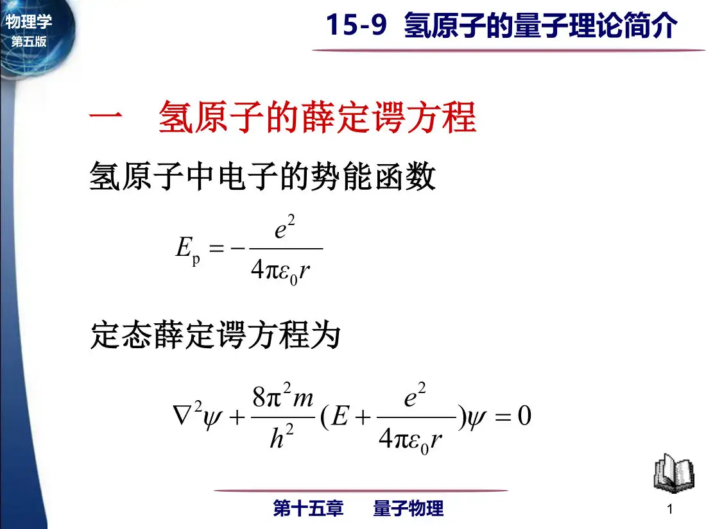

原文：

氢原子的薛定谔方程

氢原子中电子的势能函数

$$
E _ {\mathrm{p}} = - \frac {e ^ {2}}{4 \pi \varepsilon_ {0} r}
$$

定态薛定谔方程为

$$
\nabla^ {2} \psi + \frac {8 \pi^ {2} m}{h ^ {2}} (E + \frac {e ^ {2}}{4 \pi \varepsilon_ {0} r}) \psi = 0
$$

物理学第五版

15-9 氢原子的量子理论简介

山

第十五章 量子物理

1

### 转化为球坐标

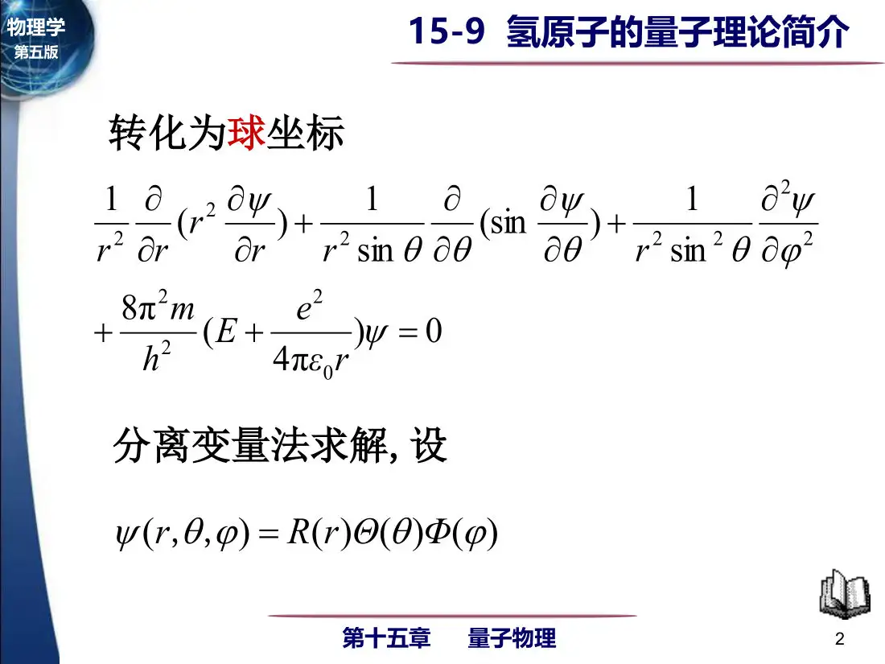

原文：

转化为球坐标

$$
\begin{array}{l} \frac {1}{r ^ {2}} \frac {\partial}{\partial r} (r ^ {2} \frac {\partial \psi}{\partial r}) + \frac {1}{r ^ {2} \sin \theta} \frac {\partial}{\partial \theta} (\sin \frac {\partial \psi}{\partial \theta}) + \frac {1}{r ^ {2} \sin^ {2} \theta} \frac {\partial^ {2} \psi}{\partial \varphi^ {2}} \\ + \frac {8 \pi^ {2} m}{h ^ {2}} (E + \frac {e ^ {2}}{4 \pi \varepsilon_ {0} r}) \psi = 0 \end{array}
$$

分离变量法求解,设

$$
\psi (r, \theta , \varphi) = R (r) \Theta (\theta) \Phi (\varphi)
$$

物理学第五版

15-9 氢原子的量子理论简介

山

第十五章 量子物理

2

### $$

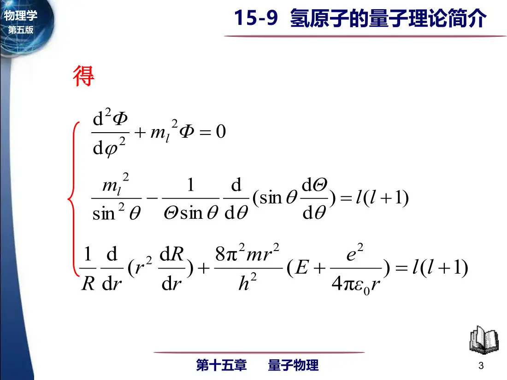

原文：

得

$$
\left\{ \begin{array}{l} \frac {\mathrm{d} ^ {2} \Phi}{\mathrm{d} \varphi^ {2}} + m _ {l} ^ {2} \Phi = 0 \\ \frac {m _ {l} ^ {2}}{\sin^ {2} \theta} - \frac {1}{\Theta \sin \theta} \frac {\mathrm{d}}{\mathrm{d} \theta} (\sin \theta \frac {\mathrm{d} \Theta}{\mathrm{d} \theta}) = l (l + 1) \\ \frac {1}{R} \frac {\mathrm{d}}{\mathrm{d} r} (r ^ {2} \frac {\mathrm{d} R}{\mathrm{d} r}) + \frac {8 \pi^ {2} m r ^ {2}}{h ^ {2}} (E + \frac {e ^ {2}}{4 \pi \varepsilon_ {0} r}) = l (l + 1) \end{array} \right.
$$

物理学第五版

15-9 氢原子的量子理论简介

山

第十五章 量子物理

3

### 二 量子化条件和量子数

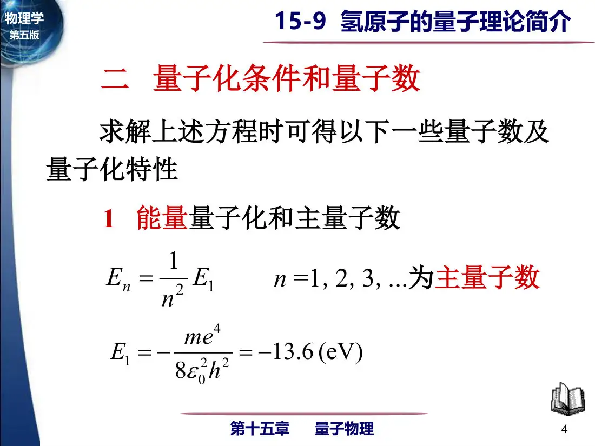

原文：

二 量子化条件和量子数

求解上述方程时可得以下一些量子数及量子化特性

能量量子化和主量子数

$$
E _ {n} = \frac {1}{n ^ {2}} E _ {1} \quad n = 1, 2, 3, \dots \text {为主量子数}
$$

$$
E _ {1} = - \frac {m e ^ {4}}{8 \varepsilon_ {0} ^ {2} h ^ {2}} = - 1 3. 6 (\mathrm{eV})
$$

物理学第五版

15-9 氢原子的量子理论简介

山

第十五章 量子物理

4

### 2 角动量量子化和角量子数电子绕核运动时的角动量为：

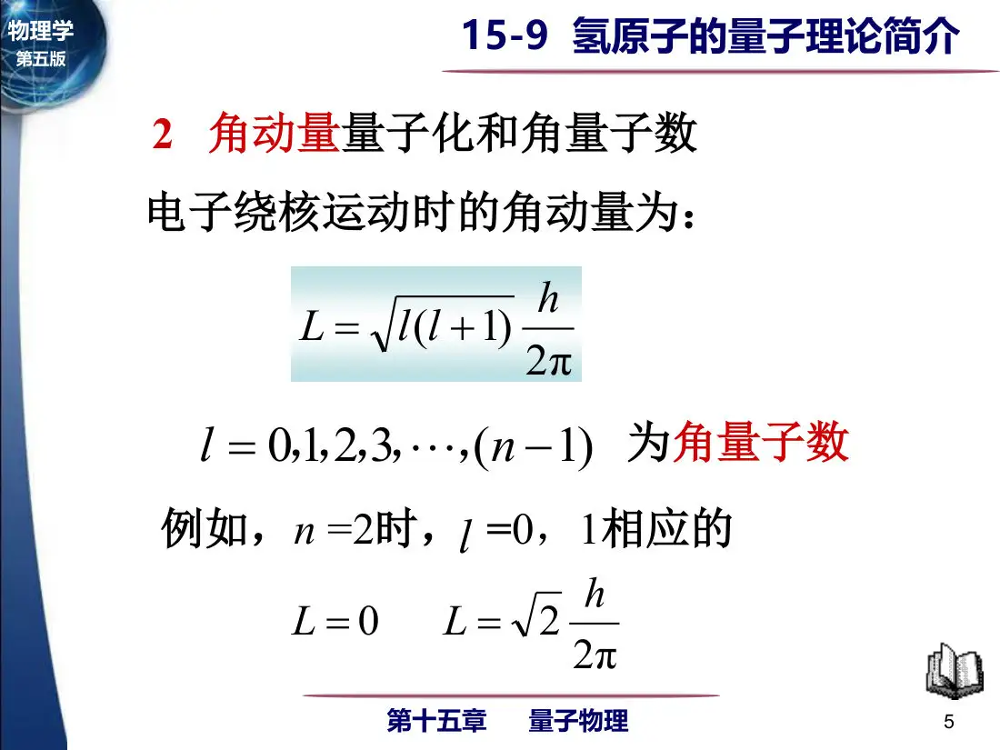

原文：

2 角动量量子化和角量子数电子绕核运动时的角动量为：

$$
L = \sqrt {l (l + 1)} \frac {h}{2 \pi}
$$

$l = 0 , 1 , 2 , 3 , \cdots , ( n - 1 )$ 为角量子数例如， $n = 2$ 时， $l ^ { = 0 }$ ，1相应的

$$
L = 0 \qquad L = \sqrt {2} \frac {h}{2 \pi}
$$

物理学第五版

15-9 氢原子的量子理论简介

山

第十五章 量子物理

5

### 3 角动量空间量子化和磁量子数

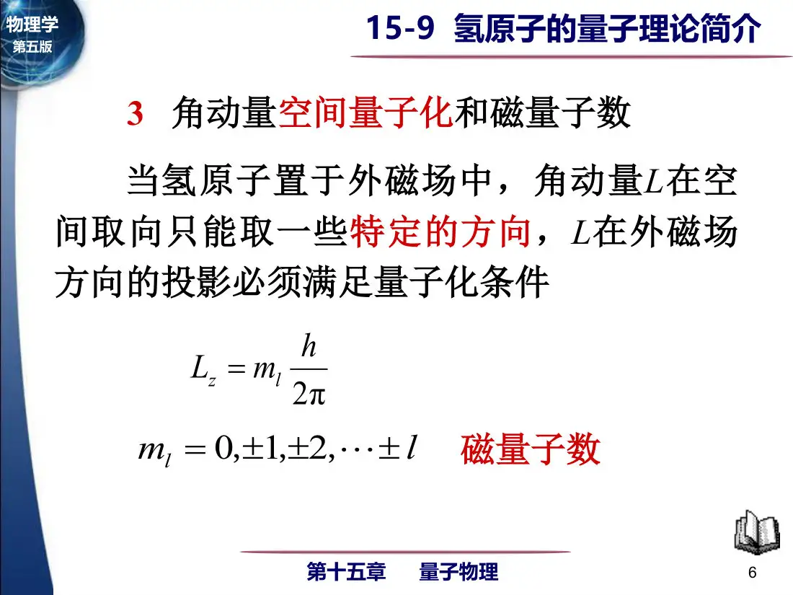

原文：

3 角动量空间量子化和磁量子数

当氢原子置于外磁场中，角动量L在空间取向只能取一些特定的方向，L在外磁场方向的投影必须满足量子化条件

$$
L _ {z} = m _ {l} \frac {h}{2 \pi}
$$

mi = 0,±1,±2, ±l 磁量子数

物理学第五版

15-9 氢原子的量子理论简介

山

第十五章 量子物理

6

### 例如， 时，

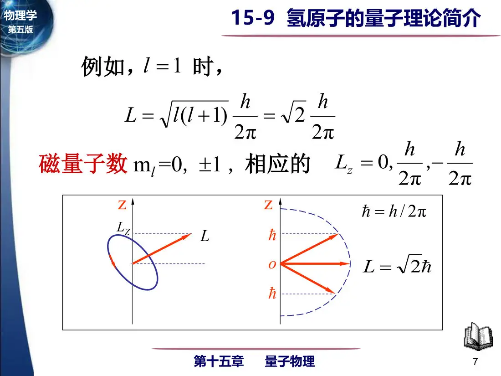

原文：

例如， 时，

$$
L = \sqrt {l (l + 1)} \frac {h}{2 \pi} = \sqrt {2} \frac {h}{2 \pi}
$$

磁量子数 $\mathrm { m } _ { l } { = } 0 , \pm 1$ , 相应的 $L _ { \mathrm { { z } } } = 0 , { \frac { h } { 2 \pi } } , - { \frac { h } { 2 \pi } }$

$$
\hbar = h / 2 \pi
$$

$$
L = \sqrt {2} \hbar
$$

物理学第五版

15-9 氢原子的量子理论简介

心

第十五章 量子物理

7

### 物理学第五版

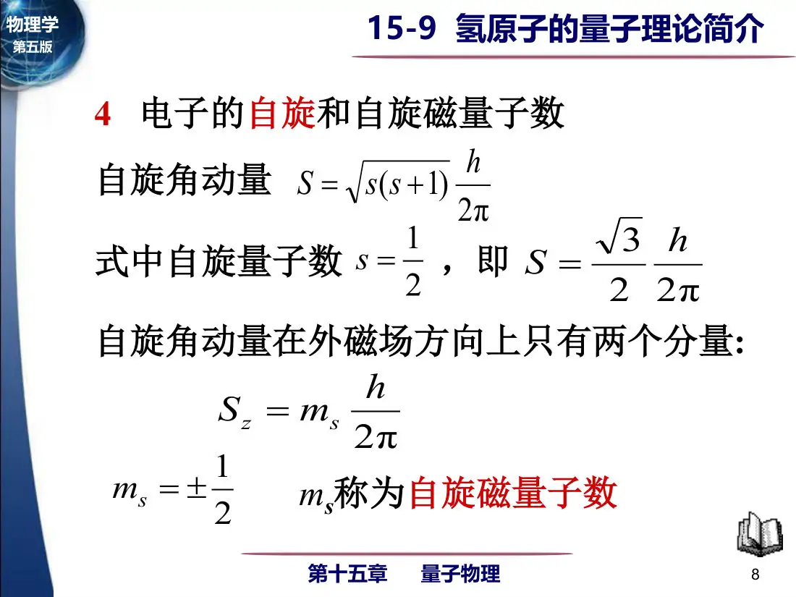

原文：

4 电子的自旋和自旋磁量子数自旋角动量 $S = \sqrt { s ( s + 1 ) } \frac { h } { 2 \pi }$ 式中自旋量子数 $s = \frac { 1 } { 2 }$ ，即 $S = \frac { \sqrt { 3 } } { 2 } \frac { h } { 2 \pi }$ 自旋角动量在外磁场方向上只有两个分量:

$S _ { z } = m _ { s } { \frac { h } { 2 \pi } }$ $m _ { s } = \pm \frac { 1 } { 2 } m _ { s }$ 称为自旋磁量子数

物理学第五版

15-9 氢原子的量子理论简介

心

第十五章 量子物理

8

### $$

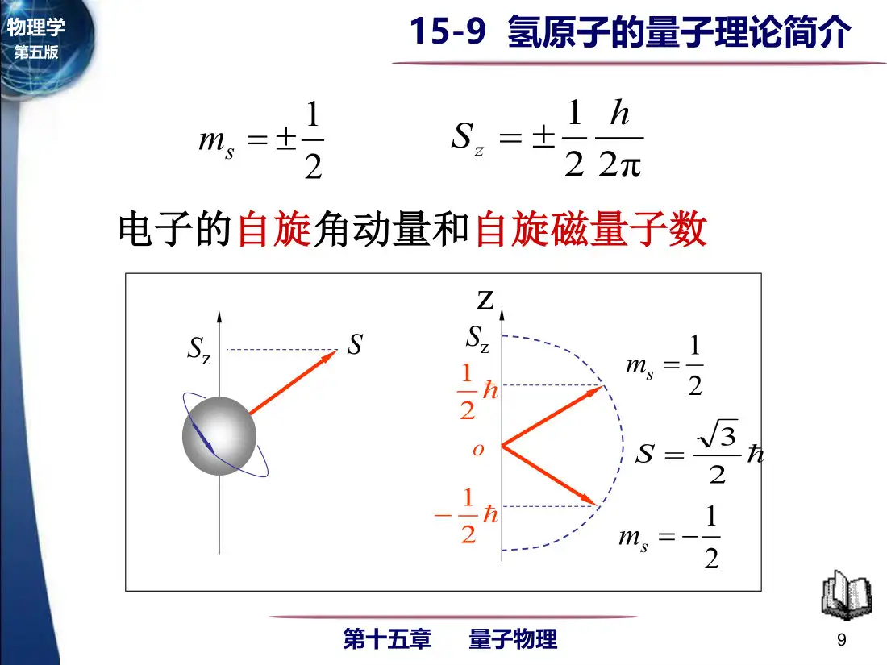

原文：

$$
m _ {s} = \pm \frac {1}{2} S _ {z} = \pm \frac {1}{2} \frac {h}{2 \pi}
$$

电子的自旋角动量和自旋磁量子数

物理学第五版

15-9 氢原子的量子理论简介

山

第十五章 量子物理

9

### 5 小结

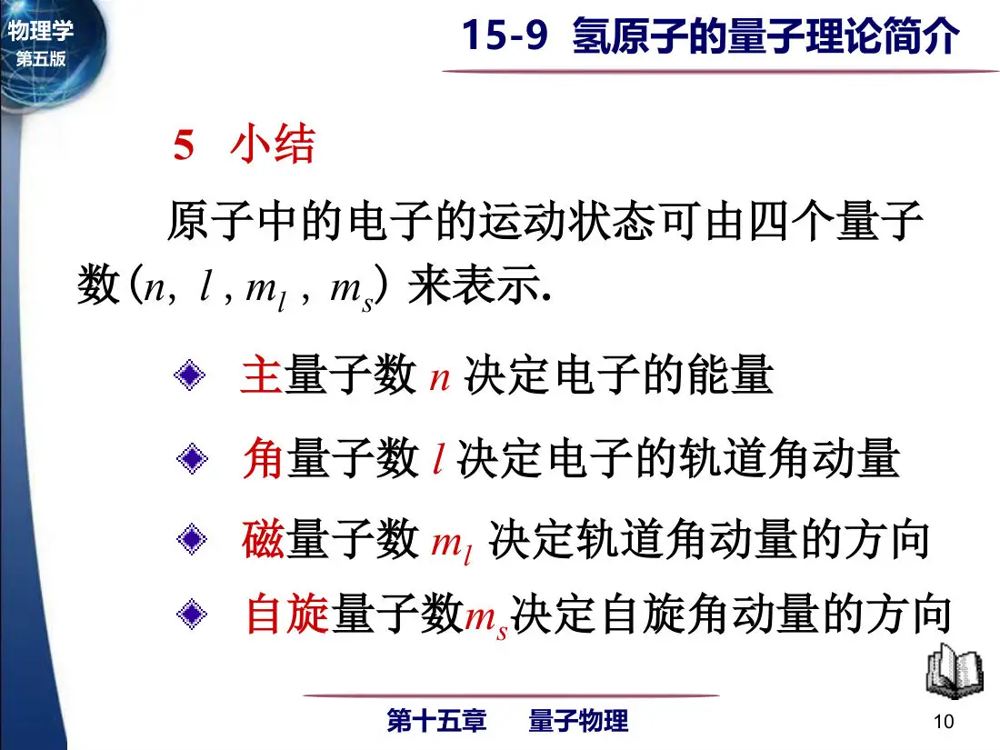

原文：

5 小结

原子中的电子的运动状态可由四个量子数 $( n , \ l , m _ { l } , \ m _ { s } )$ 来表示.

O 主量子数n决定电子的能量

角量子数 l决定电子的轨道角动量

一 磁量子数 $m _ { l }$ 决定轨道角动量的方向

自旋量子数 $m _ { s }$ 决定自旋角动量的方向

物理学第五版

15-9 氢原子的量子理论简介

山

第十五章 量子物理

10

### 三 基态径向波函数和电子分布概率

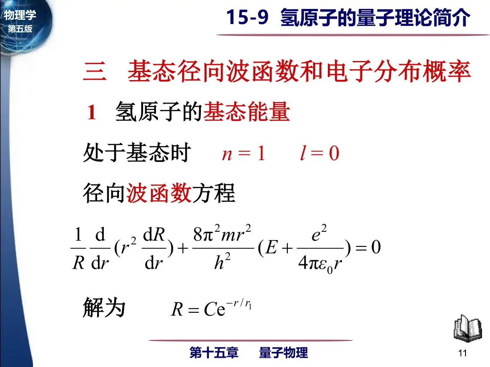

原文：

三 基态径向波函数和电子分布概率

1 氢原子的基态能量

处于基态时 $n = 1 \qquad l = 0$

径向波函数方程

$$
\frac {1}{R} \frac {\mathrm{d}}{\mathrm{d} r} (r ^ {2} \frac {\mathrm{d} R}{\mathrm{d} r}) + \frac {8 \pi^ {2} m r ^ {2}}{h ^ {2}} (E + \frac {e ^ {2}}{4 \pi \varepsilon_ {0} r}) = 0
$$

解为

$$
R = C \mathrm{e} ^ {- r / r _ {1}}
$$

物理学第五版

15-9 氢原子的量子理论简介

山

第十五章 量子物理

11

### $$

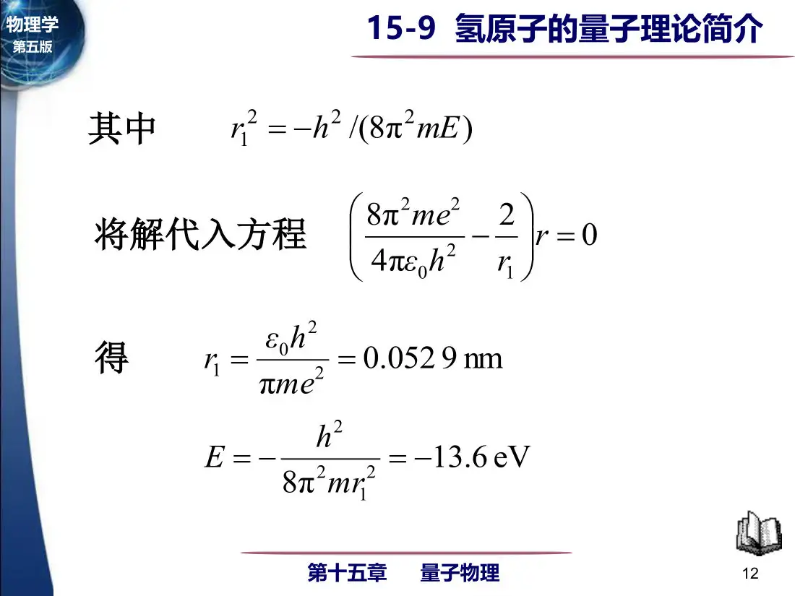

原文：

其中 $r _ { 1 } ^ { 2 } = - h ^ { 2 } / ( 8 \pi ^ { 2 } m E )$

将解代入方程 $\left( \frac { 8 \pi ^ { 2 } m e ^ { 2 } } { 4 \pi \varepsilon _ { 0 } h ^ { 2 } } - \frac { 2 } { r _ { 1 } } \right) r = 0$

得

$$
r _ {1} = \frac {\varepsilon_ {0} h ^ {2}}{\pi m e ^ {2}} = 0. 0 5 2 9 \mathrm{nm}
$$

$$
E = - \frac {h ^ {2}}{8 \pi^ {2} m r _ {1} ^ {2}} = - 1 3. 6 \mathrm{eV}
$$

物理学第五版

15-9 氢原子的量子理论简介

山

第十五章 量子物理

12

### 2 基态径向波函数

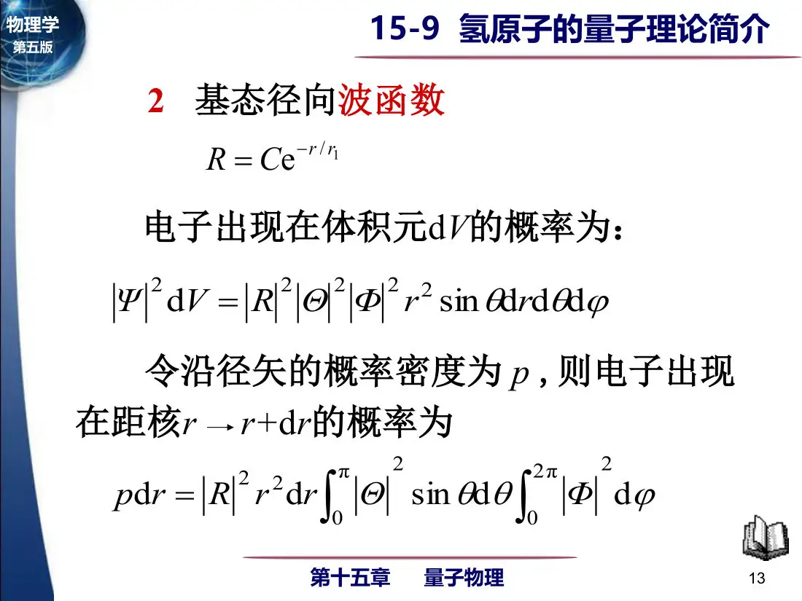

原文：

2 基态径向波函数

$$
R = C \mathrm{e} ^ {- r / r _ {1}}
$$

电子出现在体积元dV的概率为：

$$
\left| \Psi \right| ^ {2} \mathrm{d} V = \left| R \right| ^ {2} \left| \Theta \right| ^ {2} \left| \Phi \right| ^ {2} r ^ {2} \sin \theta \mathrm{d} r \mathrm{d} \theta \mathrm{d} \varphi
$$

令沿径矢的概率密度为 $p$ ,则电子出现在距核 $r \to r + \mathrm { d } r$ 的概率为

$$
p \mathrm{d} r = | R | ^ {2} r ^ {2} \mathrm{d} r \int_ {0} ^ {\pi} | \Theta | ^ {2} \sin \theta \mathrm{d} \theta \int_ {0} ^ {2 \pi} | \Phi | ^ {2} \mathrm{d} \varphi
$$

物理学第五版

15-9 氢原子的量子理论简介

山

第十五章 量子物理

13

### $$

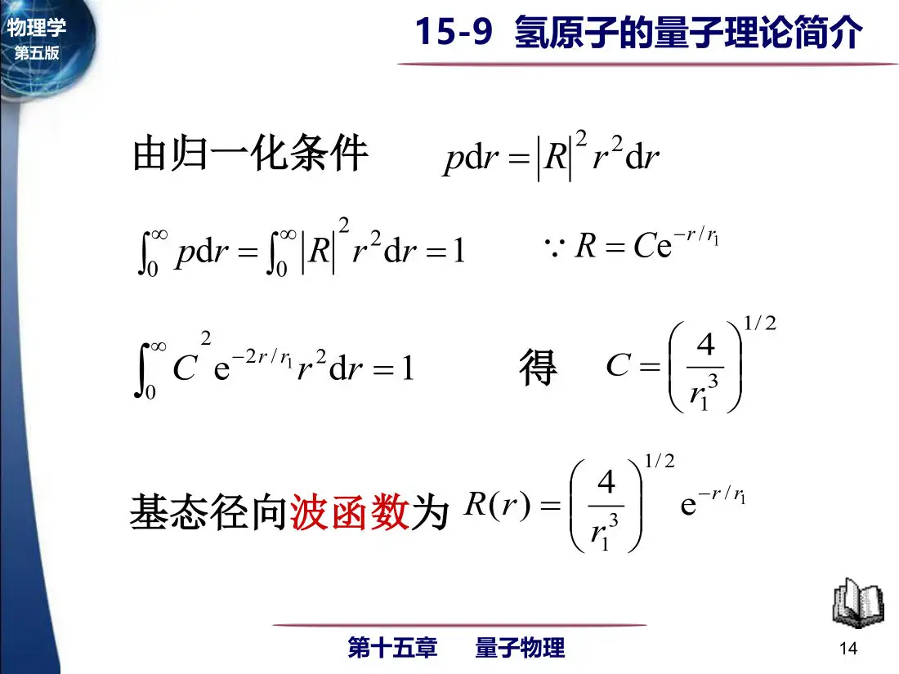

原文：

由归一化条件 $p \mathrm { d } r = \left| { R } \right| ^ { 2 } r ^ { 2 } \mathrm { d } r$

$$
\int_ {0} ^ {\infty} p \mathrm{d} r = \int_ {0} ^ {\infty} | R | ^ {2} r ^ {2} \mathrm{d} r = 1 \quad \because R = C \mathrm{e} ^ {- r / r _ {1}}
$$

$$
\int_ {0} ^ {\infty} C ^ {2} \mathrm{e} ^ {- 2 r / r _ {1}} r ^ {2} \mathrm{d} r = 1 \quad \text {得} \quad C = \left(\frac {4}{r _ {1} ^ {3}}\right) ^ {1 / 2}
$$

基态径向波函数为 $R ( r ) = \left( \frac { 4 } { r _ { 1 } ^ { 3 } } \right) ^ { 1 / 2 } { \mathrm { e } } ^ { - r / r _ { 1 } }$

物理学第五版

15-9 氢原子的量子理论简介

山

第十五章 量子物理

14

### 电子的分布概率

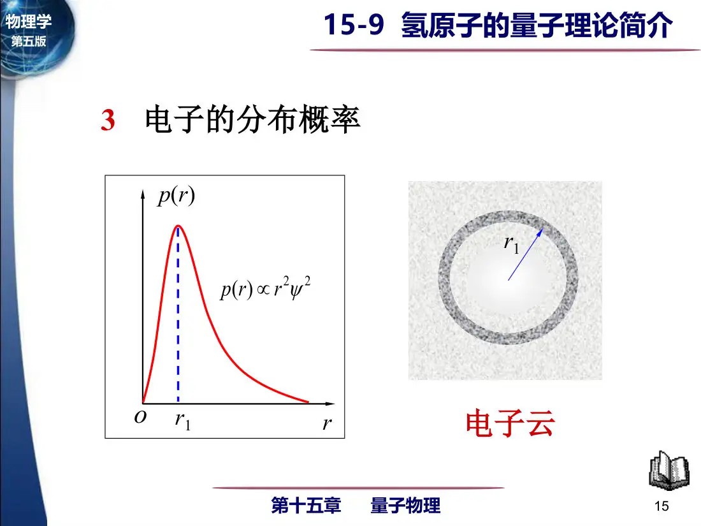

原文：

电子的分布概率

物理学第五版

15-9 氢原子的量子理论简介

山

第十五章 量子物理

15

### 本章目录

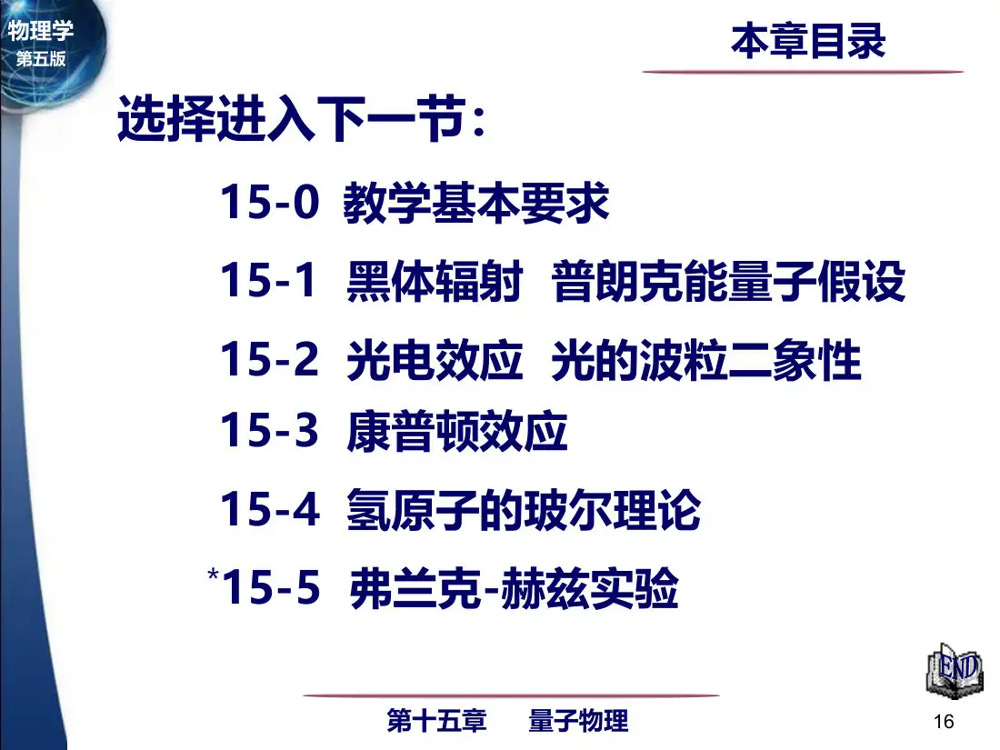

原文：

本章目录

释进入下一节:
15-0 教学基本要求
15-1 黑体辐射 普朗克能量子假设
15-2 光电效应 光的波粒二象性
15-3 康普顿效应
15-4 氢原子的玻尔理论
\*15-5 弗兰克-赫兹实验

END h.

第十五章 量子物理

16
