# 《大学物理》第15章 量子物理 §15-4.6 德布罗意波 实物粒子的波粒二象性（课件）

原件的每一页，下面附识别出的文字。

### §15-4 氢原子光谱和玻尔理论

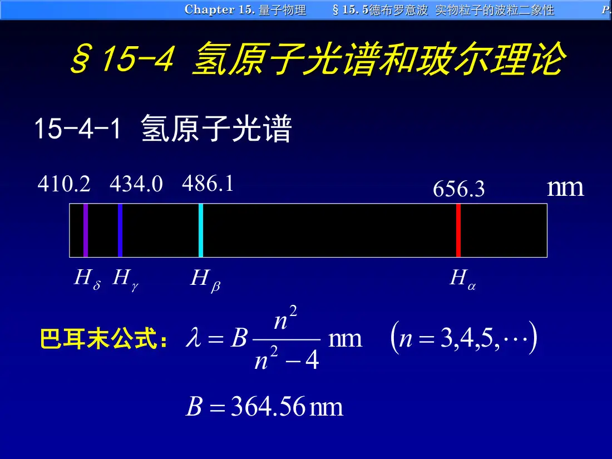

原文：

§15-4 氢原子光谱和玻尔理论

15-4-1 氢原子光谱

410.2 434.0 486.1

$$
H _ {\delta} H _ {\gamma}
$$

巴耳末公式： $\angle A = \angle B = \angle C = \angle C$ $( 4 - 8 ) \times ( - 1 0 ) = ( - 1 )$ B=364.56nm

Chapter 15. 量子物理 §15. 5德布罗意波 实物粒子的波粒二象性

P.

### 实验值：

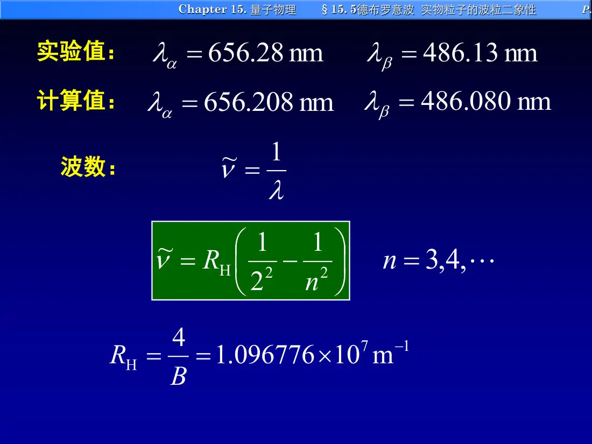

原文：

实验值：

$$
\lambda_ {\alpha} = 6 5 6. 2 8 \mathrm{nm}
$$

$$
\lambda_ {\beta} = 4 8 6. 1 3 \mathrm{nm}
$$

计算值：

$$
\lambda_ {\alpha} = 6 5 6. 2 0 8 \mathrm{nm}
$$

$$
\lambda_ {\beta} = 4 8 6. 0 8 0 \mathrm{nm}
$$

波数：

$$
\widetilde {\nu} = \frac {1}{\lambda}
$$

$$
\widetilde {\nu} = R _ {\mathrm{H}} \left(\frac {1}{2 ^ {2}} - \frac {1}{n ^ {2}}\right) \qquad n = 3, 4, \dots
$$

$$
R _ {\mathrm{H}} = \frac {4}{B} = 1. 0 9 6 7 7 6 \times 1 0 ^ {7} \mathrm{m} ^ {- 1}
$$

Chapter 15. 量子物理 §15. 5德布罗意波 实物粒子的波粒二象性

P.

### 里德伯常量的近代测量值：

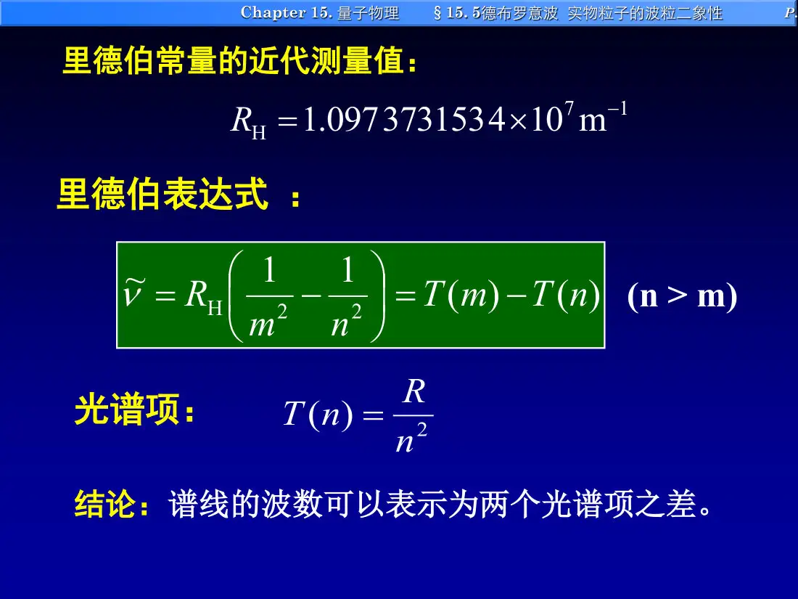

原文：

里德伯常量的近代测量值：

$$
R _ {\mathrm{H}} = 1. 0 9 7 3 7 3 1 5 3 4 \times 1 0 ^ {7} \mathrm{m} ^ {- 1}
$$

里德伯表达式

$$
\widetilde {\nu} = R _ {\mathrm{H}} \left(\frac {1}{m ^ {2}} - \frac {1}{n ^ {2}}\right) = T (m) - T (n) \quad (\mathbf {n} > \mathbf {m})
$$

光谱项：

$$
T (n) = \frac {R}{n ^ {2}}
$$

结论：谱线的波数可以表示为两个光谱项之差。

Chapter 15. 量子物理 §15. 5德布罗意波 实物粒子的波粒二象性

P.

### Chapter 15. 量子物理 §15. 5德布罗意波 实物粒子的波粒二象性

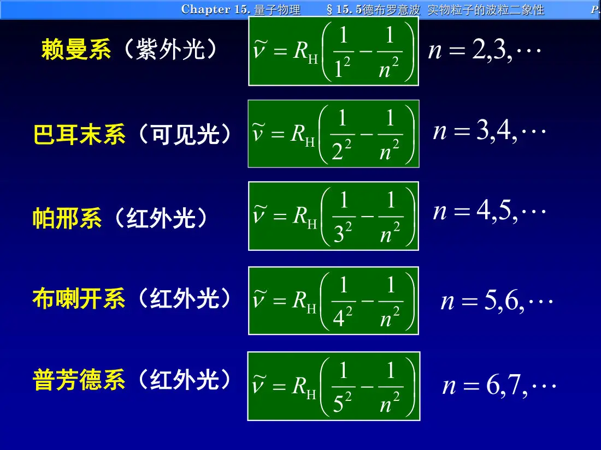

原文：

Chapter 15. 量子物理 §15. 5德布罗意波 实物粒子的波粒二象性

赖曼系（紫外光）

巴耳末系（可见光）

布喇开系（红外光）

$$
\widetilde {\nu} = R _ {\mathrm{H}} \left(\frac {1}{1 ^ {2}} - \frac {1}{n ^ {2}}\right) n = 2, 3, \dots
$$

帕邢系 （红外光）

普芳德系（红外光）

$$
\widetilde {v} = R _ {\mathrm{H}} \left(\frac {1}{2 ^ {2}} - \frac {1}{n ^ {2}}\right) n = 3, 4, \dots
$$

$$
\widetilde {\nu} = R _ {\mathrm{H}} \left(\frac {1}{3 ^ {2}} - \frac {1}{n ^ {2}}\right) n = 4, 5, \dots
$$

$$
\widetilde {\nu} = R _ {\mathrm{H}} \left(\frac {1}{4 ^ {2}} - \frac {1}{n ^ {2}}\right) \quad n = 5, 6, \dots
$$

$$
\widetilde {\nu} = R _ {\mathrm{H}} \left(\frac {1}{5 ^ {2}} - \frac {1}{n ^ {2}}\right)
$$

$$
n = 6, 7, \dots
$$

### 15-4-2 原子的经典模型

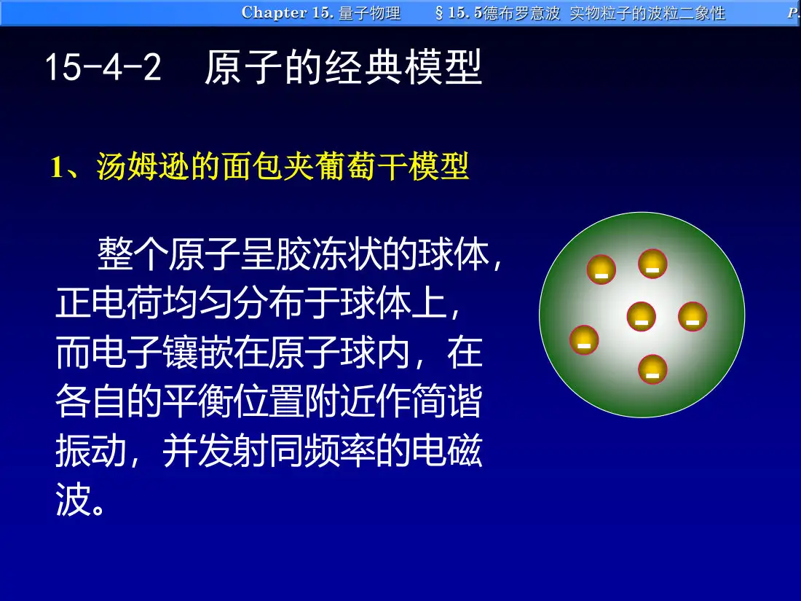

原文：

15-4-2 原子的经典模型

1、汤姆逊的面包夹葡萄干模型

整个原子呈胶冻状的球体，正电荷均匀分布于球体上，而电子镶嵌在原子球内，在各自的平衡位置附近作简谐振动，并发射同频率的电磁波。

Chapter 15. 量子物理 §15. 5德布罗意波 实物粒子的波粒二象性

P.

###  粒子散射实验

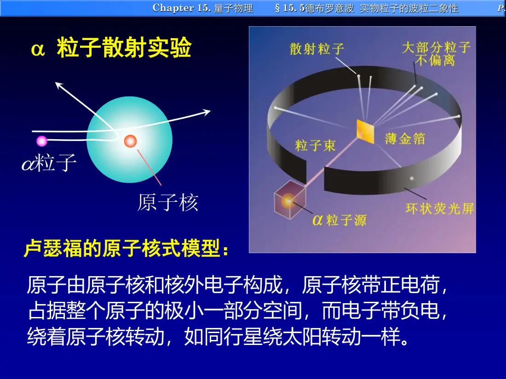

原文：

 粒子散射实验

a粒子

原子核

卢瑟福的原子核式模型：

大部分粒子不偏离

原子由原子核和核外电子构成，原子核带正电荷，占据整个原子的极小一部分空间，而电子带负电，绕着原子核转动，如同行星绕太阳转动一样。

Chapter 15. 量子物理 §15. 5德布罗意波 实物粒子的波粒二象性

P.

### 15-4-3 玻尔的氢原子理论

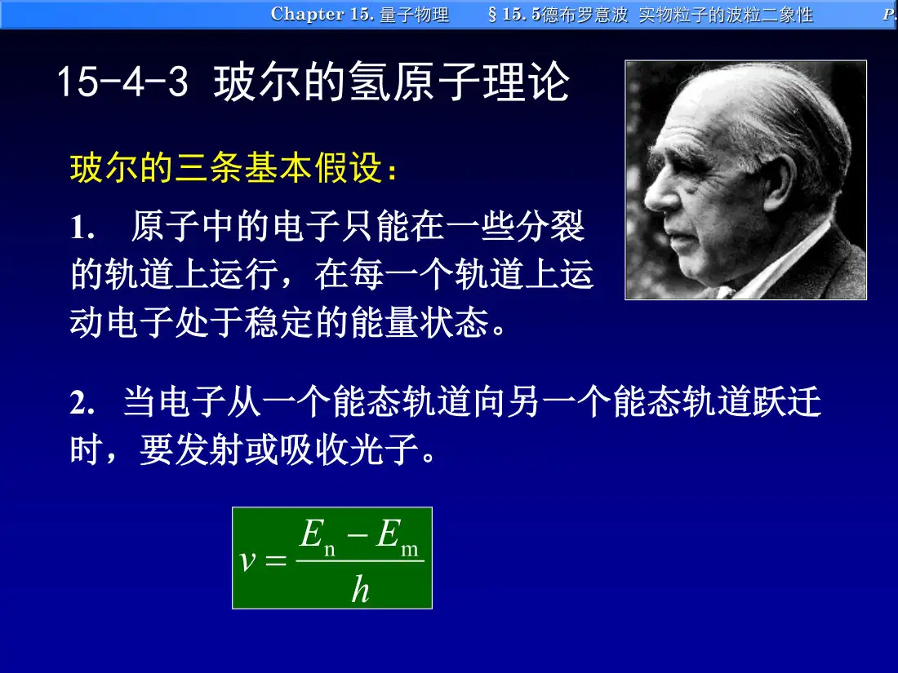

原文：

15-4-3 玻尔的氢原子理论

玻尔的三条基本假设：

1. 原子中的电子只能在一些分裂的轨道上运行，在每一个轨道上运动电子处于稳定的能量状态。

2. 当电子从一个能态轨道向另一个能态轨道跃迁时，要发射或吸收光子。

$$
\nu = \frac {E _ {\mathrm{n}} - E _ {\mathrm{m}}}{h}
$$

Chapter 15. 量子物理 §15. 5德布罗意波 实物粒子的波粒二象性

P.

### $$

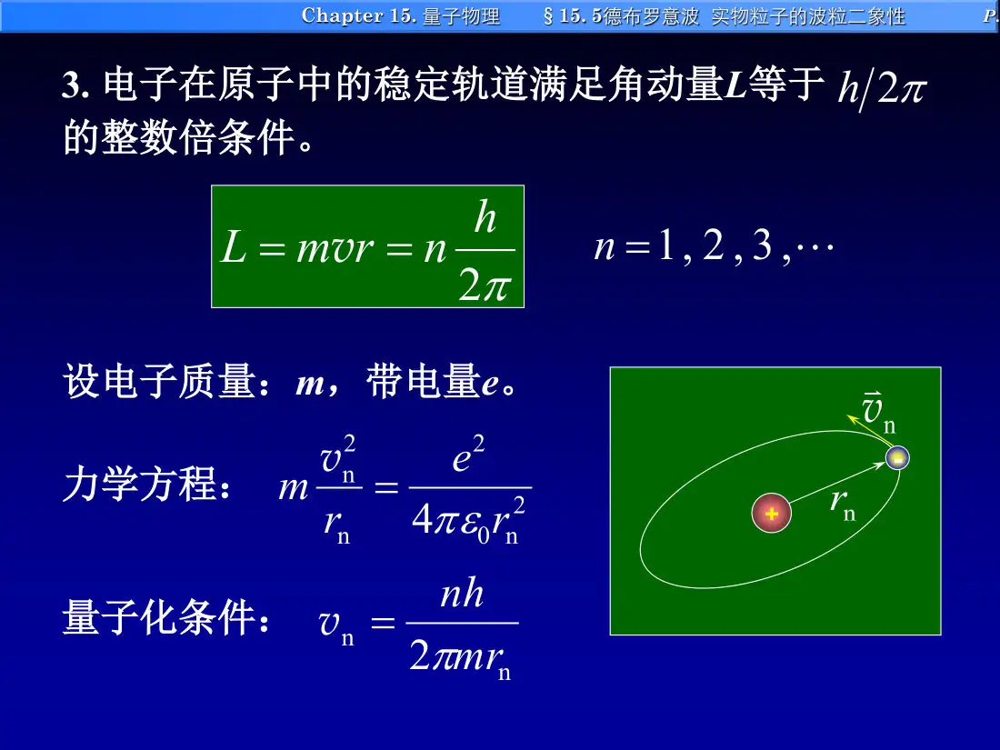

原文：

3. 电子在原子中的稳定轨道满足角动量L等于 $1 0 \% = 1 0$ 的整数倍条件。

$$
L = m v r = n \frac {h}{2 \pi}
$$

$$
n = 1, 2, 3, \dots
$$

设电子质量：m，带电量e。

力学方程： $4 0 \div \frac { 1 } { 2 } = \frac { 1 } { 2 }$

量子化条件： $( 0 . 5 \times 0 . 5 \times 0 . 5 \times 0 . 5 \times 0 . 5 \times 0 . 5 \times 0 . 5 \times 0 . 5 \times 0 . 5 \times 0 . 5 \times 0 . 5 \times 0 . 5 \times 0 . 5 \times 0 . 5 \times 0 . 5 \times 0 . 5 \times 0 . 5 \times 0 . 5 \times 0 . 5 \times 0 . 5 \times 0 . 5 \times 0 . 5 \times 0 . 5 \times 0 . 5 \times 0 . 5 \times 0 . 5 \times 0 . 5 \times 0 . 5 \times 0 . 5 \times 0 . 5 \times 0 . 5 \times 0 . 5 \times 0 . 5 \times 0 . 5 \times 0 . 5 \times 0 . 5 \times 0 . 5 \times 0 . 5 \times 0 . 5 \times 0 . 5 \times 0 . 5 \times 0 . 5 \times 0 . 5 \times 0 . 5 \times 0 . 5 \times 0 . 5 \times 0 . 5 \times 0 . 5 \times 0 .$

Chapter 15. 量子物理 §15. 5德布罗意波 实物粒子的波粒二象性

P.

### 电子轨道半径：

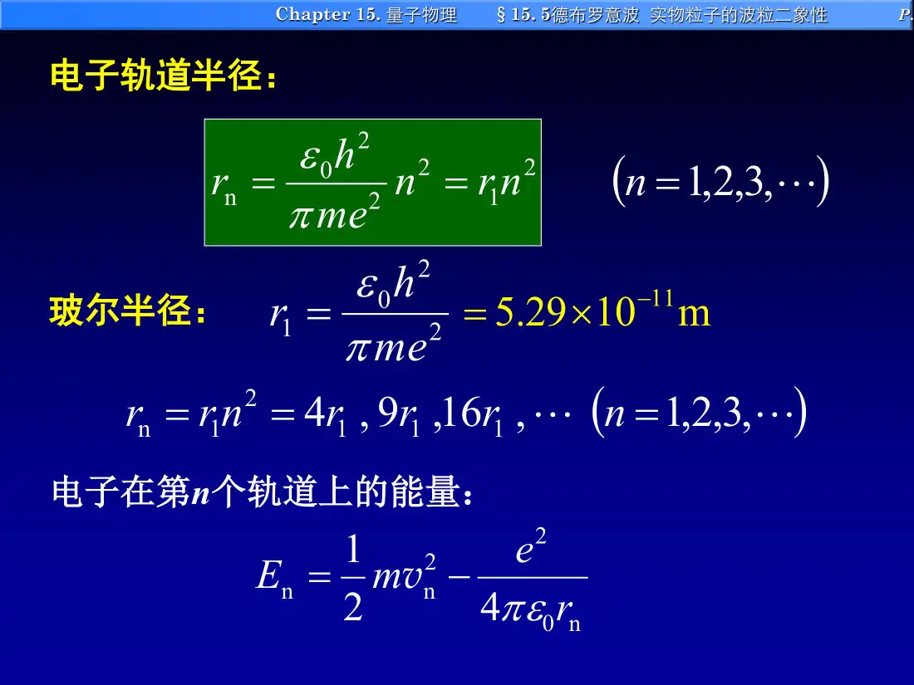

原文：

电子轨道半径：

$$
r _ {\mathrm{n}} = \frac {\varepsilon_ {0} h ^ {2}}{\pi m e ^ {2}} n ^ {2} = r _ {1} n ^ {2}
$$

$$
(n = 1, 2, 3, \dots)
$$

玻尔半径：

$$
r _ {1} = \frac {\varepsilon_ {0} h ^ {2}}{\pi m e ^ {2}} = 5. 2 9 \times 1 0 ^ {- 1 1} \mathrm{m}
$$

$$
r _ {\mathrm{n}} = r _ {1} n ^ {2} = 4 r _ {1}, 9 r _ {1}, 1 6 r _ {1}, \dots (n = 1, 2, 3, \dots)
$$

电子在第n个轨道上的能量：

$$
E _ {\mathrm{n}} = \frac {1}{2} m v _ {\mathrm{n}} ^ {2} - \frac {e ^ {2}}{4 \pi \varepsilon_ {0} r _ {\mathrm{n}}}
$$

Chapter 15. 量子物理 §15. 5德布罗意波 实物粒子的波粒二象性

P.

### 将“量子化条件”和“玻尔半径”代入能量式，得：

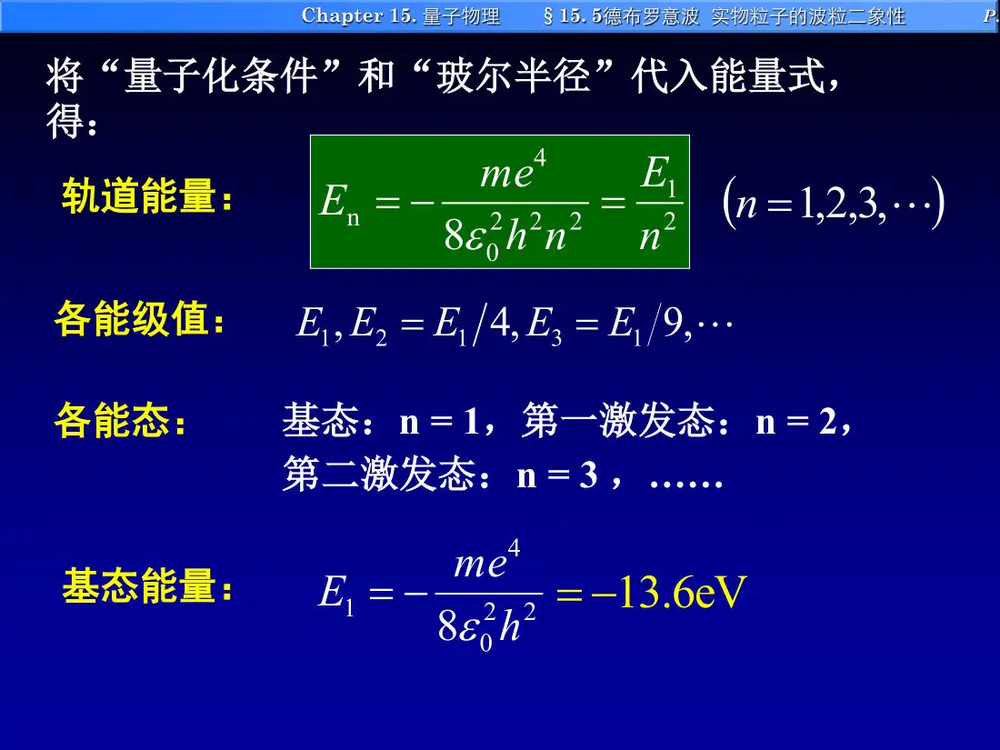

原文：

将“量子化条件”和“玻尔半径”代入能量式，得：

轨道能量：

$$
E _ {\mathrm{n}} = - \frac {m e ^ {4}}{8 \varepsilon_ {0} ^ {2} h ^ {2} n ^ {2}} = \frac {E _ {1}}{n ^ {2}} \quad (n = 1, 2, 3, \dots)
$$

各能级值：

$$
E _ {1}, E _ {2} = E _ {1} / 4, E _ {3} = E _ {1} / 9, \dots
$$

各能态： 基态：n = 1，第一激发态： $\boxed { 1 } \boxed { 2 }$ 第二激发态：n = 3 ，……

基态能量：

$$
E _ {1} = - \frac {m e ^ {4}}{8 \varepsilon_ {0} ^ {2} h ^ {2}} = - 1 3. 6 \mathrm{eV}
$$

Chapter 15. 量子物理 §15. 5德布罗意波 实物粒子的波粒二象性

P.

### 氢原子能级图

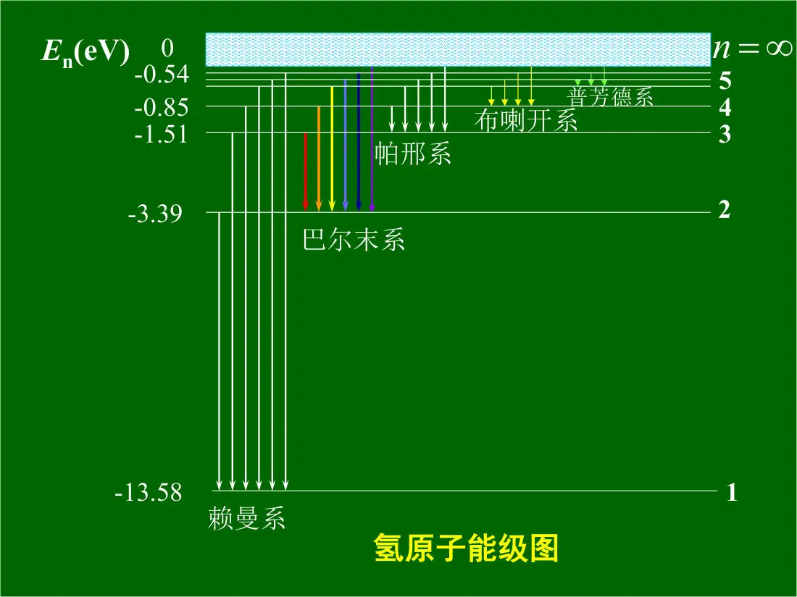

原文：

氢原子能级图

### 电子从高能级向低能级跃迁时放出光子的波数：

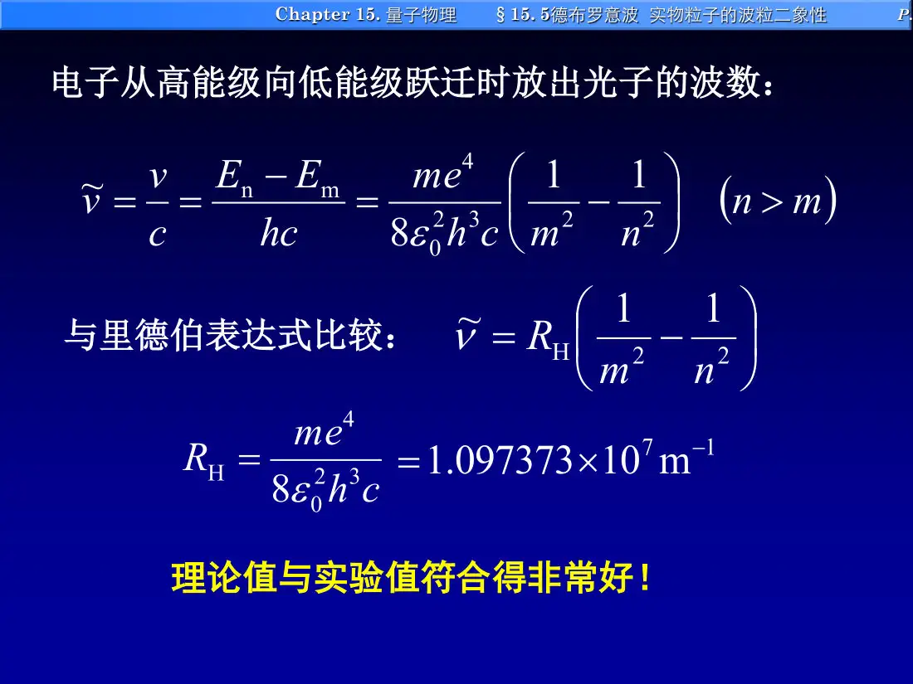

原文：

电子从高能级向低能级跃迁时放出光子的波数：

$$
\widetilde {\nu} = \frac {\nu}{c} = \frac {E _ {\mathrm{n}} - E _ {\mathrm{m}}}{h c} = \frac {m e ^ {4}}{8 \varepsilon_ {0} ^ {2} h ^ {3} c} \left(\frac {1}{m ^ {2}} - \frac {1}{n ^ {2}}\right) (n > m)
$$

与里德伯表达式比较： $x = \frac { 1 } { 2 }$

$$
R _ {\mathrm{H}} = \frac {m e ^ {4}}{8 \varepsilon_ {0} ^ {2} h ^ {3} c} = 1. 0 9 7 3 7 3 \times 1 0 ^ {7} \mathrm{m} ^ {- 1}
$$

理论值与实验值符合得非常好！

Chapter 15. 量子物理 §15. 5德布罗意波 实物粒子的波粒二象性

P.

### 例. 如用能量为12.6eV的电子轰击氢原子，将产生那些谱线？

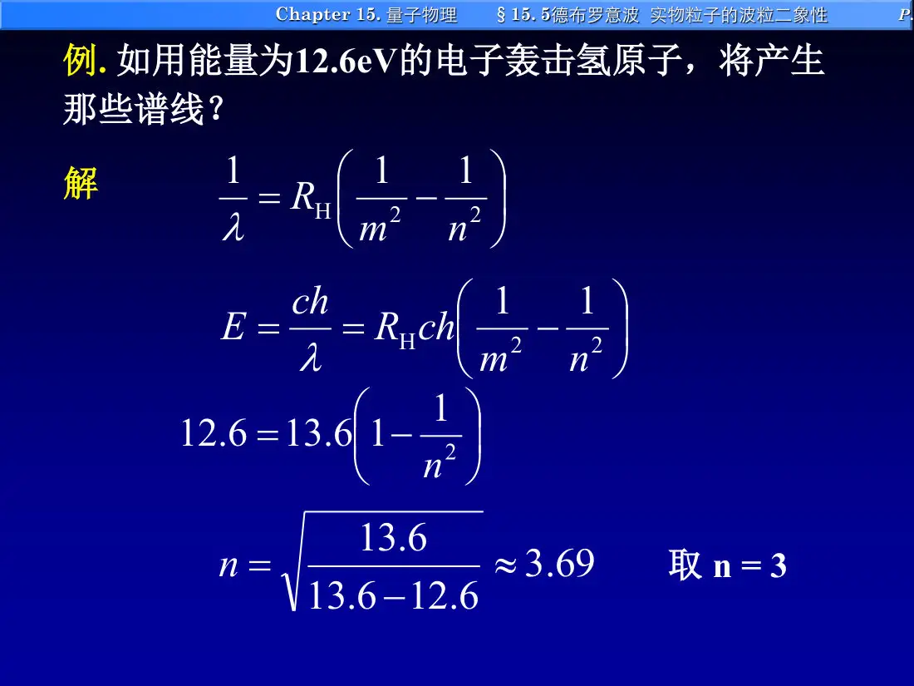

原文：

例. 如用能量为12.6eV的电子轰击氢原子，将产生那些谱线？

解

$$
\frac {1}{\lambda} = R _ {\mathrm{H}} \left(\frac {1}{m ^ {2}} - \frac {1}{n ^ {2}}\right)
$$

$$
E = \frac {c h}{\lambda} = R _ {\mathrm{H}} c h \left(\frac {1}{m ^ {2}} - \frac {1}{n ^ {2}}\right)
$$

1 12.6=13.61 2 n

$$
n = \sqrt {\frac {1 3 . 6}{1 3 . 6 - 1 2 . 6}} \approx 3. 6 9
$$

取 n = 3

Chapter 15. 量子物理 §15. 5德布罗意波 实物粒子的波粒二象性

P.

### $$

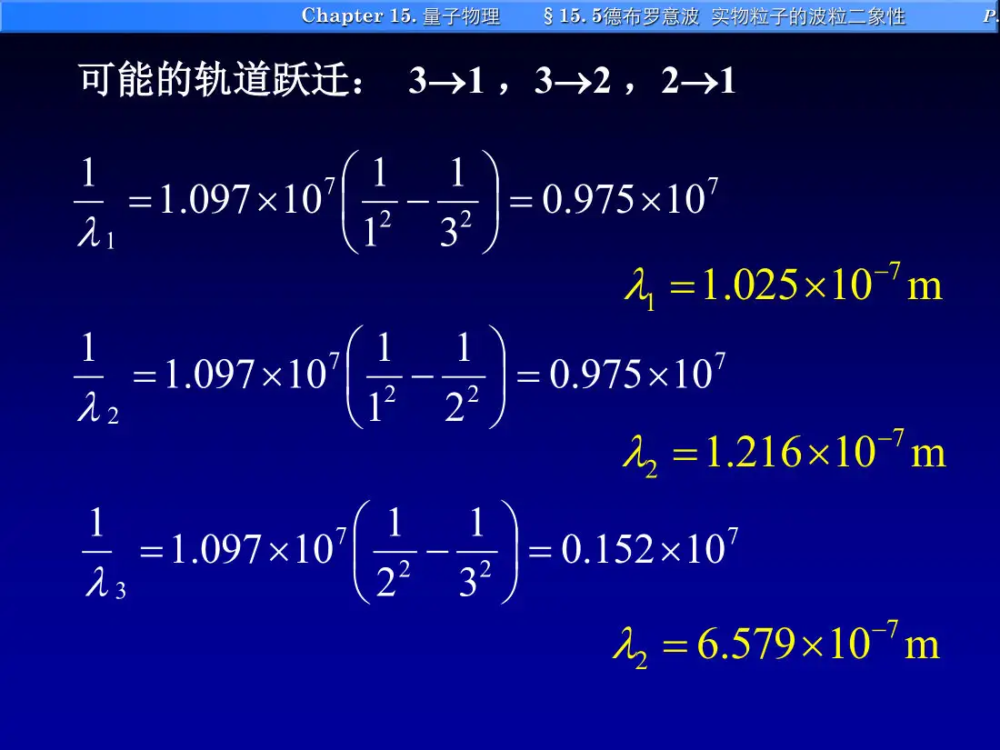

原文：

可能的轨道跃迁： $k = 2 ( m ^ { 2 } ) ^ { 2 } = 2 ( m ^ { 2 } ) ^ { 2 } = 2$

$$
\frac {1}{\lambda_ {1}} = 1. 0 9 7 \times 1 0 ^ {7} \left(\frac {1}{1 ^ {2}} - \frac {1}{3 ^ {2}}\right) = 0. 9 7 5 \times 1 0 ^ {7}
$$

$$
\frac {1}{\lambda_ {2}} = 1. 0 9 7 \times 1 0 ^ {7} \left(\frac {1}{1 ^ {2}} - \frac {1}{2 ^ {2}}\right) = 0. 9 7 5 \times 1 0 ^ {7}
$$

$$
\lambda_ {1} = 1. 0 2 5 \times 1 0 ^ {- 7} \mathrm{m}
$$

$$
\lambda_ {2} = 1. 2 1 6 \times 1 0 ^ {- 7} \mathrm{m}
$$

$$
\frac {1}{\lambda_ {3}} = 1. 0 9 7 \times 1 0 ^ {7} \left(\frac {1}{2 ^ {2}} - \frac {1}{3 ^ {2}}\right) = 0. 1 5 2 \times 1 0 ^ {7}
$$

$$
\lambda_ {2} = 6. 5 7 9 \times 1 0 ^ {- 7} \mathrm{m}
$$

P.

Chapter 15. 量子物理 §15. 5德布罗意波 实物粒子的波粒二象性

### 15-6德波罗意物质波 实物粒子的波粒二象性

原文：

15-6德波罗意物质波 实物粒子的波粒二象性

Chapter 15. 量子物理 §15. 5德布罗意波 实物粒子的波粒二象性

P.

木星上的极光

### 一、德布罗意假设

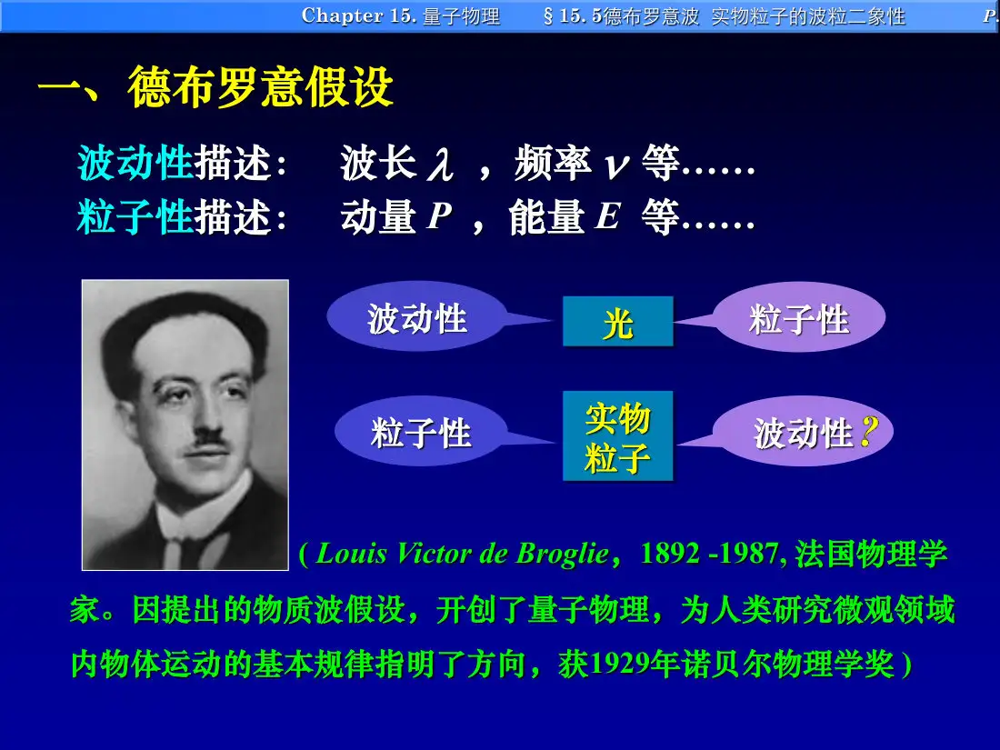

原文：

一、德布罗意假设

波动性描述：波长λ，频率ν等……….

粒子性描述： 动量 P ，能量 E 等……

波动性

粒子性

光

粒子性

实物粒子波动性

( Louis Victor de Broglie，1892 -1987, 法国物理学

家。因提出的物质波假设，开创了量子物理，为人类研究微观领域内物体运动的基本规律指明了方向，获1929年诺贝尔物理学奖 )

Chapter 15. 量子物理 §15. 5德布罗意波 实物粒子的波粒二象性

P.

### 一质量为 m 、速度为 v 的粒子其能量和动量为：

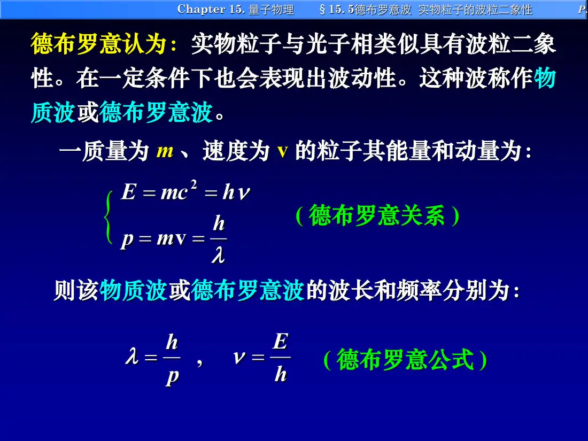

原文：

德布罗意认为：实物粒子与光子相类似具有波粒二象性。在一定条件下也会表现出波动性。这种波称作物质波或德布罗意波。

一质量为 m 、速度为 v 的粒子其能量和动量为：

$$
\begin{array}{l} E = m c ^ {2} = h \nu \\ p = m v = \frac {h}{\lambda} \end{array}
$$

( 德布罗意关系 )

则该物质波或德布罗意波的波长和频率分别为：

h Eλ = 二 p 2 ν= h ( 德布罗意公式 )

Chapter 15. 量子物理 §15. 5德布罗意波 实物粒子的波粒二象性

P.

### $$

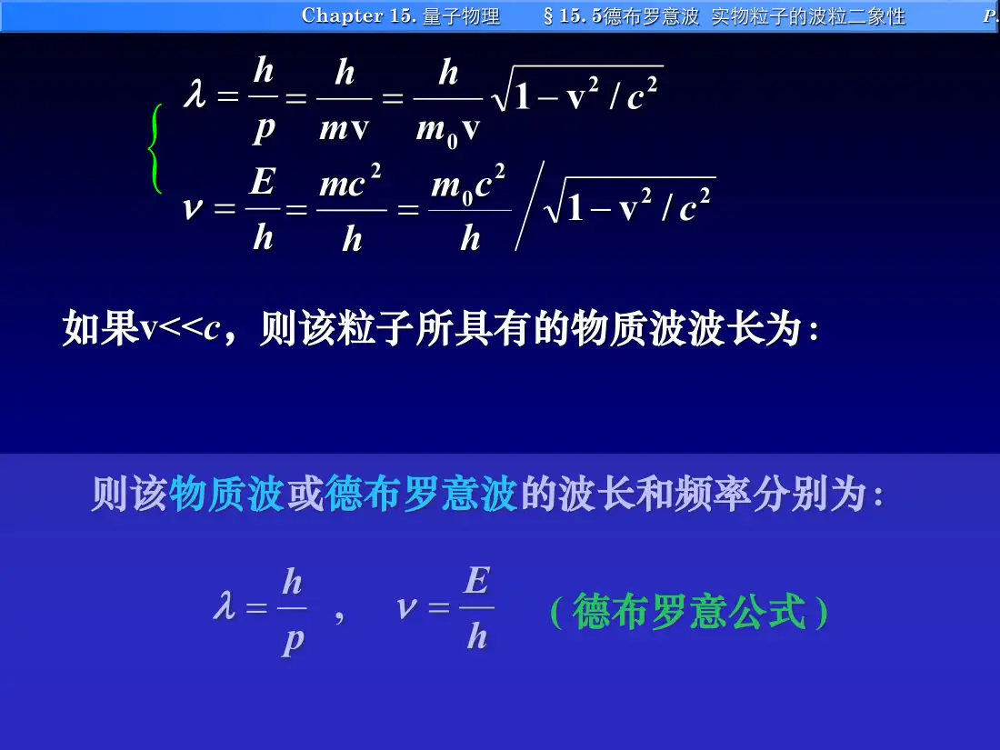

原文：

$$
\lambda = \frac {h}{p} = \frac {h}{m v} = \frac {h}{m _ {0} v} \sqrt {1 - v ^ {2} / c ^ {2}}
$$

$$
\nu = \frac {E}{h} = \frac {m c ^ {2}}{h} = \frac {m _ {0} c ^ {2}}{h} / \sqrt {1 - v ^ {2} / c ^ {2}}
$$

如果 $v \leq \frac { 2 } { 3 }$ 则该粒子所具有的物质波波长为：

则该物质波或德布罗意波的波长和频率分别为：

$$
\lambda = \frac {h}{p}, \nu = \frac {E}{h}
$$

德布罗意公式 )

Chapter 15. 量子物理 §15. 5德布罗意波 实物粒子的波粒二象性

P.

### $$

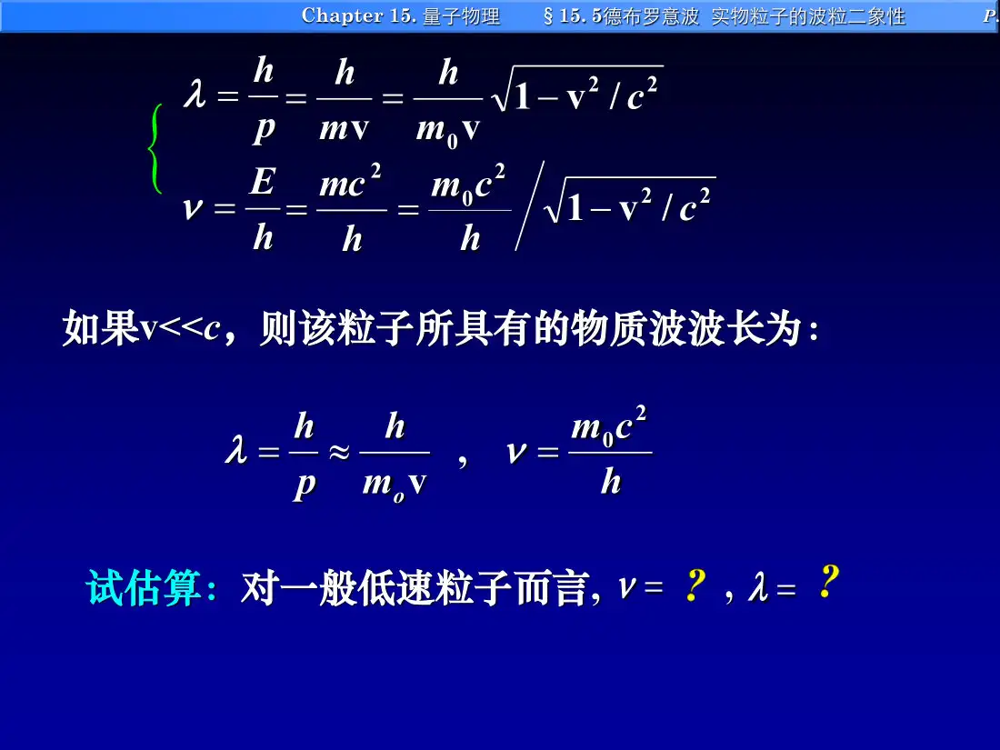

原文：

$$
\lambda = \frac {h}{p} = \frac {h}{m v} = \frac {h}{m _ {0} v} \sqrt {1 - v ^ {2} / c ^ {2}}
$$

$$
\nu = \frac {E}{h} = \frac {m c ^ {2}}{h} = \frac {m _ {0} c ^ {2}}{h} / \sqrt {1 - v ^ {2} / c ^ {2}}
$$

如果 $v \leq \frac { 2 } { 3 }$ 则该粒子所具有的物质波波长为：

$$
\lambda = \frac {h}{p} \approx \frac {h}{m _ {o} v}, \quad \nu = \frac {m _ {0} c ^ {2}}{h}
$$

试估算：对一般低速粒子而言, $V _ { 2 } = 0 . 0 2 m = 8$

Chapter 15. 量子物理 §15. 5德布罗意波 实物粒子的波粒二象性

P.

### 例 估算动能为200eV的电子束的德布罗意波波长。

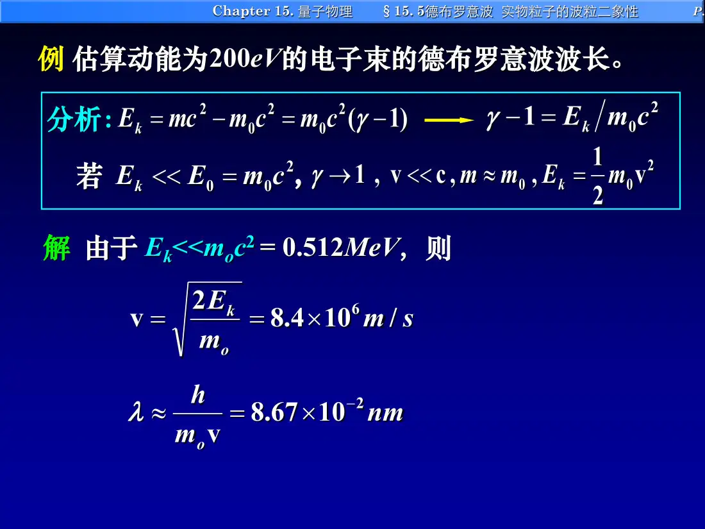

原文：

例 估算动能为200eV的电子束的德布罗意波波长。

分析： $\angle A C E = \angle B C F = \angle A F C = \angle B C F = \angle C A E = \angle A B C = \angle C A E = \angle C A E$

$$
E _ {k} <   <   E _ {0} = m _ {0} c ^ {2}, \gamma \rightarrow 1, \mathrm{v} <   <   \mathrm{c}, m \approx m _ {0}, E _ {k} = \frac {1}{2} m _ {0} \mathrm{v} ^ {2}
$$

由于 解 $1 0 7 \div m \cdots ( 1 7 \div m )$ 则

$$
\mathbf {v} = \sqrt {\frac {2 E _ {k}}{m _ {o}}} = 8. 4 \times 1 0 ^ {6} m / s
$$

$$
\lambda \approx \frac {h}{m _ {o} \mathrm{v}} = 8. 6 7 \times 1 0 ^ {- 2} n m
$$

Chapter 15. 量子物理 §15. 5德布罗意波 实物粒子的波粒二象性

P.

### 例 估算一颗质量为40g，速度为1000m/s的子弹的德布罗意波波长。

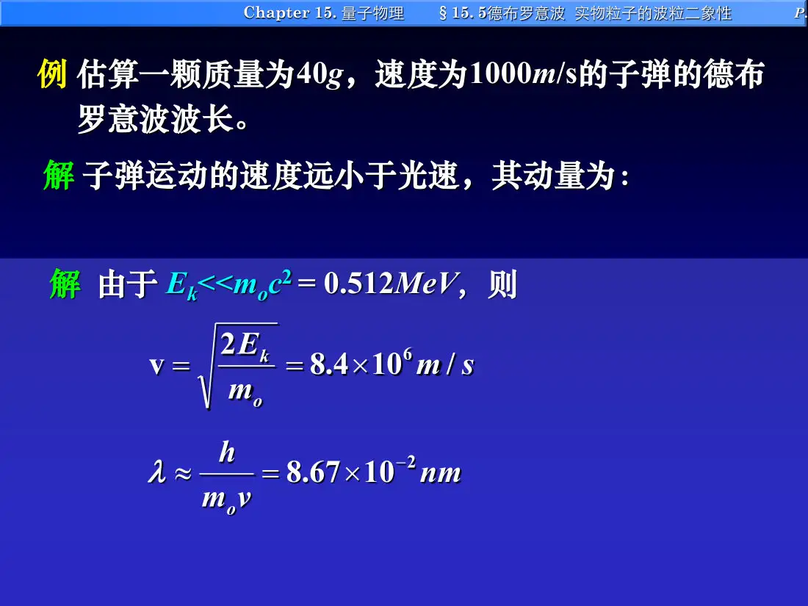

原文：

例 估算一颗质量为40g，速度为1000m/s的子弹的德布罗意波波长。

解 子弹运动的速度远小于光速，其动量为：

由于 解 $\vert P _ { 1 } ( \cdot , \cdot , 0 ) \vert ( \cdot , 0 ) = ( 1 ) \cdot \sqrt { 1 0 } ( \cdot , 0 ) / ( 2 ) \cdot ( 0 )$ 则

$$
\mathbf {v} = \sqrt {\frac {2 E _ {k}}{m _ {o}}} = 8. 4 \times 1 0 ^ {6} m / s
$$

$$
\lambda \approx \frac {h}{m _ {o} \nu} = 8. 6 7 \times 1 0 ^ {- 2} n m
$$

Chapter 15. 量子物理 §15. 5德布罗意波 实物粒子的波粒二象性

P.

### 例 估算一颗质量为40g，速度为1000m/s的子弹的德布罗意波波长。

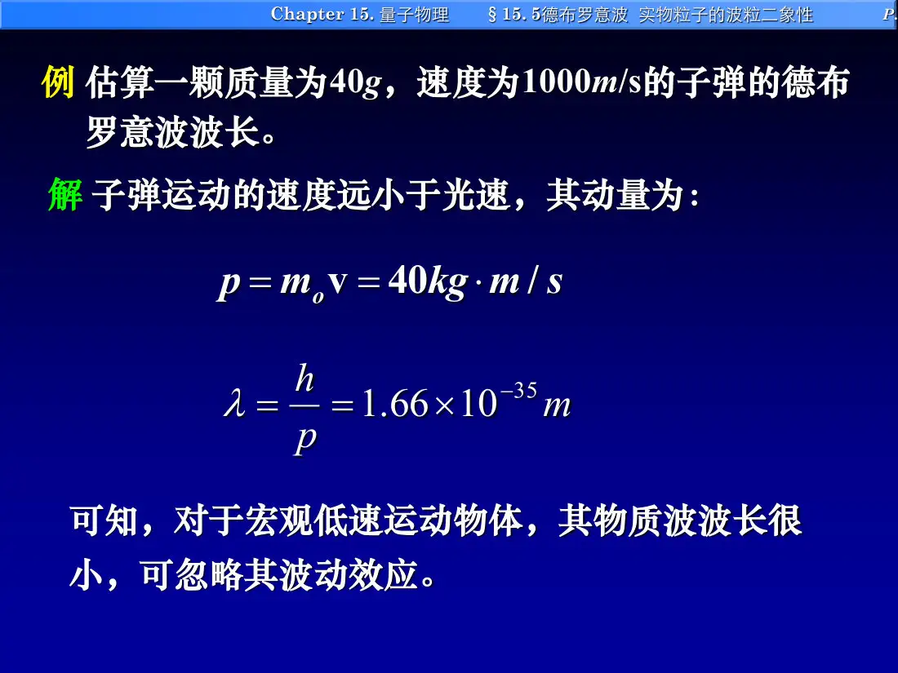

原文：

例 估算一颗质量为40g，速度为1000m/s的子弹的德布罗意波波长。

解 子弹运动的速度远小于光速，其动量为：

$$
p = m _ {o} \mathrm{v} = 4 0 k g \cdot m / s
$$

$$
\lambda = \frac {h}{p} = 1. 6 6 \times 1 0 ^ {- 3 5} m
$$

可知，对于宏观低速运动物体，其物质波波长很小，可忽略其波动效应。

Chapter 15. 量子物理 §15. 5德布罗意波 实物粒子的波粒二象性

P.

### 二.德布罗意波的实验验证

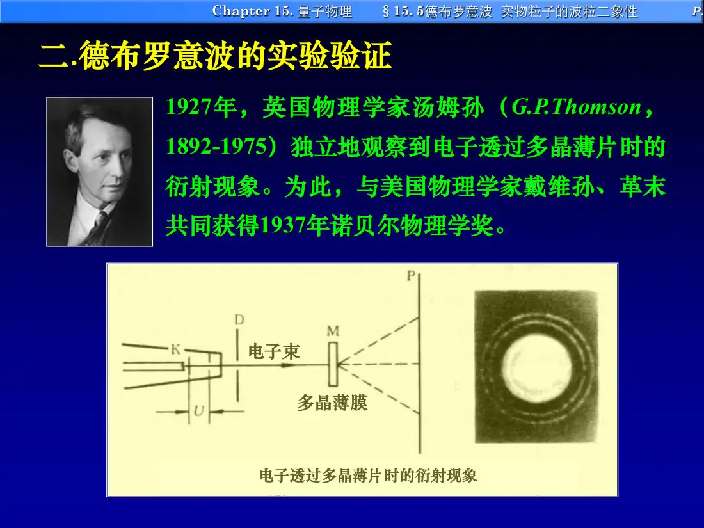

原文：

二.德布罗意波的实验验证

1927年，英国物理学家汤姆孙（G.P.Thomson，1892-1975）独立地观察到电子透过多晶薄片时的衍射现象。为此，与美国物理学家戴维孙、革末共同获得1937年诺贝尔物理学奖。

Chapter 15. 量子物理 §15. 5德布罗意波 实物粒子的波粒二象性

P.

### Chapter 15. 量子物理 §15. 5德布罗意波 实物粒子的波粒二象性

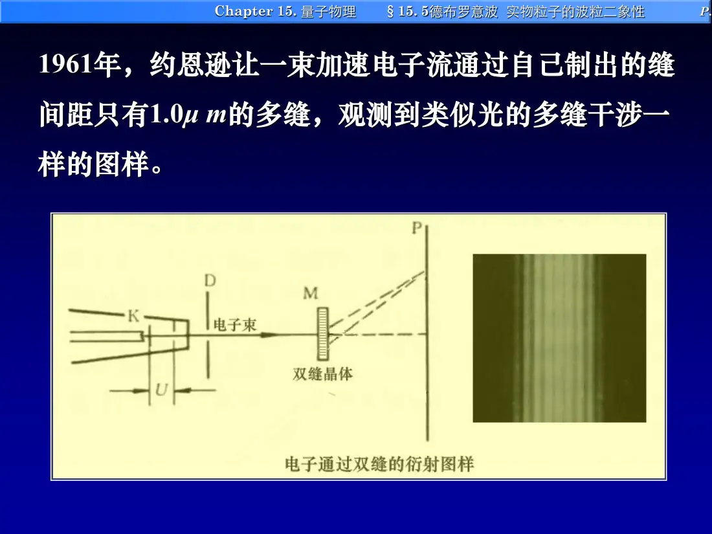

原文：

1961年，约恩逊让一束加速电子流通过自己制出的缝间距只有1.0μ m的多缝，观测到类似光的多缝干涉一样的图样。

Chapter 15. 量子物理 §15. 5德布罗意波 实物粒子的波粒二象性

P.

### 德布罗意波是什么性质的波

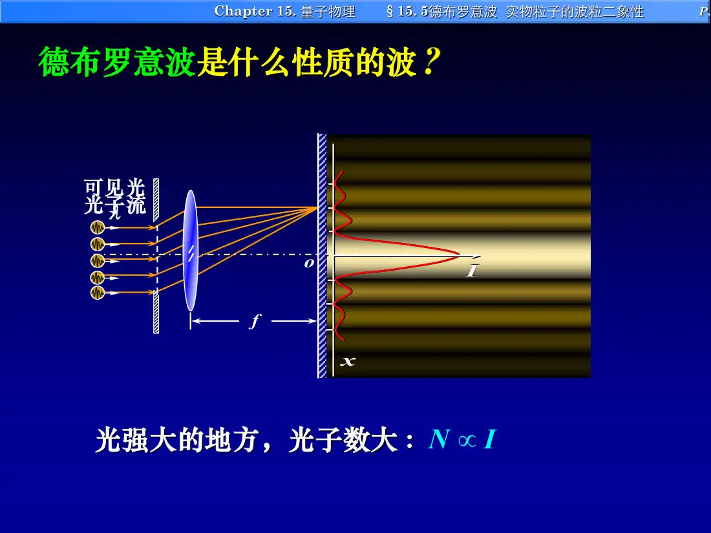

原文：

德布罗意波是什么性质的波

光强大的地方，光子数大 :

Chapter 15. 量子物理 §15. 5德布罗意波 实物粒子的波粒二象性

P.

### 德布罗意波是什么性质的波

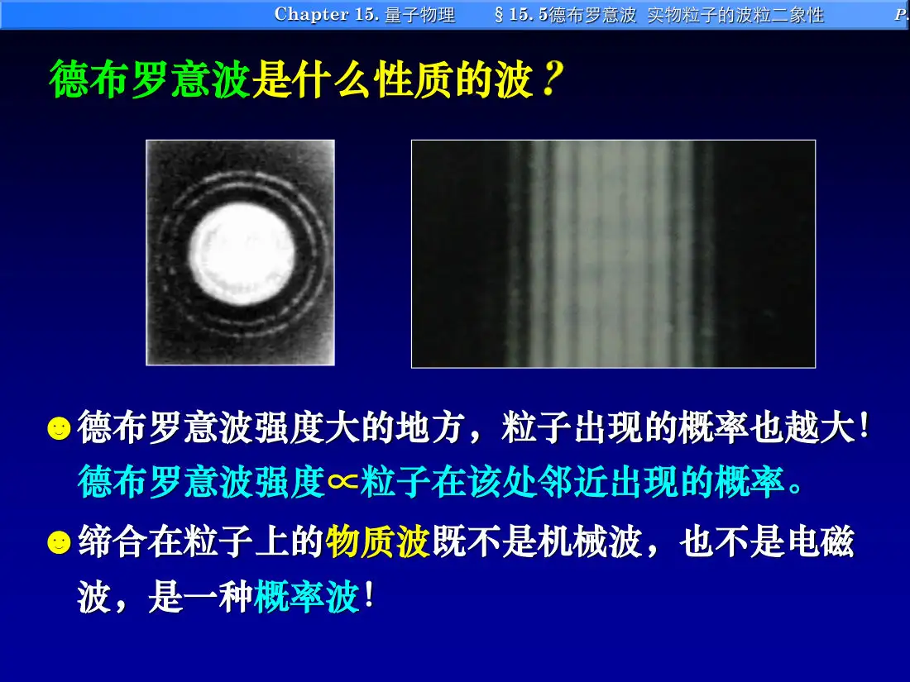

原文：

德布罗意波是什么性质的波

☻德布罗意波强度大的地方，粒子出现的概率也越大！德布罗意波强度∝粒子在该处邻近出现的概率。

☻缔合在粒子上的物质波既不是机械波，也不是电磁波，是一种概率波！

Chapter 15. 量子物理 §15. 5德布罗意波 实物粒子的波粒二象性

P.

### 德布罗意波关系式的进一步验证

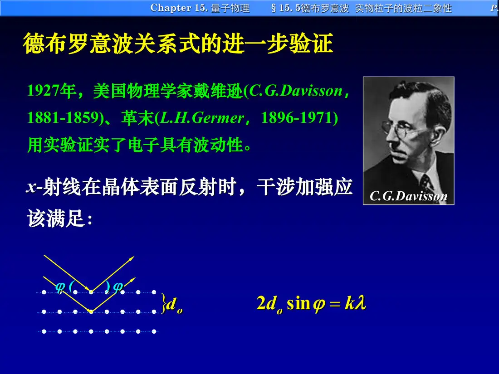

原文：

德布罗意波关系式的进一步验证

1927年，美国物理学家戴维逊(C.G.Davisson，1881-1859)、革末(L.H.Germer，1896-1971)用实验证实了电子具有波动性。

x-射线在晶体表面反射时，干涉加强应该满足：

2d sinφ=kλ

Chapter 15. 量子物理 §15. 5德布罗意波 实物粒子的波粒二象性

P.

### 类似地：

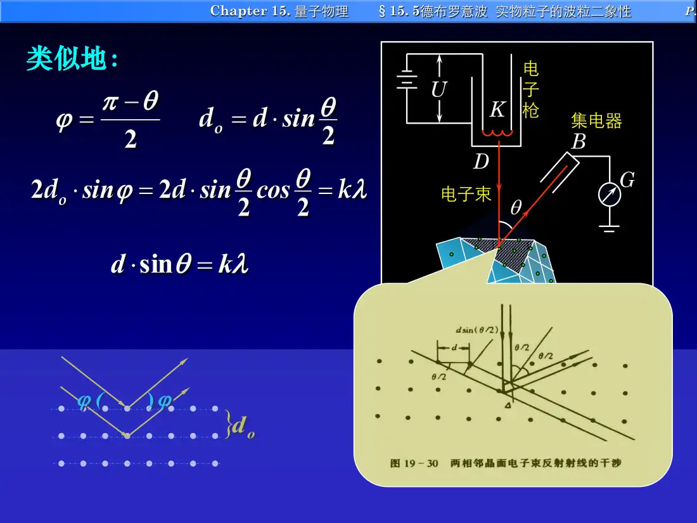

原文：

类似地：

$$
\varphi = \frac {\pi - \theta}{2}
$$

$$
d _ {o} = d \cdot \sin \frac {\theta}{2}
$$

$$
2 d _ {o} \cdot \sin \varphi = 2 d \cdot \sin \frac {\theta}{2} \cos \frac {\theta}{2} = k \lambda
$$

$$
d \cdot \sin \theta = k \lambda
$$

$$
\text {   一个   } \quad \text {   一个   } \quad \text {   一个   } \quad \text {   一个   } \quad \text {   一个   } \quad \text {   一个   } \quad \text {   一个   } \quad \text {   一个   } \quad \text {   一个   } \quad \text {   一个   }
$$

Chapter 15. 量子物理 §15. 5德布罗意波 实物粒子的波粒二象性

P.

### 类似地：

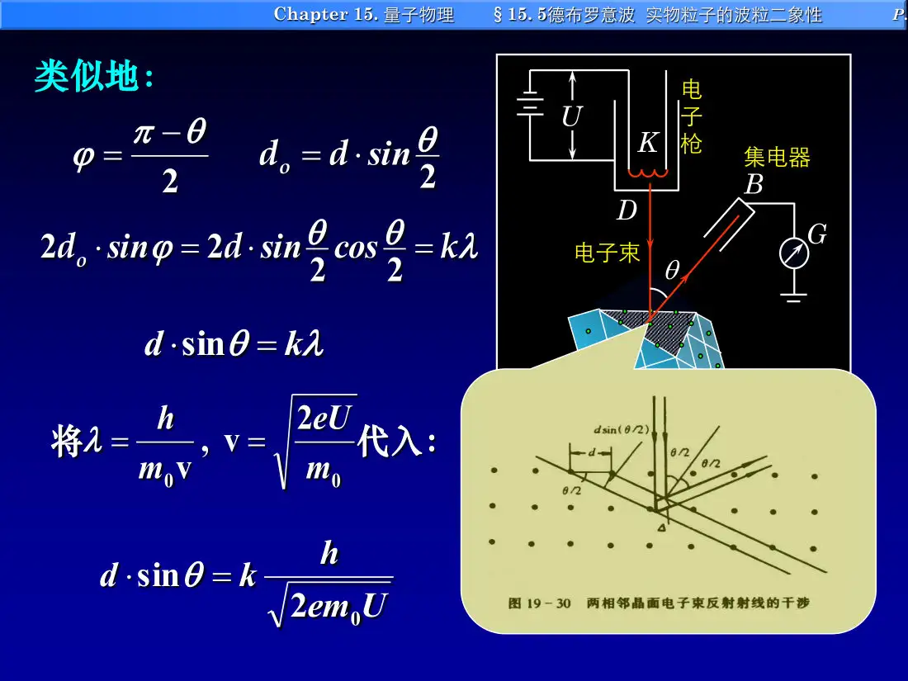

原文：

类似地：

$$
\varphi = \frac {\pi - \theta}{2} d _ {o} = d \cdot \sin \frac {\theta}{2}
$$

$$
2 d _ {o} \cdot \sin \varphi = 2 d \cdot \sin \frac {\theta}{2} \cos \frac {\theta}{2} = k \lambda
$$

$$
d \cdot \sin \theta = k \lambda
$$

$$
\text {将} \lambda = \frac {h}{m _ {0} v}, v = \sqrt {\frac {2 e U}{m _ {0}}} \text {代入:}
$$

$$
d \cdot \sin \theta = k \frac {h}{\sqrt {2 e m _ {0} U}}
$$

Chapter 15. 量子物理 §15. 5德布罗意波 实物粒子的波粒二象性

P.

### $$

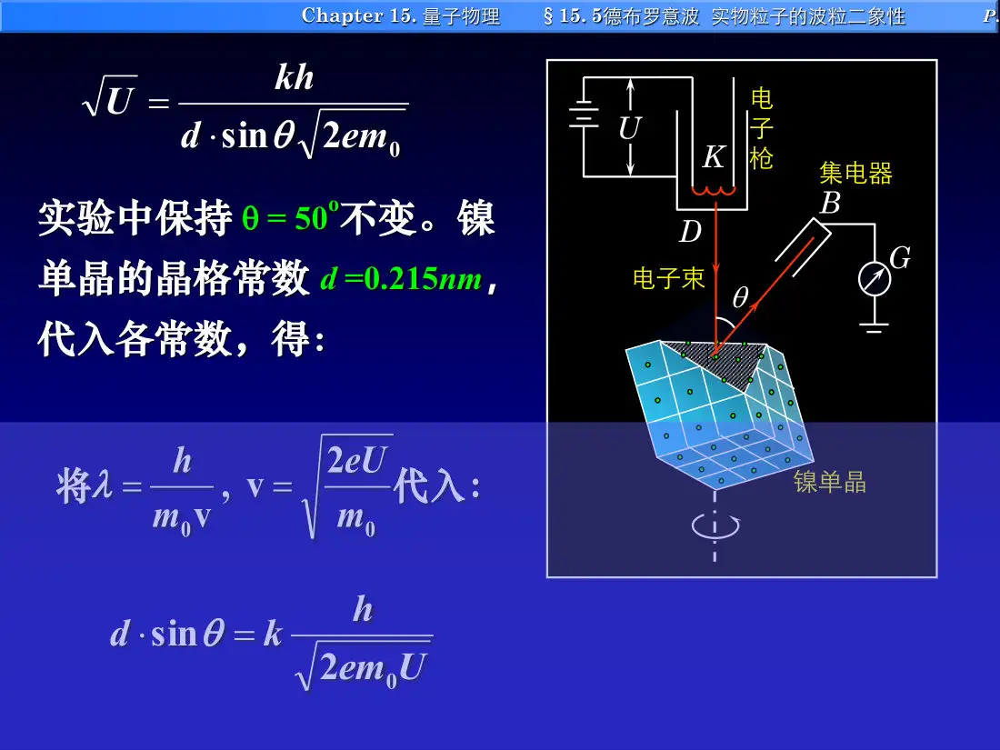

原文：

$$
\sqrt {U} = \frac {k h}{d \cdot \sin \theta \sqrt {2 e m _ {0}}}
$$

实验中保持 $( \bullet ) = ( \bullet ) ( \bullet )$ 不变。镍单晶的晶格常数 $v = 0 . 5 m / s = 0 . 5 m / s = 0 . 5 m / s = 0 . 5 m$ 代入各常数，得：

$$
\text {将} \lambda = \frac {h}{m _ {0} v}, v = \sqrt {\frac {2 e U}{m _ {0}}} \text {代入:}
$$

$$
d \cdot \sin \theta = k \frac {h}{\sqrt {2 e m _ {0} U}}
$$

Chapter 15. 量子物理 §15. 5德布罗意波 实物粒子的波粒二象性

P.

### kh d·sinθ√2em0

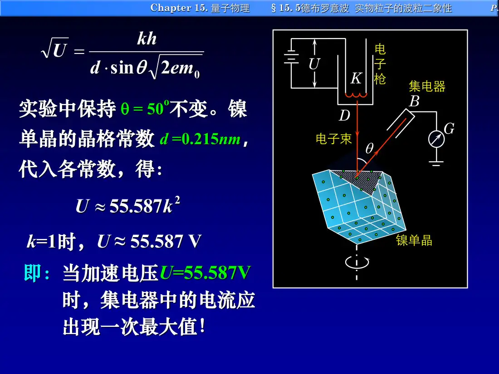

原文：

kh d·sinθ√2em0

实验中保持 $( \sharp ) = \sharp ( \mathbb { I } )$ 不变。镍单晶的晶格常数 $v _ { i } = 0 . 5 m / s \cdot 0 . 5 m / s \cdot 0 . 5 m / s \cdot 0 . 5 m / s \cdot 0 . 5 m / s \cdot 0 . 5 m / s \cdot 0 . 5 m / s \cdot 0 . 5 m / s \cdot 0 . 5 m / s \cdot 0 . 5 m$ 代入各常数，得：

$$
U \approx 5 5. 5 8 7 k ^ {2}
$$

k=1时， $\angle O B E = 1 5 ^ { \circ } - 1 5 ^ { \circ } - 3 ^ { \circ } = 1 5 ^ { \circ }$

即：当加速电压U=55.587V时，集电器中的电流应出现一次最大值！

Chapter 15. 量子物理 §15. 5德布罗意波 实物粒子的波粒二象性

P.

### 实验中发现 U=54 V 时，电流达到最大值!

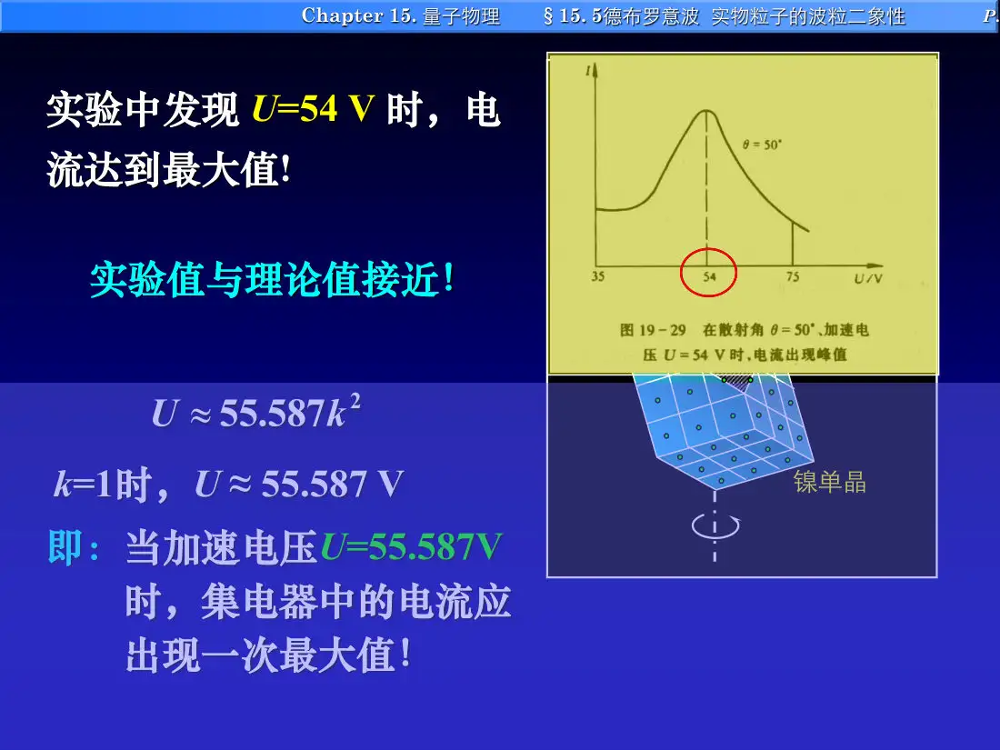

原文：

实验中发现 U=54 V 时，电流达到最大值!

实验值与理论值接近！

U ≈ 55.587k²

k=1时， $\angle D A E = 1 5 ^ { \circ } - 1 5 ^ { \circ } - 1 0 ^ { \circ } - 1 5 ^ { \circ }$

即：当加速电压U=55.587V时，集电器中的电流应出现一次最大值！

Chapter 15. 量子物理 §15. 5德布罗意波 实物粒子的波粒二象性

P.

### Chapter 15. 量子物理 §15. 5德布罗意波 实物粒子的波粒二象性

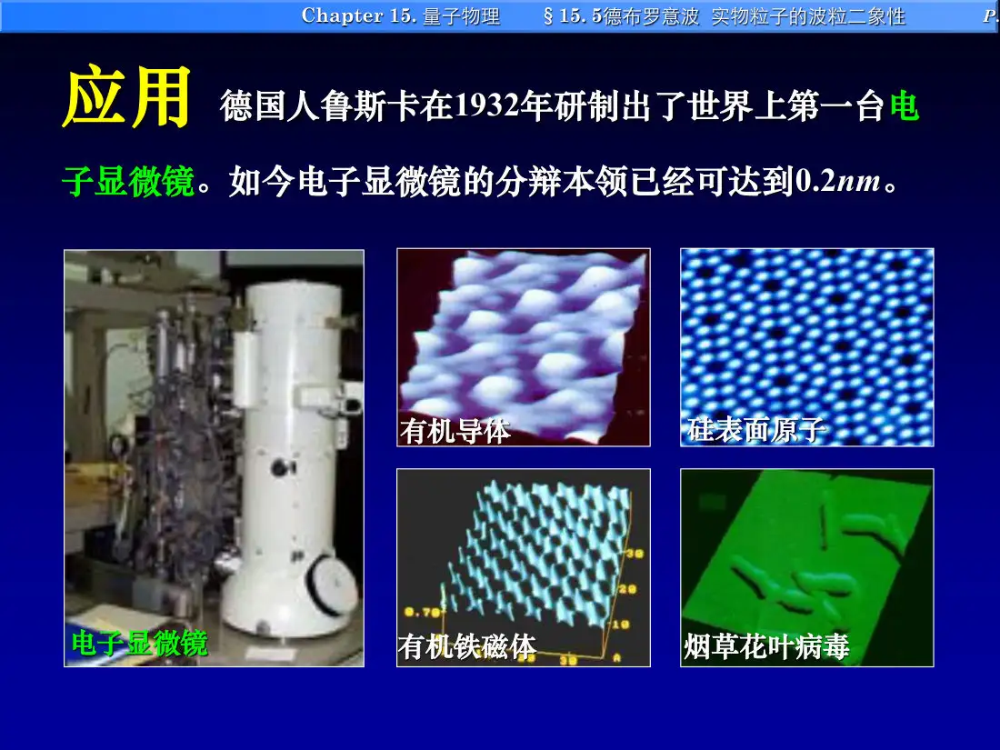

原文：

应用 德国人鲁斯卡在1932年研制出了世界上第一台电子显微镜。如今电子显微镜的分辩本领已经可达到0.2nm。

Chapter 15. 量子物理 §15. 5德布罗意波 实物粒子的波粒二象性

P.

### 波粒二象性

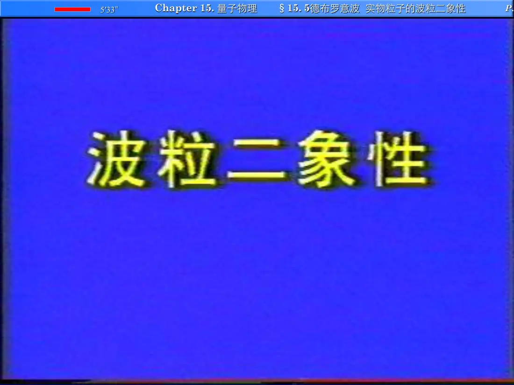

原文：

波粒二象性

Chapter 15. 量子物理 §15. 5德布罗意波 实物粒子的波粒二象性

P.
