# 《大学物理》第15章 量子物理 §15.2 光电效应 康普顿效应（课件）

原件的每一页，下面附识别出的文字。

### 15-2光电效应

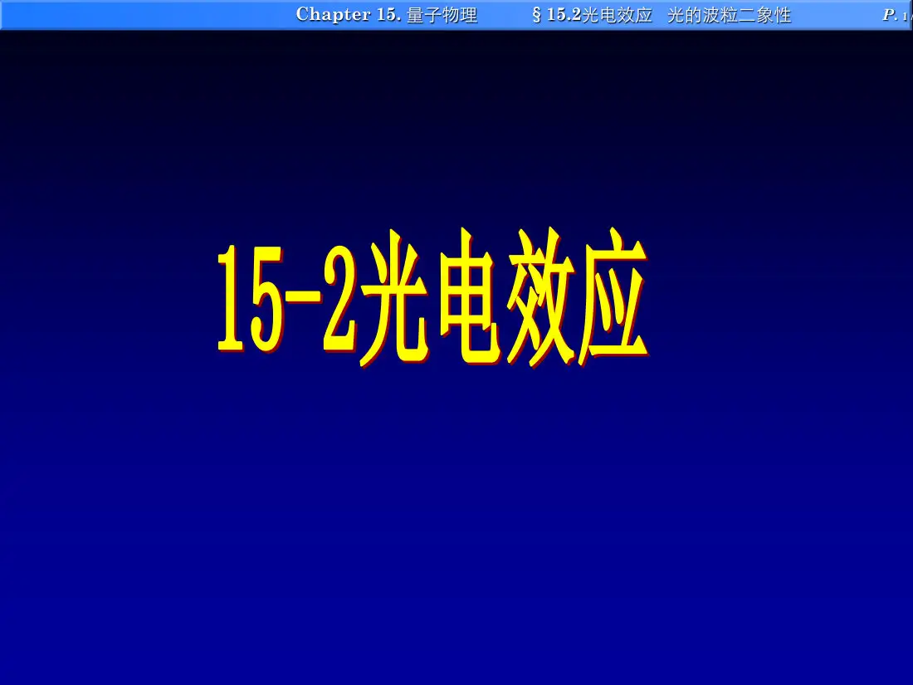

原文：

15-2光电效应

Chapter 15. 量子物理 § 15.2 光电效应 光的波粒二象性

P.1

### Heinrich R. Hertz

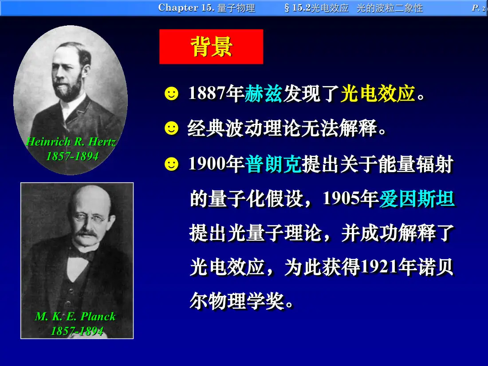

原文：

Heinrich R. Hertz
1857-1894

背景

1887年赫兹发现了光电效应。

经典波动理论无法解释。

1900年普朗克提出关于能量辐射的量子化假设，1905年爱因斯坦提出光量子理论，并成功解释了光电效应，为此获得1921年诺贝尔物理学奖。

Chapter 15. 量子物理

§ 15.2光电效应 光的波粒二象性

P.2

### 什么是光电效应？

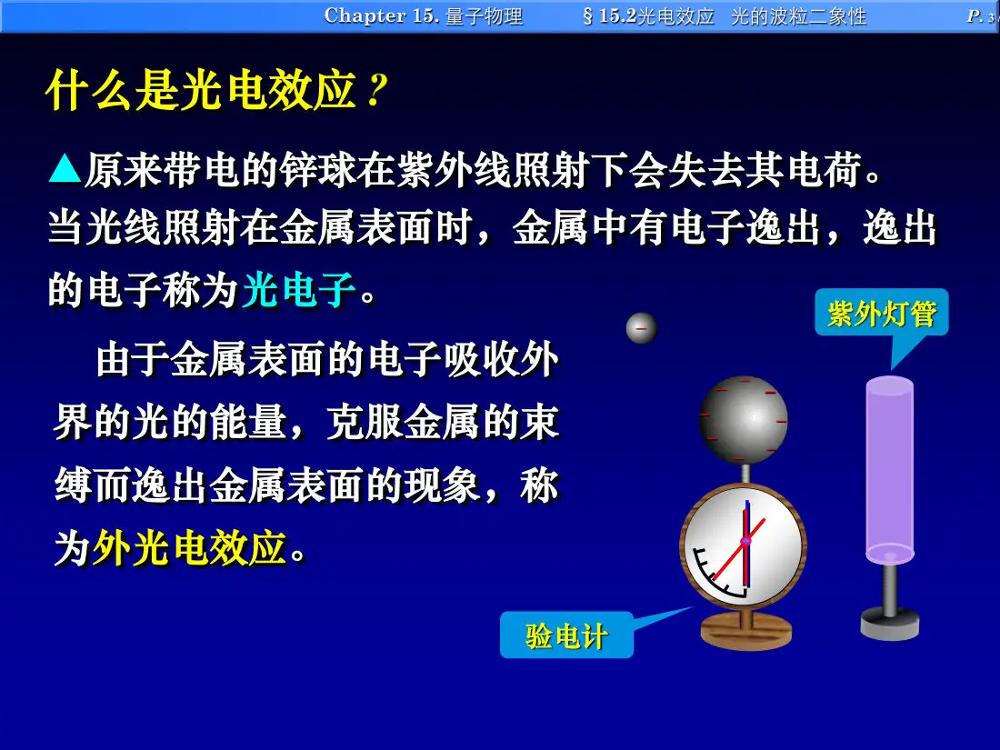

原文：

什么是光电效应？

▲原来带电的锌球在紫外线照射下会失去其电荷。当光线照射在金属表面时，金属中有电子逸出，逸出的电子称为光电子。

由于金属表面的电子吸收外界的光的能量，克服金属的束缚而逸出金属表面的现象，称为外光电效应。

紫外灯管

验电计

Chapter 15. 量子物理 § 15.2光电效应 光的波粒二象性

P. 3

### 内光电效应

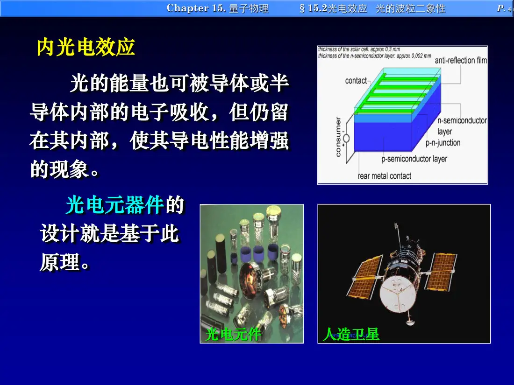

原文：

内光电效应

光的能量也可被导体或半导体内部的电子吸收，但仍留在其内部，使其导电性能增强的现象。

光电元器件的设计就是基于此原理。

Chapter 15. 量子物理

§ 15.2光电效应 光的波粒二象性

P. 4

### 一、光电效应的实验

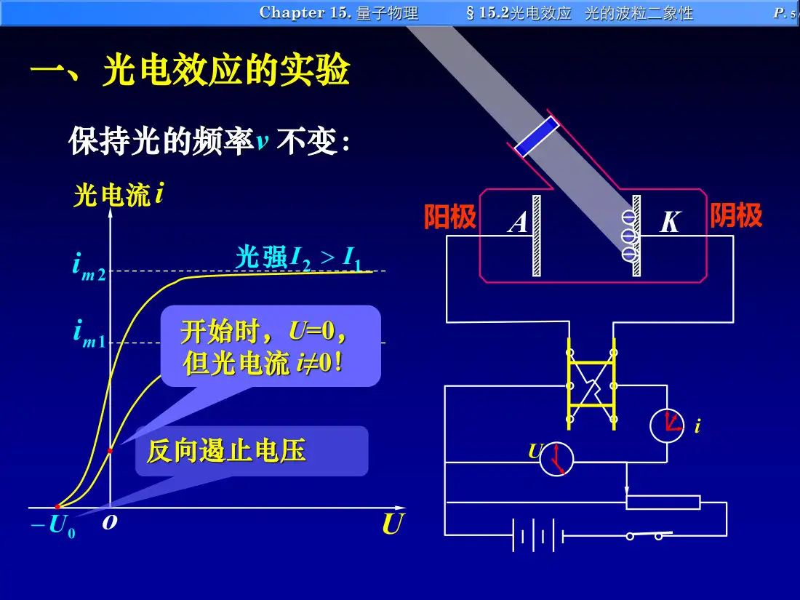

原文：

一、光电效应的实验

保持光的频率ν不变：

光电流i

光强 $I_{2} > I_{1}$

开始时，U=0，
但光电流 $i \neq 0!$

反向遏止电压

Chapter 15. 量子物理

§ 15.2光电效应 光的波粒二象性

P. 5

### 一、光电效应的实验

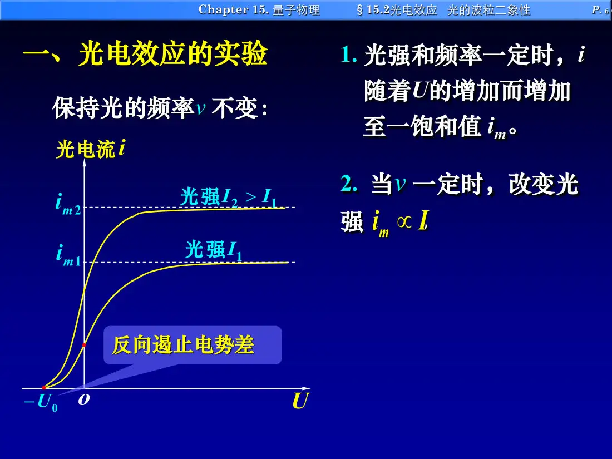

原文：

一、光电效应的实验

保持光的频率v不变:

光电流i

反向遏止电势差

1. 光强和频率一定时，i 随着U的增加而增加至一饱和值 $i_{m}$ 。

2. 当 $\nu$ 一定时, 改变光强 $i_{m} \propto I$

Chapter 15. 量子物理

§ 15.2光电效应 光的波粒二象性

P. 6

### 保持光强 $I$ 不变:

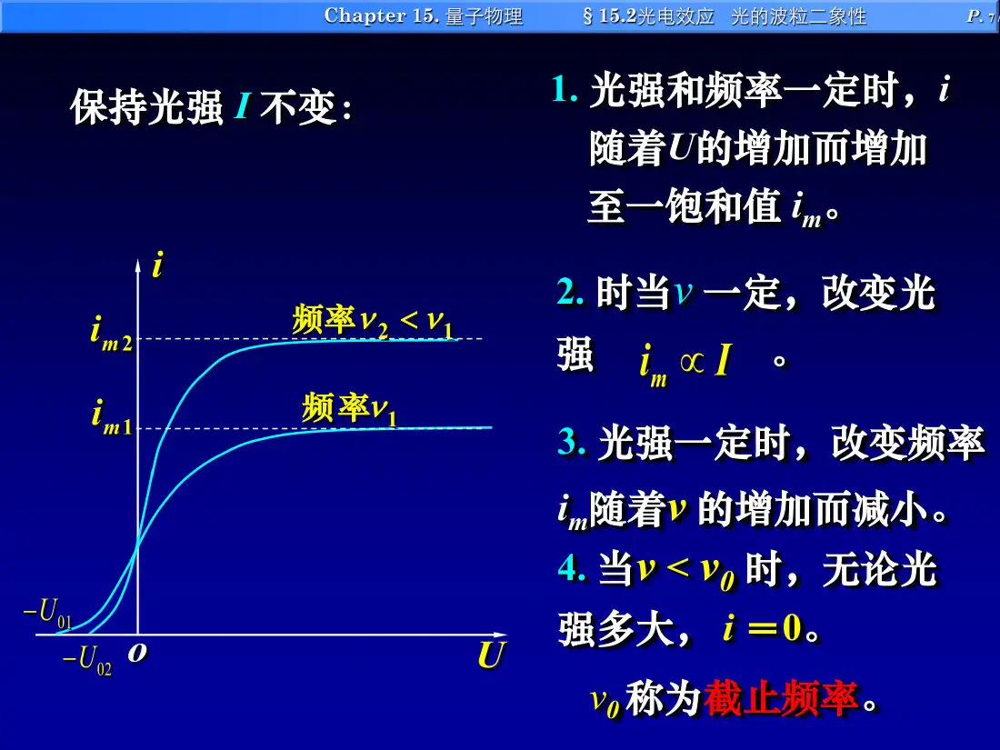

原文：

保持光强 $I$ 不变:

1. 光强和频率一定时，i 随着U的增加而增加至一饱和值 $i_{m}$ 。

2. 时当 $\nu$ 一定, 改变光强 $i_{m} \propto I$ 。

3. 光强一定时，改变频率 $i_m$ 随着 $\nu$ 的增加而减小。
4. 当 $\nu < \nu_0$ 时，无论光强多大，i = 0。

$v_{0}$ 称为截止频率。

Chapter 15. 量子物理

§ 15.2光电效应 光的波粒二象性

P. 7

### 4. 当 $v < v_{0}$ 时，无论光强多大，i = 0。

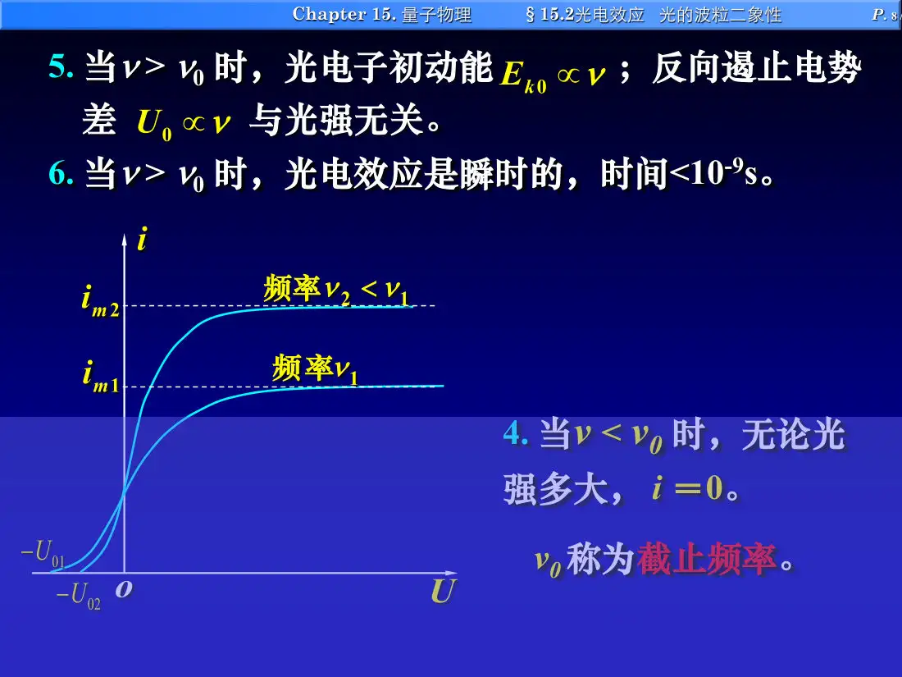

原文：

5. 当 $\nu > \nu_{0}$ 时，光电子初动能 $E_{k0} \propto \nu$ ；反向遏止电势差 $U_{0} \propto \nu$ 与光强无关。

6. 当 $\nu > \nu_{0}$ 时，光电效应是瞬时的，时间 $<10^{-9}s$ 。

4. 当 $v < v_{0}$ 时，无论光强多大，i = 0。

$v_{0}$ 称为截止频率。

Chapter 15. 量子物理 § 15.2 光电效应 光的波粒二象性

P. 8

### 二、经典波动理论的缺憾

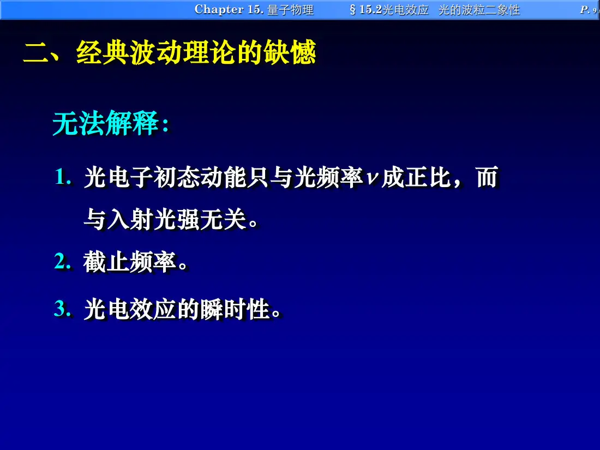

原文：

二、经典波动理论的缺憾

无法解释:

1. 光电子初态动能只与光频率 $\nu$ 成正比, 而与入射光强无关。

2. 截止频率。

3. 光电效应的瞬时性。

Chapter 15. 量子物理

§ 15.2光电效应 光的波粒二象性

P. 9

### 三、光量子(光子)假设 爱因斯坦方程

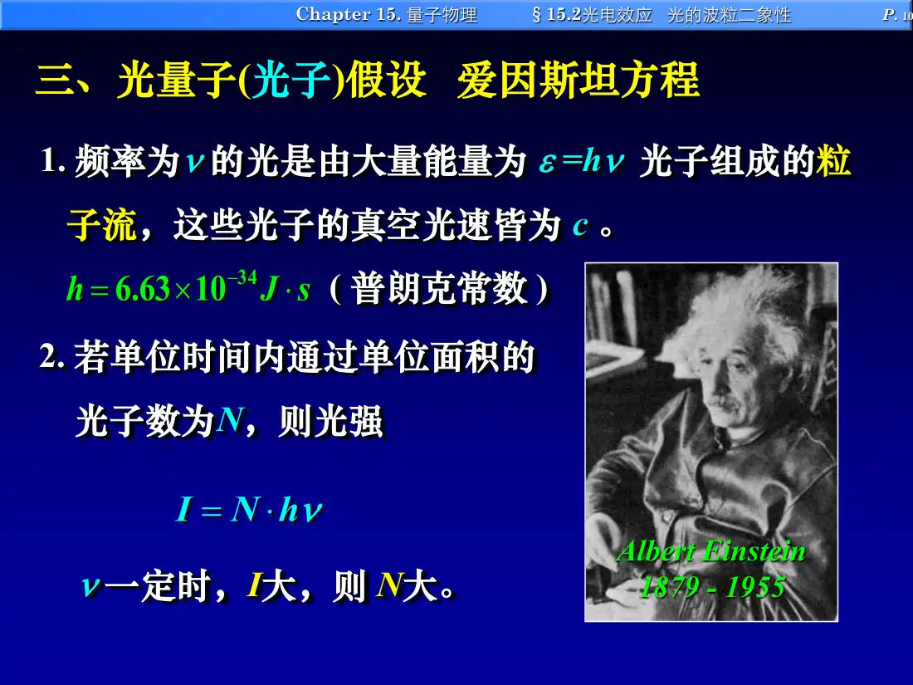

原文：

三、光量子(光子)假设 爱因斯坦方程

1. 频率为 $\nu$ 的光是由大量能量为 $\varepsilon = h\nu$ 光子组成的粒子流，这些光子的真空光速皆为 c 。

$h=6.63\times10^{-34}J\cdot s$ （普朗克常数）

2. 若单位时间内通过单位面积的光子数为 $N$ , 则光强

$I \equiv N \cdot h\nu$

$\nu$ 一定时，I大，则N大。

Chapter 15. 量子物理

§ 15.2光电效应 光的波粒二象性

P. 10

### 爱因斯坦方程

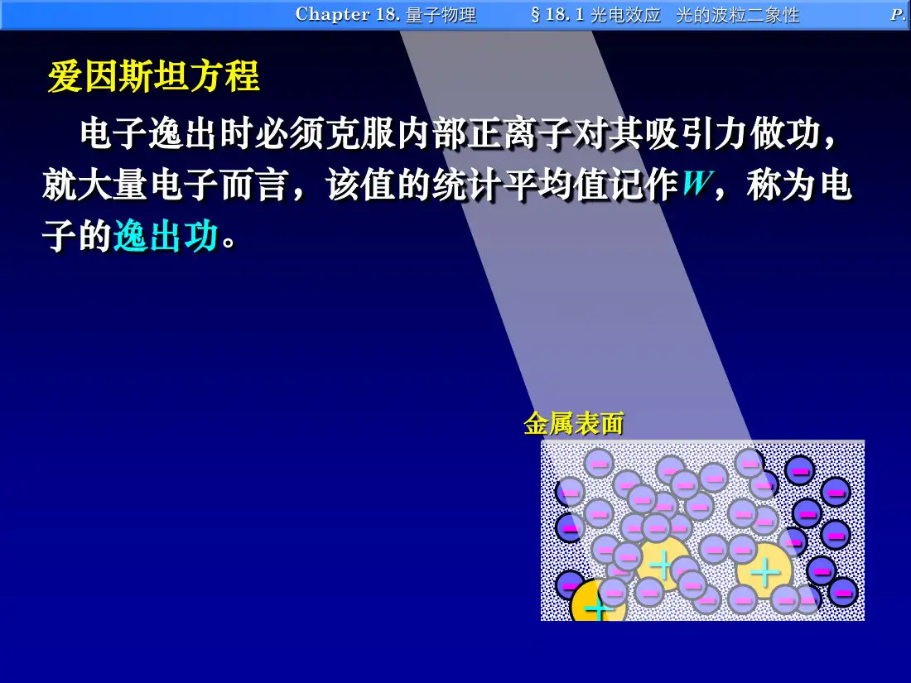

原文：

爱因斯坦方程

电子逸出时必须克服内部正离子对其吸引力做功，就大量电子而言，该值的统计平均值记作W，称为电子的逸出功。

金属表面

Chapter 18. 量子物理

§ 18.1 光电效应 光的波粒二象性

P.

### 爱因斯坦方程

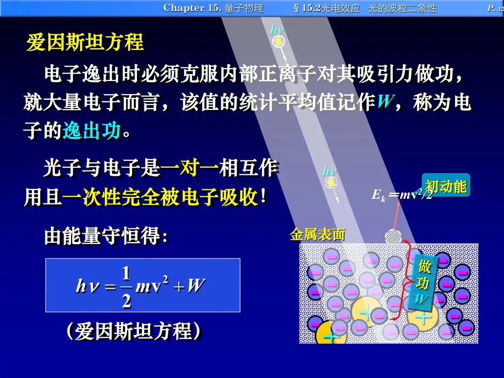

原文：

爱因斯坦方程

电子逸出时必须克服内部正离子对其吸引力做功，就大量电子而言，该值的统计平均值记作W，称为电子的逸出功。

光子与电子是一对一相互作用且一次性完全被电子吸收！

由能量守恒得:

$$
h \nu = \frac {1}{2} m v ^ {2} + W
$$

(爱因斯坦方程)

$E_{k}=mv^{2}/2$ 初动能

金属表面

Chapter 15. 量子物理

§ 15.2光电效应 光的波粒二象性

P. 12

### 解释1：要使光电子能逃逸出金属表面，则必须使：

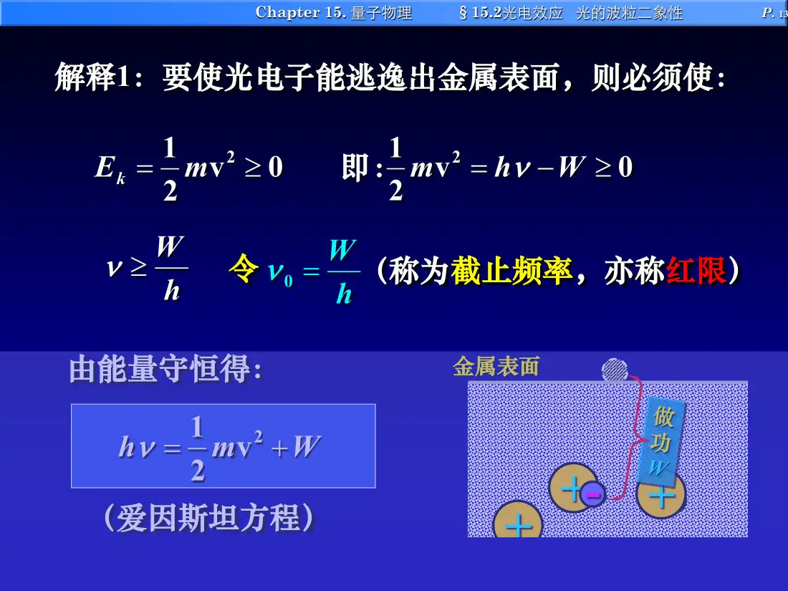

原文：

解释1：要使光电子能逃逸出金属表面，则必须使：

$$
E _ {k} = \frac {1}{2} m v ^ {2} \geq 0
$$

$$
: \frac {1}{2} m v ^ {2} = h \nu - W \geq 0
$$

$v \geq \frac{W}{h}$ 令 $v_{0} = \frac{W}{h}$ （称为截止频率，亦称红限）

由能量守恒得:

$$
h \nu = \frac {1}{2} m v ^ {2} + W
$$

(爱因斯坦方程)

金属表面

Chapter 15. 量子物理

§ 15.2光电效应 光的波粒二象性

P. 13

### 解释1：要使光电子能逃逸出金属表面，则必须使：

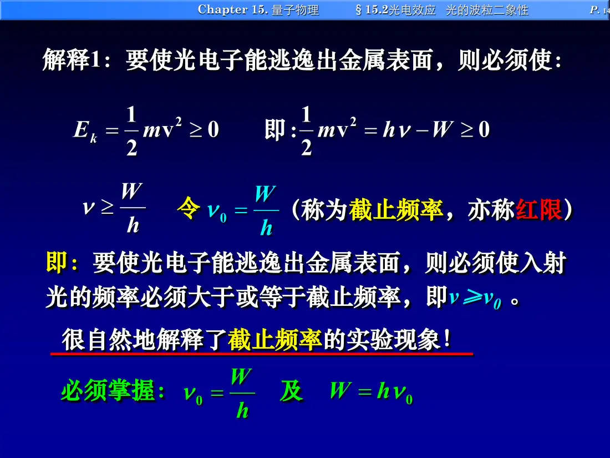

原文：

解释1：要使光电子能逃逸出金属表面，则必须使：

$$
E _ {k} = \frac {1}{2} m \mathrm{v} ^ {2} \geq 0 \quad \text {即:} \frac {1}{2} m \mathrm{v} ^ {2} = h \nu - W \geq 0
$$

$v \geq \frac{W}{h}$ 令 $v_{0} = \frac{W}{h}$ （称为截止频率，亦称红限）

即：要使光电子能逃逸出金属表面，则必须使入射光的频率必须大于或等于截止频率，即 $v \geqslant v_{0}$ 。

很自然地解释了截止频率的实验现象！

必须掌握： $v_{0}=\frac{W}{h}$ 及 $W=hv_{0}$

Chapter 15. 量子物理

§ 15.2光电效应 光的波粒二象性

P. 14

### 例 铂的逸出功为6.3eV，求铂的截止频率 $\nu_{0}$ 。

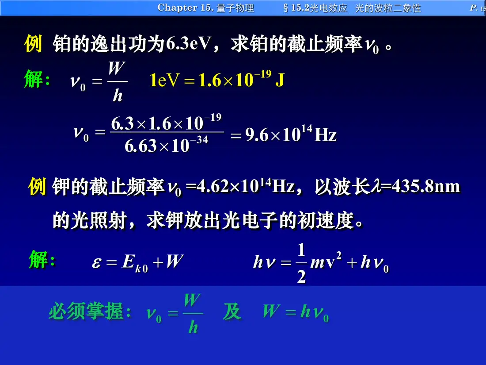

原文：

例 铂的逸出功为6.3eV，求铂的截止频率 $\nu_{0}$ 。

解: $\nu_{0} = \frac{W}{h}$ $1\mathrm{eV} = 1.6\times 10^{-19}\mathrm{J}$

$$
\nu_ {0} = \frac {6 . 3 \times 1 . 6 \times 1 0 ^ {- 1 9}}{6 . 6 3 \times 1 0 ^ {- 3 4}} = 9. 6 \times 1 0 ^ {1 4} \mathrm{Hz}
$$

例 钾的截止频率 $\nu_{0}=4.62\times10^{14}Hz$ ，以波长 $\lambda=435.8nm$ 的光照射，求钾放出光电子的初速度。

解: $\varepsilon = E_{k0} + W$

$$
h \nu = \frac {1}{2} m v ^ {2} + h \nu_ {0}
$$

必须掌握: $v_{0} = \frac{W}{h}$ 及 $W = h v_{0}$

Chapter 15. 量子物理

§ 15.2光电效应 光的波粒二象性

P. 15

### 例 铂的逸出功为6.3eV，求铂的截止频率 $\nu_{0}$ 。

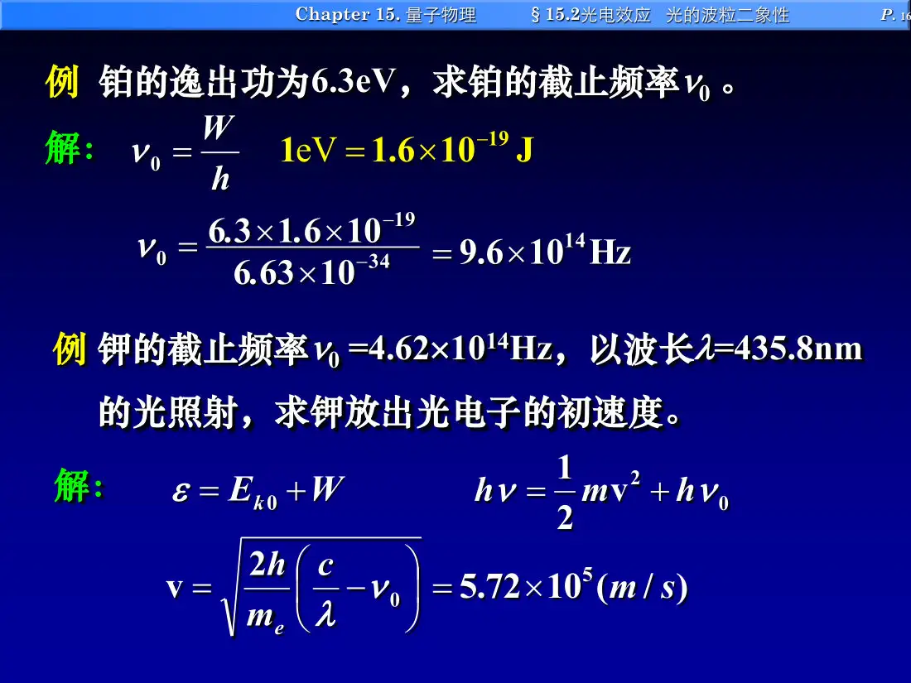

原文：

例 铂的逸出功为6.3eV，求铂的截止频率 $\nu_{0}$ 。

解: $\nu_{0} = \frac{W}{h}$ $1\mathrm{eV} = 1.6\times 10^{-19}\mathrm{J}$

$$
\nu_ {0} = \frac {6 . 3 \times 1 . 6 \times 1 0 ^ {- 1 9}}{6 . 6 3 \times 1 0 ^ {- 3 4}} = 9. 6 \times 1 0 ^ {1 4} \mathrm{Hz}
$$

例 钾的截止频率 $\nu_{0}=4.62\times10^{14}Hz$ ，以波长 $\lambda=435.8nm$ 的光照射，求钾放出光电子的初速度。

解：

$$
\varepsilon = E _ {k 0} + W
$$

$$
h \nu = \frac {1}{2} m v ^ {2} + h \nu_ {0}
$$

$$
\mathbf {v} = \sqrt {\frac {2 h}{m _ {e}} \left(\frac {c}{\lambda} - \nu_ {0}\right)} = 5. 7 2 \times 1 0 ^ {5} (m / s)
$$

Chapter 15. 量子物理

§ 15.2光电效应 光的波粒二象性

P. 16

### Chapter 15. 量子物理

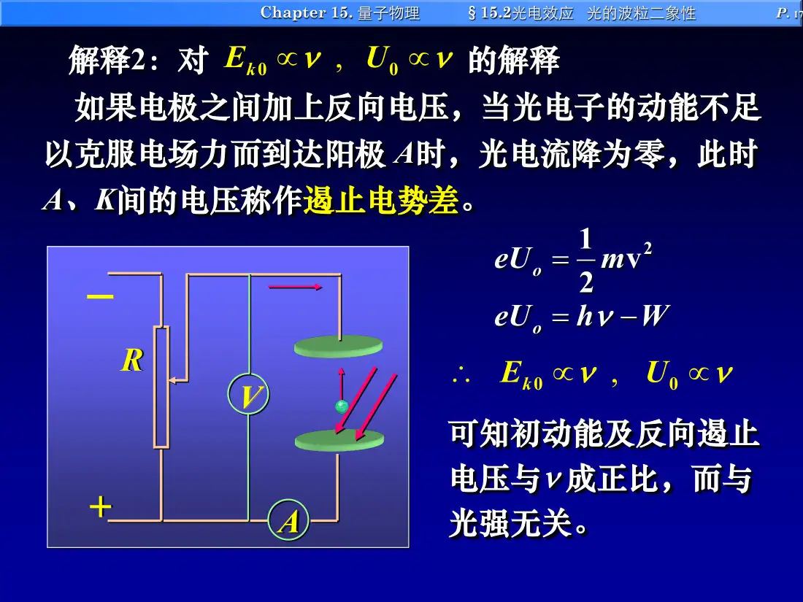

原文：

解释2: 对 $E_{k0} \propto \nu$ , $U_0 \propto \nu$ 的解释 如果电极之间加上反向电压, 当光电子的动能不足以克服电场力而到达阳极 $A$ 时, 光电流降为零, 此时 $A$ 、 $K$ 间的电压称作遏止电势差。

$eU_{o}=\frac{1}{2}mv^{2}$ $eU_{o}=h\nu-W$ $\therefore E_{k0}\propto\nu, U_{0}\propto\nu$ 可知初动能及反向遏止电压与 $\nu$ 成正比，而与光强无关。

Chapter 15. 量子物理

§ 15.2光电效应 光的波粒二象性

P. 17

### 光子理论的有力证据

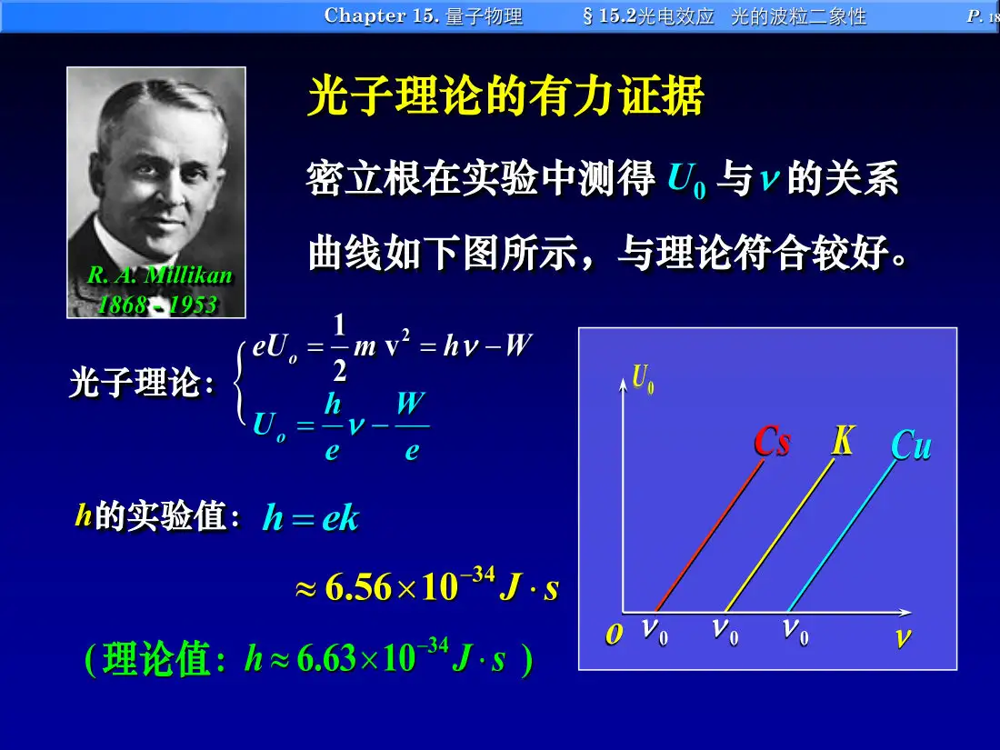

原文：

光子理论的有力证据

密立根在实验中测得 $U_{0}$ 与 $\nu$ 的关系曲线如下图所示，与理论符合较好。

光子理论：

$$
\left\{ \begin{array}{l} e U _ {o} = \frac {1}{2} m v ^ {2} = h \nu - W \\ U _ {o} = \frac {h}{e} \nu - \frac {W}{e} \end{array} \right.
$$

h的实验值: h = ek

$$
\approx 6. 5 6 \times 1 0 ^ {- 3 4} J \cdot s
$$

(理论值: $h \approx 6.63 \times 10^{-34} J \cdot s$ )

Chapter 15. 量子物理

§ 15.2光电效应 光的波粒二象性

P. 18

### 解释3：光电流正比于光强的解释

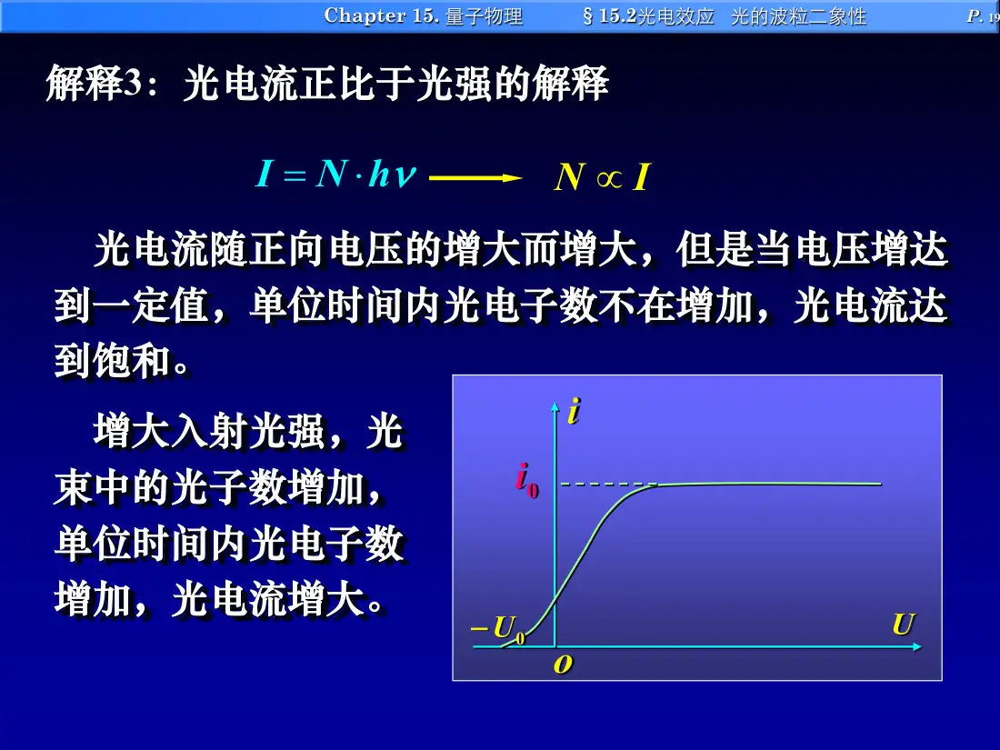

原文：

解释3：光电流正比于光强的解释

$$
I = N \cdot h \nu \longrightarrow N \propto I
$$

光电流随正向电压的增大而增大，但是当电压增达到一定值，单位时间内光电子数不在增加，光电流达到饱和。

增大入射光强，光束中的光子数增加，单位时间内光电子数增加，光电流增大。

Chapter 15. 量子物理 § 15.2 光电效应 光的波粒二象性

P. 19

### 解释4：光电效应瞬时性的解释

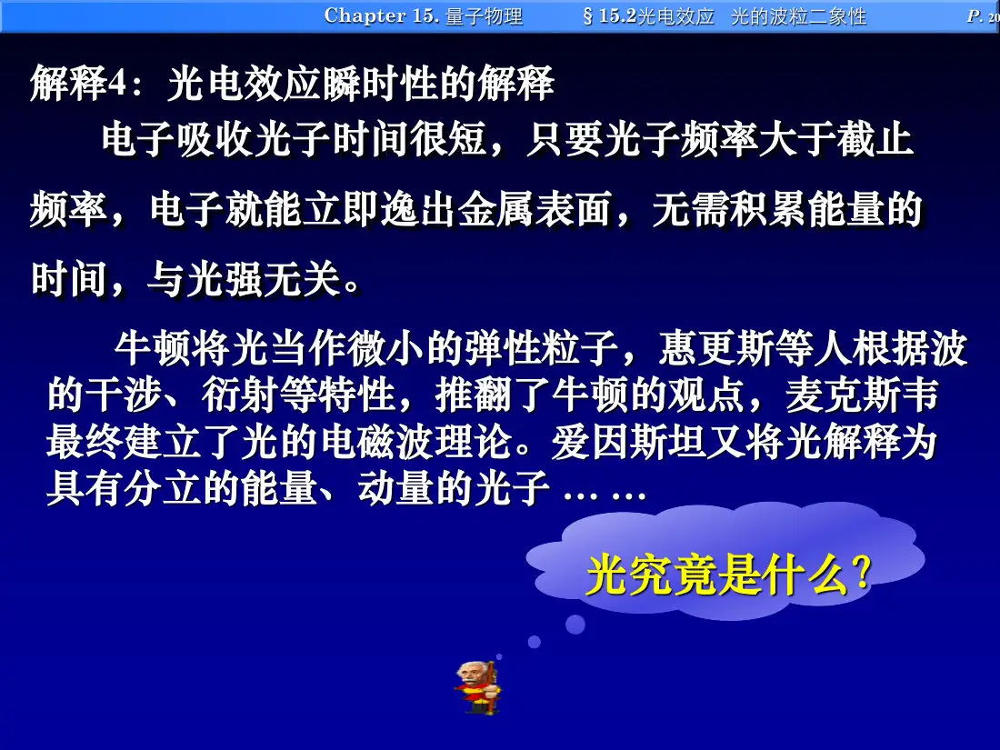

原文：

解释4：光电效应瞬时性的解释
电子吸收光子时间很短，只要光子频率大于截止频率，电子就能立即逸出金属表面，无需积累能量的时间，与光强无关。

牛顿将光当作微小的弹性粒子，惠更斯等人根据波的干涉、衍射等特性，推翻了牛顿的观点，麦克斯韦最终建立了光的电磁波理论。爱因斯坦又将光解释为具有分立的能量、动量的光子……

光究竟是什么？

Chapter 15. 量子物理 § 15.2 光电效应 光的波粒二象性

P. 20

### 四、光的波粒二象性

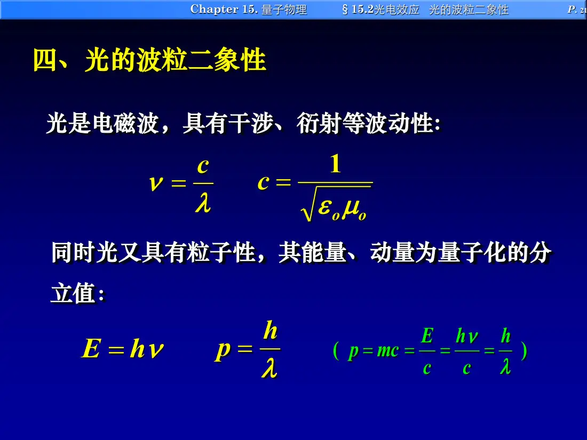

原文：

四、光的波粒二象性

光是电磁波，具有干涉、衍射等波动性：

$$
\nu = \frac {c}{\lambda} \qquad c = \frac {1}{\sqrt {\varepsilon_ {o} \mu_ {o}}}
$$

同时光又具有粒子性，其能量、动量为量子化的分立值：

$$
E = h \nu \qquad p = \frac {h}{\lambda} \qquad (p = m c = \frac {E}{c} = \frac {h \nu}{c} = \frac {h}{\lambda})
$$

Chapter 15. 量子物理 § 15.2光电效应 光的波粒二象性

P. 21

### 光的既具有波动性，又具有粒子性，即波粒二象性。

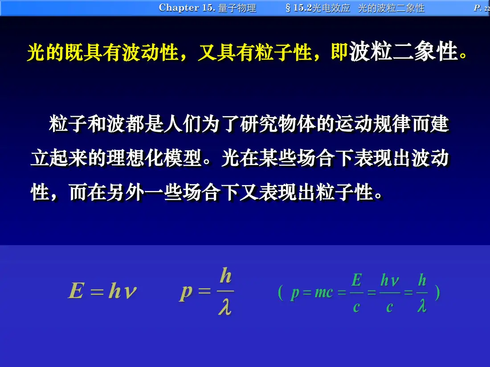

原文：

光的既具有波动性，又具有粒子性，即波粒二象性。

粒子和波都是人们为了研究物体的运动规律而建立起来的理想化模型。光在某些场合下表现出波动性，而在另外一些场合下又表现出粒子性。

$$
E = h \nu \qquad p = \frac {h}{\lambda} \qquad (p = m c = \frac {E}{c} = \frac {h \nu}{c} = \frac {h}{\lambda})
$$

Chapter 15. 量子物理

§ 15.2光电效应 光的波粒二象性

P. 22

### 光的既具有波动性，又具有粒子性，即波粒二象性。

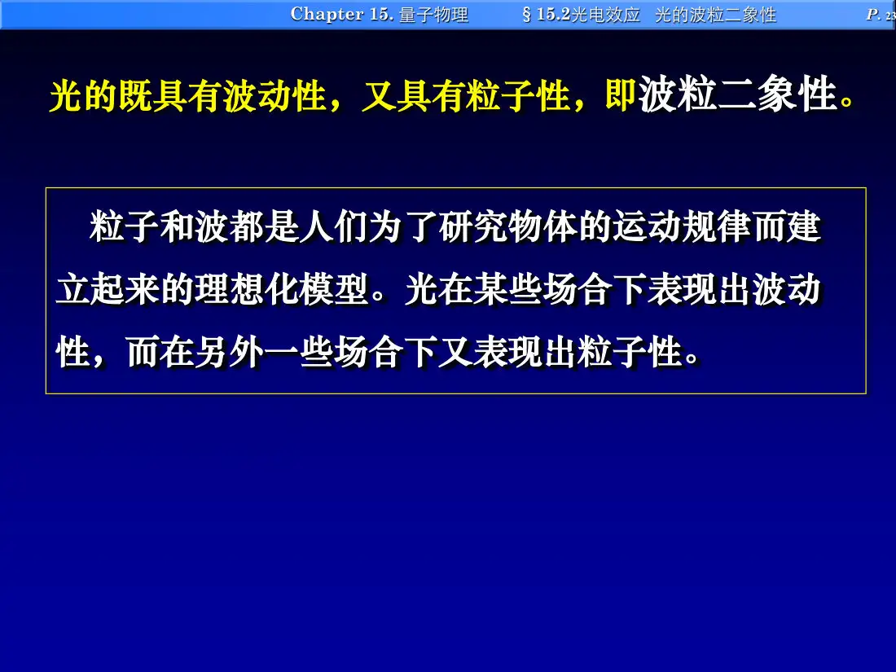

原文：

光的既具有波动性，又具有粒子性，即波粒二象性。

粒子和波都是人们为了研究物体的运动规律而建立起来的理想化模型。光在某些场合下表现出波动性，而在另外一些场合下又表现出粒子性。

Chapter 15. 量子物理

§ 15.2光电效应 光的波粒二象性

P. 23

### 例 求波长为20 nm 紫外线光子的能量、动量及质量。

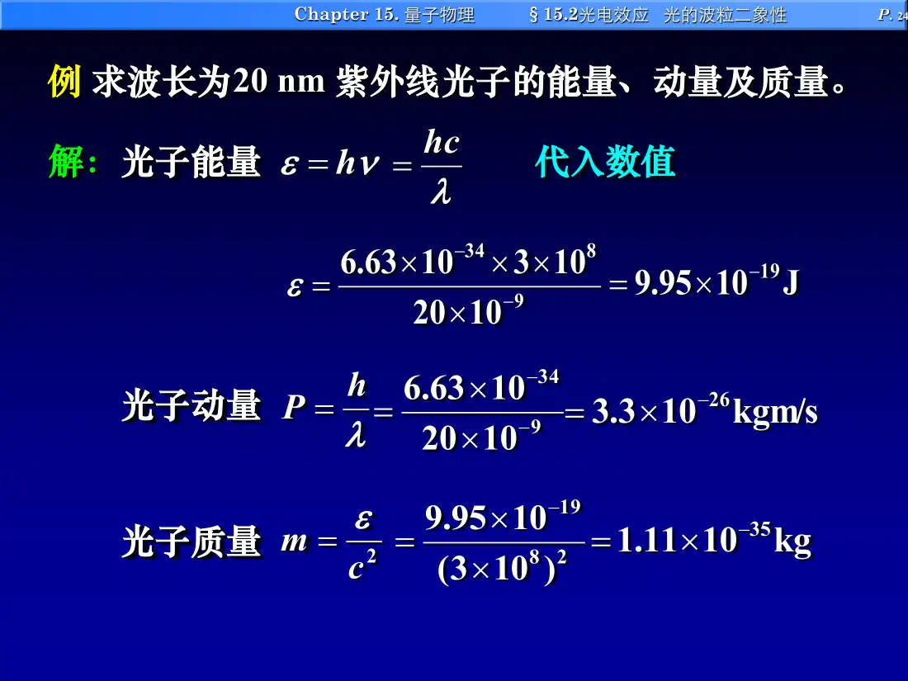

原文：

例 求波长为20 nm 紫外线光子的能量、动量及质量。

解: 光子能量 $\varepsilon = h\nu = \frac{hc}{\lambda}$ 代入数值

$$
\varepsilon = \frac {6 . 6 3 \times 1 0 ^ {- 3 4} \times 3 \times 1 0 ^ {8}}{2 0 \times 1 0 ^ {- 9}} = 9. 9 5 \times 1 0 ^ {- 1 9} \mathrm{J}
$$

光子动量 $P=\frac{h}{\lambda}=\frac{6.63\times10^{-34}}{20\times10^{-9}}=3.3\times10^{-26}$ kgm/s

光子质量 $m = \frac{\varepsilon}{c^2} = \frac{9.95\times 10^{-19}}{(3\times 10^8)^2} = 1.11\times 10^{-35}\mathrm{kg}$

Chapter 15. 量子物理 § 15.2光电效应 光的波粒二象性

P. 24

### § 15.3 康普顿效应

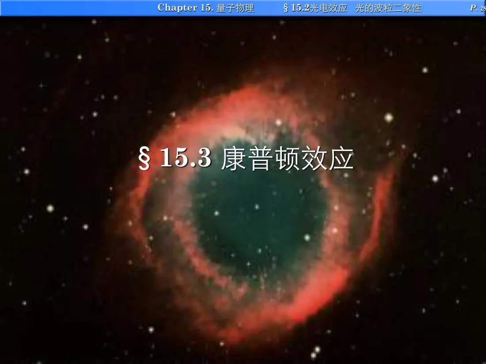

原文：

§ 15.3 康普顿效应

Chapter 15. 量子物理 § 15.2光电效应 光的波粒二象性

P. 25

### 康普顿效应

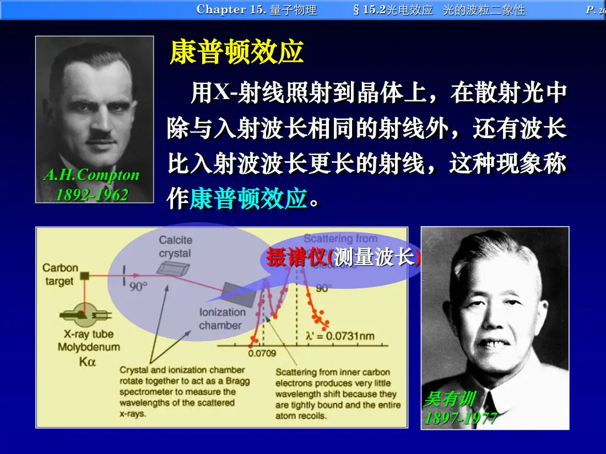

原文：

康普顿效应

用X-射线照射到晶体上，在散射光中除与入射波长相同的射线外，还有波长比入射波波长更长的射线，这种现象称作康普顿效应。

摄谱仪(测量波长)

Crystal and ionization chamber rotate together to act as a Bragg spectrometer to measure the wavelengths of the scattered x-rays.

Scattering from inner carbon electrons produces very little wavelength shift because they are tightly bound and the entire atom recoils.

Chapter 15. 量子物理

§ 15.2光电效应 光的波粒二象性

P. 26

### 康普顿散射实验装置及实验结果

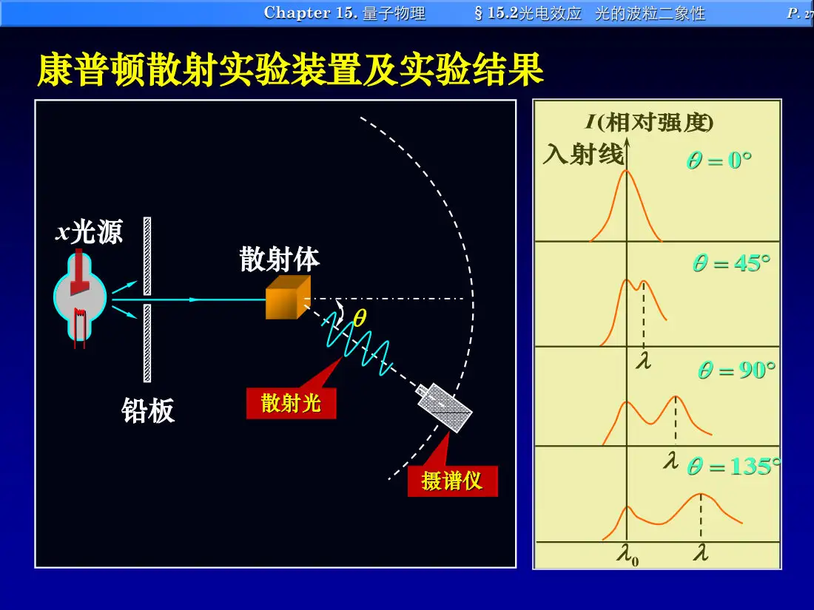

原文：

康普顿散射实验装置及实验结果

x光源

散射体

铅板

散射光

摄谱仪

入射线

Chapter 15. 量子物理

§ 15.2光电效应 光的波粒二象性

P. 27

### 一、经典电磁波理论面临的问题

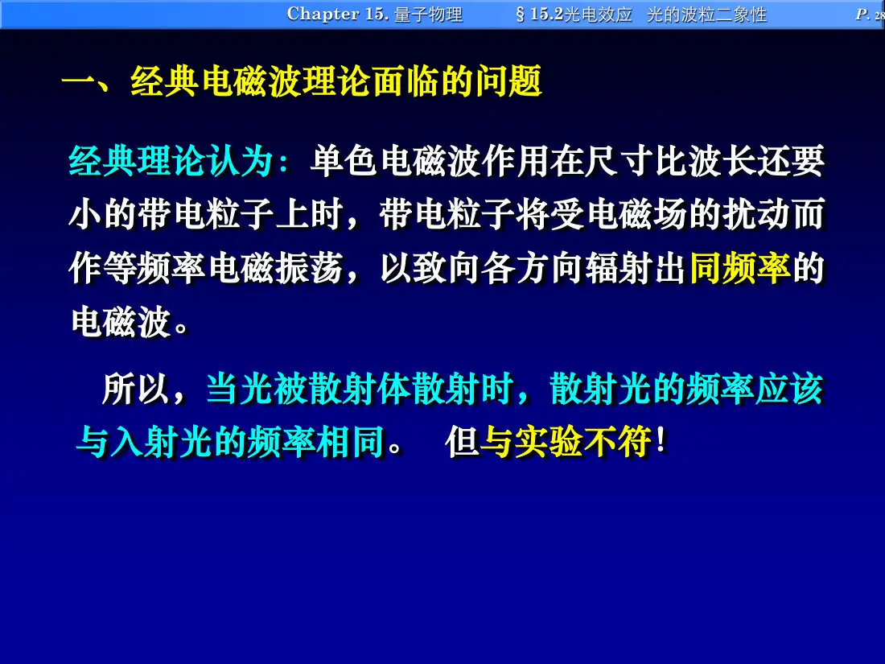

原文：

一、经典电磁波理论面临的问题

经典理论认为：单色电磁波作用在尺寸比波长还要小的带电粒子上时，带电粒子将受电磁场的扰动而作等频率电磁振荡，以致向各方向辐射出同频率的电磁波。

所以，当光被散射体散射时，散射光的频率应该与入射光的频率相同。但与实验不符！

Chapter 15. 量子物理 § 15.2 光电效应 光的波粒二象性

P. 28

### 二、光量子理论的解释

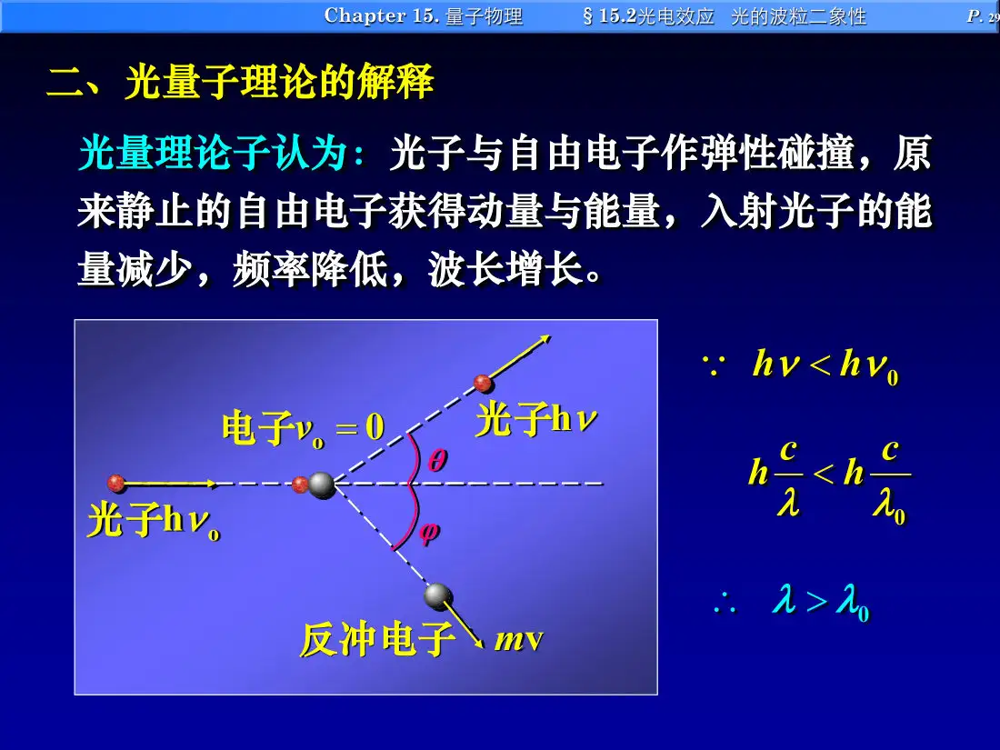

原文：

二、光量子理论的解释

光量理论子认为：光子与自由电子作弹性碰撞，原来静止的自由电子获得动量与能量，入射光子的能量减少，频率降低，波长增长。

$$
\because h \nu <   h \nu_ {0}
$$

电子 $v_{0}=0$

光子hν

光子hν $_{o}$

$$
h \frac {c}{\lambda} <   h \frac {c}{\lambda_ {0}}
$$

反冲电子 \ mv

$$
\therefore \quad \lambda > \lambda_ {0}
$$

Chapter 15. 量子物理

§ 15.2光电效应 光的波粒二象性

P. 29

### $$

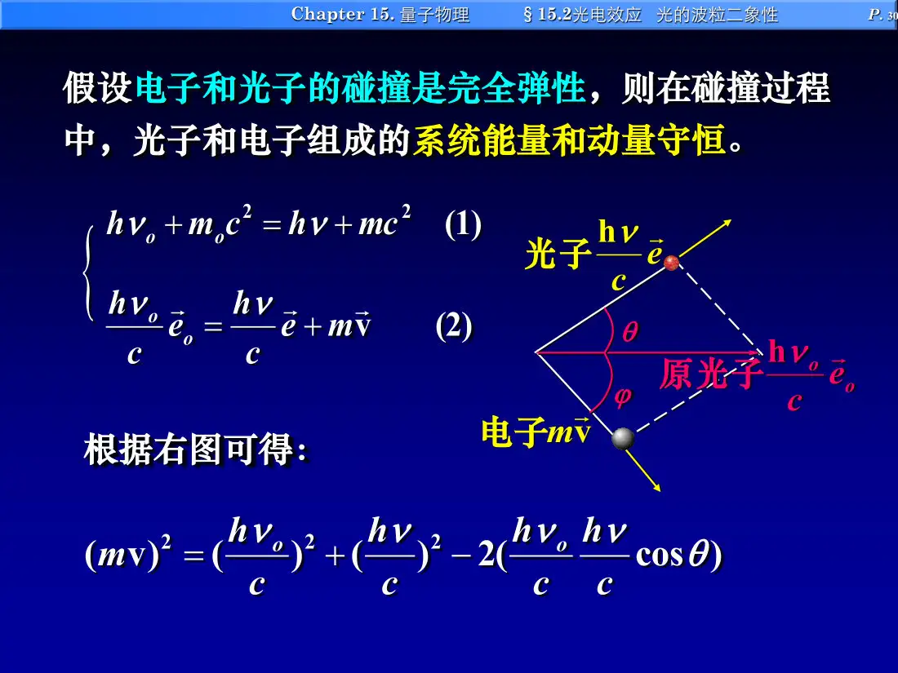

原文：

假设电子和光子的碰撞是完全弹性，则在碰撞过程中，光子和电子组成的系统能量和动量守恒。

$$
\left\{ \begin{array}{l} h \nu_ {o} + m _ {o} c ^ {2} = h \nu + m c ^ {2} \\ \frac {h \nu_ {o}}{c} \vec {e} _ {o} = \frac {h \nu}{c} \vec {e} + m \vec {\mathrm{v}} \end{array} \right.\tag{1}
$$

(2)

根据右图可得:

电子m$\vec{v}$原光子 $\frac{\mathrm{h}\nu_{o}}{c}\vec{e}_{o}$

$$
(m v) ^ {2} = (\frac {h \nu_ {o}}{c}) ^ {2} + (\frac {h \nu}{c}) ^ {2} - 2 (\frac {h \nu_ {o}}{c} \frac {h \nu}{c} \cos \theta)
$$

Chapter 15. 量子物理

§ 15.2光电效应 光的波粒二象性

P. 30

### $$

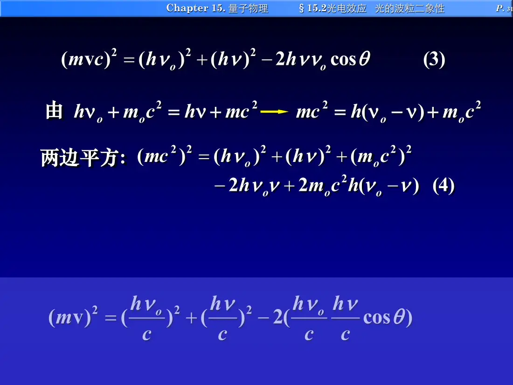

原文：

$$
(m v c) ^ {2} = (h \nu_ {o}) ^ {2} + (h \nu) ^ {2} - 2 h \nu \nu_ {o} \cos \theta\tag{3}
$$

$$
h v _ {o} + m _ {o} c ^ {2} = h v + m c ^ {2} \longrightarrow m c ^ {2} = h (v _ {o} - v) + m _ {o} c ^ {2}
$$

两边平方: $(mc^{2})^{2} = (h\nu_{o})^{2} + (h\nu)^{2} + (m_{o}c^{2})^{2}$ $-2h\nu_{o}\nu + 2m_{o}c^{2}h(\nu_{o} - \nu)$ (4)

$$
(m v) ^ {2} = \left(\frac {h v _ {o}}{c}\right) ^ {2} + \left(\frac {h v}{c}\right) ^ {2} - 2 \left(\frac {h v _ {o}}{c} \frac {h v}{c} \cos \theta\right)
$$

Chapter 15. 量子物理

§ 15.2光电效应 光的波粒二象性

P. 31

### $$

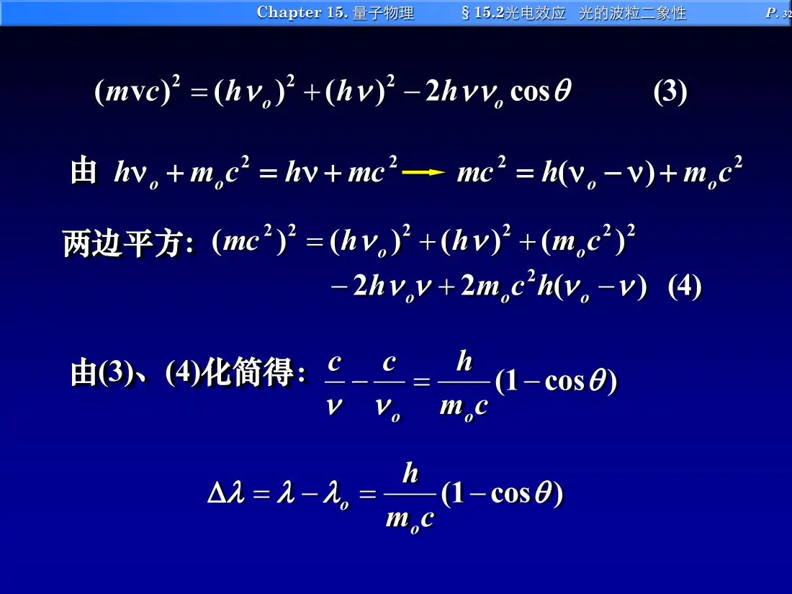

原文：

$$
(m \mathrm{vc}) ^ {2} = (h \nu_ {o}) ^ {2} + (h \nu) ^ {2} - 2 h \nu \nu_ {o} \cos \theta\tag{3}
$$

$$
h v _ {o} + m _ {o} c ^ {2} = h v + m c ^ {2} \longrightarrow m c ^ {2} = h (v _ {o} - v) + m _ {o} c ^ {2}
$$

两边平方： $(mc^{2})^{2}=(h\nu_{o})^{2}+(h\nu)^{2}+(m_{o}c^{2})^{2}$ $-2h\nu_{o}\nu+2m_{o}c^{2}h(\nu_{o}-\nu)$ (4)

由(3)、(4)化简得: $\frac{c}{\nu} - \frac{c}{\nu_o} = \frac{h}{m_o c} (1 - \cos \theta)$

$$
\Delta \lambda = \lambda - \lambda_ {o} = \frac {h}{m _ {o} c} (1 - \cos \theta)
$$

Chapter 15. 量子物理

§ 15.2光电效应 光的波粒二象性

P. 32

### $$

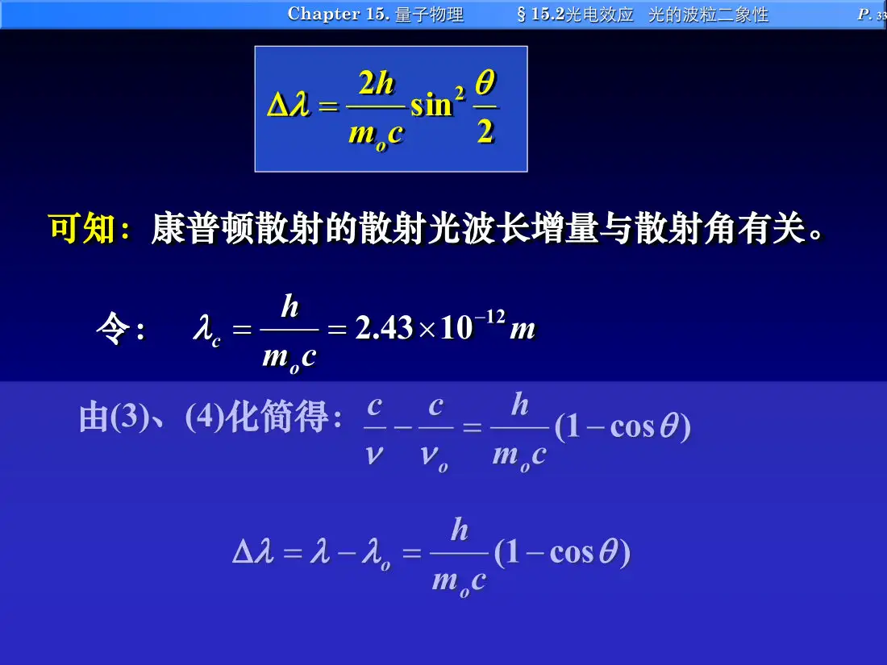

原文：

$$
\Delta \lambda = \frac {2 h}{m _ {o} c} \sin^ {2} \frac {\theta}{2}
$$

可知：康普顿散射的散射光波长增量与散射角有关。

令： $\lambda_{c} = \frac{h}{m_{o}c} = 2.43\times 10^{-12}m$

由(3)、(4)化简得: $\frac{c}{v} - \frac{c}{v_o} = \frac{h}{m_o c} (1 - \cos \theta)$

$$
\Delta \lambda = \lambda - \lambda_ {o} = \frac {h}{m _ {o} c} (1 - \cos \theta)
$$

Chapter 15. 量子物理

§ 15.2光电效应 光的波粒二象性

P. 33

### $$

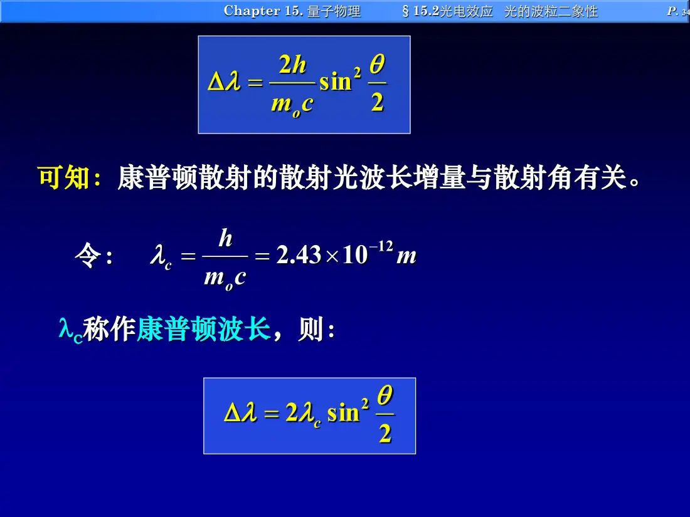

原文：

$$
\Delta \lambda = \frac {2 h}{m _ {o} c} \sin^ {2} \frac {\theta}{2}
$$

可知：康普顿散射的散射光波长增量与散射角有关。

令： $\lambda_{c} = \frac{h}{m_{o}c} = 2.43\times 10^{-12}m$

$\lambda_{c}$ 称作康普顿波长，则：

$$
\Delta \lambda = 2 \lambda_ {c} \sin^ {2} \frac {\theta}{2}
$$

Chapter 15. 量子物理

§ 15.2光电效应 光的波粒二象性

P. 34

### 明确几点

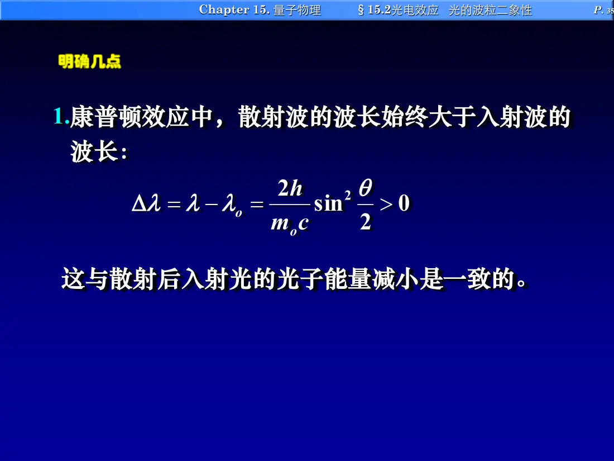

原文：

明确几点

1.康普顿效应中, 散射波的波长始终大于入射波的波长:

$$
\Delta \lambda = \lambda - \lambda_ {o} = \frac {2 h}{m _ {o} c} \sin^ {2} \frac {\theta}{2} > 0
$$

这与散射后入射光的光子能量减小是一致的。

Chapter 15. 量子物理 § 15.2 光电效应 光的波粒二象性

P. 35

### 散射体

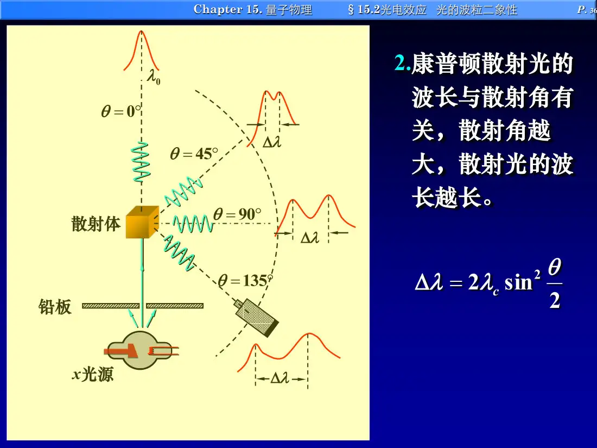

原文：

散射体

铅板

2.康普顿散射光的波长与散射角有关，散射角越大，散射光的波长越长。

$$
\Delta \lambda = 2 \lambda_ {c} \sin^ {2} \frac {\theta}{2}
$$

Chapter 15. 量子物理 § 15.2光电效应 光的波粒二象性

P. 36

### 3.康普顿散射光波长增长与散射物质无关。

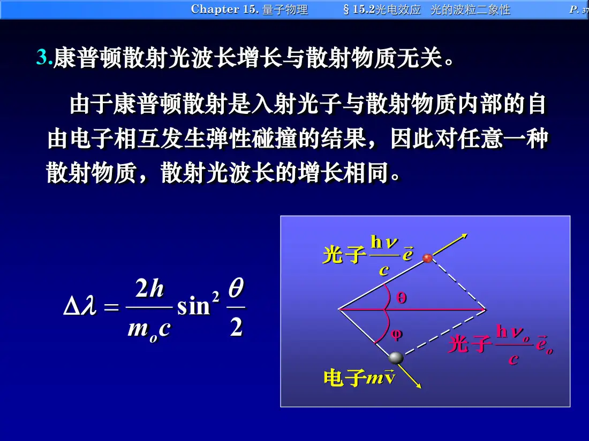

原文：

3.康普顿散射光波长增长与散射物质无关。

由于康普顿散射是入射光子与散射物质内部的自由电子相互发生弹性碰撞的结果，因此对任意一种散射物质，散射光波长的增长相同。

$$
\Delta \lambda = \frac {2 h}{m _ {o} c} \sin^ {2} \frac {\theta}{2}
$$

Chapter 15. 量子物理

§ 15.2光电效应 光的波粒二象性

P. 37

### $m_{o} \ll M$ (原子质量)

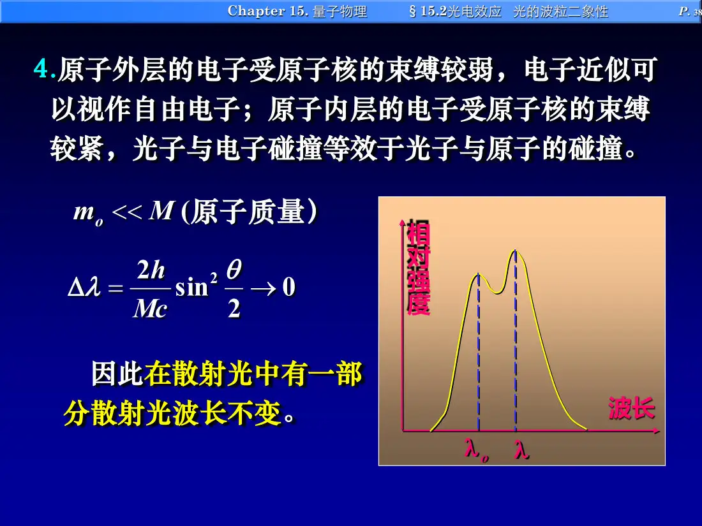

原文：

4. 原子外层的电子受原子核的束缚较弱，电子近似可以视作自由电子；原子内层的电子受原子核的束缚较紧，光子与电子碰撞等效于光子与原子的碰撞。

$m_{o} \ll M$ (原子质量)

$$
\Delta \lambda = \frac {2 h}{M c} \sin^ {2} \frac {\theta}{2} \rightarrow 0
$$

因此在散射光中有一部分散射光波长不变。

Chapter 15. 量子物理

§ 15.2光电效应 光的波粒二象性

P. 38

### Chapter 15. 量子物理

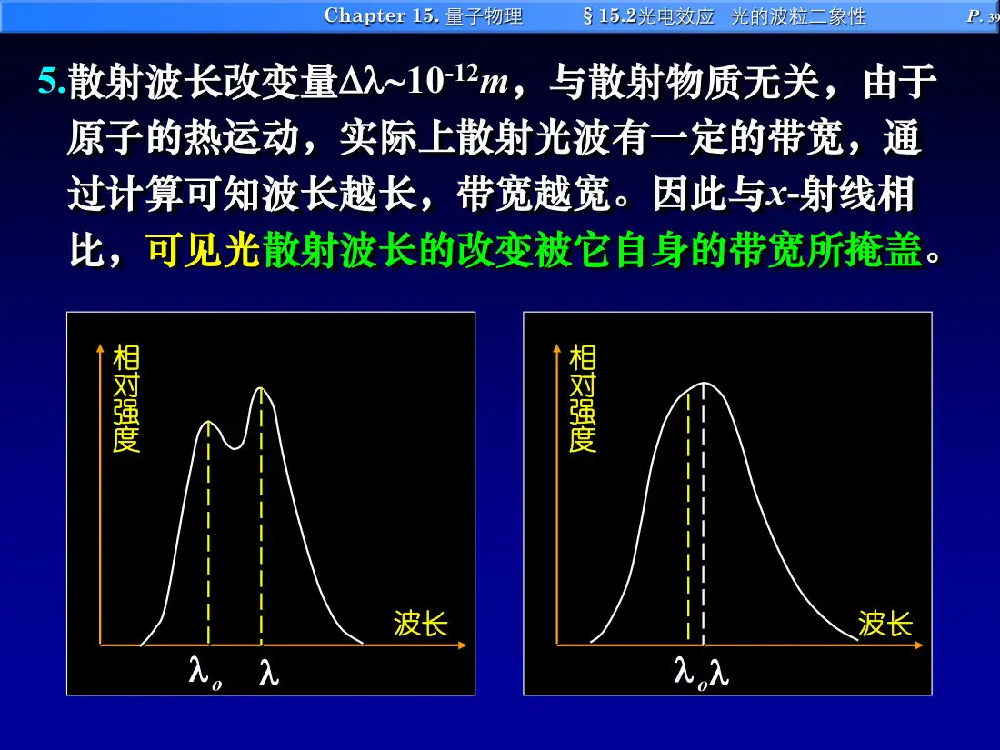

原文：

5.散射波长改变量 $\Delta \lambda \sim 10^{-12} m$ ，与散射物质无关，由于原子的热运动，实际上散射光波有一定的带宽，通过计算可知波长越长，带宽越宽。因此与x-射线相比，可见光散射波长的改变被它自身的带宽所掩盖。

Chapter 15. 量子物理

§ 15.2光电效应 光的波粒二象性

P. 39

### $$

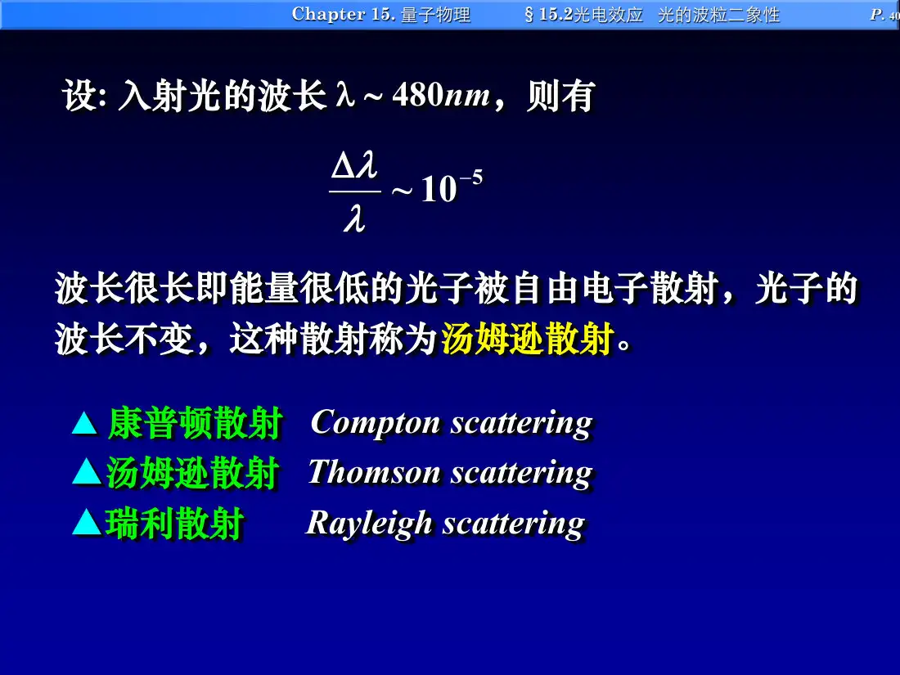

原文：

设: 入射光的波长 $\lambda \sim 480 \mathrm{~nm}$ , 则有

$$
\frac {\Delta \lambda}{\lambda} \sim 1 0 ^ {- 5}
$$

波长很长即能量很低的光子被自由电子散射，光子的波长不变，这种散射称为汤姆逊散射。

▲康普顿散射 Compton scattering

▲汤姆逊散射 Thomson scattering

▲瑞利散射 Rayleigh scattering例 设有波长 $\lambda_{0}=1.00\times10^{-10}m$ 的 $x$ -射线的光子与自由电子作弹性碰撞，散射 $x$ -射线的散射角 $\theta=90^{\circ}$ ，求:

Chapter 15. 量子物理 § 15.2光电效应 光的波粒二象性

P. 40

### (3) 碰撞中光子能量的损失。

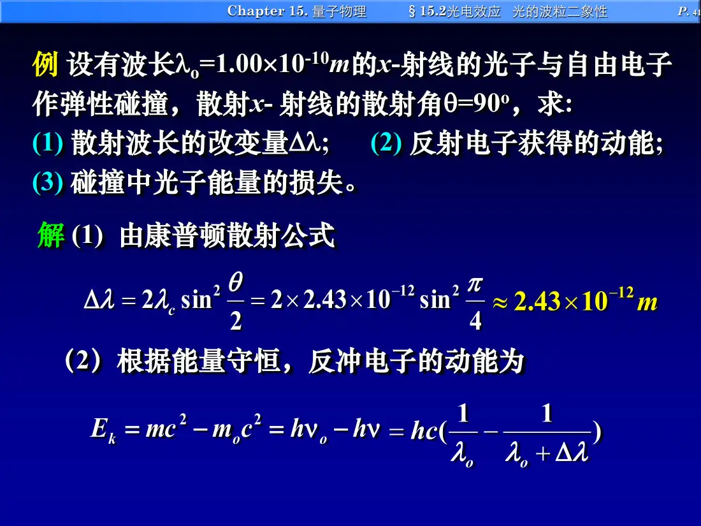

原文：

(1) 散射波长的改变量 $\Delta \lambda$ ; (2) 反射电子获得的动能;

(3) 碰撞中光子能量的损失。

解 (1) 由康普顿散射公式

$$
\Delta \lambda = 2 \lambda_ {c} \sin^ {2} \frac {\theta}{2} = 2 \times 2. 4 3 \times 1 0 ^ {- 1 2} \sin^ {2} \frac {\pi}{4} \approx 2. 4 3 \times 1 0 ^ {- 1 2} m
$$

(2) 根据能量守恒, 反冲电子的动能为

$$
E _ {k} = m c ^ {2} - m _ {o} c ^ {2} = h \nu_ {o} - h \nu = h c (\frac {1}{\lambda_ {o}} - \frac {1}{\lambda_ {o} + \Delta \lambda})
$$

Chapter 15. 量子物理

§ 15.2光电效应 光的波粒二象性

P. 41

### 由于 $\Delta\lambda<<\lambda_{o}$ ，则

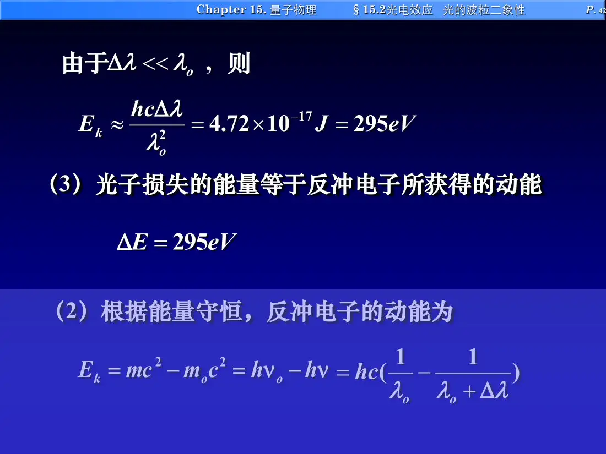

原文：

由于 $\Delta\lambda<<\lambda_{o}$ ，则

$$
E _ {k} \approx \frac {h c \Delta \lambda}{\lambda_ {o} ^ {2}} = 4. 7 2 \times 1 0 ^ {- 1 7} J = 2 9 5 e V
$$

(3) 光子损失的能量等于反冲电子所获得的动能

$\Delta E = 295eV$

(2) 根据能量守恒, 反冲电子的动能为

$$
E _ {k} = m c ^ {2} - m _ {o} c ^ {2} = h v _ {o} - h v = h c \left(\frac {1}{\lambda_ {o}} - \frac {1}{\lambda_ {o} + \Delta \lambda}\right)
$$

Chapter 15. 量子物理 § 15.2 光电效应 光的波粒二象性

P. 42

### Chapter 15. 量子物理

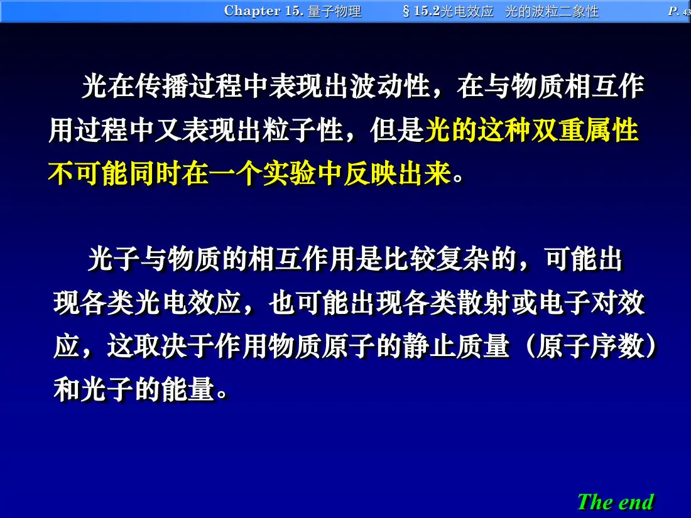

原文：

光在传播过程中表现出波动性，在与物质相互作用过程中又表现出粒子性，但是光的这种双重属性不可能同时在一个实验中反映出来。

光子与物质的相互作用是比较复杂的，可能出现各类光电效应，也可能出现各类散射或电子对效应，这取决于作用物质原子的静止质量（原子序数）和光子的能量。

Chapter 15. 量子物理

§ 15.2光电效应 光的波粒二象性

P. 43

The end
