# 《大学物理》第15章 量子物理 §15.7 不确定关系（课件）

原件的每一页，下面附识别出的文字。

### 15-7不确定关系

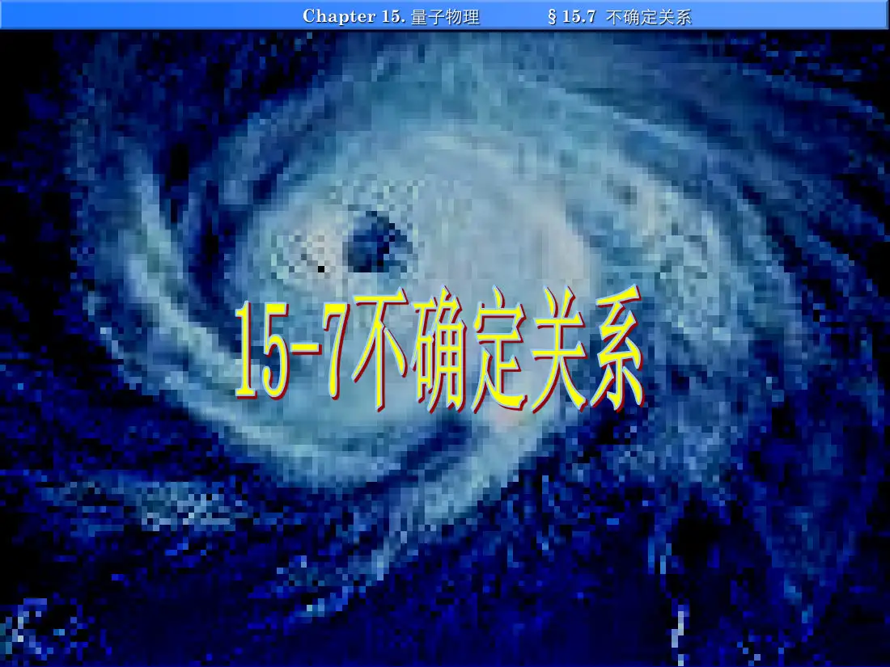

原文：

15-7不确定关系

Chapter 15. 量子物理

§ 15.7 不确定关系

### 以电子束的单缝衍射为例。

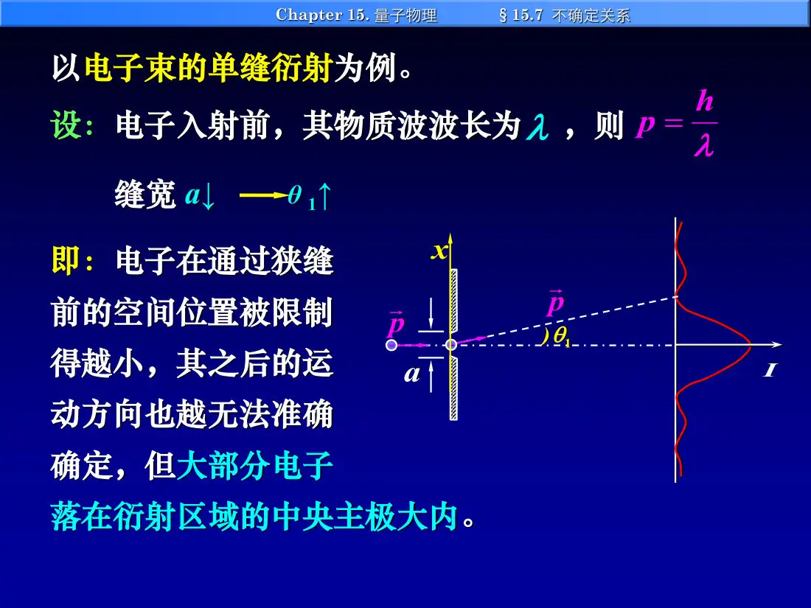

原文：

以电子束的单缝衍射为例。

设: 电子入射前, 其物质波波长为 $\lambda$ , 则 $p = \frac{h}{\lambda}$

缝宽 $a \downarrow \rightarrow \theta_{1} \uparrow$

即：电子在通过狭缝前的空间位置被限制得越小，其之后的运动方向也越无法准确确定，但大部分电子

落在衍射区域的中央主极大内。

Chapter 15. 量子物理

§ 15.7 不确定关系

### 在中央明纹内，电子在 $x$ 方向上的动量变动范围：

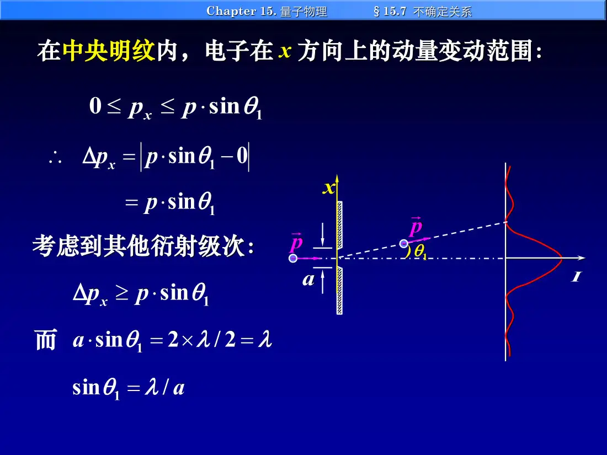

原文：

在中央明纹内，电子在 $x$ 方向上的动量变动范围：

$$
0 \leq p _ {x} \leq p \cdot \sin \theta_ {1}
$$

$$
\begin{array}{r l} \therefore & \Delta p _ {x} = | p \cdot \sin \theta_ {1} - 0 | \\ & = p \cdot \sin \theta_ {1} \end{array}
$$

考虑到其他衍射级次：

$$
\Delta p _ {x} \geq p \cdot \sin \theta_ {1}
$$

而 $a \cdot \sin \theta_{1} = 2 \times \lambda / 2 = \lambda$

$$
\sin \theta_ {1} = \lambda / a
$$

Chapter 15. 量子物理

§ 15.7 不确定关系

### $$

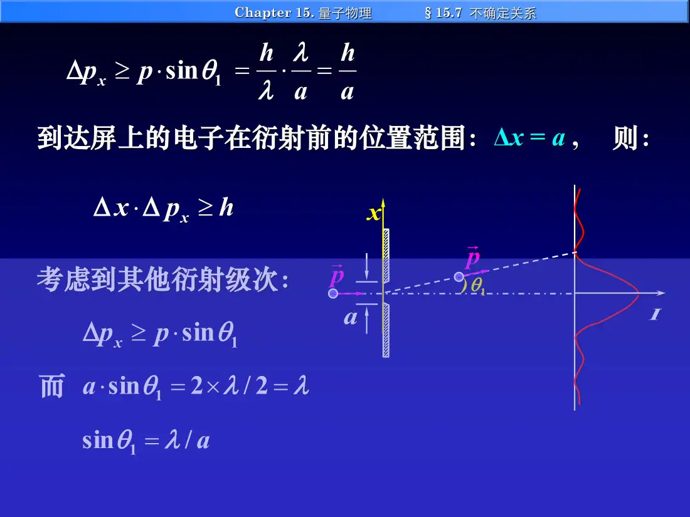

原文：

$$
\Delta p _ {x} \geq p \cdot \sin \theta_ {1} = \frac {h}{\lambda} \cdot \frac {\lambda}{a} = \frac {h}{a}
$$

到达屏上的电子在衍射前的位置范围： $\Delta x = a$ ，则：

$$
\Delta x \cdot \Delta p _ {x} \geq h
$$

考虑到其他衍射级次:

$$
\Delta p _ {x} \geq p \cdot \sin \theta_ {1}
$$

而 $a \cdot \sin \theta_{1} = 2 \times \lambda / 2 = \lambda$

$$
\sin \theta_ {1} = \lambda / a
$$

Chapter 15. 量子物理

§ 15.7 不确定关系

### $$

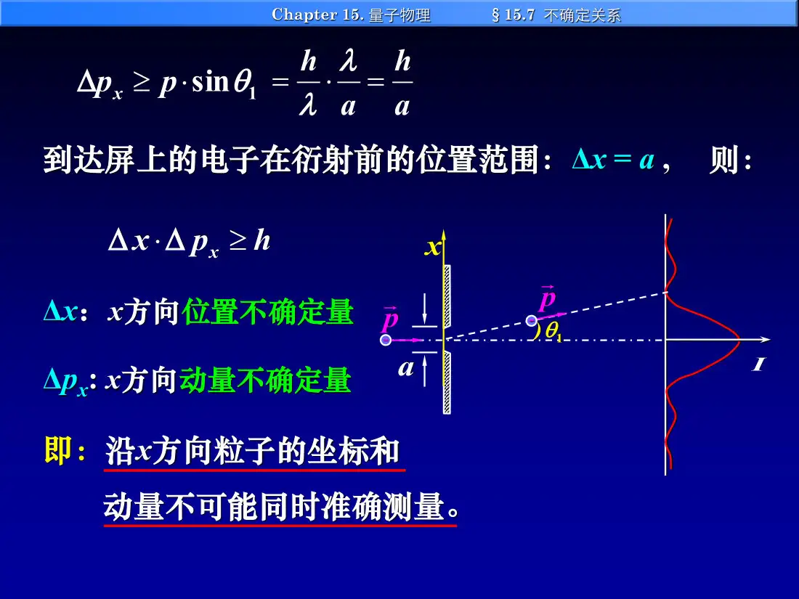

原文：

$$
\Delta p _ {x} \geq p \cdot \sin \theta_ {1} = \frac {h}{\lambda} \cdot \frac {\lambda}{a} = \frac {h}{a}
$$

到达屏上的电子在衍射前的位置范围： $\Delta x = a$ ，则：

$$
\Delta x \cdot \Delta p _ {x} \geq h
$$

$\Delta x: x$ 方向位置不确定量

$\Delta p_{x}$ : $x$ 方向动量不确定量

即：沿x方向粒子的坐标和

动量不可能同时准确测量。

Chapter 15. 量子物理

§ 15.7 不确定关系

### W.K.Heisenberg

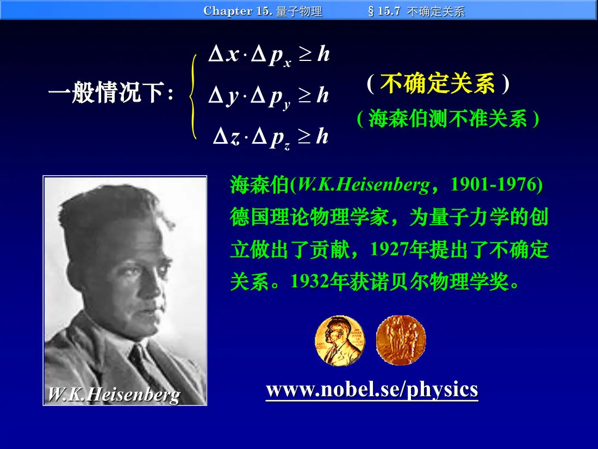

原文：

W.K.Heisenberg

§ 15.7 不确定关系

一般情况下：

$$
\Delta x \cdot \Delta p _ {x} \geq h
$$

$$
\Delta y \cdot \Delta p _ {y} \geq h
$$

$$
\Delta z \cdot \Delta p _ {z} \geq h
$$

(不确定关系)
(海森伯测不准关系)

海森伯(W.K.Heisenberg，1901-1976)德国理论物理学家，为量子力学的创立做出了贡献，1927年提出了不确定关系。1932年获诺贝尔物理学奖。

www.nobel.se/physics

Chapter 15. 量子物理

### 例子弹: 0.01kg，口径0.5cm，估算子弹的横向速度。

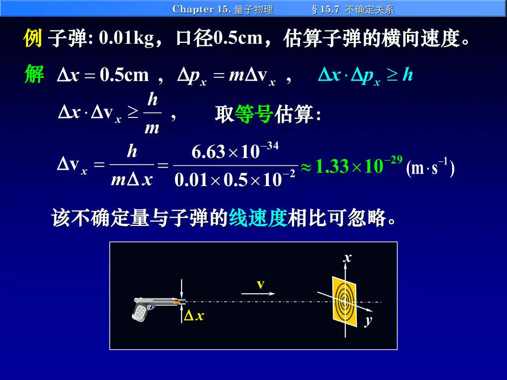

原文：

例子弹: 0.01kg，口径0.5cm，估算子弹的横向速度。
解 $\Delta x = 0.5cm$ ， $\Delta p_{x} = m\Delta v_{x}$ ， $\Delta x \cdot \Delta p_{x} \geq h$ $\Delta x \cdot \Delta v_{x} \geq \frac{h}{m}$ ，取等号估算： $\Delta v_{x}=\frac{h}{m\Delta x}=\frac{6.63\times10^{-34}}{0.01\times0.5\times10^{-2}}\approx1.33\times10^{-29}(m\cdot s^{-1})$ 该不确定量与子弹的线速度相比可忽略。

Chapter 15. 量子物理 § 15.7 不确定关系

### § 15.7 不确定关系

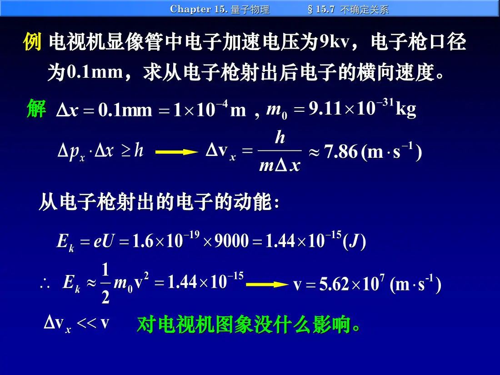

原文：

§ 15.7 不确定关系

例 电视机显像管中电子加速电压为9kv，电子枪口径为0.1mm，求从电子枪射出后电子的横向速度。
解 $\Delta x = 0.1mm = 1 \times 10^{-4}m, m_{0} = 9.11 \times 10^{-31}kg$ $\Delta p_{x} \cdot \Delta x \geq h \longrightarrow \Delta v_{x} = \frac{h}{m\Delta x} \approx 7.86 (m \cdot s^{-1})$ 从电子枪射出的电子的动能： $E_{k} = eU = 1.6 \times 10^{-19} \times 9000 = 1.44 \times 10^{-15}(J)$ $\therefore E_{k} \approx \frac{1}{2} m_{0} v^{2} = 1.44 \times 10^{-15} \longrightarrow v = 5.62 \times 10^{7} (m \cdot s^{-1})$ $\Delta v_{x} << v$ 对电视机图象没什么影响。

### 同样 可通过不确定关系估算原子中电子速度不确定量:

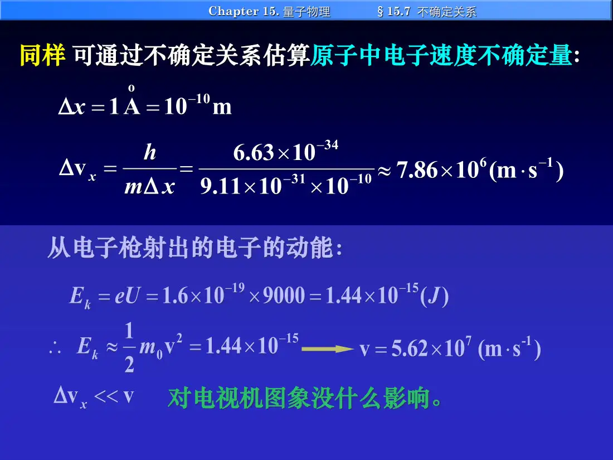

原文：

同样 可通过不确定关系估算原子中电子速度不确定量:

$$
\Delta x = 1 \stackrel {0} {\mathrm{A}} = 1 0 ^ {- 1 0} \mathrm{m}
$$

$$
\Delta \mathrm{v} _ {x} = \frac {h}{m \Delta x} = \frac {6 . 6 3 \times 1 0 ^ {- 3 4}}{9 . 1 1 \times 1 0 ^ {- 3 1} \times 1 0 ^ {- 1 0}} \approx 7. 8 6 \times 1 0 ^ {6} (\mathrm{m} \cdot \mathrm{s} ^ {- 1})
$$

从电子枪射出的电子的动能：

$$
E _ {k} = e U = 1. 6 \times 1 0 ^ {- 1 9} \times 9 0 0 0 = 1. 4 4 \times 1 0 ^ {- 1 5} (J)
$$

$$
\therefore E _ {k} \approx \frac {1}{2} m _ {0} \mathrm{v} ^ {2} = 1. 4 4 \times 1 0 ^ {- 1 5} \longrightarrow \mathrm{v} = 5. 6 2 \times 1 0 ^ {7} (\mathrm{m} \cdot \mathrm{s} ^ {- 1})
$$

$\Delta \mathbf{v}_x <   <   \mathbf{v}$ 对电视机图象没什么影响。

Chapter 15. 量子物理

§ 15.7 不确定关系

### 同样 可通过不确定关系估算原子中电子速度不确定量:

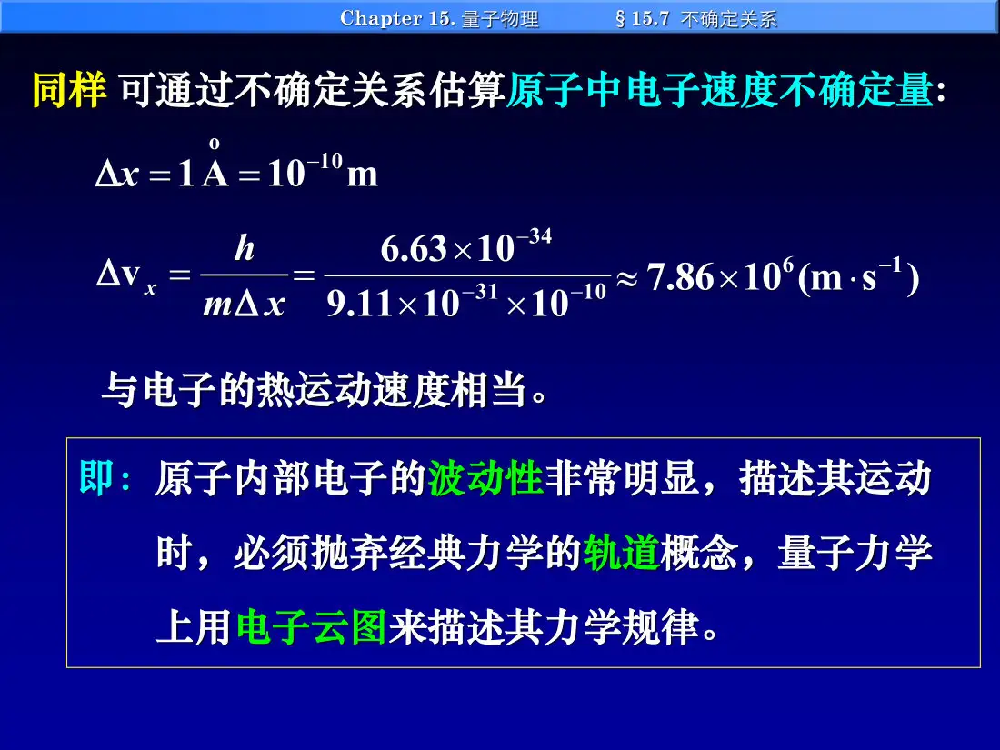

原文：

同样 可通过不确定关系估算原子中电子速度不确定量:

$$
\Delta x = 1 \stackrel {0} {\mathrm{A}} = 1 0 ^ {- 1 0} \mathrm{m}
$$

$$
\Delta \mathrm{v} _ {x} = \frac {h}{m \Delta x} = \frac {6 . 6 3 \times 1 0 ^ {- 3 4}}{9 . 1 1 \times 1 0 ^ {- 3 1} \times 1 0 ^ {- 1 0}} \approx 7. 8 6 \times 1 0 ^ {6} (\mathrm{m} \cdot \mathrm{s} ^ {- 1})
$$

与电子的热运动速度相当。

即：原子内部电子的波动性非常明显，描述其运动时，必须抛弃经典力学的轨道概念，量子力学上用电子云图来描述其力学规律。

Chapter 15. 量子物理

§ 15.7 不确定关系

### § 15.7 不确定关系

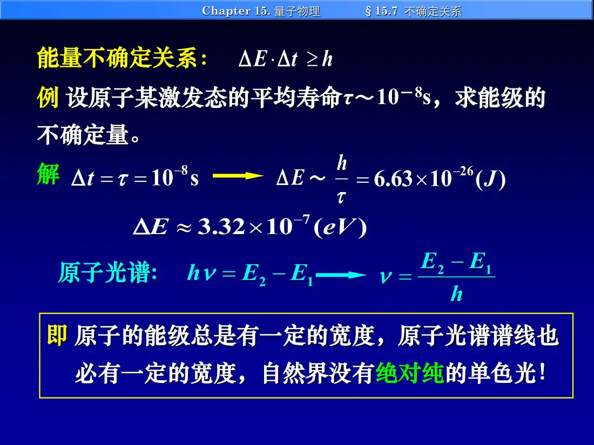

原文：

§ 15.7 不确定关系

能量不确定关系： $\Delta E \cdot \Delta t \geq h$

例 设原子某激发态的平均寿命 $\tau \sim 10^{-8} \mathrm{~s}$ ，求能级的不确定量。

$$
\Delta t = \tau = 1 0 ^ {- 8} \mathrm{s} \longrightarrow \Delta E \sim \frac {h}{\tau} = 6. 6 3 \times 1 0 ^ {- 2 6} (J)
$$

$$
\Delta E \approx 3. 3 2 \times 1 0 ^ {- 7} (e V)
$$

原子光谱: $h \nu = E_{2} - E_{1} \longrightarrow \nu = \frac{E_{2} - E_{1}}{h}$

即 原子的能级总是有一定的宽度，原子光谱谱线也必有一定的宽度，自然界没有绝对纯的单色光！

Chapter 15. 量子物理

### Chapter 15. 量子物理

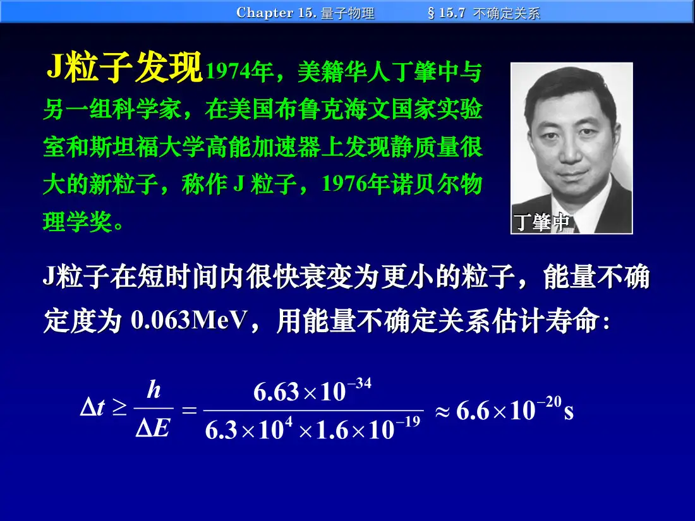

原文：

Chapter 15. 量子物理

§ 15.7 不确定关系

J粒子发现1974年，美籍华人丁肇中与另一组科学家，在美国布鲁克海文国家实验室和斯坦福大学高能加速器上发现静质量很大的新粒子，称作J粒子，1976年诺贝尔物理学奖。

J粒子在短时间内很快衰变为更小的粒子，能量不确定度为 0.063MeV，用能量不确定关系估计寿命：

$$
\Delta t \geq \frac {h}{\Delta E} = \frac {6 . 6 3 \times 1 0 ^ {- 3 4}}{6 . 3 \times 1 0 ^ {4} \times 1 . 6 \times 1 0 ^ {- 1 9}} \approx 6. 6 \times 1 0 ^ {- 2 0} \mathrm{s}
$$

### 注意

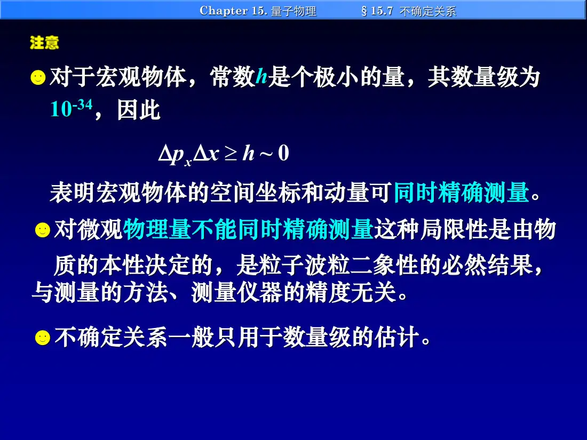

原文：

注意

对于宏观物体，常数 $h$ 是个极小的量，其数量级为 $10^{-34}$ ，因此

$$
\Delta p _ {x} \Delta x \geq h \sim 0
$$

表明宏观物体的空间坐标和动量可同时精确测量。

对微观物理量不能同时精确测量这种局限性是由物质的本性决定的，是粒子波粒二象性的必然结果，与测量的方法、测量仪器的精度无关。

不确定关系一般只用于数量级的估计。

Chapter 15. 量子物理

§ 15.7 不确定关系

### 一、X 射线

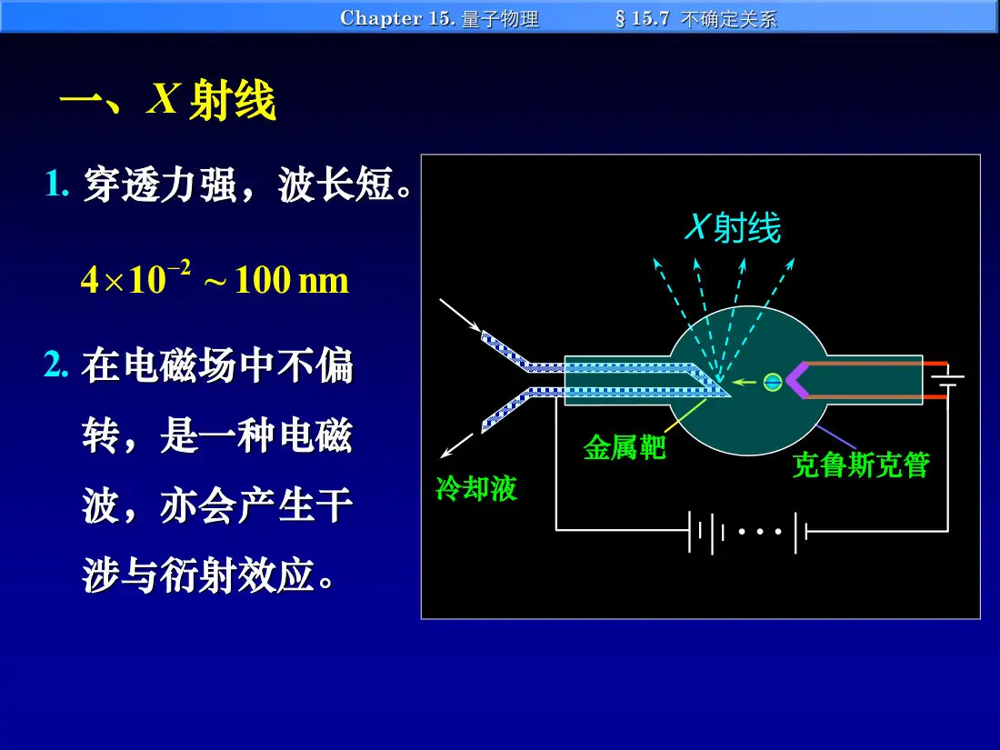

原文：

一、X 射线

1. 穿透力强，波长短。

$4 \times 10^{-2} \sim 100 \text{ nm}$

2. 在电磁场中不偏转，是一种电磁波，亦会产生干涉与衍射效应。

Chapter 15. 量子物理

§ 15.7 不确定关系

### W.k.Röntgen 1845\~1923

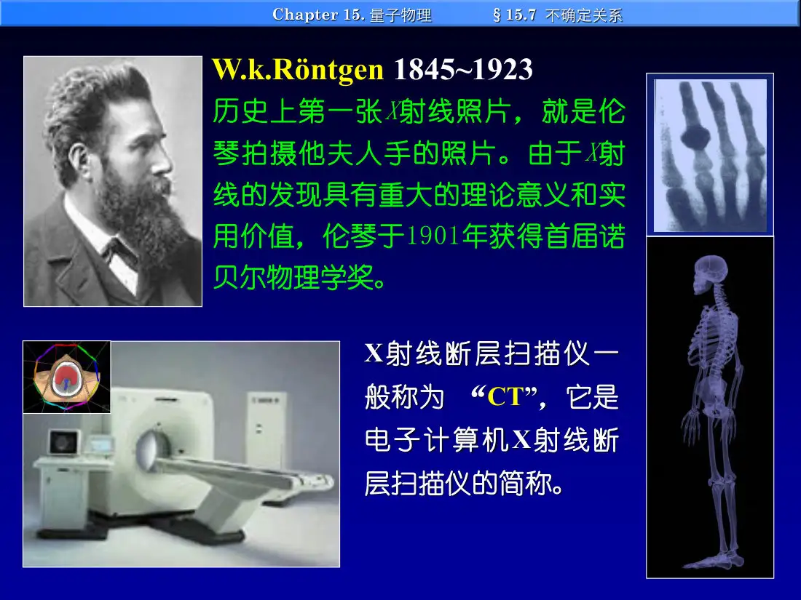

原文：

W.k.Röntgen 1845\~1923
历史上第一张X射线照片，就是伦琴拍摄他夫人手的照片。由于X射线的发现具有重大的理论意义和实用价值，伦琴于1901年获得首届诺贝尔物理学奖。

X射线断层扫描仪一般称为 “CT”，它是电子计算机X射线断层扫描仪的简称。

Chapter 15. 量子物理

§ 15.7 不确定关系

### 二、X 射线衍射实验

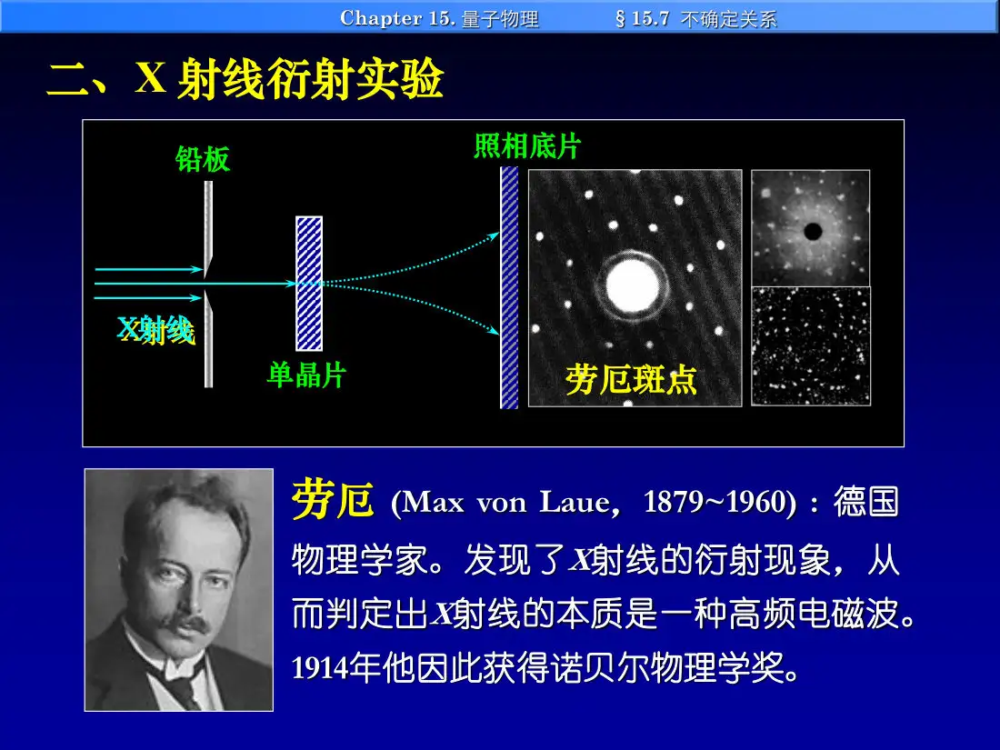

原文：

二、X 射线衍射实验

铅板

X射线

单晶片

劳厄斑点

劳厄 (Max von Laue, 1879\~1960): 德国物理学家。发现了X射线的衍射现象，从而判定出X射线的本质是一种高频电磁波。1914年他因此获得诺贝尔物理学奖。

Chapter 15. 量子物理

§ 15.7 不确定关系

### 三、布拉格公式

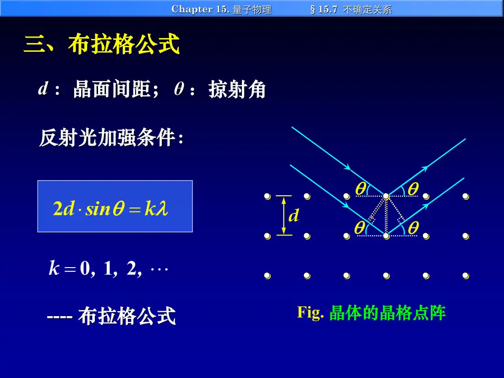

原文：

三、布拉格公式

d：晶面间距；θ：掠射角

反射光加强条件：

$$
2 d \cdot \sin \theta = k \lambda
$$

$$
k = 0, 1, 2, \dots
$$

---- 布拉格公式

Fig. 晶体的晶格点阵

Chapter 15. 量子物理

§ 15.7 不确定关系

### W.H. Bragg

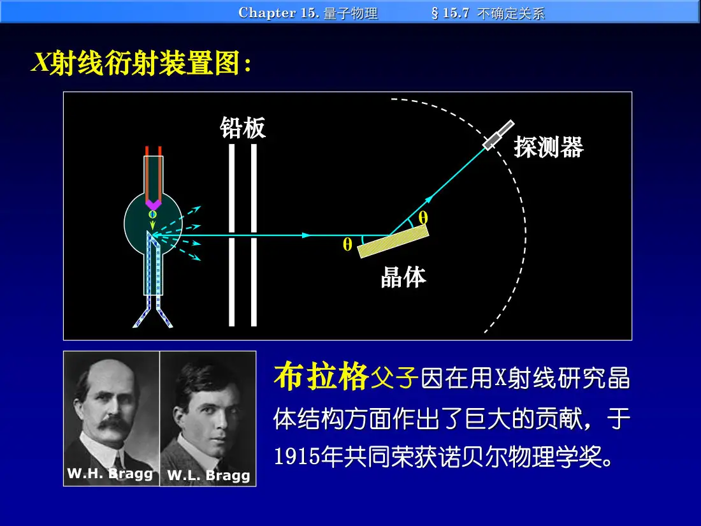

原文：

W.H. Bragg

X射线衍射装置图：

布拉格父子因在用X射线研究晶体结构方面作出了巨大的贡献，于1915年共同荣获诺贝尔物理学奖。

Chapter 15. 量子物理

§ 15.7 不确定关系

### Chapter 15. 量子物理 § 15.7 不确定关系

原文：

Chapter 15. 量子物理 § 15.7 不确定关系
