# 《大学物理》第18章 量子物理 §18.5 波函数 薛定谔方程 一维无限深势阱（课件）

原件的每一页，下面附识别出的文字。

### 15-8波函数 薛定锷方程一维无限深势阱

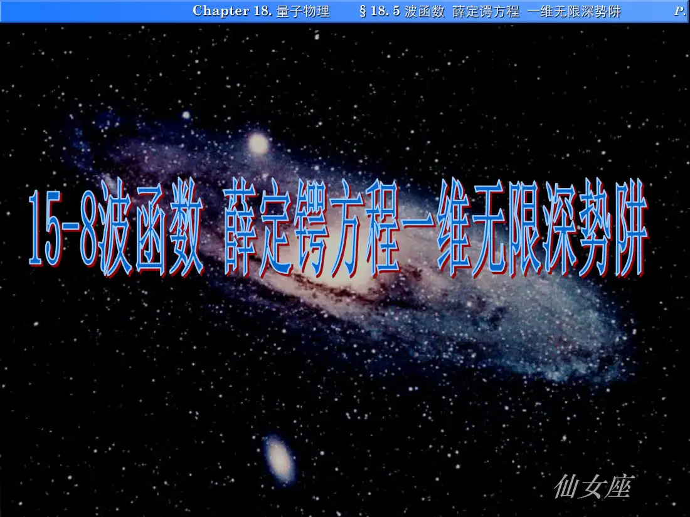

原文：

15-8波函数 薛定锷方程一维无限深势阱

Chapter 18. 量子物理 § 18.5 波函数 薛定谔方程 一维无限深势阱

P.

### P.

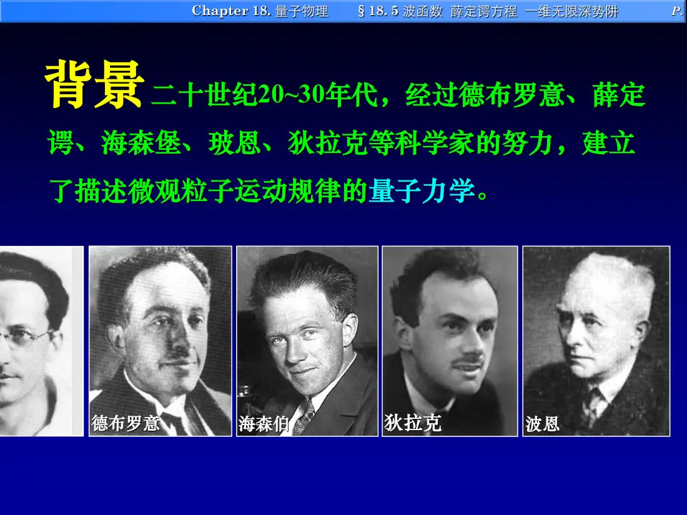

原文：

背景 二十世纪20\~30年代，经过德布罗意、薛定谔、海森堡、玻恩、狄拉克等科学家的努力，建立了描述微观粒子运动规律的量子力学。

Chapter 18. 量子物理 § 18.5 波函数 薛定谔方程 一维无限深势阱

P.

### 一、物质波波函数

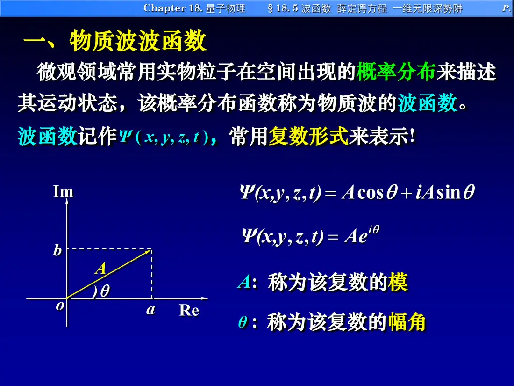

原文：

一、物质波波函数

微观领域常用实物粒子在空间出现的概率分布来描述其运动状态，该概率分布函数称为物质波的波函数。

波函数记作 $\Psi(x,y,z,t)$ ，常用复数形式来表示!

$$
\Psi (x, y, z, t) = A \cos \theta + i A \sin \theta
$$

$$
\Psi (x, y, z, t) = A e ^ {i \theta}
$$

A: 称为该复数的模

θ：称为该复数的幅角

Chapter 18. 量子物理 § 18.5 波函数 薛定谔方程 一维无限深势阱

P.

### 例如，沿+x方向传播的平面简谐波的波动方程：

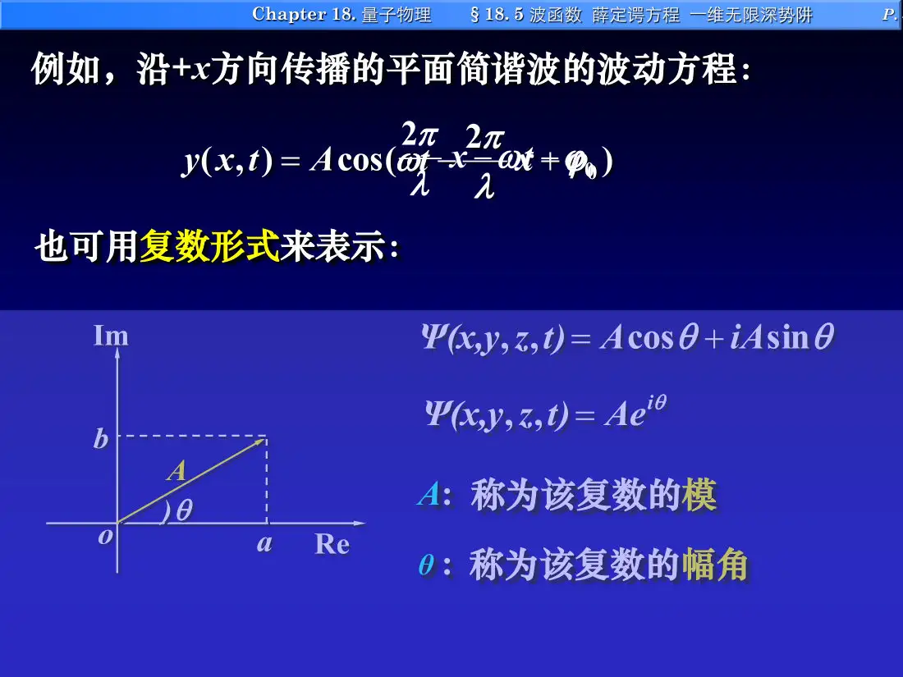

原文：

例如，沿+x方向传播的平面简谐波的波动方程：

$$
y (x, t) = A \cos (\frac {2 \pi}{\lambda} - x - \frac {2 \pi}{\lambda} \omega t + \varphi_ {0})
$$

也可用复数形式来表示:

$$
\Psi (x, y, z, t) = A \cos \theta + i A \sin \theta
$$

$$
\Psi (x, y, z, t) = A e ^ {i \theta}
$$

A: 称为该复数的模

θ：称为该复数的幅角

Chapter 18. 量子物理 § 18.5 波函数 薛定谔方程 一维无限深势阱

P.

### 例如，沿+x方向传播的平面简谐波的波动方程：

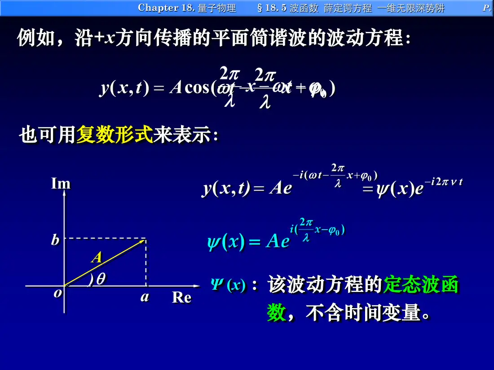

原文：

例如，沿+x方向传播的平面简谐波的波动方程：

$$
y (x, t) = A \cos (\frac {2 \pi}{\lambda} - x - \frac {2 \pi}{\lambda} \omega t + \varphi_ {0})
$$

也可用复数形式来表示：

$$
y (x, t) = A e ^ {- i (\omega t - \frac {2 \pi}{\lambda} x + \varphi_ {0})} = \psi (x) e ^ {- i 2 \pi \nu t}
$$

$$
\psi (x) = A e ^ {i (\frac {2 \pi}{\lambda} x - \varphi_ {0})}
$$

$\Psi(x)$ ：该波动方程的定态波函数，不含时间变量。

Chapter 18. 量子物理 § 18.5 波函数 薛定谔方程 一维无限深势阱

P.

### 如何构造物质波波函数 $\Psi(x, y, z, t)$ ？

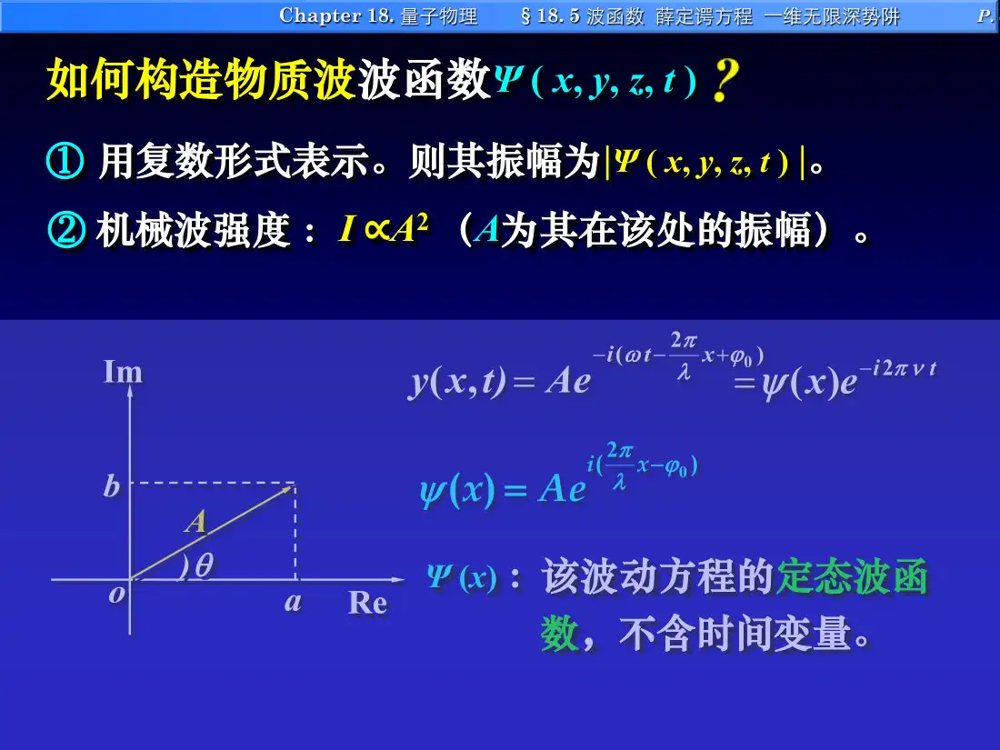

原文：

如何构造物质波波函数 $\Psi(x, y, z, t)$ ？

① 用复数形式表示。则其振幅为 $|\Psi(x, y, z, t)|$ 。

② 机械波强度： $I \propto A^{2}$ （A为其在该处的振幅）。

$$
y (x, t) = A e ^ {- i (\omega t - \frac {2 \pi}{\lambda} x + \varphi_ {0})} = \psi (x) e ^ {- i 2 \pi \nu t}
$$

$$
\psi (x) = A e ^ {i (\frac {2 \pi}{\lambda} x - \varphi_ {0})}
$$

$\Psi(x)$ ：该波动方程的定态波函数，不含时间变量。

Chapter 18. 量子物理 § 18.5 波函数 薛定谔方程 一维无限深势阱

P.

### 如何构造物质波波函数 $\Psi (x,y,z,t)$ ？

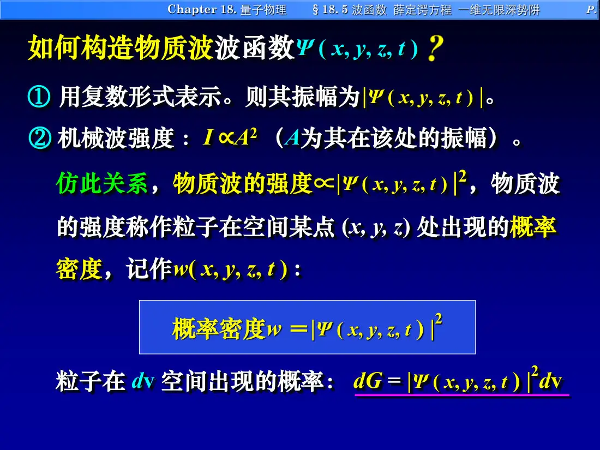

原文：

如何构造物质波波函数 $\Psi (x,y,z,t)$ ？

① 用复数形式表示。则其振幅为 $|\Psi(x, y, z, t)|$ 。

② 机械波强度： $I \propto A^{2}$ （ $A$ 为其在该处的振幅）。仿此关系，物质波的强度 $\propto |\Psi(x, y, z, t)|^{2}$ ，物质波的强度称作粒子在空间某点 $(x, y, z)$ 处出现的概率密度，记作 $w(x, y, z, t)$ ：

概率密度 $w=|\Psi(x,y,z,t)|^{2}$

粒子在 dv 空间出现的概率: $dG = \left| \Psi(x, y, z, t) \right|^2 dV$

Chapter 18. 量子物理 § 18.5 波函数 薛定谔方程 一维无限深势阱

P.

### 若粒子只出现在一维空间，则其在 $x \sim x + dx$ 空间出

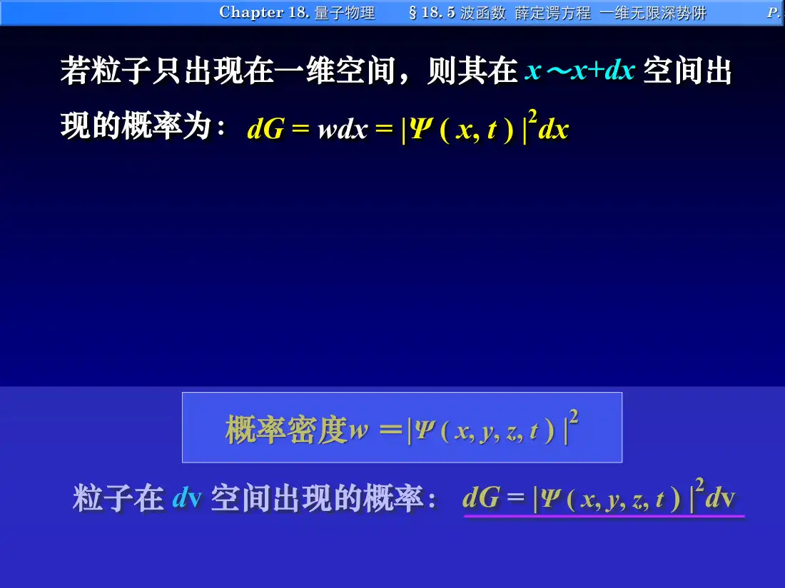

原文：

若粒子只出现在一维空间，则其在 $x \sim x + dx$ 空间出

现的概率为： $dG = wdx = |\Psi(x, t)|^2 dx$

概率密度 $w=|\Psi(x,y,z,t)|^{2}$

粒子在 dv 空间出现的概率: $dG = \left| \Psi(x, y, z, t) \right|^2 dv$ 若粒子只出现在一维空间, 则其在 $x \sim x + dx$ 空间出现的概率为: $dG = wdx = |\Psi(x, t)|^{2}dx$

Chapter 18. 量子物理 § 18.5 波函数 薛定谔方程 一维无限深势阱

P.

### P.

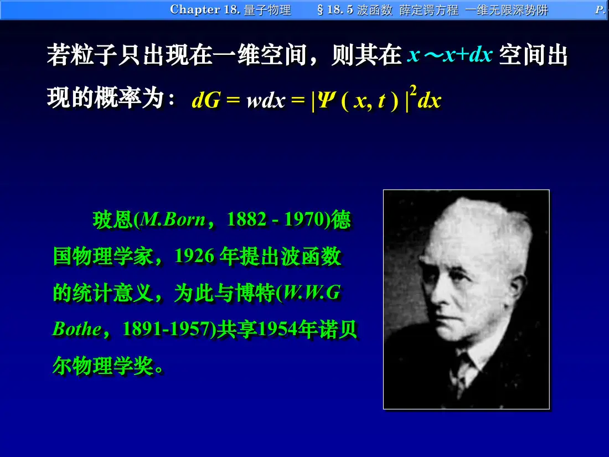

原文：

玻恩(M.Born, 1882 - 1970)德国物理学家, 1926 年提出波函数的统计意义, 为此与博特(W.W.G Bothe, 1891-1957)共享1954年诺贝尔物理学奖。

Chapter 18. 量子物理 § 18.5 波函数 薛定谔方程 一维无限深势阱

P.

### ③ 粒子在全空间出现的概率为1，即：

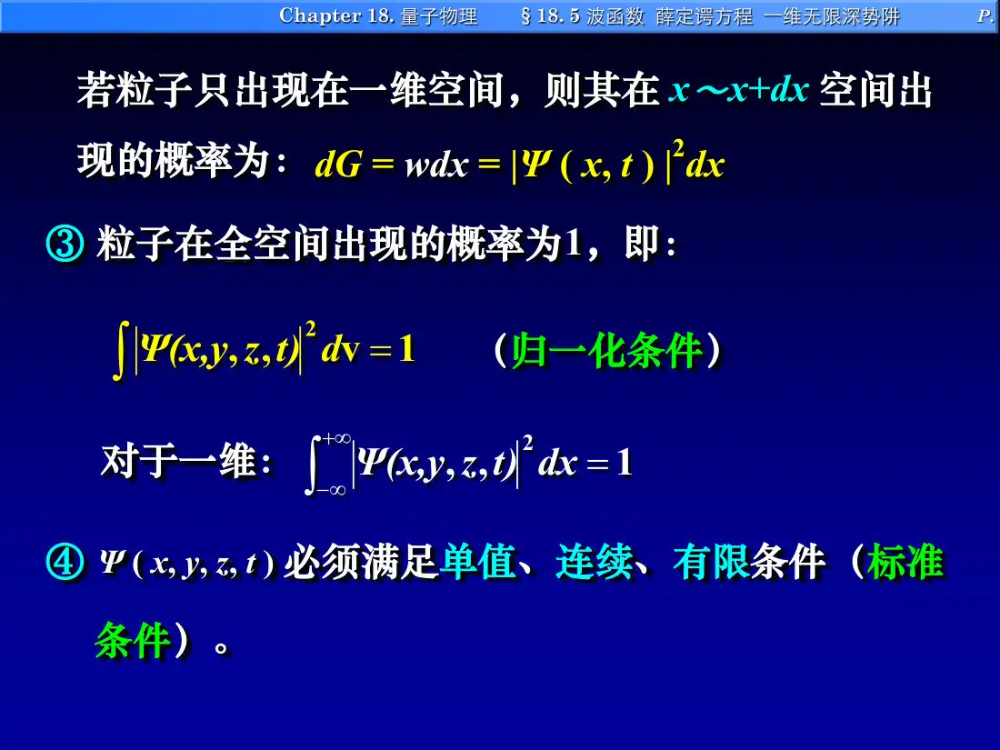

原文：

若粒子只出现在一维空间, 则其在 $x \sim x + dx$ 空间出现的概率为: $dG = wdx = |\Psi(x, t)|^{2}dx$

③ 粒子在全空间出现的概率为1，即：

$\int \left|\Psi (x,y,z,t)\right|^2 dv = 1$ （归一化条件）

对于一维： $\int_{-\infty}^{+\infty}\left|\Psi (x,y,z,t)\right|^2 dx = 1$

④ $\Psi(x,y,z,t)$ 必须满足单值、连续、有限条件（标准条件）。

Chapter 18. 量子物理 § 18.5 波函数 薛定谔方程 一维无限深势阱

P.

### 例 构造一维自由粒子的物质波波函数 $\Psi(x, t)$ 。

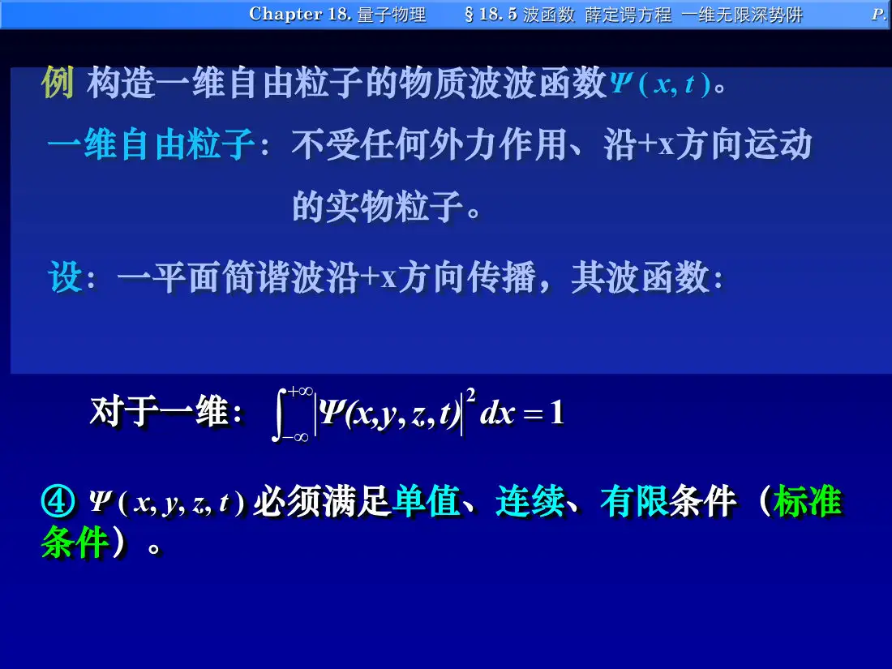

原文：

例 构造一维自由粒子的物质波波函数 $\Psi(x, t)$ 。

一维自由粒子：不受任何外力作用、沿+x方向运动

的实物粒子。

设：一平面简谐波沿+x方向传播，其波函数：

对于一维： $\int_{-\infty}^{+\infty}\left|\Psi (x,y,z,t)\right|^2 dx = 1$

④ $\Psi(x,y,z,t)$ 必须满足单值、连续、有限条件（标准条件）。

Chapter 18. 量子物理

§ 18.5 波函数 薛定谔方程 一维无限深势阱

P.

### 例 构造一维自由粒子的物质波波函数 $\Psi(x, t)$ 。

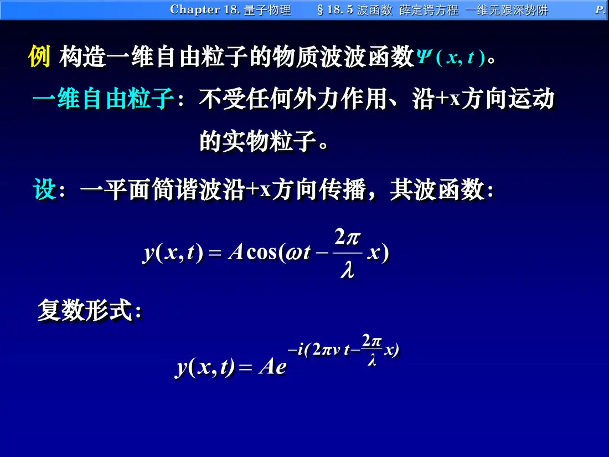

原文：

例 构造一维自由粒子的物质波波函数 $\Psi(x, t)$ 。

一维自由粒子：不受任何外力作用、沿+x方向运动的实物粒子。

设：一平面简谐波沿+x方向传播，其波函数：

$$
y (x, t) = A \cos (\omega t - \frac {2 \pi}{\lambda} x)
$$

复数形式:

$$
y (x, t) = A e ^ {- i (2 \pi \nu t - \frac {2 \pi}{\lambda} x)}
$$

Chapter 18. 量子物理

§ 18.5 波函数 薛定谔方程 一维无限深势阱

P.

### 仿照上式，在一维自由粒子上的物质波波函数：

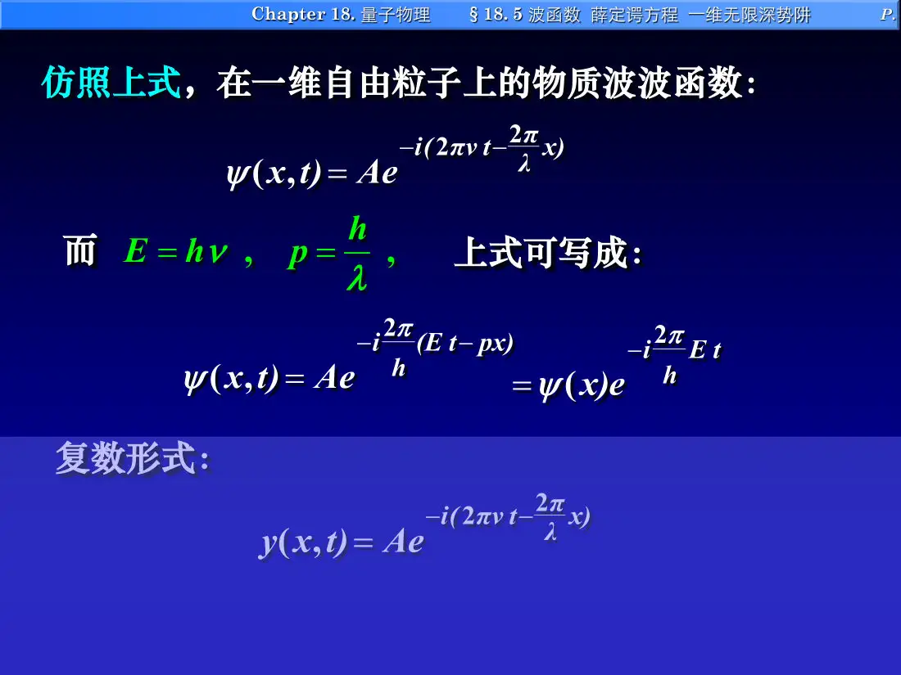

原文：

仿照上式，在一维自由粒子上的物质波波函数：

$$
\psi (x, t) = A e ^ {- i (2 \pi \nu t - \frac {2 \pi}{\lambda} x)}
$$

而 $E = h\nu$ ， $p = \frac{h}{\lambda}$ ，上式可写成：

$$
\psi (x, t) = A e ^ {- i \frac {2 \pi}{h} (E t - p x)} = \psi (x) e ^ {- i \frac {2 \pi}{h} E t}
$$

复数形式:

$$
y (x, t) = A e ^ {- i (2 \pi v t - \frac {2 \pi}{\lambda} x)}
$$

Chapter 18. 量子物理 § 18.5 波函数 薛定谔方程 一维无限深势阱

P.

### 仿照上式，缔合在一维自由粒子上的物质波波函数：

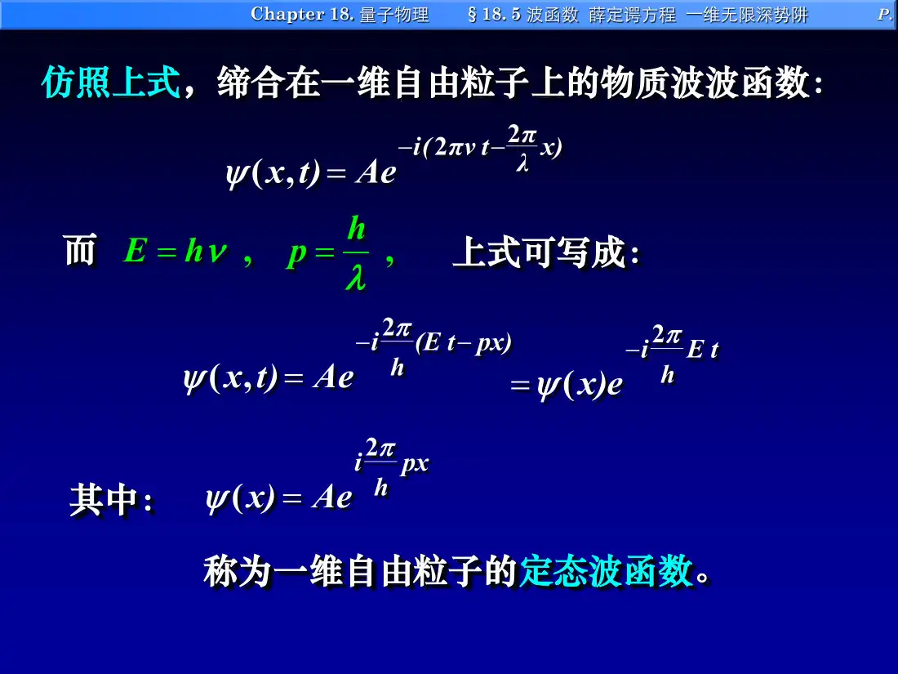

原文：

仿照上式，缔合在一维自由粒子上的物质波波函数：

$$
\psi (x, t) = A e ^ {- i (2 \pi \nu t - \frac {2 \pi}{\lambda} x)}
$$

而 $E = h\nu$ ， $p = \frac{h}{\lambda}$ ，上式可写成：

$$
\psi (x, t) = A e ^ {- i \frac {2 \pi}{h} (E t - p x)} = \psi (x) e ^ {- i \frac {2 \pi}{h} E t}
$$

其中： $\psi(x)=Ae^{i\frac{2\pi}{h}px}$

称为一维自由粒子的定态波函数。

Chapter 18. 量子物理 § 18.5 波函数 薛定谔方程 一维无限深势阱

P.

### 二、薛定谔方程 (v << c)

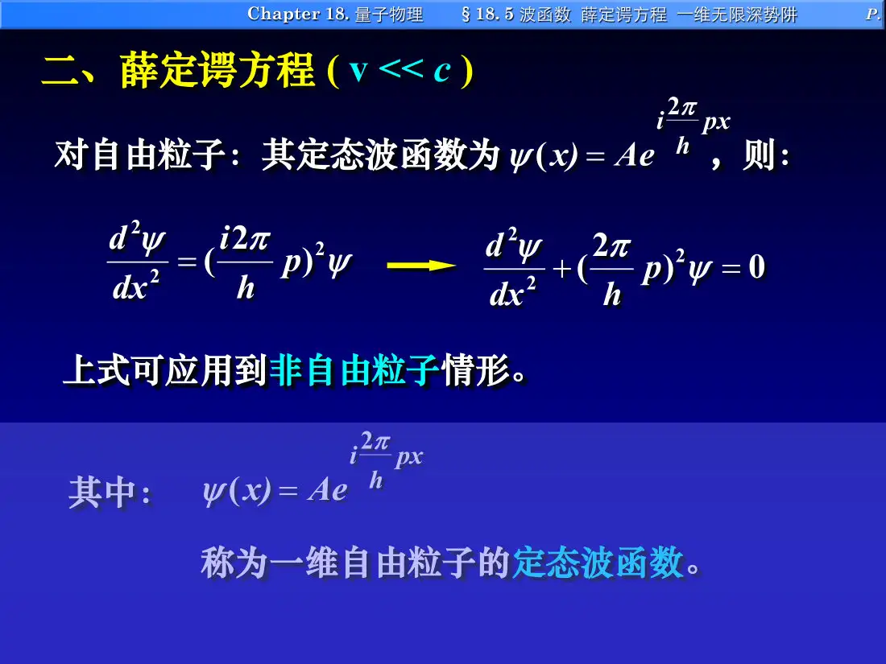

原文：

二、薛定谔方程 (v << c)

对自由粒子: 其定态波函数为 $\psi(x) = A e^{i \frac{2 \pi}{h} p x}$ , 则:

$$
\frac {d ^ {2} \psi}{d x ^ {2}} = (\frac {i 2 \pi}{h} p) ^ {2} \psi \quad \longrightarrow \quad \frac {d ^ {2} \psi}{d x ^ {2}} + (\frac {2 \pi}{h} p) ^ {2} \psi = 0
$$

上式可应用到非自由粒子情形。

其中： $\psi(x)=Ae^{\frac{i\frac{2\pi}{h}px}{} }$

称为一维自由粒子的定态波函数。

Chapter 18. 量子物理 § 18.5 波函数 薛定谔方程 一维无限深势阱

P.

### 二、薛定谔方程 (v << c)

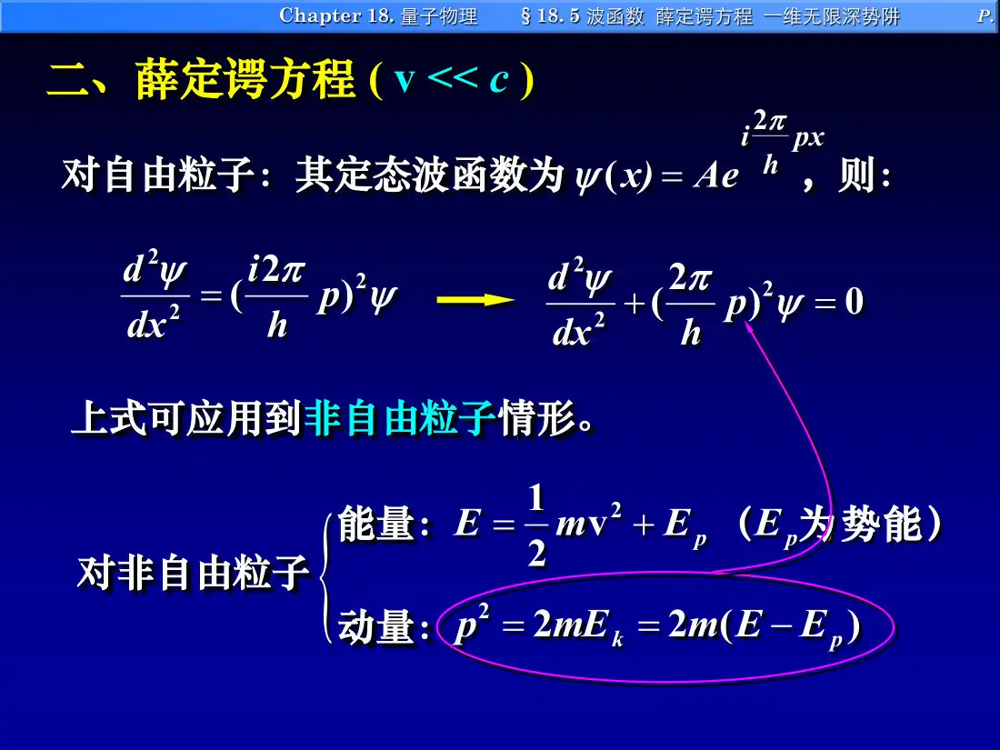

原文：

二、薛定谔方程 (v << c)

对自由粒子: 其定态波函数为 $\psi(x) = A e^{i \frac{2 \pi}{h} p x}$ , 则:

$$
\frac {d ^ {2} \psi}{d x ^ {2}} = (\frac {i 2 \pi}{h} p) ^ {2} \psi \quad \Longrightarrow \quad \frac {d ^ {2} \psi}{d x ^ {2}} + (\frac {2 \pi}{h} p) ^ {2} \psi = 0
$$

上式可应用到非自由粒子情形。

对非自由粒子

能量: $E = \frac{1}{2} m v^{2} + E_{p}$ ( $E_{p}$ 为势能)

动量: $p^{2} = 2mE_{k} = 2m(E - E_{p})$

Chapter 18. 量子物理 § 18.5 波函数 薛定谔方程 一维无限深势阱

P.

### 即：对非自由粒子

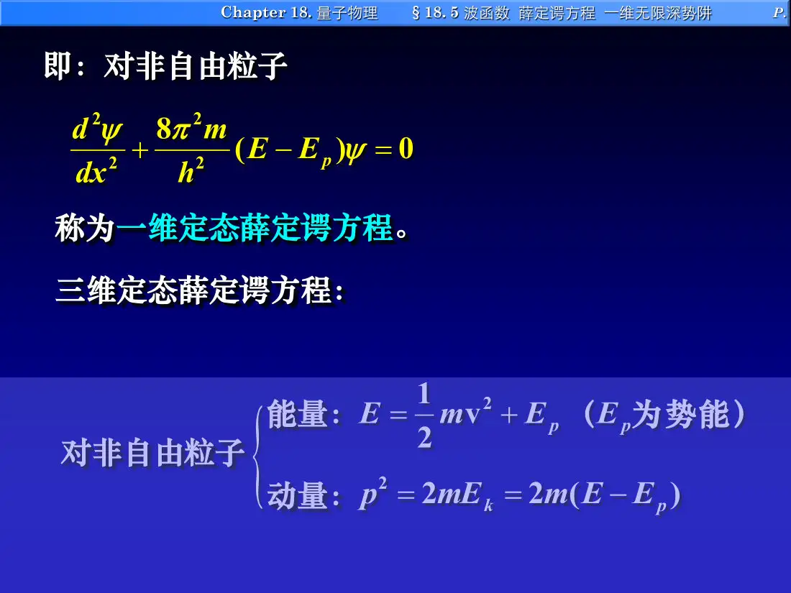

原文：

即：对非自由粒子

$$
\frac {d ^ {2} \psi}{d x ^ {2}} + \frac {8 \pi^ {2} m}{h ^ {2}} (E - E _ {p}) \psi = 0
$$

称为一维定态薛定谔方程。

三维定态薛定谔方程：

对非自由粒子

能量: $E = \frac{1}{2} m v^{2} + E_{p}$ ( $E_{p}$ 为势能)

动量: $p^{2} = 2mE_{k} = 2m(E - E_{p})$

Chapter 18. 量子物理 § 18.5 波函数 薛定谔方程 一维无限深势阱

P.

### 即：对非自由粒子

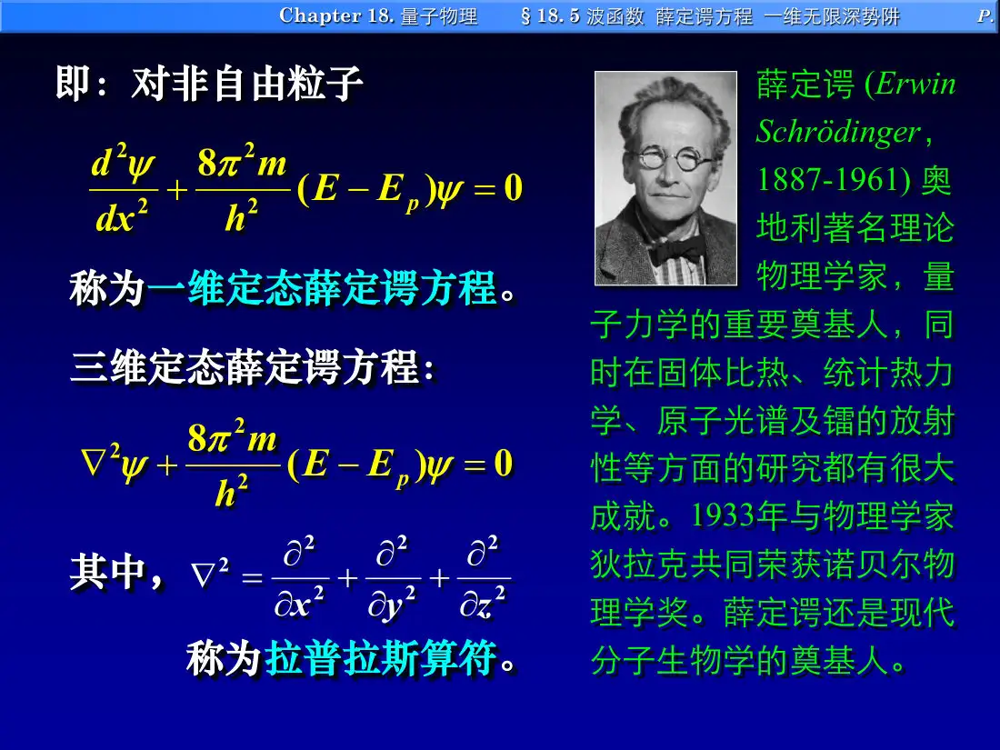

原文：

即：对非自由粒子

$$
\frac {d ^ {2} \psi}{d x ^ {2}} + \frac {8 \pi^ {2} m}{h ^ {2}} (E - E _ {p}) \psi = 0
$$

称为一维定态薛定谔方程。

三维定态薛定谔方程：

$\nabla^{2}\psi + \frac{8\pi^{2}m}{h^{2}} (E - E_{p})\psi = 0$ 其中， $\nabla^{2} = \frac{\partial^{2}}{\partial x^{2}} + \frac{\partial^{2}}{\partial y^{2}} + \frac{\partial^{2}}{\partial z^{2}}$ 称为拉普拉斯算符。

薛定谔 (Erwin Schrödinger, 1887-1961) 奥地利著名理论物理学家，量

子力学的重要奠基人，同时在固体比热、统计热力学、原子光谱及镭的放射性等方面的研究都有很大成就。1933年与物理学家狄拉克共同荣获诺贝尔物理学奖。薛定谔还是现代分子生物学的奠基人。

Chapter 18. 量子物理 § 18.5 波函数 薛定谔方程 一维无限深势阱

P.

### 三、一维无限深势阱

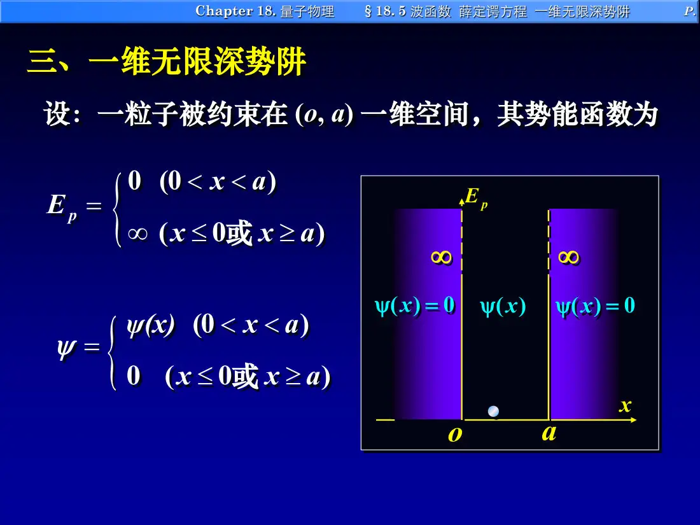

原文：

三、一维无限深势阱

设：一粒子被约束在 $(o, a)$ 一维空间，其势能函数为

$$
E _ {p} = \left\{ \begin{array}{l l} 0 & (0 <   x <   a) \\ \infty & (x \leq 0 \text {或} x \geq a) \end{array} \right.
$$

$$
\psi = \left\{ \begin{array}{l l} \psi (x) & (0 <   x <   a) \\ 0 & (x \leq 0 \text {或} x \geq a) \end{array} \right.
$$

$$
\begin{array}{c c c} \text {E} _ {p} \\ \text {ψ(x)=0} & \text {ψ(x)} & \text {ψ(x)=0} \\ \text {x} & o & a \end{array}
$$

Chapter 18. 量子物理 § 18.5 波函数 薛定谔方程 一维无限深势阱

P.

### 根据定态薛定谔方程，势阱中粒子的概率波满足

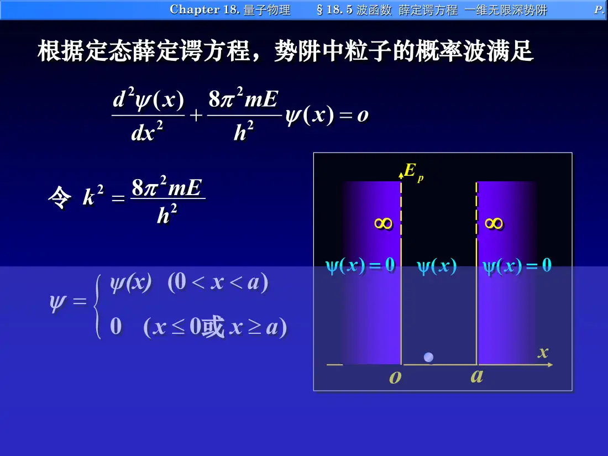

原文：

根据定态薛定谔方程，势阱中粒子的概率波满足

$$
\frac {d ^ {2} \psi (x)}{d x ^ {2}} + \frac {8 \pi^ {2} m E}{h ^ {2}} \psi (x) = o
$$

$$
\text { 令 } k ^ {2} = \frac {8 \pi^ {2} m E}{h ^ {2}}
$$

$$
\psi = \left\{ \begin{array}{l l} \psi (x) & (0 <   x <   a) \\ 0 & (x \leq 0 \text {或} x \geq a) \end{array} \right.
$$

$$
\begin{array}{c c c} \text {E} _ {p} \\ \psi (x) = 0 & \psi (x) & \text {∞} \\ o & a & x \end{array}
$$

Chapter 18. 量子物理 § 18.5 波函数 薛定谔方程 一维无限深势阱

P.

### 根据定态薛定谔方程，势阱中粒子的概率波满足

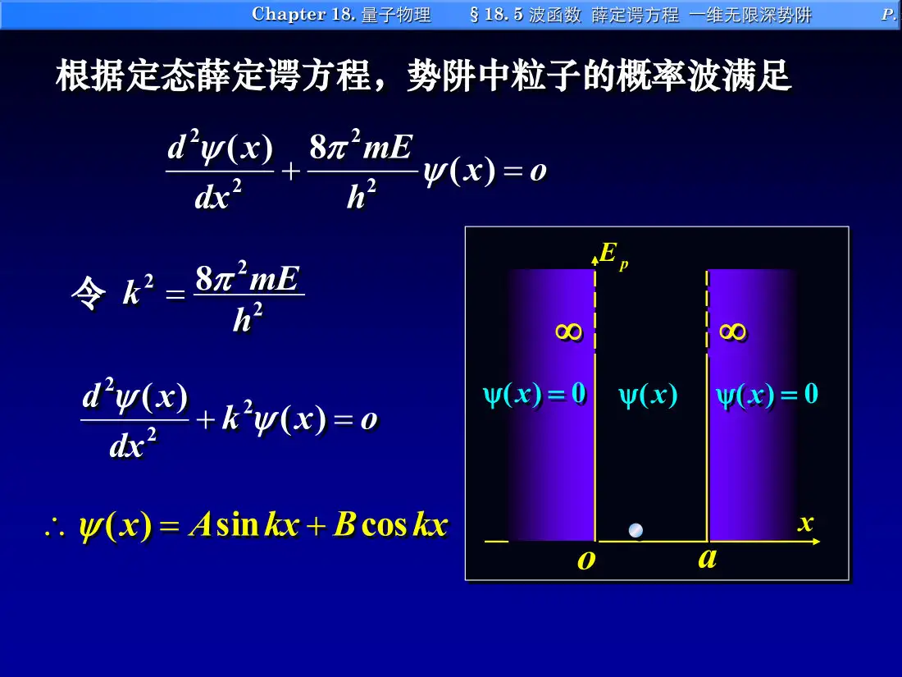

原文：

根据定态薛定谔方程，势阱中粒子的概率波满足

$$
\frac {d ^ {2} \psi (x)}{d x ^ {2}} + \frac {8 \pi^ {2} m E}{h ^ {2}} \psi (x) = o
$$

$$
\text { 令 } k ^ {2} = \frac {8 \pi^ {2} m E}{h ^ {2}}
$$

$$
\frac {d ^ {2} \psi (x)}{d x ^ {2}} + k ^ {2} \psi (x) = o
$$

$$
\therefore \psi (x) = A \sin k x + B \cos k x
$$

$$
\begin{array}{c c} \text {E} _ {p} \\ \psi (x) = 0 & \psi (x) \\ o & a \end{array}
$$

Chapter 18. 量子物理 § 18.5 波函数 薛定谔方程 一维无限深势阱

P.

### 根据边界条件:

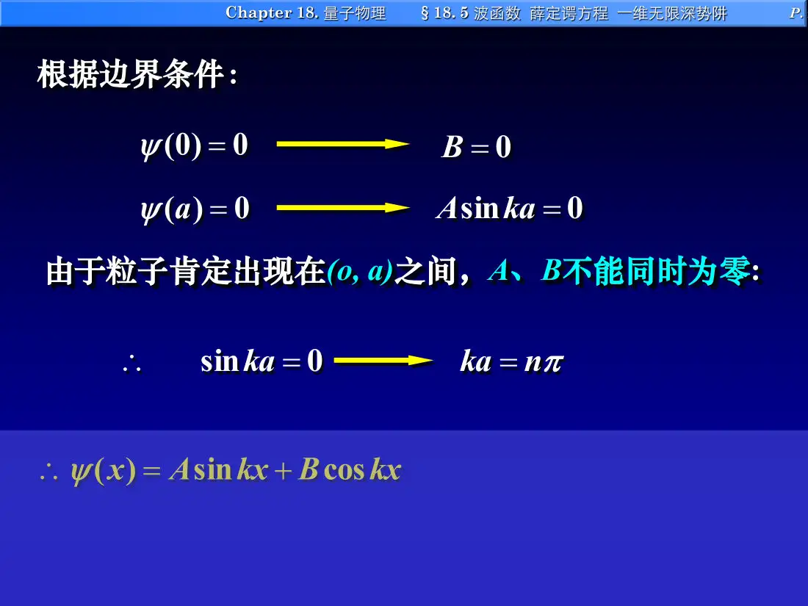

原文：

根据边界条件:

$$
\psi (0) = 0 \quad \longrightarrow \quad B = 0
$$

$$
\psi (a) = 0 \quad \longrightarrow \quad A \sin k a = 0
$$

由于粒子肯定出现在 $(o, a)$ 之间， $A$ 、 $B$ 不能同时为零：

$$
\sin k a = 0 \longrightarrow k a = n \pi
$$

$$
\therefore \psi (x) = A \sin k x + B \cos k x
$$

Chapter 18. 量子物理 § 18.5 波函数 薛定谔方程 一维无限深势阱

P.

### 根据边界条件:

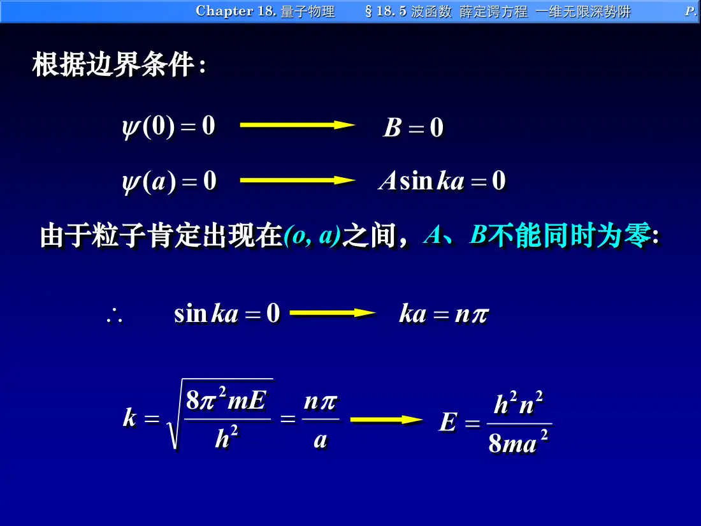

原文：

根据边界条件:

$$
\psi (0) = 0 \quad \longrightarrow \quad B = 0
$$

$$
\psi (a) = 0 \quad \longrightarrow \quad A \sin k a = 0
$$

由于粒子肯定出现在 $(o, a)$ 之间， $A$ 、 $B$ 不能同时为零：

$$
\therefore \quad \sin k a = 0 \longrightarrow k a = n \pi
$$

$$
k = \sqrt {\frac {8 \pi^ {2} m E}{h ^ {2}}} = \frac {n \pi}{a} \longrightarrow E = \frac {h ^ {2} n ^ {2}}{8 m a ^ {2}}
$$

Chapter 18. 量子物理 § 18.5 波函数 薛定谔方程 一维无限深势阱

P.

### $$

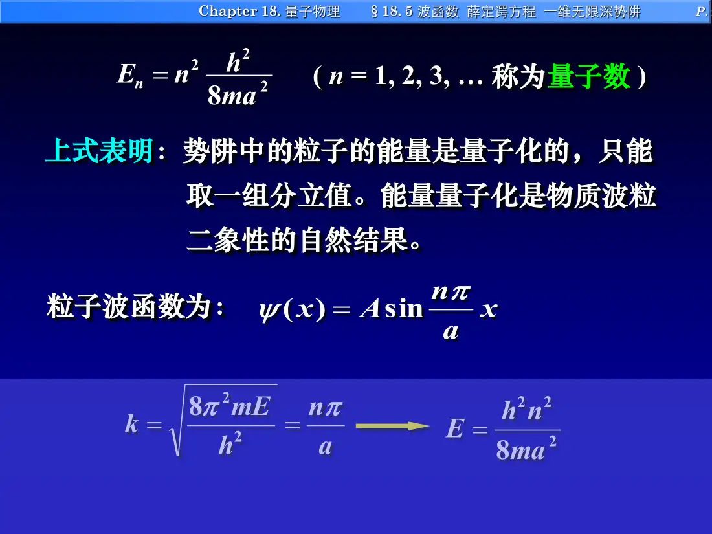

原文：

$E_{n}=n^{2}\frac{h^{2}}{8ma^{2}}$ (n=1,2,3,... 称为量子数)

上式表明：势阱中的粒子的能量是量子化的，只能取一组分立值。能量量子化是物质波粒二象性的自然结果。

粒子波函数为: $\psi(x) = A \sin \frac{n\pi}{a} x$

$$
k = \sqrt {\frac {8 \pi^ {2} m E}{h ^ {2}}} \equiv \frac {n \pi}{a} \longrightarrow E = \frac {h ^ {2} n ^ {2}}{8 m a ^ {2}}
$$

Chapter 18. 量子物理 § 18.5 波函数 薛定谔方程 一维无限深势阱

P.

### $$

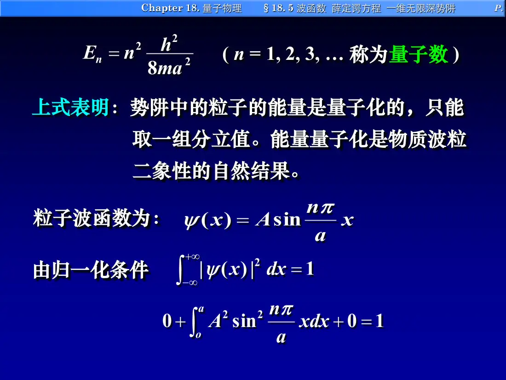

原文：

$$
E _ {n} = n ^ {2} \frac {h ^ {2}}{8 m a ^ {2}} \quad (n = 1, 2, 3, \dots \text {称为量子数})
$$

上式表明：势阱中的粒子的能量是量子化的，只能取一组分立值。能量量子化是物质波粒二象性的自然结果。

粒子波函数为： $\psi (x) = A\sin \frac{n\pi}{a} x$ 由归一化条件 $\int_{-\infty}^{+\infty}|\psi (x)|^2 dx = 1$ $0 + \int_{o}^{a}A^{2}\sin^{2}\frac{n\pi}{a} xdx + 0 = 1$

Chapter 18. 量子物理 § 18.5 波函数 薛定谔方程 一维无限深势阱

P.

### $$

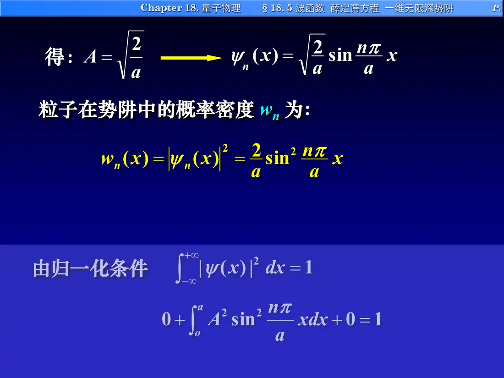

原文：

$$
\text {得:} A = \sqrt {\frac {2}{a}} \quad \longrightarrow \psi_ {n} (x) = \sqrt {\frac {2}{a}} \sin \frac {n \pi}{a} x
$$

粒子在势阱中的概率密度 $w_{n}$ 为:

$$
w _ {n} (x) = \left| \psi_ {n} (x) \right| ^ {2} = \frac {2}{a} \sin^ {2} \frac {n \pi}{a} x
$$

由归一化条件 $\int_{-\infty}^{+\infty}|\psi (x)|^2 dx = 1$

$$
0 + \int_ {o} ^ {a} A ^ {2} \sin^ {2} \frac {n \pi}{a} x d x + 0 = 1
$$

Chapter 18. 量子物理 § 18.5 波函数 薛定谔方程 一维无限深势阱

P.

### $$

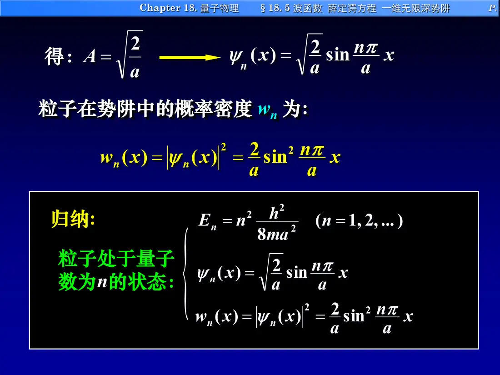

原文：

$$
\text {得:} A = \sqrt {\frac {2}{a}} \quad \longrightarrow \psi_ {n} (x) = \sqrt {\frac {2}{a}} \sin \frac {n \pi}{a} x
$$

粒子在势阱中的概率密度 $w_{n}$ 为:

$$
w _ {n} (x) = \left| \psi_ {n} (x) \right| ^ {2} = \frac {2}{a} \sin^ {2} \frac {n \pi}{a} x
$$

归纳:

$$
E _ {n} = n ^ {2} \frac {h ^ {2}}{8 m a ^ {2}} (n = 1, 2, \dots)
$$

粒子处于量子数为 $n$ 的状态:

$$
\psi_ {n} (x) = \sqrt {\frac {2}{a}} \sin \frac {n \pi}{a} x
$$

$$
w _ {n} (x) = \left| \psi_ {n} (x) \right| ^ {2} = \frac {2}{a} \sin^ {2} \frac {n \pi}{a} x
$$

Chapter 18. 量子物理 § 18.5 波函数 薛定谔方程 一维无限深势阱

P.

### $$

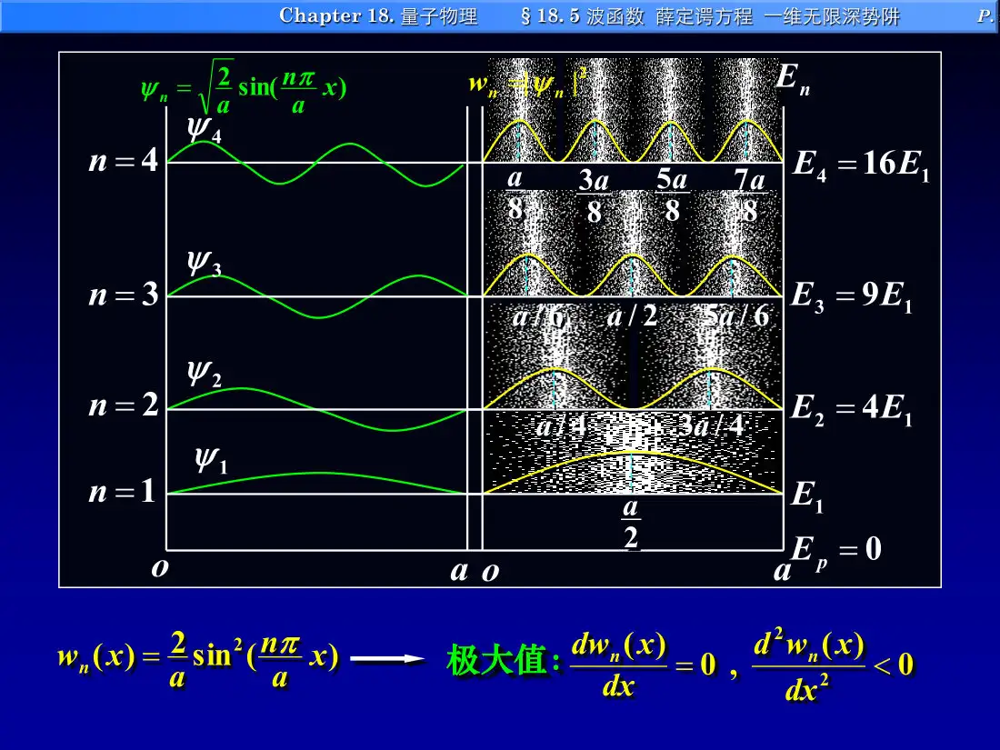

原文：

$$
w _ {n} (x) = \frac {2}{a} \sin^ {2} \left(\frac {n \pi}{a} x\right) \longrightarrow \text {极大值}: \frac {d w _ {n} (x)}{d x} = 0, \frac {d ^ {2} w _ {n} (x)}{d x ^ {2}} <   0
$$

Chapter 18. 量子物理 § 18.5 波函数 薛定谔方程 一维无限深势阱

P.

### 波函数的驻波特点

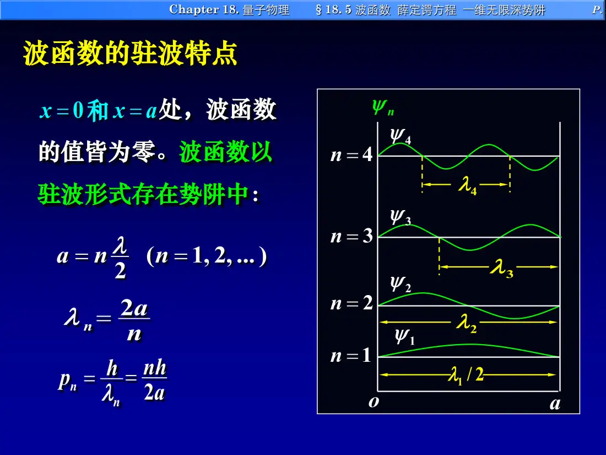

原文：

波函数的驻波特点

x=0 和 x=a 处，波函数的值皆为零。波函数以驻波形式存在势阱中：

$$
a = n \frac {\lambda}{2} (n = 1, 2, \dots)
$$

$$
\lambda_ {n} = \frac {2 a}{n}
$$

$$
p _ {n} = \frac {h}{\lambda_ {n}} = \frac {n h}{2 a}
$$

Chapter 18. 量子物理 § 18.5 波函数 薛定谔方程 一维无限深势阱

P.

### 波函数的驻波特点

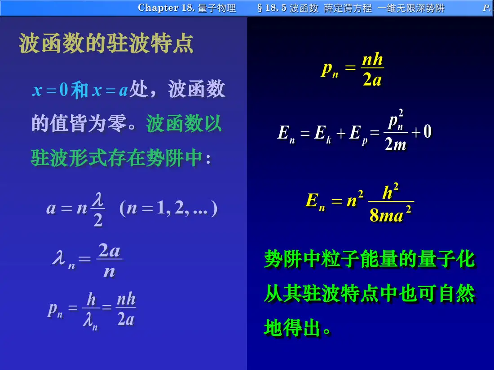

原文：

波函数的驻波特点

x=0 和 x=a 处，波函数的值皆为零。波函数以驻波形式存在势阱中：

$$
a = n \frac {\lambda}{2} (n = 1, 2, \dots)
$$

$$
\lambda_ {n} = \frac {2 a}{n}
$$

$$
p _ {n} = \frac {h}{\lambda_ {n}} = \frac {n h}{2 a}
$$

$$
p _ {n} = \frac {n h}{2 a}
$$

$$
E _ {n} = E _ {k} + E _ {p} = \frac {p _ {n} ^ {2}}{2 m} + 0
$$

$$
E _ {n} = n ^ {2} \frac {h ^ {2}}{8 m a ^ {2}}
$$

势阱中粒子能量的量子化从其驻波特点中也可自然地得出。

Chapter 18. 量子物理 § 18.5 波函数 薛定谔方程 一维无限深势阱

P.

### \*四、对应原理

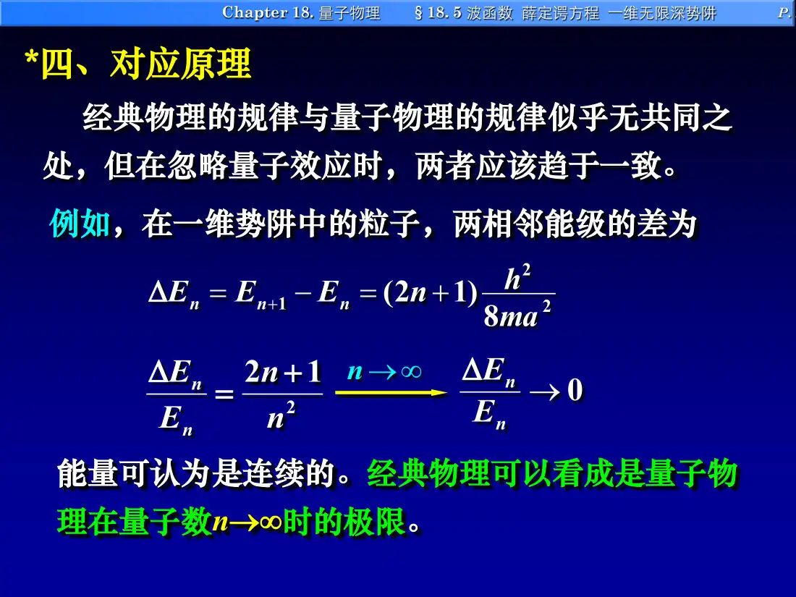

原文：

\*四、对应原理

经典物理的规律与量子物理的规律似乎无共同之处，但在忽略量子效应时，两者应该趋于一致。例如，在一维势阱中的粒子，两相邻能级的差为

$$
\Delta E _ {n} = E _ {n + 1} - E _ {n} = (2 n + 1) \frac {h ^ {2}}{8 m a ^ {2}}
$$

$$
\frac {\Delta E _ {n}}{E _ {n}} = \frac {2 n + 1}{n ^ {2}} \xrightarrow [ ]{n \to \infty} \frac {\Delta E _ {n}}{E _ {n}} \to 0
$$

能量可认为是连续的。经典物理可以看成是量子物理在量子数 $n \to \infty$ 时的极限。

Chapter 18. 量子物理 § 18.5 波函数 薛定谔方程 一维无限深势阱

P.

### \*五、一维方势垒 隧道效应

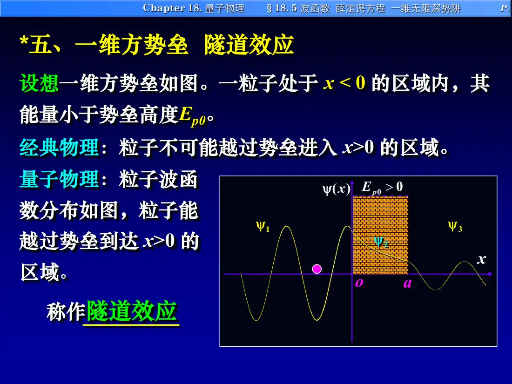

原文：

\*五、一维方势垒 隧道效应

设想一维方势垒如图。一粒子处于 x < 0 的区域内，其能量小于势垒高度 $E_{p0}$ 。

经典物理：粒子不可能越过势垒进入 $x > 0$ 的区域。

量子物理：粒子波函数分布如图，粒子能越过势垒到达 $x > 0$ 的区域。

称作隧道效应

Chapter 18. 量子物理 § 18.5 波函数 薛定谔方程 一维无限深势阱

P.

### P.

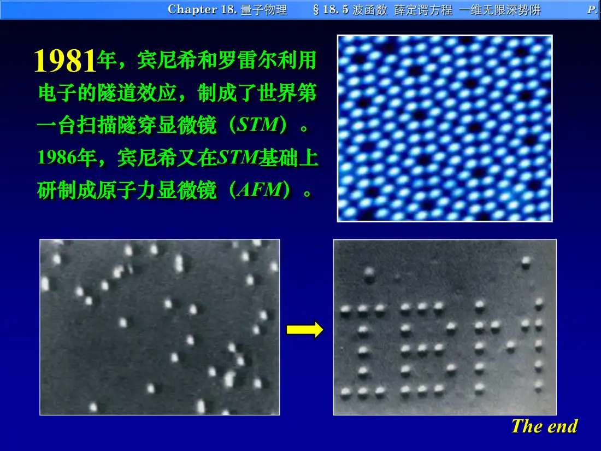

原文：

1981年，宾尼希和罗雷尔利用电子的隧道效应，制成了世界第一台扫描隧穿显微镜（STM）。1986年，宾尼希又在STM基础上研制成原子力显微镜（AFM）。

Chapter 18. 量子物理 § 18.5 波函数 薛定谔方程 一维无限深势阱

P.
