# 《大学物理》第19章 量子物理（19-12 半导体）（课件）

原件的每一页，下面附识别出的文字。

### 固体的能带

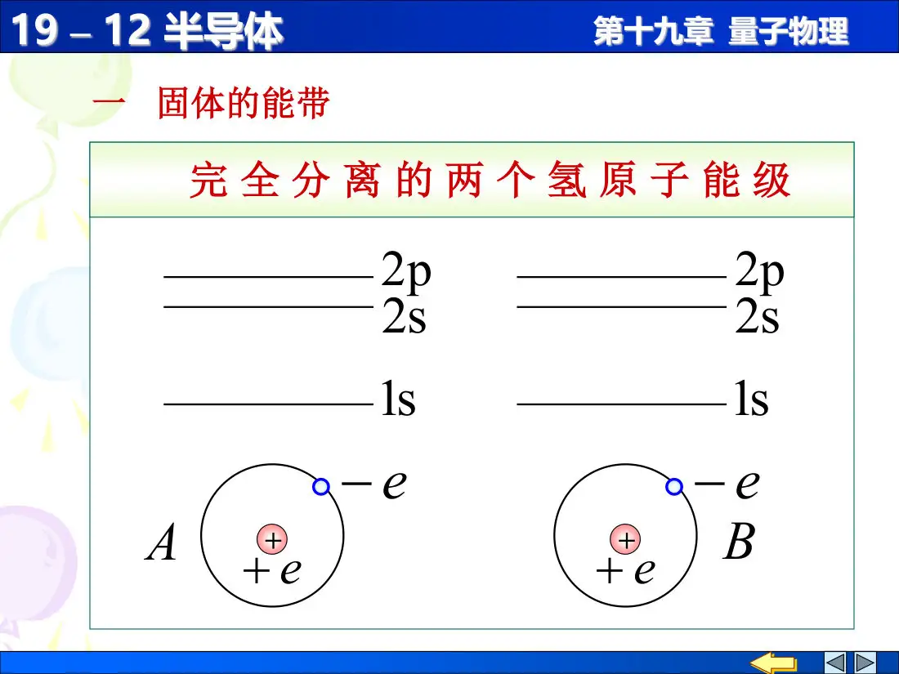

原文：

固体的能带

完 全 分 离 的 两 个 氢 原 子 能 级

2p 2s

$$
\begin{array}{c} \text {2p} \\ \text {2s} \end{array}
$$

1s

-1s

19 – 12 半导体

第十九章 量子物理

### 19 – 12 半导体

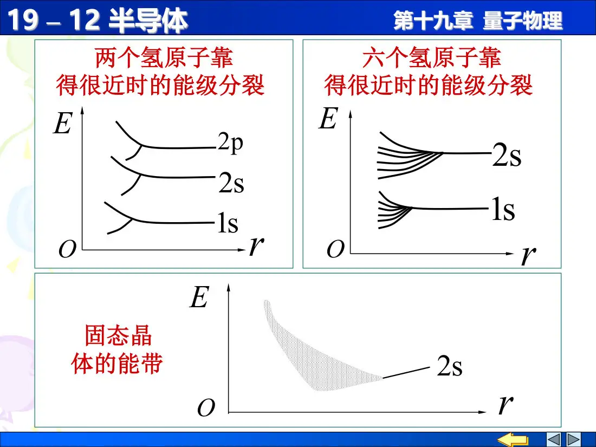

原文：

19 – 12 半导体

两个氢原子靠得很近时的能级分裂

六个氢原子靠得很近时的能级分裂

固态晶体的能带

第十九章 量子物理

### 19 – 12 半导体

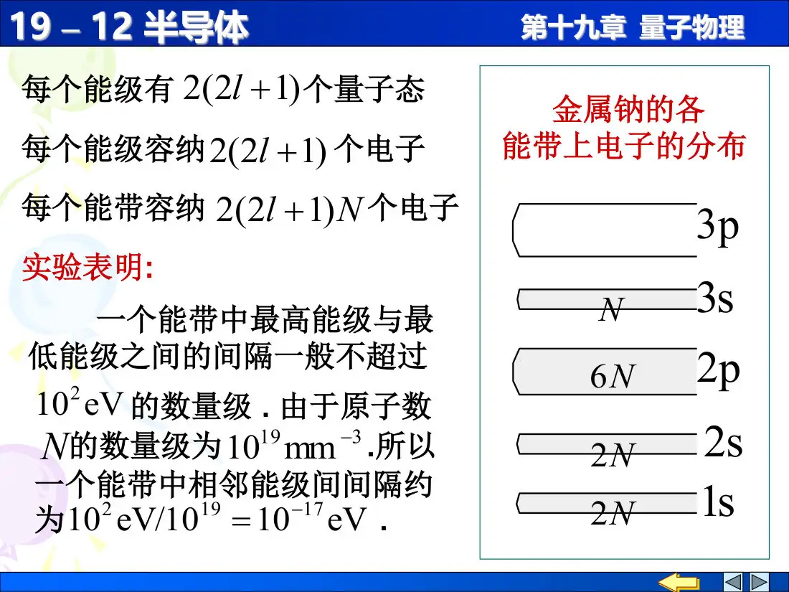

原文：

19 – 12 半导体

每个能级有 个量子态每个能级容纳 个电子每个能带容纳 个电子实验表明:

个能带中最高能级与最低能级之间的间隔一般不超过$1 0 ^ { 2 } \mathrm { e V }$ 的数量级 . 由于原子数的数量级为 $1 0 ^ { 1 9 } \mathrm { m m } ^ { - 3 }$ .所以一为 $1 0 ^ { 2 } \mathrm { e V } / 1 0 ^ { 1 9 } = 1 0 ^ { - 1 7 } \mathrm { e V }$ 隔约.

第十九章 量子物理

金属钠的各能带上电子的分布

### 19 – 12 半导体

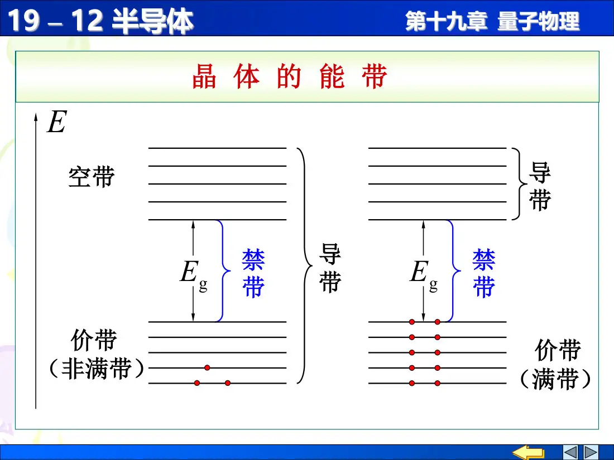

原文：

19 – 12 半导体

第十九章 量子物理

晶 体 的 能 带

E

空带

价带（非满带）

禁带

导带

导带

禁带

价带（满带）

### 19 – 12 半导体

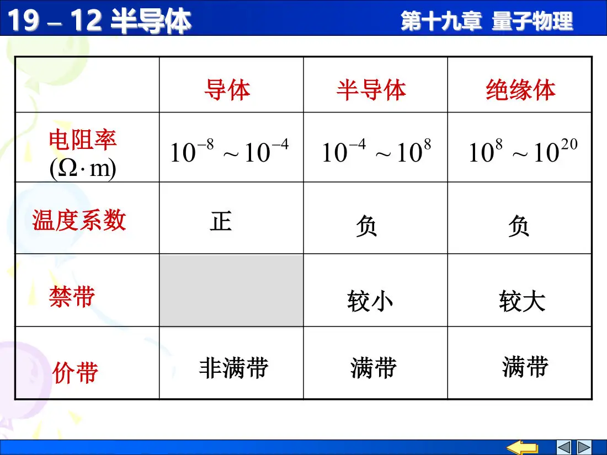

原文：

19 – 12 半导体

第十九章 量子物理

<table><tr><td></td><td>导体</td><td>半导体</td><td>绝缘体</td></tr><tr><td>电阻率(Ω·m)</td><td> $10^{-8} \sim 10^{-4}$ </td><td> $10^{-4} \sim 10^{8}$ </td><td> $10^{8} \sim 10^{20}$ </td></tr><tr><td>温度系数</td><td>正</td><td>负</td><td>负</td></tr><tr><td>禁带</td><td></td><td>较小</td><td>较大</td></tr><tr><td>价带</td><td>非满带</td><td>满带</td><td>满带</td></tr></table>

### 19 – 12 半导体

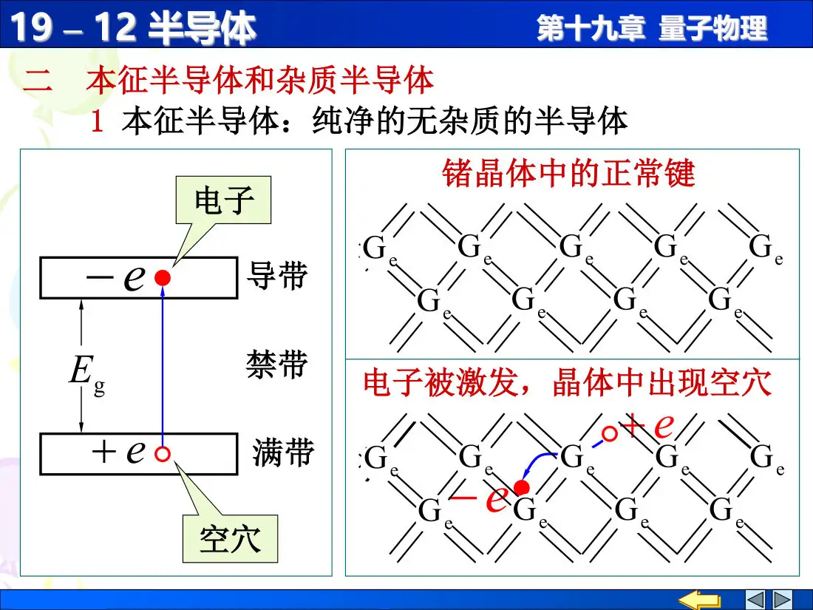

原文：

19 – 12 半导体

二 本征半导体和杂质半导体

1 本征半导体：纯净的无杂质的半导体

电子

导带

禁带

满带

空穴

锗晶体中的正常键

电子被激发，晶体中出现空穴

第十九章 量子物理

### 19 – 12 半导体

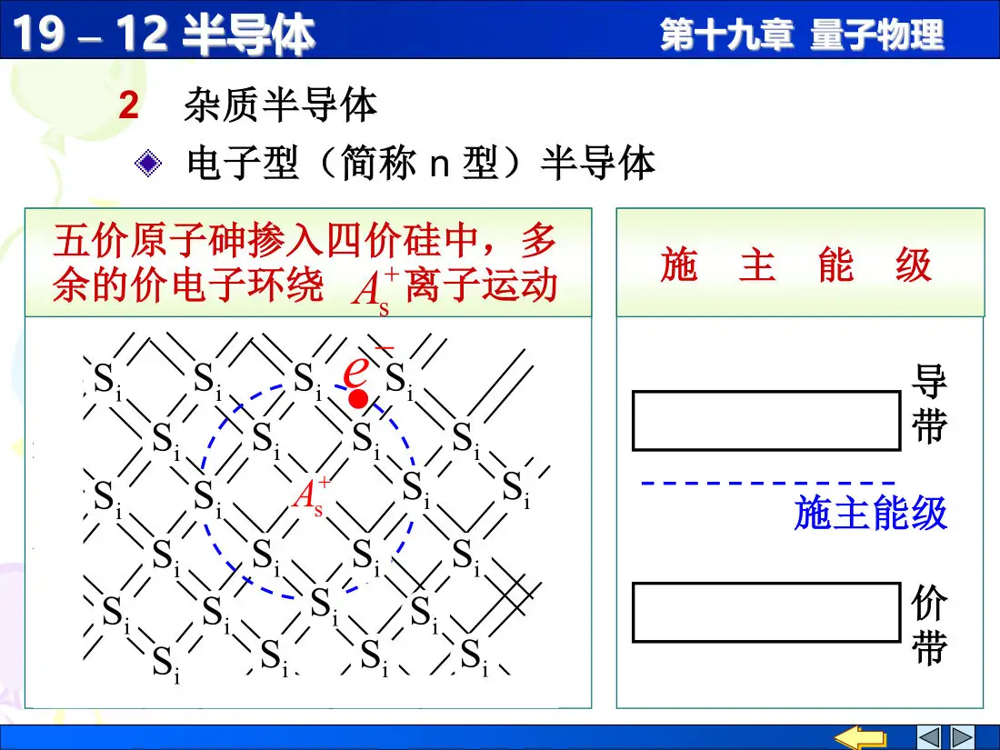

原文：

19 – 12 半导体

2 杂质半导体

● 电子型（简称 n 型）半导体

五价原子砷掺入四价硅中，多余的价电子环绕 离子运动施 主 能 级

导带

施主能级

价带

第十九章 量子物理

### 19 – 12 半导体

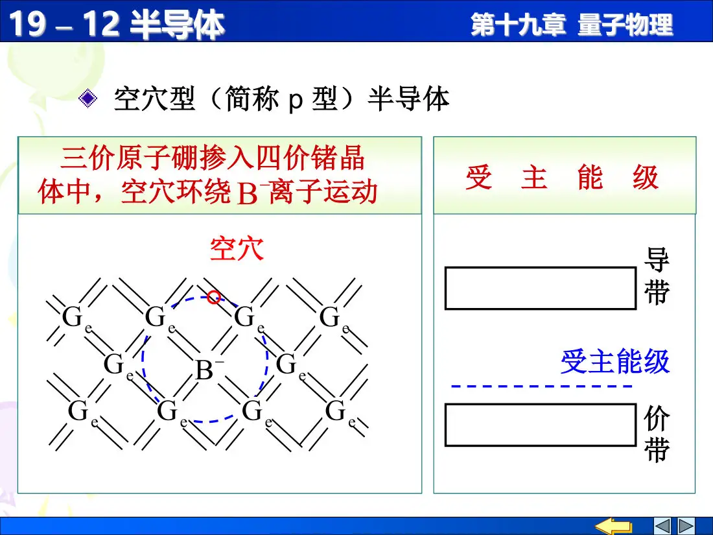

原文：

19 – 12 半导体

空穴型（简称 p 型）半导体

三价原子硼掺入四价锗晶体中，空穴环绕 离子运动

空穴

受 主 能 级

导带

受主能级

价带

第十九章 量子物理

### 19 – 12 半导体

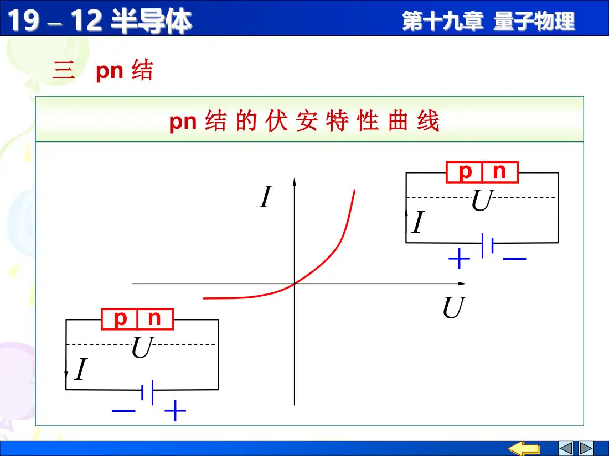

原文：

19 – 12 半导体

第十九章 量子物理

三 pn 结

### 19 – 12 半导体

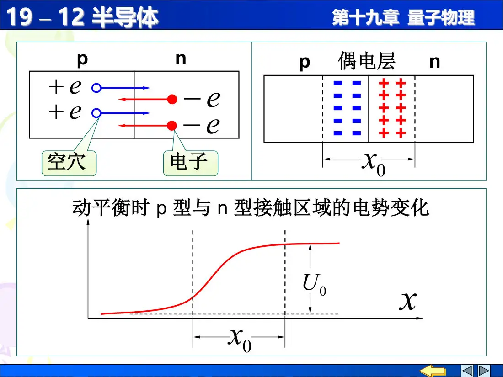

原文：

19 – 12 半导体

第十九章 量子物理

空穴

电子

p

偶电层

n

$$
x _ {0}
$$

动平衡时 $p$ 型与 n 型接触区域的电势变化

### 19 – 12 半导体

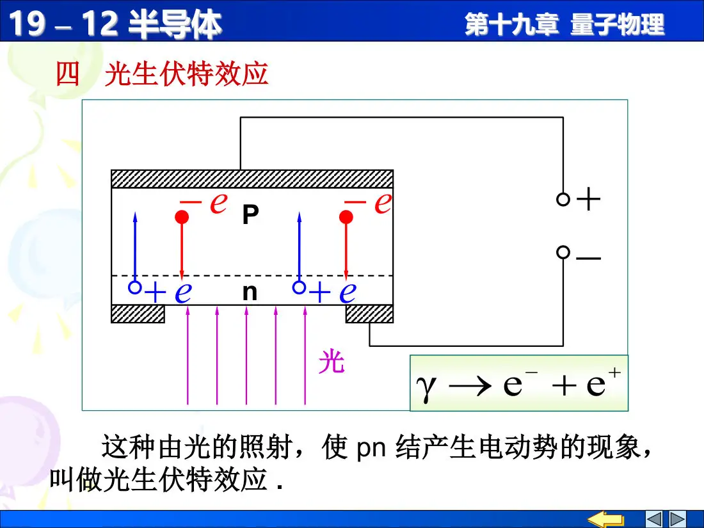

原文：

19 – 12 半导体

第十九章 量子物理

四 光生伏特效应

这种由光的照射，使 pn 结产生电动势的现象，叫做光生伏特效应 .
