# 《大学物理》第1章 质点运动学 §1.1 质点运动的描述（2）（课件）

原件的每一页，下面附识别出的文字。

### § 1. 1 质点运动的描述 (2)

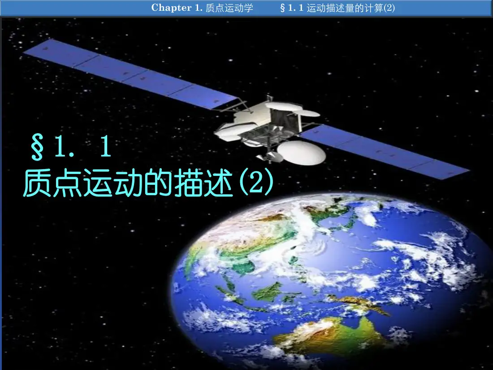

原文：

§ 1. 1 质点运动的描述 (2)

Chapter 1. 质点运动学 § 1.1 运动描述量的计算(2)

### 总结回顾：

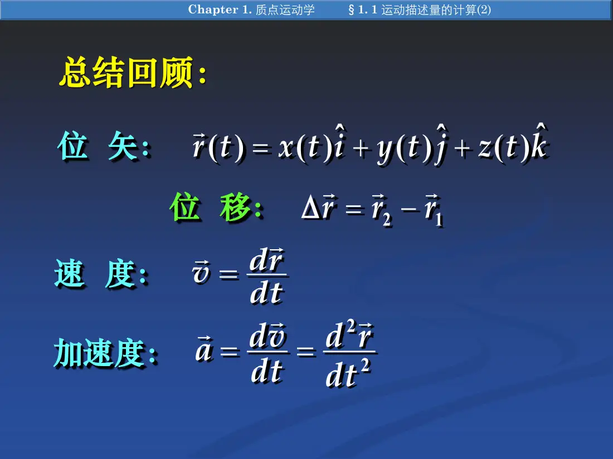

原文：

总结回顾：

位矢: $\vec{r}(t) = x(t)\hat{i} + y(t)\hat{j} + z(t)\hat{k}$

位移: $\Delta \vec{r} \equiv \vec{r}_2 - \vec{r}_1$

速度: $\vec{v} = \frac{d\vec{r}}{dt}$

加速度: $\vec{a} = \frac{d\vec{v}}{dt} = \frac{d^2\vec{r}}{dt^2}$

Chapter 1. 质点运动学 § 1.1 运动描述量的计算(2)

### 一、已知 $\vec{r}$ 求 $\vec{v}$ 、 $\vec{a}$

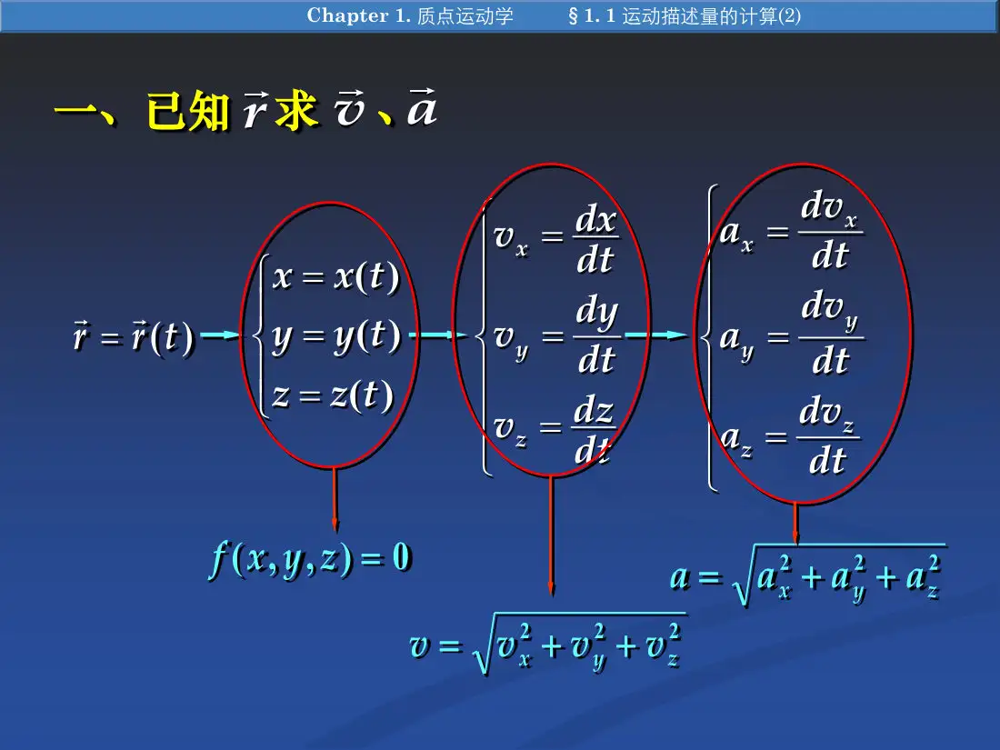

原文：

一、已知 $\vec{r}$ 求 $\vec{v}$ 、 $\vec{a}$

$$
\vec {r} = \vec {r} (t)
$$

$$
\left\{ \begin{array}{l} x = x (t) \\ y = y (t) \\ z = z (t) \end{array} \right.
$$

$$
v _ {x} = \frac {d x}{d t}
$$

$$
v _ {y} = \frac {d y}{d t}
$$

$$
v _ {z} = \frac {d z}{d t}
$$

$$
a _ {x} = \frac {d v _ {x}}{d t}
$$

$$
a _ {y} = \frac {d v _ {y}}{d t}
$$

$$
a _ {z} = \frac {d v _ {z}}{d t}
$$

$$
f (x, y, z) = 0
$$

$$
a = \sqrt {a _ {x} ^ {2} + a _ {y} ^ {2} + a _ {z} ^ {2}}
$$

$$
v = \sqrt {v _ {x} ^ {2} + v _ {y} ^ {2} + v _ {z} ^ {2}}
$$

Chapter 1. 质点运动学

§ 1.1 运动描述量的计算(2)

### $$

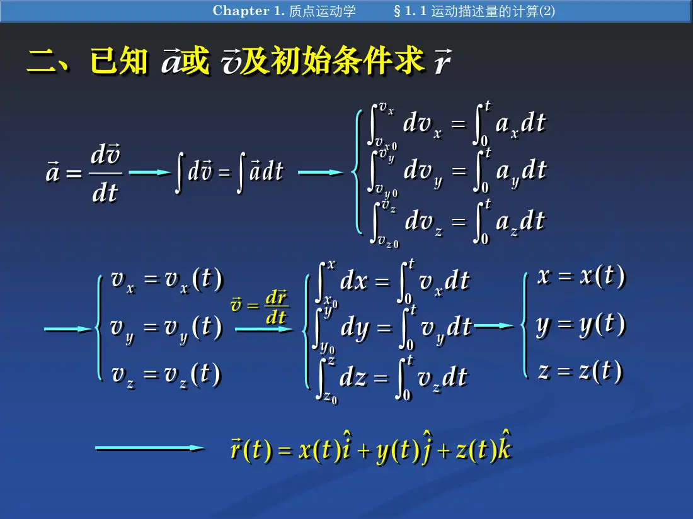

原文：

二、已知 $\vec{a}$ 或 $\vec{v}$ 及初始条件求 $\vec{r}$

$$
\vec {a} = \frac {d \vec {v}}{d t} \longrightarrow \int d \vec {v} = \int \vec {a} d t \longrightarrow \left\{ \begin{array}{l} \int_ {v _ {x 0}} ^ {v _ {x}} d v _ {x} = \int_ {0} ^ {t} a _ {x} d t \\ \int_ {v _ {y 0}} ^ {v _ {x 0}} d v _ {y} = \int_ {0} ^ {t} a _ {y} d t \\ \int_ {v _ {z 0}} ^ {v _ {z}} d v _ {z} = \int_ {0} ^ {t} a _ {z} d t \end{array} \right.
$$

$$
\longrightarrow \left\{ \begin{array}{l} v _ {x} = v _ {x} (t) \\ v _ {y} = v _ {y} (t) \\ v _ {z} = v _ {z} (t) \end{array} \right. \stackrel {\vec {v} = \frac {d \vec {r}}{d t}} {\longrightarrow}
$$

$$
\left\{ \begin{array}{l} \int_ {x _ {0}} ^ {x} d x = \int_ {0} ^ {t} v _ {x} d t \\ \int_ {y _ {0}} ^ {y} d y = \int_ {0} ^ {t} v _ {y} d t \\ \int_ {z _ {0}} ^ {z} d z = \int_ {0} ^ {t} v _ {z} d t \end{array} \right. \longrightarrow \left\{ \begin{array}{l} x = x (t) \\ y = y (t) \\ z = z (t) \end{array} \right.
$$

$$
\vec {r} (t) = x (t) \hat {i} + y (t) \hat {j} + z (t) \hat {k}
$$

Chapter 1. 质点运动学

§ 1.1 运动描述量的计算(2)

### $$

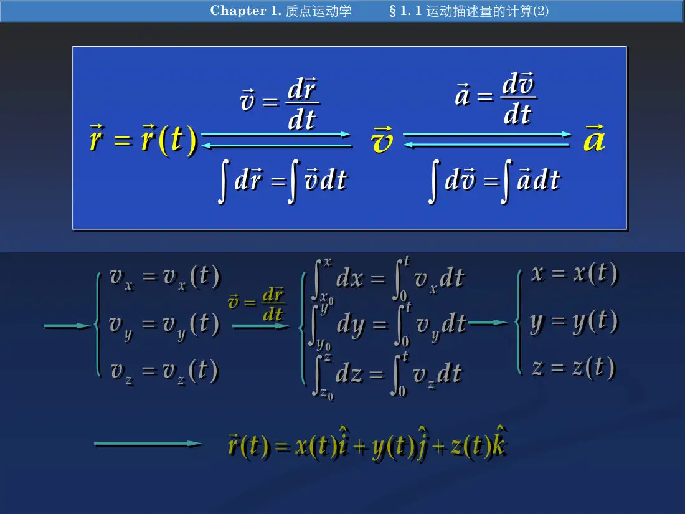

原文：

$$
\vec {r} = \vec {r} (t) \xrightarrow [ \int d \vec {r} = \int \vec {v} d t ]{\vec {v} = \frac {d \vec {r}}{d t}} \vec {\vec {v}} \xrightarrow [ \int d \vec {v} = \int \vec {a} d t ]{\vec {a} = \frac {d \vec {v}}{d t}} \vec {a}
$$

$$
\begin{array}{r l} & {\longrightarrow \left\{ \begin{array}{l l} v _ {x} = v _ {x} (t) \\ v _ {y} = v _ {y} (t) \\ v _ {z} = v _ {z} (t) \end{array} \right. \stackrel {\vec {v} = \frac {d \vec {r}}{d t}} {\longrightarrow} \left\{ \begin{array}{l l} \int_ {x _ {0}} ^ {x} d x = \int_ {0} ^ {t} v _ {x} d t \\ \int_ {y _ {0}} ^ {y} d y = \int_ {0} ^ {t} v _ {y} d t \\ \int_ {z _ {0}} ^ {z} d z = \int_ {0} ^ {t} v _ {z} d t \end{array} \right. \longrightarrow \left\{ \begin{array}{l l} x = x (t) \\ y = y (t) \\ z = z (t) \end{array} \right.} \\ & {\longrightarrow \quad \vec {r} (t) = x (t) \hat {\dot {i}} + y (t) \hat {\dot {j}} + z (t) \hat {\dot {k}}} \end{array}
$$

Chapter 1. 质点运动学

§ 1.1 运动描述量的计算(2)

### Chapter 1. 质点运动学 § 1.1 运动描述量的计算(2)

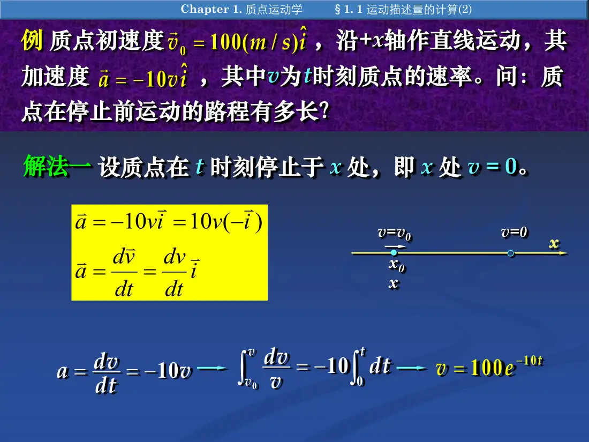

原文：

Chapter 1. 质点运动学 § 1.1 运动描述量的计算(2)

例 质点初速度 $\vec{v}_0 = 100(m / s)\hat{i}$ ，沿 $+x$ 轴作直线运动，其加速度 $\vec{a} = -10\vec{v}\hat{i}$ ，其中 $v$ 为 $t$ 时刻质点的速率。问：质点在停止前运动的路程有多长？

解法一 设质点在 t 时刻停止于 x 处，即 x 处 v = 0。

$$
\begin{array}{l} \vec {a} = - 1 0 v \vec {i} = 1 0 v (- \vec {i}) \\ \vec {a} = \frac {d \vec {v}}{d t} = \frac {d v}{d t} \vec {i} \end{array}
$$

$$
\begin{array}{c c} v = v _ {0} & v = 0 \\ x _ {0} & x \end{array}
$$

$$
a = \frac {d v}{d t} = - 1 0 v \longrightarrow \int_ {v _ {0}} ^ {v} \frac {d v}{v} = - 1 0 \int_ {0} ^ {t} d t \longrightarrow v = 1 0 0 e ^ {- 1 0 t}
$$

### Chapter 1. 质点运动学 § 1.1 运动描述量的计算(2)

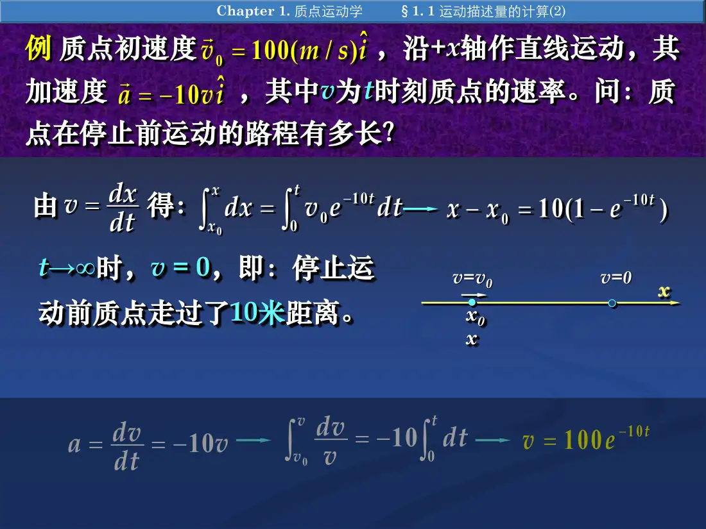

原文：

Chapter 1. 质点运动学 § 1.1 运动描述量的计算(2)

例 质点初速度 $\vec{v}_0 = 100(m / s)\hat{i}$ ，沿 $+x$ 轴作直线运动，其加速度 $\vec{a} = -10\vec{v}\hat{i}$ ，其中 $v$ 为 $t$ 时刻质点的速率。问：质点在停止前运动的路程有多长？

由 $v=\frac{dx}{dt}$ 得： $\int_{x_{0}}^{x}dx=\int_{0}^{t}v_{0}e^{-10t}dt\longrightarrow x-x_{0}=10(1-e^{-10t})$ $t\rightarrow\infty$ 时，v=0，即：停止运动前质点走过了10米距离。

$$
a = \frac {d v}{d t} = - 1 0 v \longrightarrow \int_ {v _ {0}} ^ {v} \frac {d v}{v} = - 1 0 \int_ {0} ^ {t} d t \longrightarrow v = 1 0 0 e ^ {- 1 0 t}
$$

### Chapter 1. 质点运动学 § 1.1 运动描述量的计算(2)

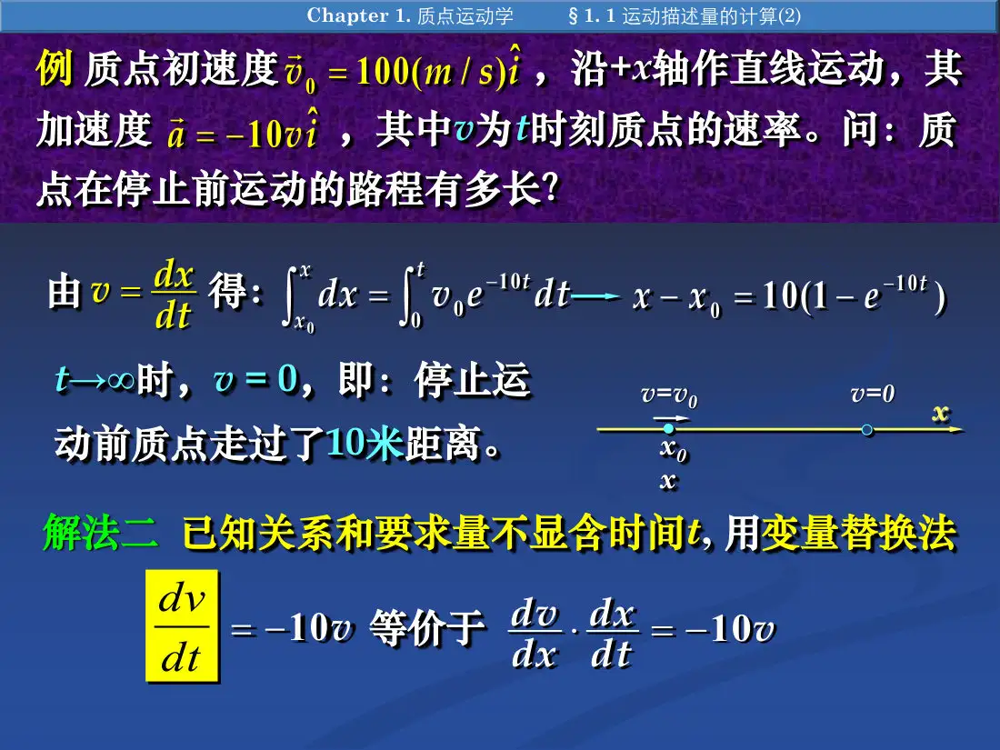

原文：

Chapter 1. 质点运动学 § 1.1 运动描述量的计算(2)

例 质点初速度 $\vec{v}_0 = 100(m / s)\hat{i}$ ，沿 $+x$ 轴作直线运动，其加速度 $\vec{a} = -10\vec{v}\hat{i}$ ，其中 $v$ 为 $t$ 时刻质点的速率。问：质点在停止前运动的路程有多长？

由 $v=\frac{dx}{dt}$ 得： $\int_{x_{0}}^{x}dx=\int_{0}^{t}v_{0}e^{-10t}dt\longrightarrow x-x_{0}=10(1-e^{-10t})$ $t\to\infty$ 时，v=0，即：停止运动前质点走过了10米距离。

解法二 已知关系和要求量不显含时间t, 用变量替换法 $\frac{dv}{dt} = -10v$ 等价于 $\frac{dv}{dx} \cdot \frac{dx}{dt} = -10v$

### Chapter 1. 质点运动学 § 1.1 运动描述量的计算(2)

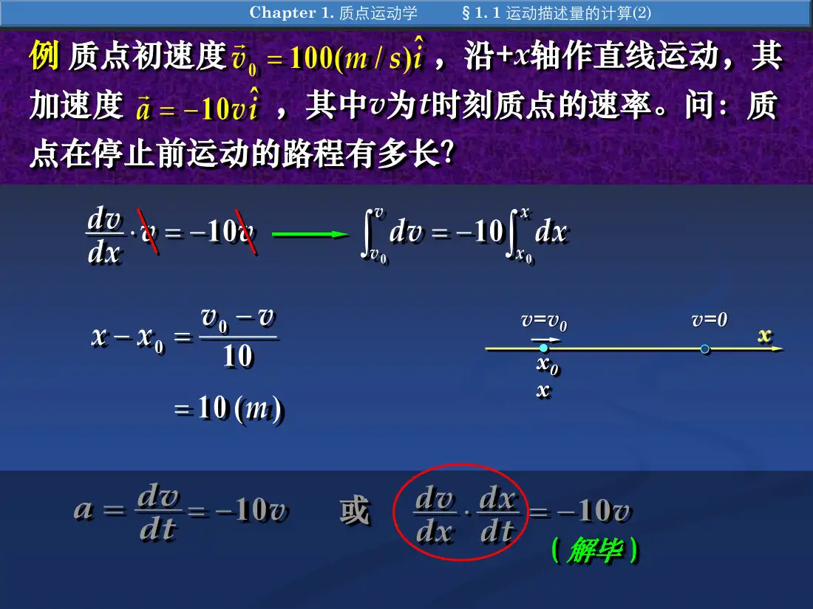

原文：

Chapter 1. 质点运动学 § 1.1 运动描述量的计算(2)

例 质点初速度 $\vec{v}_0 = 100(m/s)\hat{i}$ ，沿 $+x$ 轴作直线运动，其加速度 $\vec{a} = -10\vec{v}\hat{i}$ ，其中 $v$ 为 $t$ 时刻质点的速率。问：质点在停止前运动的路程有多长？

$$
\begin{array}{l} \frac {d v}{d x} \cdot v = - 1 0 v \longrightarrow \int_ {v _ {0}} ^ {v} d v = - 1 0 \int_ {x _ {0}} ^ {x} d x \\ x - x _ {0} = \frac {v _ {0} - v}{1 0} \\ = 1 0 (m) \end{array} \qquad \begin{array}{l} \overrightarrow {x _ {0}} = \overrightarrow {v = v _ {0}} \quad \overrightarrow {x = 0} \\ \overrightarrow {x _ {0}} = \overrightarrow {x} \end{array}
$$

$$
a = \frac {d v}{d t} = - 1 0 v
$$

或

$$
\frac {d v}{d x} \cdot \frac {d x}{d t} = - 1 0 v (\text {解毕})
$$

### 三、加速度为恒矢量时的质点运动

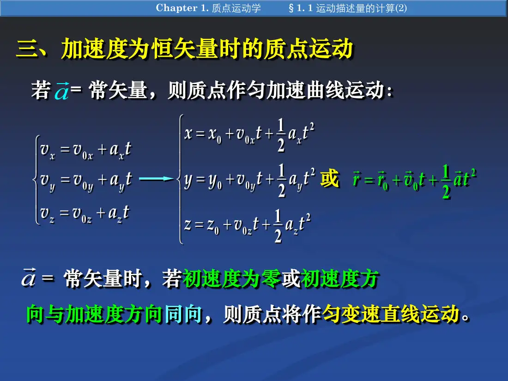

原文：

三、加速度为恒矢量时的质点运动

若 $\vec{a}$ = 常矢量，则质点作匀加速曲线运动：

$$
\left\{ \begin{array}{l} v _ {x} = v _ {0 x} + a _ {x} t \\ v _ {y} = v _ {0 y} + a _ {y} t \\ v _ {z} = v _ {0 z} + a _ {z} t \end{array} \right. \longrightarrow \left\{ \begin{array}{l l} x = x _ {0} + v _ {0 x} t + \frac {1}{2} a _ {x} t ^ {2} \\ y = y _ {0} + v _ {0 y} t + \frac {1}{2} a _ {y} t ^ {2} \text {或} & \vec {r} = \vec {r} _ {0} + \vec {v} _ {0} t + \frac {1}{2} \vec {a} t ^ {2} \\ z = z _ {0} + v _ {0 z} t + \frac {1}{2} a _ {z} t ^ {2} \end{array} \right.
$$

$\vec{a} =$ 常矢量时, 若初速度为零或初速度方向与加速度方向同向, 则质点将作匀变速直线运动。

Chapter 1. 质点运动学

§ 1.1 运动描述量的计算(2)

### [常见的运动实例]

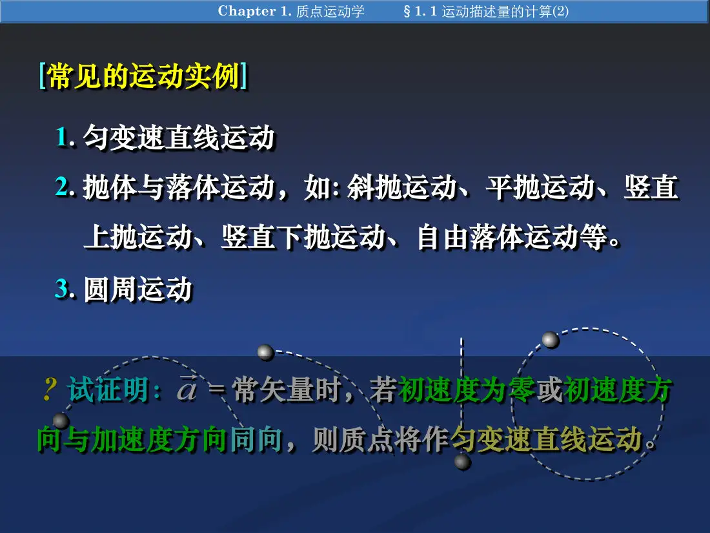

原文：

[常见的运动实例]

1. 匀变速直线运动

2. 抛体与落体运动，如: 斜抛运动、平抛运动、竖直上抛运动、竖直下抛运动、自由落体运动等。

3. 圆周运动

? 试证明: $\vec{a} =$ 常矢量时, 若初速度为零或初速度方向与加速度方向同向, 则质点将作匀变速直线运动。

Chapter 1. 质点运动学

§ 1.1 运动描述量的计算(2)

### 归纳

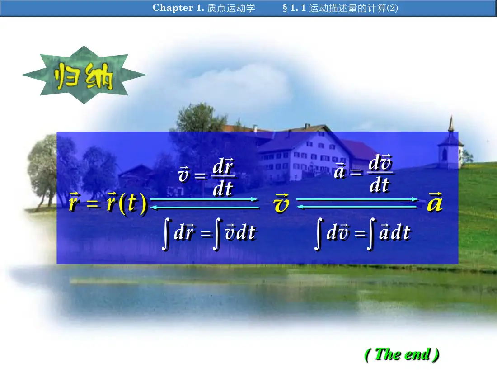

原文：

归纳

$$
\vec {v} = \frac {d \vec {r}}{d t}
$$

$$
\vec {a} = \frac {d \vec {v}}{d t}
$$

$$
\int d \vec {r} = \int \vec {v} d t
$$

$$
\int d \vec {v} = \int \vec {a} d t
$$

( The end )

Chapter 1. 质点运动学

§ 1.1 运动描述量的计算(2)
