# 《大学物理》第1章 质点运动学 §1.2 圆周运动（课件）

原件的每一页，下面附识别出的文字。

### 质点运动：简单 → 复杂

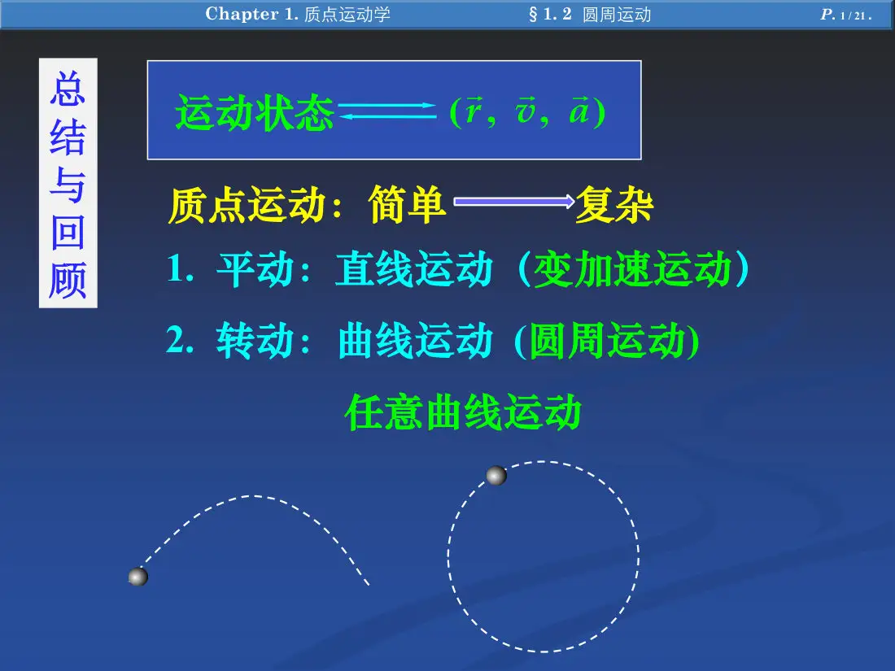

原文：

运动状态 $\Longleftrightarrow (\vec{r},\vec{v},\vec{a})$

质点运动：简单 → 复杂

1. 平动：直线运动（变加速运动）

2. 转动：曲线运动（圆周运动）

任意曲线运动

总结与回顾

P. 1/21.

Chapter 1. 质点运动学

§ 1.2 圆周运动

### § 1.2 员周运动

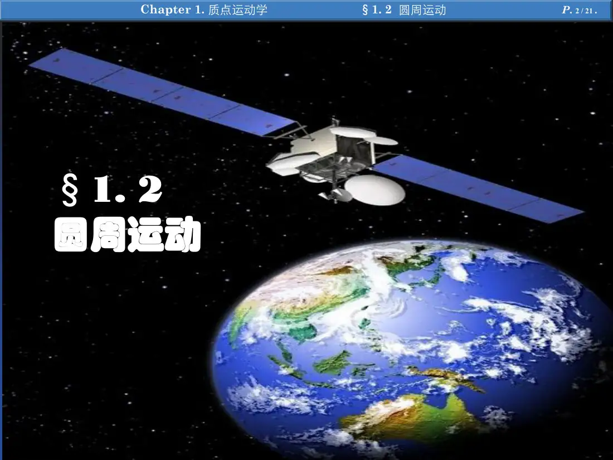

原文：

§ 1.2 员周运动

P. 2/21.

Chapter 1. 质点运动学

§ 1.2 圆周运动

### 一、圆周运动的角量描述

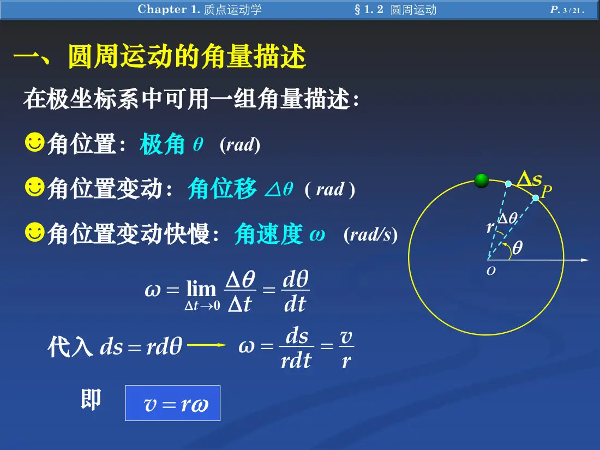

原文：

一、圆周运动的角量描述

在极坐标系中可用一组角量描述:

角位置: 极角 $\theta$ (rad)

角位置变动：角位移 $\triangle \theta$ (rad)

角位置变动快慢：角速度 $\omega$ (rad/s)

$$
\omega = \lim _ {\Delta t \rightarrow 0} \frac {\Delta \theta}{\Delta t} = \frac {d \theta}{d t}
$$

代入 $ds = rd\theta \longrightarrow \omega = \frac{ds}{rdt} = \frac{v}{r}$

即

$$
v = r \omega
$$

P. 3/21.

Chapter 1. 质点运动学

§ 1.2 圆周运动

### 角速度变动快慢: 角加速度 $\alpha$ (rad/s²)

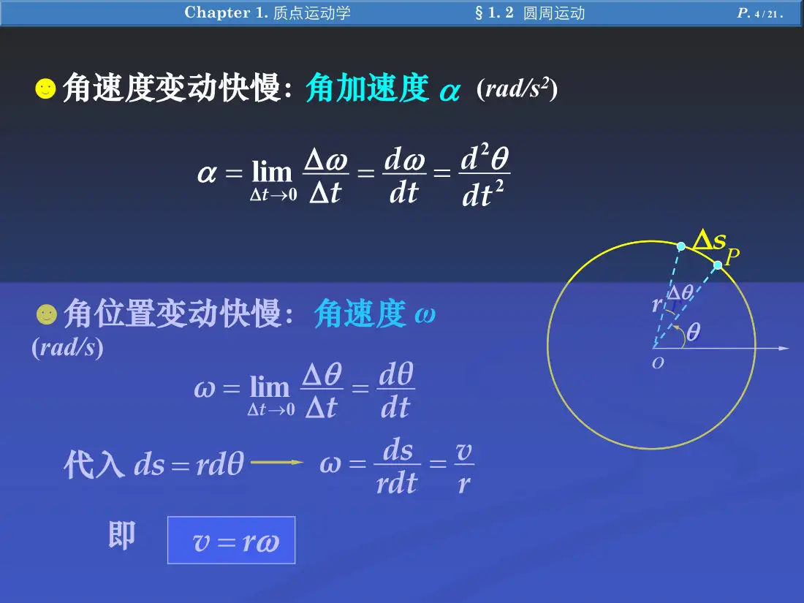

原文：

角速度变动快慢: 角加速度 $\alpha$ (rad/s²)

$$
\alpha = \lim _ {\Delta t \to 0} \frac {\Delta \omega}{\Delta t} = \frac {d \omega}{d t} = \frac {d ^ {2} \theta}{d t ^ {2}}
$$

角位置变动快慢: 角速度 $\omega$ (rad/s)

$$
\omega = \lim _ {\Delta t \rightarrow 0} \frac {\Delta \theta}{\Delta t} = \frac {d \theta}{d t}
$$

代入 $ds = rd\theta \longrightarrow \omega = \frac{ds}{rdt} = \frac{v}{r}$

即

$$
v = r \omega
$$

Chapter 1. 质点运动学

§ 1.2 圆周运动

P. 4/21.

### 角速度变动快慢: 角加速度 $\alpha$ (rad/s²)

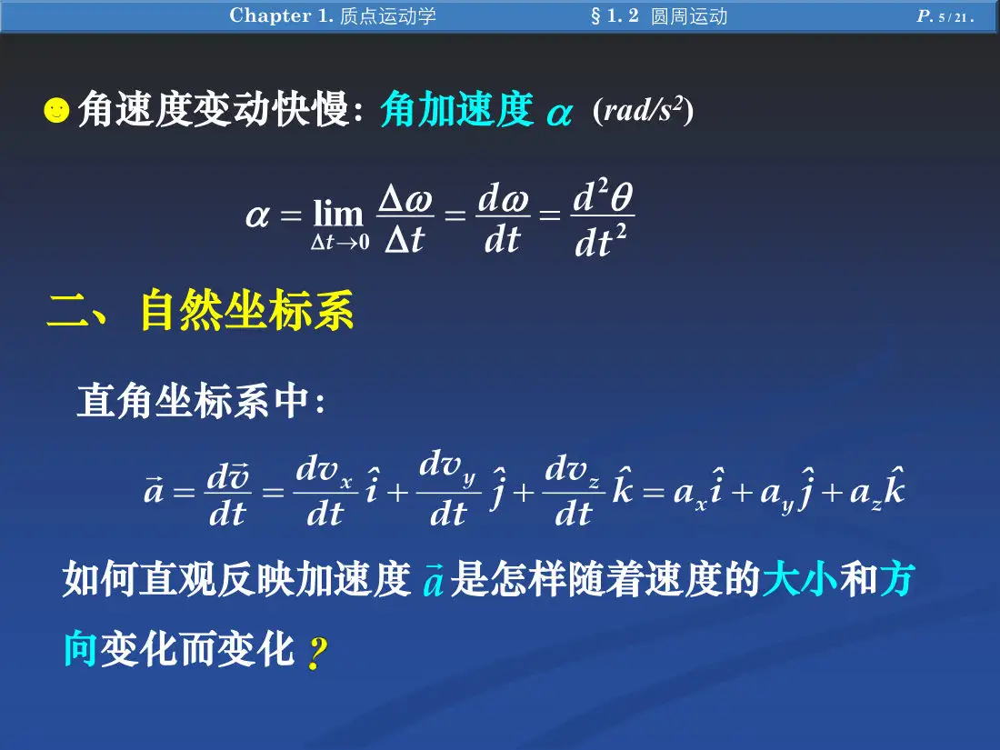

原文：

角速度变动快慢: 角加速度 $\alpha$ (rad/s²)

$$
\alpha = \lim _ {\Delta t \rightarrow 0} \frac {\Delta \omega}{\Delta t} = \frac {d \omega}{d t} = \frac {d ^ {2} \theta}{d t ^ {2}}
$$

二、自然坐标系

直角坐标系中:

$\vec{a} = \frac{d\vec{v}}{dt} = \frac{dv_x}{dt}\hat{i} +\frac{dv_y}{dt}\hat{j} +\frac{dv_z}{dt}\hat{k} = a_x\hat{i} +a_y\hat{j} +a_z\hat{k}$ 如何直观反映加速度 $\vec{a}$ 是怎样随着速度的大小和方向变化而变化？

P. 5/21.

Chapter 1. 质点运动学

§ 1.2 圆周运动

### 自然坐标系是建立在物体运动的轨迹上的，有两个坐标轴，切向坐标轴和法向坐标轴。

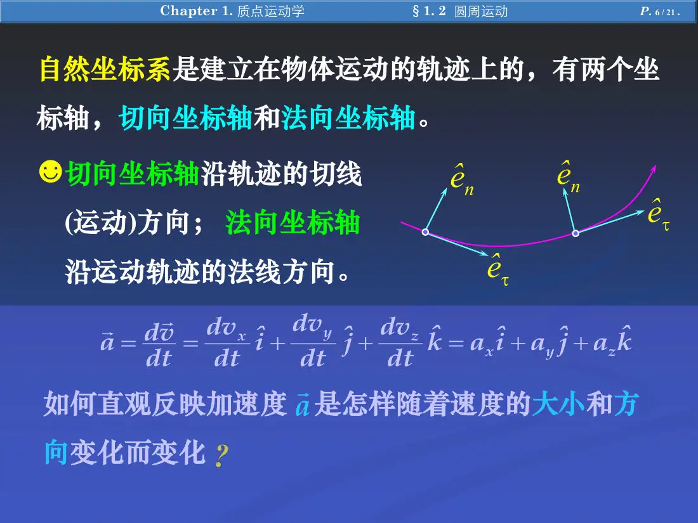

原文：

自然坐标系是建立在物体运动的轨迹上的，有两个坐标轴，切向坐标轴和法向坐标轴。

切向坐标轴沿轨迹的切线(运动)方向；法向坐标轴沿运动轨迹的法线方向。

$\vec{a} = \frac{d\vec{v}}{dt} = \frac{dv_x}{dt}\hat{i} +\frac{dv_y}{dt}\hat{j} +\frac{dv_z}{dt}\hat{k} = a_x\hat{i} +a_y\hat{j} +a_z\hat{k}$ 如何直观反映加速度 $\vec{a}$ 是怎样随着速度的大小和方向变化而变化？

P. 6/21.

Chapter 1. 质点运动学

§ 1.2 圆周运动

### 自然坐标系是建立在物体运动的轨迹上的，有两个坐标轴，切向坐标轴和法向坐标轴。

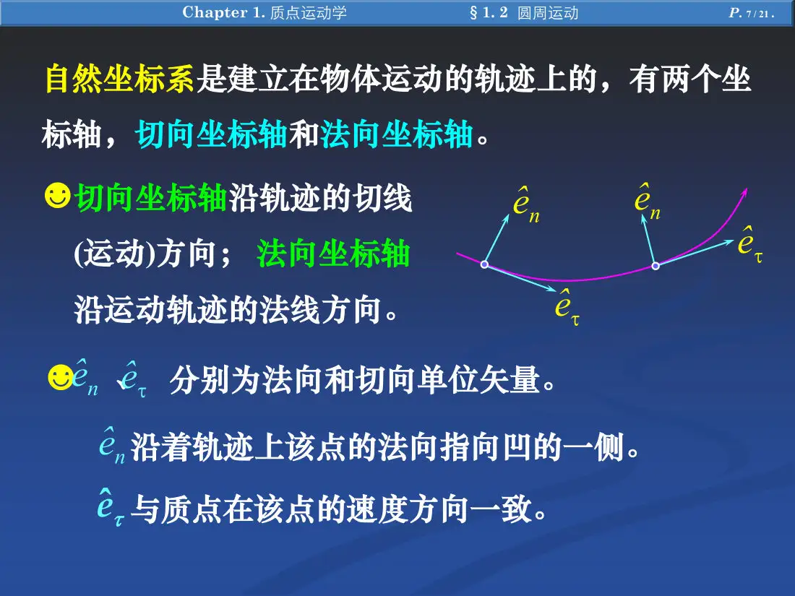

原文：

自然坐标系是建立在物体运动的轨迹上的，有两个坐标轴，切向坐标轴和法向坐标轴。

切向坐标轴沿轨迹的切线(运动)方向；法向坐标轴沿运动轨迹的法线方向。

$\hat{e}_{n}$ $\hat{e}_{\tau}$ 分别为法向和切向单位矢量。

$\hat{e}_n$ 沿着轨迹上该点的法向指向凹的一侧。

$\hat{e}_{\tau}$ 与质点在该点的速度方向一致。

Chapter 1. 质点运动学

§ 1.2 圆周运动

P. 7/21.

### 三、切向与法向加速度质点作圆周运动。建立自然坐标系如图所示。

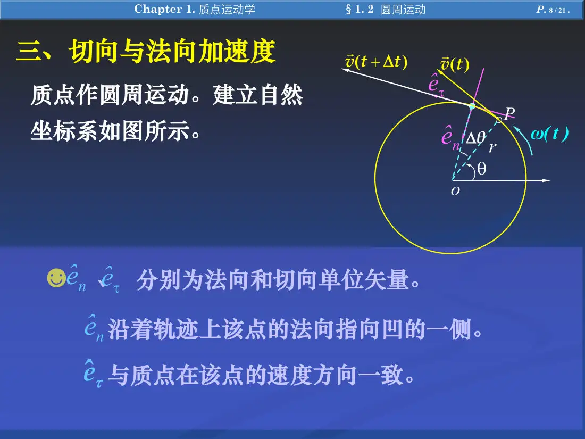

原文：

三、切向与法向加速度质点作圆周运动。建立自然坐标系如图所示。

😊 $\hat{e}_{n}$ ̂ $\hat{e}_{\tau}$ 分别为法向和切向单位矢量。

$\hat{e}_n$ 沿着轨迹上该点的法向指向凹的一侧。

$\hat{e}_{\tau}$ 与质点在该点的速度方向一致。

Chapter 1. 质点运动学

§ 1.2 圆周运动

P. 8/21.

### 三、切向与法向加速度质点作圆周运动。建立自然坐标系如图所示。

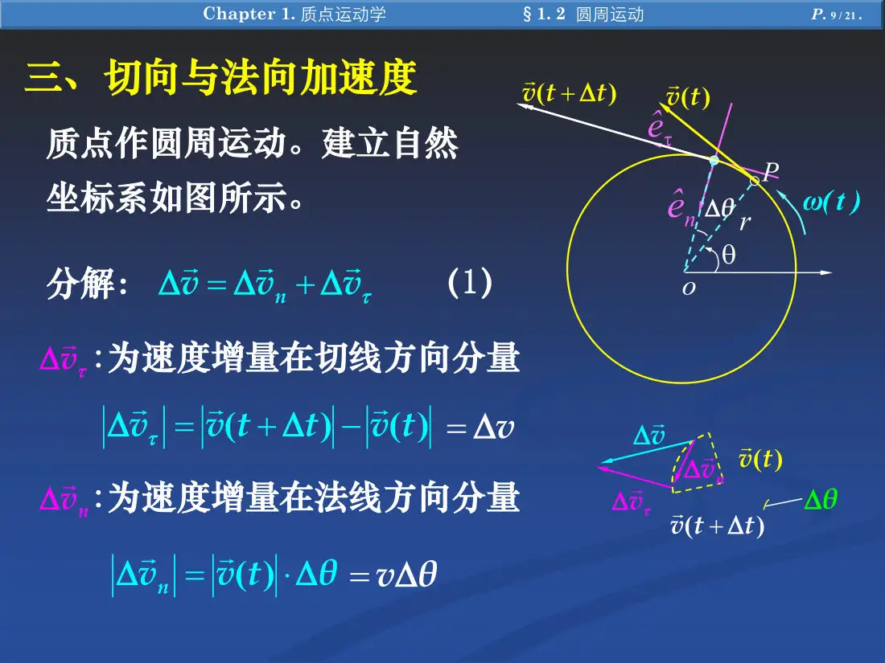

原文：

三、切向与法向加速度质点作圆周运动。建立自然坐标系如图所示。

分解: $\Delta \vec{v} = \Delta \vec{v}_n + \Delta \vec{v}_\tau$ (1)

$\Delta \vec{v}_{\tau}$ :为速度增量在切线方向分量

$\left|\Delta \vec{v}_{\tau}\right| = \left|\vec{v} (t + \Delta t)\right| - \left|\vec{v} (t)\right| = \Delta v$

$\Delta \vec{v}_n$ : 为速度增量在法线方向分量

$\left|\Delta \vec{v}_n\right| = \left|\vec{v} (t)\right| \cdot \Delta \theta = v \Delta \theta$

$$
\begin{array}{c} \Delta \vec {v} \\ \Delta \vec {v} _ {\tau} \end{array} \begin{array}{c} \Delta \vec {v} _ {u} \\ \vec {v} (t) \\ \vec {v} (t + \Delta t) \end{array} \begin{array}{c} \vec {v} (t) \\ - \Delta \theta \end{array}
$$

Chapter 1. 质点运动学

§ 1.2 圆周运动

P. 9/21.

### (1) 式两边同除 $\triangle t$ :

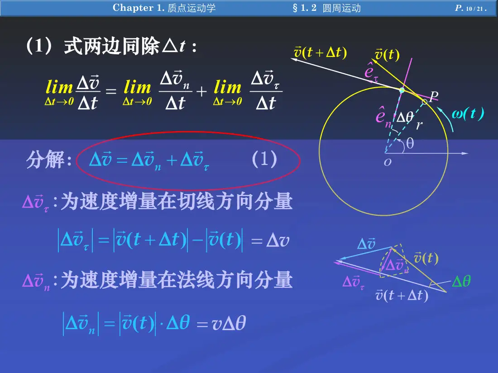

原文：

(1) 式两边同除 $\triangle t$ :

$$
\lim _ {\Delta t \rightarrow 0} \frac {\Delta \vec {v}}{\Delta t} = \lim _ {\Delta t \rightarrow 0} \frac {\Delta \vec {v} _ {n}}{\Delta t} + \lim _ {\Delta t \rightarrow 0} \frac {\Delta \vec {v} _ {\tau}}{\Delta t}
$$

分解: $\Delta \vec{v} = \Delta \vec{v}_n + \Delta \vec{v}_\tau$

(1)

$\Delta \vec{v}_{\tau}$ : 为速度增量在切线方向分量

$$
\left| \Delta \vec {v} _ {\tau} \right| = \left| \vec {v} (t + \Delta t) \right| - \left| \vec {v} (t) \right| = \Delta v
$$

$\Delta \vec{v}_n$ : 为速度增量在法线方向分量

$\left|\Delta \vec{v}_n\right| = \left|\vec{v} (t)\right| \cdot \Delta \theta = v \Delta \theta$

$$
\begin{array}{c} \Delta \vec {v} \\ \Delta \vec {v} _ {\tau} \\ \vec {v} (t + \Delta t) \end{array} \begin{array}{c} \vec {v} (t) \\ \vec {v} (t + \Delta t) \\ \Delta \theta \end{array}
$$

Chapter 1. 质点运动学

§ 1.2 圆周运动

P. 10 / 21.

### (1) 式两边同除 $\triangle t$ :

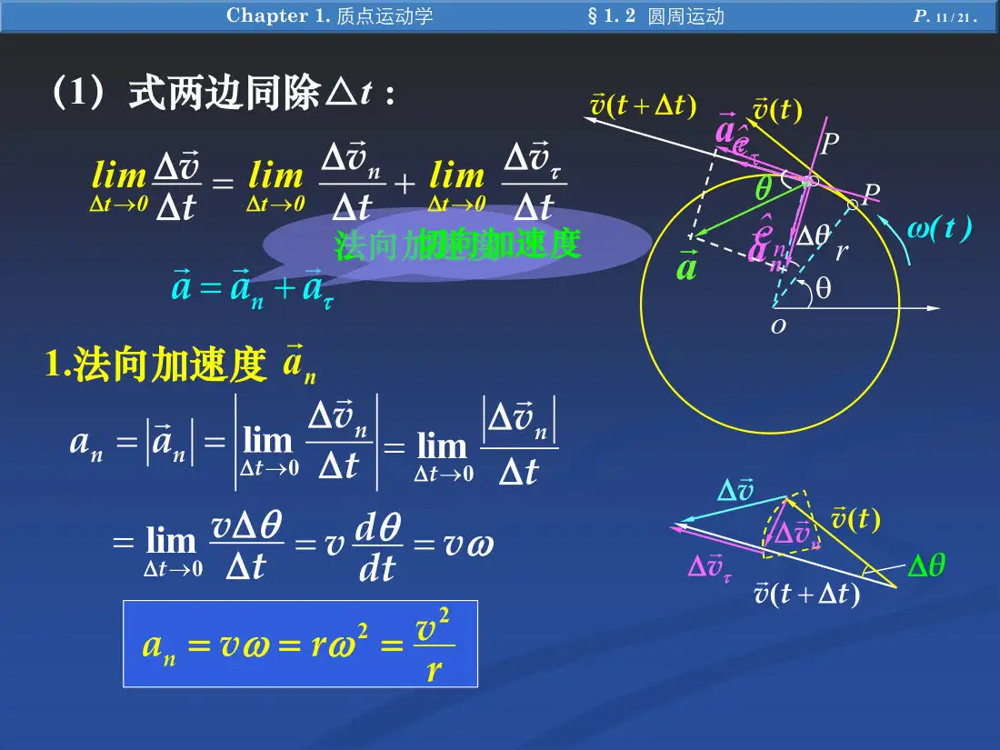

原文：

(1) 式两边同除 $\triangle t$ :

$$
\lim _ {\Delta t \rightarrow 0} \frac {\Delta \vec {v}}{\Delta t} = \lim _ {\Delta t \rightarrow 0} \frac {\Delta \vec {v} _ {n}}{\Delta t} + \lim _ {\Delta t \rightarrow 0} \frac {\Delta \vec {v} _ {\tau}}{\Delta t}
$$

切向加速度

$$
\vec {a} = \vec {a} _ {n} + \vec {a} _ {\tau}
$$

1. 法向加速度 $\vec{a}_{n}$

$$
\begin{array}{l}a _ {n} = \left| \vec {a} _ {n} \right| = \left| \lim _ {\Delta t \rightarrow 0} \frac {\Delta \vec {v} _ {n}}{\Delta t} \right| = \lim _ {\Delta t \rightarrow 0} \frac {\left| \Delta \vec {v} _ {n} \right|}{\Delta t}\\= \lim _ {\Delta t \rightarrow 0} \frac {v \Delta \theta}{\Delta t} = v \frac {d \theta}{d t} = v \omega\\\boxed {a _ {n} = v \omega = r \omega^ {2} = \frac {v ^ {2}}{r}}\end{array}
$$

$$
\begin{array}{c} \Delta \vec {v} \\ \Delta \vec {v} _ {\tau} \\ \vec {v} (t + \Delta t) \end{array} \begin{array}{c} \vec {v} (t) \\ \Delta \theta \end{array}
$$

Chapter 1. 质点运动学

§ 1.2 圆周运动

P. 11/21.

### 2. 切向加速度 $\vec{a}_{\tau}$

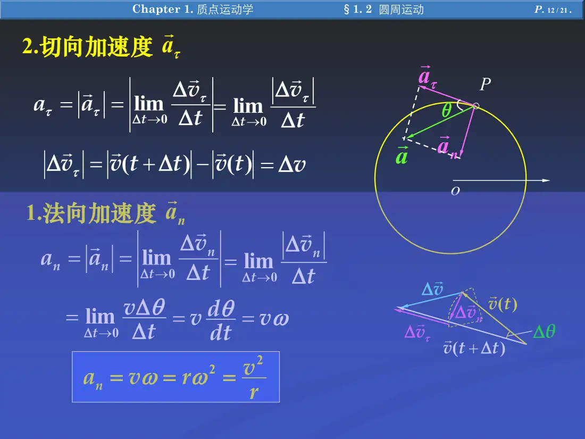

原文：

2. 切向加速度 $\vec{a}_{\tau}$

$$
a _ {\tau} = | \vec {a} _ {\tau} | = \left| \lim _ {\Delta t \to 0} \frac {\Delta \vec {v} _ {\tau}}{\Delta t} \right| = \lim _ {\Delta t \to 0} \frac {| \Delta \vec {v} _ {\tau} |}{\Delta t}
$$

$\left|\Delta \vec{v}_{\tau}\right| = \left|\vec{v} (t + \Delta t)\right| - \left|\vec{v} (t)\right| = \Delta v$

1. 法向加速度 $\vec{a}_{n}$

$$
\begin{array}{l}a _ {n} = \left| \vec {a} _ {n} \right| = \left| \lim _ {\Delta t \rightarrow 0} \frac {\Delta \vec {v} _ {n}}{\Delta t} \right| = \lim _ {\Delta t \rightarrow 0} \frac {\left| \Delta \vec {v} _ {n} \right|}{\Delta t}\\= \lim _ {\Delta t \rightarrow 0} \frac {v \Delta \theta}{\Delta t} = v \frac {d \theta}{d t} = v \omega\\\boxed {a _ {n} = v \omega = r \omega^ {2} = \frac {v ^ {2}}{r}}\end{array}
$$

$$
\begin{array}{c} \Delta \vec {v} \\ \Delta \vec {v} _ {\tau} \\ \vec {v} (t + \Delta t) \end{array} \begin{array}{c} \vec {v} (t) \\ \vec {v} (t + \Delta t) \\ \Delta \theta \end{array}
$$

Chapter 1. 质点运动学

§ 1.2 圆周运动

P. 12 / 21.

### § 1.2 圆周运动

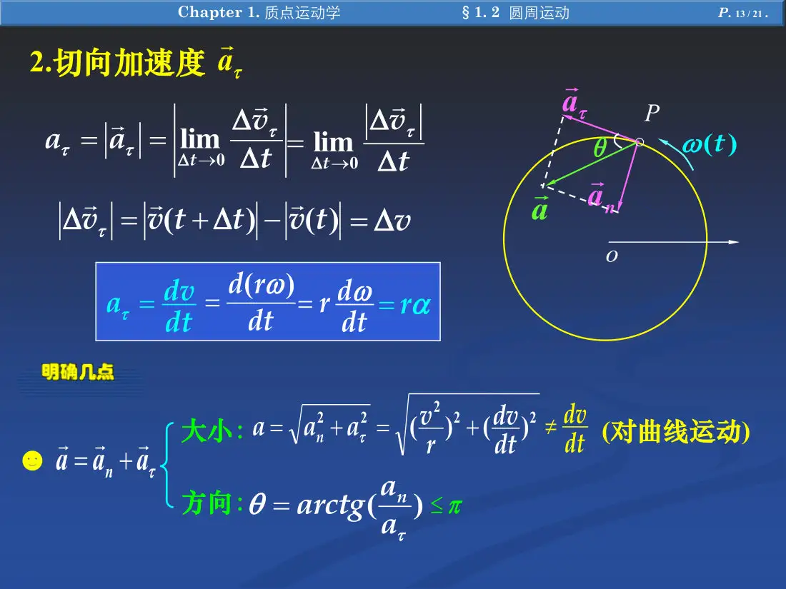

原文：

§ 1.2 圆周运动

2. 切向加速度 $\vec{a}_{\tau}$

$$
a _ {\tau} = | \vec {a} _ {\tau} | = \left| \lim _ {\Delta t \rightarrow 0} \frac {\Delta \vec {v} _ {\tau}}{\Delta t} \right| = \lim _ {\Delta t \rightarrow 0} \frac {| \Delta \vec {v} _ {\tau} |}{\Delta t}
$$

$$
\left| \Delta \vec {v} _ {\tau} \right| = \left| \vec {v} (t + \Delta t) \right| - \left| \vec {v} (t) \right| = \Delta v
$$

$$
a _ {\tau} = \frac {d v}{d t} = \frac {d (r \omega)}{d t} = r \frac {d \omega}{d t} = r \alpha
$$

明确几点

$$
\vec {a} = \vec {a} _ {n} + \vec {a} _ {\tau}
$$

大小： $a=\sqrt{a_{n}^{2}+a_{\tau}^{2}}=\sqrt{\left(\frac{v^{2}}{r}\right)^{2}+\left(\frac{dv}{dt}\right)^{2}}\neq\frac{dv}{dt}$ (对曲线运动)

方向: $\theta = \operatorname{arctg}\left(\frac{a_n}{a_\tau}\right) \leq \pi$ 😊 $\vec{a}_{n}$ 由 $\vec{v}$ 方向变化引起，指向圆心； $\vec{a}_{\tau}$ 由 $\vec{v}$ 大小变化引起，当 $\Delta v > 0$ 时， $\vec{a}_{\tau}$ 与 $\vec{v}$ 同方向，否则相反。

Chapter 1. 质点运动学

P. 13 / 21.

### 明确几点

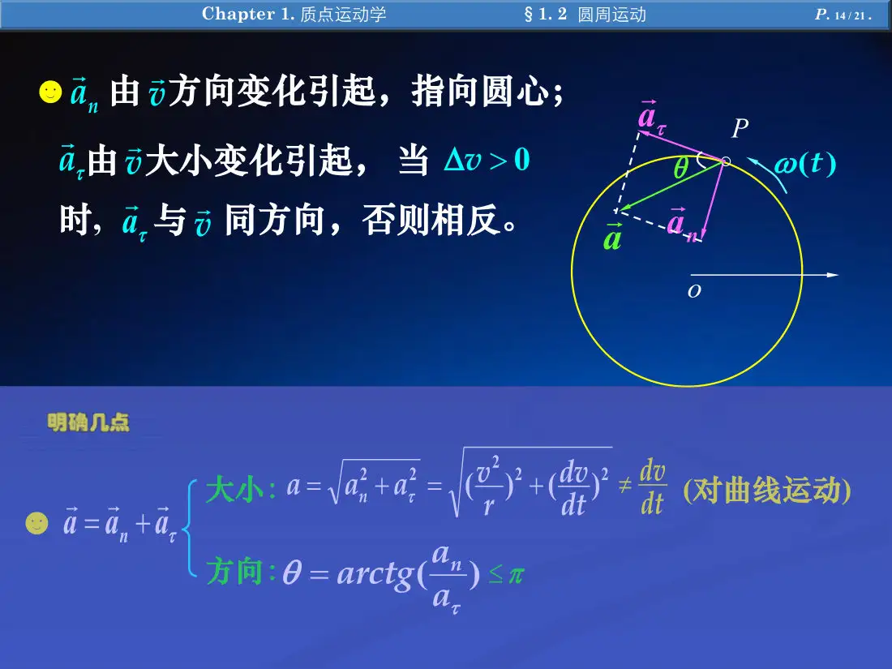

原文：

明确几点

大小： $a=\sqrt{a_{n}^{2}+a_{\tau}^{2}}=\sqrt{\left(\frac{v^{2}}{r}\right)^{2}+\left(\frac{dv}{dt}\right)^{2}}\neq\frac{dv}{dt}$ (对曲线运动)

$$
\vec {a} = \vec {a} _ {n} + \vec {a} _ {\tau}
$$

方向: $\theta = \operatorname{arctg}\left(\frac{a_n}{a_\tau}\right) \leq \pi$ 😊 $\vec{a}_{n}$ 由 $\vec{v}$ 方向变化引起，指向圆心； $\vec{a}_{\tau}$ 由 $\vec{v}$ 大小变化引起，当 $\Delta v > 0$ 时， $\vec{a}_{\tau}$ 与 $\vec{v}$ 同方向，否则相反。

Chapter 1. 质点运动学

§ 1.2 圆周运动

P. 14/21.

### 归纳

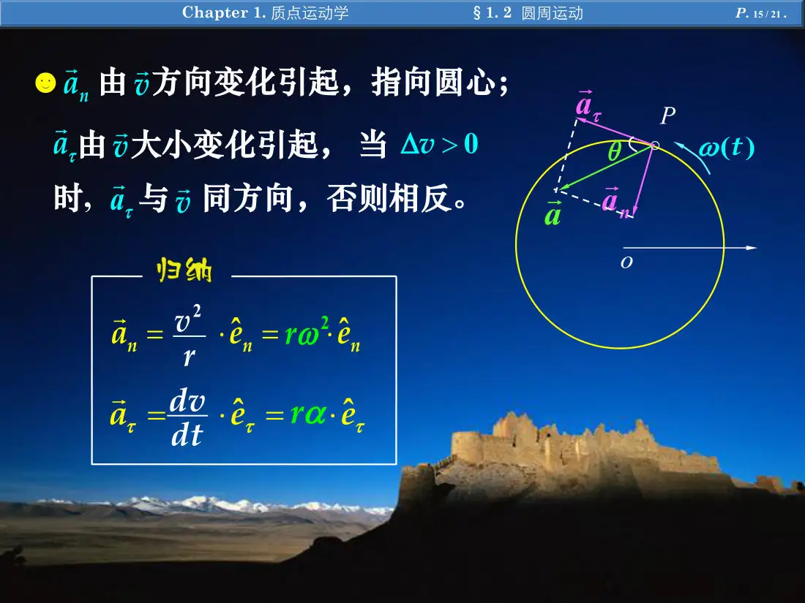

原文：

归纳

$$
\vec {a} _ {n} = \frac {v ^ {2}}{r} \cdot \hat {e} _ {n} = r \omega^ {2} \cdot \hat {e} _ {n}
$$

$$
\vec {a} _ {\tau} = \frac {d v}{d t} \cdot \hat {\boldsymbol {e}} _ {\tau} = r \alpha \cdot \hat {\boldsymbol {e}} _ {\tau}
$$

Chapter 1. 质点运动学

§ 1.2 圆周运动

P. 15/21.

### 解 速率: $v = \frac{ds}{dt} = kRt$

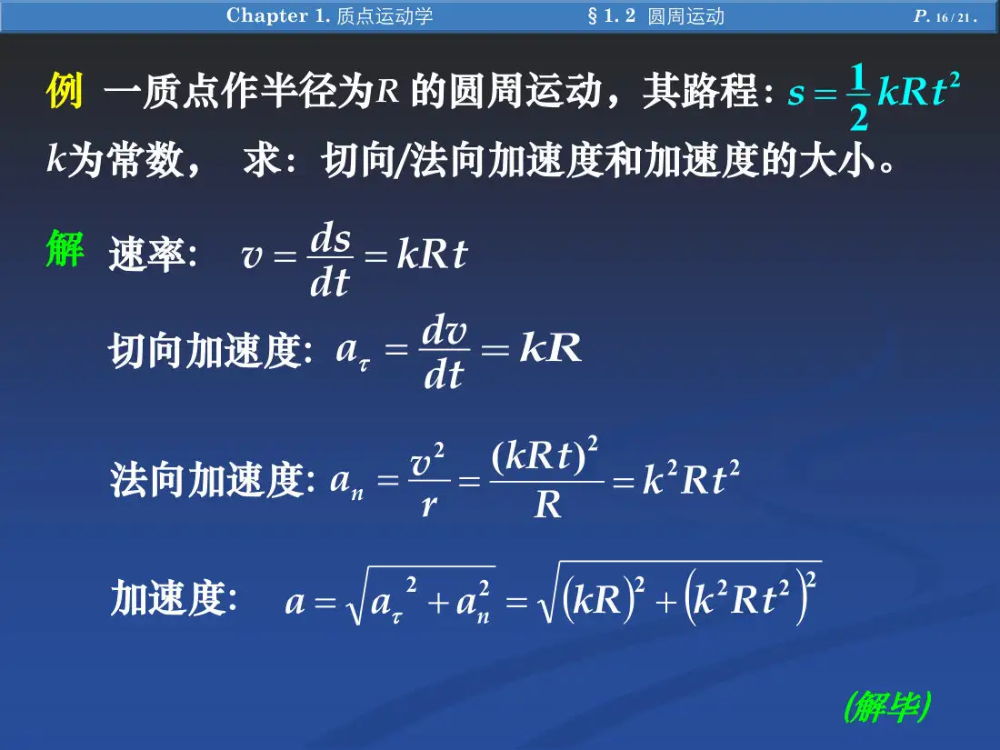

原文：

例 一质点作半径为R的圆周运动，其路程： $s=\frac{1}{2}kRt^{2}$ k为常数，求：切向/法向加速度和加速度的大小。

解 速率: $v = \frac{ds}{dt} = kRt$

切向加速度: $a_{\tau} = \frac{dv}{dt} = kR$

法向加速度: $a_{n} = \frac{v^{2}}{r} = \frac{(kRt)^{2}}{R} = k^{2}Rt^{2}$

加速度: $a = \sqrt{a_{\tau}^{2} + a_{n}^{2}} = \sqrt{(kR)^{2} + (k^{2}Rt^{2})^{2}}$

Chapter 1. 质点运动学

§ 1.2 圆周运动

P. 16/21.

(解毕)

### 3. 匀变速圆周运动

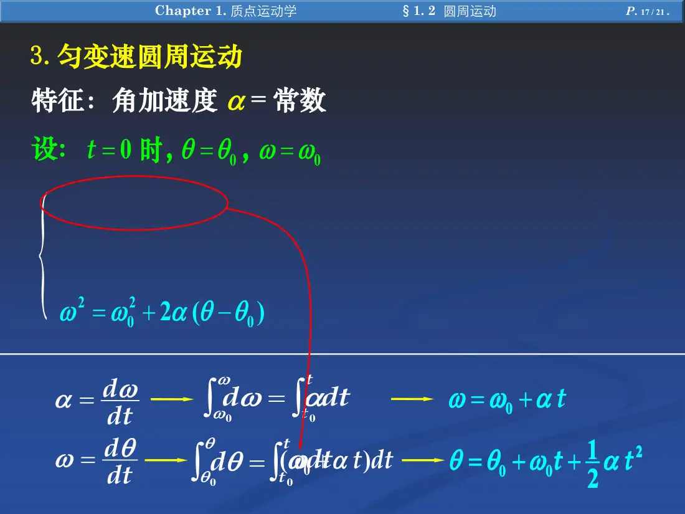

原文：

3. 匀变速圆周运动

特征：角加速度 $\alpha =$ 常数

设: $t = 0$ 时, $\theta = \theta_{0}$ , $\omega = \omega_{0}$

$$
\omega^ {2} = \omega_ {0} ^ {2} + 2 \alpha (\theta - \theta_ {0})
$$

$$
\alpha = \frac {d \omega}{d t} \longrightarrow \int_ {\omega_ {0}} ^ {\omega} d \omega = \int_ {t _ {0}} ^ {t} \alpha d t \quad \longrightarrow \quad \omega = \omega_ {0} + \alpha t
$$

$$
\omega = \frac {d \theta}{d t} \longrightarrow \int_ {\theta_ {0}} ^ {\theta} d \theta = \int_ {t _ {0}} ^ {t} (\omega d t \alpha t) d t \longrightarrow \theta = \theta_ {0} + \omega_ {0} t + \frac {1}{2} \alpha t ^ {2}
$$

Chapter 1. 质点运动学

§ 1.2 圆周运动

P. 17/21.

### 3. 匀变速圆周运动

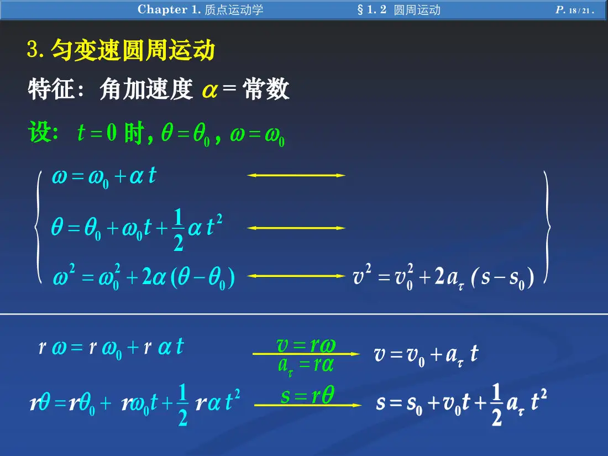

原文：

3. 匀变速圆周运动

特征：角加速度 $\alpha =$ 常数

设: $t = 0$ 时, $\theta = \theta_{0}$ , $\omega = \omega_{0}$

$$
\left\{ \begin{array}{l} \omega = \omega_ {0} + \alpha t \\ \theta = \theta_ {0} + \omega_ {0} t + \frac {1}{2} \alpha t ^ {2} \\ \omega^ {2} = \omega_ {0} ^ {2} + 2 \alpha (\theta - \theta_ {0}) \\ \end{array} \right. \quad \Longleftrightarrow \quad v ^ {2} = v _ {0} ^ {2} + 2 a _ {\tau} (s - s _ {0})
$$

$$
r \omega = r \omega_ {0} + r \alpha t
$$

$$
\frac {v = r \omega}{a _ {\tau} = r \alpha} \rightarrow v = v _ {0} + a _ {\tau} t
$$

$$
r \theta = r \theta_ {0} + r \omega_ {0} t + \frac {1}{2} r \alpha t ^ {2} \xrightarrow {s = r \theta} s = s _ {0} + v _ {0} t + \frac {1}{2} a _ {\tau} t ^ {2}
$$

Chapter 1. 质点运动学

§ 1.2 圆周运动

P. 18/21.

### 作辅助图：半径r=曲率半径ρ

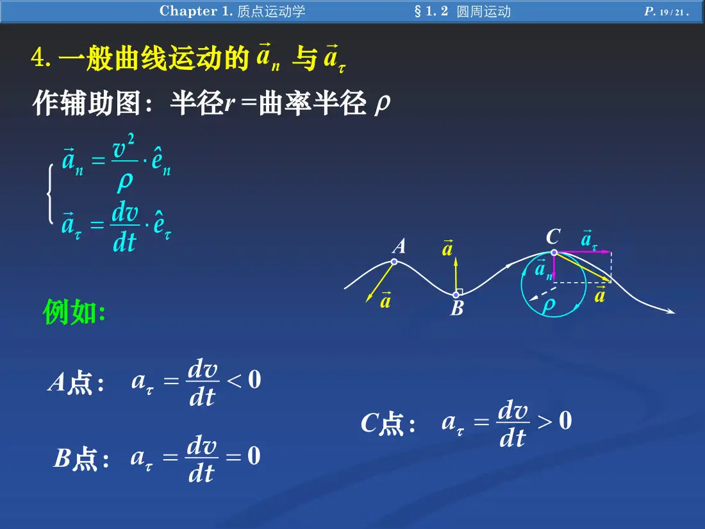

原文：

4. 一般曲线运动的 $\vec{a}_{n}$ 与 $\vec{a}_{\tau}$

作辅助图：半径r=曲率半径ρ

$$
\left\{ \begin{array}{l} \vec {a} _ {n} = \frac {v ^ {2}}{\rho} \cdot \hat {e} _ {n} \\ \vec {a} _ {\tau} = \frac {d v}{d t} \cdot \hat {e} _ {\tau} \end{array} \right.
$$

例如:

A点: $a_{\tau}=\frac{dv}{dt}<0$

B点： $a_{\tau}=\frac{dv}{dt}=0$

C点: $a_{\tau} = \frac{dv}{dt} > 0$

Chapter 1. 质点运动学

§ 1.2 圆周运动

P. 19/21.

### $$

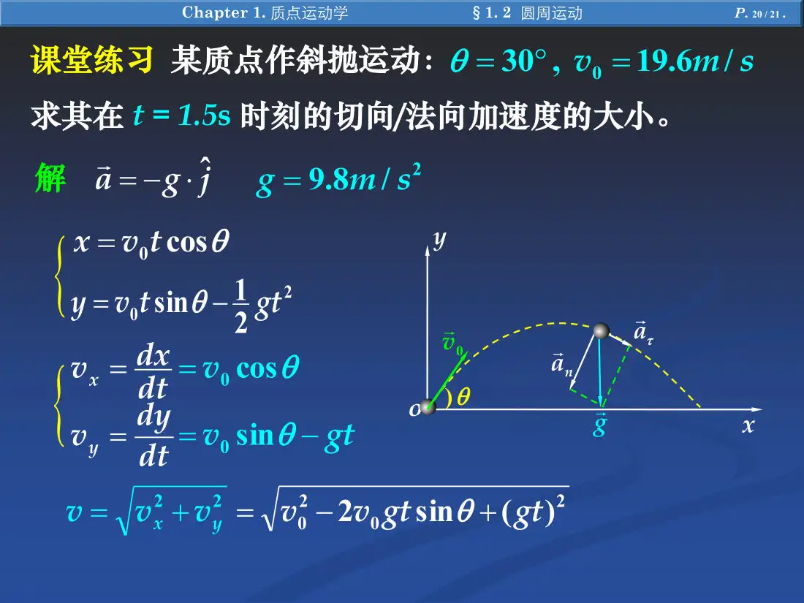

原文：

课堂练习 某质点作斜抛运动: $\theta = 30^{\circ}$ , $v_{0} = 19.6 \mathrm{~m} / \mathrm{s}$ 求其在 $t = 1.5 \mathrm{~s}$ 时刻的切向/法向加速度的大小。

解

$$
\vec {a} = - g \cdot \hat {j}
$$

$$
g = 9. 8 m / s ^ {2}
$$

$$
x = v _ {0} t \cos \theta
$$

$$
y = v _ {0} t \sin \theta - \frac {1}{2} g t ^ {2}
$$

$$
v _ {x} = \frac {d x}{d t} = v _ {0} \cos \theta
$$

$$
v _ {y} = \frac {d y}{d t} = v _ {0} \sin \theta - g t
$$

P. 20 / 21.

Chapter 1. 质点运动学

§ 1.2 圆周运动

[v = \sqrt{v\_{x}^{2} + v\_{y}^{2}} = \sqrt{v\_{0}^{2} - 2v\_{0}gt\sin\theta + (gt)^{2}}]

x

### $$

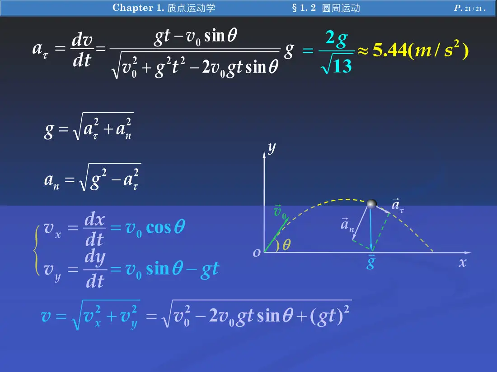

原文：

$$
a _ {\tau} = \frac {d v}{d t} = \frac {g t - v _ {0} \sin \theta}{\sqrt {v _ {0} ^ {2} + g ^ {2} t ^ {2} - 2 v _ {0} g t \sin \theta}} g = \frac {2 g}{\sqrt {1 3}} \approx 5. 4 4 (m / s ^ {2})
$$

$$
g = \sqrt {a _ {\tau} ^ {2} + a _ {n} ^ {2}}
$$

$$
a _ {n} = \sqrt {g ^ {2} - a _ {\tau} ^ {2}}
$$

$$
v _ {x} = \frac {d x}{d t} = v _ {0} \cos \theta
$$

$$
v _ {y} = \frac {d y}{d t} = v _ {0} \sin \theta - g t
$$

Chapter 1. 质点运动学

§ 1.2 圆周运动

P. 21 / 21.

[v = \sqrt{v\_{x}^{2} + v\_{y}^{2}} = \sqrt{v\_{0}^{2} - 2v\_{0}gt\sin\theta + (gt)^{2}}]

x

### $$

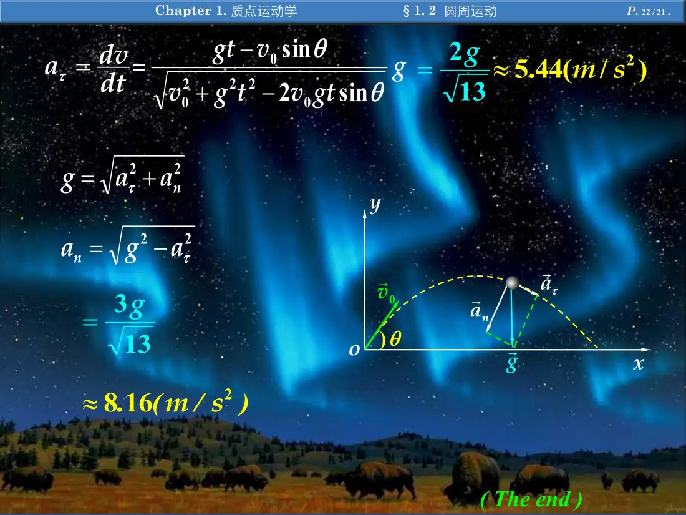

原文：

$a_{\tau} = \frac{dv}{dt} = \frac{gt - v_0\sin\theta}{\sqrt{v_0^2 + g^2t^2 - 2v_0gt\sin\theta}}g = \frac{2g}{\sqrt{13}}\approx 5.44(m / s^2)$

$$
g = \sqrt {a _ {\tau} ^ {2} + a _ {n} ^ {2}}
$$

$$
a _ {n} = \sqrt {g ^ {2} - a _ {\tau} ^ {2}}
$$

$$
= \frac {3 g}{\sqrt {1 3}}
$$

$$
\approx 8. 1 6 (m / s ^ {2})
$$

Chapter 1. 质点运动学

§ 1.2 圆周运动

P. 22 / 21.
