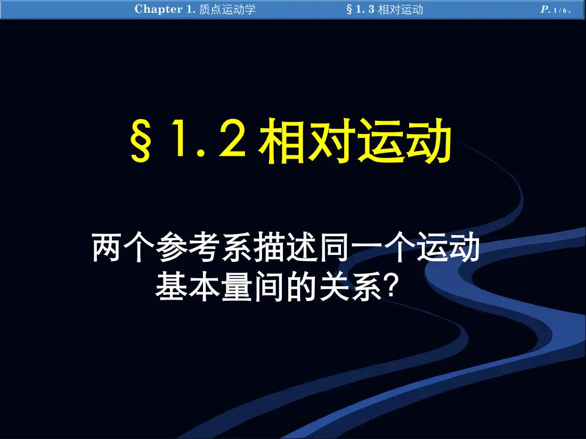
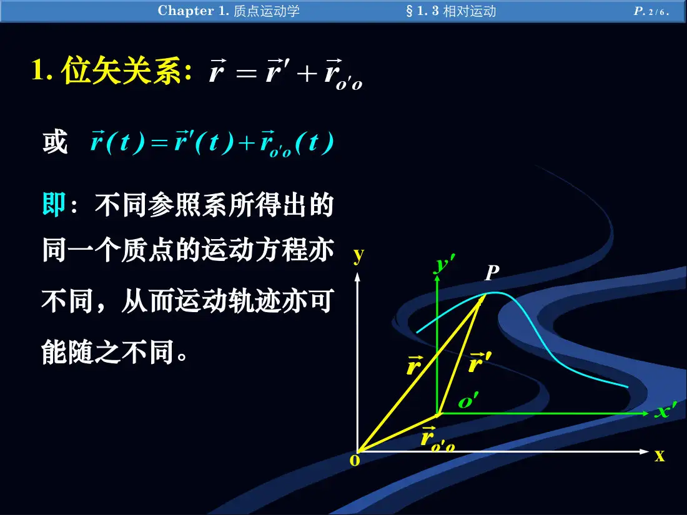
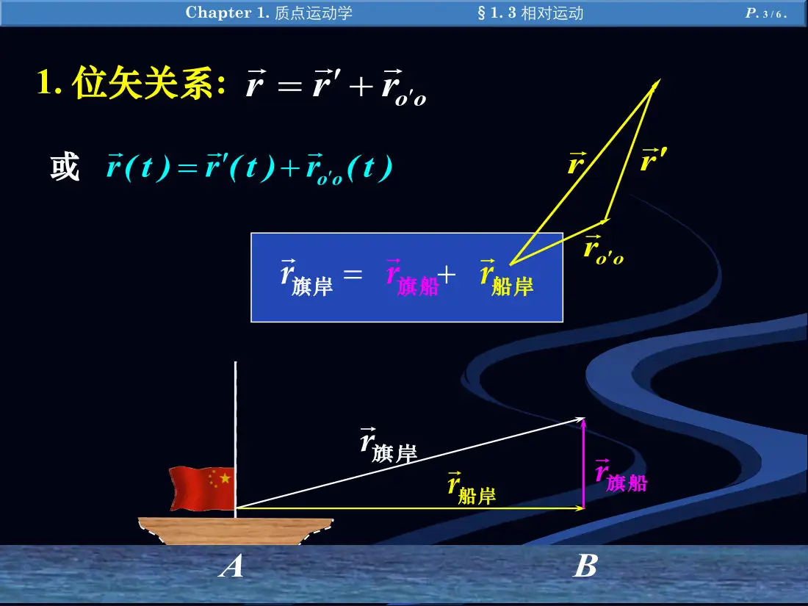
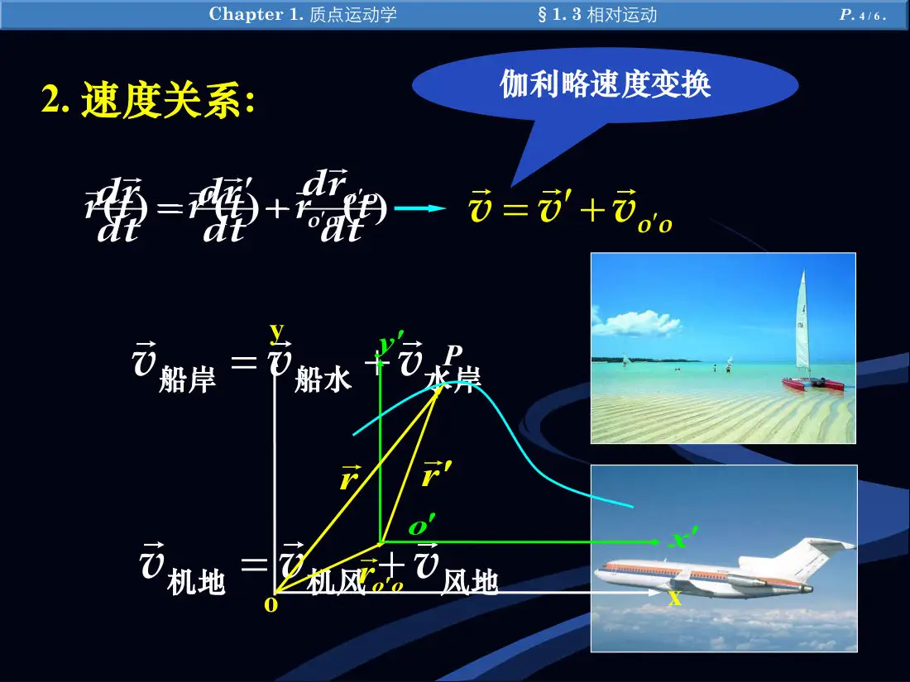
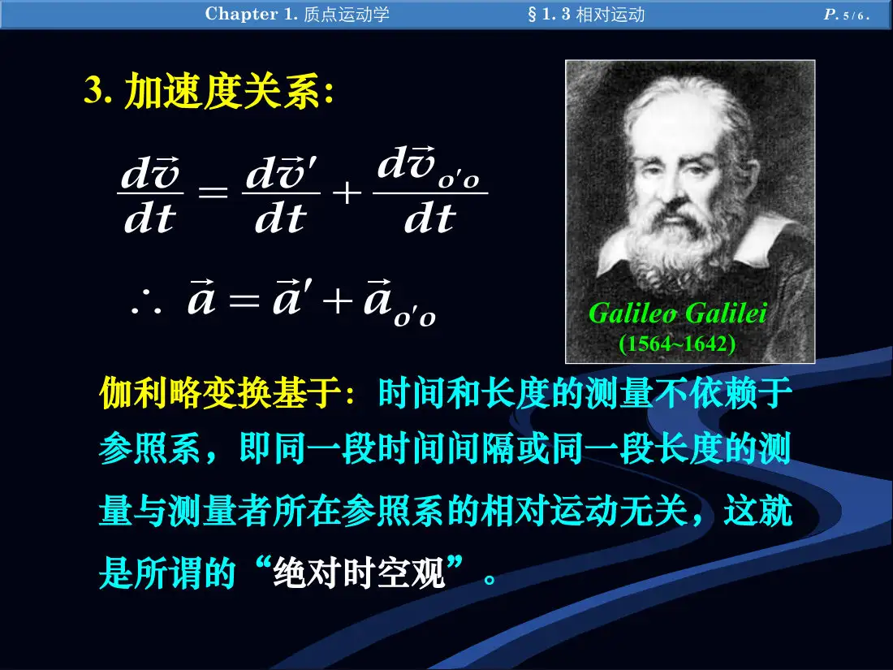
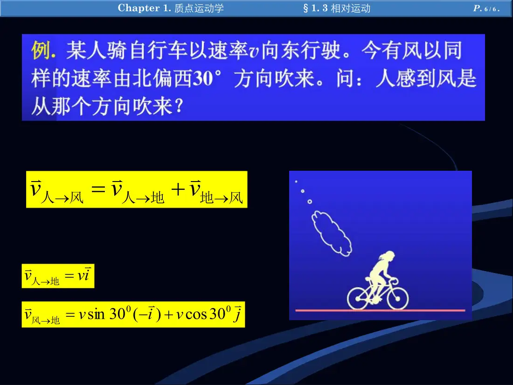

# 《大学物理》第1章 质点运动学 §1.3 相对运动（课件）

原件的每一页，下面附识别出的文字。

### § 1.2 相对运动

原文：

§ 1.2 相对运动

两个参考系描述同一个运动基本量间的关系？

P. 1/6.

Chapter 1. 质点运动学

§ 1.3 相对运动

### 即：不同参照系所得出的同一个质点的运动方程亦不同，从而运动轨迹亦可能随之不同。

原文：

1. 位矢关系: $\vec{r} = \vec{r}' + \vec{r}_{o'o}$

或 $\vec{r}(t) = \vec{r}'(t) + \vec{r}_{o'o}(t)$

即：不同参照系所得出的同一个质点的运动方程亦不同，从而运动轨迹亦可能随之不同。

Chapter 1. 质点运动学

§ 1.3 相对运动

### Chapter 1. 质点运动学

原文：

1. 位矢关系: $\vec{r} = \vec{r}' + \vec{r}_{o'o}$

或 $\vec{r}(t) = \vec{r}'(t) + \vec{r}_{o'o}(t)$

$\vec{r}_{\text{旗岸}} = \vec{r}_{\text{旗船}} + \vec{r}_{\text{船岸}}$

Chapter 1. 质点运动学

§ 1.3 相对运动

P. 3/6.

### 2. 速度关系:

原文：

2. 速度关系:

伽利略速度变换

$$
\vec {r} \frac {d \vec {r}}{d t} = \vec {r} \frac {d \vec {r} ^ {\prime}}{d t} + \vec {r} \frac {d \vec {r}}{o ^ {\prime} d t} (t ^ {\prime}) \longrightarrow \vec {v} = \vec {v} ^ {\prime} + \vec {v} _ {o ^ {\prime} o}
$$

$$
\vec {v} _ {\text {船岸}} = \vec {v} _ {\text {船水}} + \vec {v} _ {\text {水岸}} ^ {P}
$$

$$
\vec {v} _ {\text {机地}} = \vec {v} _ {\text {机风} _ {o ^ {\prime} o}} + \vec {v} _ {\text {风地}}
$$

Chapter 1. 质点运动学

§ 1.3 相对运动

P. 4/6.

### 3. 加速度关系:

原文：

3. 加速度关系:

$$
\frac {d \vec {v}}{d t} = \frac {d \vec {v} ^ {\prime}}{d t} + \frac {d \vec {v} _ {o ^ {\prime} o}}{d t}
$$

$$
\therefore \vec {a} = \vec {a} ^ {\prime} + \vec {a} _ {o ^ {\prime} o}
$$

Galileo Galilei (1564\~1642)

伽利略变换基于：时间和长度的测量不依赖于参照系，即同一段时间间隔或同一段长度的测量与测量者所在参照系的相对运动无关，这就是所谓的“绝对时空观”。

Chapter 1. 质点运动学

§ 1.3 相对运动

P. 5/6.

### $$

原文：

例. 某人骑自行车以速率 $v$ 向东行驶。今有风以同样的速率由北偏西 $30^{\circ}$ 方向吹来。问: 人感到风是从那个方向吹来?

$$
\vec {v} _ {\mathrm{人} \rightarrow \mathrm{风}} = \vec {v} _ {\mathrm{人} \rightarrow \mathrm{地}} + \vec {v} _ {\mathrm{地} \rightarrow \mathrm{风}}
$$

$$
\vec {v} _ {\mathrm{人} \rightarrow \mathrm{地}} = v \vec {i}
$$

$$
\vec {v} _ {\text {风} \rightarrow \text {地}} = v \sin 3 0 ^ {0} (- \vec {i}) + v \cos 3 0 ^ {0} \vec {j}
$$

Chapter 1. 质点运动学

§ 1.3 相对运动

P. 6/6.
