# 《大学物理》第1章 质点运动学（课件）

原件的每一页，下面附识别出的文字。

### 1 质点运动学

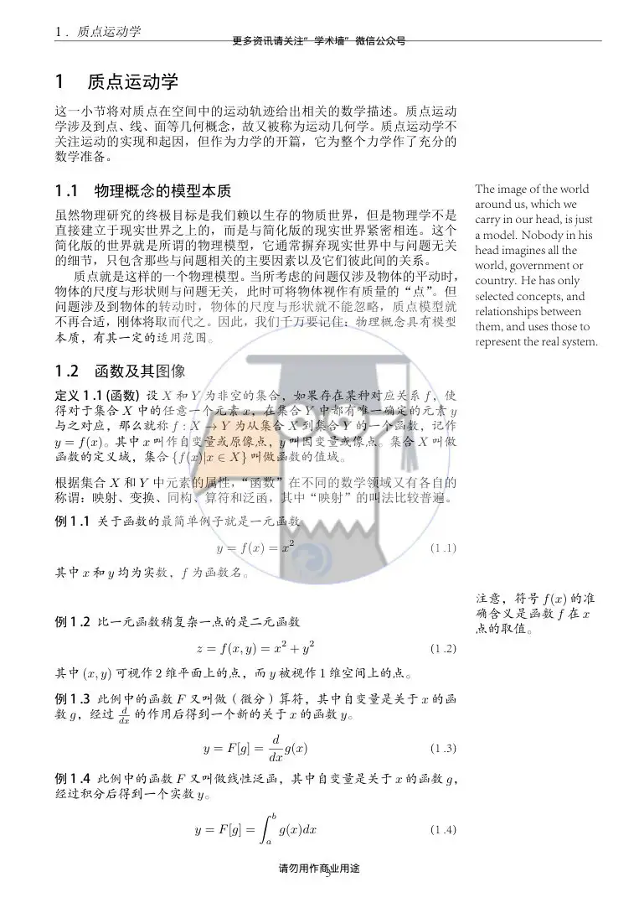

原文：

1 质点运动学

这一小节将对质点在空间中的运动轨迹给出相关的数学描述。质点运动学涉及到点、线、面等几何概念，故又被称为运动几何学。质点运动学不关注运动的实现和起因，但作为力学的开篇，它为整个力学作了充分的数学准备。

1.1 物理概念的模型本质

虽然物理研究的终极目标是我们赖以生存的物质世界，但是物理学不是直接建立于现实世界之上的，而是与简化版的现实世界紧密相连。这个简化版的世界就是所谓的物理模型，它通常摒弃现实世界中与问题无关的细节，只包含那些与问题相关的主要因素以及它们彼此间的关系。

质点就是这样的一个物理模型。当所考虑的问题仅涉及物体的平动时，物体的尺度与形状则与问题无关，此时可将物体视作有质量的“点”。但问题涉及到物体的转动时，物体的尺度与形状就不能忽略，质点模型就不再合适，刚体将取而代之。因此，我们千万要记住：物理概念具有模型本质，有其一定的适用范围。

The image ofthe world around us, which we carry in our head, is just a model. Nobody in his head imagines all the world, government or country. He has only selected concepts, and relationships between them, and uses those to represent the real system.

1.2 函数及其图像

定义1.1(函数) 设X 和Y 为非空的集合，如果存在某种对应关系f，使得对于集合X 中的任意一个元素x，在集合Y 中都有唯一确定的元素y与之对应，那么就称f : X → Y为从集合X 到集合Y的一个函数，记作$y = f ( x )$ 。其中x叫作自变量或原像点，y叫因变量或像点。集合X 叫做函数的定义域，集合 $\{ f ( x ) | x \in X \}$ 叫做函数的值域。

根据集合X 和Y 中元素的属性，“函数”在不同的数学领域又有各自的称谓：映射、变换、同构、算符和泛函，其中“映射”的叫法比较普遍。

例1.1 关于函数的最简单例子就是一元函数

$$
y = f (x) = x ^ {2}\tag{1.1}
$$

其中x和 $y$ 均为实数，f 为函数名。

例1.2 比一元函数稍复杂一点的是二元函数

$$
z = f (x, y) = x ^ {2} + y ^ {2}
$$

注意，符号f(x)的准确含义是函数f 在x点的取值。

(1 .2)

其中 $( x , y )$ 可视作2维平面上的点，而y被视作1维空间上的点。

例1.3 此例中的函数F又叫做（微分）算符，其中自变量是关于x的函数 $g$ ，经过 $\textstyle { \frac { d } { d x } }$ 的作用后得到一个新的关于x的函数 $y _ { \cdot }$ 。

$$
y = F [ g ] = \frac {d}{d x} g (x)\tag{1.3}
$$

例1.4 此例中的函数F又叫做线性泛函，其中自变量是关于x的函数 $g$ ，经过积分后得到一个实数 $y$ 。

$$
y = F [ g ] = \int_ {a} ^ {b} g (x) d x\tag{1.4}
$$

1 . 质点运动学

更多资讯请关注“学术墙”微信公众号

3请勿用作商业用途

### $$

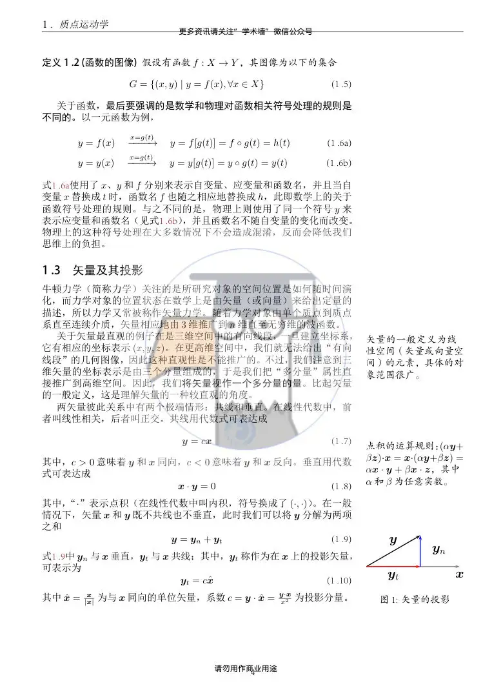

原文：

定义1.2(函数的图像) 假设有函数 $f : X \to Y$ ，其图像为以下的集合

$$
G = \{(x, y) \mid y = f (x), \forall x \in X \}\tag{1.5}
$$

关于函数，最后要强调的是数学和物理对函数相关符号处理的规则是不同的。以一元函数为例，

$$
y = f (x) \quad \xrightarrow {x = g (t)} \quad y = f [ g (t) ] = f \circ g (t) = h (t)\tag{1.6a}
$$

$$
y = y (x) \quad {\xrightarrow {x = g (t)}} \quad y = y [ g (t) ] = y \circ g (t) = y (t)\tag{1.6b}
$$

式1.6a使用了x、y 和f 分别来表示自变量、应变量和函数名，并且当自 $y$ 变量 替换成 时，函数名 $f$ 也随之相应地替换成 ，此即数学上的关于函数符号处理的规则。与之不同的是，物理上则使用了同一个符号 $y$ 来表示应变量和函数名（见式1.6b），并且函数名不随自变量的变化而改变。物理上的这种符号处理在大多数情况下不会造成混淆，反而会降低我们思维上的负担。

1.3 矢量及其投影

牛顿力学（简称力学）关注的是所研究对象的空间位置是如何随时间演化，而力学对象的位置状态在数学上是由矢量（或向量）来给出定量的描述，所以力学又常被称作矢量力学。随着力学对象由单个质点到质点系直至连续介质，矢量相应地由3维推广到n维直至无穷维的波函数。

关于矢量最直观的例子在是三维空间中的有向线段，一旦建立坐标系，它有相应的坐标表示 $( x , y , z )$ 。在更高维空间中，我们就无法给出“有向线段”的几何图像，因此这种直观性是不能推广的。不过，我们注意到三维矢量的坐标表示是由三个分量组成的，于是我们把“多分量”属性直接推广到高维空间。因此，我们将矢量视作一个多分量的量。比起矢量的一般定义，这是理解矢量的一种较直观的角度。

矢量的一般定义为线性空间（矢量或向量空间）的元素，具体的对象范围很广。

两矢量彼此关系中有两个极端情形：共线和垂直。在线性代数中，前者叫线性相关，后者叫正交。共线用代数式可表达成

$$
\boldsymbol {y} = c \boldsymbol {x}\tag{1.7}
$$

其中， $c > 0$ 意味着y 和x同向， $c < 0$ 意味着y 和 $_ { x }$ 反向。垂直用代数式可表达成

$$
\boldsymbol {x} \cdot \boldsymbol {y} = 0\tag{1.8}
$$

点积的运算规则： $( \alpha { \pmb y } +$ $\beta z ) { \cdot } x = x { \cdot } ( \alpha y + \beta z ) =$ $\alpha { \pmb x } \cdot { \pmb y } + \beta { \pmb x } \cdot { \pmb z }$ ，其中$\alpha$ 和 $\beta$ 为任意实数。

其中， $^ { 6 6 } \cdot ^ { \dag }$ 表示点积（在线性代数中叫内积，符号换成了(·,·)）。在一般情况下，矢量 $_ { \boldsymbol{x} }$ 和 $\textbf {  { y } }$ 既不共线也不垂直，此时我们可以将 $\textbf {  { y } }$ 分解为两项之和

$$
\pmb {y} = \pmb {y} _ {n} + \pmb {y} _ {t}\tag{1.9}
$$

式1 .9中 ${ \bf { \nabla } } \pmb { y } _ { n }$ 与 $_ { \boldsymbol{x} }$ 垂直， ${ \mathbf { } } _ { \pmb { y } _ { t } }$ 与 $_ { \boldsymbol{x} }$ 共线；其中， ${ \mathbf { } } _ { \mathbf { } } \mathbf { \mathbf { } } _ { \mathbf { } } \mathbf { \mathbf { } } _ { \mathbf { } } \mathbf { \mathbf { } } _ { \mathbf { } } \mathbf { \mathbf { } } _ { \mathbf { } } \mathbf { \mathbf { } } _ { \mathbf { } } \mathbf { \mathbf { } } _ { \mathbf { } } \mathbf { \mathbf { } } _ { \mathbf { } } \mathbf { \Xi } _ { \mathbf { } } \mathbf { \Lambda } _ { \mathbf { } } \mathbf { \Lambda } _ { \mathbf { } } \textbf { } _ { \mathbf { } } \textbf { } \textbf { } _ { \mathrm { } }$ 称作为在x上的投影矢量，可表示为

$$
\pmb {y} _ {t} = c \hat {\pmb {x}}\tag{1.10}
$$

其中 $\begin{array} { r } { \hat { \pmb x } = \frac { \pmb x } { | \pmb x | } } \end{array}$ 为与x同向的单位矢量，系数 $\begin{array} { r } { c = { \pmb y } \cdot \hat { \pmb x } = \frac { { \pmb y } \cdot { \pmb x } } { x ^ { 2 } } } \end{array}$ 为投影分量。

图1: 矢量的投影

1 . 质点运动学

更多资讯请关注“学术墙”微信公众号

4请勿用作商业用途

### 1.4 位矢及其坐标表示

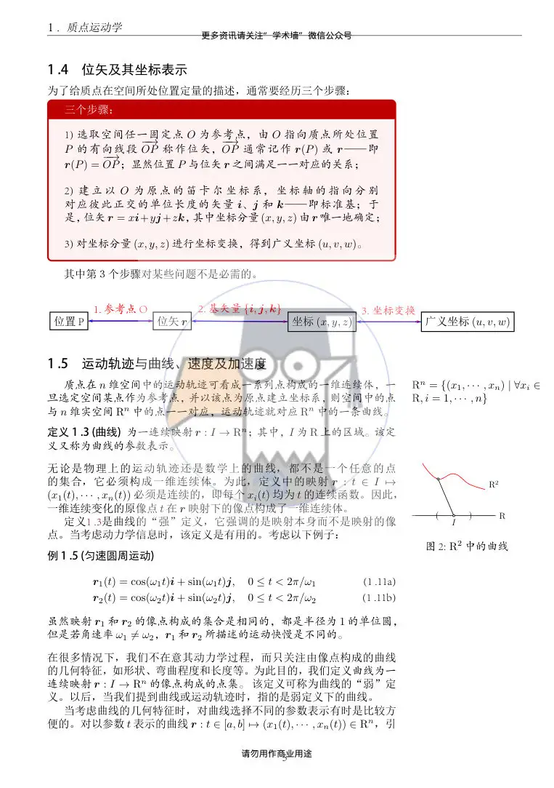

原文：

1.4 位矢及其坐标表示

为了给质点在空间所处位置定量的描述，通常要经历三个步骤：

三个步骤：

1) 选取空间任一固定点 O 为参考点，由 O 指向质点所处位置P 的有向线段 $\overrightarrow { O P }$ 称作位矢， $\overrightarrow { O P }$ 通常记作 $r ( P )$ 或 r——即$r ( P ) = \overrightarrow { O P }$ ；显然位置P与位矢r之间满足一一对应的关系；

2) 建立以 O 为原点的笛卡尔坐标系，坐标轴的指向分别对应彼此正交的单位长度的矢量 i、j 和 k——即标准基；于是，位矢 $r = x i + y j + z k$ ，其中坐标分量 $( x , y , z )$ 由r唯一地确定；

3)对坐标分量 $( x , y , z )$ 进行坐标变换，得到广义坐标 $( u , v , w )$ 。

其中第3个步骤对某些问题不是必需的。

1.5 运动轨迹与曲线、速度及加速度

质点在n维空间中的运动轨迹可看成一系列点构成的一维连续体，一旦选定空间某点作为参考点，并以该点为原点建立坐标系，则空间中的点与n维实空间 $\mathrm { R } ^ { n }$ 中的点一一对应，运动轨迹就对应 $\mathrm { R } ^ { n }$ 中的一条曲线。

$$
\begin{array}{l} \mathrm{R} ^ {n} = \{(x _ {1}, \dots , x _ {n}) \mid \forall x _ {i} \in \\ \mathrm{R}, i = 1, \dots , n \} \end{array}
$$

定义1.3(曲线) 为一连续映射 $r : I \to \mathrm { R } ^ { r }$ n；其中，I 为 R 上的区域。该定义又称为曲线的参数表示。

无论是物理上的运动轨迹还是数学上的曲线，都不是一个任意的点的集合，它必须构成一维连续体。为此，定义中的映射 $r : \mathcal { t } \in I \mapsto$ $( x _ { 1 } ( t ) , \cdot \cdot \cdot , x _ { n } ( t ) )$ 必须是连续的，即每个 $x _ { i } ( t )$ 均为t的连续函数。因此，一维连续变化的原像点t在r映射下的像点构成了一维连续体。

定义1.3是曲线的“强”定义，它强调的是映射本身而不是映射的像点。当考虑动力学信息时，该定义是有用的。考虑以下例子：

例1.5(匀速圆周运动)

$$
\pmb {r} _ {1} (t) = \cos (\omega_ {1} t) \pmb {i} + \sin (\omega_ {1} t) \pmb {j}, \quad 0 \leq t <   2 \pi / \omega_ {1}\tag{1.11a}
$$

$$
\boldsymbol {r} _ {2} (t) = \cos (\omega_ {2} t) \boldsymbol {i} + \sin (\omega_ {2} t) \boldsymbol {j}, \quad 0 \leq t <   2 \pi / \omega_ {2}\tag{1.11b}
$$

虽然映射 $\mathbf { \Delta } _ { \mathbf { r } _ { 1 } }$ 和 $\mathbf { \boldsymbol { r } } _ { 2 }$ 的像点构成的集合是相同的，都是半径为1的单位圆，但是若角速率 $\omega _ { 1 } \neq \omega _ { 2 } , \ r _ { 1 }$ 和 $\mathbf { \boldsymbol { r } } _ { 2 }$ 所描述的运动快慢是不同的。

在很多情况下，我们不在意其动力学过程，而只关注由像点构成的曲线的几何特征，如形状、弯曲程度和长度等。为此目的，我们定义曲线为一连续映射 $r : I \to \mathrm { R } ^ { n }$ 的像点构成的点集。该定义可称为曲线的“弱”定义。以后，当我们提到曲线或运动轨迹时，指的是弱定义下的曲线。

当考虑曲线的几何特征时，对曲线选择不同的参数表示有时是比较方便的。对以参数t表示的曲线 $r : t \in [ a , b ] \mapsto ( x _ { 1 } ( t ) , \cdot \cdot \cdot , x _ { n } ( t ) ) \in \mathrm { R } ^ { n }$ ，引入新参数 $\tau ( a ^ { \prime } \leq \tau \leq b ^ { \prime } )$ ，t与τ有函数关系 $t = t ( \tau )$ ，该函数满足 $t ( a ^ { \prime } ) = a$ 和 $t ( b ^ { \prime } ) = b$ ，且 $\begin{array} { r } { \frac { d t } { d \tau } > 0 } \end{array}$ 。（这意味当 $\tau$ 由 $a ^ { \prime }$ 变化到 $b ^ { \prime }$ 时，t由 $a$ 单调地变化到 $b _ { \circ } )$ 于是，就得到以参数τ表示的曲线

1 . 质点运动学

更多资讯请关注“学术墙”微信公众号

请勿用作商业用途

### $$

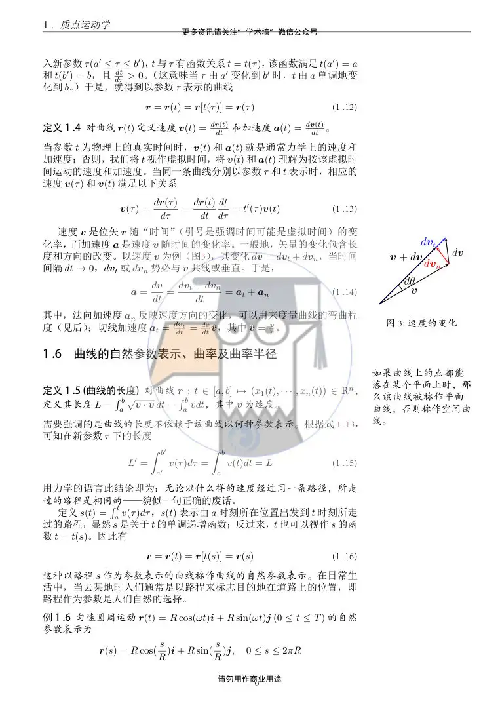

原文：

$$
\boldsymbol {r} = \boldsymbol {r} (t) = \boldsymbol {r} [ t (\tau) ] = \boldsymbol {r} (\tau)\tag{1.12}
$$

定义1.4 对曲线 $\mathbf { } _ { \pmb { r } ( t ) }$ 定义速度 $\begin{array} { r } { \pmb { v } ( t ) = \frac { d \pmb { r } ( t ) } { d t } } \end{array}$ 和加速度 $\begin{array} { r } { \mathbf { a } ( t ) = \frac { d \pmb { v } ( t ) } { d t } } \end{array}$

当参数t为物理上的真实时间时， ${ \pmb v } ( t )$ 和 $\mathbf { } \mathbf { } \mathbf { } \mathbf { } \mathbf { } \mathbf { } \mathbf { } \mathbf { } \mathbf { } \mathbf { } \mathbf { } \mathbf { } \mathbf { } \mathbf { } \mathbf { } \mathbf { } \mathbf { } \mathbf { } \mathbf { } \mathbf { } \mathbf { } \mathbf { } \mathbf { } \mathbf { } \mathbf { } \mathbf { } \mathbf { } \mathbf { } \mathbf { } \mathbf { } \mathbf { } \mathbf { } \mathbf { } \mathbf { } \mathbf { } \mathbf { } \mathbf { } \mathbf { } \mathbf { } \mathbf { } \mathbf { } \mathbf { } \mathbf { } \mathbf { } \mathbf { } \mathbf { } \mathbf { } \mathbf { } \mathbf { } \mathbf { } \mathbf { } \mathbf { } \mathbf { } \mathbf { } \mathbf { } \mathbf { } \mathbf { } \mathbf { } \mathbf { } \mathbf { } \mathbf { } \mathbf { } \mathbf { } \mathbf { } \mathbf { } \mathbf { } \mathbf { } \mathbf { } \mathbf { } \mathbf { } \mathbf { } \mathbf { } \mathbf { } \mathbf { } \mathbf { } \mathbf { } \mathbf { } \mathbf { } \mathbf { } \mathbf { } \mathbf { } \mathbf { } \mathbf { } \mathbf { } \mathbf { } \mathbf { } \mathbf { } \mathbf { } \mathbf { } \mathbf { } \mathbf { } \mathbf { } \mathbf { } \mathbf { } \mathbf { } \mathbf { } \mathbf { } \mathbf { } \mathbf { } \mathbf { } \mathbf { } \mathbf { } \mathbf { } \mathbf { } \mathbf { } \mathbf { } \mathbf { } \mathbf { } \mathbf { } \mathbf { } \mathbf { } \mathbf { } \mathbf { } \mathbf { } \mathbf { } \mathbf { } \mathbf { } \mathbf { } \mathbf { } \mathbf { } \mathbf { } \mathbf { } \mathbf { } \mathbf { } \mathbf { } \mathbf \mathbf { } \mathbf { } \mathbf { } \mathbf { } \mathbf \mathbf { } \mathbf { } \mathbf { } \mathbf \mathbf { } \mathbf { } \mathbf \mathbf { } \mathbf { } \mathbf \mathbf { } \mathbf { } \mathbf \mathbf { } \mathbf \mathbf { } \mathbf { } \mathbf \mathbf { } \mathbf \mathbf { } \mathbf \mathbf { } \mathbf \mathbf { } \mathbf \mathbf { } \mathbf \mathbf { } \mathbf \mathbf { } \mathbf \mathbf { } \mathbf \mathbf \mathbf { } \mathbf \mathbf { } \mathbf \mathbf \mathbf { } \mathbf \mathbf \mathbf { } \mathbf \mathbf \mathbf { } $ 就是通常力学上的速度和加速度；否则，我们将t视作虚拟时间，将 ${ \pmb v } ( t )$ 和 $\mathbf { } \mathbf { } \mathbf { } \mathbf { } \mathbf { } \mathbf { } \mathbf { } \mathbf { } \mathbf { } \mathbf { } \mathbf { } \mathbf { } \mathbf { } \mathbf { } \mathbf { } \mathbf { } \mathbf { } \mathbf { } \mathbf { } \mathbf { } \mathbf { } \mathbf { } \mathbf { } \mathbf { } \mathbf { } \mathbf { } \mathbf { } \mathbf { } \mathbf { } \mathbf { } \mathbf { } \mathbf { } \mathbf { } \mathbf { } \mathbf { } \mathbf { } \mathbf { } \mathbf { } \mathbf { } \mathbf { } \mathbf { } \mathbf { } \mathbf { } \mathbf { } \mathbf { } \mathbf { } \mathbf { } \mathbf { } \mathbf { } \mathbf { } \mathbf { } \mathbf { } \mathbf { } \mathbf { } \mathbf { } \mathbf { } \mathbf { } \mathbf { } \mathbf { } \mathbf { } \mathbf { } \mathbf { } \mathbf { } \mathbf { } \mathbf { } \mathbf { } \mathbf { } \mathbf { } \mathbf { } \mathbf { } \mathbf { } \mathbf { } \mathbf { } \mathbf { } \mathbf { } \mathbf { } \mathbf { } \mathbf { } \mathbf { } \mathbf { } \mathbf { } \mathbf { } \mathbf { } \mathbf { } \mathbf { } \mathbf { } \mathbf { } \mathbf { } \mathbf { } \mathbf { } \mathbf { } \mathbf { } \mathbf { } \mathbf { } \mathbf { } \mathbf { } \mathbf { } \mathbf { } \mathbf { } \mathbf { } \mathbf { } \mathbf { } \mathbf { } \mathbf { } \mathbf { } \mathbf { } \mathbf { } \mathbf { } \mathbf { } \mathbf { } \mathbf { } \mathbf { } \mathbf { } \mathbf { } \mathbf { } \mathbf { } \mathbf { } \mathbf { } \mathbf { } \mathbf { } \mathbf { } \mathbf { } \mathbf { } \mathbf { } \mathbf { } \mathbf \mathbf { } \mathbf { } \mathbf { } \mathbf { } \mathbf \mathbf { } \mathbf { } \mathbf { } \mathbf \mathbf { } \mathbf { } \mathbf \mathbf { } \mathbf { } \mathbf \mathbf { } \mathbf { } \mathbf \mathbf { } \mathbf \mathbf { } \mathbf { } \mathbf \mathbf { } \mathbf \mathbf { } \mathbf \mathbf { } \mathbf \mathbf { } \mathbf \mathbf { } \mathbf \mathbf { } \mathbf \mathbf { } \mathbf \mathbf { } \mathbf \mathbf \mathbf { } \mathbf \mathbf { } \mathbf \mathbf \mathbf { } \mathbf \mathbf \mathbf { } \mathbf \mathbf \mathbf { } $ 理解为按该虚拟时间运动的速度和加速度。当同一条曲线分别以参数τ和t表示时，相应的速度 $\pmb { v } ( \tau )$ 和 ${ \pmb v } ( t )$ 满足以下关系

$$
\pmb {v} (\tau) = \frac {d \pmb {r} (\tau)}{d \tau} = \frac {d \pmb {r} (t)}{d t} \frac {d t}{d \tau} = t ^ {\prime} (\tau) \pmb {v} (t)\tag{1.13}
$$

速度v 是位矢r 随“时间”（引号是强调时间可能是虚拟时间）的变化率，而加速度 $\boldsymbol{a}$ 是速度v随时间的变化率。一般地，矢量的变化包含长度和方向的改变。以速度v为例（图3），其变化 $\begin{array} { r } { d \pmb { v } = d \pmb { v } _ { t } + d \pmb { v } _ { n } } \end{array}$ ，当时间间隔 $d t \to 0$ $d { \pmb v } _ { t }$ 或 $d { \boldsymbol { v } } _ { n }$ 势必与v共线或垂直。于是，

$$
\pmb {a} = \frac {d \pmb {v}}{d t} = \frac {d \pmb {v} _ {t} + d \pmb {v} _ {n}}{d t} = \pmb {a} _ {t} + \pmb {a} _ {n}\tag{1.14}
$$

其中，法向加速度 $\mathbf { a } _ { n }$ 反映速度方向的变化，可以用来度量曲线的弯曲程度（见后）；切线加速度 $\begin{array} { r } { \pmb { a } _ { t } \equiv \frac { d \pmb { v } _ { t } } { d t } = \frac { d \pmb { v } } { d t } \pmb { \hat { v } } } \end{array}$ ，其中 $\scriptstyle { \hat { v } } = { \frac { v } { v } } \circ$

图3: 速度的变化

1.6 曲线的自然参数表示、曲率及曲率半径

定义1.5(曲线的长度) 对曲线 $r : t \in [ a , b ] \mapsto ( x _ { 1 } ( t ) , \cdot \cdot \cdot \| , x _ { n } ( t ) ) \in \mathbb { R } ^ { n }$ 定义其长度 $\begin{array} { r } { L = \int _ { a } ^ { b } { \sqrt { \pmb { v } \cdot \pmb { v } } } d t = \int _ { a } ^ { b } v d t } \end{array}$ ，其中 v 为速度。

如果曲线上的点都能落在某个平面上时，那么该曲线被称作平面曲线，否则称作空间曲线。

需要强调的是曲线的长度不依赖于该曲线以何种参数表示。根据式1.13，可知在新参数 $\tau$ 下的长度

$$
L ^ {\prime} = \int_ {a ^ {\prime}} ^ {b ^ {\prime}} v (\tau) d \tau = \int_ {a} ^ {b} v (t) d t = L\tag{1.15}
$$

用力学的语言此结论即为：无论以什么样的速度经过同一条路径，所走过的路程是相同的——貌似一句正确的废话。

定义 $\begin{array} { r } { s ( t ) = \int _ { a } ^ { t } v ( \tau ) d \tau , s ( t ) } \end{array}$ 表示由 时刻所在位置出发到 时刻所走过的路程，显然s是关于t的单调递增函数；反过来，t也可以视作s的函数 $t = t ( s )$ 。因此有

$$
\boldsymbol {r} = \boldsymbol {r} (t) = \boldsymbol {r} [ t (s) ] = \boldsymbol {r} (s)\tag{1.16}
$$

这种以路程s作为参数表示的曲线称作曲线的自然参数表示 $^ { \circ }$ 在日常生活中，当去某地时人们通常是以路程来标志目的地在道路上的位置，即路程作为参数是人们自然的选择。

例1.6 匀速圆周运动 $\pmb { r } ( t ) = R \cos ( \omega t ) \pmb { i } + R \sin ( \omega t ) \pmb { j } ( 0 \leq t \leq T )$ 的自然参数表示为

$$
\boldsymbol {r} (s) = R \cos (\frac {s}{R}) \boldsymbol {i} + R \sin (\frac {s}{R}) \boldsymbol {j}, \quad 0 \leq s \leq 2 \pi R
$$

1 . 质点运动学

更多资讯请关注“学术墙”微信公众号

6请勿用作商业用途

### 在自然参数下的速度与加速度有以下特殊的性质：

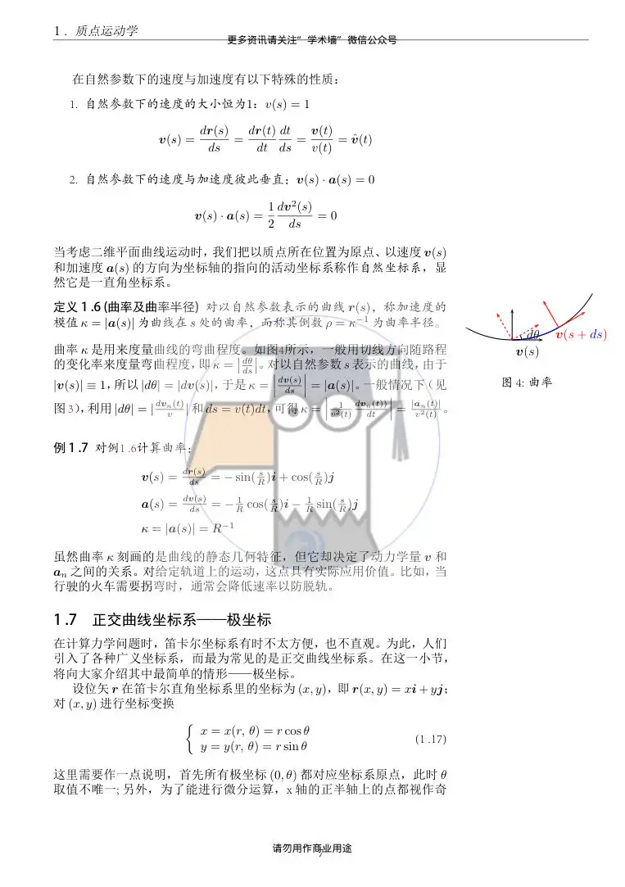

原文：

在自然参数下的速度与加速度有以下特殊的性质：

1. 自然参数下的速度的大小恒为1： $v ( s ) = 1$

$$
\pmb {v} (s) = \frac {d \pmb {r} (s)}{d s} = \frac {d \pmb {r} (t)}{d t} \frac {d t}{d s} = \frac {\pmb {v} (t)}{v (t)} = \hat {\pmb {v}} (t)
$$

2. 自然参数下的速度与加速度彼此垂直： ${ \pmb v } ( s ) \cdot { \pmb a } ( s ) = 0$

$$
\pmb {v} (s) \cdot \pmb {a} (s) = \frac {1}{2} \frac {d \pmb {v} ^ {2} (s)}{d s} = 0
$$

当考虑二维平面曲线运动时，我们把以质点所在位置为原点、以速度 $\pmb { v } ( s )$ 和加速度 $\pmb { a } ( s )$ 的方向为坐标轴的指向的活动坐标系称作自然坐标系，显然它是一直角坐标系。

定义1.6(曲率及曲率半径) 对以自然参数表示的曲线 $\pmb { r } ( s )$ ，称加速度的模值 $\boldsymbol { \kappa } = | \boldsymbol { a } ( \boldsymbol { s } ) |$ 为曲线在 $s$ 处的曲率，而称其倒数 $\overline { { \rho = } } \kappa ^ { - 1 }$ 为曲率半径。

曲率 $\kappa$ 是用来度量曲线的弯曲程度。如图4所示，一般用切线方向随路程的变化率来度量弯曲程度，即 $\begin{array} { r } { { \boldsymbol { \kappa } } = \left| \frac { d { \boldsymbol { \theta } } } { d s } \right| } \end{array}$ 。对以自然参数s表示的曲线，由于$| \pmb { v } ( s ) | \equiv 1$ ，所以 $| d \theta | = | d v ( s ) |$ ，于是 $\begin{array} { r } { \kappa = \left| \frac { d { \pmb v } ( s ) } { d s } \right| = | { \pmb a } ( s ) | } \end{array}$ 。一般情况下（见图3），利用 $\begin{array} { r } { | d \theta | = | \frac { d v _ { n } ( t ) } { v } } \end{array}$ 和 $d s = v ( t ) d t$ ，可得 κ $\begin{array} { r l } { \bigg [ \frac { 1 } { v ^ { 2 } ( t ) } \frac { d v _ { n } ( t ) } { d t } \bigg ] } & { { } \equiv \frac { | a _ { n } ( t ) | } { v ^ { 2 } ( t ) } \circ } \end{array}$

图 4: 曲率

例1.7 对例1.6计算曲率：

$$
\begin{array}{l} \boldsymbol {v} (s) = \frac {d \boldsymbol {r} (s)}{d s} = - \sin (\frac {s}{R}) \boldsymbol {i} + \cos (\frac {s}{R}) \boldsymbol {j} \\ \boldsymbol {a} (s) = \frac {d \boldsymbol {v} (s)}{d s} = - \frac {1}{R} \cos (\frac {s}{R}) \boldsymbol {i} - \frac {1}{R} \sin (\frac {s}{R}) \boldsymbol {j} \\ \kappa = | \boldsymbol {a} (s) | = R ^ {- 1} \end{array}
$$

虽然曲率 $\kappa$ 刻画的是曲线的静态几何特征，但它却决定了动力学量v 和$\mathbf { a } _ { n }$ 之间的关系。对给定轨道上的运动，这点具有实际应用价值。比如，当行驶的火车需要拐弯时，通常会降低速率以防脱轨。

1.7 正交曲线坐标系——极坐标

在计算力学问题时，笛卡尔坐标系有时不太方便，也不直观。为此，人们引入了各种广义坐标系，而最为常见的是正交曲线坐标系。在这一小节，将向大家介绍其中最简单的情形——极坐标。

设位矢 $\mathbfit { \Delta } \mathbf { r }$ 在笛卡尔直角坐标系里的坐标为 $( x , y )$ ，即 $\pmb { r } ( x , y ) = x \pmb { i } + y \pmb { j }$ 对 $( x , y )$ 进行坐标变换

$$
\left\{ \begin{array}{l l} x = x (r, \theta) = r \cos \theta \\ y = y (r, \theta) = r \sin \theta \end{array} \right.\tag{1.17}
$$

这里需要作一点说明，首先所有极坐标 $( 0 , \theta )$ 都对应坐标系原点，此时θ取值不唯一;另外，为了能进行微分运算，x轴的正半轴上的点都视作奇异点不予考虑。也就是说我们只考虑 $r > 0$ 并且 $0 < \theta < 2 \pi$ 的情形，对该区域上点 $( x , y )$ 与 $( r , \theta )$ 之间有一一对应关系，并有逆变换

1 . 质点运动学

更多资讯请关注“学术墙”微信公众号

请勿用作商业用途

### $$

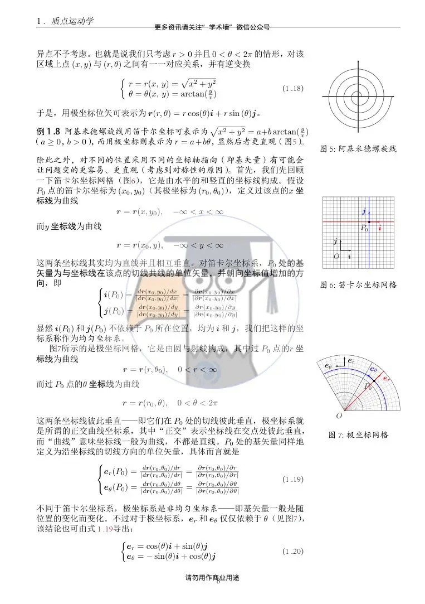

原文：

$$
\left\{ \begin{array}{l} r = r (x, y) = \sqrt {x ^ {2} + y ^ {2}} \\ \theta = \theta (x, y) = \arctan (\frac {y}{x}) \end{array} \right.\tag{1.18}
$$

于是，用极坐标位矢可表示为 $\pmb { r } ( r , \theta ) = r \cos ( \theta ) \pmb { i } + r \sin \left( \theta \right) \pmb { j }$ 。

例1.8 阿基米德螺旋线用笛卡尔坐标可表示为 ${ \sqrt { x ^ { 2 } + y ^ { 2 } } } = a { + } b \arctan ( { \frac { y } { r } } )$ $( a \geq 0 , b > 0 )$ ），而用极坐标则表示为 $r = a + b \theta$ ，显然后者更直观 $( \sharp 5 ) _ { \circ } ^ { \boldsymbol { \omega } }$

图5: 阿基米德螺旋线

除此之外，对不同的位置采用不同的坐标轴指向（即基矢量）有可能会让问题变的更容易、更直观（考虑到对称性的原因 $) _ { \circ }$ 。首先，我们先回顾一下笛卡尔坐标网格（图6），它是由水平的和竖直的坐标线构成。假设$P _ { 0 }$ 点的笛卡尔坐标为 $( x _ { 0 } , y _ { 0 } )$ （其极坐标为 $( r _ { 0 } , \theta _ { 0 } ) )$ ），定义过该点的x坐标线为曲线

$$
\boldsymbol {r} = \boldsymbol {r} (x, y _ {0}), - \infty <   x <   \infty
$$

而 $y$ 坐标线为曲线

$$
\boldsymbol {r} = \boldsymbol {r} (x _ {0}, y), - \infty <   y <   \infty
$$

这两条坐标线其实均为直线并且相互垂直。对笛卡尔坐标系， $P _ { 0 }$ 处的基矢量为与坐标线在该点的切线共线的单位矢量，并朝向坐标值增加的方向，即

图6: 笛卡尔坐标网格

$$
\left\{ \begin{array}{l} \boldsymbol {i} (P _ {0}) = \frac {d \boldsymbol {r} (x _ {0} , y _ {0}) / d x}{| d \boldsymbol {r} (x _ {0} , y _ {0}) / d x |} = \frac {\partial \boldsymbol {r} (x _ {0} , y _ {0}) / \partial x}{| \partial \boldsymbol {r} (x _ {0} , y _ {0}) / \partial x |} \\ \boldsymbol {j} (P _ {0}) = \frac {d \boldsymbol {r} (x _ {0} , y _ {0}) / d y}{| d \boldsymbol {r} (x _ {0} , y _ {0}) / d y |} = \frac {\partial \boldsymbol {r} (x _ {0} , y _ {0}) / \partial y}{| \partial \boldsymbol {r} (x _ {0} , y _ {0}) / \partial y |} \end{array} \right.
$$

显然 $i ( P _ { 0 } )$ 和 $j ( P _ { 0 } )$ 不依赖于 $P _ { 0 }$ 所在位置，均为 i 和 $j$ ，我们把这样的坐标系称作为均匀坐标系。

图7所示的是极坐标网格，它是由圆与射线构成，其中过 $P _ { 0 }$ 点的r 坐标线为曲线

$$
\pmb {r} = \pmb {r} (r, \theta_ {0}), \quad 0 <   r <   \infty
$$

而过 $P _ { 0 }$ 点的θ坐标线为曲线

$$
\boldsymbol {r} = \boldsymbol {r} (r _ {0}, \theta), \quad 0 <   \theta <   2 \pi
$$

这两条坐标线彼此垂直——即它们在 $P _ { 0 }$ 处的切线彼此垂直，极坐标系就是所谓的正交曲线坐标系，其中“正交”表示坐标线在交点处彼此垂直，而“曲线”意味坐标线一般为曲线，不都是直线。 $P _ { 0 }$ 处的基矢量同样地定义为沿坐标线的切线方向的单位矢量，具体而言就是

图7: 极坐标网格

$$
\left\{ \begin{array}{l} \boldsymbol {e} _ {r} (P _ {0}) = \frac {d \boldsymbol {r} (r _ {0} , \theta_ {0}) / d r}{| d \boldsymbol {r} (r _ {0} , \theta_ {0}) / d r |} = \frac {\partial \boldsymbol {r} (r _ {0} , \theta_ {0}) / \partial r}{| \partial \boldsymbol {r} (r _ {0} , \theta_ {0}) / \partial r |} \\ \boldsymbol {e} _ {\theta} (P _ {0}) = \frac {d \boldsymbol {r} (r _ {0} , \theta_ {0}) / d \theta}{| d \boldsymbol {r} (r _ {0} , \theta_ {0}) / d \theta |} = \frac {\partial \boldsymbol {r} (r _ {0} , \theta_ {0}) / \partial \theta}{| \partial \boldsymbol {r} (r _ {0} , \theta_ {0}) / \partial \theta |} \end{array} \right.\tag{1.19}
$$

不同于笛卡尔坐标系，极坐标系是非均匀坐标系——即基矢量一般是随位置的变化而变化。不过对于极坐标系， $e _ { r }$ 和 $e _ { \theta }$ 仅仅依赖于 $\theta$ （见图7），该结论也可由式1.19导出：

$$
\left\{ \begin{array}{l} \boldsymbol {e} _ {r} = \cos (\theta) \boldsymbol {i} + \sin (\theta) \boldsymbol {j} \\ \boldsymbol {e} _ {\theta} = - \sin (\theta) \boldsymbol {i} + \cos (\theta) \boldsymbol {j} \end{array} \right.\tag{1.20}
$$

1 . 质点运动学

更多资讯请关注“学术墙”微信公众号

8请勿用作商业用途

### $$

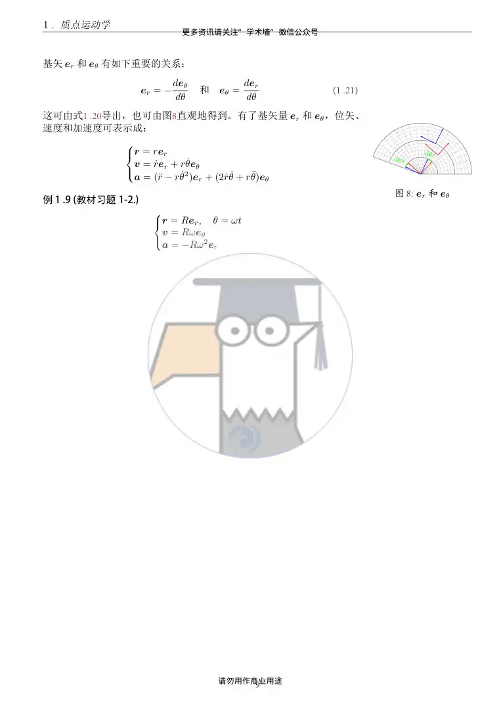

原文：

基矢 $e _ { r }$ 和 $e _ { \theta }$ 有如下重要的关系：

$$
\pmb {e} _ {r} = - \frac {d \pmb {e} _ {\theta}}{d \theta} \quad \text {和} \quad \pmb {e} _ {\theta} = \frac {d \pmb {e} _ {r}}{d \theta}\tag{1.21}
$$

这可由式1.20导出，也可由图8直观地得到。有了基矢量 $e _ { r }$ 和 $e _ { \theta }$ ，位矢、速度和加速度可表示成：

$$
\left\{ \begin{array}{l} \boldsymbol {r} = r \boldsymbol {e} _ {r} \\ \boldsymbol {v} = \dot {r} \boldsymbol {e} _ {r} + r \dot {\theta} \boldsymbol {e} _ {\theta} \\ \boldsymbol {a} = (\ddot {r} - r \dot {\theta} ^ {2}) \boldsymbol {e} _ {r} + (2 \dot {r} \dot {\theta} + r \ddot {\theta}) \boldsymbol {e} _ {\theta} \end{array} \right.
$$

例 1 .9 (教材习题 1-2.)

$$
\left\{ \begin{array}{l} \boldsymbol {r} = R \boldsymbol {e} _ {r}, \quad \theta = \omega t \\ \boldsymbol {v} = R \omega e _ {\theta} \\ \boldsymbol {a} = - R \omega^ {2} \boldsymbol {e} _ {r} \end{array} \right.
$$

1 . 质点运动学

更多资讯请关注“学术墙”微信公众号

请勿用作商业用途

### 4 机械能守恒定律

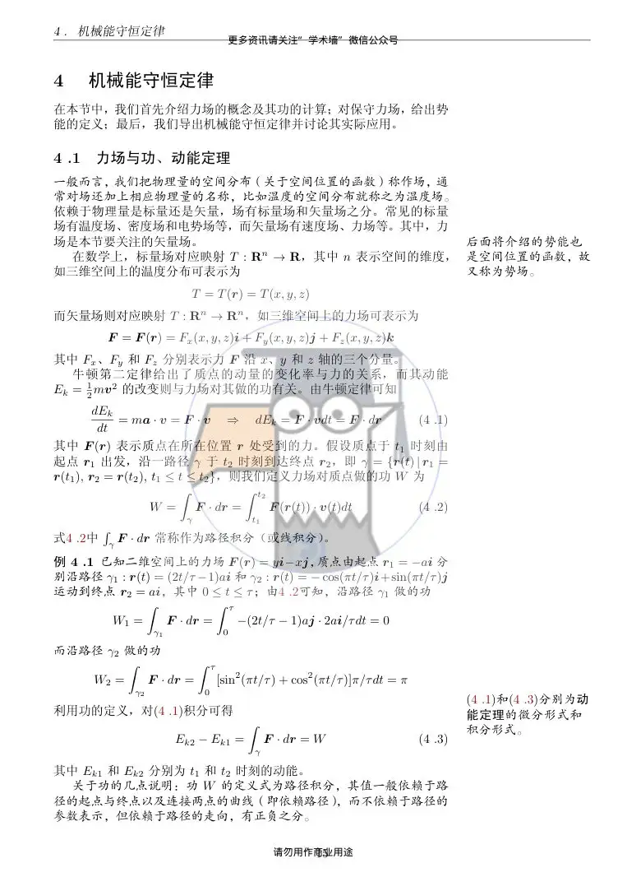

原文：

4 机械能守恒定律

在本节中，我们首先介绍力场的概念及其功的计算；对保守力场，给出势能的定义；最后，我们导出机械能守恒定律并讨论其实际应用。

4 .1 力场与功、动能定理

一般而言，我们把物理量的空间分布（关于空间位置的函数）称作场，通常对场还加上相应物理量的名称，比如温度的空间分布就称之为温度场。依赖于物理量是标量还是矢量，场有标量场和矢量场之分。常见的标量场有温度场、密度场和电势场等，而矢量场有速度场、力场等。其中，力场是本节要关注的矢量场。

在数学上，标量场对应映射 $T : \mathbf { R } ^ { n }  \mathbf { R }$ ，其中 n 表示空间的维度，如三维空间上的温度分布可表示为

$$
T = T (\boldsymbol {r}) = T (x, y, z)
$$

后面将介绍的势能也是空间位置的函数，故又称为势场。

而矢量场则对应映射 $T : \mathbf { R } ^ { n }  \mathbf { R } ^ { n }$ ，如三维空间上的力场可表示为

$$
\boldsymbol {F} = \boldsymbol {F} (\boldsymbol {r}) = F _ {x} (x, y, z) \boldsymbol {i} + F _ {y} (x, y, z) \boldsymbol {j} + F _ {z} (x, y, z) \boldsymbol {k}
$$

其中 $F _ { x } , \ F _ { y }$ 和 $F _ { z }$ 分别表示力 $\mathbfcal { F }$ 沿 $\overline { { x \setminus y } }$ 和 $z$ 轴的三个分量。

牛顿第二定律给出了质点的动量的变化率与力的关系，而其动能$\begin{array} { r } { E _ { k } = \frac { 1 } { 2 } m v ^ { 2 } } \end{array}$ 的改变则与力场对其做的功有关。由牛顿定律可知

$$
\frac {d E _ {k}}{d t} = m \boldsymbol {a} \cdot \boldsymbol {v} = \boldsymbol {F} \cdot \boldsymbol {v} \quad \Rightarrow \quad d E _ {k} = \boldsymbol {F} \cdot \boldsymbol {v} d t = \boldsymbol {F} \cdot d \boldsymbol {r}\tag{4.1}
$$

其中 $F ( r )$ 表示质点在所在位置 r 处受到的力。假设质点于 $t _ { 1 }$ 时刻由起点 $\mathbf { \Delta } _ { \mathbf { r } _ { 1 } }$ 出发，沿一路径 γ 于 $t _ { 2 }$ 时刻到达终点 $r _ { 2 }$ ，即 $\boldsymbol { \gamma } | = \{ \boldsymbol { r } ( t ) | \boldsymbol { r } _ { 1 }$ $r ( t _ { 1 } ) , r _ { 2 } = r ( t _ { 2 } ) , t _ { 1 } \leq t \leq t _ { 2 } ^ { * }$ ，则我们定义力场对质点做的功 W 为

$$
W = \int_ {\gamma} \boldsymbol {F} \cdot d \boldsymbol {r} = \int_ {t _ {1}} ^ {t _ {2}} \boldsymbol {F} (\boldsymbol {r} (t)) \cdot \boldsymbol {v} (t) d t\tag{4.2}
$$

式4 .2中 $\int _ { \gamma } \boldsymbol { F } \cdot d \boldsymbol { r }$ 常称作为路径积分（或线积分）。

例 4 .1 已知二维空间上的力场 $F ( r ) = y i - x j$ ，质点由起点 $r _ { 1 } = - a i$ 分别沿路径 $\gamma _ { 1 } : r ( t ) = ( 2 t / \tau - 1 ) a i$ 和 $\gamma _ { 2 } : r ( t ) = - \cos ( \pi t / \tau ) i + \sin ( \pi t / \tau ) j$ 运动到终点 $r _ { 2 } = a i$ ，其中 $0 \leq t \leq \tau$ ；由4 .2可知，沿路径 $\gamma _ { 1 }$ 做的功

$$
W _ {1} = \int_ {\gamma_ {1}} \boldsymbol {F} \cdot d \boldsymbol {r} = \int_ {0} ^ {\tau} - (2 t / \tau - 1) a \boldsymbol {j} \cdot 2 a \boldsymbol {i} / \tau d t = 0
$$

而沿路径 $\gamma _ { 2 }$ 做的功

$$
W _ {2} = \int_ {\gamma_ {2}} \boldsymbol {F} \cdot d \boldsymbol {r} = \int_ {0} ^ {\tau} [ \sin^ {2} (\pi t / \tau) + \cos^ {2} (\pi t / \tau) ] \pi / \tau d t = \pi
$$

利用功的定义，对(4 .1)积分可得(4 .1)和(4 .3)分别为动能定理的微分形式和积分形式。

$$
E _ {k 2} - E _ {k 1} = \int_ {\gamma} \boldsymbol {F} \cdot d \boldsymbol {r} = W\tag{4.3}
$$

其中 $E _ { k 1 }$ 和 $E _ { k 2 }$ 分别为 $t _ { 1 }$ 和 $t _ { 2 }$ 时刻的动能。

关于功的几点说明：功 W 的定义式为路径积分，其值一般依赖于路径的起点与终点以及连接两点的曲线（即依赖路径），而不依赖于路径的参数表示，但依赖于路径的走向，有正负之分。

4 . 机械能守恒定律

更多资讯请关注“学术墙”微信公众号

15请勿用作商业用途

### 4 .2 保守力及其势能、中心力场

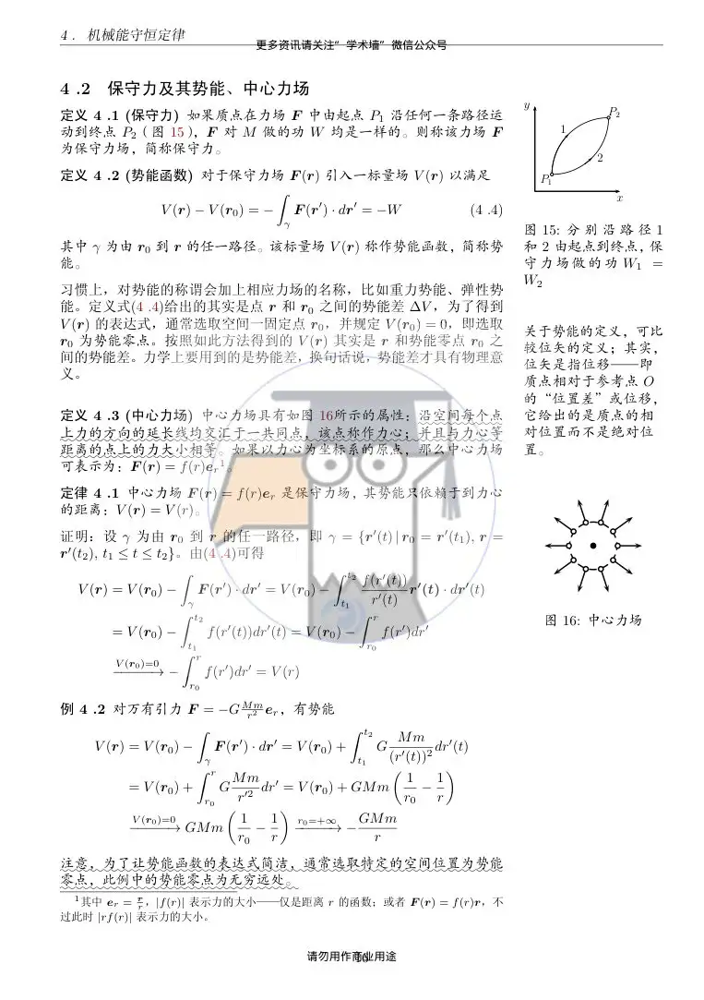

原文：

4 .2 保守力及其势能、中心力场

定义 4 .1 (保守力) 如果质点在力场 F 中由起点 $P _ { 1 }$ 沿任何一条路径运动到终点 $P _ { 2 }$ （图 15），F 对 M 做的功 W 均是一样的。则称该力场 F为保守力场，简称保守力。

定义 4 .2 (势能函数) 对于保守力场 $F ( r )$ 引入一标量场 $V ( r )$ 以满足

$$
V (\boldsymbol {r}) - V (\boldsymbol {r} _ {0}) = - \int_ {\gamma} \boldsymbol {F} (\boldsymbol {r} ^ {\prime}) \cdot d \boldsymbol {r} ^ {\prime} = - W
$$

(4 .4)

其中 $\gamma$ 为由 $\mathbf { \boldsymbol { r } } _ { 0 }$ 到 r 的任一路径。该标量场 $V ( r )$ 称作势能函数，简称势能。

图 15: 分 别 沿 路 径 1和 2 由起点到终点，保守力场做的功 $\begin{array} { r l } { W _ { 1 } } & { { } = } \end{array}$ $W _ { 2 }$

习惯上，对势能的称谓会加上相应力场的名称，比如重力势能、弹性势能。定义式(4 .4)给出的其实是点 r 和 $r _ { 0 }$ 之间的势能差 $\Delta V$ ，为了得到$V ( r )$ 的表达式，通常选取空间一固定点 $r _ { 0 }$ ，并规定 $V ( r _ { 0 } ) = 0$ ，即选取$\mathbf { \boldsymbol { r } } _ { 0 }$ 为势能零点。按照如此方法得到的 $V ( r )$ 其实是 r 和势能零点 $r _ { 0 }$ 之间的势能差。力学上要用到的是势能差，换句话说，势能差才具有物理意义。

关于势能的定义，可比较位矢的定义；其实，位矢是指位移——即质点相对于参考点 O的“位置差”或位移，它给出的是质点的相对位置而不是绝对位置。

定义 4 .3 (中心力场) 中心力场具有如图 16所示的属性：沿空间每个点上力的方向的延长线均交汇于一共同点，该点称作力心；并且与力心等距离的点上的力大小相等。如果以力心为坐标系的原点，那么中心力场可表示为： $\pmb { F } ( \pmb { r } ) = f ( r ) \pmb { e } _ { r } ^ { \mathrm { ~ 1 ~ } }$

定律 4 .1 中心力场 $\pmb { F } ( \pmb { r } ) \equiv f ( \pmb { r } ) \pmb { e } _ { r }$ 是保守力场，其势能只依赖于到力心的距离： $V ( \pmb { r } ) = V ( \pmb { r } )$

证明：设 γ 为由 $\mathbf { \boldsymbol { r } } _ { 0 }$ 到 r 的任一路径，即 $\gamma = \{ r ^ { \prime } ( t ) | r _ { 0 } | = r ^ { \prime } ( t _ { 1 } ) , r | =$ $r ^ { \prime } ( t _ { 2 } ) , t _ { 1 } \leq t \leq t _ { 2 } \}$ 。由 $( 4 ^ { \top } . 4 )$ 可得

$$
\begin{array}{l} V (\boldsymbol {r}) = V (\boldsymbol {r} _ {0}) - \int_ {\gamma} \boldsymbol {F} (\boldsymbol {r} ^ {\prime}) \cdot d \boldsymbol {r} ^ {\prime} = V (\boldsymbol {r} _ {0}) - \int_ {t _ {1}} ^ {t _ {2}} \frac {f (r ^ {\prime} (t))}{r ^ {\prime} (t)} \boldsymbol {r} ^ {\prime} (t) \cdot d \boldsymbol {r} ^ {\prime} (t) \\ = V (\boldsymbol {r} _ {0}) - \int_ {t _ {1}} ^ {t _ {2}} f (r ^ {\prime} (t)) d r ^ {\prime} (t) = V (\boldsymbol {r} _ {0}) - \int_ {r _ {0}} ^ {r} f (r ^ {\prime}) d r ^ {\prime} \\ \xrightarrow {V (\boldsymbol {r} _ {0}) = 0} - \int_ {r _ {0}} ^ {r} f (r ^ {\prime}) d r ^ {\prime} = V (r) \end{array}
$$

图 16: 中心力场

例 4 .2 对万有引力 $\begin{array} { r } { { \pmb F } = - G \frac { M m } { r ^ { 2 } } { \pmb e } _ { r } } \end{array}$ ，有势能

$$
\begin{array}{l} V (\boldsymbol {r}) = V (\boldsymbol {r} _ {0}) - \int_ {\gamma} \boldsymbol {F} (\boldsymbol {r} ^ {\prime}) \cdot d \boldsymbol {r} ^ {\prime} = V (\boldsymbol {r} _ {0}) + \int_ {t _ {1}} ^ {t _ {2}} G \frac {M m}{(r ^ {\prime} (t)) ^ {2}} d r ^ {\prime} (t) \\ = V (\boldsymbol {r} _ {0}) + \int_ {r _ {0}} ^ {r} G \frac {M m}{r ^ {\prime 2}} d r ^ {\prime} = V (\boldsymbol {r} _ {0}) + G M m \left(\frac {1}{r _ {0}} - \frac {1}{r}\right) \\ \xrightarrow {V (\boldsymbol {r} _ {0}) = 0} G M m \left(\frac {1}{r _ {0}} - \frac {1}{r}\right) \xrightarrow {r _ {0} = + \infty} - \frac {G M m}{r} \end{array}
$$

注意，为了让势能函数的表达式简洁，通常选取特定的空间位置为势能零点，此例中的势能零点为无穷远处。

4 . 机械能守恒定律

更多资讯请关注“学术墙”微信公众号

16请勿用作商业用途

er = rr ，|f(r)|

|rf(r)|

F (r) = f(r)r

1其中 er = 表示力的大小——仅是距离 r 的函数；或者 ，不过此时 表示力的大小。

### 4 .3 机械能守恒定律

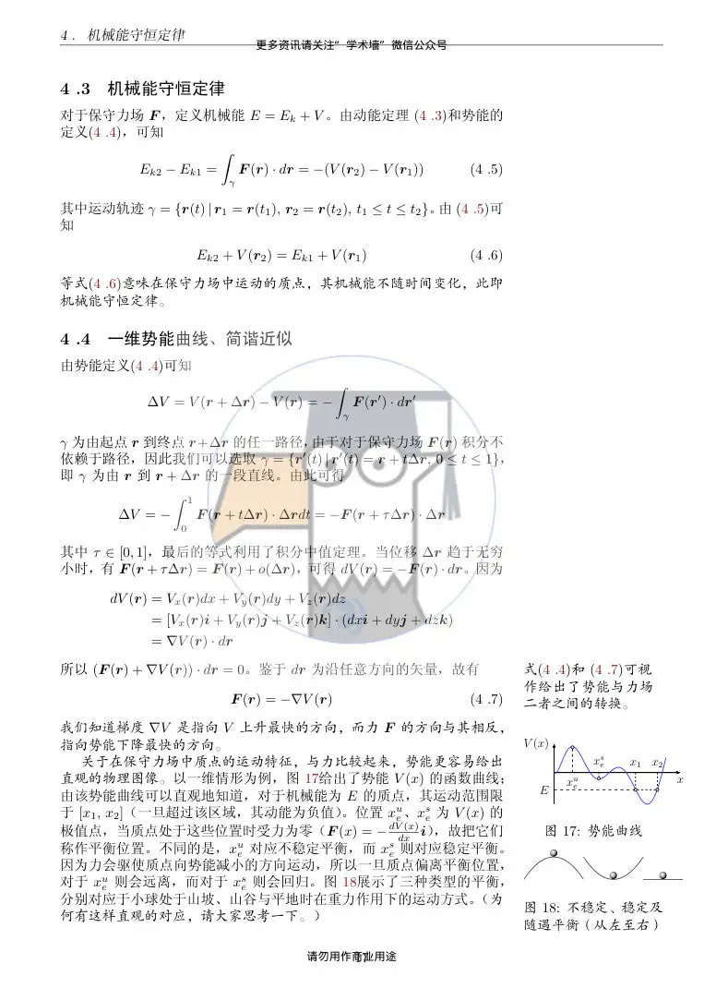

原文：

4 .3 机械能守恒定律

对于保守力场 F，定义机械能 $E = E _ { k } + V$ 。由动能定理 (4 .3)和势能的定义(4 .4)，可知

$$
E _ {k 2} - E _ {k 1} = \int_ {\gamma} \boldsymbol {F} (\boldsymbol {r}) \cdot d \boldsymbol {r} = - (V (\boldsymbol {r} _ {2}) - V (\boldsymbol {r} _ {1}))\tag{4.5}
$$

其中运动轨迹 $\gamma = \{ { \pmb r } ( t ) | { \pmb r } _ { 1 } = { \pmb r } ( t _ { 1 } ) , { \pmb r } _ { 2 } = { \pmb r } ( t _ { 2 } ) , t _ { 1 } \leq t \leq t _ { 2 } \}$ 。由 (4 .5)可知

$$
E _ {k 2} + V (\pmb {r} _ {2}) = E _ {k 1} + V (\pmb {r} _ {1})\tag{4.6}
$$

等式(4 .6)意味在保守力场中运动的质点，其机械能不随时间变化，此即机械能守恒定律。

4 .4 一维势能曲线、简谐近似

由势能定义(4 .4)可知

$$
\Delta V = V (\boldsymbol {r} + \Delta \boldsymbol {r}) - V (\boldsymbol {r}) = - \int_ {\gamma} \boldsymbol {F} (\boldsymbol {r} ^ {\prime}) \cdot d \boldsymbol {r} ^ {\prime}
$$

$\gamma$ 为由起点 r 到终点 $r + \Delta r$ 的任一路径，由于对于保守力场 $F ( r )$ 积分不依赖于路径，因此我们可以选取 $\gamma = \{ r _ { \parallel } ^ { \prime } ( t ) | x ^ { \prime } ( t ) | = _ { e } x + t \Delta r , 0 \leq t \leq 1 \}$ 即 $\gamma$ 为由 r 到 $r + \Delta r$ 的一段直线。由此可得

$$
\Delta V = - \int_ {0} ^ {1} F (\pmb {r} + t \Delta \pmb {r}) \cdot \Delta \pmb {r} d t = - F (\pmb {r} + \tau \Delta \pmb {r}) \cdot \Delta \pmb {r}
$$

其中 $\tau \in [ 0 , 1 ]$ ，最后的等式利用了积分中值定理。当位移 $\Delta r$ 趋于无穷小时，有 $F ( \pmb { r } + \tau \Delta \pmb { r } ) = F ( \pmb { r } ) + o ( \Delta \pmb { r } )$ ，可得 $d V ( r ) = _ { \bf { \alpha } } - { \bar { F } } ( r ) \cdot d r$ 。因为

$$
\begin{array}{l} d V (\boldsymbol {r}) = V _ {x} (\boldsymbol {r}) d x + V _ {y} (\boldsymbol {r}) d y + V _ {z} (\boldsymbol {r}) d z \\ \qquad = [ V _ {x} (\boldsymbol {r}) \boldsymbol {i} + V _ {y} (\boldsymbol {r}) \boldsymbol {j} + V _ {z} (\boldsymbol {r}) \boldsymbol {k} ] \cdot (d x \boldsymbol {i} + d y \boldsymbol {j} + d z \boldsymbol {k}) \\ \qquad = \nabla V (\boldsymbol {r}) \cdot d \boldsymbol {r} \end{array}
$$

所以 $\begin{array} { r } { ( F ( \pmb { r } ) + \nabla V ( \pmb { r } ) ) \cdot d \pmb { r } = 0 , } \end{array}$ 。鉴于 $d r$ 为沿任意方向的矢量，故有

$$
\boldsymbol {F} (\boldsymbol {r}) = - \nabla V (\boldsymbol {r})\tag{4.7}
$$

式(4 .4)和 (4 .7)可视作给出了势能与力场二者之间的转换。

我们知道梯度 ∇V 是指向 V 上升最快的方向，而力 F 的方向与其相反，指向势能下降最快的方向。

关于在保守力场中质点的运动特征，与力比较起来，势能更容易给出直观的物理图像。以一维情形为例，图 17给出了势能 $V ( x )$ 的函数曲线；由该势能曲线可以直观地知道，对于机械能为 E 的质点，其运动范围限于 $[ x _ { 1 } , x _ { 2 } ]$ （一旦超过该区域，其动能为负值）。位置 $x _ { e } ^ { u } \setminus x _ { e } ^ { s }$ 为 $V ( x )$ 的极值点，当质点处于这些位置时受力为零 $\begin{array} { r } { ( F ( x ) = - \frac { d V ( x ) } { d x } i ) } \end{array}$ ），故把它们称作平衡位置。不同的是， $x _ { e } ^ { u }$ 对应不稳定平衡，而 $x _ { e } ^ { s }$ 则对应稳定平衡。因为力会驱使质点向势能减小的方向运动，所以一旦质点偏离平衡位置，对于 $x _ { e } ^ { u }$ 则会远离，而对于 $x _ { e } ^ { s }$ 则会回归。图 18展示了三种类型的平衡，分别对应于小球处于山坡、山谷与平地时在重力作用下的运动方式。（为何有这样直观的对应，请大家思考一下。）

4 . 机械能守恒定律

更多资讯请关注“学术墙”微信公众号

17请勿用作商业用途

### $$

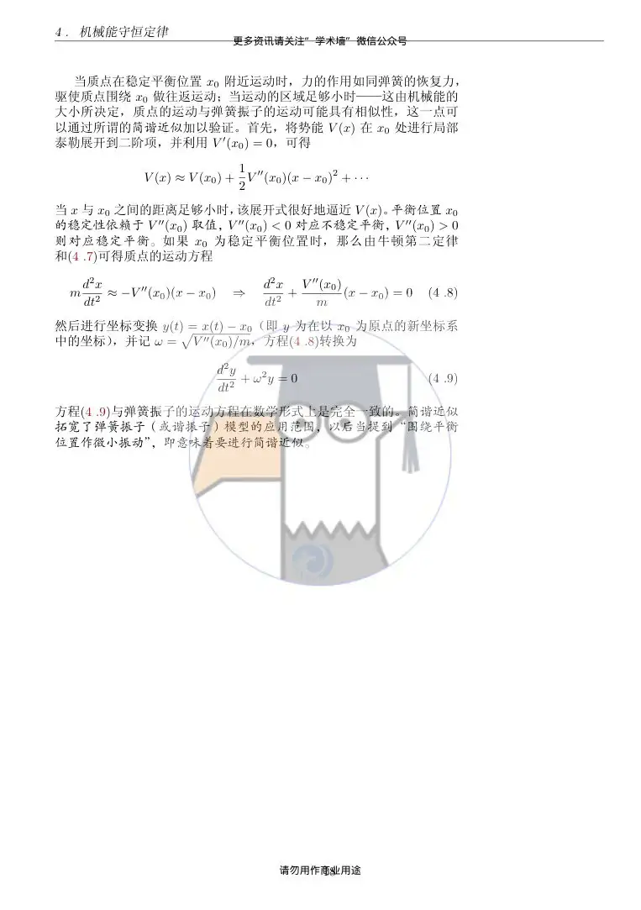

原文：

当质点在稳定平衡位置 $x _ { 0 }$ 附近运动时，力的作用如同弹簧的恢复力，驱使质点围绕 x 做往返运动；当运动的区域足够小时——这由机械能的 $x _ { 0 }$ 大小所决定，质点的运动与弹簧振子的运动可能具有相似性，这一点可以通过所谓的简谐近似加以验证。首先，将势能 $V ( x )$ 在 $x _ { 0 }$ 处进行局部泰勒展开到二阶项，并利用 $V ^ { \prime } ( x _ { 0 } ) = 0$ ，可得

$$
V (x) \approx V (x _ {0}) + \frac {1}{2} V ^ {\prime \prime} (x _ {0}) (x - x _ {0}) ^ {2} + \dots
$$

当 $x$ 与 $x _ { 0 }$ 之间的距离足够小时，该展开式很好地逼近 $V ( x )$ 。平衡位置 $x _ { 0 }$ 的稳定性依赖于 $V ^ { \prime \prime } ( x _ { 0 } )$ 取值， $V ^ { \prime \prime } ( x _ { 0 } ) < 0$ 对应不稳定平衡， $V ^ { \prime \prime } ( x _ { 0 } ) > 0$ 则对应稳定平衡。如果 $x _ { 0 }$ 为稳定平衡位置时，那么由牛顿第二定律和(4 .7)可得质点的运动方程

$$
m \frac {d ^ {2} x}{d t ^ {2}} \approx - V ^ {\prime \prime} (x _ {0}) (x - x _ {0}) \Rightarrow \frac {d ^ {2} x}{d t ^ {2}} + \frac {V ^ {\prime \prime} (x _ {0})}{m} (x - x _ {0}) = 0\tag{4.8}
$$

然后进行坐标变换 $y ( t ) = x ( t ) - x _ { 0 }$ （即 $y$ 为在以 $x _ { 0 }$ 为原点的新坐标系中的坐标），并记 $\omega = \sqrt { V ^ { \prime \prime } ( x _ { 0 } ) / m } ,$ ，方程(4 .8)转换为

$$
\frac {d ^ {2} y}{d t ^ {2}} + \omega^ {2} y = 0\tag{4.9}
$$

方程(4 .9)与弹簧振子的运动方程在数学形式上是完全一致的。简谐近似拓宽了弹簧振子（或谐振子）模型的应用范围，以后当提到“围绕平衡位置作微小振动”，即意味着要进行简谐近似。

4 . 机械能守恒定律

更多资讯请关注“学术墙”微信公众号

18请勿用作商业用途

### 8 热力学第零定律

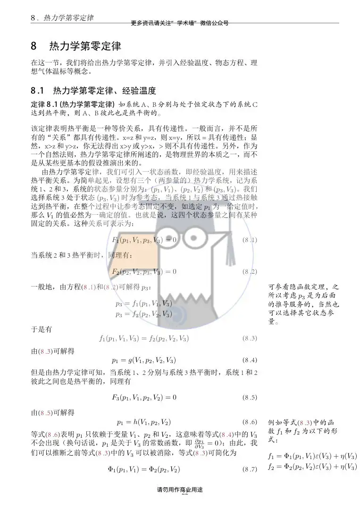

原文：

8 热力学第零定律

在这一节，我们将给出热力学第零定律，并引入经验温度、物态方程、理想气体温标等概念。

8.1 热力学第零定律、经验温度

定律8.1(热力学第零定律) 如系统A、B分别与处于恒定状态下的系统C达到热平衡，则A、B彼此也是热平衡的。

该定律表明热平衡是一种等价关系，具有传递性。一般而言，并不是所有的“关系”都具有传递性。x=z和 $\scriptstyle { \ Y = Z }$ ，则 $\mathrm { x } { = } \mathrm { y }$ ，所以=具有传递性；显然，x>z 和 $y > z$ ，你无法得出x>y或y>x，>则不具有传递性。另外，作为一个自然法则，热力学第零定律所阐述的，是物理世界的本质之一，而不是从某些更基本的假设推演出来的。

由热力学第零定律，我们可引入一状态函数，即经验温度，用来描述热平衡关系。为简单起见，设想有三个（两参量的）热力学系统，记为系统1、2和3，系统的状态参量分别为 $\therefore ( p _ { 1 } , V _ { 1 } ) , ( p _ { 2 } , V _ { 2 } )$ 和 $( p _ { 3 } , V _ { 3 } )$ 。我们选择系统3处于状态 $( p _ { 3 } , V _ { 3 } )$ 时为参考态，当系统1与系统3通过热接触达到热平衡，在整个过程中让参考态固定不变，如选定 $p _ { 1 }$ 为一给定值时，那么 $V _ { 1 }$ 的值必然为一确定的值。也就是说，这四个状态参量之间有某种固定的关系。这种关系可表示为：

$$
F _ {1} (p _ {1}, V _ {1}, p _ {3}, V _ {3}) = 0\tag{8.1}
$$

当系统2和3热平衡时，同理有：

$$
F _ {2} (p _ {2}, V _ {2}, p _ {3}, V _ {3}) = 0\tag{8.2}
$$

一般地，由方程(8.1)和(8.2)可解得 $p _ { 3 }$ ：

$$
\begin{array}{r} p _ {3} = f _ {1} (p _ {1}, V _ {1}, V _ {3}) \\ p _ {3} = f _ {2} (p _ {2}, V _ {2}, V _ {3}) \end{array}
$$

可参看隐函数定理，之所以考虑 $p _ { 3 }$ 是为后面的推导服务的，当然也可以选择其它状态参量。

于是有

$$
f _ {1} (p _ {1}, V _ {1}, V _ {3}) = f _ {2} (p _ {2}, V _ {2}, V _ {3})\tag{8.3}
$$

由(8 .3)可解得

$$
p _ {1} = g (V _ {1}, p _ {2}, V _ {2}, V _ {3})\tag{8.4}
$$

但是由热力学定律可知，当系统1、2分别与系统3热平衡时，系统1和2彼此之间也是热平衡的，同理有

$$
F _ {3} (p _ {1}, V _ {1}, p _ {2}, V _ {2}) = 0\tag{8.5}
$$

由(8 .5)可解得

$$
p _ {1} = h (V _ {1}, p _ {2}, V _ {2})\tag{8.6}
$$

等式 $\left( 8 . 6 \right)$ 表明 $p _ { 1 }$ 只依赖于变量 $V _ { 1 }$ 、 $p _ { 2 }$ 和 $V _ { 2 }$ ，这意味着等式(8.4)中的 $V _ { 3 }$ 不会出现（换句话说， $p _ { 1 }$ 是关于 $V _ { 3 }$ 的常数函数，即 $\begin{array} { r } { \frac { \partial p _ { 1 } } { \partial V _ { 3 } } = 0 \rangle } \end{array}$ ）；由此，我们可以推断之前等式(8.3)中的 $V _ { 3 }$ 可以被消除，等式(8.3)可简化为

例如等式(8.3)中的函数 $f _ { 1 }$ 和 $f _ { 2 }$ 为以下的形式：

$$
\Phi_ {1} (p _ {1}, V _ {1}) = \Phi_ {2} (p _ {2}, V _ {2})\tag{8.7}
$$

$$
\begin{array}{l} f _ {1} = \Phi_ {1} (p _ {1}, V _ {1}) \varepsilon (V _ {3}) + \eta (V _ {3}) \\ f _ {2} = \Phi_ {2} (p _ {2}, V _ {2}) \varepsilon (V _ {3}) + \eta (V _ {3}) \end{array}
$$

8 . 热力学第零定律

更多资讯请关注“学术墙”微信公众号

22请勿用作商业用途

### 此式表达了系统1和2达到热平衡的条件。

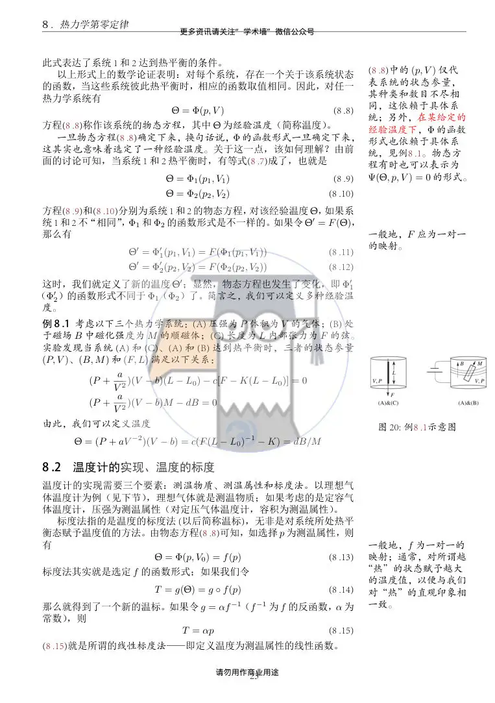

原文：

此式表达了系统1和2达到热平衡的条件。

以上形式上的数学论证表明：对每个系统，存在一个关于该系统状态的函数，当这些系统彼此热平衡时，相应的函数取值相同。因此，对任一热力学系统有

$$
\Theta = \Phi (p, V)\tag{8.8}
$$

方程(8.8)称作该系统的物态方程，其中Θ为经验温度（简称温度）。

一旦物态方程(8.8)确定下来，换句话说，Φ的函数形式一旦确定下来，这其实也意味着选定了一种经验温度。关于这一点，该如何理解？由前面的讨论可知，当系统1和2热平衡时，有等式(8.7)成了，也就是

$$
\Theta = \Phi_ {1} (p _ {1}, V _ {1})\tag{8.9}
$$

$$
\Theta = \Phi_ {2} (p _ {2}, V _ {2})\tag{8.10}
$$

方程(8.9)和(8.10)分别为系统1和2的物态方程，对该经验温度 ，如果系统1和2不“相同”， $\Phi _ { 1 }$ 和 $\Phi _ { 2 }$ 的函数形式是不一样的。如果令 $\Theta ^ { \prime } = F ( \Theta )$ (Θ)，那么有

(8 .8)中的 (p, V) 仅代表系统的状态参量，其种类和数目不尽相同，这依赖于具体系统；另外，在某给定的经验温度下，Φ的函数形式也依赖于具体系统，见例8.1。物态方程有时也可以表示为$\Psi ( \Theta , p , V ) = 0$ 的形式。

$$
\Theta^ {\prime} = \Phi_ {1} ^ {\prime} (p _ {1}, V _ {1}) = F (\Phi_ {1} (p _ {1}, V _ {1}))\tag{8.11}
$$

一般地， $F$ 应为一对一的映射。

$$
\Theta^ {\prime} = \Phi_ {2} ^ {\prime} (p _ {2}, V _ {2}) = F (\Phi_ {2} (p _ {2}, V _ {2}))\tag{8.12}
$$

这时，我们就定义了新的温度 $\Theta ^ { \prime }$ ；显然，物态方程也发生了变化，即 $\Phi _ { 1 } ^ { \prime }$ $( \Phi _ { 2 } ^ { \prime } )$ ）的函数形式不同于 $\Phi _ { 1 } / \Phi _ { 2 } )$ 了。简言之，我们可以定义多种经验温度。

例8.1 考虑以下三个热力学系统：(A)压强为P体积为V的气体；(B)处于磁场 中磁化强度为 的顺磁体；(C)长度为 内部张力为 的弦。实验发现当系统(A)和(C)、(A)和(B)达到热平衡时，三者的状态参量(P,V)、(B,M) 和 (F,L) 满足以下关系：

$$
\begin{array}{l} (P + \frac {a}{V ^ {2}}) (V - b) (L - L _ {0}) - c [ F - K (L - L _ {0}) ] = 0 \\ (P + \frac {a}{V ^ {2}}) (V - b) M - d B = 0 \end{array}
$$

(A)&(C)

(A)&(B)

由此，我们可以定义温度

图 20: 例8 .1示意图

$$
\Theta = (P + a V ^ {- 2}) (V - b) = c (F (L - L _ {0}) ^ {- 1} - K) = d B / M
$$

8.2 温度计的实现、温度的标度

温度计的实现需要三个要素：测温物质、测温 $\mathcal { J } _ { \mathbb { P } } ^ { \ Z }$ 性和标度法。以理想气体温度计为例（见下节），理想气体就是测温物质；如果考虑的是定容气体温度计，压强为测温属性（对定压气体温度计，容积为测温属性）。

标度法指的是温度的标度法(以后简称温标)，无非是对系统所处热平衡态赋予温度值的方法。由物态方程(8.8)可知，如选择 为测温属性，则 $p$ 有

$$
\Theta = \Phi (p, V _ {0}) = f (p)\tag{8.13}
$$

标度法其实就是选定f 的函数形式；如果我们令

$$
T = g (\Theta) = g \circ f (p)\tag{8.14}
$$

一般地，f 为一对一的映射；通常，对所谓越“热”的状态赋予越大的温度值，以便与我们对“热”的直观印象相一致。

那么就得到了一个新的温标。如果令 $g = \alpha f ^ { - 1 } ~ ( \ f ^ { - 1 }$ 为f的反函数， $\alpha$ 为常数），则

$$
T = \alpha p\tag{8.15}
$$

(8.15)就是所谓的线性标度法——即定义温度为测温属性的线性函数。

8 . 热力学第零定律

更多资讯请关注“学术墙”微信公众号

23请勿用作商业用途

### 8 .3 理想气体温标

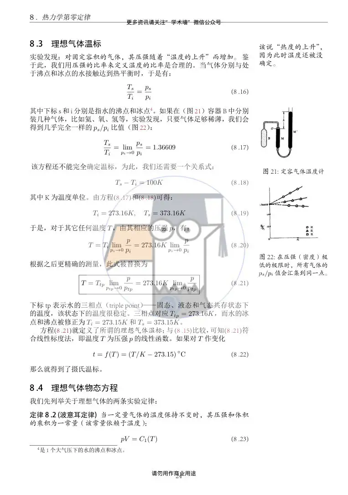

原文：

8 .3 理想气体温标

实验发现：对固定容积的气体，其压强随着“温度的上升”而增加。鉴于此，我们用压强的比率来定义温度的比率是合理的。当气体分别与处于沸点和冰点的水接触达到热平衡时，于是有：

该说“热度的上升”，因为此时温度还被没确定。

$$
\frac {T _ {s}}{T _ {i}} = \frac {p _ {s}}{p _ {i}}\tag{8.16}
$$

其中下标 $\mathsf { S }$ 和i分别是指水的沸点和冰点4。如果在（图21）容器B中分别装几种气体，比如氦、氧、氢等，实验发现，只要气体足够稀薄，我们会得到几乎完全一样的 $p _ { s } / p _ { i }$ 比值（图22）：

$$
\frac {T _ {s}}{T _ {i}} = \lim _ {p _ {i} \rightarrow 0} \frac {p _ {s}}{p _ {i}} = 1. 3 6 6 0 9\tag{8.17}
$$

该方程还不能完全确定温标，为此，我们还需要一个关系式：

图21: 定容气体温度计

$$
T _ {s} - T _ {i} = 1 0 0 K\tag{8.18}
$$

其中 $\mathrm { K }$ 为温度单位。由方程(8.17)和(8.18)可得：

$$
T _ {i} = 2 7 3. 1 6 K, \quad T _ {s} = 3 7 3. 1 6 K\tag{8.19}
$$

于是，对于其它任何温度 T，由其相应的压强 p，有：

$$
T = T _ {i} \lim _ {p _ {i} \to 0} \frac {p}{p _ {i}} = 2 7 3. 1 6 K \lim _ {p _ {i} \to 0} \frac {p}{p _ {i}}
$$

(8 .20)

根据之后更精确的测量，此式被替换为图22: 在压强（密度）极低的极限时，所有气体的$p _ { s } / p _ { i }$ 值会汇集到同一点。

$$
\boxed {T = T _ {t p} \lim _ {p _ {t p} \to 0} \frac {p}{p _ {t p}} = 2 7 3. 1 6 K \lim _ {p _ {t p} \to 0} \frac {p}{p _ {t p}}}\tag{8.21}
$$

下标 $\mathrm { t p }$ 表示水的三相点（triplepoint）——固态、液态和气态共存状态下的温度，该状态下的温度很稳定。三相点对应 $T _ { t p } = 2 7 3 . 1 6 K$ ，而水的冰点和沸点被修正为 $T _ { i } = 2 7 3 . 1 5 K$ 和 $T _ { s } = 3 7 3 . 1 5 K$ 。

方程(8.21)就定义了所谓的理想气体温标；与(8.15)比较，可知(8.21)符合线性标度法，即温度T为压强 $p$ 的线性函数。如果对T作变化

$$
t = f (T) = \left(T / K - 2 7 3. 1 5\right) ^ {\circ} \mathrm{C}\tag{8.22}
$$

那么就得到了摄氏温标。

8.4 理想气体物态方程

我们先列举关于理想气体的两条实验定律：

定律8.2(波意耳定律) 当一定量气体的温度保持不变时，其压强和体积的乘积为一常量（该常量依赖于温度）：

$$
p V = C _ {1} (T)\tag{8.23}
$$

8 . 热力学第零定律

更多资讯请关注“学术墙”微信公众号

24请勿用作商业用途

4是1个大气压下的水的沸点和冰点。

### $$

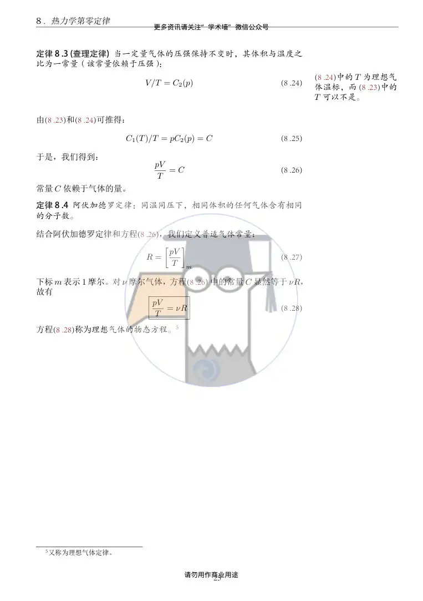

原文：

定律8.3(查理定律) 当一定量气体的压强保持不变时，其体积与温度之比为一常量（该常量依赖于压强）：

$$
V / T = C _ {2} (p)\tag{8.24}
$$

(8 .24)中的 T 为理想气体温标，而(8.23)中的T可以不是。

由(8 .23)和(8 .24)可推得：

$$
C _ {1} (T) / T = p C _ {2} (p) = C\tag{8.25}
$$

于是，我们得到：

$$
\frac {p V}{T} = C\tag{8.26}
$$

常量C依赖于气体的量。

定律8.4 阿伏加德 $\mathcal { Y }$ 定律：同温同压下，相同体积的任何气体含有相同的分子数。

结合阿伏加德罗定律和方程(8 .26)，我们定义普适气体常量：

$$
R = \left[ \frac {p V}{T} \right] _ {m}\tag{8.27}
$$

下标 $m$ 表示 1 摩尔。对 ν 摩尔气体，方程(8 .26) 中的常量 C 显然等于 νR，故有

$$
\boxed {\frac {p V}{T} = \nu R}\tag{8.28}
$$

方程(8.28)称为理想气体的物态方程。5

8 . 热力学第零定律

更多资讯请关注“学术墙”微信公众号

5又称为理想气体定律。

25请勿用作商业用途

### 10 热力学第一定律

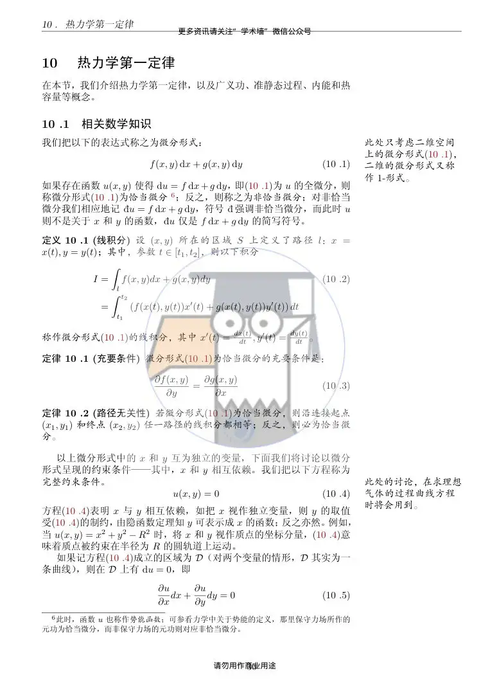

原文：

10 热力学第一定律

在本节，我们介绍热力学第一定律，以及广义功、准静态过程、内能和热容量等概念。

10 .1 相关数学知识

我们把以下的表达式称之为微分形式：

$$
f (x, y) \mathrm{d} x + g (x, y) \mathrm{d} y\tag{10.1}
$$

此处只考虑二维空间上的微分形式(10 .1)，二维的微分形式又称作 1-形式。

如果存在函数 $u ( x , y )$ 使得 $\mathrm { d } u = f \mathrm { d } x + g \mathrm { d } y$ ，即(10 .1)为 u 的全微分，则称微分形式(10 .1)为恰当微分 6；反之，则称之为非恰当微分；对非恰当微分我们相应地记 $\mathrm { d } u = f \mathrm { d } x + g$ dy，符号 ¯d强调非恰当微分，而此时 u则不是关于 x 和 y 的函数，¯du 仅是 $f \mathrm { d } x + g \mathrm { d } y$ 的简写符号。

定义 10 .1 (线积分) 设 (x,y) 所在的区域 S 上定义了路径 l： $x =$ $x ( t ) , y = y ( t )$ ；其中，参数 $t \in [ t _ { 1 } , t _ { 2 } ]$ ，则以下积分

$$
\begin{array}{l} I = \int_ {l} f (x, y) d x + g (x, y) d y \\ = \int_ {t _ {1}} ^ {t _ {2}} \left(f (x (t), y (t)) x ^ {\prime} (t) + g (x (t), y (t)) y ^ {\prime} (t)\right) d t \end{array}\tag{10.2}
$$

称作微分形式(10 .1)的线积分，其中 $\begin{array} { r } { x ^ { \prime } ( t ) = \frac { d x ( t ) } { d t } , y ^ { \prime } ( t ) ^ { \prime } = \rho \frac { d y ( t ) } { d t } , } \end{array}$

定律 10 .1 (充要条件) 微分形式(10 .1)为恰当微分的充要条件是：

$$
\frac {\partial f (x , y)}{\partial y} = \frac {\partial g (x , y)}{\partial x}\tag{10.3}
$$

定律 10 .2 (路径无关性) 若微分形式(10 .1)为恰当微分，则沿连接起点$( x _ { 1 } , y _ { 1 } )$ 和终点 $( x _ { 2 } , y _ { 2 } )$ 任一路径的线积分都相等；反之，则必为恰当微分。

以上微分形式中的 $x$ 和 $y$ 互为独立的变量，下面我们将讨论以微分形式呈现的约束条件——其中，x 和 y 相互依赖。我们把以下方程称为完整约束条件。

$$
u (x, y) = 0\tag{10.4}
$$

此处的讨论，在求理想气体的过程曲线方程时将会用到。

方程(10 .4)表明 $x$ 与 $y$ 相互依赖，如把 $x$ 视作独立变量，则 的取值受(10 .4)的制约，由隐函数定理知 $y$ 可表示成 x 的函数；反之亦然。例如，当 $u ( x , y ) = x ^ { 2 } + y ^ { 2 } - R ^ { 2 }$ 时，将 x 和 y 视作质点的坐标分量，(10 .4)意味着质点被约束在半径为 R 的圆轨道上运动。

如果记方程(10 .4)成立的区域为 $\mathcal { D }$ （对两个变量的情形，D 其实为一条曲线），则在 D 上有 $\mathrm { d } u = 0$ ，即

$$
\frac {\partial u}{\partial x} d x + \frac {\partial u}{\partial y} d y = 0\tag{10.5}
$$

10 . 热力学第一定律

更多资讯请关注“学术墙”微信公众号

30请勿用作商业用途

u

6此时，函数 u 也称作势能函数；可参看力学中关于势能的定义，那里保守力场所作的元功为恰当微分，而非保守力场的元功则对应非恰当微分。

### 这其实是约束条件(10 .4)的微分形式的表示。还以圆轨道为例，有：

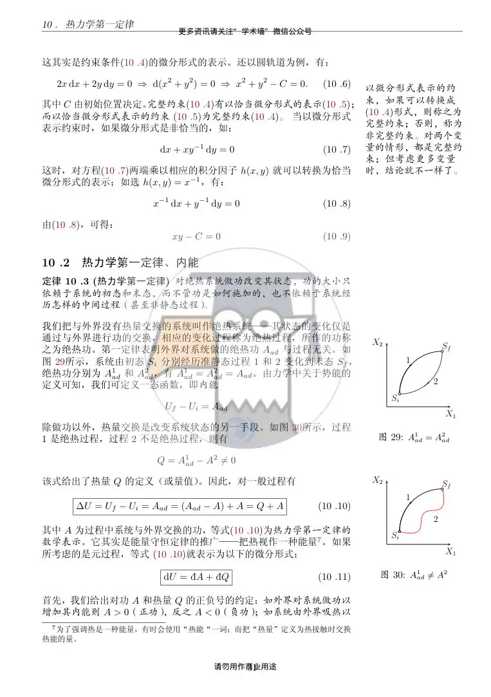

原文：

这其实是约束条件(10 .4)的微分形式的表示。还以圆轨道为例，有：

$$
2 x \mathrm{d} x + 2 y \mathrm{d} y = 0 \Rightarrow \mathrm{d} (x ^ {2} + y ^ {2}) = 0 \Rightarrow x ^ {2} + y ^ {2} - C = 0.\tag{10.6}
$$

其中C由初始位置决定。完整约束(10 .4)有以恰当微分形式的表示(10 .5)；而以恰当微分形式表示的约束 (10 .5)为完整约束(10 .4)。 当以微分形式表示约束时，如果微分形式是非恰当的，如：

$$
\mathrm{d} x + x y ^ {- 1} \mathrm{d} y = 0\tag{10.7}
$$

这时，对方程(10 .7)两端乘以相应的积分因子 $h ( x , y )$ 就可以转换为恰当微分形式的表示；如选 $h ( x , y ) = x ^ { - 1 }$ ，有：

以微分形式表示的约束，如果可以转换成(10 .4)形式，则称之为完整约束；否则，称为非完整约束。对两个变量的情形，都是完整约束；但考虑更多变量时，结论就不一样了。

$$
x ^ {- 1} \mathrm{d} x + y ^ {- 1} \mathrm{d} y = 0\tag{10.8}
$$

由(10 .8)，可得：

$$
x y - C = 0\tag{10.9}
$$

10 .2 热力学第一定律、内能

定律 10 .3 (热力学第一定律) 对绝热系统做功改变其状态，功的大小只依赖于系统的初态和末态，而不管功是如何施加的，也不依赖于系统经历怎样的中间过程（甚至非静态过程）。

我们把与外界没有热量交换的系统叫作绝热系统——其状态的变化仅是通过与外界进行功的交换，相应的变化过程称为绝热过程，所作的功称之为绝热功。第一定律表明外界对系统做的绝热功 $A _ { a d }$ 与过程无关。如图 29所示，系统由初态 $\bar { S } _ { i }$ 分别经历准静态过程 1 和 2 变化到末态 $S _ { f }$ 绝热功分别为 $A _ { a d } ^ { 1 }$ 和 A2 ，有 $\overline { { { A _ { a d } ^ { 1 } } } } = \overline { { { A _ { a d } ^ { 2 } } } } = A _ { a d } .$ 。由力学中关于势能的定义可知，我们可定义一态函数，即内能

$$
U _ {f} - U _ {i} = A _ {a d}
$$

除做功以外，热量交换是改变系统状态的另一手段。如图 30所示，过程1 是绝热过程，过程 2 不是绝热过程，则有

图 29: $A _ { a d } ^ { 1 } = A _ { a d } ^ { 2 }$

$$
Q = A _ {a d} ^ {1} - A ^ {2} \neq 0
$$

该式给出了热量 Q 的定义（或量值）。因此，对一般过程有

$$
\boxed {\Delta U = U _ {f} - U _ {i} = A _ {a d} = (A _ {a d} - A) + A = Q + A}\tag{10.10}
$$

其中 $A$ 为过程中系统与外界交换的功，等式(10 .10)为热力学第一定律的数学表示。它其实是能量守恒定律的推广——把热视作一种能量7。如果所考虑的是元过程，等式 (10 .10)就表示为以下的微分形式：

$$
\boxed {\mathrm{d} U = \mathrm{d} A + \mathrm{d} Q}\tag{10.11}
$$

首先，我们给出对功 A 和热量 $Q$ 的正负号的约定：如外界对系统做功以增加其内能则 $A > 0$ （正功），反之 $A < 0$ （负功）；如系统由外界吸热以增加其内能则 $Q > 0$ ，反之 $Q < 0 \AA _ { \circ }$ 当系统经历一元过程由初态变到末态时，内能 U（态函数）的变化对应恰当微分（使用符号 d）；而系统与外界交换的功和热能则对应非恰当微分（使用符号 ¯d）。以理想气体为例，选取 $p$ 和 V 为状态参量，当系统经历一元过程时，交换的功为 $- p \mathrm { d } V ^ { 8 }$ 其中，负号的出现是因为当 ${ \cal N } > 0$ 时，意味气体膨胀对外做功，按“正负号的约定”功为负值。显然，微分形式 $( - p \mathrm { d } V )$ 是非恰当微分，因此记 $\mathrm { d } A = - p \mathrm { d } V$ 。于是，交换的热量也对应非恰当微分，记为 $\mathrm { d } Q$ 。（恰当微分不可能等于恰当微分与非恰当微分之和。）

10

热力学第一定律

更多资讯请关注“学术墙”微信公众号

31请勿用作商业用途

7为了强调热是一种能量，有时会使用“热能“一词；而把“热量”定义为热接触时交换热能的量。

### 功和热量的取值依赖于过程，故称作过程量。

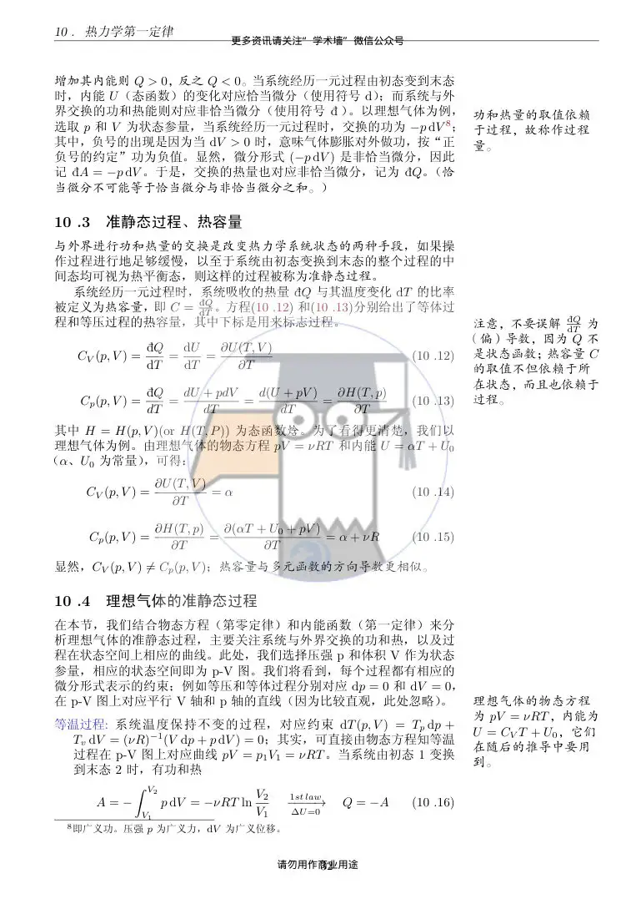

原文：

功和热量的取值依赖于过程，故称作过程量。

10 .3 准静态过程、热容量

与外界进行功和热量的交换是改变热力学系统状态的两种手段，如果操作过程进行地足够缓慢，以至于系统由初态变换到末态的整个过程的中间态均可视为热平衡态，则这样的过程被称为准静态过程。

系统经历一元过程时，系统吸收的热量 $\tt d Q$ 与其温度变化 $\mathrm { d } T$ 的比率被定义为热容量，即 $\begin{array} { r } { C = { \frac { \mathrm { d } Q } { \mathrm { d } T } } } \end{array}$ 。方程(10 .12) 和(10 .13)分别给出了等体过程和等压过程的热容量，其中下标是用来标志过程。

$$
C _ {V} (p, V) = \frac {\mathrm{d} Q}{\mathrm{d} T} = \frac {\mathrm{d} U}{\mathrm{d} T} = \frac {\partial U (T , V)}{\partial T}\tag{10.12}
$$

注意，不要误解 $\frac { \mathrm { d } Q } { \mathrm { d } T }$ 为（偏）导数，因为 $Q$ 不是状态函数；热容量 C的取值不但依赖于所在状态，而且也依赖于过程。

$$
C _ {p} (p, V) = \frac {\mathrm{d} Q}{\mathrm{d} T} = \frac {d U + p d V}{d T} = \frac {d (U + p V)}{d T} = \frac {\partial H (T , p)}{\partial T}\tag{10.13}
$$

其中 $H = H ( p , V ) ( \mathrm { o r } \ H ( T | / P ) )$ 为态函数焓。为了看得更清楚，我们以理想气体为例。由理想气体的物态方程 $p V = \nu R T$ 和内能 $U = \alpha T + U _ { 0 }$ $( \alpha , \ U _ { 0 }$ 为常量），可得：

$$
C _ {V} (p, V) = \frac {\partial U (T , V)}{\partial T} = \alpha\tag{10.14}
$$

$$
C _ {p} (p, V) = \frac {\partial H (T , p)}{\partial T} = \frac {\partial (\alpha T + U _ {0} + p V)}{\partial T} = \alpha + \nu R\tag{10.15}
$$

显然， $C _ { V } ( p , V ) \neq C _ { p } ( p , V )$ ；热容量与多元函数的方向导数更相似。

10 .4 理想气体的准静态过程

在本节，我们结合物态方程（第零定律）和内能函数（第一定律）来分析理想气体的准静态过程，主要关注系统与外界交换的功和热，以及过程在状态空间上相应的曲线。此处，我们选择压强 $\mathrm { p }$ 和体积 V 作为状态参量，相应的状态空间即为 $\mathrm { p - V }$ 图。我们将看到，每个过程都有相应的微分形式表示的约束；例如等压和等体过程分别对应 $\mathrm { d } p = 0$ 和 $\mathrm { d } V = 0$ $\mathrm { p - V }$ 图上对应平行 V 轴和 $\mathrm { p }$ 轴的直线（因为比较直观，此处忽略）。

等温过程: 系统温度保持不变的过程，对应约束 $\mathrm { d } T ( p , V ) = T _ { p } \mathrm { d } p +$ $T _ { v } \mathrm { d } V = ( \nu R ) ^ { - 1 } ( V \mathrm { d } p + p \mathrm { d } V ) = 0$ ；其实，可直接由物态方程知等温过程在 $\mathrm { p - V }$ 图上对应曲线 $p V = p _ { 1 } V _ { 1 } = \nu R T$ 。当系统由初态 1 变换到末态 2 时，有功和热

理想气体的物态方程为 $p V = \nu R T$ ，内能为$U = C _ { V } T + U _ { 0 }$ ，它们在随后的推导中要用到。

$$
A = - \int_ {V _ {1}} ^ {V _ {2}} p \mathrm{d} V = - \nu R T \ln \frac {V _ {2}}{V _ {1}} \quad \xrightarrow [ \Delta U = 0 ]{1 s t l a w} Q = - A\tag{10.16}
$$

8即广义功。压强 $p$ 为广义力，dV 为广义位移。

10 . 热力学第一定律

更多资讯请关注“学术墙”微信公众号

32请勿用作商业用途

### $$

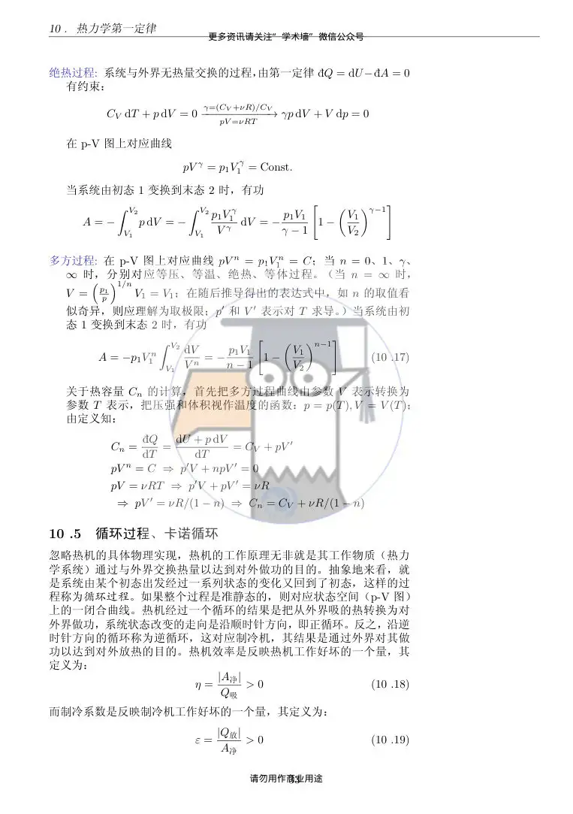

原文：

绝热过程: 系统与外界无热量交换的过程，由第一定律 $\mathrm { d } Q = \mathrm { d } U - \mathrm { d } A = 0$ 有约束：

$$
C _ {V} \mathrm{d} T + p \mathrm{d} V = 0 \xrightarrow [ p V = \nu R T ]{\gamma = (C _ {V} + \nu R) / C _ {V}} \gamma p \mathrm{d} V + V \mathrm{d} p = 0
$$

在 $\mathrm { p - V }$ 图上对应曲线

$$
p V ^ {\gamma} = p _ {1} V _ {1} ^ {\gamma} = \mathrm{Const}.
$$

当系统由初态 1 变换到末态 2 时，有功

$$
A = - \int_ {V _ {1}} ^ {V _ {2}} p \mathrm{d} V = - \int_ {V _ {1}} ^ {V _ {2}} \frac {p _ {1} V _ {1} ^ {\gamma}}{V ^ {\gamma}} \mathrm{d} V = - \frac {p _ {1} V _ {1}}{\gamma - 1} \left[ 1 - \left(\frac {V _ {1}}{V _ {2}}\right) ^ {\gamma - 1} \right]
$$

多方过程: 在 $\mathrm { p - V }$ 图上对应曲线 $p V ^ { n } = p _ { 1 } V _ { 1 } ^ { n } = C$ ；当 $n = 0 , 1 , \gamma ,$ ∞ 时，分别对应等压、等温、绝热、等体过程。（当 $n = \infty$ 时，$\begin{array} { r } { V = \left( \frac { p _ { 1 } } { p } \right) ^ { 1 / n } V _ { 1 } = V _ { 1 } } \end{array}$ ；在随后推导得出的表达式中，如 n 的取值看似奇异，则应理解为取极限； $p ^ { \prime }$ 和 $V ^ { \prime }$ 表示对 T 求导。）当系统由初态 1 变换到末态 2 时，有功

$$
A = - p _ {1} V _ {1} ^ {n} \int_ {V _ {1}} ^ {V _ {2}} \frac {\mathrm{d} V}{V ^ {n}} = - \frac {p _ {1} V _ {1}}{n - 1} \left[ 1 - \left(\frac {V _ {1}}{V _ {2}}\right) ^ {n - 1} \right]\tag{10.17}
$$

关于热容量 $C _ { n }$ 的计算，首先把多方过程曲线由参数 V 表示转换为参数 $T$ 表示，把压强和体积视作温度的函数： $p = p ( \overline { { T } } )$ $V = V ( T )$ 由定义知：

$$
\begin{array}{r l} & C _ {n} = \frac {\mathrm{d} Q}{\mathrm{d} T} = \frac {\mathrm{d} U + p \mathrm{d} V}{\mathrm{d} T} = C _ {V} + p V ^ {\prime} \\ & p V ^ {n} = C \Rightarrow p ^ {\prime} V + n p V ^ {\prime} = 0 \\ & p V = \nu R T \Rightarrow p ^ {\prime} V + p V ^ {\prime} = \nu R \\ & \Rightarrow p V ^ {\prime} = \nu R / (1 - n) \Rightarrow C _ {n} = C _ {V} + \nu R / (1 - n) \end{array}
$$

10 .5 循环过程、卡诺循环

忽略热机的具体物理实现，热机的工作原理无非就是其工作物质（热力学系统）通过与外界交换热量以达到对外做功的目的。抽象地来看，就是系统由某个初态出发经过一系列状态的变化又回到了初态，这样的过程称为循环过程。如果整个过程是准静态的，则对应状态空间（p-V 图）上的一闭合曲线。热机经过一个循环的结果是把从外界吸的热转换为对外界做功，系统状态改变的走向是沿顺时针方向，即正循环。反之，沿逆时针方向的循环称为逆循环，这对应制冷机，其结果是通过外界对其做功以达到对外放热的目的。热机效率是反映热机工作好坏的一个量，其定义为：

$$
\eta = \frac {| A _ {\mathrm{净}} |}{Q _ {\mathrm{吸}}} > 0\tag{10.18}
$$

而制冷系数是反映制冷机工作好坏的一个量，其定义为：

$$
\varepsilon = \frac {| Q _ {\mathrm{放}} |}{A _ {\mathrm{净}}} > 0\tag{10.19}
$$

10 . 热力学第一定律

更多资讯请关注“学术墙”微信公众号

33请勿用作商业用途

### $$

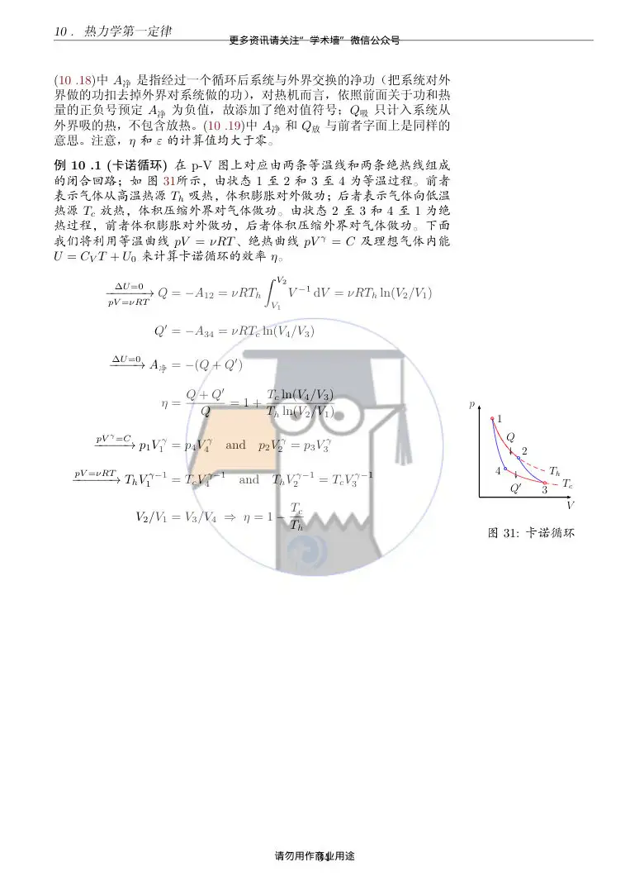

原文：

(10 .18)中 $A _ { \ P \ P }$ 是指经过一个循环后系统与外界交换的净功（把系统对外界做的功扣去掉外界对系统做的功），对热机而言，依照前面关于功和热量的正负号预定 $A _ { \sharp }$ 为负值，故添加了绝对值符号； $Q _ { \parallel \parallel }$ 只计入系统从外界吸的热，不包含放热。(10 .19)中 $A _ { \sharp }$ 和 $Q _ { \mathbb { H } } { \boldsymbol { \chi } }$ 与前者字面上是同样的意思。注意，η 和 $\varepsilon$ 的计算值均大于零。

例 10 .1 (卡诺循环) 在 $\mathrm { p - V }$ 图上对应由两条等温线和两条绝热线组成的闭合回路；如 图 31所示，由状态 1 至 2 和 3 至 4 为等温过程。前者表示气体从高温热源 $T _ { h }$ 吸热，体积膨胀对外做功；后者表示气体向低温热源 $T _ { c }$ 放热，体积压缩外界对气体做功。由状态 2 至 3 和 4 至 1 为绝热过程，前者体积膨胀对外做功，后者体积压缩外界对气体做功 $\circ$ 下面我们将利用等温曲线 $p V = \nu R T$ 、绝热曲线 $p V ^ { \gamma } = C$ 及理想气体内能$U = C _ { V } T + U _ { 0 }$ 来计算卡诺循环的效率 $\eta _ { \textmd { 4 } }$

$$
\xrightarrow [ p V = \nu R T ]{\Delta U = 0} Q = - A _ {1 2} = \nu R T _ {h} \int_ {V _ {1}} ^ {V _ {2}} V ^ {- 1} \mathrm{d} V = \nu R T _ {h} \ln (V _ {2} / V _ {1})
$$

$$
Q ^ {\prime} = - A _ {3 4} = \nu R T _ {c} \ln (V _ {4} / V _ {3})
$$

$$
\xrightarrow {\Delta U = 0} A _ {\text {净}} = - (Q + Q ^ {\prime})
$$

$$
\eta = \frac {Q + Q ^ {\prime}}{Q} = 1 + \frac {T _ {c} \ln (V _ {4} / V _ {3})}{T _ {h} \ln (V _ {2} / V _ {1})}
$$

$$
\xrightarrow {p V ^ {\gamma} = C} p _ {1} V _ {1} ^ {\gamma} = p _ {4} V _ {4} ^ {\gamma} \quad \mathrm{and} \quad p _ {2} V _ {2} ^ {\gamma} = p _ {3} V _ {3} ^ {\gamma}
$$

$$
\xrightarrow {p V = \nu R T} T _ {h} V _ {1} ^ {\gamma - 1} = T _ {c} V _ {4} ^ {\gamma - 1} \quad \text { and } \quad T _ {h} V _ {2} ^ {\gamma - 1} = T _ {c} V _ {3} ^ {\gamma - 1}
$$

10 . 热力学第一定律

更多资讯请关注“学术墙”微信公众号

34请勿用作商业用途

### 8 第七单元

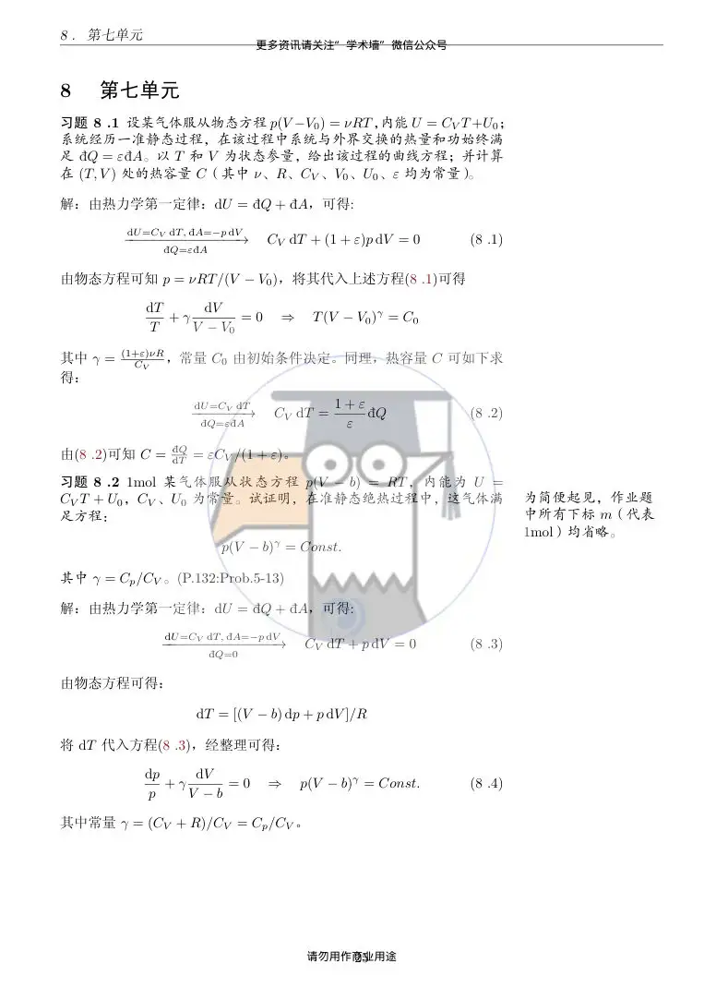

原文：

8 第七单元

习题 8 .1 设某气体服从物态方程 $p ( V - V _ { 0 } ) = \nu R T$ ，内能 $U = C _ { V } T { + } U _ { 0 }$ ；系统经历一准静态过程，在该过程中系统与外界交换的热量和功始终满足 $\mathrm { d } Q = \varepsilon \mathrm { d } A$ 。以 T 和 V 为状态参量，给出该过程的曲线方程；并计算在 (T,V) 处的热容量 C（其中 $\nu , \ R , \ C _ { V \setminus \ V _ { 0 \setminus \ V } } \ U _ { 0 \setminus \ \mathcal { E } }$ 均为常量）。

解：由热力学第一定律： $\mathrm { d } U = \mathrm { d } Q + \mathrm { d } A$ ，可得:

$$
\xrightarrow [ \mathrm{d} Q = \varepsilon \mathrm{d} A ]{\mathrm{d} U = C _ {V} \mathrm{d} T , \mathrm{d} A = - p \mathrm{d} V} C _ {V} \mathrm{d} T + (1 + \varepsilon) p \mathrm{d} V = 0\tag{8.1}
$$

由物态方程可知 $p = \nu R T / ( V - V _ { 0 } )$ ，将其代入上述方程(8 .1)可得

$$
\frac {\mathrm{d} T}{T} + \gamma \frac {\mathrm{d} V}{V - V _ {0}} = 0 \quad \Rightarrow \quad T (V - V _ {0}) ^ {\gamma} = C _ {0}
$$

其中 $\begin{array} { r } { \gamma = \frac { ( 1 + \varepsilon ) \nu R } { { \cal C } _ { V } } } \end{array}$ ，常量 $C _ { 0 }$ 由初始条件决定。同理，热容量 C 可如下求得：

$$
\frac {\mathrm{d} U = C _ {V} \mathrm{d} T}{\mathrm{d} Q = \varepsilon \mathrm{d} A} \rightarrow C _ {V} \mathrm{d} T = \frac {1 + \varepsilon}{\varepsilon} \mathrm{d} Q\tag{8.2}
$$

由(8 .2)可知 $\begin{array} { r } { C = \frac { \mathrm { d } Q } { \mathrm { d } T } = \varepsilon C _ { V \mu } / ( 1 + \varepsilon ) \circ } \end{array}$ 。

习题 8 .2 1mol 某气体服从状态方程 p(V − b) = RT，内能为 U =$C _ { V } T + U _ { 0 } , \ C _ { V } , \ U _ { 0 }$ 为常量。试证明，在准静态绝热过程中，这气体满足方程：

为简便起见，作业题中所有下标 m（代表1mol）均省略。

$$
p (V - b) ^ {\gamma} = C o n s t.
$$

其中 $\gamma = C _ { p } / C _ { V }$ 。(P.132:Prob.5-13)

解：由热力学第一定律： $\mathrm { d } U = \mathrm { d } Q + \mathrm { d } A$ ，可得:

$$
\frac {\mathrm{d} U = C _ {V} \mathrm{d} T , \mathrm{d} A = - p \mathrm{d} V}{\mathrm{d} Q = 0} \quad C _ {V} \mathrm{d} T + p \mathrm{d} V = 0\tag{8.3}
$$

由物态方程可得：

$$
\mathrm{d} T = [ (V - b) \mathrm{d} p + p \mathrm{d} V ] / R
$$

将 $\mathrm { d } T$ 代入方程(8 .3)，经整理可得：

$$
\frac {\mathrm{d} p}{p} + \gamma \frac {\mathrm{d} V}{V - b} = 0 \quad \Rightarrow \quad p (V - b) ^ {\gamma} = C o n s t.\tag{8.4}
$$

其中常量 $\gamma = ( C _ { V } + R ) / C _ { V } = C _ { p } / C _ { V }$ 习题 8 .3 如图 27所示为 1mol 单原子理想气体所经历的循环过程，其中 AB 为等温线。已知 $V _ { A } = 3 . 0 L$ $V _ { B } = 6 . 0 L$ ，求效率 $\eta _ { \circ }$ 。设气体的$C _ { V } = { \textstyle { \frac { 3 } { 2 } } } R _ { \circ } \mathrm { ( P . 1 3 4 { : } P r o b . 5 { - } 2 7 ) }$

8 . 第七单元

更多资讯请关注“学术墙”微信公众号

25请勿用作商业用途

### 图 27: 习题8 .3

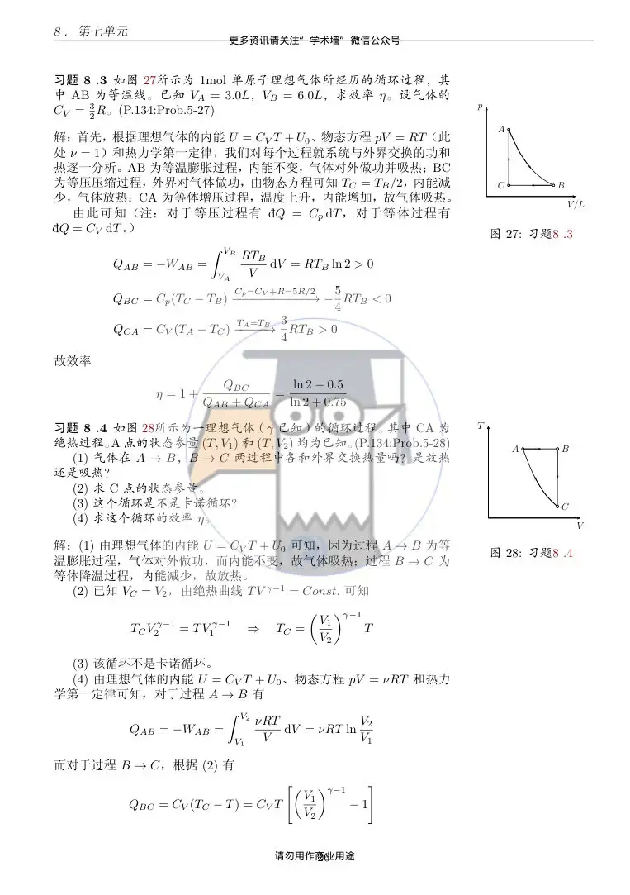

原文：

解：首先，根据理想气体的内能 $U = C _ { V } T + U _ { 0 }$ 、物态方程 $p V = R T$ （此处 $\nu = 1 )$ 和热力学第一定律，我们对每个过程就系统与外界交换的功和热逐一分析。AB 为等温膨胀过程，内能不变，气体对外做功并吸热；BC为等压压缩过程，外界对气体做功，由物态方程可知 $T _ { C } = T _ { B } / 2$ ，内能减少，气体放热；CA 为等体增压过程，温度上升，内能增加，故气体吸热。

由此可知（注：对于等压过程有 $\mathrm { d } Q \ = \ C _ { p } \mathrm { d } T$ ，对于等体过程有$\mathrm { d } Q = C _ { V } \mathrm { d } T _ { \circ } )$

图 27: 习题8 .3

$$
Q _ {A B} = - W _ {A B} = \int_ {V _ {A}} ^ {V _ {B}} \frac {R T _ {B}}{V} \mathrm{d} V = R T _ {B} \ln 2 > 0
$$

$$
Q _ {B C} = C _ {p} (T _ {C} - T _ {B}) \xrightarrow {C _ {p} = C _ {V} + R = 5 R / 2} - \frac {5}{4} R T _ {B} <   0
$$

$$
Q _ {C A} = C _ {V} (T _ {A} - T _ {C}) \xrightarrow {T _ {A} = T _ {B}} \frac {3}{4} R T _ {B} > 0
$$

故效率

$$
\eta = 1 + \frac {Q _ {B C}}{Q _ {A B} + Q _ {C A}} = \frac {\ln 2 - 0 . 5}{\ln 2 + 0 . 7 5}
$$

$( \gamma \mathbb { R } \mathbb { R } ) \mathbb { A } \mathbb { P } \mathbb { A } \mathbb { E } \mathbb { F } \mathbb { A } \mathbb { E } \mathbb { F } \mathbb { A } \mathbb { E } \mathbb { \ P } \mathbb { \ P }$ 。其中 CA 为绝热过程 $_ \circ \mathrm { A }$ 点的状态参量 $( T , V _ { 1 } )$ $( T , V _ { 2 } )$ 均为已知。(P.134:Prob.5-28)

(1) 气体在 $A \to B , | \bar { B } \to C$ 两过程中各和外界交换热量吗？是放热还是吸热？

(2) 求 C 点的状态参量。

(3) 这个循环是不是卡诺循环？

(4) 求这个循环的效率 η。

解：(1) 由理想气体的内能 $U = C _ { V } T + U _ { 0 }$ 可知，因为过程 $A  B$ 为等温膨胀过程，气体对外做功，而内能不变，故气体吸热；过程 $B  C$ 为等体降温过程，内能减少，故放热。

图 28: 习题8 .4

(2) 已知 $V _ { C } = V _ { 2 }$ ，由绝热曲线 $T V ^ { \gamma - 1 } = C o n s t$ . 可知

$$
T _ {C} V _ {2} ^ {\gamma - 1} = T V _ {1} ^ {\gamma - 1} \Rightarrow T _ {C} = \left(\frac {V _ {1}}{V _ {2}}\right) ^ {\gamma - 1} T
$$

(3) 该循环不是卡诺循环。

(4) 由理想气体的内能 $U = C _ { V } T + U _ { 0 }$ 、物态方程 $p V = \nu R T$ 和热力学第一定律可知，对于过程 $A  B$ 有

$$
Q _ {A B} = - W _ {A B} = \int_ {V _ {1}} ^ {V _ {2}} \frac {\nu R T}{V} \mathrm{d} V = \nu R T \ln \frac {V _ {2}}{V _ {1}}
$$

而对于过程 $B  C$ ，根据 (2) 有

$$
Q _ {B C} = C _ {V} (T _ {C} - T) = C _ {V} T \left[ \left(\frac {V _ {1}}{V _ {2}}\right) ^ {\gamma - 1} - 1 \right]
$$

8 . 第七单元

更多资讯请关注“学术墙”微信公众号

26请勿用作商业用途

### 所以效率

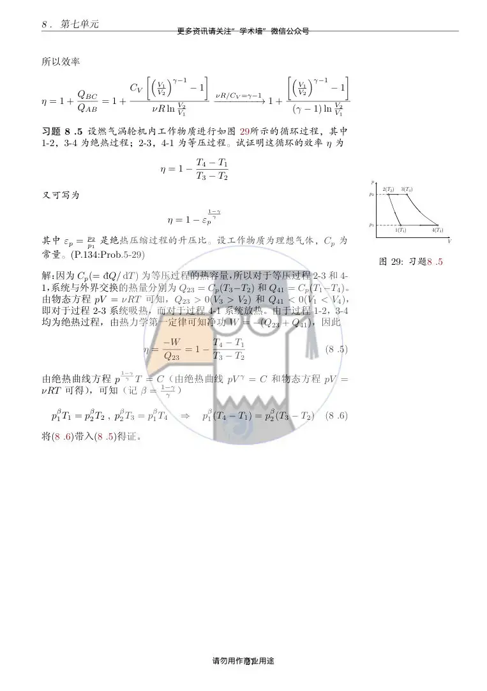

原文：

所以效率

$$
\eta = 1 + \frac {Q _ {B C}}{Q _ {A B}} = 1 + \frac {C _ {V} \left[ \left(\frac {V _ {1}}{V _ {2}}\right) ^ {\gamma - 1} - 1 \right]}{\nu R \ln \frac {V _ {2}}{V _ {1}}} \xrightarrow {\nu R / C _ {V} = \gamma - 1} 1 + \frac {\left[ \left(\frac {V _ {1}}{V _ {2}}\right) ^ {\gamma - 1} - 1 \right]}{(\gamma - 1) \ln \frac {V _ {2}}{V _ {1}}}
$$

习题 8 .5 设燃气涡轮机内工作物质进行如图 29所示的循环过程，其中1-2，3-4 为绝热过程；2-3，4-1 为等压过程。试证明这循环的效率 η 为

$$
\eta = 1 - \frac {T _ {4} - T _ {1}}{T _ {3} - T _ {2}}
$$

又可写为

$$
\eta = 1 - \varepsilon_ {p} ^ {\frac {1 - \gamma}{\gamma}}
$$

其中 $\begin{array} { r } { \varepsilon _ { p } = \frac { p _ { 2 } } { p _ { 1 } } } \end{array}$ 是绝热压缩过程的升压比。设工作物质为理想气体， $C _ { p }$ 为常量。(P.134:Prob.5-29)

解：因为 $C _ { p } ( = \mathrm { d } Q / \mathrm { d } T )$ 为等压过程的热容量，所以对于等压过程2-3和4-1，系统与外界交换的热量分别为 $Q _ { 2 3 } = C _ { p } ( T _ { 3 } { - } T _ { 2 } )$ ) 和和 $Q _ { 4 1 } = C _ { p } [ T _ { 1 } { - } T _ { 4 } )$ 。由物态方程 $p V = \nu R T$ 可知， $Q _ { 2 3 } > 0 ( V _ { 3 } > V _ { 2 } )$ $Q _ { 4 1 } < 0 ( V _ { 1 } < V _ { 4 } )$ 即对于过程 2-3 系统吸热，而对于过程 4-1 系统放热。由于过程 1-2，3-4均为绝热过程，由热力学第一定律可知净功 W = $- ( Q _ { 2 3 } ) + Q _ { 4 1 } ^ { - } )$ ， 因此

$$
\eta = \frac {- W}{Q _ {2 3}} = 1 - \frac {T _ {4} - T _ {1}}{T _ {3} - T _ {2}}\tag{8.5}
$$

由绝热曲线方程 $p ^ { { \frac { 1 - \gamma } { \gamma } } } T \equiv C$ （由绝热曲线 $p V ^ { \gamma } = C$ 和物态方程 $p V =$ $\nu R T$ 可得），可知（记 $\begin{array} { r } { \beta \doteq \frac { 1 - \gamma } { \gamma } ) } \end{array}$

$$
p _ {1} ^ {\beta} T _ {1} = p _ {2} ^ {\beta} T _ {2}, p _ {2} ^ {\beta} T _ {3} = p _ {1} ^ {\beta} T _ {4} \Rightarrow p _ {1} ^ {\beta} (T _ {4} - T _ {1}) = p _ {2} ^ {\beta} (T _ {3} - T _ {2})\tag{8.6}
$$

将(8 .6)带入(8 .5)得证。

8 . 第七单元

更多资讯请关注“学术墙”微信公众号

27请勿用作商业用途

### 9 熵的计算

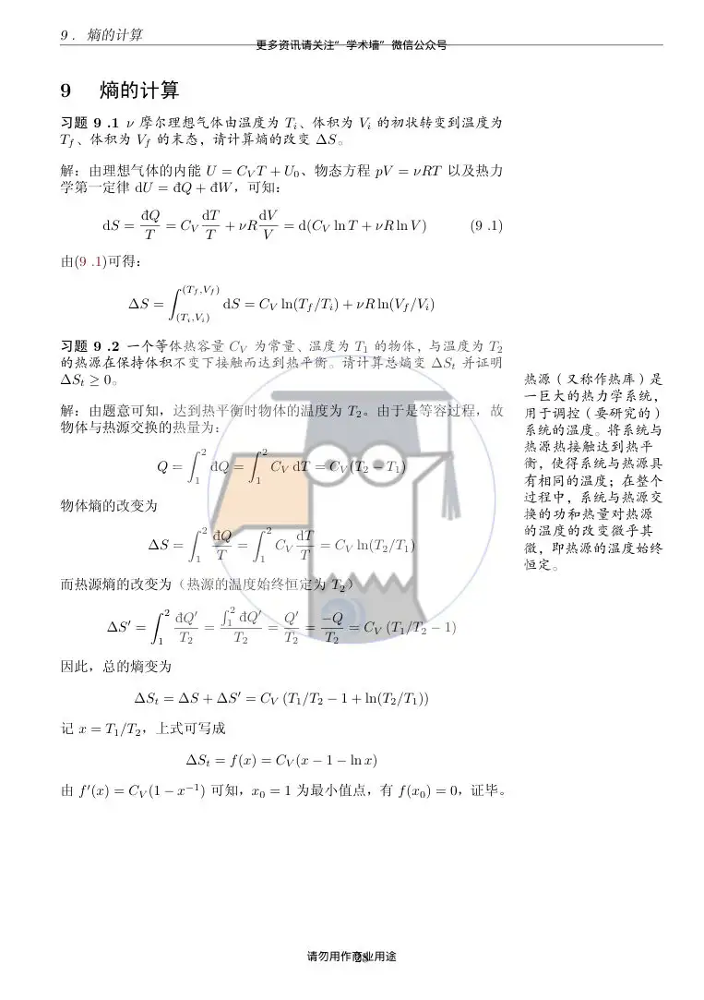

原文：

9 熵的计算

习题 9 .1 ν 摩尔理想气体由温度为 $T _ { i }$ 、体积为 $V _ { i }$ 的初状转变到温度为$T _ { f }$ 、体积为 $V _ { f }$ 的末态，请计算熵的改变 $\Delta S _ { \parallel }$ 。

解：由理想气体的内能 $U = C _ { V } T + U _ { 0 }$ 、物态方程 $p V = \nu R T$ 以及热力学第一定律 $\mathrm { d } U = \mathrm { d } Q + \mathrm { d } W$ ，可知：

$$
\mathrm{d} S = \frac {\mathrm{d} Q}{T} = C _ {V} \frac {\mathrm{d} T}{T} + \nu R \frac {\mathrm{d} V}{V} = \mathrm{d} (C _ {V} \ln T + \nu R \ln V)\tag{9.1}
$$

由(9 .1)可得：

$$
\Delta S = \int_ {(T _ {i}, V _ {i})} ^ {(T _ {f}, V _ {f})} \mathrm{d} S = C _ {V} \ln (T _ {f} / T _ {i}) + \nu R \ln (V _ {f} / V _ {i})
$$

习题 9 .2 一个等体热容量 $C _ { V }$ 为常量、温度为 $T _ { 1 }$ 的物体，与温度为 $T _ { 2 }$ 的热源在保持体积不变下接触而达到热平衡。请计算总熵变 $\Delta S _ { t }$ 并证明$\Delta S _ { t } \ge 0$ O

解：由题意可知，达到热平衡时物体的温度为 $T _ { 2 }$ 由于是等容过程，故物体与热源交换的热量为：

$$
Q = \int_ {1} ^ {2} \mathrm{d} Q = \int_ {1} ^ {2} C _ {V} \mathrm{d} T = C _ {V} (T _ {2} - T _ {1})
$$

物体熵的改变为

$$
\Delta S = \int_ {1} ^ {2} \frac {\mathrm{d} Q}{T} = \int_ {1} ^ {2} C _ {V} \frac {\mathrm{d} T}{T} = C _ {V} \ln (T _ {2} / T _ {1})
$$

热源（又称作热库）是一巨大的热力学系统，用于调控（要研究的）系统的温度。将系统与热源热接触达到热平衡，使得系统与热源具有相同的温度；在整个过程中，系统与热源交换的功和热量对热源的温度的改变微乎其微，即热源的温度始终恒定。

而热源熵的改变为（热源的温度始终恒定为 $\mathbf { \hat { \phi } } _ { T _ { 2 } } \mathbf { \hat { \phi } } _ { }$

$$
\Delta S ^ {\prime} = \int_ {1} ^ {2} \frac {\mathrm{d} Q ^ {\prime}}{T _ {2}} = \frac {\int_ {1} ^ {2} \mathrm{d} Q ^ {\prime}}{T _ {2}} = \frac {Q ^ {\prime}}{T _ {2}} = \frac {- Q}{T _ {2}} = C _ {V} (T _ {1} / T _ {2} - 1)
$$

因此，总的熵变为

$$
\Delta S _ {t} = \Delta S + \Delta S ^ {\prime} = C _ {V} \left(T _ {1} / T _ {2} - 1 + \ln (T _ {2} / T _ {1})\right)
$$

记 $x = T _ { 1 } / T _ { 2 }$ ，上式可写成

$$
\Delta S _ {t} = f (x) = C _ {V} (x - 1 - \ln x)
$$

由 $f ^ { \prime } ( x ) = C _ { V } ( 1 - x ^ { - 1 } )$ 可知， $x _ { 0 } = 1$ 为最小值点，有 $f ( x _ { 0 } ) = 0$ ，证毕。

9 . 熵的计算

更多资讯请关注“学术墙”微信公众号

28请勿用作商业用途
