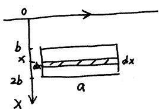

# 《大学物理》第24章 磁场中的高斯定理与安培环路定理（同步练习册答案）

原件经识别和整理；“参考解答”是我们补的。

## 一、磁通量与高斯定理

### 计算 1

作半径为 $r$ 的大圆面与半球面 $S$ 构成一封闭曲面。

闭合曲面磁通量（高斯定理）：

$$\oint \vec{B}\cdot d\vec{s}=0$$

而

$$\oint \vec{B}\cdot d\vec{s}=\int_{S}\vec{B}\cdot d\vec{s}+\int_{\text{大圆面}}\vec{B}\cdot d\vec{s}=0$$

$$\begin{aligned}\int_{S}\vec{B}\cdot d\vec{s}&=-\int_{\text{大圆面}}\vec{B}\cdot d\vec{s}\\&=-\int_{\text{大圆面}}B\,ds\cos\alpha=-B\cos\alpha\int_{\text{大圆面}}ds\\&=-B\cos\alpha\cdot(\pi r^{2})\end{aligned}$$

所以

$$\int_{S}\vec{B}\cdot d\vec{s}=-B\pi r^{2}\cos\alpha$$

取弯面向外为正法线方向。

## 二、安培环路定理

知识点：[磁通量与磁场中的高斯定理](../../../topics/大学物理/磁场中的高斯定理.md)、[磁场与磁感应强度的定义](../../../topics/大学物理/磁感应强度.md)、[安培环路定理及其应用](../../../topics/大学物理/安培环路定理.md)

### 计算 2

图中 $L_{1}$ 和 $L_{2}$ 都取逆时针为正方向。由安培环路定理：

$$\oint_{L_{1}}\vec{B}\cdot d\vec{l}=\mu_{0}(I_{1}+I_{2})$$

$$\oint_{L_{2}}\vec{B}\cdot d\vec{l}=\mu_{0}(I_{1}+I_{2})$$

所以

$$\oint_{L_{1}}\vec{B}\cdot d\vec{l}=\oint_{L_{2}}\vec{B}\cdot d\vec{l}$$

（只与回路内包围电流有关）

安培回路上各点的磁感强度 $B$ 由空间所有电流共同决定，所以 $\vec{B}_{P_{1}}\neq\vec{B}_{P_{2}}$（空间电流分布不同）。

知识点：[安培环路定理及其应用](../../../topics/大学物理/安培环路定理.md)

### 计算 3

根据安培环路定理：

$L_{1}$ 以顺时针为正方向：

$$\oint_{L_{1}}\vec{B}\cdot d\vec{l}=-\mu_{0}\cdot 2I$$

$L_{2}$ 以逆时针为正方向：

$$\oint_{L_{2}}\vec{B}\cdot d\vec{l}=-\mu_{0}I$$

$L_{3}$ 以逆时针为正方向：

$$\oint_{L_{3}}\vec{B}\cdot d\vec{l}=\mu_{0}(2I-I)=\mu_{0}I$$

$L_{4}$ 以顺时针为正方向：

$$\oint_{L_{4}}\vec{B}\cdot d\vec{l}=\mu_{0}(I-2I)=-\mu_{0}I$$

知识点：[安培环路定理及其应用](../../../topics/大学物理/安培环路定理.md)

### 计算 4

(1) 直导线 A 在 P 点贡献：

$$B_{AP}=\frac{\mu_{0}I}{2\pi\frac{a}{2}}，方向沿 y 轴正方向。$$

直导线 B 在 P 点贡献：

$$B_{BP}=\frac{\mu_{0}I}{2\pi\frac{a}{2}}，方向沿 y 轴负方向。$$

所以在 P 点总磁感强度 $\vec{B}_{P}=0$。

(2) 由安培环路定理，回路 $L$ 以顺时针为正方向：

$$\oint_{L}\vec{B}\cdot d\vec{l}=\mu_{0}(-I)=-\mu_{0}I$$

知识点：[安培环路定理及其应用](../../../topics/大学物理/安培环路定理.md)、[毕奥-萨伐尔定律及典型载流导线的磁场计算](../../../topics/大学物理/毕奥-萨伐尔定律.md)

### 计算 5

取 $x$ 轴竖直向下，在矩形处磁感强度方向垂直纸面向里。取一宽为 $dx$ 的矩形条 $ds$，并设法线方向垂直纸面向里为正，则 $ds$ 与 $B$ 同方向。

$$\begin{aligned}\phi_{m}&=\int_{S}\vec{B}\cdot d\vec{s}=\int_{S}B\cdot ds=\int_{b}^{2b}\frac{\mu_{0}I}{2\pi x}\cdot a\,dx\\&=\frac{\mu_{0}Ia}{2\pi}\ln\frac{2b}{b}=\frac{\mu_{0}Ia}{2\pi}\ln 2\end{aligned}$$

知识点：[磁场与磁感应强度的定义](../../../topics/大学物理/磁感应强度.md)

### 计算 6

电流均分布在圆柱体的截面上，空间磁感线是以圆柱中轴线为中心的同心圆。取半径为 $r$ 的圆为安培回路 $L$，并设逆时针为正方向。

① $r<R$，在圆柱体内：

$$\oint\vec{B}\cdot d\vec{l}=\mu_{0}\cdot\frac{I}{\pi R^{2}}\cdot\pi r^{2}$$

$$B\cdot 2\pi r=\mu_{0}\frac{I}{R^{2}}r^{2}$$

$$B=\frac{\mu_{0}I}{2\pi R^{2}}r$$

② $r>R$，在圆柱体外：

$$\oint\vec{B}\cdot d\vec{l}=\mu_{0}I$$

$$B\cdot 2\pi r=\mu_{0}I$$

所以

$$B=\frac{\mu_{0}I}{2\pi r}$$

即

$$B=\begin{cases}\dfrac{\mu_{0}I}{2\pi R^{2}}r & (r<R)\
$$
6pt]\dfrac{\mu_{0}I}{2\pi r} & (r>R)\end{cases}$$

在阴影所示的矩形平面内磁感强度垂直纸面向里。设矩形平面的法线方向垂直纸面向里为正方向，则 $B$ 和 $ds$ 同方向。

$$\begin{aligned}\phi_{m}&=\int_{S}\vec{B}\cdot d\vec{s}=\int_{S}B\cdot dS=\int_{0}^{R}\frac{\mu_{0}I}{2\pi R^{2}}r\cdot h\,dr+\int_{R}^{2R}\frac{\mu_{0}I}{2\pi r}h\,dr\\&=\frac{\mu_{0}I}{2\pi R^{2}}h\cdot\frac{1}{2}R^{2}+\frac{\mu_{0}I}{2\pi}h\ln 2\\&=\frac{\mu_{0}Ih}{4\pi}(1+2\ln 2)\end{aligned}$$

知识点：[安培环路定理及其应用](../../../topics/大学物理/安培环路定理.md)、[毕奥-萨伐尔定律及典型载流导线的磁场计算](../../../topics/大学物理/毕奥-萨伐尔定律.md)

### 计算 7

无限长载流平板可看成由无数多载流直导线密排而成。

在 $x$ 处取宽为 $dx$ 的无限长直载流导线，电流 $dI=\delta\,dx$，在 P 点产生磁感强度

$$dB=\frac{\mu_{0}\,dI}{2\pi x}，方向垂直纸面向里$$

其他各直导线在 P 点产生磁感强度 $d\vec{B}$ 方向相同。

P 点总磁感强度

$$B=\int dB=\int\frac{\mu_{0}\,dI}{2\pi x}=\int_{d}^{d+r}\frac{\mu_{0}\delta\,dx}{2\pi x}=\frac{\mu_{0}\delta}{2\pi}\ln\left(1+\frac{r}{d}\right)$$

方向垂直纸面向里。

知识点：[毕奥-萨伐尔定律及典型载流导线的磁场计算](../../../topics/大学物理/毕奥-萨伐尔定律.md)、[几种特殊带电体（点电荷、无限长直线、圆环、圆盘等）激发的电场](../../../topics/大学物理/特殊带电体电场.md)
