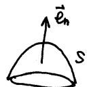
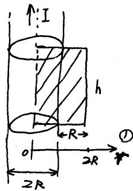
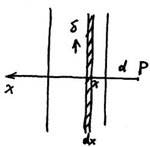

# 《大学物理》第24章 磁场中的高斯定理与安培环路定理（同步练习册答案）

原件经识别和整理；“参考解答”是我们补的。

## 一、磁通量与高斯定理

### 计算 1

作半径为 $r$ 的大圆面与半球面 $S$ 构成一封闭曲面。

闭合曲面磁通量（高斯定理）：

$$\oint \vec{B}\cdot d\vec{s}=0$$

而

$$\oint \vec{B}\cdot d\vec{s}=\int_{S}\vec{B}\cdot d\vec{s}+\int_{\text{大圆面}}\vec{B}\cdot d\vec{s}=0$$

$$\begin{aligned}\int_{S}\vec{B}\cdot d\vec{s}&=-\int_{\text{大圆面}}\vec{B}\cdot d\vec{s}\\&=-\int_{\text{大圆面}}B\,ds\cos\alpha=-B\cos\alpha\int_{\text{大圆面}}ds\\&=-B\cos\alpha\cdot(\pi r^{2})\end{aligned}$$

所以

$$\int_{S}\vec{B}\cdot d\vec{s}=-B\pi r^{2}\cos\alpha$$

取弯面向外为正法线方向。

## 二、安培环路定理

参考解答：结论：

$$
\int_S \vec B\cdot d\vec S=-B\pi r^2\cos\alpha
$$

其中 $S$ 为半球面，取弯面向外为正法线方向。

**理由与关键步骤：**

补上半径为 $r$ 的大圆面，使半球面 $S$ 与大圆面构成闭合曲面。由磁场高斯定理：

$$
\oint \vec B\cdot d\vec S=0
$$

所以

$$
\int_S \vec B\cdot d\vec S+
\int_{\text{圆面}} \vec B\cdot d\vec S=0
$$

因此

$$
\int_S \vec B\cdot d\vec S
= -\int_{\text{圆面}} \vec B\cdot d\vec S
$$

对大圆面，磁场 $\vec B$ 为匀强磁场，法线与 $\vec B$ 的夹角为 $\alpha$，故

$$
\int_{\text{圆面}} \vec B\cdot d\vec S
= B\pi r^2\cos\alpha
$$

于是

$$
\int_S \vec B\cdot d\vec S
= -B\pi r^2\cos\alpha
$$

若半球面向外为正法线方向，则结果为负；若取向内为正，则符号相反。

知识点：[磁通量与磁场中的高斯定理](../../../topics/大学物理/磁场中的高斯定理.md)、[磁场与磁感应强度的定义](../../../topics/大学物理/磁感应强度.md)、[安培环路定理及其应用](../../../topics/大学物理/安培环路定理.md)

### 计算 2

图中 $L_{1}$ 和 $L_{2}$ 都取逆时针为正方向。由安培环路定理：

$$\oint_{L_{1}}\vec{B}\cdot d\vec{l}=\mu_{0}(I_{1}+I_{2})$$

$$\oint_{L_{2}}\vec{B}\cdot d\vec{l}=\mu_{0}(I_{1}+I_{2})$$

所以

$$\oint_{L_{1}}\vec{B}\cdot d\vec{l}=\oint_{L_{2}}\vec{B}\cdot d\vec{l}$$

（只与回路内包围电流有关）

安培回路上各点的磁感强度 $B$ 由空间所有电流共同决定，所以 $\vec{B}_{P_{1}}\neq\vec{B}_{P_{2}}$（空间电流分布不同）。

参考解答：**结论**

两条回路的安培环路积分相等：

$$\oint_{L_{1}}\vec{B}\cdot d\vec{l}=\oint_{L_{2}}\vec{B}\cdot d\vec{l}=\mu_{0}(I_{1}+I_{2})$$

但回路上对应点的磁感强度一般不相等：$\vec{B}_{P_{1}}\neq\vec{B}_{P_{2}}$。

---

**推理过程**

1. **环路积分的计算**

   取逆时针为正方向，由安培环路定理 $\displaystyle\oint_{L}\vec{B}\cdot d\vec{l}=\mu_{0}\sum I_{\text{内}}$，两回路包围的电流代数和相同，均为 $I_1 + I_2$，故

   $$\oint_{L_{1}}\vec{B}\cdot d\vec{l}=\mu_{0}(I_{1}+I_{2}), \quad \oint_{L_{2}}\vec{B}\cdot d\vec{l}=\mu_{0}(I_{1}+I_{2})$$

   因此二者相等。**环路积分只取决于回路所包围的净电流**，与回路形状、大小及外部电流无关。

2. **各点磁感强度的分析**

   空间任意一点的磁感强度由**所有电流**（包括回路内和回路外的电流）按毕奥-萨伐尔定律叠加决定：

   $$\vec{B}(\vec{r})=\frac{\mu_{0}}{4\pi}\sum_i\int\frac{I_i\,d\vec{l}_i\times\hat{r}}{r^2}$$

   $P_1$ 在 $L_1$ 上、$P_2$ 在 $L_2$ 上，两点到各电流元的距离和方位不同，叠加结果自然不同，故 $\vec{B}_{P_{1}}\neq\vec{B}_{P_{2}}$。

3. **核心辨析**

   - **环路积分相等** $\not\Rightarrow$ **环路上各点 $\vec{B}$ 相等**。
   - 安培环路定理反映的是 $\vec{B}$ 沿闭合路径的整体累积效果，不能反推出路径上每一点的场强值；某点的 $\vec{B}$ 是全局所有电流共同贡献的结果。

知识点：[安培环路定理及其应用](../../../topics/大学物理/安培环路定理.md)

### 计算 3

根据安培环路定理：

$L_{1}$ 以顺时针为正方向：

$$\oint_{L_{1}}\vec{B}\cdot d\vec{l}=-\mu_{0}\cdot 2I$$

$L_{2}$ 以逆时针为正方向：

$$\oint_{L_{2}}\vec{B}\cdot d\vec{l}=-\mu_{0}I$$

$L_{3}$ 以逆时针为正方向：

$$\oint_{L_{3}}\vec{B}\cdot d\vec{l}=\mu_{0}(2I-I)=\mu_{0}I$$

$L_{4}$ 以顺时针为正方向：

$$\oint_{L_{4}}\vec{B}\cdot d\vec{l}=\mu_{0}(I-2I)=-\mu_{0}I$$

参考解答：### 结论
$$
\oint_{L_1}\vec B\cdot d\vec l=-2\mu_0I,\qquad
\oint_{L_2}\vec B\cdot d\vec l=-\mu_0I,\qquad
\oint_{L_3}\vec B\cdot d\vec l=\mu_0I,\qquad
\oint_{L_4}\vec B\cdot d\vec l=-\mu_0I.
$$

### 推理过程
安培环路定理为
$$
\oint_L\vec B\cdot d\vec l=\mu_0 I_{\text{内}},
$$
其中 $I_{\text{内}}$ 为环路所包围的电流代数和。按右手螺旋定则确定电流正负：四指沿环路正方向弯曲，拇指指向为电流正方向。

- $L_1$：顺时针为正，包围的 $2I$ 为负，故 $\oint_{L_1}\vec B\cdot d\vec l=-2\mu_0I$。
- $L_2$：逆时针为正，包围的 $I$ 为负，故 $\oint_{L_2}\vec B\cdot d\vec l=-\mu_0I$。
- $L_3$：逆时针为正，包围的 $2I$ 为正、$I$ 为负，故 $\oint_{L_3}\vec B\cdot d\vec l=\mu_0(2I-I)=\mu_0I$。
- $L_4$：顺时针为正，包围的 $I$ 为正、$2I$ 为负，故 $\oint_{L_4}\vec B\cdot d\vec l=\mu_0(I-2I)=-\mu_0I$。

知识点：[安培环路定理及其应用](../../../topics/大学物理/安培环路定理.md)

### 计算 4

(1) 直导线 A 在 P 点贡献：

$$B_{AP}=\frac{\mu_{0}I}{2\pi\frac{a}{2}}，方向沿 y 轴正方向。$$

直导线 B 在 P 点贡献：

$$B_{BP}=\frac{\mu_{0}I}{2\pi\frac{a}{2}}，方向沿 y 轴负方向。$$

所以在 P 点总磁感强度 $\vec{B}_{P}=0$。

(2) 由安培环路定理，回路 $L$ 以顺时针为正方向：

$$\oint_{L}\vec{B}\cdot d\vec{l}=\mu_{0}(-I)=-\mu_{0}I$$

参考解答：(1) $\vec{B}_P = 0$；(2) $\oint_L \vec{B} \cdot d\vec{l} = -\mu_0 I$。

1.  **P 点磁感强度**：两导线电流大小相等、方向相同且关于 P 点对称，由毕奥-萨伐尔定律 $B=\frac{\mu_0 I}{2\pi r}$ 可知，两导线在 P 点产生的磁场大小均为 $\frac{\mu_0 I}{\pi a}$，但根据右手螺旋定则判断二者方向相反（分别沿 $y$ 轴正、负方向），故矢量叠加后合磁感强度为零。
2.  **安培环路积分**：取顺时针为回路 $L$ 的正方向，根据右手螺旋定则，垂直纸面向里的电流为正；因导线中电流方向与回路正方向满足左手关系（或说电流穿过回路方向与正法向相反），故包围的净电流代数和为 $-I$，直接代入安培环路定理 $\oint_L \vec{B} \cdot d\vec{l} = \mu_0 \sum I_{\text{内}}$ 即得结果。

知识点：[安培环路定理及其应用](../../../topics/大学物理/安培环路定理.md)、[毕奥-萨伐尔定律及典型载流导线的磁场计算](../../../topics/大学物理/毕奥-萨伐尔定律.md)

### 计算 5

取 $x$ 轴竖直向下，在矩形处磁感强度方向垂直纸面向里。取一宽为 $dx$ 的矩形条 $ds$，并设法线方向垂直纸面向里为正，则 $ds$ 与 $B$ 同方向。

$$\begin{aligned}\phi_{m}&=\int_{S}\vec{B}\cdot d\vec{s}=\int_{S}B\cdot ds=\int_{b}^{2b}\frac{\mu_{0}I}{2\pi x}\cdot a\,dx\\&=\frac{\mu_{0}Ia}{2\pi}\ln\frac{2b}{b}=\frac{\mu_{0}Ia}{2\pi}\ln 2\end{aligned}$$

参考解答：通过矩形面积的磁通量为 $\Phi_m = \dfrac{\mu_0 I a}{2\pi} \ln 2$。

长直导线在距其 $x$ 处产生的磁感强度大小为 $B(x) = \dfrac{\mu_0 I}{2\pi x}$，方向垂直纸面向里。取宽度为 $dx$、长度为 $a$ 的窄条作为面积元 $dS = a\,dx$，其法线方向与 $\vec{B}$ 一致，故 $\vec{B} \cdot d\vec{S} = B(x)\,a\,dx$。对 $x$ 从 $b$ 到 $2b$ 积分：

$$
\Phi_m = \int_b^{2b} \frac{\mu_0 I}{2\pi x} \cdot a \, dx = \frac{\mu_0 I a}{2\pi} \int_b^{2b} \frac{dx}{x} = \frac{\mu_0 I a}{2\pi} \ln\left(\frac{2b}{b}\right) = \frac{\mu_0 I a}{2\pi} \ln 2.
$$

关键步骤在于正确写出非均匀磁场中面积元的磁通量表达式，并利用 $\int \frac{dx}{x} = \ln x$ 完成定积分；上下限 $b$ 与 $2b$ 对应矩形近边与远边到导线的距离，比值化简后得 $\ln 2$。

知识点：[磁场与磁感应强度的定义](../../../topics/大学物理/磁感应强度.md)

### 计算 6

电流均分布在圆柱体的截面上，空间磁感线是以圆柱中轴线为中心的同心圆。取半径为 $r$ 的圆为安培回路 $L$，并设逆时针为正方向。

① $r<R$，在圆柱体内：

$$\oint\vec{B}\cdot d\vec{l}=\mu_{0}\cdot\frac{I}{\pi R^{2}}\cdot\pi r^{2}$$

$$B\cdot 2\pi r=\mu_{0}\frac{I}{R^{2}}r^{2}$$

$$B=\frac{\mu_{0}I}{2\pi R^{2}}r$$

② $r>R$，在圆柱体外：

$$\oint\vec{B}\cdot d\vec{l}=\mu_{0}I$$

$$B\cdot 2\pi r=\mu_{0}I$$

所以

$$B=\frac{\mu_{0}I}{2\pi r}$$

即

$$B=\begin{cases}\dfrac{\mu_{0}I}{2\pi R^{2}}r & (r<R)\
$$
6pt]\dfrac{\mu_{0}I}{2\pi r} & (r>R)\end{cases}$$

在阴影所示的矩形平面内磁感强度垂直纸面向里。设矩形平面的法线方向垂直纸面向里为正方向，则 $B$ 和 $ds$ 同方向。

$$\begin{aligned}\phi_{m}&=\int_{S}\vec{B}\cdot d\vec{s}=\int_{S}B\cdot dS=\int_{0}^{R}\frac{\mu_{0}I}{2\pi R^{2}}r\cdot h\,dr+\int_{R}^{2R}\frac{\mu_{0}I}{2\pi r}h\,dr\\&=\frac{\mu_{0}I}{2\pi R^{2}}h\cdot\frac{1}{2}R^{2}+\frac{\mu_{0}I}{2\pi}h\ln 2\\&=\frac{\mu_{0}Ih}{4\pi}(1+2\ln 2)\end{aligned}$$

参考解答：### 结论

磁感强度大小为

\[
B(r)=
\begin{cases}
\dfrac{\mu_0 I}{2\pi R^2}\,r, & 0\le r<R,\\[6pt]
\dfrac{\mu_0 I}{2\pi r}, & r>R.
\end{cases}
$$

矩形平面内的磁通量为

$$
\boxed{\Phi_m=\frac{\mu_0 I h}{4\pi}\left(1+2\ln 2\right)}
$$

方向垂直纸面向里；若取垂直纸面向里为正方向，则磁通量为正。

### 推导

电流均匀分布在半径为 $R$ 的圆柱体截面上，因此电流密度为

$$
J=\frac{I}{\pi R^2}.
$$

由安培环路定律

$$
\oint_L \vec B\cdot d\vec l=\mu_0 I_{\text{包围}}.
$$

圆柱内部 $r<R$ 时，包围的电流为

$$
I_{\text{包围}}=J\pi r^2=\frac{I}{R^2}r^2.
$$

于是

$$
B(2\pi r)=\mu_0\frac{I}{R^2}r^2,
$$

故

$$
B=\frac{\mu_0 I}{2\pi R^2}r.
$$

圆柱外部 $r>R$ 时，包围全部电流 $I$，故

$$
B(2\pi r)=\mu_0 I,
$$

即

$$
B=\frac{\mu_0 I}{2\pi r}.
$$

矩形平面从圆柱轴线延伸至 $r=2R$，高度为 $h$。磁感强度垂直纸面向里，与面积元方向相同，因此

$$
\begin{aligned}
\Phi_m
&=\int_S \vec B\cdot d\vec S\\
&=\int_0^R \frac{\mu_0 I}{2\pi R^2}r\cdot h\,dr
+\int_R^{2R}\frac{\mu_0 I}{2\pi r}\cdot h\,dr\\
&=\frac{\mu_0 I h}{2\pi R^2}\cdot\frac{R^2}{2}
+\frac{\mu_0 I h}{2\pi}\ln\frac{2R}{R}\\
&=\frac{\mu_0 I h}{4\pi}
+\frac{\mu_0 I h}{2\pi}\ln 2\\
&=\boxed{\frac{\mu_0 I h}{4\pi}\left(1+2\ln 2\right)}.
\end{aligned}
$$

知识点：[安培环路定理及其应用](../../../topics/大学物理/安培环路定理.md)、[毕奥-萨伐尔定律及典型载流导线的磁场计算](../../../topics/大学物理/毕奥-萨伐尔定律.md)

### 计算 7

无限长载流平板可看成由无数多载流直导线密排而成。

在 $x$ 处取宽为 $dx$ 的无限长直载流导线，电流 $dI=\delta\,dx$，在 P 点产生磁感强度

$$dB=\frac{\mu_{0}\,dI}{2\pi x}，方向垂直纸面向里$$

其他各直导线在 P 点产生磁感强度 $d\vec{B}$ 方向相同。

P 点总磁感强度

$$B=\int dB=\int\frac{\mu_{0}\,dI}{2\pi x}=\int_{d}^{d+r}\frac{\mu_{0}\delta\,dx}{2\pi x}=\frac{\mu_{0}\delta}{2\pi}\ln\left(1+\frac{r}{d}\right)$$

方向垂直纸面向里。

参考解答：**结论：**

$$
B=\frac{\mu_0\delta}{2\pi}\ln\left(1+\frac{r}{d}\right)
$$

方向垂直纸面向里。

**推理过程：**

将无限长载流平板视为无数平行的无限长载流直导线的叠加。面电流密度为 $\delta$。

在距 P 点水平距离为 $x$ 处取宽度 $dx$ 的窄条，其中电流为

$$
dI=\delta\,dx
$$

该窄条在 P 点产生的磁感强度大小为

$$
dB=\frac{\mu_0\,dI}{2\pi x}=\frac{\mu_0\delta\,dx}{2\pi x}
$$

各窄条在 P 点产生的磁感强度方向均垂直纸面向里，因此直接积分：

$$
B=\int_d^{d+r}\frac{\mu_0\delta\,dx}{2\pi x}
=\frac{\mu_0\delta}{2\pi}\ln\frac{d+r}{d}
=\frac{\mu_0\delta}{2\pi}\ln\left(1+\frac{r}{d}\right)
$$

所以 P 点磁感强度为

$$
\boxed{B=\frac{\mu_0\delta}{2\pi}\ln\left(1+\frac{r}{d}\right)}
$$

方向垂直纸面向里。

知识点：[毕奥-萨伐尔定律及典型载流导线的磁场计算](../../../topics/大学物理/毕奥-萨伐尔定律.md)、[几种特殊带电体（点电荷、无限长直线、圆环、圆盘等）激发的电场](../../../topics/大学物理/特殊带电体电场.md)
