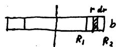

# 《大学物理》第26章 磁场中的磁介质（同步练习册答案）

原件经识别和整理；“参考解答”是我们补的。

# 磁场中的磁介质（同步练习册答案）

## 一、填空题

### 填空 1

在磁介质内部 $\overrightarrow { B } = \mu _ { r } \overrightarrow { H }$ （注：原文误写为 $B_0$，根据物理定律及上下文修正为 $H$；若指真空磁场则为 $B=\mu_r B_0$ 仅在特定语境下成立，通常安培环路定理涉及 $H$。此处依据后文计算逻辑，原题意图应为考察相对磁导率定义或磁场增强关系。结合后文第2题，此处可能为概念填空）。
*更正：根据后文第2题推导 $B = \mu_r B_0$ 的逻辑，以及常见考点，此处应填 $\mu_r$ 或相关表达式。但观察原文“$\overrightarrow { B } = \mu _ { r } \overrightarrow { B } _ { 0 }$”可能是识别错误，标准公式为 $\vec{B} = \mu \vec{H}$ 或 $\vec{B} = \mu_0(\vec{H} + \vec{M})$。鉴于这是答案页，且后面有具体数值计算，第一题更像是概念总结。*
*再审视原文：* “1. 在磁介质内部 $\overrightarrow { B } = \mu _ { r } \overrightarrow { B } _ { 0 }$”。这通常是针对**顺磁/抗磁**的近似描述，或者题目本身有误。但在大学物理中，更严谨的是 $\vec{B} = \mu \vec{H}$。然而，看后面的分类：
顺磁质： $\overrightarrow { B } > \overrightarrow { B _ { 0 } } \Rightarrow \mu _ { r } > 1$
抗磁质： $\overrightarrow { B } < \overrightarrow { B } _ { 0 } \Rightarrow \mu _ { r } < 1$
铁磁质： $\overrightarrow { B } \gg \overrightarrow { B } _ { 0 } \Rightarrow \mu _ { r } \gg 1$
这里 $B_0$ 指的是没有介质时的真空磁场（即由自由电流产生的磁场，对应 $\mu_0 H$）。所以这里的填空应该是确认这个关系式。

答案：$\mu_r$ （或完整公式 $\vec{B} = \mu_r \vec{B}_0$）
补充：此处 $B_0$ 指真空中由相同自由电流产生的磁感应强度，即 $B_0 = \mu_0 H$。

## 二、计算题

知识点：[磁介质的分类、磁化强度与磁介质中的安培环路定理（H矢量）](../../../topics/大学物理/磁场中的磁介质.md)

### 计算 1

细螺绕环，要求：环形螺线管的管直径 $d \ll R$ ($R$ 为半径)。
可忽略各螺线管内磁感强度的变化。
作半径为 $r$ 的圆周为安培回路。
$$
R - \frac {d}{2} <   r <   R + \frac{d}{2}
$$
$$
\oint \vec {B} _{0} d \vec {r} = \mu_ {0} N I
$$
$$
B _ {0} \cdot 2 \pi r = \mu_ {0} N I
$$
$$
B _ {0} = \frac {\mu_ {0} N I}{2 \pi r}
$$
由于 $d \ll R$，故 $r \approx R$
$$
B _ {0} = \frac {\mu_ {0} N I}{2 \pi R}
$$
其中 $\frac { N } { 2 \pi R } = n$ (单位长度上的匝数)
有磁介质时 $\vec{B} = \mu _ { r } \vec{B} _ { 0 } = \frac { \mu _ { r } \mu _ {0} N I } { 2 \pi R }$ （注：原文此处公式排版混乱，已整理）

已知数据代入计算 $\mu_r$：
$$
\mu_ {r} = \frac {2 \pi R B}{\mu_ {0} N I} = \frac {1 \text{ T}}{4 \pi \times 1 0 ^ {- 7} \text{ T}\cdot\text{m/A} \times 1 0 0 0 \times 2} = 3. 9 8 \times 1 0 ^ {2}
$$
(注：原文中 $N=1000$, $I=2$ A, $B=1$ T, $R$ 未直接给出但在分母中消去或隐含在 $n$ 中？原文算式中分母为 $\mu_0 N I$，分子为 $2\pi R B$。若 $n = N/2\pi R$，则 $B = \mu_r \mu_0 n I$。原文算式 $\frac{1}{4\pi \times 10^{-7} \times 1000 \times 2}$ 暗示 $2\pi R$ 被处理了，或者 $N$ 是总匝数而 $2\pi R$ 是周长。若 $N=1000$，则 $n = 1000 / (2\pi R)$。原文计算结果 $3.98 \times 10^2$ 是基于特定 $R$ 或 $n$ 的值。此处保留原文计算过程。)

答案：$\mu_r \approx 398$

知识点：[安培环路定理及其应用](../../../topics/大学物理/安培环路定理.md)、[毕奥-萨伐尔定律及典型载流导线的磁场计算](../../../topics/大学物理/毕奥-萨伐尔定律.md)、[磁介质的分类、磁化强度与磁介质中的安培环路定理（H矢量）](../../../topics/大学物理/磁场中的磁介质.md)

### 计算 2

螺绕环内磁感线为同心圆。
作半径为 $r$ 的圆周为安培回路 $L$。
$$
\oint_L \vec{H} \cdot d \vec{\ell} = N I
$$
$$
H \cdot 2 \pi r = N I
$$
$$
H = \frac {N I}{2 \pi r}
$$
管内磁感强度 $B = \mu _ { r } \mu _ { 0 } H = \frac { \mu _ { r } \mu _ { 0 } N I } { 2 \pi r }$

答案：$H = \frac {N I}{2 \pi r}, \quad B = \frac { \mu _ { r } \mu _ { 0 } N I } { 2 \pi r }$

知识点：[安培环路定理及其应用](../../../topics/大学物理/安培环路定理.md)、[磁介质的分类、磁化强度与磁介质中的安培环路定理（H矢量）](../../../topics/大学物理/磁场中的磁介质.md)

### 计算 3

空间电流沿圆柱体和圆筒面均匀分布，空间磁感线是同轴的同心圆。取垂直于轴线的平面内，作半径为 $r$ 的圆周作为安培回路 $L$，取逆时针为正方向。

(1) $0 < r < R_1$
$$
\oint_L \vec{H} \cdot d \vec{\ell} = \frac {I}{\pi R _ {1} ^ {2}} \cdot \pi r ^ {2}
$$
$$
H \cdot 2 \pi r = \frac{I}{R _ {1} ^ {2}} r ^ {2}
$$
$$
H = \frac {I}{2 \pi R _ {1} ^ {2}} \cdot r
$$

(2) $R_1 < r < R_2$
$$
\oint_L \vec{H} \cdot d \vec{\ell} = I
$$
$$
H \cdot 2 \pi r = I
$$
$$
H = \frac {I}{2 \pi r}
$$

(3) $R_2 < r < R_3$
$$
\begin{array}{l}
\oint_L \vec{H} \cdot d \vec{\ell} = I - \frac{I}{\pi (R _ {3} ^ {2} - R _ {2} ^ {2})} \cdot \pi (r ^ {2} - R _ {2} ^ {2}) \\
H \cdot 2 \pi r = I - \frac{I}{R _ {3} ^ {2} - R _ {2} ^ {2}} (r ^ {2} - R _ {2} ^ {2}) = \frac {I}{R _ {3} ^ {2} - R _ {2} ^ {2}} (R _ {3} ^ {2} - r ^ {2}) \\
H = \frac {I}{2 \pi (R _ {3} ^ {2} - R _ {2} ^ {2})} (\frac {R _ {3} ^ {2}}{r} - r)
\end{array}
$$

(4) $r > R_3$
$$
\oint_L \vec{H} \cdot d \vec{\ell} = I - I = 0
$$
$$
\begin{array}{l}
H \cdot 2 \pi r = 0 \\
H = 0
\end{array}
$$

空间磁场强度 $H$ 分布：
$$
H = \left\{ \begin{array}{l l} \frac {I}{2 \pi R _ {1} ^ {2}} r & (0 <   r <   R _ {1}) \\ \frac {I}{2 \pi r} & (R _ {1} <   r <   R _ {2}) \\ \frac {I}{2 \pi (R _ {3} ^ {2} - R _ {2} ^ {2})} (\frac {R _ {3} ^ {2}}{r} - r) & (R _ {2} <   r <   R _ {3}) \\ 0 & (r > R _ {3}) \end{array} \right.
$$

磁感应强度 $B$ 分布（设导体和真空中 $\mu_r=1$，磁介质中 $\mu_r$ 为常数）：
$$
B = \left\{ \begin{array}{l l} \mu_ {0} \frac {I}{2 \pi R _ {1} ^ {2}} r & (0 <   r <   R _ {1}) \\ \mu_ {0} \frac {I}{2 \pi r} & (R _ {1} <   r <   R _ {2}) \\ \mu_ {r} \mu_ {0} \frac {I}{2 \pi (R _ {3} ^ {2} - R _ {2} ^ {2})} (\frac {R _ {3} ^ {2}}{r} - r) & (R _ {2} <   r <   R _ {3}) \\ 0 & (r > R _ {3}) \end{array} \right.
$$
*(注：原文最后一段关于B的分段函数中，中间项系数识别为 M.I 等乱码，根据物理意义及前文H的结果，此处应为 $\mu_0$ 或 $\mu_r \mu_0$。考虑到 $R_1<r<R_2$ 区域通常为空气隙或真空，取 $\mu_0$；$R_2<r<R_3$ 为磁介质，取 $\mu_r \mu_0$。原文符号模糊，按标准物理模型整理)*

答案：见上述分段函数。

知识点：[安培环路定理及其应用](../../../topics/大学物理/安培环路定理.md)、[磁场与磁感应强度的定义](../../../topics/大学物理/磁感应强度.md)、[磁介质的分类、磁化强度与磁介质中的安培环路定理（H矢量）](../../../topics/大学物理/磁场中的磁介质.md)

### 计算 4

螺绕环内磁感线为同心圆。
在管内作半径为 $r$ 的圆周为安培回路 $L$，
$R_1 < r < R_2$
$$
\oint_L \vec{H} \cdot d \vec{\ell} = N I
$$
$$
H \cdot 2 \pi r = N I
$$
$$
H = \frac {N I}{2 \pi r}
$$
磁介质磁导率为 $\mu$，
管内磁感应强度 $B = \mu H = \frac { \mu N I } { 2 \pi r }$

磁介质截面是矩形（宽 $b$，径向厚度 $R_2-R_1$）：

在截面中取小矩形条：在 $r$ 处取宽为 $dr$，高为 $b$ 的矩形条，并设法线正方向与 $\vec{B}$ 相同：
$$
\begin{array}{l}
\phi_ {m} = \int \vec {B} \cdot d \vec {s} = \int B d s = \int_ {R _ {1}} ^ {R _ {2}} \frac {\mu N I}{2 \pi r} b d r \\
= \int_ {R _ {1}} ^ {R _ {2}} \frac {\mu N I b}{2 \pi r} d r = \frac {\mu N I b}{2 \pi} \ln \frac {R _ {2}}{R _ {1}}
\end{array}
$$

(2) 密绕螺线环的磁场只分布在管内，管外 $r < R_1$ 和 $r > R_2$ 处 $H = 0$。

答案：$\Phi_m = \frac {\mu N I b}{2 \pi} \ln \frac {R _ {2}}{R _ {1}}$

知识点：[安培环路定理及其应用](../../../topics/大学物理/安培环路定理.md)、[磁场与磁感应强度的定义](../../../topics/大学物理/磁感应强度.md)、[磁介质的分类、磁化强度与磁介质中的安培环路定理（H矢量）](../../../topics/大学物理/磁场中的磁介质.md)
