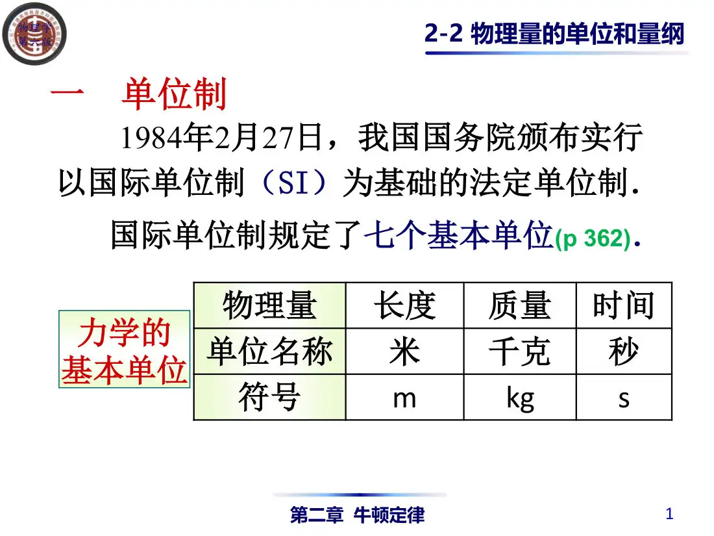
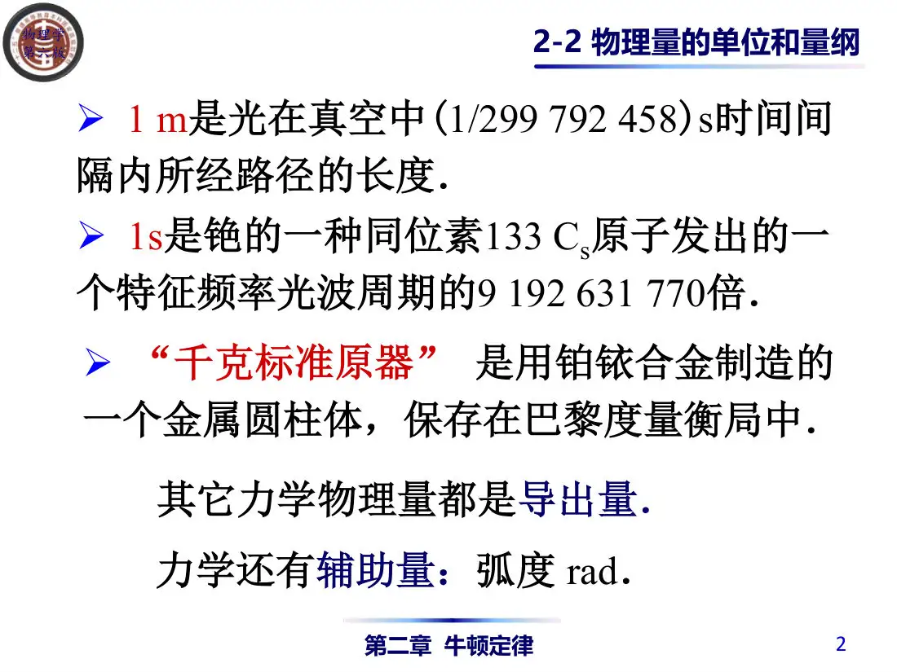
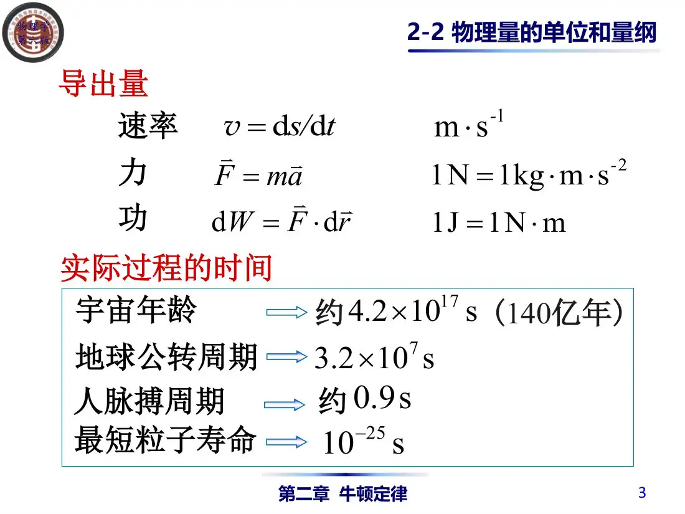
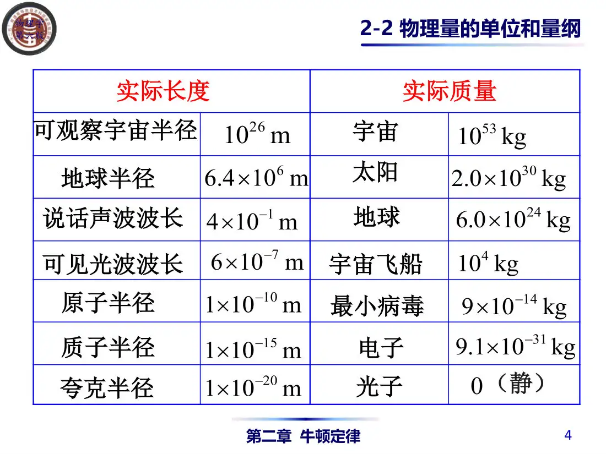
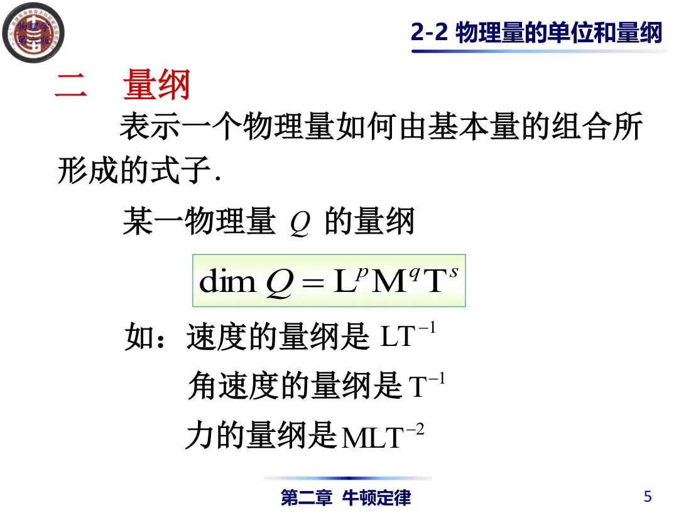
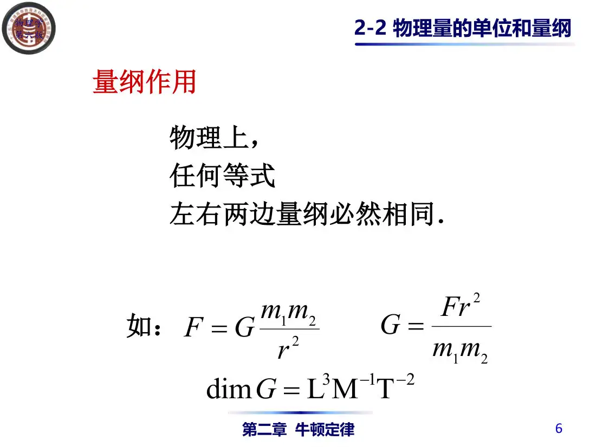

# 《大学物理》第2章 牛顿定律：物理量的单位和量纲（课件）

原件的每一页，下面附识别出的文字。

### 一 单位制

原文：

一 单位制

1984年2月27日，我国国务院颁布实行以国际单位制（SI）为基础的法定单位制

国际单位制规定了七个基本单位(p 362)

力学的基本单位

<table><tr><td>物理量</td><td>长度</td><td>质量</td><td>时间</td></tr><tr><td>单位名称</td><td>米</td><td>千克</td><td>秒</td></tr><tr><td>符号</td><td>m</td><td>kg</td><td>s</td></tr></table>

物理学第六版

2-2 物理量的单位和量纲

第二章 牛顿定律

1

### ➢ 1 m是光在真空中(1/299 792 458)s时间间隔内所经路径的长度

原文：

➢ 1 m是光在真空中(1/299 792 458)s时间间隔内所经路径的长度

➢ 1s是铯的一种同位素133 $\mathrm { C _ { s } }$ 原子发出的一个特征频率光波周期的9 192 631 770倍

➢ “千克标准原器” 是用铂铱合金制造的一个金属圆柱体，保存在巴黎度量衡局中

其它力学物理量都是导出量

力学还有辅助量：弧度 rad

物理学第六版

2-2 物理量的单位和量纲

第二章 牛顿定律

2

### 导出量

原文：

导出量

速率

$$
v = \mathrm{ds} / \mathrm{dt}
$$

$$
\mathbf {m} \cdot \mathbf {s} ^ {- 1}
$$

力

$$
\vec {F} = m \vec {a}
$$

功

$$
1 \mathrm{N} = 1 \mathrm{kg} \cdot \mathrm{m} \cdot \mathrm{s} ^ {- 2}
$$

$$
\mathrm{d} W = \vec {F} \cdot \mathrm{d} \vec {r}
$$

$$
1 \mathrm{J} = 1 \mathrm{N} \cdot \mathrm{m}
$$

实际过程的时间

宇宙年龄

约 $4 . 2 \times 1 0 ^ { 1 7 } \mathrm { s }$ (140亿年)

地球公转周期

人脉搏周期 →约0.9s

最短粒子寿命 $1 0 ^ { - 2 5 } \mathrm { s }$

物理学第六版

2-2 物理量的单位和量纲

第二章 牛顿定律

3

### 物理学第六版

原文：

<table><tr><td colspan="2">实际长度</td><td colspan="2">实际质量</td></tr><tr><td>可观察宇宙半径</td><td> $10^{26}$ m</td><td>宇宙</td><td> $10^{53}$ kg</td></tr><tr><td>地球半径</td><td> $6.4 \times 10^{6}$ m</td><td>太阳</td><td> $2.0 \times 10^{30}$ kg</td></tr><tr><td>说话声波波长</td><td> $4 \times 10^{-1}$ m</td><td>地球</td><td> $6.0 \times 10^{24}$ kg</td></tr><tr><td>可见光波波长</td><td> $6 \times 10^{-7}$ m</td><td>宇宙飞船</td><td> $10^{4}$ kg</td></tr><tr><td>原子半径</td><td> $1 \times 10^{-10}$ m</td><td>最小病毒</td><td> $9 \times 10^{-14}$ kg</td></tr><tr><td>质子半径</td><td> $1 \times 10^{-15}$ m</td><td>电子</td><td> $9.1 \times 10^{-31}$ kg</td></tr><tr><td>夸克半径</td><td> $1 \times 10^{-20}$ m</td><td>光子</td><td>0(静)</td></tr></table>

物理学第六版

2-2 物理量的单位和量纲

第二章 牛顿定律

4

### 二 量纲

原文：

二 量纲

表示一个物理量如何由基本量的组合所形成的式子

某一物理量 Q 的量纲

$$
\dim Q = \mathbf {L} ^ {p} \mathbf {M} ^ {q} \mathbf {T} ^ {s}
$$

如：速度的量纲是 $\mathrm { L T ^ { - 1 } }$

角速度的量纲是 $\mathrm { T } ^ { - 1 }$

力的量纲是 $\mathrm { { M L T ^ { - 2 } } }$

物理学第六版

2-2 物理量的单位和量纲

第二章 牛顿定律

5

### 量纲作用

原文：

量纲作用

物理上，

任何等式

左右两边量纲必然相同

如：

$$
F = G \frac {m _ {1} m _ {2}}{r ^ {2}} \quad G = \frac {F r ^ {2}}{m _ {1} m _ {2}}
$$

dim $G = \mathrm { L } ^ { 3 } \mathrm { M } ^ { - 1 } \mathrm { T } ^ { - 2 }$

物理学第六版

2-2 物理量的单位和量纲

第二章 牛顿定律

6
