# 《大学物理》第2章 牛顿运动定律（课件）

原件的每一页，下面附识别出的文字。

### 第 二 章牛顿运动定律

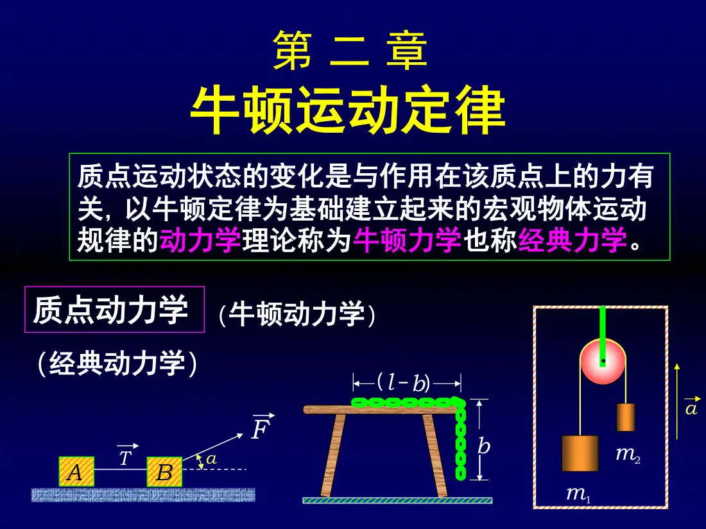

原文：

第 二 章牛顿运动定律

质点运动状态的变化是与作用在该质点上的力有关，以牛顿定律为基础建立起来的宏观物体运动规律的动力学理论称为牛顿力学也称经典力学。

质点动力学 （牛顿动力学）

（经典动力学）

### 第 2 页

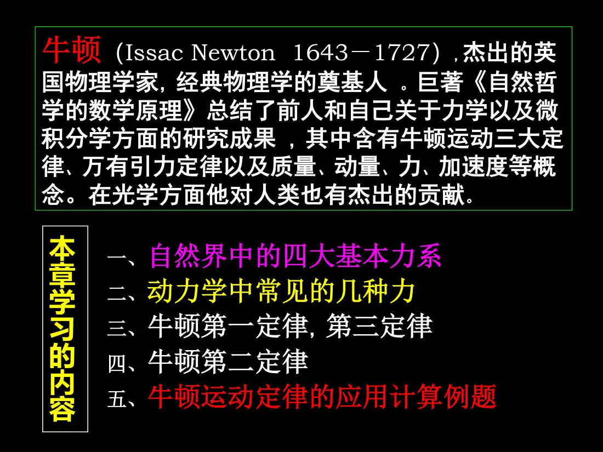

原文：

牛顿（Issac Newton 1643－1727）,杰出的英国物理学家，经典物理学的奠基人 。巨著《自然哲学的数学原理》总结了前人和自己关于力学以及微积分学方面的研究成果 ，其中含有牛顿运动三大定律、万有引力定律以及质量、动量、力、加速度等概念。在光学方面他对人类也有杰出的贡献。

一、自然界中的四大基本力系二、动力学中常见的几种力三、牛顿第一定律，第三定律四、牛顿第二定律五、牛顿运动定律的应用计算例题

本
章
学
习
的
内
容

### 在学习本章时，可以记住一个口诀和一个解题步骤的要领。

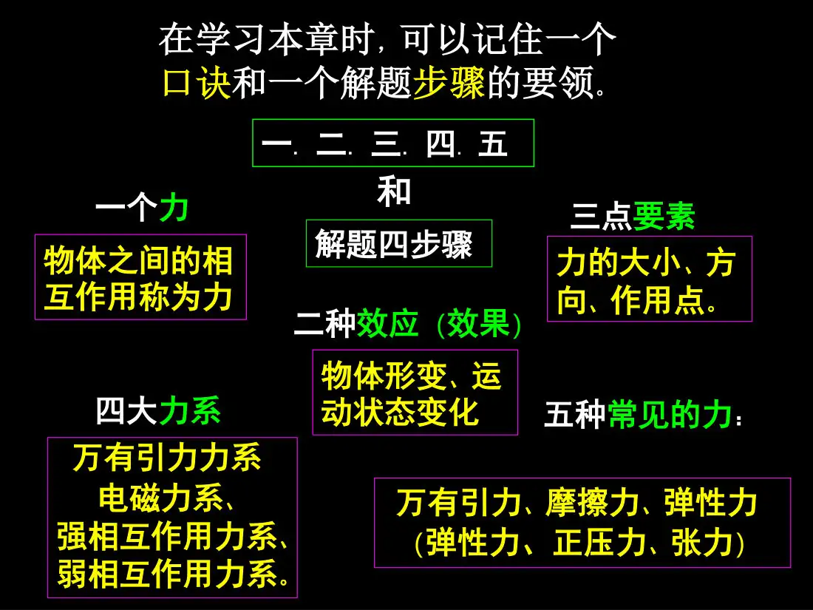

原文：

在学习本章时，可以记住一个口诀和一个解题步骤的要领。

一. 二. 三. 四. 五

一个力

物体之间的相互作用称为力

四大力系

万有引力力系电磁力系、强相互作用力系、弱相互作用力系。

和解题四步骤

二种效应（效果）

物体形变、运动状态变化三点要素

力的大小、方向、作用点。

五种常见的力：

万有引力、摩擦力、弹性力（弹性力、正压力、张力）

### 应用牛顿定律的解题四步骤：

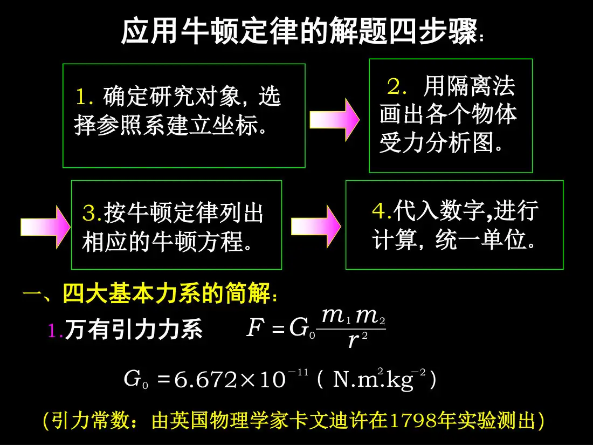

原文：

应用牛顿定律的解题四步骤：

1. 确定研究对象，选择参照系建立坐标。

2. 用隔离法画出各个物体受力分析图。

3.按牛顿定律列出相应的牛顿方程。

4.代入数字,进行计算，统一单位。

一、四大基本力系的简解：

1.万有引力力系 $\vert \frac { n } { 2 } \vert = 1 \frac { n } { 2 } \vert n \vert \frac { n } { 2 }$

$$
G _ {0} = 6. 6 7 2 \times 1 0 ^ {- 1 1} (\mathrm{N.m} ^ {2}. \mathrm{kg} ^ {- 2})
$$

（引力常数：由英国物理学家卡文迪许在1798年实验测出）

### 万有引力存在于：星球之间，地球和地球表面附近的物体之间，以及所有物体与物体之间。

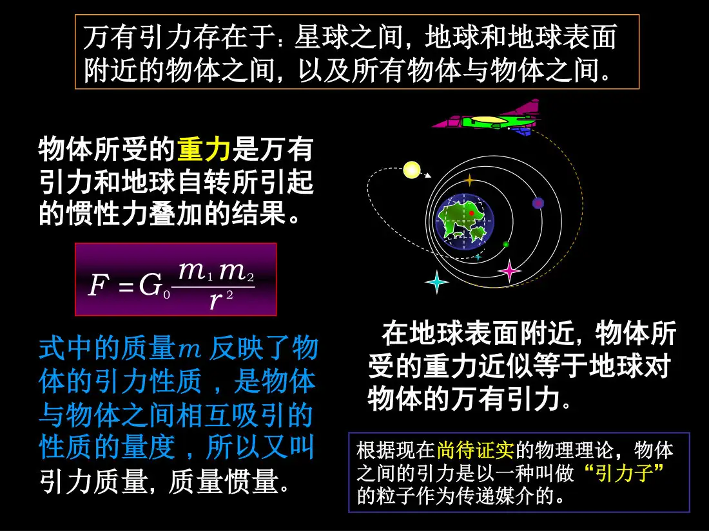

原文：

万有引力存在于：星球之间，地球和地球表面附近的物体之间，以及所有物体与物体之间。

物体所受的重力是万有引力和地球自转所引起的惯性力叠加的结果。

$$
F = G _ {0} \frac {m _ {1} m _ {2}}{r ^ {2}}
$$

式中的质量m 反映了物体的引力性质 ，是物体与物体之间相互吸引的性质的量度 ，所以又叫引力质量，质量惯量。

在地球表面附近，物体所受的重力近似等于地球对物体的万有引力。

根据现在尚待证实的物理理论，物体之间的引力是以一种叫做“引力子”的粒子作为传递媒介的。

### 2. 电磁力系：

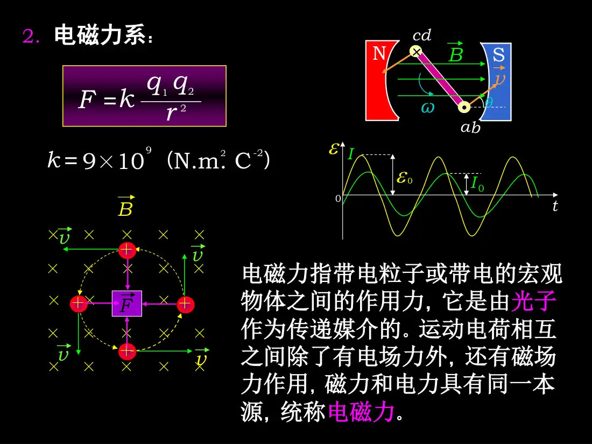

原文：

2. 电磁力系：

$$
F = k \frac {q _ {1} q _ {2}}{r ^ {2}}
$$

$$
k = 9 \times 1 0 ^ {9} (\mathrm{N.m.} ^ {2} \mathrm{C} ^ {- 2})
$$

电磁力指带电粒子或带电的宏观物体之间的作用力，它是由光子作为传递媒介的。运动电荷相互之间除了有电场力外，还有磁场力作用，磁力和电力具有同一本源，统称电磁力。

### 强力是夸克所带的“色荷”之间的作用力：色力的表现，是以胶子作为传递媒介的。

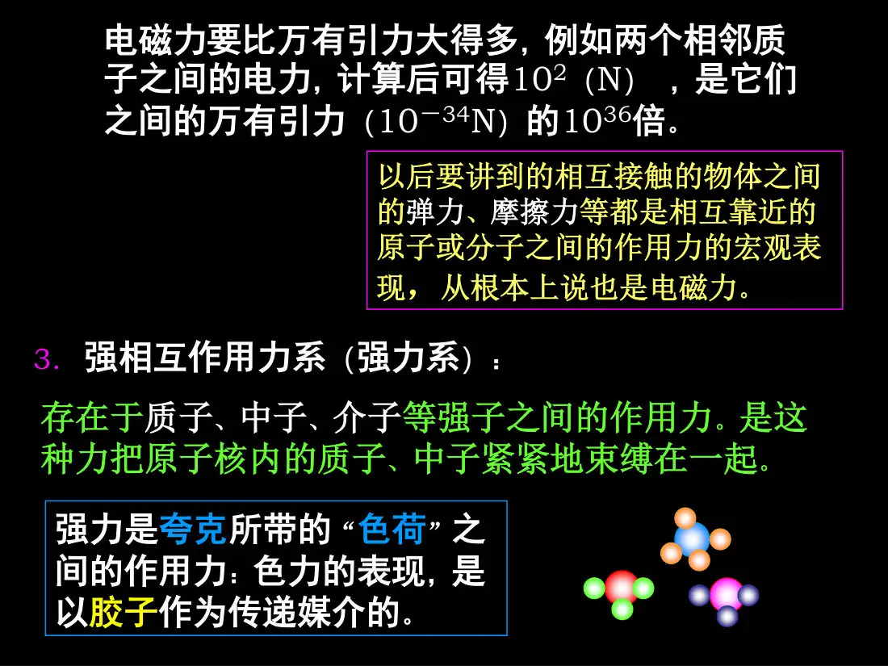

原文：

电磁力要比万有引力大得多，例如两个相邻质子之间的电力，计算后可得102（N） ，是它们之间的万有引力（10－34N）的1036倍。

以后要讲到的相互接触的物体之间的弹力、摩擦力等都是相互靠近的原子或分子之间的作用力的宏观表现，从根本上说也是电磁力。

3. 强相互作用力系（强力系）：存在于质子、中子、介子等强子之间的作用力。是这种力把原子核内的质子、中子紧紧地束缚在一起。

强力是夸克所带的“色荷”之间的作用力：色力的表现，是以胶子作为传递媒介的。

### 4. 弱相互作用力系（弱力系）：

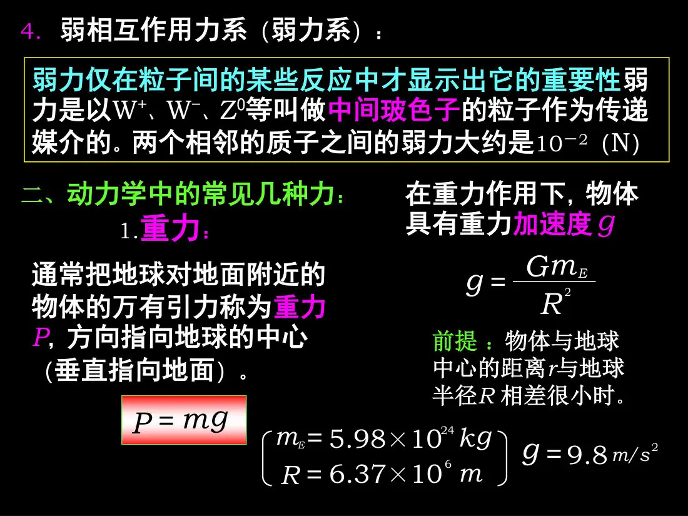

原文：

4. 弱相互作用力系（弱力系）：

弱力仅在粒子间的某些反应中才显示出它的重要性弱力是以W+、W-、Z0等叫做中间玻色子的粒子作为传递媒介的。两个相邻的质子之间的弱力大约是10－2（N）

二、动力学中的常见几种力：1.重力：

通常把地球对地面附近的物体的万有引力称为重力P，方向指向地球的中心（垂直指向地面）。

$$
P = m g
$$

在重力作用下，物体具有重力加速度g

$$
g = \frac {G m _ {E}}{R ^ {2}}
$$

前提 ：物体与地球中心的距离r与地球半径R 相差很小时。

mE 5.98×1024 ＝ kg

$$
R = 6. 3 7 \times 1 0 ^ {6} m
$$

$$
g = 9. 8 \mathrm{m} / \mathrm{s} ^ {2}
$$

### 弹簧的倔强系数、弹性系数

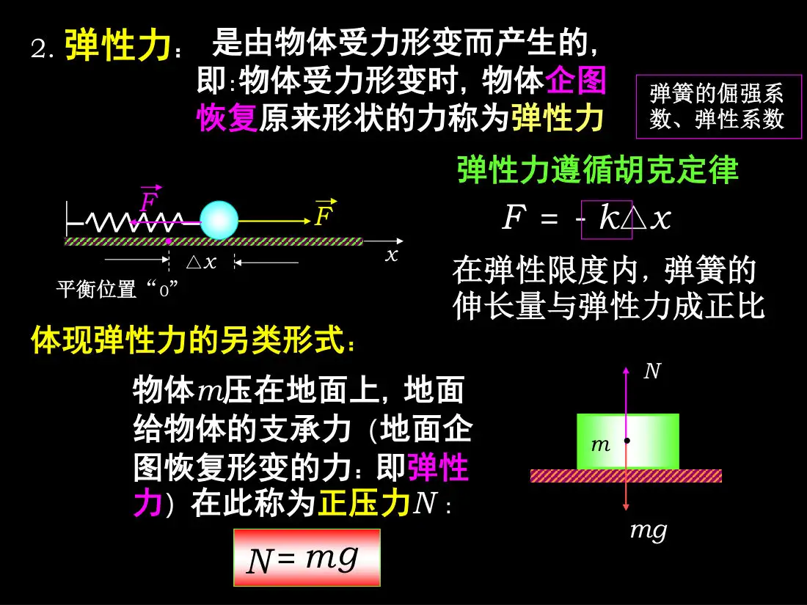

原文：

2. 弹性力： 是由物体受力形变而产生的，即:物体受力形变时，物体企图恢复原来形状的力称为弹性力

弹簧的倔强系数、弹性系数

弹性力遵循胡克定律

平衡位置“0”

F ＝－k△x

体现弹性力的另类形式：

在弹性限度内，弹簧的伸长量与弹性力成正比

物体m压在地面上，地面给物体的支承力（地面企图恢复形变的力：即弹性力）在此称为正压力N :

$$
N = m g
$$

### N＝mgcosθ

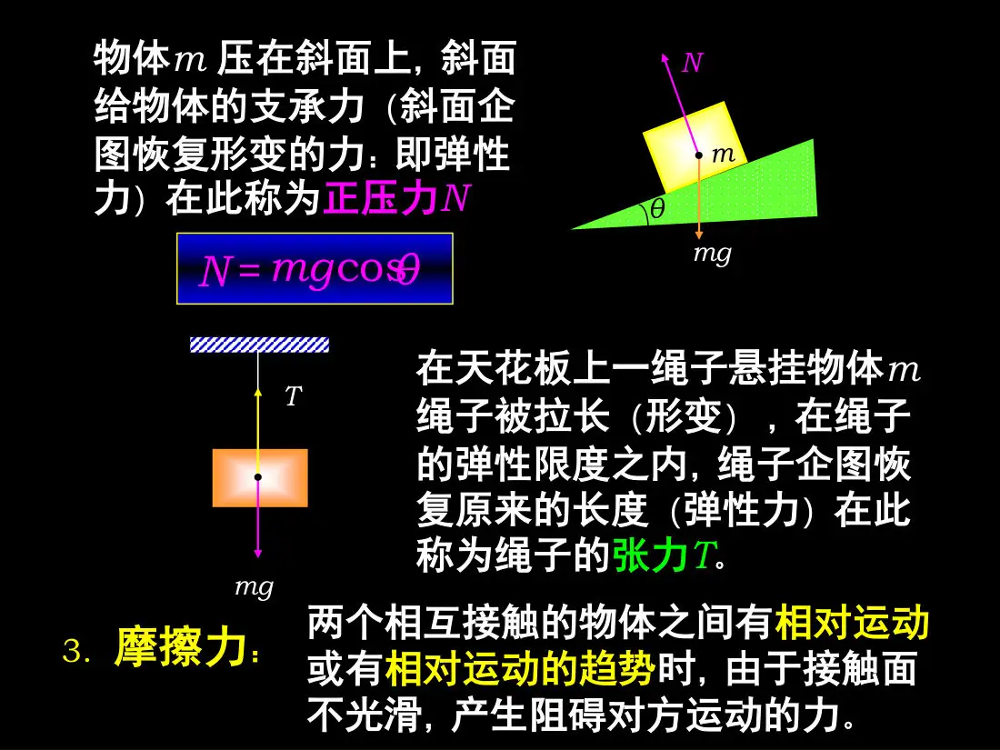

原文：

物体m 压在斜面上，斜面给物体的支承力（斜面企图恢复形变的力：即弹性力）在此称为正压力N

N＝mgcosθ

3. 摩擦力：

在天花板上一绳子悬挂物体m绳子被拉长（形变） ，在绳子的弹性限度之内，绳子企图恢复原来的长度（弹性力）在此称为绳子的张力T。

两个相互接触的物体之间有相对运动或有相对运动的趋势时，由于接触面不光滑，产生阻碍对方运动的力。

### 3. 摩擦力：

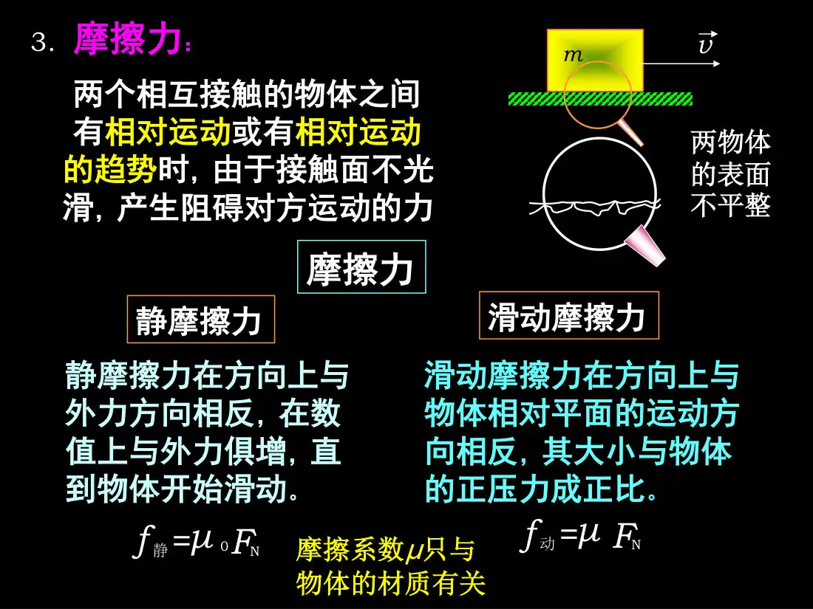

原文：

3. 摩擦力：

两个相互接触的物体之间有相对运动或有相对运动的趋势时，由于接触面不光滑，产生阻碍对方运动的力

两物体 的表面 不平整

摩擦力

静摩擦力

静摩擦力在方向上与外力方向相反，在数值上与外力俱增，直到物体开始滑动。

滑动摩擦力

f 静＝μ 0FN

滑动摩擦力在方向上与物体相对平面的运动方向相反，其大小与物体的正压力成正比。

摩擦系数μ只与物体的材质有关f 动＝μ FN

### 受力分析举例：

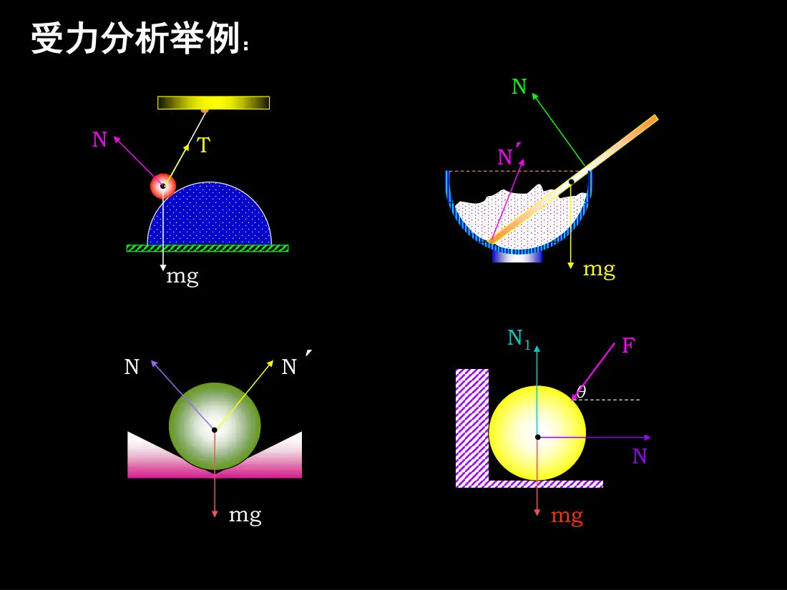

原文：

受力分析举例：

### 受力分析举例：

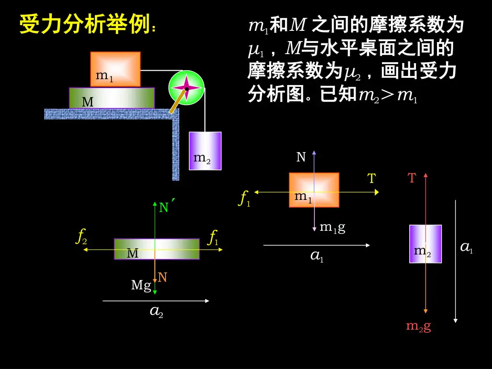

原文：

受力分析举例：

$1 0 0 \times 5 0 = 1 0 0 0 ( c m )$ 和M 之间的摩擦系数为μ ，M与水平桌面之间的摩擦系数为μ ，画出受力分析图。已知 $1 0 0 m = 1 0 0 m$

### 受力分析举例：

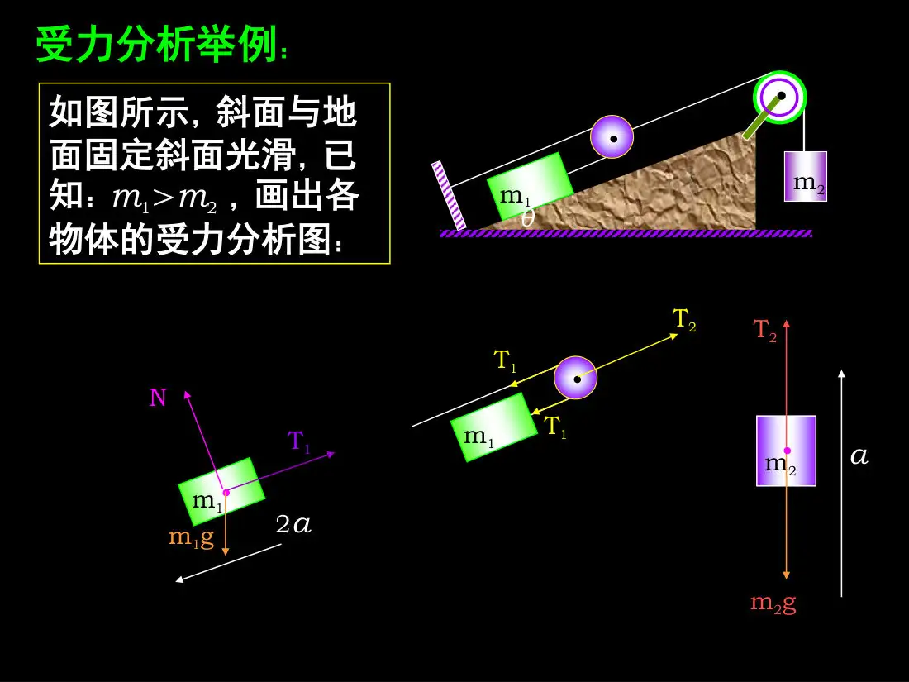

原文：

受力分析举例：

如图所示，斜面与地面固定斜面光滑，已知： $1 0 0 - 1 0 0 = 1 0 0 0$ ，画出各物体的受力分析图：

### 受力分析举例：

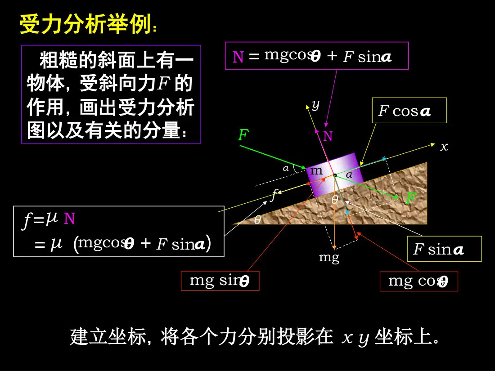

原文：

受力分析举例：

粗糙的斜面上有一物体，受斜向力F 的作用，画出受力分析图以及有关的分量：

Nf＝μ＝ mgcosθ＋F sinαμ（ ）

N＝mgcosθ＋F sinα

F cosα

F sinα

mg sinθ

mg cosθ

建立坐标，将各个力分别投影在 x y 坐标上。

### 三、 牛顿第一定律和第三定律

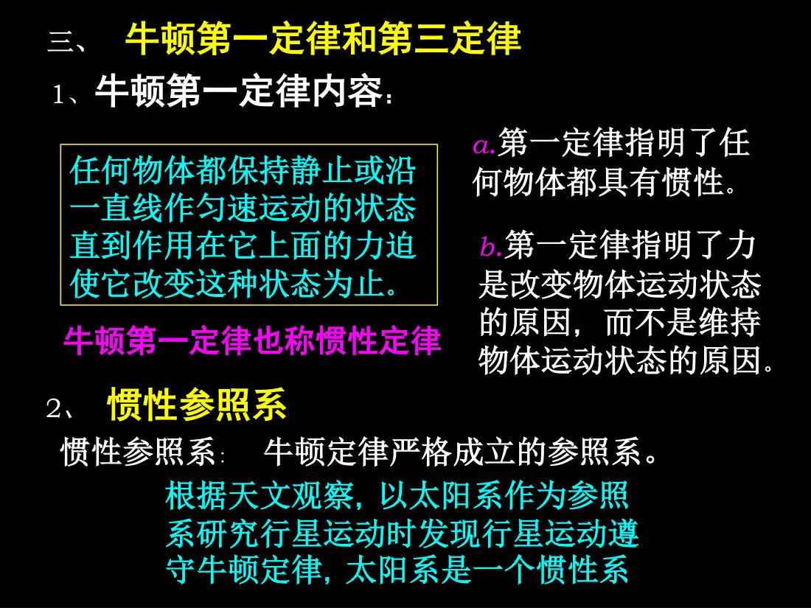

原文：

三、 牛顿第一定律和第三定律

1、牛顿第一定律内容：

任何物体都保持静止或沿一直线作匀速运动的状态直到作用在它上面的力迫使它改变这种状态为止。

牛顿第一定律也称惯性定律a.第一定律指明了任何物体都具有惯性。

b.第一定律指明了力是改变物体运动状态的原因，而不是维持物体运动状态的原因。

2、 惯性参照系惯性参照系: 牛顿定律严格成立的参照系。根据天文观察，以太阳系作为参照系研究行星运动时发现行星运动遵守牛顿定律，太阳系是一个惯性系根据天文观察，以太阳系作为参照系研究行星运动时发现行星运动遵守牛顿定律，太阳系是一个惯性系

### 地球有公转和自转，所以地球是一个近似的惯性系。

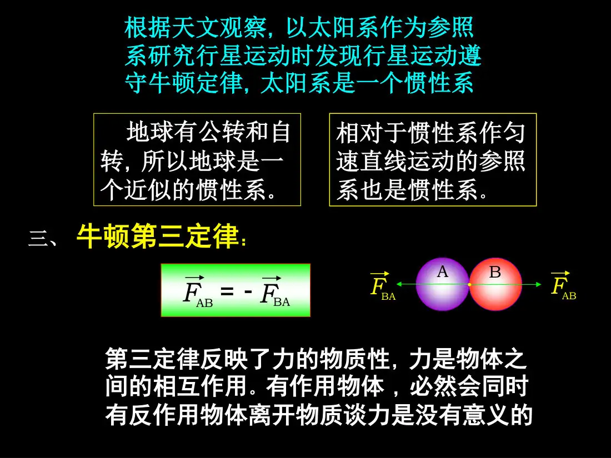

原文：

地球有公转和自转，所以地球是一个近似的惯性系。

相对于惯性系作匀速直线运动的参照系也是惯性系。

三、 牛顿第三定律：

$$
\vec {F} _ {\mathrm{AB}} = - \vec {F} _ {\mathrm{BA}}
$$

第三定律反映了力的物质性，力是物体之间的相互作用。有作用物体 ，必然会同时有反作用物体离开物质谈力是没有意义的

### $$

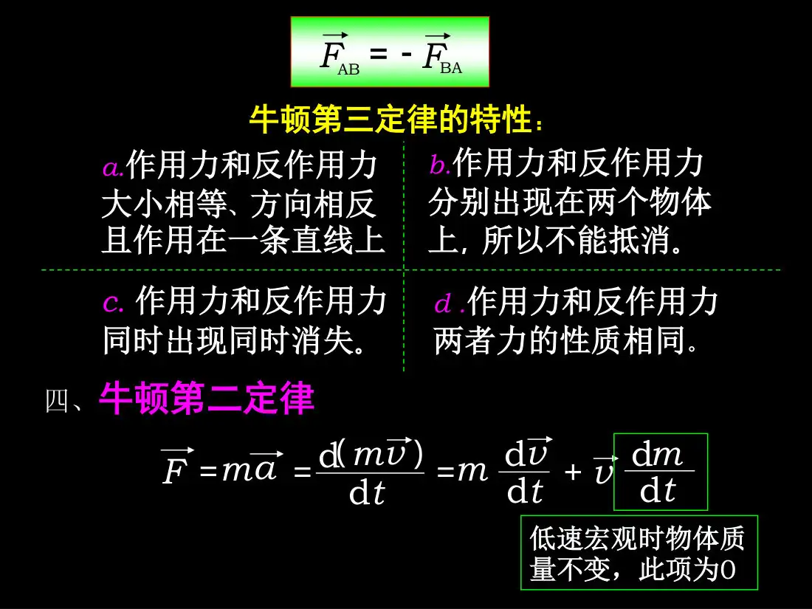

原文：

$$
\vec {F} _ {\mathrm{AB}} = - \vec {F} _ {\mathrm{BA}}
$$

牛顿第三定律的特性：

a.作用力和反作用力大小相等、方向相反且作用在一条直线上

c. 作用力和反作用力同时出现同时消失。b.作用力和反作用力分别出现在两个物体上，所以不能抵消。

d .作用力和反作用力两者力的性质相同。

四、牛顿第二定律

$$
\overrightarrow {F} = m \overrightarrow {a} = \frac {\mathrm{d} (m \overrightarrow {v})}{\mathrm{d} t} = m \frac {\mathrm{d} \overrightarrow {v}}{\mathrm{d} t} + \overrightarrow {v} \frac {\mathrm{d} m}{\mathrm{d} t}
$$

低速宏观时物体质 量不变，此项为0

### $$

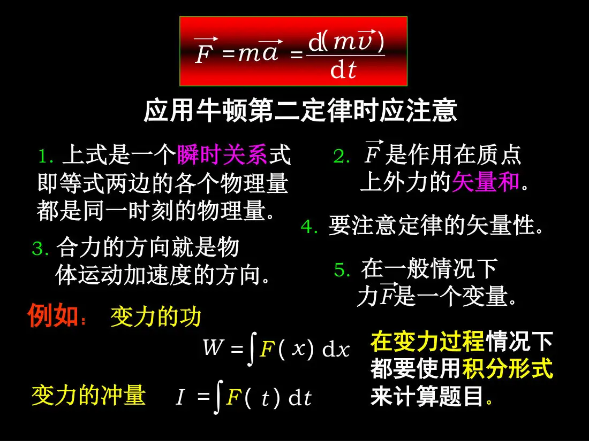

原文：

$$
\overrightarrow {F} = m \overrightarrow {a} = \frac {\mathrm{d} (m \overrightarrow {v})}{\mathrm{d} t}
$$

应用牛顿第二定律时应注意

1. 上式是一个瞬时关系式即等式两边的各个物理量都是同一时刻的物理量。

3. 合力的方向就是物体运动加速度的方向。

例如： 变力的功

$$
W = \int F (x) \mathrm{d} x
$$

变力的冲量

I =F ( t）dt

2. F 是作用在质点上外力的矢量和。

4. 要注意定律的矢量性。

5. 在一般情况下力F是一个变量。

在变力过程情况下都要使用积分形式来计算题目。

### 6. 牛顿第二定律的投影形式：

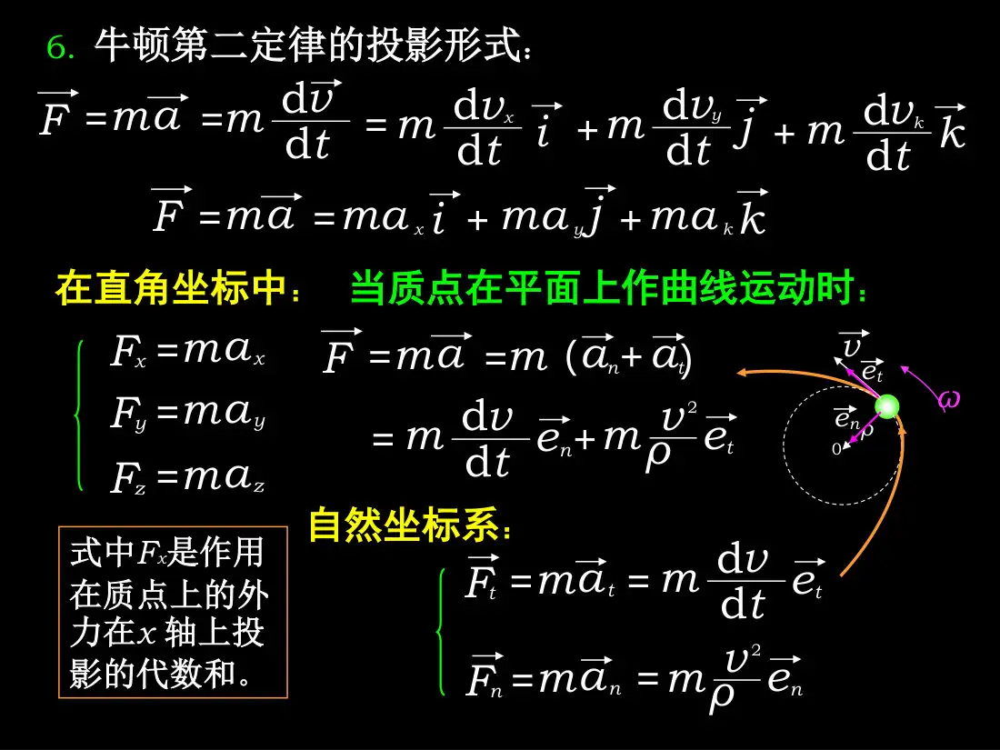

原文：

6. 牛顿第二定律的投影形式：

$$
\begin{array}{r} \overrightarrow {F} = m \overrightarrow {a} = m \frac {\mathrm{d} \overrightarrow {\nu}}{\mathrm{d} t} = m \frac {\mathrm{d} \nu_ {x}}{\mathrm{d} t} \overrightarrow {i} + m \frac {\mathrm{d} \nu_ {y}}{\mathrm{d} t} \overrightarrow {j} + m \frac {\mathrm{d} \nu_ {k}}{\mathrm{d} t} \overrightarrow {k} \\ \overrightarrow {F} = m \overrightarrow {a} = m a _ {x} \overrightarrow {i} + m a _ {y} \overrightarrow {j} + m a _ {k} \overrightarrow {k} \end{array}
$$

在直角坐标中： 当质点在平面上作曲线运动时：

$$
\begin{array}{c} F _ {x} = m a _ {x} \\ F _ {y} = m a _ {y} \\ F _ {z} = m a _ {z} \end{array}
$$

$$
\begin{array}{r l} \overrightarrow {F} = m \overrightarrow {a} = m (\overrightarrow {a _ {n}} + \overrightarrow {a _ {t}}) \\ = m \frac {\mathrm{d} \nu}{\mathrm{d} t} \overrightarrow {e _ {n}} + m \frac {\nu^ {2}}{\rho} \overrightarrow {e _ {t}} \end{array}
$$

自然坐标系：

式中Fx是作用在质点上的外力在x 轴上投影的代数和。

$$
\vec {F} _ {t} = m \vec {a} _ {t} = m \frac {\mathrm{d} \nu}{\mathrm{d} t} \vec {e} _ {t}
$$

$$
\vec {F _ {n}} = m \vec {a} _ {n} = m \frac {\nu^ {2}}{\rho} \vec {e} _ {n}
$$

### 解：确立研究对象，对物体A、 B 画出受力分析图：

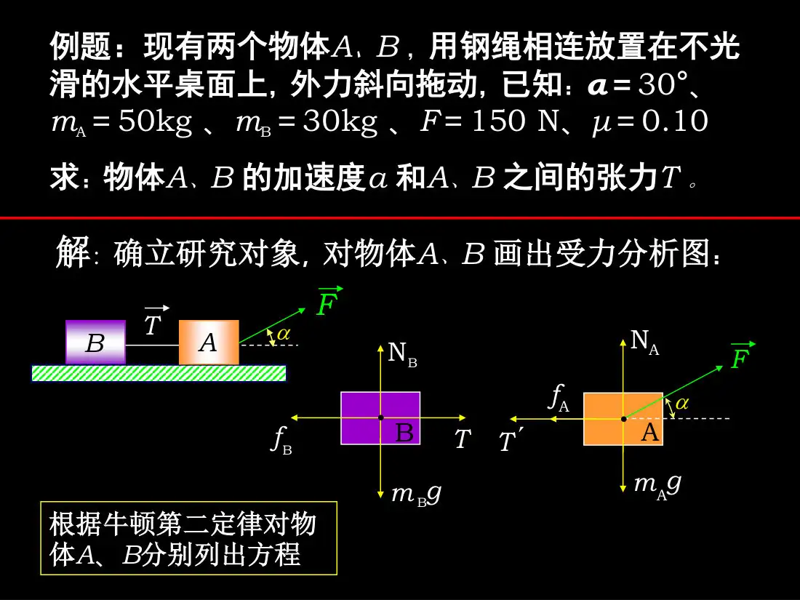

原文：

例题：现有两个物体A、 B ，用钢绳相连放置在不光滑的水平桌面上，外力斜向拖动，已知： $\scriptstyle ( 0 , 0 ) = ( { \mathrm { s } } ( 0 ) ^ { \circ } )$ $1 0 0 - 5 0 0 = 5 0 0 0$ $1 4 0 - 5 0 0 = 5 0 0 ( m ) = 5 0 0$ $\lvert \tilde { n } \rvert = \lvert \lvert \mathbf { \tilde { s } } \rvert \rvert = \lvert \mathbf { \tilde { s } } \rvert \rvert$ $[ \pmb { \imath } ] = \pmb { \imath } ] _ { 0 } [ \pmb { 0 } ]$ 求：物体A B 的加速度a 和A B 之间的张力T

解：确立研究对象，对物体A、 B 画出受力分析图：

根据牛顿第二定律对物体A、B分别列出方程

### 根据牛顿第二定律对物体A、B分别列出方程

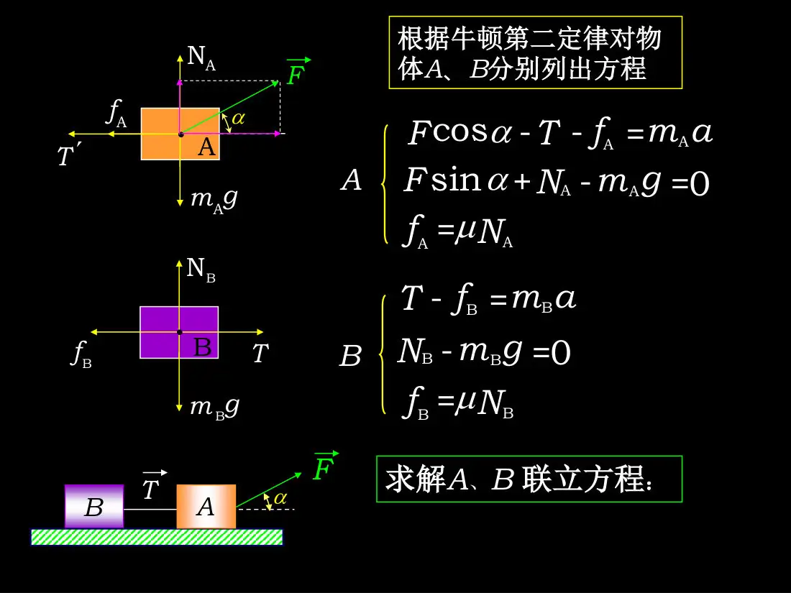

原文：

A

B

B

根据牛顿第二定律对物体A、B分别列出方程

$$
\begin{array}{l} F \cos \alpha - T - f _ {\mathrm{A}} = m _ {\mathrm{A}} \alpha \\ F \sin \alpha + N _ {\mathrm{A}} - m _ {\mathrm{A}} g = 0 \\ f _ {\mathrm{A}} = \mu N _ {\mathrm{A}} \end{array}
$$

$$
\begin{array}{l} {T - f _ {\mathrm{B}} = m _ {\mathrm{B}} a} \\ {N _ {\mathrm{B}} - m _ {\mathrm{B}} g = 0} \\ {f _ {\mathrm{B}} = \mu N _ {\mathrm{B}}} \end{array}
$$

求解A、B 联立方程：

### 求解A、B 联立方程：

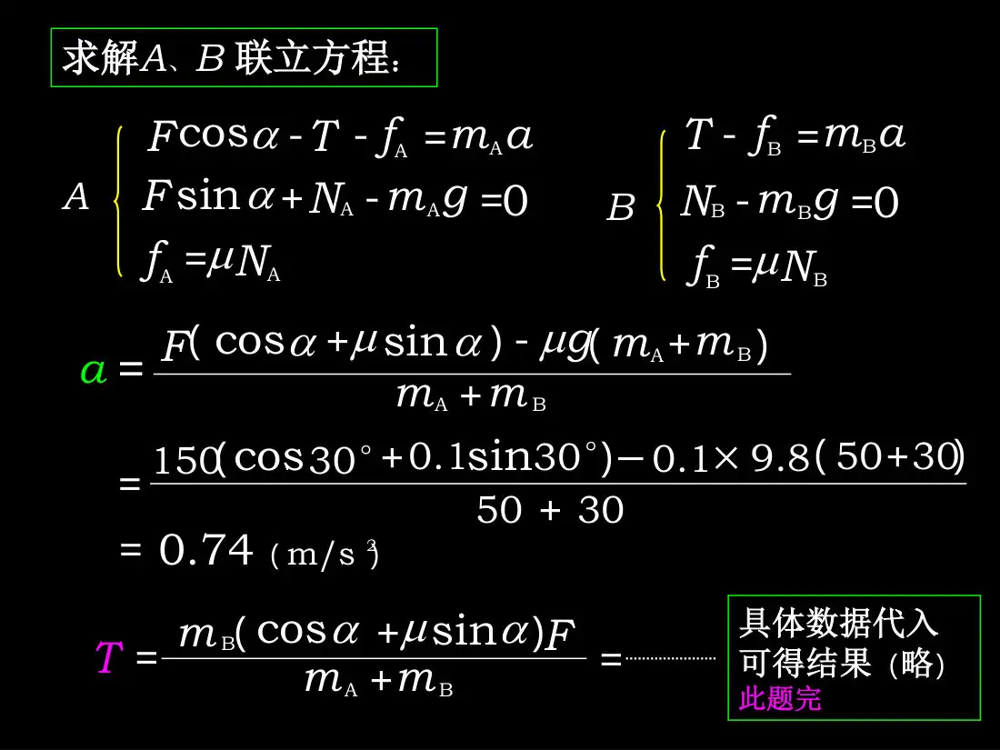

原文：

求解A、B 联立方程：

$$
F \cos \alpha - T - f _ {\mathrm{A}} = m _ {\mathrm{A}} \alpha
$$

$$
\begin{array}{l} {F \sin \alpha + N _ {\mathrm{A}} - m _ {\mathrm{A}} g = 0} \\ {f _ {\mathrm{A}} = \mu N _ {\mathrm{A}}} \end{array}
$$

$$
\begin{array}{r l} & T - f _ {\mathrm{B}} = m _ {\mathrm{B}} a \\ & N _ {\mathrm{B}} - m _ {\mathrm{B}} g = 0 \\ & f _ {\mathrm{B}} = \mu N _ {\mathrm{B}} \end{array}
$$

$$
m _ {\mathrm{A}} + m _ {\mathrm{B}}
$$

50 + 30

= 0.74 ( m/s )2

F+ )m B( cos sin =T Bm mA +

具体数据代入可得结果（略）此题完

### 解：将小球作为研究对象并加以受力分析小球受绳的张力T，进行分解后

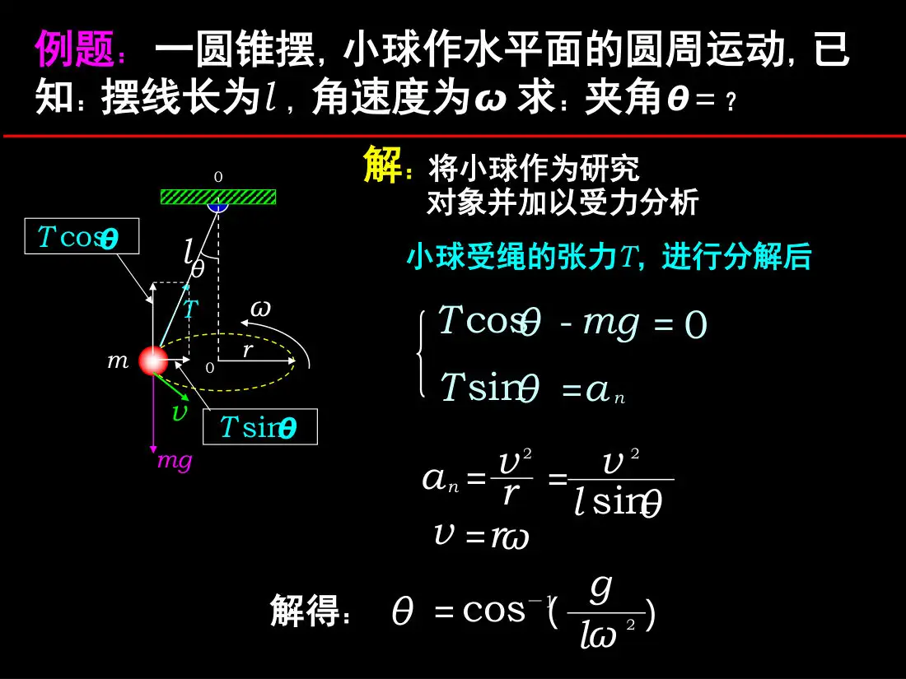

原文：

例题： 一圆锥摆，小球作水平面的圆周运动，已知：摆线长为l ，角速度为ω 求：夹角θ＝？

解：将小球作为研究对象并加以受力分析小球受绳的张力T，进行分解后

T cosθ －mg = 0 Tsinθ =an

$$
\begin{array}{c} a _ {n} = \frac {\nu^ {2}}{r} = \frac {\nu^ {2}}{l \sin \theta} \\ \nu = r \omega \end{array}
$$

解得： $\textcircled { 4 } \textcircled { \div } \textcircled { \div } \textcircled { \div } \textcircled { \div } \textcircled { \div } \textcircled { \div } \textcircled { \div } \textcircled { \div } \textcircled { \div }$

### 第 25 页

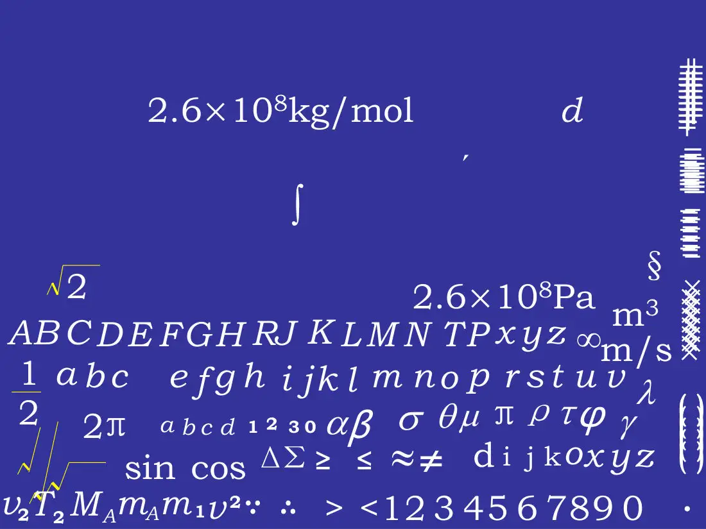

原文：

2 2.6×108Pa m3 AB C DE FGH RJ K LM N TPx zy ×××××m/s 1 a bc gf h m n r s t u ve l pi jk o 2 2π 1 2 3 0a b c d sin cos ∆∑≥′≤≈≠ d i j kox y z v T v2 MAmAm1 ∵ ∴ <12 3 45 6 789 0

### 0601 ΑΒΓΔΕΖΗΘΙΚ

原文：

0601 ΑΒΓΔΕΖΗΘΙΚ

0611 ΛΜΝΞΟΠΡΣΤΥ

0621 ΦΧΨΩ

0631 αβγδεζηθ

0641ικλμνξοπρσ

0651 τυφχψω

0101 、。·ˉˇ¨〃々—

0111 ～‖…‘’“”〔〕〈

0121 〉 《》 「 『』 〖〗【

0131 】±×÷∶∧∨∑∏∪

0141 ∩∈∷√⊥∥∠⌒⊙0151 ∮≡≌≈∽∝≠≮≯≤

0161 ≥∞∵∴ °′″℃

0171 ＄¤￠￡‰§№☆★○

0181 ※

0191 ←↑↓〓→耻虫仇

0201 ⅰⅱⅲⅳⅴⅵⅶⅷⅸⅹ

0701 АБВГДЕЁЖЗИ

0711 ЙКЛМНОПРСТ

0721 УФХЦЧШЩЪЫЬ

× 0731 ЭЮЯ

0211 ⒈⒉⒊⒋

0221 ⒌⒍⒎⒏⒐⒑⒒⒓⒔⒕

0231 ⒖⒗⒘⒙⒚⒛⑴⑵⑶⑷

0241 ⑸⑹⑺⑻⑼⑽⑾⑿⒀⒁

0251 ⒂⒃⒄⒅⒆⒇① ② ③ ④

0261 ⑤ ⑥ ⑦ ⑧ ⑨⑩ ㈠㈡

0271 ㈢㈣㈤㈥㈦㈧㈨㈩

0281 ⅠⅡⅢⅣⅤⅥⅦⅧⅨⅩ

0291 ⅪⅫ Ⅹ

-WW MW
