# 《大学物理》第2章 质点动力学 §2.3 惯性系与非惯性系（课件）

原件的每一页，下面附识别出的文字。

### § 2.3 惯性系与非惯性系

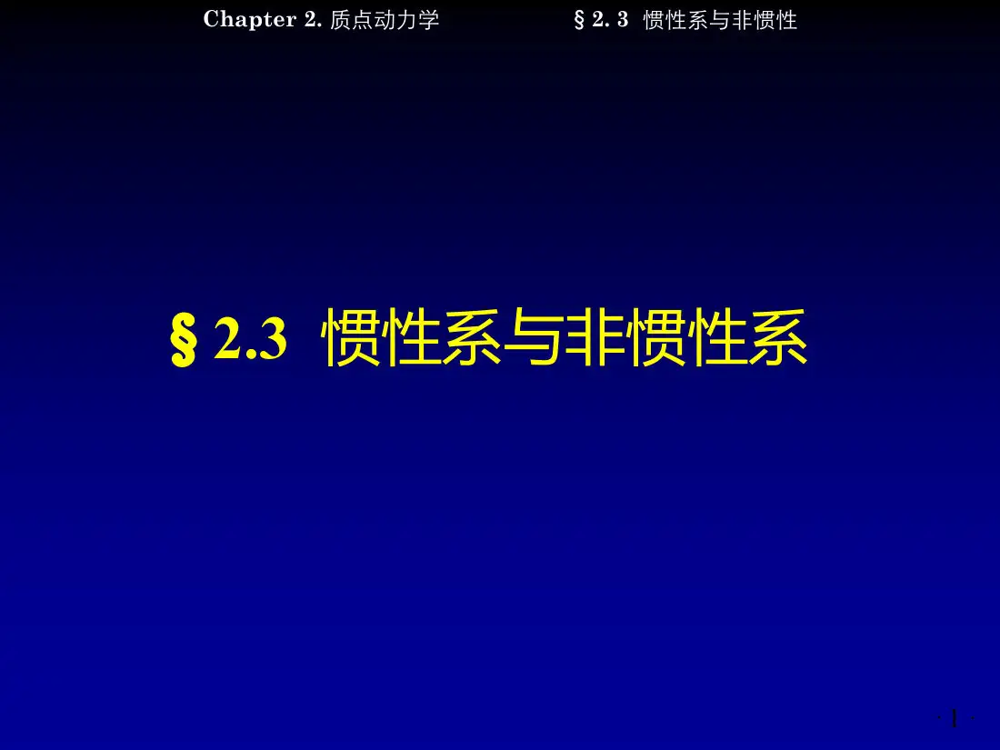

原文：

§ 2.3 惯性系与非惯性系

Chapter 2. 质点动力学

§ 2.3 惯性系与非惯性

### Chapter 2. 质点动力学

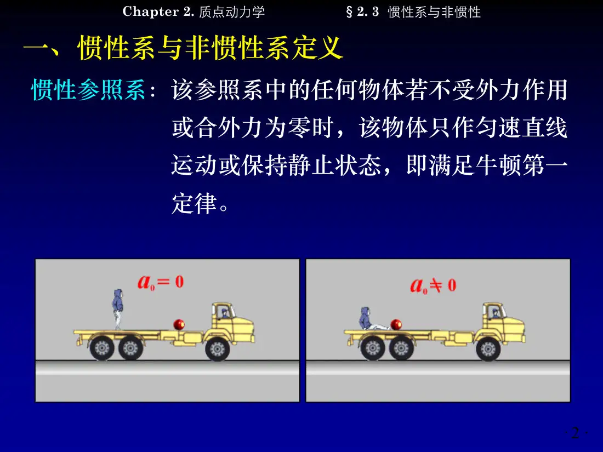

原文：

Chapter 2. 质点动力学

§ 2.3 惯性系与非惯性

一、惯性系与非惯性系定义

惯性参照系：该参照系中的任何物体若不受外力作用或合外力为零时，该物体只作匀速直线运动或保持静止状态，即满足牛顿第一定律。

2

### Chapter 2. 质点动力学

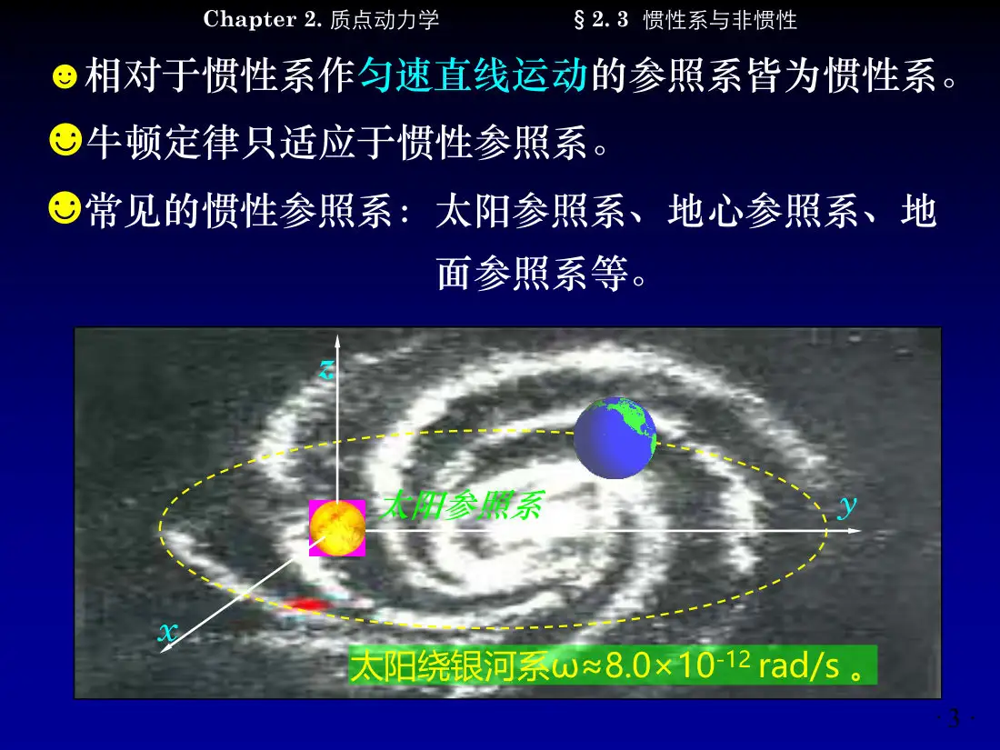

原文：

Chapter 2. 质点动力学

§ 2.3 惯性系与非惯性

相对于惯性系作匀速直线运动的参照系皆为惯性系。

牛顿定律只适应于惯性参照系。

常见的惯性参照系：太阳参照系、地心参照系、地面参照系等。

太阳绕银河系 $\omega \approx 8.0 \times 10^{-12} \mathrm{rad/s}$ 。

3

### Chapter 2. 质点动力学

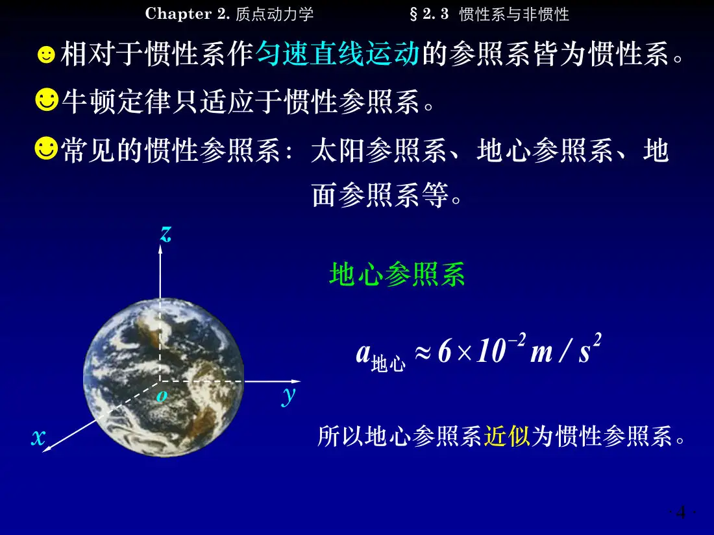

原文：

Chapter 2. 质点动力学

§ 2.3 惯性系与非惯性

相对于惯性系作匀速直线运动的参照系皆为惯性系。

牛顿定律只适应于惯性参照系。

常见的惯性参照系：太阳参照系、地心参照系、地面参照系等。

地心参照系

$$
a _ {\text {地心}} \approx 6 \times 1 0 ^ {- 2} m / s ^ {2}
$$

所以地心参照系近似为惯性参照系。

### Chapter 2. 质点动力学

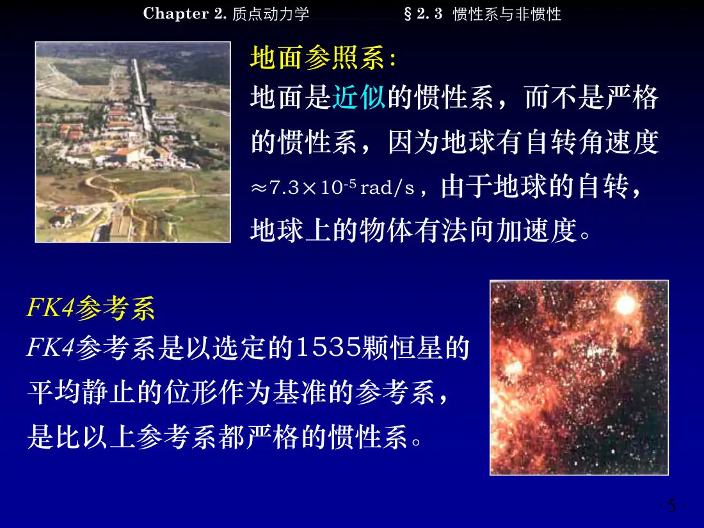

原文：

Chapter 2. 质点动力学

§ 2.3 惯性系与非惯性

地面参照系：
地面是近似的惯性系，而不是严格的惯性系，因为地球有自转角速度 $\approx 7.3 \times 10^{-5} \text{ rad/s}$ ，由于地球的自转，地球上的物体有法向加速度。

FK4参考系
FK4参考系是以选定的1535颗恒星的平均静止的位形作为基准的参考系，是比以上参考系都严格的惯性系。

5

### Chapter 2. 质点动力学

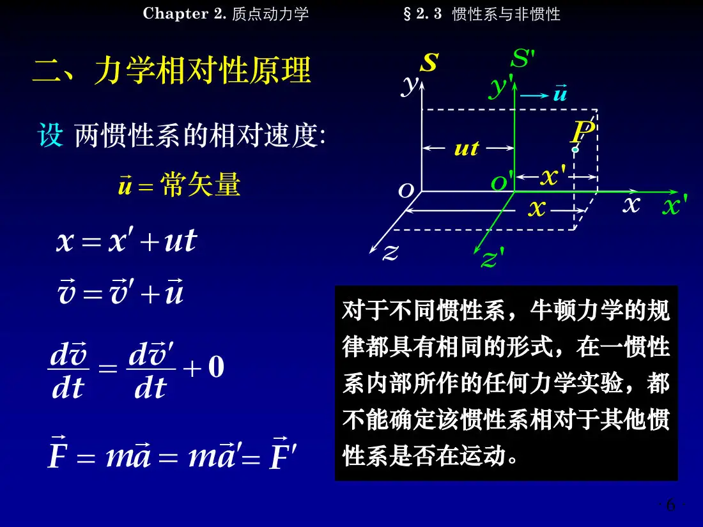

原文：

Chapter 2. 质点动力学

二、力学相对性原理

设 两惯性系的相对速度:

$\vec{u}=$ 常矢量

$x = x' + ut$

$\vec{v} = \vec{v}' + \vec{u}$

$\frac{d\vec{v}}{dt} = \frac{d\vec{v}'}{dt} + 0$

$$
\vec {F} = m \vec {a} = m \vec {a} ^ {\prime} = \vec {F} ^ {\prime}
$$

§ 2.3 惯性系与非惯性

对于不同惯性系，牛顿力学的规律都具有相同的形式，在一惯性系内部所作的任何力学实验，都不能确定该惯性系相对于其他惯性系是否在运动。

6

### Chapter 2. 质点动力学

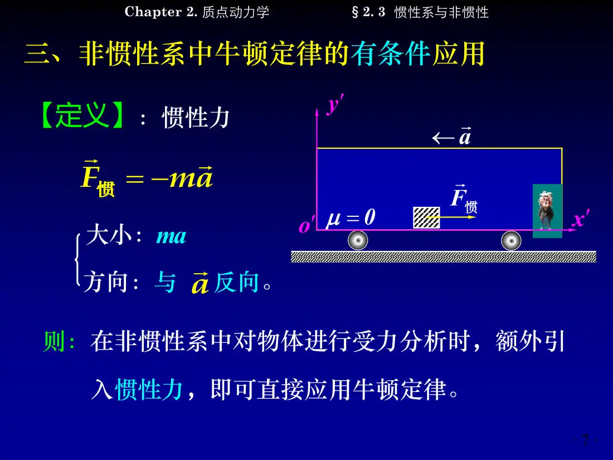

原文：

Chapter 2. 质点动力学

§ 2.3 惯性系与非惯性

三、非惯性系中牛顿定律的有条件应用

【定义】：惯性力

$\vec{F}_{惯} = -m\vec{a}$

大小：ma

方向：与 $\vec{a}$ 反向。

则：在非惯性系中对物体进行受力分析时，额外引

入惯性力，即可直接应用牛顿定律。

7

### Chapter 2. 质点动力学

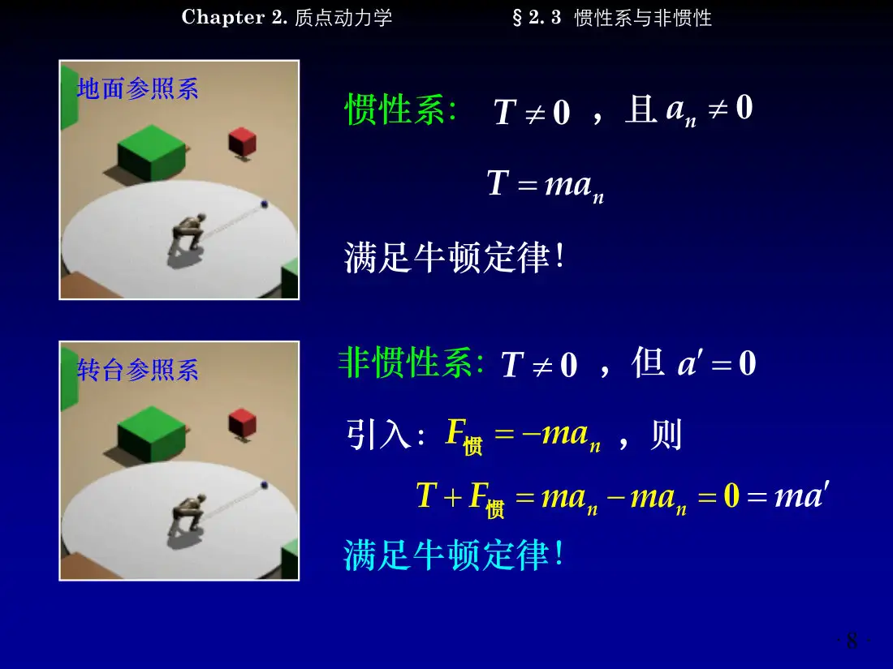

原文：

Chapter 2. 质点动力学

§ 2.3 惯性系与非惯性

地面参照系

转台参照系

惯性系: $T \neq 0$ , 且 $a_{n} \neq 0$

$T = m a_{n}$

满足牛顿定律!

非惯性系: $T \neq 0$ , 但 $a' = 0$

引入： $F_{惯} = -ma_{n}$ ，则

$$
T + F _ {\text {惯}} = m a _ {n} - m a _ {n} = 0 = m a ^ {\prime}
$$

满足牛顿定律!

8

### 1. 惯性力不是客观存在的力，是虚拟力，所以惯性力无反作用力。

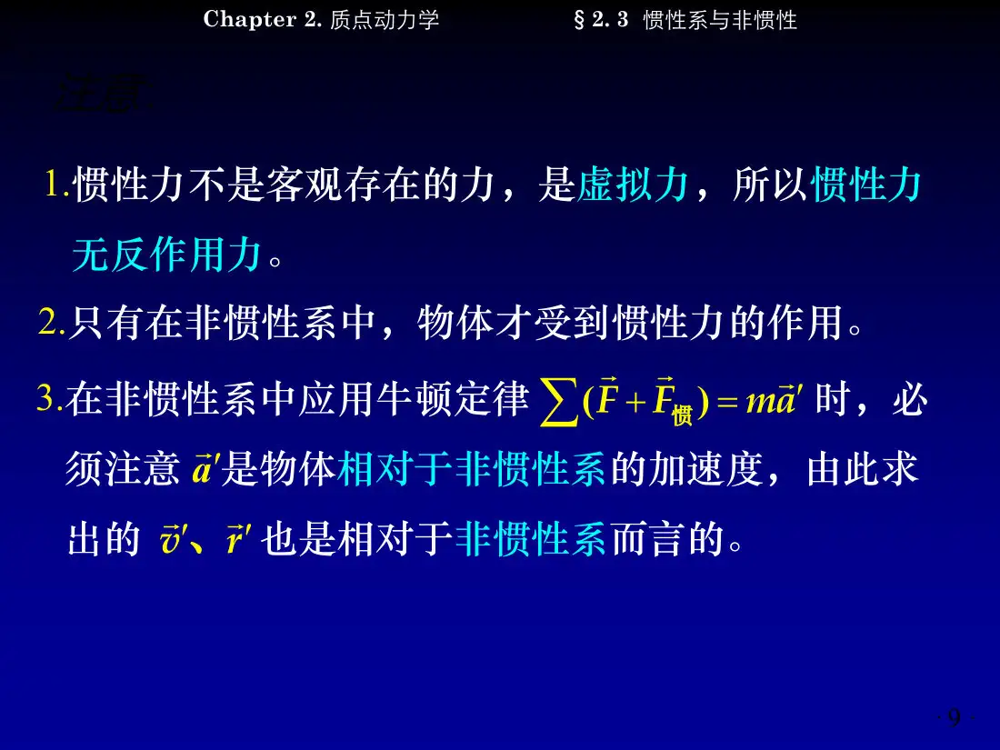

原文：

1. 惯性力不是客观存在的力，是虚拟力，所以惯性力无反作用力。

2. 只有在非惯性系中，物体才受到惯性力的作用。

3. 在非惯性系中应用牛顿定律 $\sum(\vec{F}+\vec{F}_{惯})=m\vec{a}'$ 时，必须注意 $\vec{a}'$ 是物体相对于非惯性系的加速度，由此求出的 $\vec{v}'$ 、 $\vec{r}'$ 也是相对于非惯性系而言的。

Chapter 2. 质点动力学

§ 2.3 惯性系与非惯性

9

### 自然现象中的惯性力

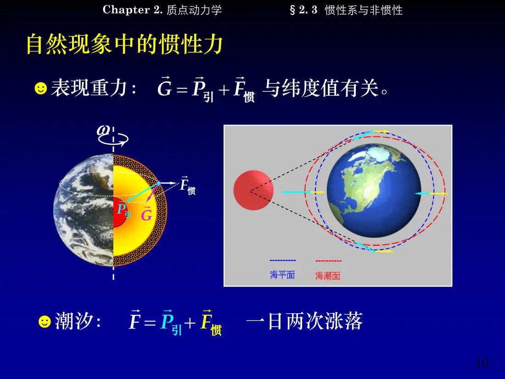

原文：

自然现象中的惯性力

表现重力： $\vec{G} = \vec{P}_{\text {引}} + \vec{F}_{\text {惯}}$ 与纬度值有关。

😊 潮汐: $\vec{F} = \vec{P}_{\text {引}} + \vec{F}_{\text {惯}}$ 一日两次涨落

Chapter 2. 质点动力学

§ 2.3 惯性系与非惯性

10

### Chapter 2. 质点动力学

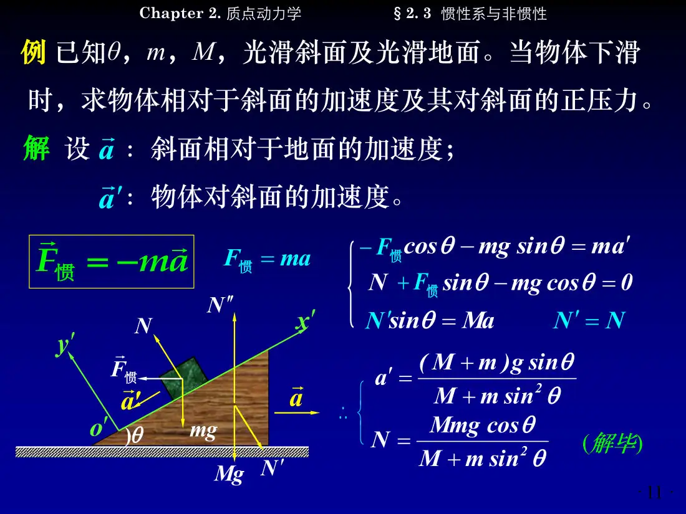

原文：

Chapter 2. 质点动力学

§ 2.3 惯性系与非惯性

例 已知 $\theta, m, M$ ，光滑斜面及光滑地面。当物体下滑时，求物体相对于斜面的加速度及其对斜面的正压力。

解 设 $\vec{a}$ ：斜面相对于地面的加速度；

$\vec{a}^{\prime}$ ：物体对斜面的加速度。

$\vec{F}_{惯} = -m\vec{a}$

$$
F _ {\text {惯}} = m a
$$

$$
- F _ {\text {惯}} \cos \theta - m g \sin \theta = m a ^ {\prime}
$$

$$
N + F _ {\text {惯}} \sin \theta - m g \cos \theta = 0
$$

$$
N ^ {\prime} \sin \theta = M a \quad N ^ {\prime} = N
$$

$$
a ^ {\prime} = \frac {(M + m) g \sin \theta}{M + m \sin^ {2} \theta}
$$

$$
N = \frac {M m g \cos \theta}{M + m \sin^ {2} \theta}
$$

(解毕)

11

### 1. 牛顿定律只适用于惯性参照系；

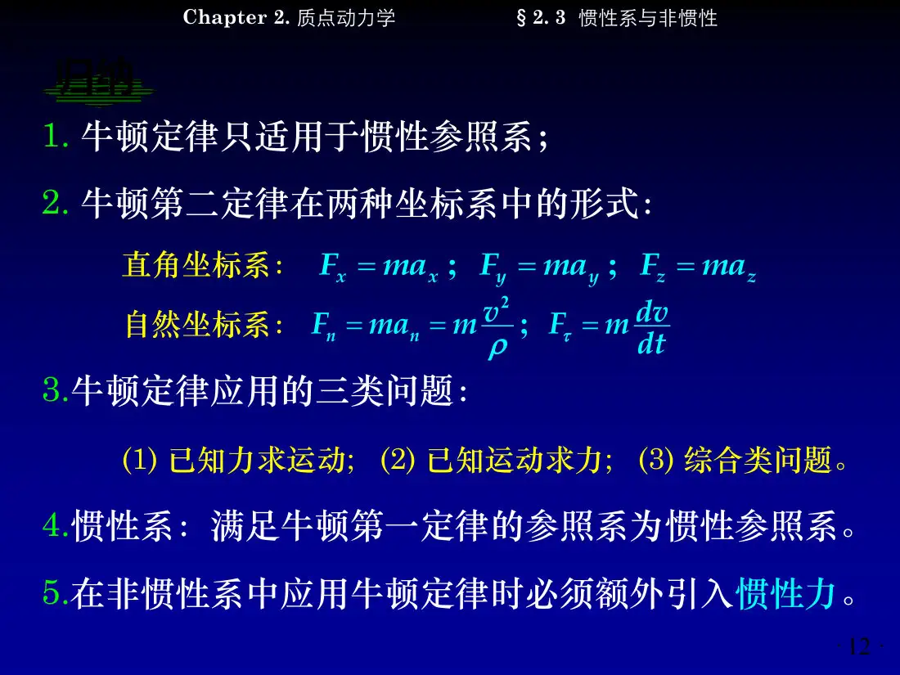

原文：

1. 牛顿定律只适用于惯性参照系；

2. 牛顿第二定律在两种坐标系中的形式:

直角坐标系： $F_{x}=ma_{x}$ ; $F_{y}=ma_{y}$ ; $F_{z}=ma_{z}$

自然坐标系： $F_{n}=ma_{n}=m\frac{v^{2}}{\rho}$ ; $F_{\tau}=m\frac{dv}{dt}$

3. 牛顿定律应用的三类问题：

(1) 已知力求运动；(2) 已知运动求力；(3) 综合类问题。

4. 惯性系：满足牛顿第一定律的参照系为惯性参照系。

5. 在非惯性系中应用牛顿定律时必须额外引入惯性力。

Chapter 2. 质点动力学

§ 2.3 惯性系与非惯性

12
