# 《大学物理》第3章 §3.1 质点和质点系的动量定理（课件）

原件的每一页，下面附识别出的文字。

### § 3.1 质点和质点系的动量定理

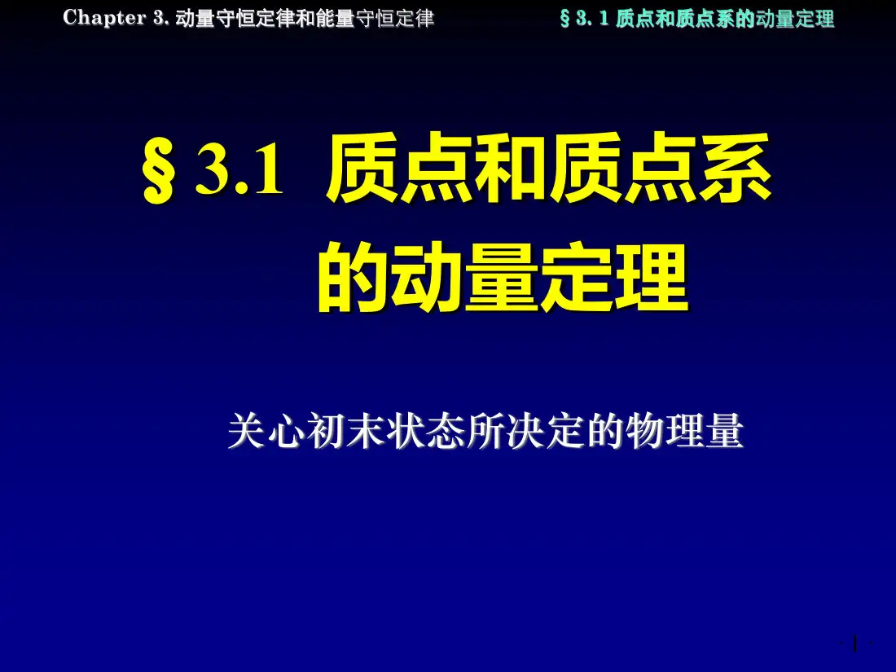

原文：

§ 3.1 质点和质点系的动量定理

关心初末状态所决定的物理量

Chapter 3. 动量守恒定律和能量守恒定律

§ 3.1 质点和质点系的动量定理

### Chapter 3. 动量守恒定律和能量守恒定律

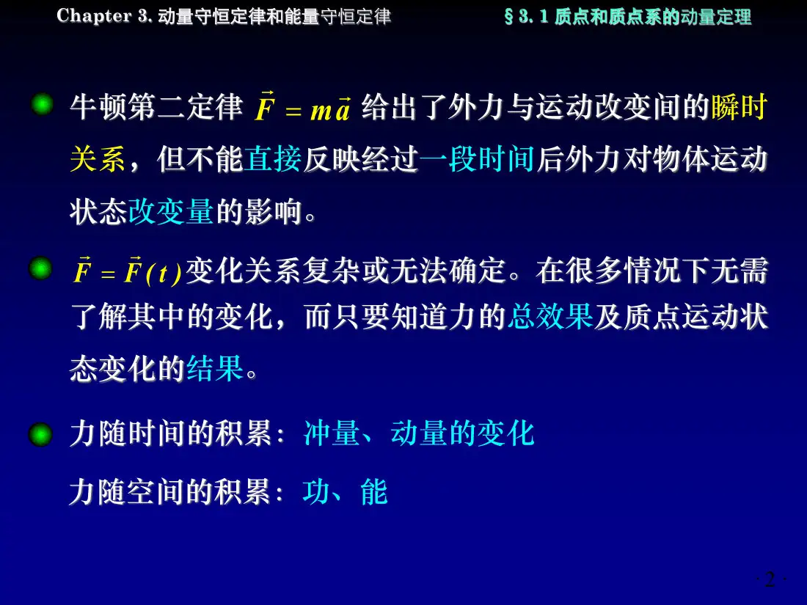

原文：

Chapter 3. 动量守恒定律和能量守恒定律

§ 3.1 质点和质点系的动量定理

牛顿第二定律 $\vec{F} = m\vec{a}$ 给出了外力与运动改变间的瞬时关系，但不能直接反映经过一段时间后外力对物体运动状态改变量的影响。

$\vec{F} = \vec{F}(t)$ 变化关系复杂或无法确定。在很多情况下无需了解其中的变化，而只要知道力的总效果及质点运动状态变化的结果。

力随时间的积累：冲量、动量的变化

力随空间的积累：功、能

2

### 一、动量 冲量 质点的动量定理

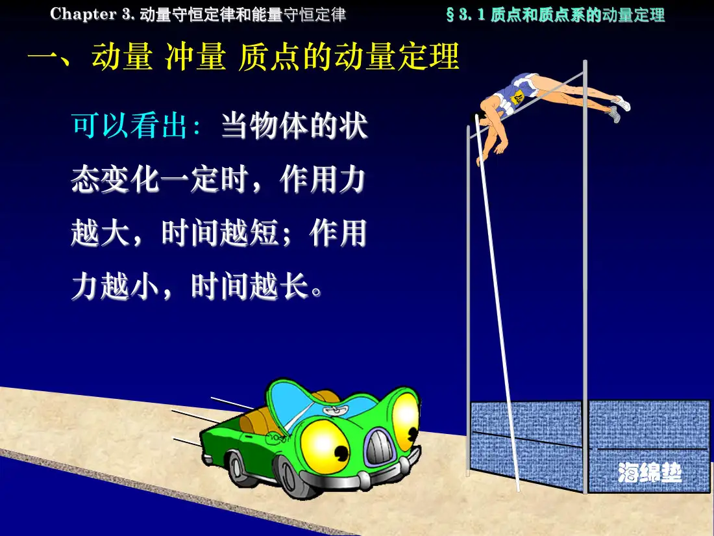

原文：

一、动量 冲量 质点的动量定理

可以看出：当物体的状态变化一定时，作用力越大，时间越短；作用力越小，时间越长。

Chapter 3. 动量守恒定律和能量守恒定律

§ 3.1 质点和质点系的动量定理

### 一、冲量 动量 质点的动量定理

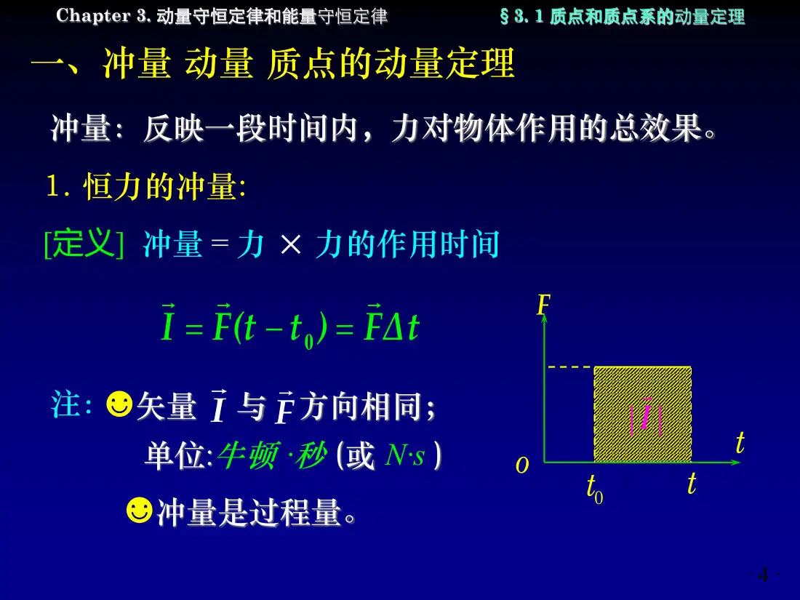

原文：

一、冲量 动量 质点的动量定理

冲量：反映一段时间内，力对物体作用的总效果。

1. 恒力的冲量:

[定义] 冲量 = 力 × 力的作用时间

$\vec{I} = \vec{F}(t - t_0) = \vec{F}\Delta t$

注：😊矢量 $\vec{I}$ 与 $\vec{F}$ 方向相同；

单位: 牛顿·秒 (或 N·s)

😊冲量是过程量。

4

Chapter 3. 动量守恒定律和能量守恒定律

§ 3.1 质点和质点系的动量定理

### Chapter 3. 动量守恒定律和能量守恒定律

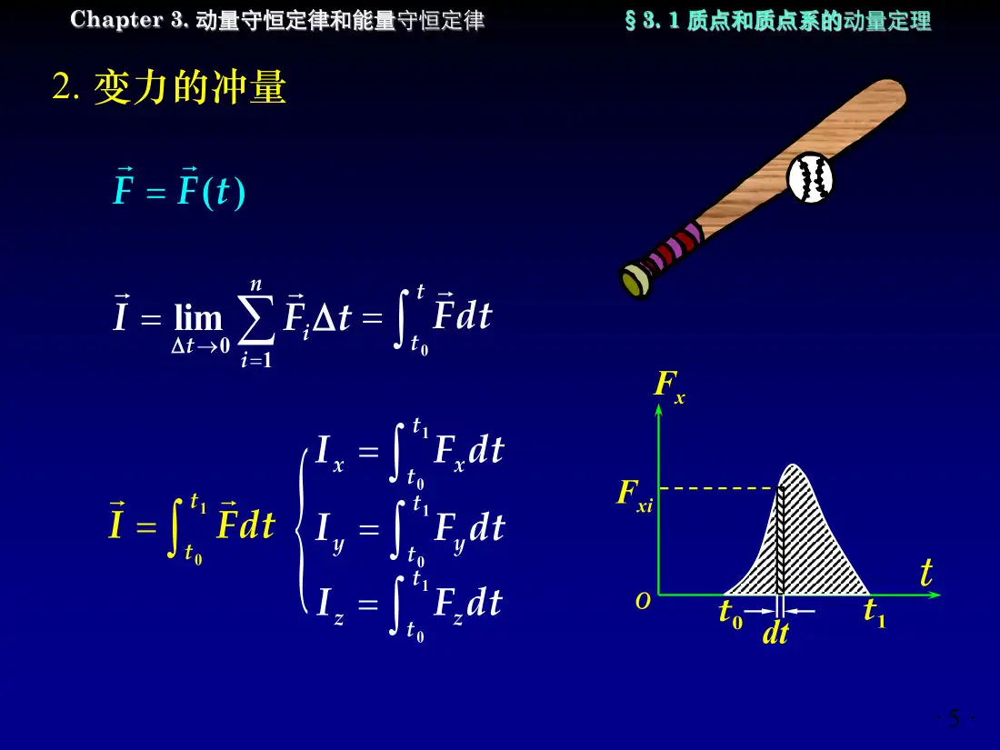

原文：

Chapter 3. 动量守恒定律和能量守恒定律

2. 变力的冲量

$$
\vec {F} = \vec {F} (t)
$$

$$
\vec {I} = \lim _ {\Delta t \to 0} \sum_ {i = 1} ^ {n} \vec {F} _ {i} \Delta t = \int_ {t _ {0}} ^ {t} \vec {F} d t
$$

$$
\vec {I} = \int_ {t _ {0}} ^ {t _ {1}} \vec {F} d t \left\{ \begin{array}{l l} I _ {x} = \int_ {t _ {0}} ^ {t _ {1}} F _ {x} d t \\ I _ {y} = \int_ {t _ {0}} ^ {t _ {1}} F _ {y} d t \\ I _ {z} = \int_ {t _ {0}} ^ {t _ {1}} F _ {z} d t \end{array} \right.
$$

§ 3.1 质点和质点系的动量定理

5

### 3. 动量

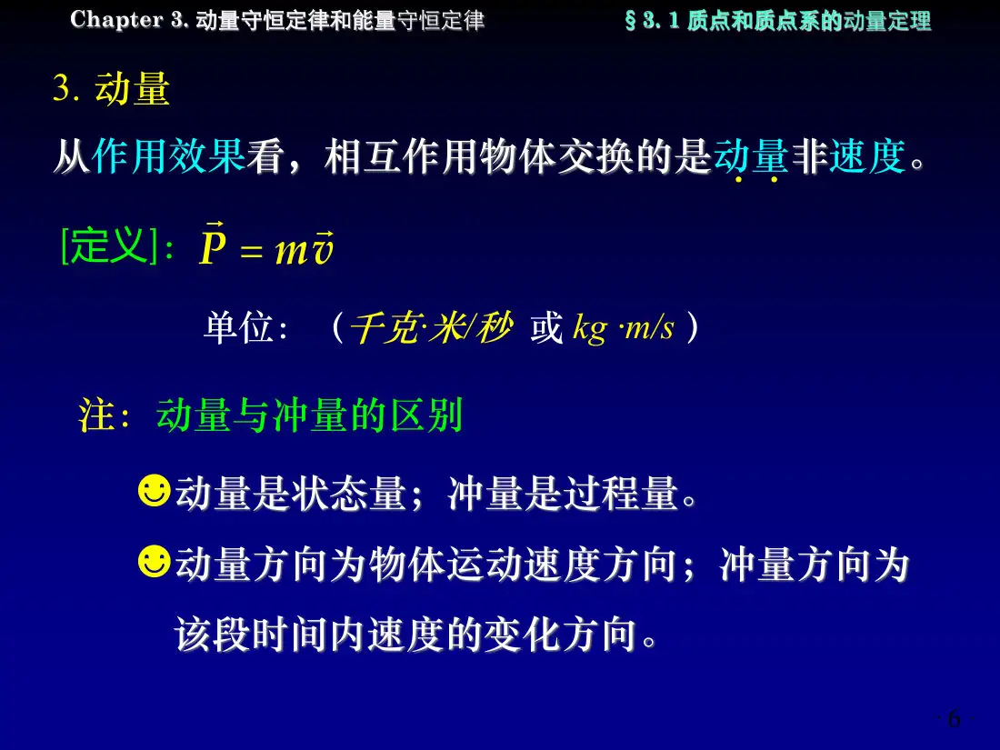

原文：

3. 动量

从作用效果看，相互作用物体交换的是动量非速度。

[定义]: $\vec{P} = m\vec{v}$

单位：（千克·米/秒 或 kg·m/s）

注：动量与冲量的区别

动量是状态量；冲量是过程量。

动量方向为物体运动速度方向；冲量方向为该段时间内速度的变化方向。

Chapter 3. 动量守恒定律和能量守恒定律

§ 3.1 质点和质点系的动量定理

6

### Chapter 3. 动量守恒定律和能量守恒定律

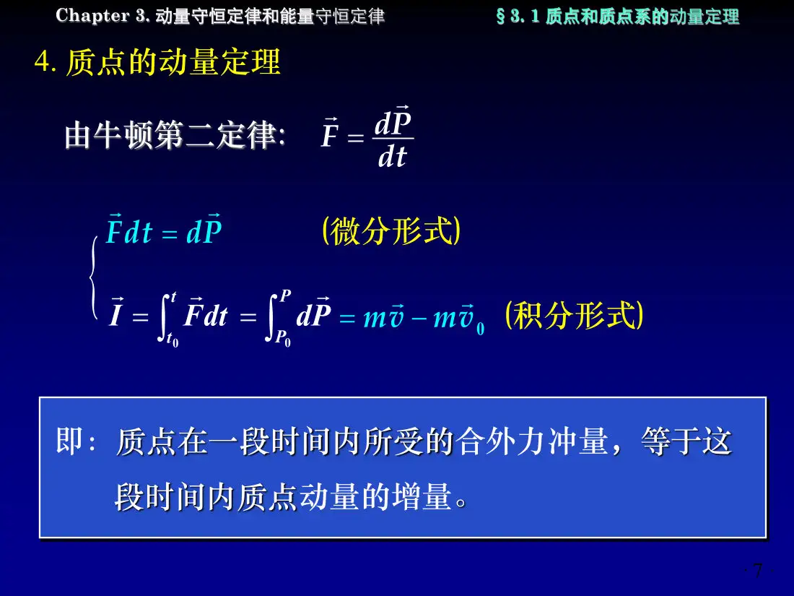

原文：

Chapter 3. 动量守恒定律和能量守恒定律

§ 3.1 质点和质点系的动量定理

4. 质点的动量定理

由牛顿第二定律: $\vec{F} = \frac{d\vec{P}}{dt}$

$$
\vec {F} d t = d \vec {P}
$$

(微分形式)

$\vec{I} = \int_{t_0}^{t}\vec{F}dt = \int_{P_0}^{P}d\vec{P} = m\vec{v} -m\vec{v}_0$ （积分形式）

即：质点在一段时间内所受的合外力冲量，等于这段时间内质点动量的增量。

7

### Chapter 3. 动量守恒定律和能量守恒定律

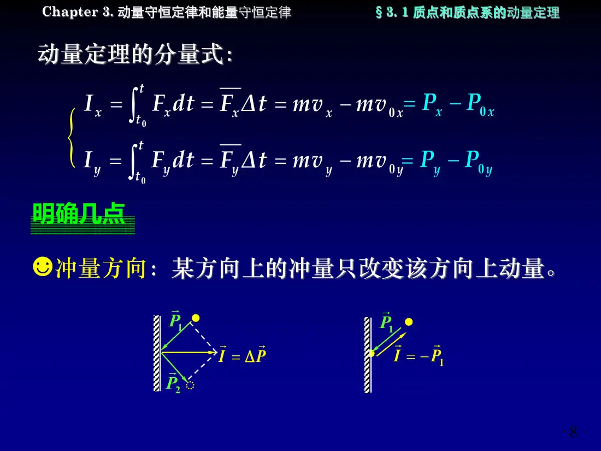

原文：

Chapter 3. 动量守恒定律和能量守恒定律

§ 3.1 质点和质点系的动量定理

动量定理的分量式:

$$
I _ {x} = \int_ {t _ {0}} ^ {t} F _ {x} d t = \overline {{F _ {x}}} \Delta t = m v _ {x} - m v _ {0 x} = P _ {x} - P _ {0 x}
$$

$$
I _ {y} = \int_ {t _ {0}} ^ {t} F _ {y} d t = \overline {{F _ {y}}} \Delta t = m v _ {y} - m v _ {0 y} = P _ {y} - P _ {0 y}
$$

明确几点

😊冲量方向：某方向上的冲量只改变该方向上动量。

$$
\vec {P} _ {1} \quad \vec {I} = \Delta \vec {P}
$$

$$
\vec {P} _ {1} \quad \vec {I} = - \vec {P} _ {1}
$$

8

### Chapter 3. 动量守恒定律和能量守恒定律

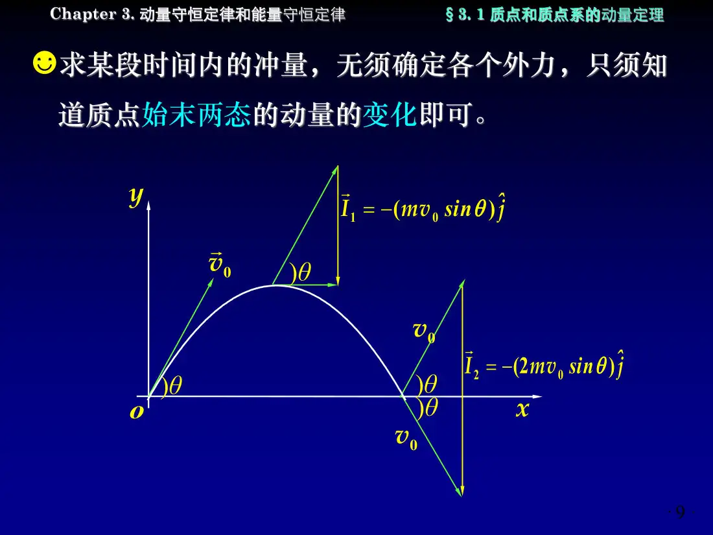

原文：

Chapter 3. 动量守恒定律和能量守恒定律

§ 3.1 质点和质点系的动量定理

求某段时间内的冲量，无须确定各个外力，只须知道质点始末两态的动量的变化即可。

9

### Chapter 3. 动量守恒定律和能量守恒定律

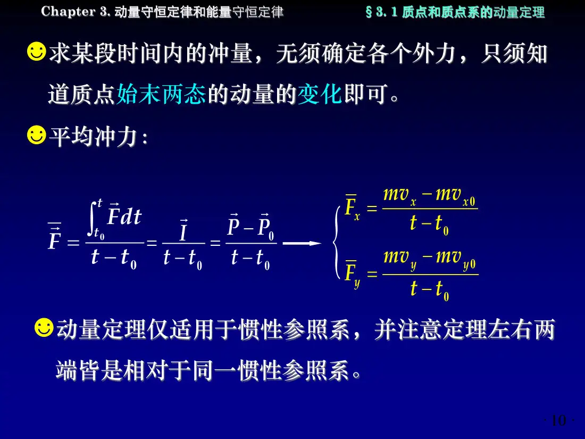

原文：

Chapter 3. 动量守恒定律和能量守恒定律

§ 3.1 质点和质点系的动量定理

求某段时间内的冲量，无须确定各个外力，只须知道质点始末两态的动量的变化即可。

平均冲力：

$$
\overline {{\vec {F}}} = \frac {\int_ {t _ {0}} ^ {t} \vec {F} d t}{t - t _ {0}} = \frac {\vec {I}}{t - t _ {0}} = \frac {\vec {P} - \vec {P} _ {0}}{t - t _ {0}} \longrightarrow \left\{ \begin{array}{l l} \overline {{F}} _ {x} = \frac {m v _ {x} - m v _ {x 0}}{t - t _ {0}} \\ \overline {{F}} _ {y} = \frac {m v _ {y} - m v _ {y 0}}{t - t _ {0}} \end{array} \right.
$$

动量定理仅适用于惯性参照系，并注意定理左右两端皆是相对于同一惯性参照系。

10

### Chapter 3. 动量守恒定律和能量守恒定律

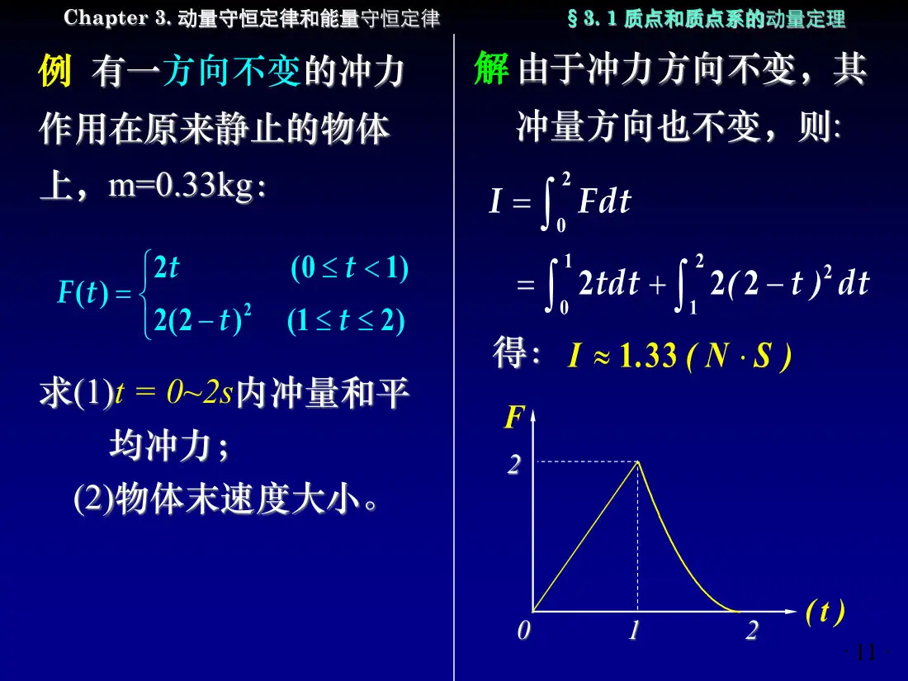

原文：

Chapter 3. 动量守恒定律和能量守恒定律

例 有一方向不变的冲力作用在原来静止的物体上，m=0.33kg:

$$
F (t) = \left\{ \begin{array}{l l} 2 t & (0 \leq t <   1) \\ 2 (2 - t) ^ {2} & (1 \leq t \leq 2) \end{array} \right.
$$

求(1)t = 0\~2s内冲量和平均冲力；

(2)物体末速度大小。

§ 3.1 质点和质点系的动量定理

解 由于冲力方向不变，其冲量方向也不变，则:

$$
\begin{array}{r l} I & = \int_ {0} ^ {2} F d t \\ & = \int_ {0} ^ {1} 2 t d t + \int_ {1} ^ {2} 2 (2 - t) ^ {2} d t \end{array}
$$

得: $I \approx 1.33 (N \cdot S)$

11

### Chapter 3. 动量守恒定律和能量守恒定律

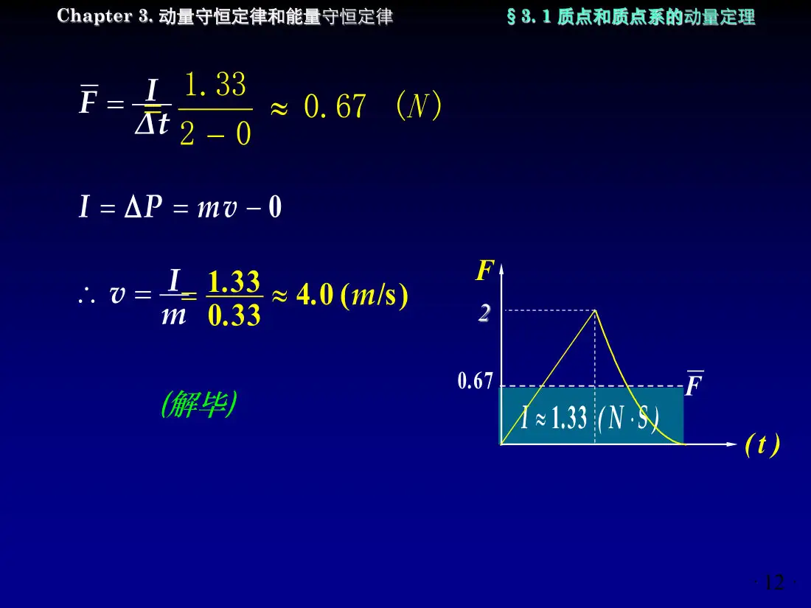

原文：

Chapter 3. 动量守恒定律和能量守恒定律

$$
\overline {{F}} = \frac {I}{\Delta t} \frac {1 . 3 3}{2 - 0} \approx 0. 6 7 (N)
$$

$$
I = \Delta P = m v - 0
$$

$$
\therefore v = \frac {I}{m} = \frac {1 . 3 3}{0 . 3 3} \approx 4. 0 (m / s)
$$

(解毕)

§ 3.1 质点和质点系的动量定理

12

### Chapter 3. 动量守恒定律和能量守恒定律

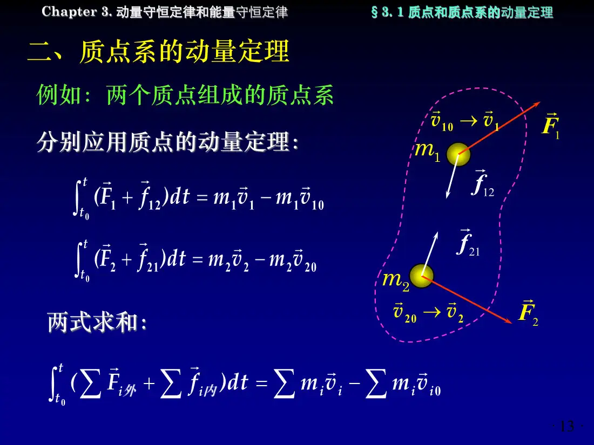

原文：

Chapter 3. 动量守恒定律和能量守恒定律

二、质点系的动量定理

例如：两个质点组成的质点系

分别应用质点的动量定理：

$$
\int_ {t _ {0}} ^ {t} (\vec {F} _ {1} + \vec {f} _ {1 2}) d t = m _ {1} \vec {v} _ {1} - m _ {1} \vec {v} _ {1 0}
$$

$$
\int_ {t _ {0}} ^ {t} (\vec {F} _ {2} + \vec {f} _ {2 1}) d t = m _ {2} \vec {v} _ {2} - m _ {2} \vec {v} _ {2 0}
$$

两式求和:

$$
\int_ {t _ {0}} ^ {t} \left(\sum \vec {F} _ {i \text {外}} + \sum \vec {f} _ {i \text {内}}\right) d t = \sum m _ {i} \vec {v} _ {i} - \sum m _ {i} \vec {v} _ {i 0}
$$

§ 3.1 质点和质点系的动量定理

13

### Chapter 3. 动量守恒定律和能量守恒定律

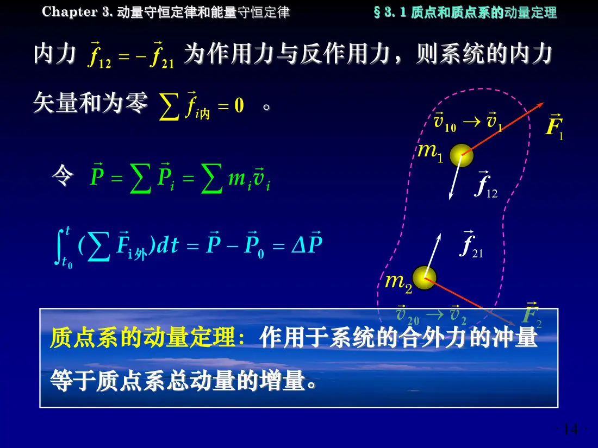

原文：

Chapter 3. 动量守恒定律和能量守恒定律

§ 3.1 质点和质点系的动量定理

内力 $\vec{f}_{12} = -\vec{f}_{21}$ 为作用力与反作用力，则系统的内力

$$
\sum \vec {f} _ {i \text {内}} = 0
$$

令 $\vec{P}=\sum\vec{P}_{i}=\sum m_{i}\vec{v}_{i}$

$$
\int_ {t _ {0}} ^ {t} (\sum \vec {F} _ {\mathrm{i外}}) d t = \vec {P} - \vec {P} _ {0} = \Delta \vec {P}
$$

质点系的动量定理：作用于系统的合外力的冲量等于质点系总动量的增量。

14

### 系统内力不改变系统的总动量，但改变系统内动量的分布。只有外力可改变系统的动量。

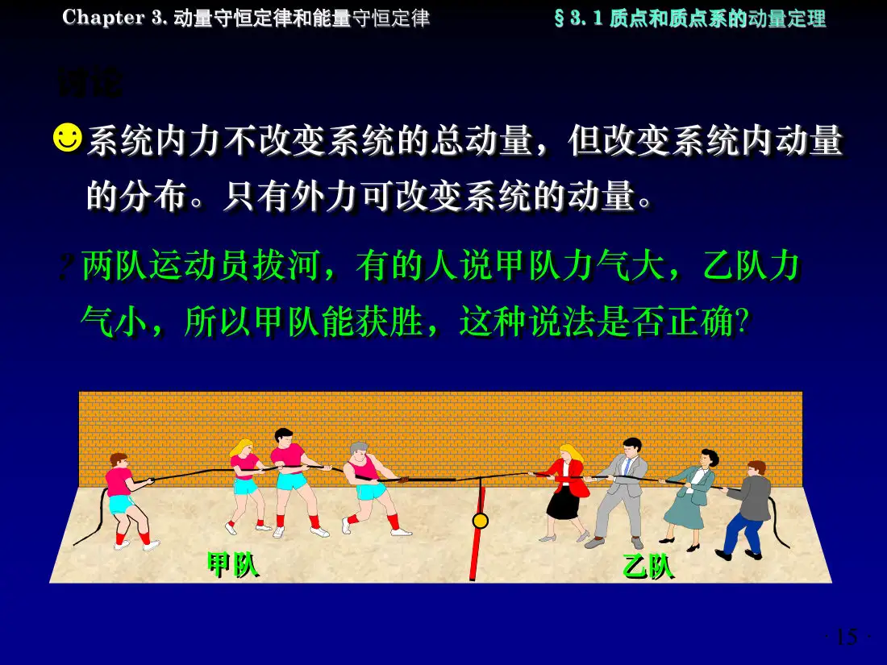

原文：

系统内力不改变系统的总动量，但改变系统内动量的分布。只有外力可改变系统的动量。

?两队运动员拔河，有的人说甲队力气大，乙队力气小，所以甲队能获胜，这种说法是否正确？

Chapter 3. 动量守恒定律和能量守恒定律

§ 3.1 质点和质点系的动量定理

15

### Chapter 3. 动量守恒定律和能量守恒定律

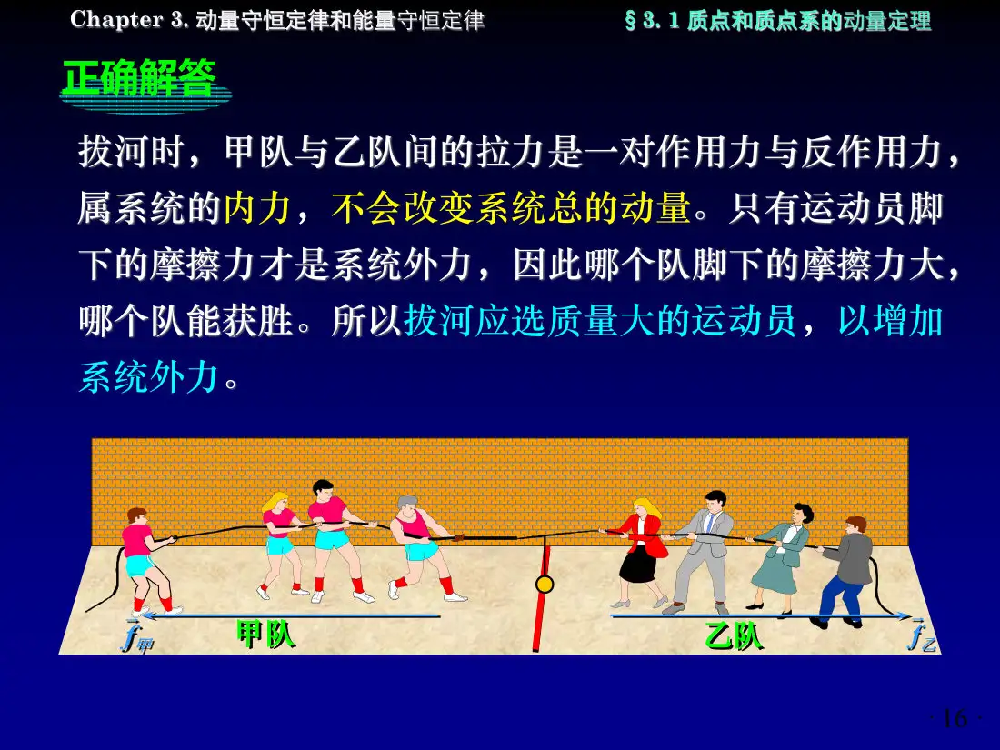

原文：

拔河时，甲队与乙队间的拉力是一对作用力与反作用力，属系统的内力，不会改变系统总的动量。只有运动员脚下的摩擦力才是系统外力，因此哪个队脚下的摩擦力大，哪个队能获胜。所以拔河应选质量大的运动员，以增加系统外力。

Chapter 3. 动量守恒定律和能量守恒定律

§ 3.1 质点和质点系的动量定理

16

### Chapter 3. 动量守恒定律和能量守恒定律

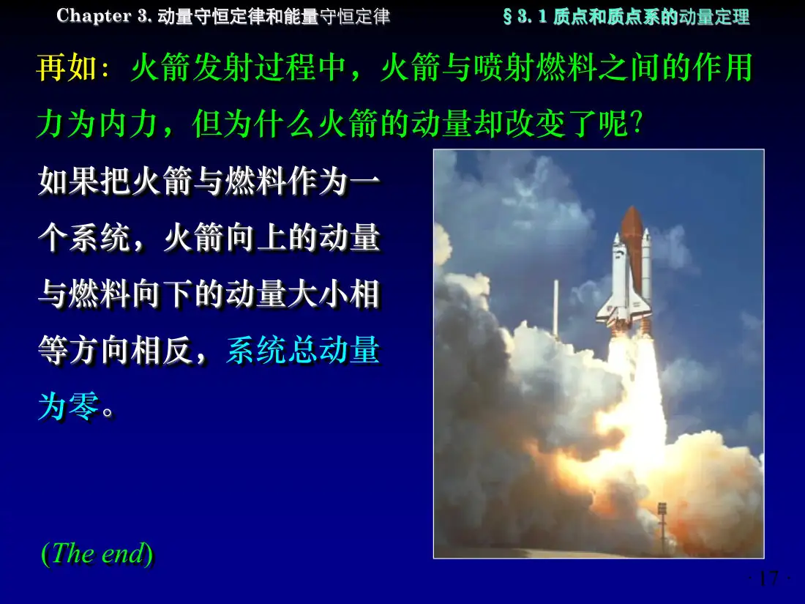

原文：

Chapter 3. 动量守恒定律和能量守恒定律

再如：火箭发射过程中，火箭与喷射燃料之间的作用力为内力，但为什么火箭的动量却改变了呢？

如果把火箭与燃料作为一个系统，火箭向上的动量与燃料向下的动量大小相等方向相反，系统总动量为零。

§ 3.1 质点和质点系的动量定理

(The end)

17
