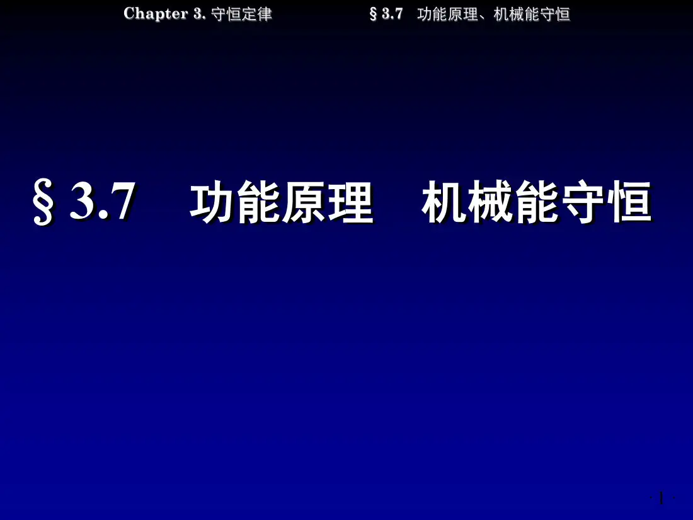
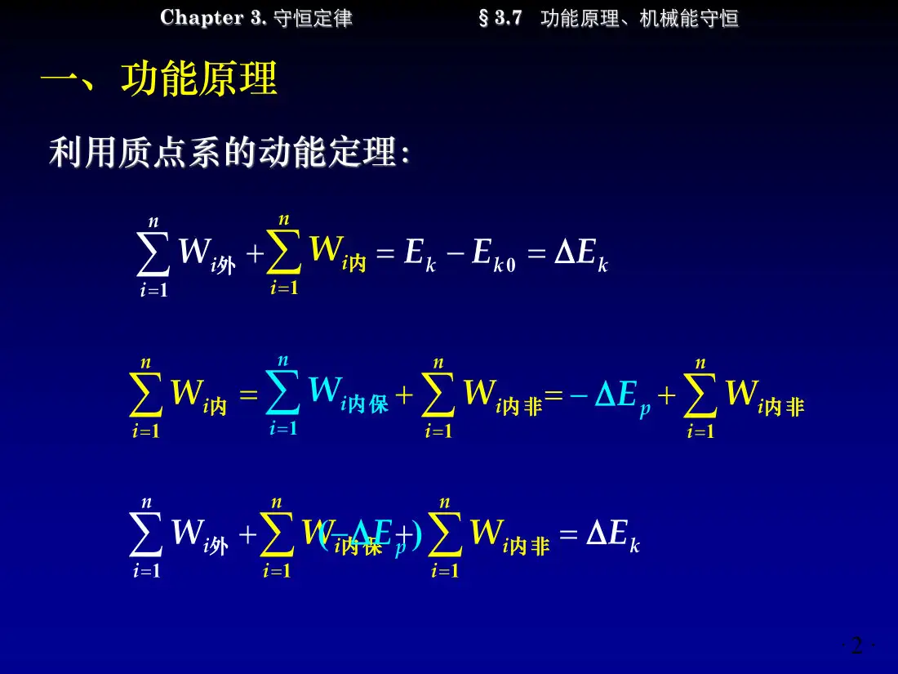
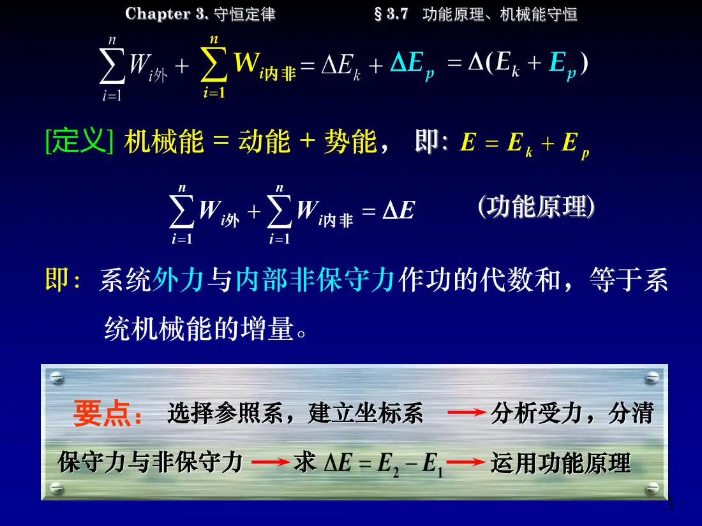
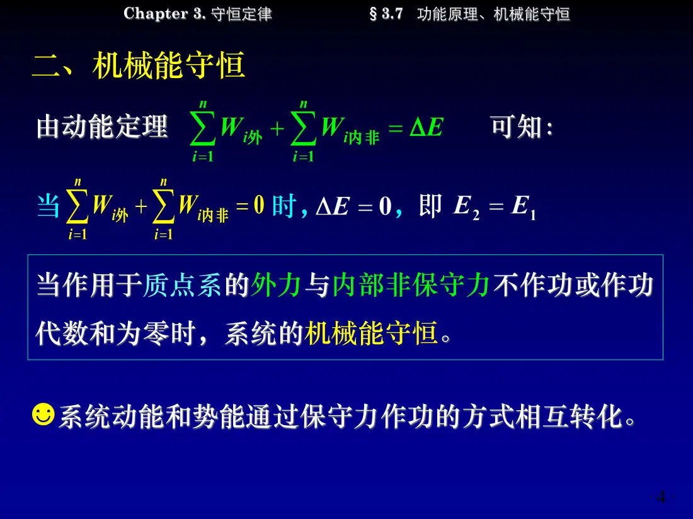
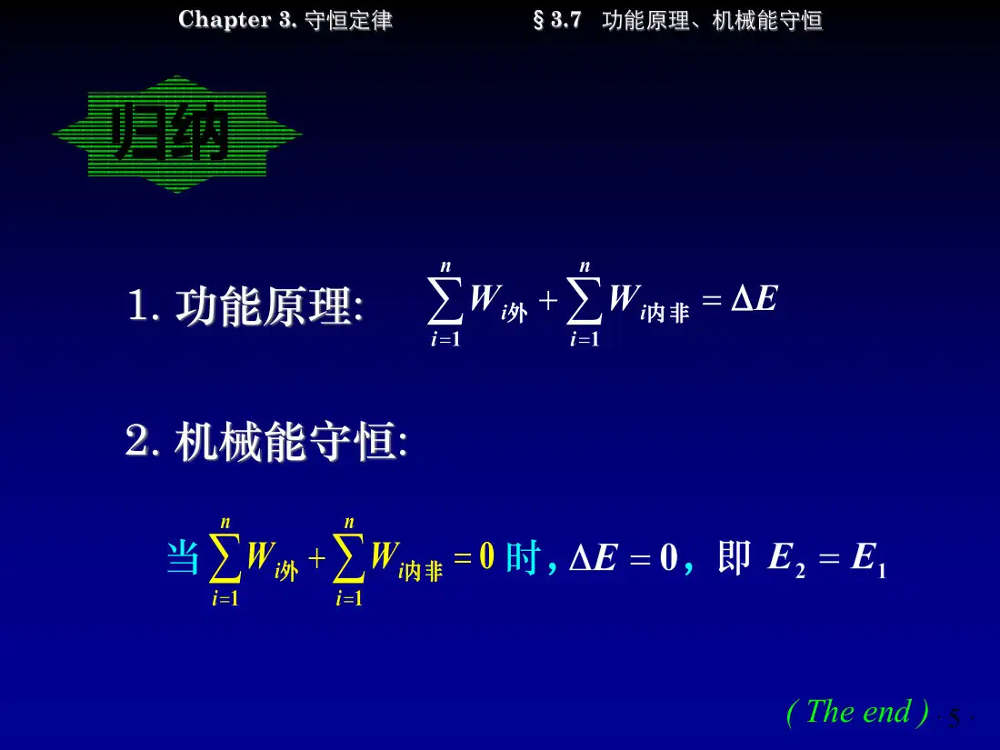

# 《大学物理》第3章 §3.6-3.7 功能原理及机械能守恒（课件）

原件的每一页，下面附识别出的文字。

### §3.7 功能原理 机械能守恒

原文：

§3.7 功能原理 机械能守恒

Chapter 3. 守恒定律

§3.7 功能原理、机械能守恒

### 一、功能原理

原文：

一、功能原理

利用质点系的动能定理：

$$
\sum_ {i = 1} ^ {n} W _ {i \text {外}} + \sum_ {i = 1} ^ {n} W _ {i \text {内}} = E _ {k} - E _ {k 0} = \Delta E _ {k}
$$

$$
\sum_ {i = 1} ^ {n} W _ {i \text {内}} = \sum_ {i = 1} ^ {n} W _ {i \text {内保}} + \sum_ {i = 1} ^ {n} W _ {i \text {内非}} = - \Delta E _ {p} + \sum_ {i = 1} ^ {n} W _ {i \text {内非}}
$$

$$
\sum_ {i = 1} ^ {n} W _ {i \text {外}} + \sum_ {i = 1} ^ {n} W _ {\overline {{i}} \text {内保} p} + \sum_ {i = 1} ^ {n} W _ {i \text {内非}} = \Delta E _ {k}
$$

Chapter 3. 守恒定律

§3.7 功能原理、机械能守恒

· 2

### Chapter 3. 守恒定律

原文：

Chapter 3. 守恒定律

§3.7 功能原理、机械能守恒

$$
\sum_ {i = 1} ^ {n} W _ {i \text {外}} + \sum_ {i = 1} ^ {n} W _ {i \text {内非}} = \Delta E _ {k} + \Delta E _ {p} = \Delta (E _ {k} + E _ {p})
$$

[定义] 机械能 = 动能 + 势能， 即: $1 0 \div 1 0 = 1 0$

$$
\sum_ {i = 1} ^ {n} W _ {i \text {外}} + \sum_ {i = 1} ^ {n} W _ {i \text {内非}} = \Delta E
$$

(功能原理)

即：系统外力与内部非保守力作功的代数和，等于系统机械能的增量。

要点： 选择参照系，建立坐标系 分析受力，分清保守力与非保守力 求 $\Delta E = E _ { 2 } - E _ { 1 }$ 运用功能原理

### Chapter 3. 守恒定律

原文：

Chapter 3. 守恒定律

§3.7 功能原理、机械能守恒

二、机械能守恒

由动能定理 $2 4 0 \div 2 = 2 4 \cdots 2$ 可知：

当 $2 4 0 \times 2 = 1 1 0 0 ( c m )$ 时， $\Delta \nabla \bar { z } \in \mathbb { I }$ 即 $| \overrightarrow { a } - \overrightarrow { b } | = | \overrightarrow { b } |$

当作用于质点系的外力与内部非保守力不作功或作功代数和为零时，系统的机械能守恒。

☻系统动能和势能通过保守力作功的方式相互转化。

· 4

### 2. 机械能守恒:

原文：

1. 功能原理: $\frac { 1 } { 1 0 } \angle C D B - \frac { 1 } { 1 0 } \angle C A E = 9 0 ^ { \circ }$

2. 机械能守恒:

$= 2 \times ( - 2 ) \times 2 \times 2 \times 2 = 0$ 时， $\Delta \nabla \beta \in \mathbb { I }$ 即 $| \mathcal { P } _ { \mathcal { P } } | = | \mathcal { P } _ { \mathcal { P } } |$

( The end )

Chapter 3. 守恒定律

§3.7 功能原理、机械能守恒

· 5
