# 《大学物理》第3章 保守力与非保守力及势能（课件）

原件的每一页，下面附识别出的文字。

### 保守力势能保守力作功的特点

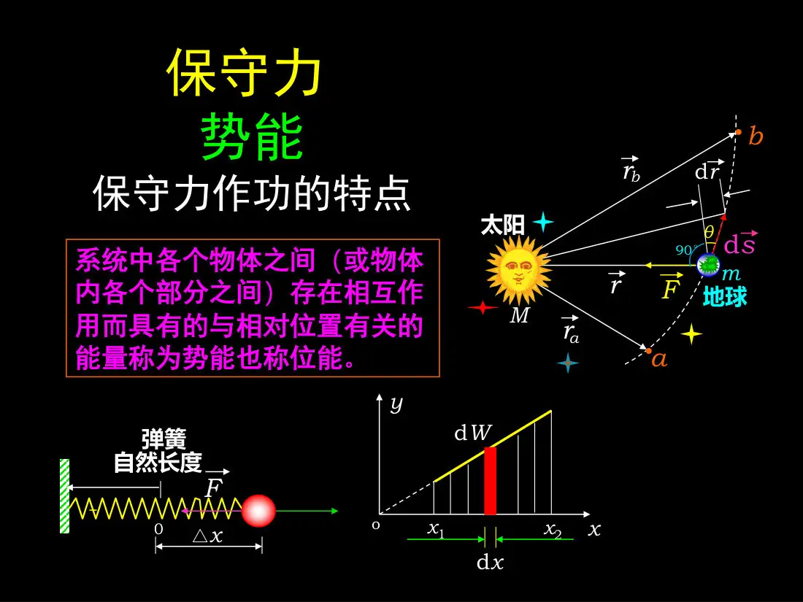

原文：

保守力势能保守力作功的特点

系统中各个物体之间（或物体内各个部分之间）存在相互作用而具有的与相对位置有关的能量称为势能也称位能。

### §3-5 保守力与非保守力 势能

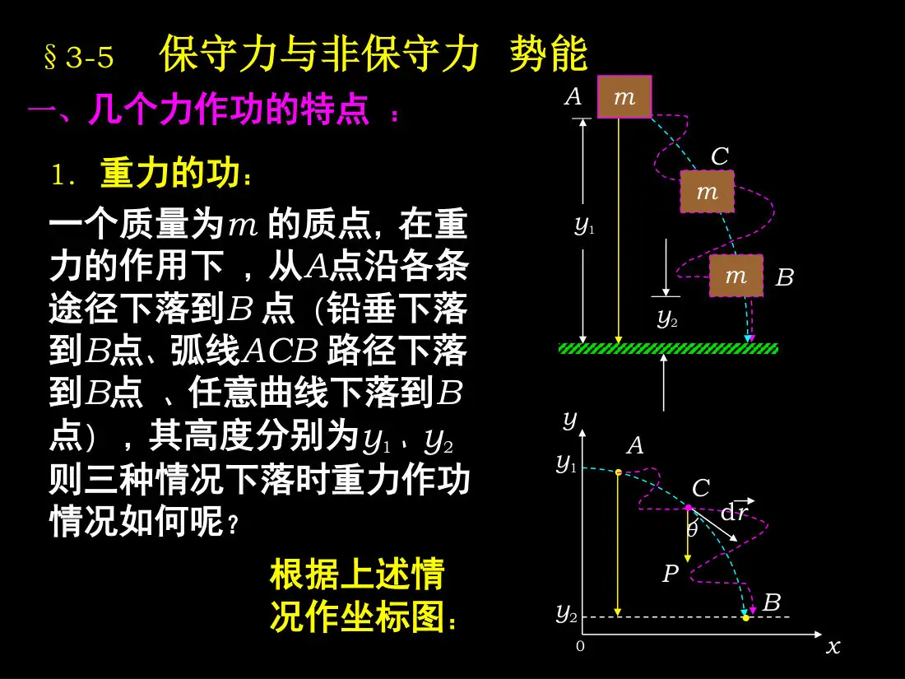

原文：

§3-5 保守力与非保守力 势能

一、几个力作功的特点

1. 重力的功：

一个质量为m 的质点，在重力的作用下 ，从A点沿各条途径下落到B 点（铅垂下落到B点、弧线ACB 路径下落到B点 、任意曲线下落到B点） ，其高度分别为y1 、 y2则三种情况下落时重力作功情况如何呢？

根据上述情

况作坐标图：

x

### 由：

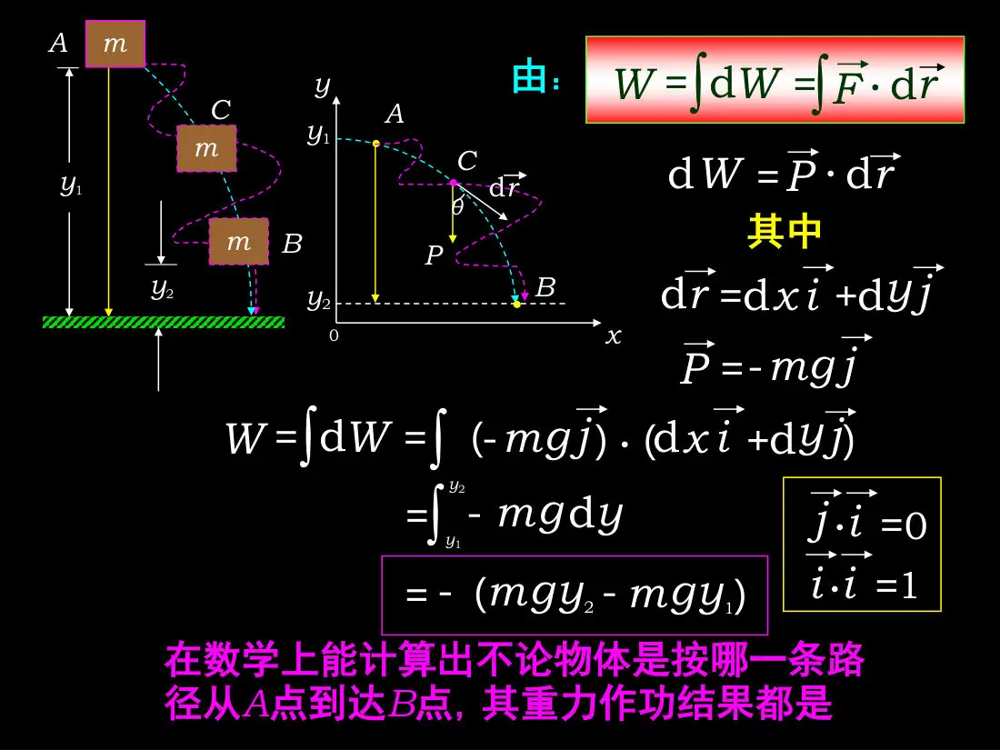

原文：

由：

$$
W = \int \mathrm{d} W = \int \vec {F} \cdot \mathrm{d} \vec {r}
$$

$$
\mathrm{d} W = \overrightarrow {P} \cdot \mathrm{d} \overrightarrow {r}
$$

其中

$$
\begin{array}{c} \mathrm{d} \vec {r} = \mathrm{d} x \vec {i} + \mathrm{d} y \vec {j} \\ \vec {P} = - m g \vec {j} \end{array}
$$

$$
\begin{array}{l} \overrightarrow {j} \cdot \overrightarrow {i} = 0 \\ \overrightarrow {i} \cdot \overrightarrow {i} = 1 \end{array}
$$

在数学上能计算出不论物体是按哪一条路径从A点到达B点，其重力作功结果都是在数学上能计算出不论物体是按哪一条路径从A点到达B点，其重力作功结果都是

### 若物体从A点出发经任意路径又回到A点则有：

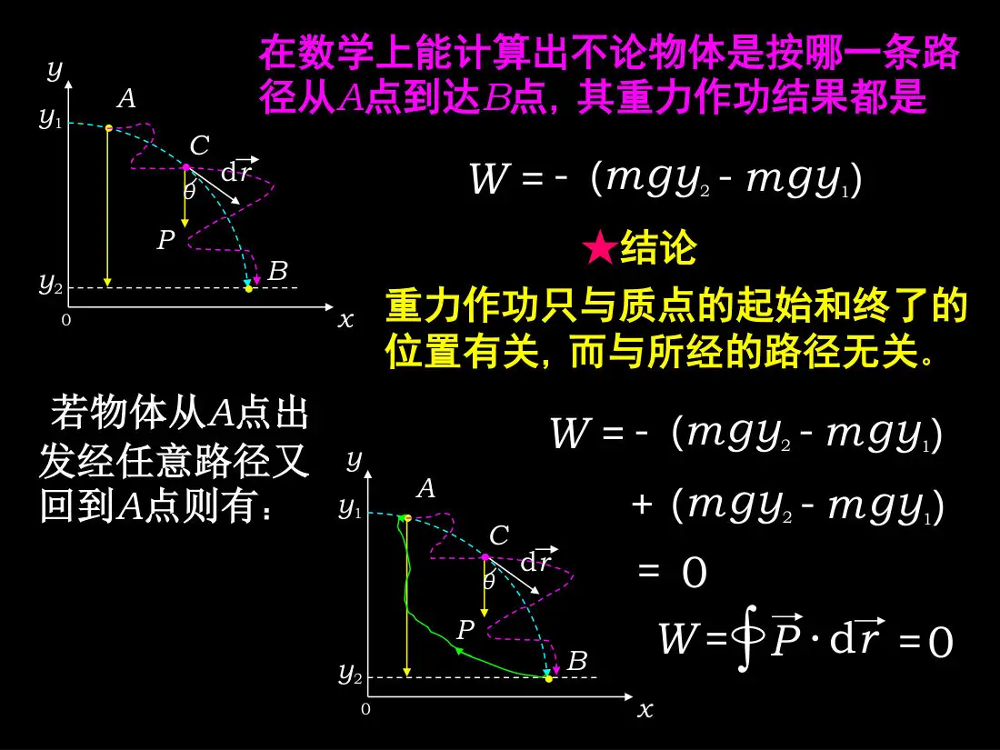

原文：

若物体从A点出发经任意路径又回到A点则有：

$$
W = - (m g y _ {2} - m g y _ {1})
$$

★结论

重力作功只与质点的起始和终了的位置有关，而与所经的路径无关。

$$
\begin{array}{r l} & W = - (m g y _ {2} - m g y _ {1}) \\ & + (m g y _ {2} - m g y _ {1}) \\ & = 0 \\ & W = \oint \vec {P} \cdot d \vec {r} = 0 \\ & y _ {1} \\ & y _ {2} \\ & y _ {3} \\ & y _ {4} \\ & y _ {5} \\ & y _ {6} \\ & y _ {7} \\ & y _ {8} \\ & y _ {9} \\ & y _ {1 0} \end{array}
$$

### 2. 万有引力的功：由万有引力公式

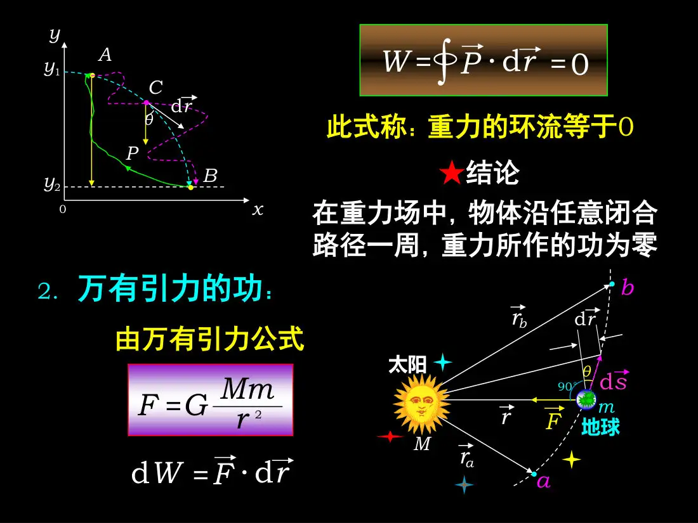

原文：

2. 万有引力的功：由万有引力公式

$$
F = G \frac {M m}{r ^ {2}}
$$

$$
\mathrm{d} W = \overrightarrow {F} \cdot \mathrm{d} \overrightarrow {r}
$$

在重力场中，物体沿任意闭合路径一周，重力所作的功为零

$$
W = \oint \vec {P} \cdot \mathrm{d} \vec {r} = 0
$$

此式称：重力的环流等于0

★结论

### 由万有引力公式 dW =F . ds

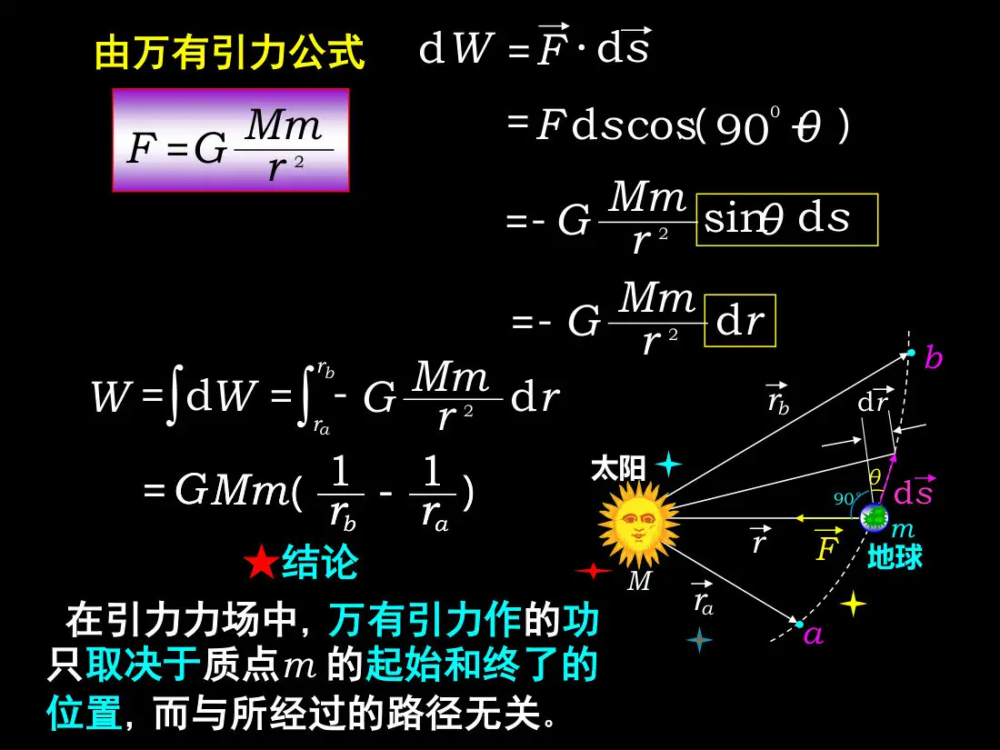

原文：

由万有引力公式 dW =F . ds

$$
F = G \frac {M m}{r ^ {2}}
$$

=F dscos( 90 + )0 θ

sinθ ds

$$
\begin{array}{r l} W & = \int \mathrm{d} W = \int_ {r _ {a}} ^ {r _ {b}} - G \frac {M m}{r ^ {2}} \mathrm{d} r \\ & = G M m (\frac {1}{r _ {b}} - \frac {1}{r _ {a}}) \\ & \text {结论} \end{array}
$$

在引力力场中，万有引力作的功只取决于质点m 的起始和终了的位置，而与所经过的路径无关。

### 3. 弹性力的功:

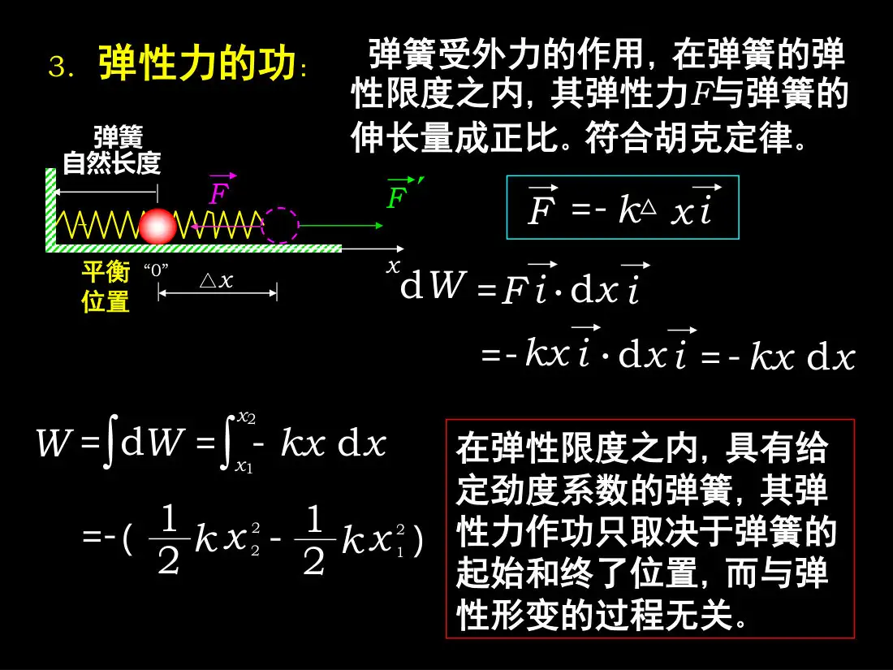

原文：

3. 弹性力的功:

弹簧自然长度

平衡 “0”位置 △x

W=∫dW=∫x- kx dx =- ( k 2x 2 )2x 1k 2 2

弹簧受外力的作用，在弹簧的弹性限度之内，其弹性力F与弹簧的伸长量成正比。符合胡克定律。

$$
\overrightarrow {F} = - k \triangle x \overrightarrow {i}
$$

xdW =Fi·dx i =－kx i ·dx i =－kx dx

在弹性限度之内，具有给定劲度系数的弹簧，其弹性力作功只取决于弹簧的起始和终了位置，而与弹性形变的过程无关。

### 用示功图来表示弹性力作功：

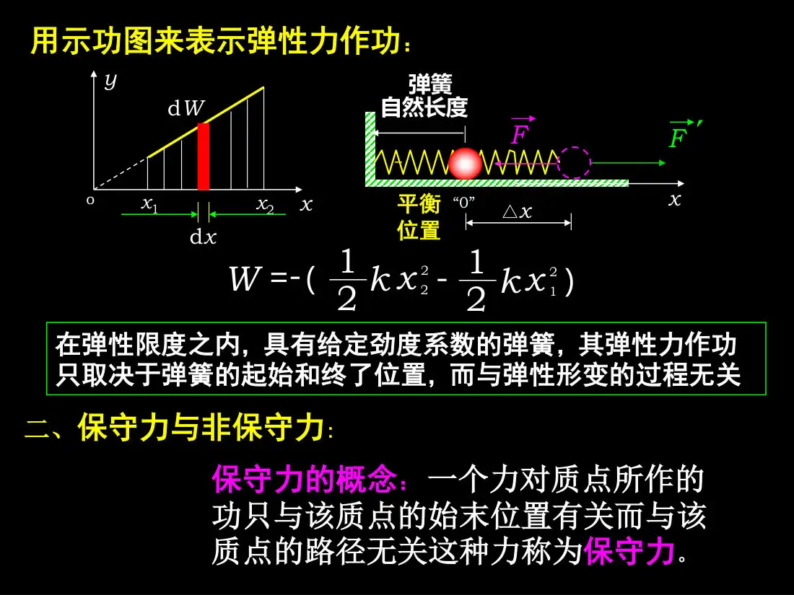

原文：

用示功图来表示弹性力作功：

弹簧自然长度

平衡 位置 “0” △x

$$
W = - (\frac {1}{2} k x _ {2} ^ {2} - \frac {1}{2} k x _ {1} ^ {2})
$$

在弹性限度之内，具有给定劲度系数的弹簧，其弹性力作功只取决于弹簧的起始和终了位置，而与弹性形变的过程无关

二、保守力与非保守力:

保守力的概念：一个力对质点所作的功只与该质点的始末位置有关而与该质点的路径无关这种力称为保守力。

### 非保守力的概念：某力对质点作功时，其量值的大小与质点的始末位置、所经的路径都有关

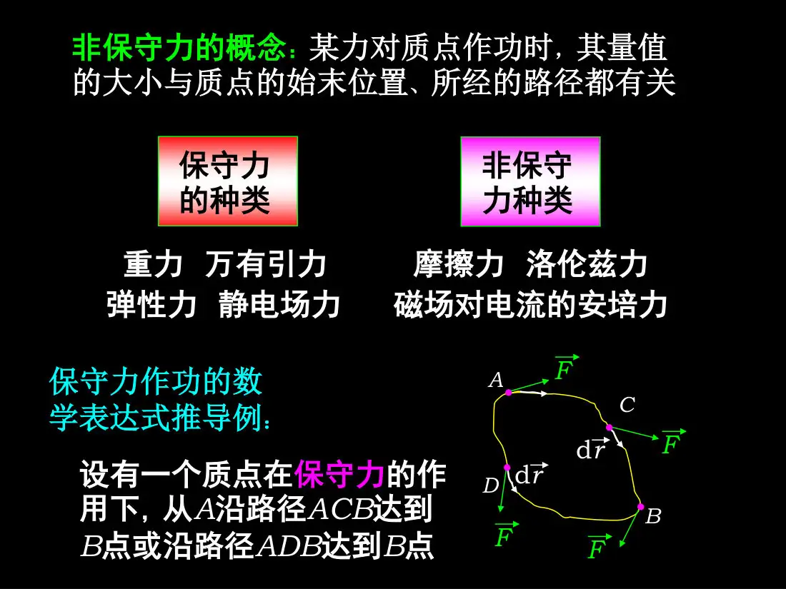

原文：

非保守力的概念：某力对质点作功时，其量值的大小与质点的始末位置、所经的路径都有关

保守力的种类

重力 万有引力弹性力 静电场力

保守力作功的数学表达式推导例：

设有一个质点在保守力的作用下，从A沿路径ACB达到B点或沿路径ADB达到B点

非保守

力种类

摩擦力 洛伦兹力磁场对电流的安培力设有一个质点在保守力的作用下，从A沿路径ACB达到B点或沿路径ADB达到B点

### ∵保守力作功的只与该质点的始末 位置有关而与该质点的路径无关。

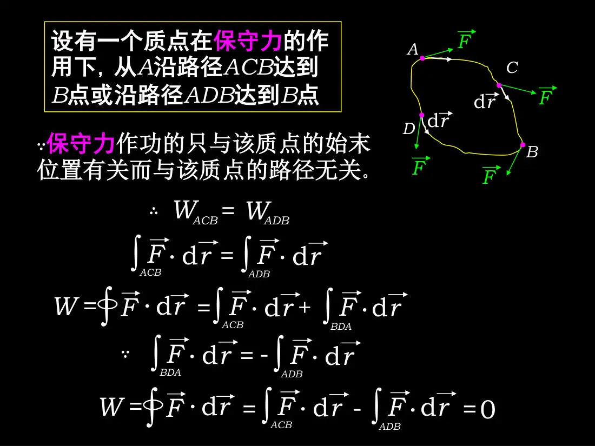

原文：

∵保守力作功的只与该质点的始末 位置有关而与该质点的路径无关。

$\textcircled { 1 } N a _ { 2 } S O _ { 4 } = N a _ { 2 } O _ { 4 } = 2 N a O H _ { 2 }$ $\textcircled { 1 } \frac { 1 } { 2 } \times \frac { 1 } { 3 } = \textcircled { 1 } \frac { 1 } { 2 } \times \frac { 1 } { 3 }$ W=∮F·dr=∫F·dr+∫F·dr ACB BDA $( 1 ) 2 ( 2 ) 2 = ( 1 0 0 - 2 ) ( 1 0 0 - 2 ) ( 1 0 0 )$ W=∮F·dr=∫F·dr-∫F.dr =0

### $$

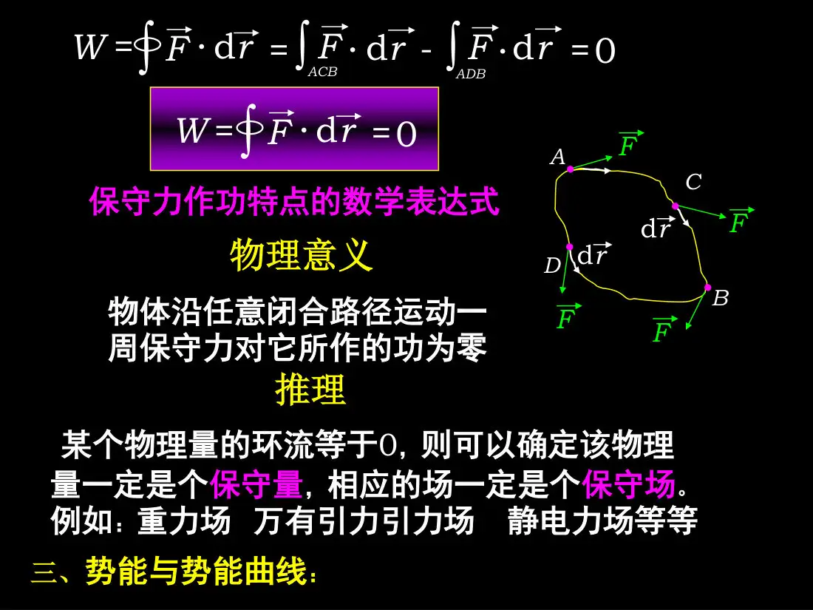

原文：

$$
W = \oint \overrightarrow {F} \cdot \mathrm{d} \overrightarrow {r} = \int_ {A C B} \overrightarrow {F} \cdot \mathrm{d} \overrightarrow {r} - \int_ {A D B} \overrightarrow {F} \cdot \mathrm{d} \overrightarrow {r} = 0
$$

$$
W = \oint \vec {F} \cdot \mathrm{d} \vec {r} = 0
$$

保守力作功特点的数学表达式

物理意义

物体沿任意闭合路径运动一周保守力对它所作的功为零

推理

某个物理量的环流等于0，则可以确定该物理量一定是个保守量，相应的场一定是个保守场。例如：重力场 万有引力引力场 静电力场等等

三、势能与势能曲线：

### 三、势能与势能曲线：

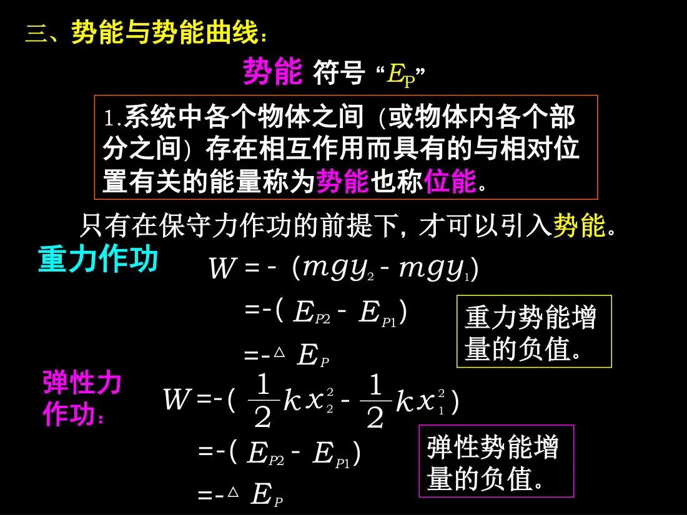

原文：

三、势能与势能曲线：

符号“EP势能 ”

1.系统中各个物体之间（或物体内各个部分之间）存在相互作用而具有的与相对位置有关的能量称为势能也称位能。

只有在保守力作功的前提下，才可以引入势能。

重力作功

$$
\begin{array}{r l} W = - (m g y _ {2} - m g y _ {1}) \\ = - (E _ {P 2} - E _ {P 1}) \\ = - \triangle E _ {P} \end{array}
$$

重力势能增量的负值。

弹性力作功：

$$
\begin{array}{r l} {W = - (\frac {1}{2} k x _ {2} ^ {2} - \frac {1}{2} k x _ {1} ^ {2})} \\ & {= - (E _ {P 2} - E _ {P 1})} \\ & {= - \triangle E _ {P}} \end{array}
$$

弹性势能增量的负值。

### 万有引力作功

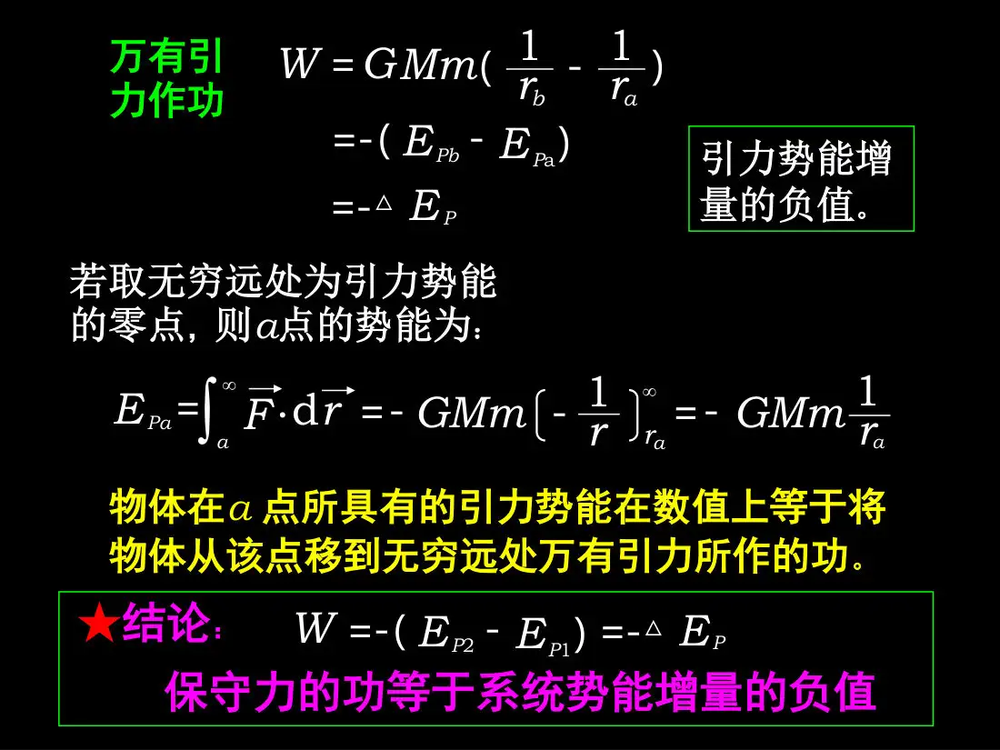

原文：

万有引力作功

$$
\begin{array}{r l} & W = G M m (\frac {1}{r _ {b}} - \frac {1}{r _ {a}}) \\ & = - (E _ {P b} - E _ {P a}) \\ & = - ^ {\triangle} E _ {P} \end{array}
$$

引力势能增量的负值。

若取无穷远处为引力势能的零点，则a点的势能为：

$$
E _ {P a} = \int_ {a} ^ {\infty} \overrightarrow {F} \cdot \mathrm{d} \overrightarrow {r} = - G M m \left(- \frac {1}{r}\right) _ {r _ {a}} ^ {\infty} = - G M m \frac {1}{r _ {a}}
$$

物体在a 点所具有的引力势能在数值上等于将物体从该点移到无穷远处万有引力所作的功。

★结论： $( 1 ) A ^ { \prime } ( 1 - \cos \angle 2 ) = \cos \angle D ^ { \prime } ( 1 - \cos \angle 2 ) = \cos \angle D ^ { \prime } ( 1 - \cos \angle 2 )$

保守力的功等于系统势能增量的负值

### 加深对势能的物理涵意的理解

原文：

加深对势能的物理涵意的理解

特别强调

1. 势能是系统内各物体位置坐标的单值函数，势能是状态的函数

2. 势能具有相对性和系统性其值与零势能位置的选取有关。

3. 引入势能的一个重要目的是为了简化保守力作功的计算。

对于非保守力来说无法引入势能的概念。

零势能的选取

一旦选定后在计算中就不能随便变动。

重力零势能： 一般选择地面或特定的参考点。弹性零势能： 选取在弹簧处于自然状态时。万有引力零势能：可设两个物体相距无限远处。

### 势能曲线

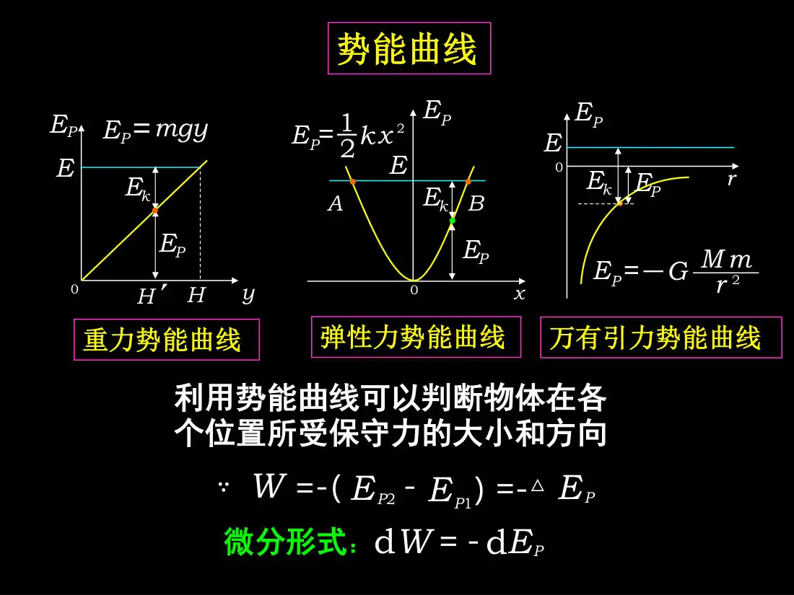

原文：

势能曲线

重力势能曲线

弹性力势能曲线

万有引力势能曲线

利用势能曲线可以判断物体在各个位置所受保守力的大小和方向$( 1 ) A ^ { \prime } ( 2 - \infty ) = ( 1 0 0 - \infty ) \times ( 1 0 - \infty ) = ( 1 0 0 ) \times ( 1 0 - \infty )$ 微分形式： $\langle \bullet | | \gamma \rangle _ { l } = \langle \bullet | | D _ { l } |$

### 利用势能曲线可以判断物体在各个位置所受保守力的大小和方向

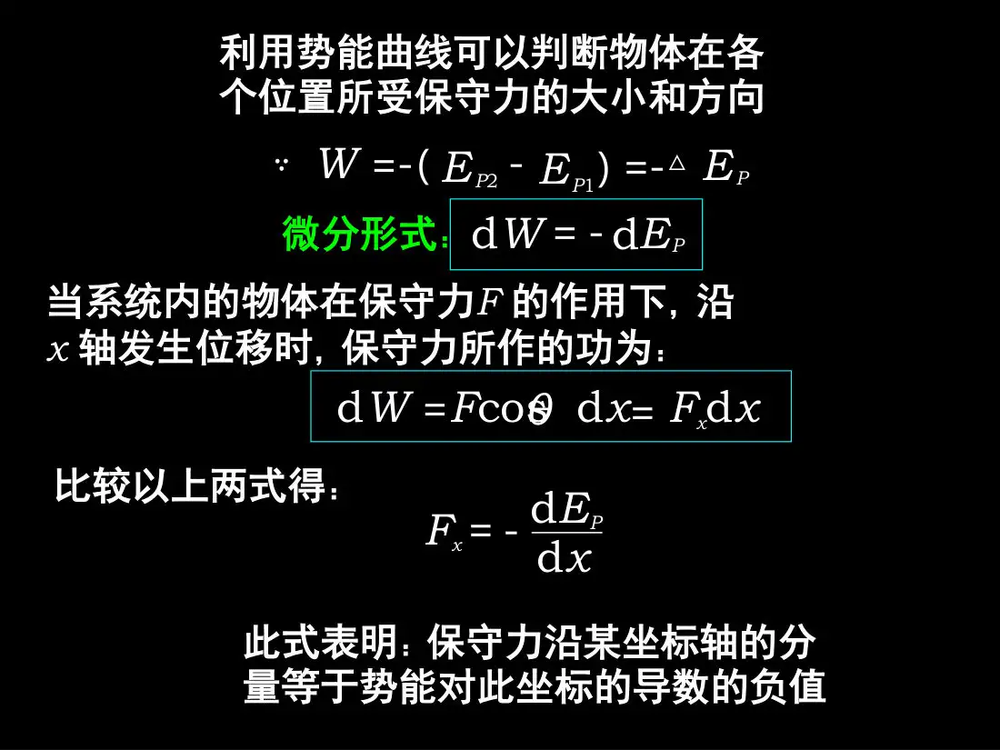

原文：

利用势能曲线可以判断物体在各个位置所受保守力的大小和方向

$$
W = - (E _ {P 2} - E _ {P 1}) = - ^ {\triangle} E _ {P}
$$

微分形式： $\mathbf { \hat { \eta } } ^ { ( 0 ) } \mathbf { \hat { \eta } } ^ { ( 1 ) } \mathbf { \hat { \eta } } ^ { ( 2 ) } = \mathbf { \hat { \eta } } ^ { ( 0 ) } \mathbf { \tilde { \eta } } ^ { ( 2 ) }$

当系统内的物体在保守力F 的作用下，沿x 轴发生位移时，保守力所作的功为：

dW =Fcos θ $\cos \theta = 1 0 \sqrt { 3 } \sqrt { 3 }$

比较以上两式得：

$$
F _ {x} = - \frac {\mathrm{d} E _ {P}}{\mathrm{d} x}
$$

此式表明：保守力沿某坐标轴的分量等于势能对此坐标的导数的负值例题： 一质量为m 的质点作平面运动，其位矢为 $\textcircled { 2 } \textcircled { 1 } \textcircled { 2 } \textcircled { 1 } \textcircled { 2 } \textcircled { 2 } \textcircled { 2 } \textcircled { 2 } \textcircled { 2 } \textcircled { 2 } \textcircled { 2 } \textcircled { 2 } \textcircled { 2 } \textcircled { 2 } \textcircled { 2 } \textcircled { 2 } \textcircled { 2 } \textcircled { 2 } \textcircled { 2 } \textcircled { 2 }$ 式中 a、 b 为正值常量，且 $\textcircled { \bullet }$ 问：

### （1）此质点作的是什么运动？求轨迹方程。

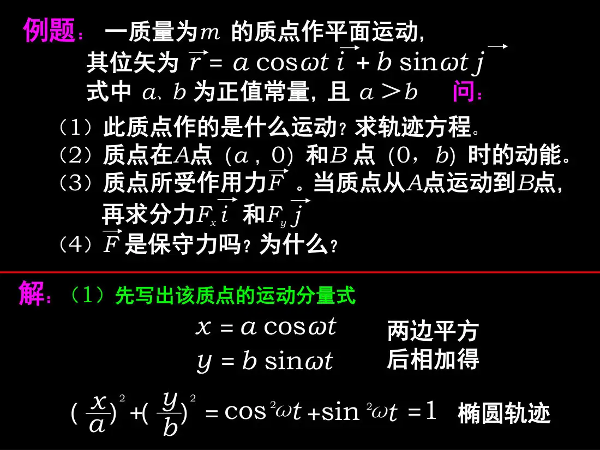

原文：

（1）此质点作的是什么运动？求轨迹方程。

（2）质点在A点（a ，0）和B 点（0，b）时的动能。

（3）质点所受作用力F 。当质点从A点运动到B点，再求分力 $1 0 \times 9 = 1 0$ 和Fy j

（4）F 是保守力吗？为什么？

解：（1）先写出该质点的运动分量式

x =a cosωt

y =b sinωt 两边平方 后相加得

$( 1 0 0 0 0 0 0 0 0 0 0 0 0 0 0 0 0 0 0 0 0 0 0 0 0 0 0 0 0 0 0 0 0 0 0 0 0 0 0 0 0 0 0 0 0 0 0 0 0 0 0 0 0 0 0 0 0 0 0 0 0 0 0 0 0 0 0 0 0 0 0 0 0 0 0 0 0 0 0 0 0 0 0 0 0 0 0 0 0 0 0 0 0 0 0 0 0 0 0 0 0 0 0 0 0 0 0 0 0 0 0 0 0 0 0 0 0 0 0 0 0 0 0 0 0 0 0 0 0 0 0 0 0 0 0 0 0 0 0 0 0 0 0 0 0 0 0 0 0 0 0 0 0 0 0 0 0 0 0 0 0 0 0 0 0 0 0 0 0 0 0 0 0 0 0 0 0 0 0 0 0 0 0 0 0 0 0 0 0 0 0 0 0 0 0 0 0 0 0 0 0 0 0 0 0 0 0 0 0 0 0 0 0 0 0 0 0 0 0 0 0 0 0 0 0 0 0 0 0 0 0 0 0 0 0 0 0 0 0 0 0 0 0 0 0 0 0 0 0 0 0 0 0 0 0 0 0 0 0 0 0 0 0 0 0 0 0 0 0 0 0 0 0 0 0 0 0 0 0 0 0 0 0 0 0 0 0 0 0 0 0 0 0 0 0 0 0 0 0 0 0 0 0 0 0 0 0 0 0 0 0 0 0 0 0 0 0 0 0 0 0 0 0 0 0 0 0 0 0 0 0 0 0 0 0 0 0 0 0 0 0 0 0 0 0 0 0 0 0 0 0 0 0 0 0 0 0 0 0 0 0 0 0 0 0 0 0 0 0 0 0 0 0 0 0 0 0 0 0 0 0 0 0 0 0 0 0 0 0 0 0 0 0 0 0 0 0 0 0 0 0 0 0 0 0 0 0 0 0 0 0 0 0 0 0 0 0 0 0 0 0 0 0 0 0 0 0 0 0 0 0 0 0 0 0 0 0 0 0 0 0 0 0 0 0 0 0 0 0 0 0 0 0 0 0 0 0 0 0 0 0 0 0 0 0 0 0 0 0 0 0 0 0 0 0 0 0 0 0 0 0 0 0 0 0 0 0 0 0 0 0 0 0 0 0 0 0 0 0 0 0 0 0 0 0 0 0 0 0 0 0 0 0 0 0 0 0 0 0 0 0 0 0 0 0 0 0 0 0 0 0 0 0 0 0 0 0 0 0 0 0 0 0 0 0 0 0 0 0 0 0 0 0 0 0 0 0 0 0 0 0 0 0 0 0 0 0 0 0 0 0 0 0 0 0$ 椭圆轨迹

### $$

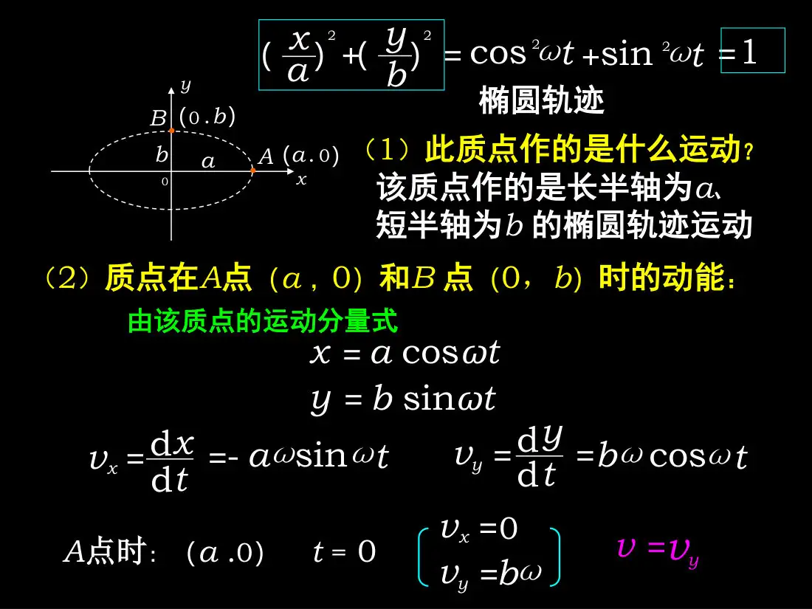

原文：

$$
\left(\frac {x}{a}\right) ^ {2} + \left(\frac {y}{b}\right) ^ {2} = \cos^ {2} \omega t + \sin^ {2} \omega t = 1
$$

椭圆轨迹

（1）此质点作的是什么运动？该质点作的是长半轴为a、短半轴为b 的椭圆轨迹运动

（2）质点在A点（a ，0）和B 点（0，b）时的动能：

由该质点的运动分量式

x =a cosωt

y =b sinωt

v = dx =- aωsinωt x dt

$$
\nu_ {y} = \frac {\mathrm{d} y}{\mathrm{d} t} = b \omega \cos \omega t
$$

A点时: （a .0）

$$
t = 0
$$

$$
\left( \begin{array}{l} \nu_ {x} = 0 \\ \nu_ {y} = b \omega \end{array} \right)
$$

$$
\nu = \nu_ {y}
$$

### （2）质点在A点（a ，0）和B 点（0，b）时的动能：

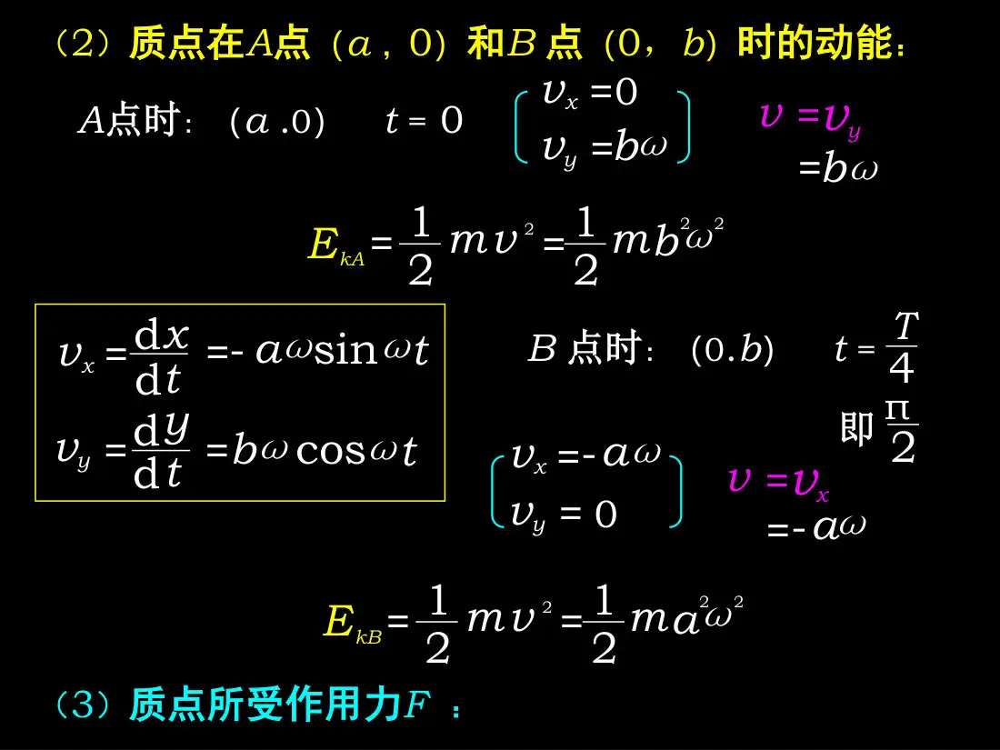

原文：

（2）质点在A点（a ，0）和B 点（0，b）时的动能：

A点时: （a .0） t = 0

$$
\left( \begin{array}{l} \nu_ {x} = 0 \\ \nu_ {y} = b \omega \end{array} \right)
$$

$$
\begin{array}{c} \nu = \nu_ {y} \\ = b \omega \end{array}
$$

$$
E _ {k A} = \frac {1}{2} m v ^ {2} = \frac {1}{2} m b ^ {2} \omega^ {2}
$$

$$
\nu_ {x} = \frac {\mathrm{d} x}{\mathrm{d} t} = - a \omega \sin \omega t
$$

B 点时: （0.b）

$$
\nu_ {y} = \frac {\mathrm{d} y}{\mathrm{d} t} = b \omega \cos \omega t
$$

$$
\left( \begin{array}{l} \nu_ {x} = - a \omega \\ \nu_ {y} = 0 \end{array} \right) \quad \begin{array}{c} \nu = \nu_ {x} \\ = - a \omega \end{array}
$$

$$
E _ {k B} = \frac {1}{2} m v ^ {2} = \frac {1}{2} m a ^ {2} \omega^ {2}
$$

（3）质点所受作用力F ：

### （3）质点所受作用力F ：

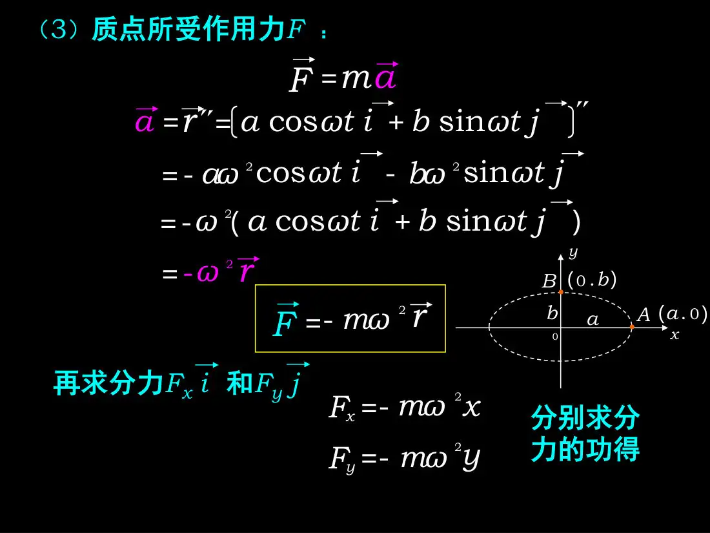

原文：

（3）质点所受作用力F ：

$$
\vec {F} = m \vec {a}
$$

$$
\begin{array}{r l} & {\vec {a} = \vec {r} ^ {\prime \prime} = \left(a \cos \omega t \vec {i} + b \sin \omega t \vec {j} \right] ^ {\prime \prime}} \\ & {\quad = - a \omega^ {2} \cos \omega t \vec {i} - b \omega^ {2} \sin \omega t \vec {j}} \\ & {\quad = - \omega^ {2} (a \cos \omega t \vec {i} + b \sin \omega t \vec {j})} \end{array}
$$

$$
= - \omega^ {2} \vec {r}
$$

$$
\vec {F} = - m \omega^ {2} \vec {r}
$$

再求分力 $\textcircled { 1 } 2 \textcircled { 2 } 2 \textcircled { 2 } 2 \textcircled { 2 } 2 \textcircled { 2 } 2 \textcircled { 2 } 2 \textcircled { 2 } 2 \textcircled { 2 } 2 \textcircled { 2 } 2 \textcircled { 2 } 2 \textcircled { 2 } 2 \textcircled { 2 } 2 \textcircled { 2 } 2 \textcircled { 2 } 2 \textcircled { 2 } 2 \textcircled { 2 } 2 \textcircled { 2 } 2 \textcircled { 2 } 2 \textcircled { 2 } 2 \textcircled { 2 } 2 \textcircled { 2 } 2 \textcircled { 2 } 2 \textcircled { 2 } 2 \textcircled { 2 } 2 \textcircled { 2 } 2 \textcircled { 2 } 2 \textcircled { 2 } 2 \textcircled { 2 } 2 \textcircled { 2 } 2 \textcircled { 2 } 2 \textcircled { 2 } 2 \textcircled { 2 } 2 \textcircled { 2 } 2 $ 和Fy j

$$
F _ {x} = - m \omega^ {2} x
$$

$$
F _ {y} = - m \omega^ {2} y
$$

分别求分力的功得（4）F 是保守力吗？为什么？

### $$

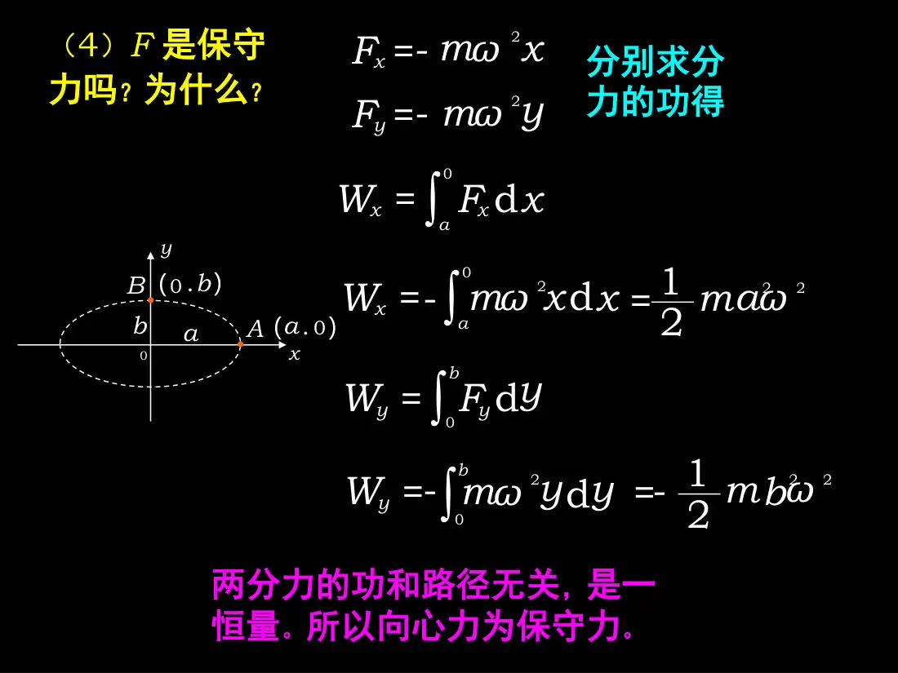

原文：

$$
F _ {x} = - \textit {m} \omega^ {2} x
$$

$$
F _ {y} = - \textit {m} \omega^ {2} y
$$

分别求分力的功得

$$
W _ {x} = \int_ {a} ^ {0} F _ {x} \mathrm{d} x
$$

$$
\begin{array}{c c} \text { y } & \\ B (0, b) & \\ b & a \\ 0 & \end{array} A (a. 0)
$$

$$
W _ {x} = - \int_ {a} ^ {0} m \omega^ {2} x \mathrm{d} x = \frac {1}{2} m a ^ {2} \omega^ {2}
$$

$$
W _ {y} = \int_ {0} ^ {b} F _ {y} \mathrm{d} \mathcal {Y}
$$

$$
W _ {y} = - \int_ {0} ^ {b} m \omega^ {2} y \mathrm{d} y = - \frac {1}{2} m b \omega^ {2}
$$

两分力的功和路径无关，是一恒量。所以向心力为保守力。

### 第 22 页

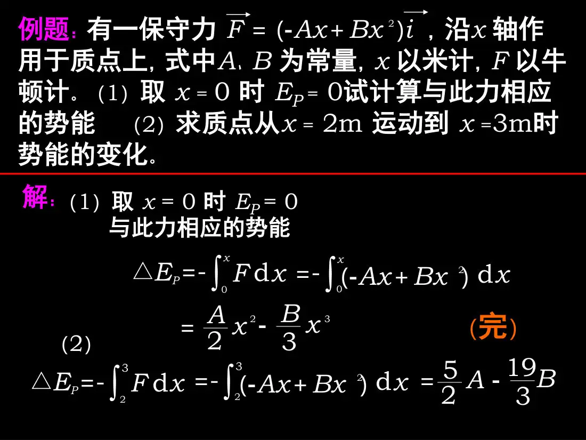

原文：

例题：有一保守力 $1 2 = 1 0 \times ( - \frac { 1 } { 2 } ) \times ( - \frac { 1 } { 2 } ) \times ( - \frac { 1 } { 2 } )$ ，沿x 轴作用于质点上，式中A、 B 为常量，x 以米计，F 以牛顿计。（1）取 x = 0 时 $\lvert \overline { { p } } \rvert = \lvert \overline { { 0 } } \rvert$ 试计算与此力相应的势能 （2）求质点从 $\therefore \angle B A C = \angle A B D$ 运动到 x =3m时势能的变化。

解：（1）取 $v = 0$ 时 $| \pmb { \bigtriangledown } | _ { \pmb { \bigtriangledown } } = \pmb { \bigtriangledown } ( \pmb { \bigtriangledown } )$ 与此力相应的势能

△EP=-  F dx =-  (-Ax＋Bx ) dx2 （2） 2 A 2x - B 3x 3 （完） △EP=- 3F dx =-  (-Ax＋Bx ) dx2 = 5 A - B19 2 2 3

### 第 23 页

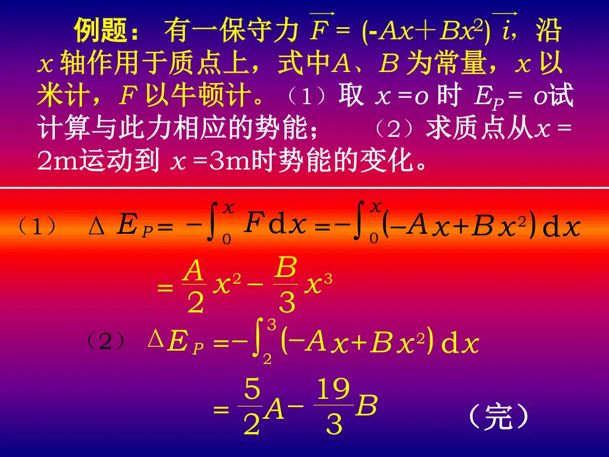

原文：

例题： 有一保守力 $1 2 - ( 1 0 - 2 5 + 1 0 ) = 5 3 ( 2 )$ i，沿x 轴作用于质点上，式中A、 B 为常量，x 以米计，F 以牛顿计。（1）取 x =o 时 $| \frac { \partial } { \partial t } | =$ o试计算与此力相应的势能； （2）求质点从x =2m运动到 $- 6 7 \div 7$ 时势能的变化。

（1） ΔEP= x 0 =F x d ( Ax+B )2 xx x d 0 A B = 2 2 x 一 3 3 x ( A +B ) x 23 x dx （2） E Δ 1P = 5 19 二 A 2 B （完） 3

### 第 24 页

原文：

sin cos tg ctg sec csc ∝ ≈ ≠ ≤ ≥⊕ ∂∞ § AB C DEFGH IJ K LMNOPQRSTUVW a b c d e fg h i jk l m no pq r s t u v w x yz αβ γ δ ζ η λ µ ν ξ π ρ σ τ φ Φ ψ Ψ Ω ω χ a b c d 1 2 3 0 ΔΣ ab c d i j kox yz XYZ∝ ±7 += × = > < ()? 12 3 456789 0.
